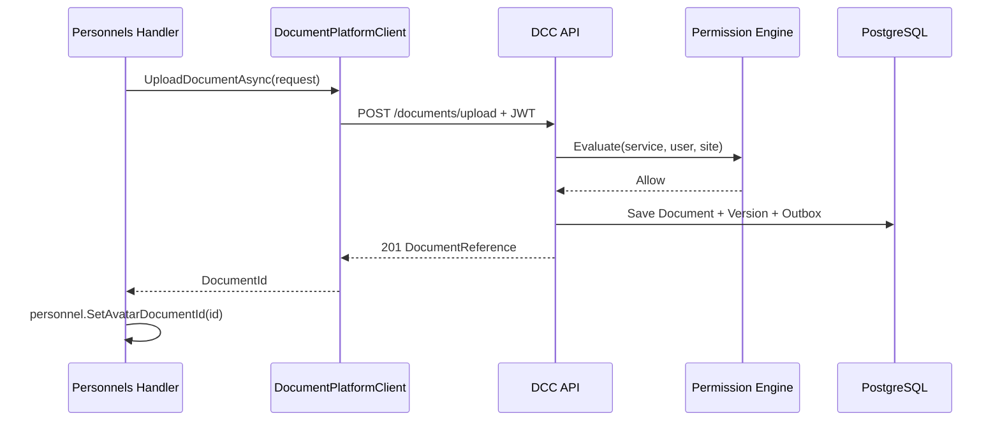

# DCC API Specification

> REST API v2 — normative contract for platform and module integration  
> Base path: `/api/v2/platform`  
> Version header: `Api-Version: 2.0` (URL segment preferred)

---

## 1. Conventions

| Aspect | Standard |
|--------|----------|
| Auth | Bearer JWT (IdentityServer) — all endpoints except signed-url redeem |
| Tenancy | `X-Site-Ids` header optional — intersects with JWT sites |
| Correlation | `X-Correlation-Id` optional — echoed in audit |
| Errors | RFC 7807 Problem Details |
| Result pattern | HTTP status maps from ErrorOr (400/401/403/404/409/422) |
| Pagination | `?page=1&pageSize=50` max 200 |
| Idempotency | `Idempotency-Key` header on POST upload (Phase B) |

---

## 2. Authentication Matrix

| Caller | Upload | Read | Recycle | Purge | Admin |
|--------|--------|------|---------|-------|-------|
| User JWT (module UI) | ✓ scoped | ✓ scoped | ✓ if permitted | ✗ | ✗ |
| Service account (module S2S) | ✓ own OwnerModule | ✓ own OwnerModule | ✓ | ✗ | ✗ |
| Platform admin role | ✓ | ✓ | ✓ | ✓ | ✓ |

---

## 3. Document Endpoints

### 3.1 Upload Document

```
POST /api/v2/platform/documents/upload
Content-Type: multipart/form-data
```

| Field | Type | Required | Description |
|-------|------|----------|-------------|
| File | binary | Yes | Content stream |
| OwnerModule | string | Yes | `Dejban.Personnels` |
| OwnerEntityId | guid | Yes | Business entity PK |
| DocumentTypeKey | string | Yes | `Personnel.Avatar` |
| SiteId | guid | Yes | Tenancy |
| Metadata | json string | No | Validated against profile |
| Tags | string[] | No | Optional tags |

**Response 201:**

```json
{
  "documentId": "3fa85f64-5717-4562-b3fc-2c963f66afa6",
  "versionNumber": 1,
  "status": "Scanning",
  "checksumSha256": "ABC...",
  "contentType": "image/jpeg",
  "sizeBytes": 245678
}
```

**Note:** No `storagePath`, `blobKey`, or URLs with internal keys returned.

---

### 3.2 Create Version

```
POST /api/v2/platform/documents/{documentId}/versions
Content-Type: multipart/form-data
```

Same fields as upload except Owner fields immutable (validated).

**Response 201:** version details + updated `versionNumber`.

---

### 3.3 Get Document Metadata

```
GET /api/v2/platform/documents/{documentId}
```

**Response 200:**

```json
{
  "documentId": "uuid",
  "ownerModule": "Dejban.Personnels",
  "ownerEntityId": "uuid",
  "documentTypeKey": "Personnel.Avatar",
  "siteId": "uuid",
  "status": "Available",
  "currentVersionNumber": 2,
  "contentType": "image/jpeg",
  "sizeBytes": 245678,
  "originalFileName": "photo.jpg",
  "metadata": { },
  "tags": ["profile"],
  "createdAt": "2026-07-20T12:00:00Z",
  "recycledAt": null
}
```

---

### 3.4 Download Content

```
GET /api/v2/platform/documents/{documentId}/content
```

**Response 200:** `Content-Type` stream, `Content-Disposition: attachment`

Optional: `?versionNumber=1` for historical version.

---

### 3.5 Get Thumbnail / Preview

```
GET /api/v2/platform/documents/{documentId}/thumbnail?size=256
GET /api/v2/platform/documents/{documentId}/preview
```

**Response 302** redirect to signed URL **or** 200 stream (configurable).

---

### 3.6 List by Owner

```
GET /api/v2/platform/documents?ownerModule=Dejban.Visitors&ownerEntityId={guid}&documentTypeKey=Visitor.Photo
```

**Response 200:** paginated `DocumentSummary[]`

---

### 3.7 Search

```
GET /api/v2/platform/documents/search?q=report&ownerModule=Dejban.Patrol&siteId={guid}
```

**Response 200:** paginated search hits with highlights (Phase B).

---

### 3.8 Recycle / Restore / Purge

```
DELETE /api/v2/platform/documents/{documentId}           → Recycle (204)
POST   /api/v2/platform/documents/{documentId}/restore   → Restore (204)
DELETE /api/v2/platform/documents/{documentId}/purge     → Purge (204, admin only)
```

---

### 3.9 Permissions

```
POST   /api/v2/platform/documents/{documentId}/permissions
DELETE /api/v2/platform/documents/{documentId}/permissions/{permissionId}
GET    /api/v2/platform/documents/{documentId}/permissions
```

Body grant:

```json
{
  "principalType": "Role",
  "principalId": "SiteAdmin",
  "permissionLevel": "Read"
}
```

---

### 3.10 Signed URL

```
POST /api/v2/platform/documents/{documentId}/signed-url
```

```json
{
  "expiresInSeconds": 3600,
  "permission": "Read"
}
```

**Response:**

```json
{
  "url": "https://gateway/api/v2/platform/signed/{token}",
  "expiresAt": "2026-07-20T13:00:00Z"
}
```

```
GET /api/v2/platform/signed/{token}
```

Anonymous — validates token, streams content, audits access.

---

### 3.11 Bulk Operations (Phase B)

```
POST /api/v2/platform/documents/bulk/upload
POST /api/v2/platform/documents/bulk/recycle
GET  /api/v2/platform/documents/bulk/{jobId}
```

---

## 4. Admin Endpoints

Base: `/api/v2/platform/admin` — requires platform admin role.

| Method | Path | Purpose |
|--------|------|---------|
| POST | /document-types | Register DocumentType |
| PUT | /document-types/{key} | Update profile |
| GET | /document-types | List registered types |
| POST | /retention-policies | Create policy |
| GET | /audit/export | CSV/JSON export |
| GET | /health/detail | Deep health |

---

## 5. Legacy v1 Compatibility

| v1 | v2 mapping | Deprecation |
|----|------------|-------------|
| POST /api/v1.0/Files/UploadFileSecure | POST .../documents/upload | Phase A dual; remove +6mo after A |
| GET .../Downloadfile/{id} | GET .../content | Same |

Gateway routes both during migration.

---

## 6. OpenAPI

- Generated from ASP.NET OpenAPI + XML doc comments
- Scalar at `/dccscalar` via gateway (dev)
- Contract published as `DCC.Contracts` OpenAPI JSON artifact in CI

---

## 7. GraphQL Readiness

Future endpoint: `/graphql` — read-only.

| REST resource | Future GraphQL type |
|-------------|---------------------|
| DocumentMetadata response | `Document` |
| DocumentSummary | `DocumentSummary` |
| Search hit | `DocumentSearchResult` |

Mutations remain REST/SDK for transactional clarity (Phase D+ decision).

---

## 8. Rate Limits (Gateway)

| Route | Limit |
|-------|-------|
| Upload | 30/min per user |
| Download | 120/min per user |
| Search | 60/min per user |

---

## 9. Sequence — Module Upload



---

## Related Documents

- [SDK Specification](./DCC_SDK_SPECIFICATION.md)
- [Module Integration Guide](./DCC_MODULE_INTEGRATION_GUIDE.md)
- [Architecture Bible](./DCC_ARCHITECTURE_BIBLE.md)
