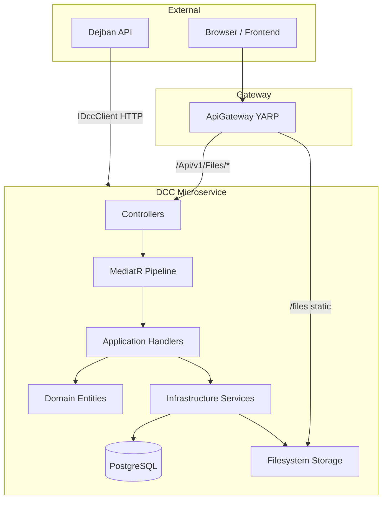
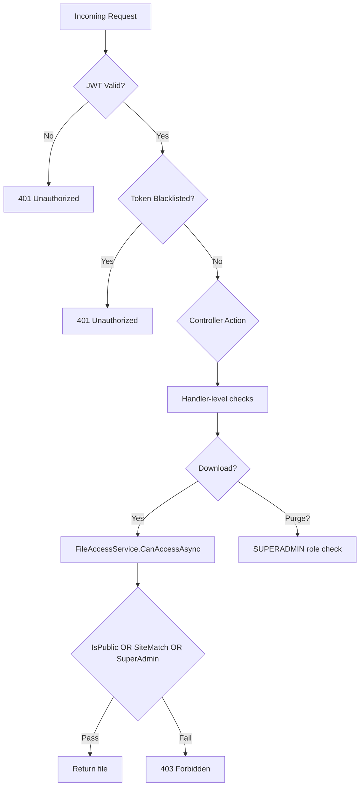
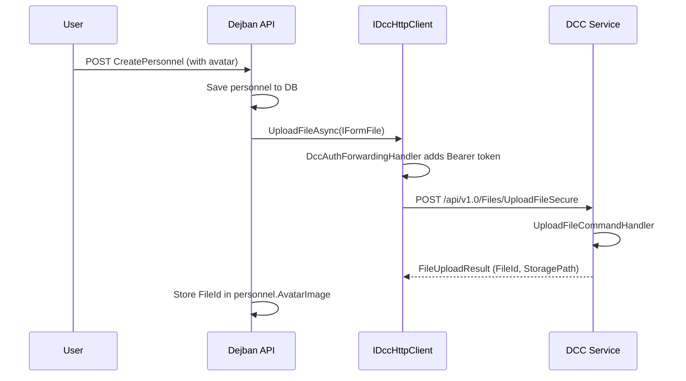
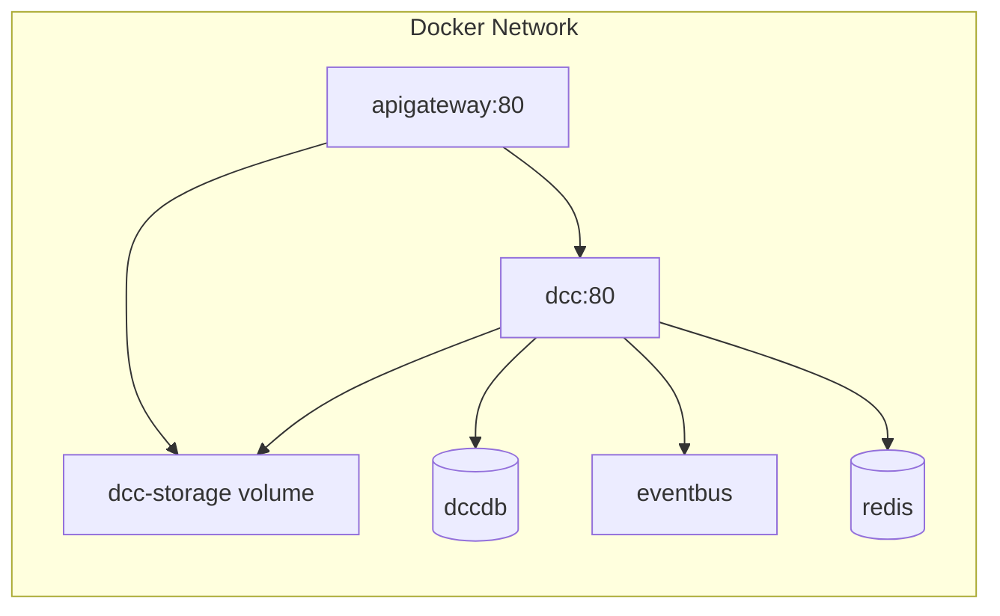

# DCC Architecture

> Document Control Center — architecture analysis, patterns, and cross-service communication.

---

## 1. Executive Summary

DCC (Document Control Center) is a **standalone ASP.NET Core microservice** responsible for centralized file storage, metadata management, and access-controlled download for the PayamGostar platform. It acts as the **system of record for binary assets** while other services (Dejban Personnels, Dejban Visitors, potentially IdentityServer) store only a **file ID reference** in their own databases.

The service follows a **pragmatic CQRS + vertical slice** architecture inside a single project, with **MediatR** for command/query dispatch, **EF Core** for persistence, and **local filesystem storage** abstracted behind `IFileStorage`.

---

## 2. Architecture Style

| Aspect | Assessment |
|--------|------------|
| **Overall style** | Microservice with modular monolith internal structure (logical layers, one assembly) |
| **Communication** | Synchronous HTTP (primary), asynchronous MassTransit (endpoint discovery only) |
| **API exposure** | REST via `FilesController`, versioned (`/api/v1.0/Files/...`) |
| **Data ownership** | DCC owns file bytes + metadata; consumers own business references (`AvatarImage` = Guid string) |



---

## 3. Layer Breakdown

### 3.1 Presentation Layer

**Location:** `Microservices/DCC/Controllers/`

| Component | Responsibility |
|-----------|----------------|
| `ApiController` | Base class; maps `ErrorOr` to HTTP status codes (400/401/403/404/409/500) |
| `FilesController` | REST endpoints for file CRUD operations |

**Middleware pipeline** (`Program.cs`):

1. CORS
2. DB migration initializer
3. OpenAPI (dev/DockerDevelopment only)
4. Serilog request logging
5. Exception handler + status code pages
6. Request localization (fa-IR default)
7. Token revocation (Redis blacklist)
8. Authentication (JWT Bearer)
9. Authorization
10. Tenant context (`UseTenantContext`)
11. Controller mapping

All controller actions inherit `[Authorize]` from `ApiController` except `PurgeFile` which has `[AllowAnonymous]` but enforces SUPERADMIN inside the handler.

### 3.2 Application Layer

**Location:** `Microservices/DCC/Application/`

Organized as **vertical slices** by feature:

```
Application/
├── Files/
│   ├── Commands/   UploadFile, DeleteFile, RestoreFile, PurgeFile
│   ├── Queries/    DownloadFile, GetFileMeta
│   └── Errors/     Errors.Files
├── Services/       IFileAccessService, IFileStorage (interfaces)
└── Consumers/      GetDCCServiceEndpointsConsumer
```

**MediatR pipeline:**

- `ValidationBehavior<TRequest,TResponse>` — FluentValidation before handler execution; converts failures to `ErrorOr` validation errors.

**Handlers return `ErrorOr<T>`** — consistent railway-oriented error handling without exceptions for business failures.

### 3.3 Domain Layer

**Location:** `Microservices/DCC/Domain/Entities/`

Two entities: `FileEntity` (aggregate root candidate) and `FileRevision` (audit child). See [DCC Domain Model](./DCC_DOMAIN_MODEL.md) for full analysis.

**DDD maturity: Low–Medium**

- Entities are **anemic** (properties only, no behavior methods)
- Business logic lives in `FileService` (infrastructure) and handlers (application)
- No domain events, specifications, or value objects
- No explicit aggregate boundaries enforced in code

### 3.4 Infrastructure Layer

**Location:** `Microservices/DCC/Infrastructure/`

| Component | Role |
|-----------|------|
| `ApplicationDbContext` | EF Core context; inbox/outbox entities; tenant filter hook (not applied to FileEntity) |
| `FileEntityConfiguration` / `FileRevisionConfiguration` | EF mappings, indexes, JSONB columns |
| `FileStorage` | Local filesystem implementation of `IFileStorage` |
| `FileService` | Core file operations (upload, download, delete, soft delete, restore, purge) |
| `ClaimService` | MassTransit client for `GetUserSiteClaims` — **registered but unused** |
| Migrations | Single `Initial` migration (20260708095740) |

**No repository pattern** — `FileService` uses `ApplicationDbContext` directly.

---

## 4. CQRS Maturity

| Pattern | Implementation |
|---------|----------------|
| Command/Query separation | Yes — separate records and handlers |
| MediatR dispatch | Yes |
| Read/write model separation | No — same `FileEntity` for reads and writes |
| Event sourcing | No — `FileRevision` is audit snapshot, not event store |
| Projections | No |

**CQRS maturity: Medium** — structural separation without read model optimization.

---

## 5. API Surface

| Method | Route | Handler | Notes |
|--------|-------|---------|-------|
| POST | `/api/v1.0/Files/UploadFile` | `UploadFileCommand` | Described as internal; still requires JWT |
| POST | `/api/v1.0/Files/UploadFileSecure` | `UploadFileCommand` | Used by `IDccHttpClient` |
| GET | `/api/v1.0/Files/Downloadfile/{Id}` | `DownloadFileQuery` | Access check via `FileAccessService` |
| GET | `/api/v1.0/Files/GetFileMeta/{Id}` | `GetFileMetaQuery` | Returns `FileInfoDTO` — **no access check** |
| DELETE | `/api/v1.0/Files/DeleteFile/{Id}` | `DeleteFileCommand` | Soft or hard delete based on `IsProtected` |
| POST | `/api/v1.0/Files/RestoreFile/{Id}` | `RestoreFileCommand` | Undoes soft delete |
| DELETE | `/api/v1.0/Files/PurgeFile/{Id}` | `PurgeFileCommand` | SUPERADMIN only; hard delete |

Request size limit: **1 GB** (`RequestSizeLimit(1_000_000_000)`).

---

## 6. Storage Architecture

### 6.1 Abstraction

```csharp
// Application/Services/IFileStorage.cs
Task SaveAsync(string relativePath, Stream content);
Task<Stream?> OpenReadAsync(string relativePath);
Task DeleteAsync(string relativePath);
bool Exists(string relativePath);
string Root { get; }
```

### 6.2 Path Layout

Files are stored under:

```
{Root}/{public|private}/{OwnerService}/{yyyy-MM}/{FileName}
```

Example:

```
uploads/public/Dejban.Visitors/2026-07/{visitor-guid}.jpg
```

| Environment | Root path |
|-------------|-----------|
| Development / Production (local) | `{ContentRoot}/uploads` |
| Docker / DockerDevelopment | `Storage:RootPath` → `/data/dcc/files` (config) or `/app/uploads` (volume) |

### 6.3 Public File Delivery

Public files can be accessed two ways:

1. **Through DCC API** — `Downloadfile/{Id}` (with auth unless `IsPublic`)
2. **Direct static serving** — ApiGateway serves `/files/*` from the `public/` subdirectory of the shared volume

This dual path means public assets may be reachable without hitting DCC's access logic if the storage path is known.

---

## 7. Persistence

### 7.1 Database

- **Engine:** PostgreSQL (`payamgostar_dcc`)
- **ORM:** EF Core with Npgsql
- **Migration strategy:** Auto-migrate on startup (`DbInitializer` with 10-second delay)

### 7.2 Tables

| Table | Purpose |
|-------|---------|
| `Files` | File metadata and access control fields |
| `FileRevisions` | Audit trail snapshots (JSONB) |
| `OutboxMessage` / `OutboxState` | MassTransit transactional outbox |
| `InboxState` | MassTransit inbox (idempotent consumption) |

### 7.3 Transaction Boundaries

- Each command handler typically triggers one or more `SaveChangesAsync` calls
- `FileService.UploadFileAsync` saves internally
- `UploadFileCommandHandler` performs an additional save for `IsProtected`
- Soft delete/restore use `ExecuteUpdateAsync` + separate revision insert — **not wrapped in explicit transaction scope**

---

## 8. Dependency Injection Strategy

Configured in `ServiceCollectionExtensions`:

| Lifetime | Service |
|----------|---------|
| Singleton | `IFileStorage` → `FileStorage`, `LinkProvider` |
| Scoped | `ApplicationDbContext`, `FileService`, `IFileAccessService`, `IClaimService`, `ITenantContext` |
| Transient | MediatR handlers, validators, `DccAuthForwardingHandler` (in consumers) |

Extension method chain in `Program.cs`:

```csharp
builder.Services
    .AddInfrastructure(configuration)
    .AddApplication()
    .AddPresentation(configuration);
```

---

## 9. Authentication & Authorization

### 9.1 Authentication

- **JWT Bearer** via `AddCustomJwtAuth` (shared Common extension)
- Token sources: `Authorization` header, cookie `AccessToken`, query string `AccessToken`
- **Token blacklist** checked by `TokenRevokeMiddleware` (Redis)

### 9.2 Authorization Layers



**`FileAccessService` current behavior:**

- Grants access if user is authenticated AND file is public
- OR passes site match check (`RequireSiteMatch` + `SiteId` in header site IDs)
- **Commented out:** role, permission, user whitelist, service whitelist, access expiry checks

**Download handler** also bypasses access check for SUPERADMIN (via role claim).

### 9.3 Multi-Tenancy

- `TenantContextMiddleware` extracts site IDs from JWT claims and optional `X-Site-Ids` header
- `ApplicationDbContext` implements `ITenantDbContext` and calls `ApplyTenantQueryFilters`
- **`FileEntity` does NOT implement `ISiteEntity`** — tenant filters are **not applied** to file queries
- Upload assigns `SiteId` from the caller's first JWT site ID

---

## 10. Event-Driven Architecture

### 10.1 MassTransit Configuration

```csharp
x.AddEntityFrameworkOutbox<ApplicationDbContext>(o => {
    o.UsePostgres();
    o.UseBusOutbox();
});
x.AddConsumer<GetDCCServiceEndpointsConsumer>();
```

**Features enabled:**

- EF transactional outbox (bus outbox pattern)
- Exponential retry (5 attempts, 1s–5min)
- Circuit breaker (15 failures/minute)
- Tenant context propagation filters
- Kebab-case endpoint naming

**Outbox usage:** Infrastructure is configured; DCC does not publish integration events from handlers.

**Inbox usage:** Tables exist; no idempotent consumers beyond MassTransit internals.

### 10.2 Endpoint Discovery Consumer

`GetDCCServiceEndpointsConsumer` responds to `GetDCCServiceEndpoints` by introspecting ASP.NET Core endpoint metadata and returning `GetServiceEndpointsResponse`.

**Purpose:** Feed IdentityServer's endpoint-based permission claims system.

**Gap:** `GetServicesEndpointsQueryHandler` in IdentityServer currently requests endpoints from Dejban, ACLServer, and RequestTracker only — **not DCC or Reporting**.

---

## 11. Cross-Service Communication

### 11.1 Inbound: Dejban / IdentityServer → DCC



**Registration points for `AddDccClient`:**

| Location | Notes |
|----------|-------|
| `Dejban.Api/Program.cs` | Global registration |
| `Dejban.Common.Infrastructure/InfrastructureConfiguration.cs` | Also registers (duplicate) |
| `PersonnelsModule.cs` | Module-level |
| `VisitorsModule.cs` | Module-level |
| `IdentityServer/ServiceCollectionExtensions.cs` | No usage found |

**Configuration:**

```json
"Dcc": {
  "BaseUrl": "http://localhost:5043",
  "TimeoutSeconds": 120
}
```

Fallback if section missing: `http://localhost:5043`.

### 11.2 Inbound: Client → ApiGateway → DCC

External clients call file operations through the gateway at `/Api/v1.0/Files/...` with JWT authentication enforced by the gateway's default authorization policy.

### 11.3 Outbound: DCC → IdentityServer (potential)

`ClaimService` can request `GetUserSiteClaims` via MassTransit with Redis caching (30s local TTL). Not currently used by any DCC handler.

### 11.4 Why Each Dependency Exists

| Dependency | Why |
|------------|-----|
| **IdentityServer (JWT)** | All API endpoints require authenticated users; tokens issued by IdentityServer |
| **Redis** | Token revocation blacklist + hybrid cache for claims |
| **RabbitMQ** | Endpoint discovery RPC; outbox infrastructure for future events |
| **PostgreSQL** | File metadata, revision audit, MassTransit outbox/inbox |
| **Common.Authorization** | Shared claim transformation and policy handlers (endpoint/role/permission) |
| **Common.Tenancy** | Site-scoped operations across platform; partial adoption in DCC |
| **Dejban modules** | Primary business consumers uploading photos |
| **ApiGateway** | Single entry point; static public file serving |

---

## 12. Configuration Strategy

| Source | Content |
|--------|---------|
| `GlobalAppsettings/` | JWT, Serilog, SuperAdmin, AllowedOrigins |
| `appsettings.json` | Postgres, Redis, RabbitMQ, Storage |
| `appsettings.{Environment}.json` | Environment overrides |
| `.env` (Docker DB) | PostgreSQL credentials for `dccdb` container |

DCC reads global config via `PhysicalFileProvider` pointing to `GlobalAppsettings` (path adjusted for Development).

---

## 13. Observability

- **Serilog** with Console, File, and Seq sinks
- Outbox/inbox SQL noise filtered from logs in `Program.cs`
- Application name: `"DCC"` in Serilog properties
- No OpenTelemetry in DCC (Dejban has OTEL; DCC does not)

---

## 14. Deployment Topology



---

## 15. Architectural Gaps & Technical Debt

Documented for maintainers (not recommendations to fix now):

| Item | Description |
|------|-------------|
| Anemic domain | Business rules in `FileService`, not entities |
| Incomplete access control | Role/permission/user checks commented out in `FileAccessService` |
| GetFileMeta unprotected | No access check on metadata endpoint |
| PurgeFile `[AllowAnonymous]` | Relies solely on handler SUPERADMIN check |
| Unused `ClaimService` | Registered in DI, never injected |
| DCC endpoints not synced | IdentityServer doesn't request `GetDCCServiceEndpoints` |
| IdentityServer `AddDccClient` | Registered without usage |
| No integration tests | DCC has no test project |
| UploadFile vs UploadFileSecure | Identical implementation; naming suggests intent not enforced |
| Tenant filter not on FileEntity | `SiteId` stored but queries not auto-filtered |
| `CreateRevisionAsync` private method | Dead code; revisions created inline in soft delete/restore |
| DbInitializer swallows errors | Migration failures logged to console only |

---

## 16. Comparison with Dejban Modules

| Aspect | DCC | Dejban Module |
|--------|-----|---------------|
| Projects | 1 | 4–6 per module |
| Domain richness | Anemic | Rich aggregates with behavior |
| Outbox domain events | No | Yes (per module) |
| Repository pattern | No | Yes |
| Unit of Work | Implicit (DbContext) | Explicit `IUnitOfWork` |
| Presentation | MVC Controllers | Minimal APIs + endpoints |
| Integration events | None published | Module-specific events |

DCC is architecturally **simpler and more CRUD-oriented** than Dejban modules, reflecting its role as shared infrastructure rather than a business bounded context.

---

## 17. Related Documentation

- [Workspace Map](./DCC_WORKSPACE_MAP.md)
- [Domain Model](./DCC_DOMAIN_MODEL.md)
- [Onboarding Guide](./DCC_ONBOARDING_GUIDE.md)
