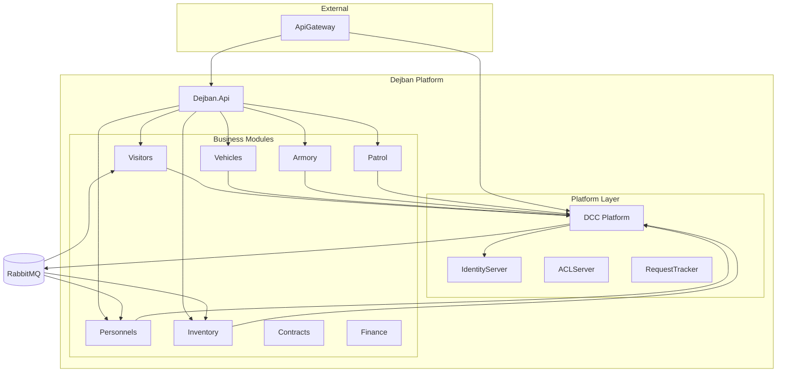
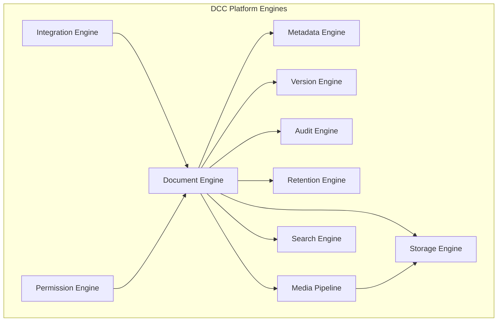
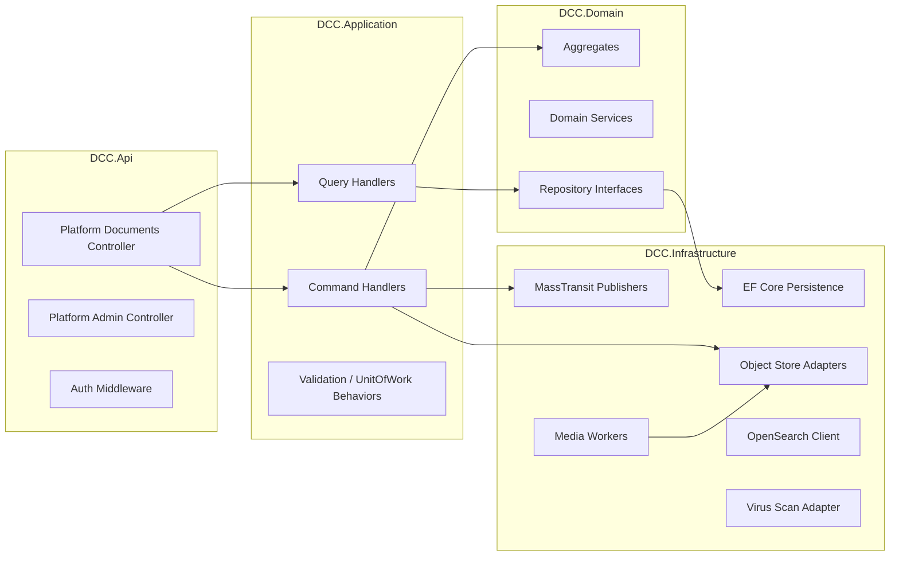
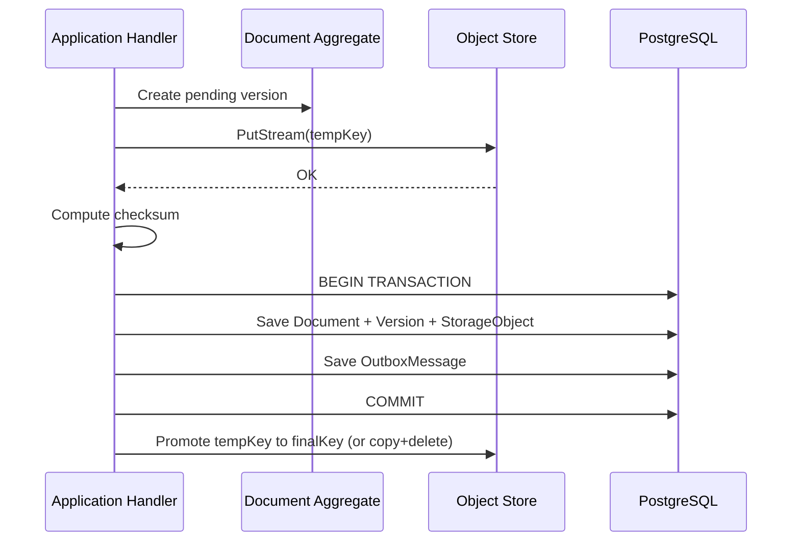
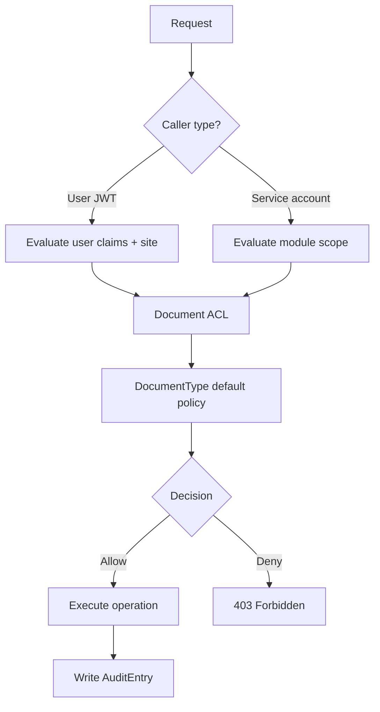
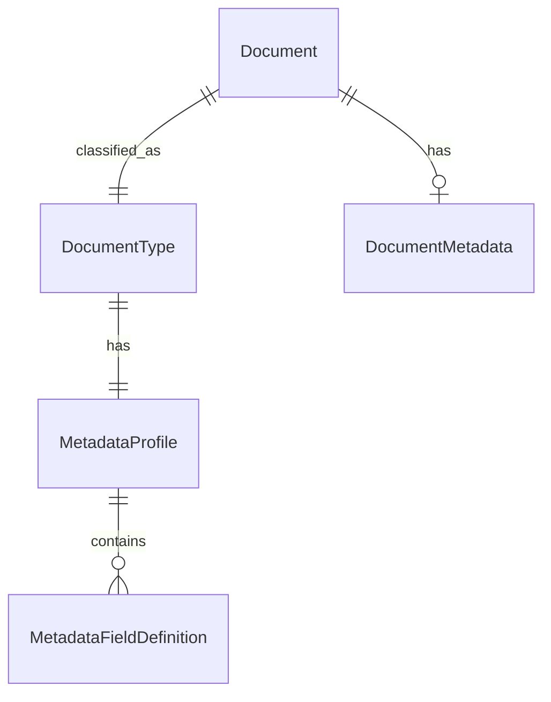
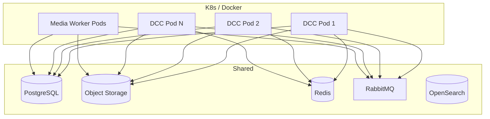
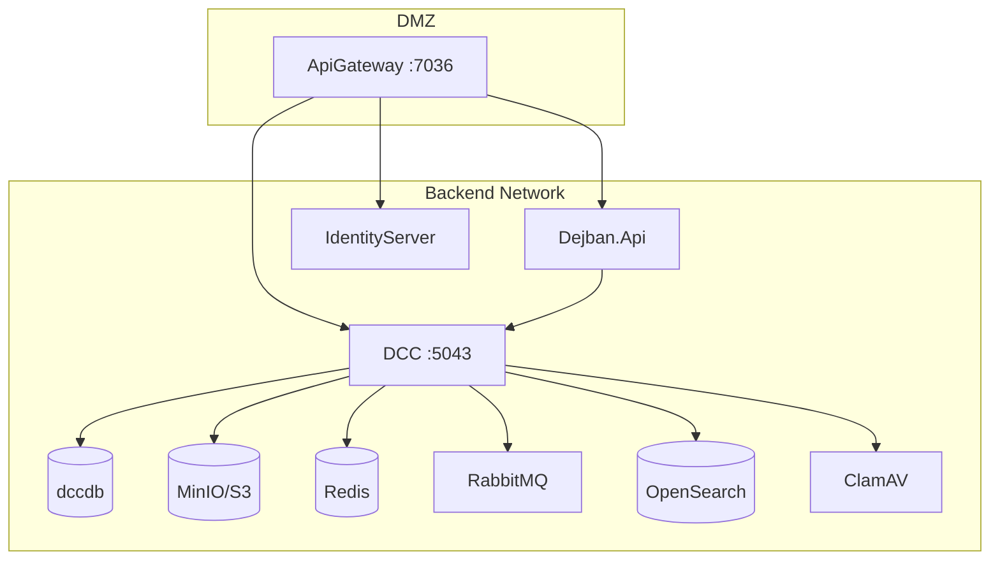

# DCC Architecture Bible

> **Official engineering specification** — Document Control Center Platform  
> Version: 1.0 | Status: Approved for implementation  
> Audience: Senior engineers, architects, tech leads  
> Supersedes: ad-hoc DCC architecture notes; standalone DMS roadmap assumptions

---

## 1. Executive Summary

DCC (Document Control Center) is the **single source of truth** for every document, attachment, image, video, and binary asset in the Dejban platform. It is a **core platform microservice** — not a business module, not an end-user product.

Business modules (Visitors, Personnels, Inventory, etc.) store **only** lightweight references (`DocumentId`, `AvatarDocumentId`). DCC owns storage, metadata, versions, permissions, audit, retention, search, and media derivatives.

This document is the **authoritative architectural reference** for all DCC development for the next decade.

---

## 2. Architectural Position



| Layer | Responsibility |
|-------|----------------|
| **Business modules** | Business entities, rules, workflows, UI |
| **DCC** | Complete document lifecycle |
| **IdentityServer** | Authentication, claims |
| **ApiGateway** | Edge routing, JWT enforcement |

---

## 3. Architectural Style

| Pattern | Application in DCC |
|---------|-------------------|
| **Clean Architecture** | Domain ← Application ← Infrastructure ← Api (dependency inward) |
| **DDD** | Rich aggregates, domain events, bounded context = DCC Platform |
| **CQRS** | Commands mutate aggregates; queries use read models / projections |
| **Event-Driven** | Integration events via MassTransit outbox; modules subscribe |
| **SOLID** | Ports/adapters for storage, search, scan, media |
| **OCP** | New DocumentTypes, storage providers via registration — no core changes |

### 3.1 Project Structure (Mandatory)

```
Microservices/DCC/
├── DCC.Api/                          # Controllers, middleware, OpenAPI
├── DCC.Application/                  # Commands, queries, handlers, behaviors
├── DCC.Domain/                       # Aggregates, VOs, domain events, repository interfaces
├── DCC.Infrastructure/               # EF, object store, search, media, messaging
├── DCC.Contracts/                    # Public DTOs, integration events (NuGet-refable)
└── tests/
    ├── DCC.Domain.Tests/
    ├── DCC.Application.Tests/
    ├── DCC.Architecture.Tests/
    └── DCC.Integration.Tests/
```

**Why:** Single deployable microservice with **enforced** layer boundaries (NetArchTest), matching Dejban module conventions while remaining independently deployable.

**Alternative considered:** Multi-microservice DCC (storage service + metadata service). **Rejected** — operational overhead unjustified until >10M documents with independent scaling proof.

---

## 4. Platform Engines



| Engine | Owns | Must NOT own |
|--------|------|--------------|
| Storage Engine | Blobs, keys, providers, tiers, checksums | Business entity validation |
| Document Engine | Document registry, lifecycle state | Workflow approval |
| Metadata Engine | DocumentTypes, MetadataProfiles | Business field semantics |
| Version Engine | Immutable version chain | Business version meaning |
| Permission Engine | All access decisions | Business authorization rules |
| Search Engine | Index, query API | Business entity search |
| Audit Engine | Immutable audit log | Module audit duplication |
| Retention Engine | Policies, disposition schedule | Business retention rules definition* |
| Integration Engine | SDK, REST, events, outbox | Module notification delivery |
| Media Pipeline | Thumbnails, previews, OCR text | UI rendering |

*Modules **register** retention requirements; DCC **executes** them.

---

## 5. Component Diagram



---

## 6. CQRS Design

### 6.1 Commands (Write Side)

| Command | Aggregate | Transaction boundary |
|---------|-----------|---------------------|
| `RegisterDocumentTypeCommand` | DocumentTypeRegistry | Single UoW |
| `UploadDocumentCommand` | Document + DocumentVersion + StorageObject | Single UoW + outbox |
| `CreateDocumentVersionCommand` | Document + DocumentVersion | Single UoW + outbox |
| `UpdateDocumentMetadataCommand` | Document | Single UoW + outbox |
| `RecycleDocumentCommand` | Document | Single UoW + outbox |
| `RestoreDocumentCommand` | Document | Single UoW + outbox |
| `PurgeDocumentCommand` | Document | Single UoW + outbox + async blob delete |
| `GrantDocumentPermissionCommand` | DocumentPermission | Single UoW |
| `ApplyLegalHoldCommand` | Document | Single UoW |
| `RegisterRetentionPolicyCommand` | RetentionPolicy | Single UoW |

All commands return `ErrorOr<T>` — no exceptions for business failures.

### 6.2 Queries (Read Side)

| Query | Source | Notes |
|-------|--------|-------|
| `GetDocumentByIdQuery` | Document table (+ cache) | Permission check first |
| `GetDocumentMetadataQuery` | Document + Metadata | |
| `ListDocumentVersionsQuery` | DocumentVersion | |
| `SearchDocumentsQuery` | OpenSearch projection | Always scoped by caller context |
| `GetDocumentAuditQuery` | AuditEntry | Paginated |
| `GetPreviewUrlQuery` | MediaAsset | Signed URL generation |
| `GetThumbnailUrlQuery` | MediaAsset | Signed URL |
| `ListDocumentsByOwnerQuery` | Document by OwnerModule+OwnerEntityId | Primary module query |

**Read models:** `DocumentSummaryProjection`, `DocumentSearchDocument` (OpenSearch).

**Why CQRS:** Search and list operations must not load blob metadata into write aggregate; OpenSearch scales independently.

---

## 7. Repository Contracts

Defined in `DCC.Domain` — implemented in `DCC.Infrastructure`.

```csharp
// Illustrative — specification, not generated code
IDocumentRepository
IDocumentVersionRepository
IDocumentTypeRepository
IStorageObjectRepository
IMediaAssetRepository
IAuditEntryRepository
IRetentionPolicyRepository
IDocumentPermissionRepository
IUnitOfWork
```

**Rule:** Application handlers depend on repository **interfaces** only — never `DbContext`.

**Why repositories over DbContext in handlers:** Testability, aggregate persistence encapsulation, query filter centralization (tenant, soft-delete).

**Alternative considered:** Generic `IRepository<T>`. **Rejected** — aggregate-specific methods (`GetByOwnerAsync`, `GetWithVersionsAsync`) need explicit contracts.

---

## 8. Application Services (Domain Services)

| Service | Responsibility |
|---------|----------------|
| `IAccessPolicyEvaluator` | Single permission pipeline |
| `IMetadataValidator` | Validate payload against MetadataProfile JSON Schema |
| `IStorageKeyGenerator` | Deterministic blob key from DocumentId+VersionId |
| `IChecksumService` | SHA-256 compute and verify |
| `ISignedUrlGenerator` | Time-limited access tokens |
| `IRetentionEvaluator` | Compute disposition date from policy |
| `IDocumentTypeRegistry` | Resolve DocumentType + profile |

---

## 9. Infrastructure Services

| Service | Adapter implementations |
|---------|------------------------|
| `IObjectStore` | `S3ObjectStore`, `AzureBlobObjectStore`, `MinioObjectStore`, `FileSystemObjectStore` (dev) |
| `IVirusScanner` | `ClamAvScanner`, `NoOpScanner` (dev) |
| `ISearchIndexer` | `OpenSearchIndexer`, `PostgreSqlFtsIndexer` (fallback) |
| `IMediaProcessor` | `ImageSharpProcessor`, `FFmpegProcessor`, `LibreOfficeProcessor` |
| `IEncryptionService` | Provider-native SSE + optional envelope encryption |

---

## 10. Storage Abstraction

### 10.1 Blob Key Strategy

```
{environment}/{siteId}/{ownerModule}/{documentId}/{versionId}/{filename}
```

**Why include documentId in key:** Immutable reference even if logical filename changes; supports dedup by content hash at StorageObject layer.

**Alternative considered:** Content-addressable keys only (hash). **Rejected for primary key** — complicates versioning; use hash for dedup index instead.

### 10.2 Upload Protocol



**Why write-then-commit:** Prevents orphan DB rows; temp blob cleanup job handles failed commits.

---

## 11. Permission Model



### Permission dimensions

| Dimension | Source |
|-----------|--------|
| SiteId | JWT + X-Site-Ids header |
| OwnerModule | Document record — service account must match for S2S |
| DocumentType policy | Registry — e.g. `Personnel.Avatar` requires `Personnels.Read` |
| Document ACL | Explicit grants by owning module |
| Legal hold | Blocks purge/recycle for non-admin |

**Default deny** for non-public documents.

---

## 12. Ownership Model

| Field | Type | Meaning |
|-------|------|---------|
| `OwnerModule` | string | `Dejban.{ModuleName}` — namespace isolation |
| `OwnerEntityId` | Guid | Opaque business entity PK — DCC does not FK |
| `SiteId` | Guid | Tenancy from Dejban site model |
| `CreatedByUserId` | string? | Human uploader if applicable |
| `CreatedByService` | string | Calling service identity |

**DocumentOwner** value object encapsulates Module + EntityId + SiteId.

Modules query: `ListDocuments(OwnerModule, OwnerEntityId)`.

---

## 13. Folder Strategy

**Decision:** Logical folders optional; **primary organization via OwnerModule + OwnerEntityId + DocumentType**.

Optional `FolderPath` (materialized path) for admin browsing — **not** exposed to modules as primary API.

**Why:** Dejban modules already have business aggregates as natural grouping; SharePoint-style folder trees add complexity without module benefit.

**Alternative considered:** Full folder hierarchy as aggregate. **Deferred to Phase C** as `Folder` aggregate for admin-only organization.

---

## 14. Metadata Model



- **DocumentType:** e.g. `Dejban.Personnels.Personnel.Avatar`
- **MetadataProfile:** JSON Schema stored in DB, versioned
- **DocumentMetadata:** JSONB validated on write

Modules pass metadata at upload; DCC validates — modules do not store copy.

---

## 15. Lifecycle Strategies

See [Domain Specification](./DCC_DOMAIN_SPECIFICATION.md) for state machine.

| Strategy | Owner |
|----------|-------|
| Deletion (recycle) | Document Engine — soft delete |
| Purge (destroy) | Retention Engine or admin — hard delete blob + row |
| Retention | Retention Engine — scheduled disposition |
| Archive | Storage Engine tier change + Document status `Archived` |

---

## 16. Search Strategy

| Phase | Implementation |
|-------|----------------|
| MVP (Phase B) | OpenSearch cluster, index on integration events |
| Fallback | PostgreSQL FTS on metadata + OCR text column |

Query **always** includes: `SiteId IN @callerSites AND (OwnerModule = @module OR caller is platform admin)`.

---

## 17. Audit Strategy

Append-only `AuditEntry` table — **no updates, no deletes**.

Every command and download logs: Actor, Action, DocumentId, Timestamp, CorrelationId, IP, Result.

Optional SIEM export (Phase C) — async worker.

---

## 18. Caching Strategy

| Cache | Technology | TTL | Content |
|-------|------------|-----|---------|
| Document metadata | Redis HybridCache | 60s | DocumentSummary by Id |
| DocumentType registry | In-memory + Redis | 5m | Profiles |
| Signed URLs | Not cached | — | Generated on demand |
| Search results | Not cached | — | Index is source |

**Invalidation:** On `DocumentMetadataUpdated`, `DocumentRecycled` integration events.

---

## 19. Scaling Strategy



| Component | Scaling |
|-----------|---------|
| DCC API pods | Horizontal — stateless |
| Media workers | Horizontal — queue-driven |
| PostgreSQL | Vertical + read replica for queries (Phase C) |
| Object storage | Provider-native scale |
| OpenSearch | 3+ node cluster |

---

## 20. Background Processing

| Worker | Trigger | Engine |
|--------|---------|--------|
| `VirusScanConsumer` | DocumentUploaded | Media + Security |
| `ThumbnailGeneratorConsumer` | DocumentUploaded | Media |
| `PreviewGeneratorConsumer` | DocumentUploaded | Media |
| `OcrExtractorConsumer` | DocumentUploaded (type filter) | Media + Search |
| `SearchIndexConsumer` | Document* events | Search |
| `RetentionDispositionJob` | Quartz cron daily | Retention |
| `OrphanBlobCleanupJob` | Quartz cron hourly | Storage |
| `OutboxDispatcher` | MassTransit built-in | Integration |

---

## 21. EventBus Integration

- **MassTransit** + **EF Outbox** (existing pattern, now with real publishers)
- Tenant context propagation filters (existing Common.Tenancy)
- Retry: exponential 5 attempts; idempotent consumers use Inbox

See [Event Specification](./DCC_EVENT_SPECIFICATION.md).

---

## 22. GraphQL Readiness (Future)

**Decision:** REST + SDK first; GraphQL **read-only** layer optional Phase D+.

**Preparation now:**
- Queries return stable DTOs from `DCC.Contracts`
- No blob fields in DTOs — URLs only
- `DocumentSummary` type maps 1:1 to future GraphQL `Document` type

**Why not GraphQL now:** Module integration is server-side .NET SDK; REST sufficient for 10-year horizon start.

---

## 23. Deployment Diagram



---

## 24. Cross-Reference Index

| Topic | Document |
|-------|----------|
| Aggregates, events, VOs | [Domain Specification](./DCC_DOMAIN_SPECIFICATION.md) |
| Tables, ERD, indexes | [Database Specification](./DCC_DATABASE_SPECIFICATION.md) |
| REST endpoints | [API Specification](./DCC_API_SPECIFICATION.md) |
| SDK methods | [SDK Specification](./DCC_SDK_SPECIFICATION.md) |
| Events | [Event Specification](./DCC_EVENT_SPECIFICATION.md) |
| Coding standards | [Implementation Guidelines](./DCC_IMPLEMENTATION_GUIDELINES.md) |
| Module integration | [Module Integration Guide](./DCC_MODULE_INTEGRATION_GUIDE.md) |
| ADRs | [Decision Records](./DCC_DECISION_RECORDS.md) |

---

## 25. Implementation Phases (Summary)

| Phase | Duration | Outcome |
|-------|----------|---------|
| **A** | 5 months | Secure platform, SDK, Personnels+Visitors migrated |
| **B** | 7 months | Versions, search, media, retention, 6 modules |
| **C** | 5 months | All modules, OCR, tiering, admin API |
| **D** | 6 months optional | AI assist APIs |

Detailed sprint plan: [Revised Implementation Plan](./DCC_REVISED_IMPLEMENTATION_PLAN.md).

---

*This document is normative. Deviations require an ADR in [Decision Records](./DCC_DECISION_RECORDS.md).*
