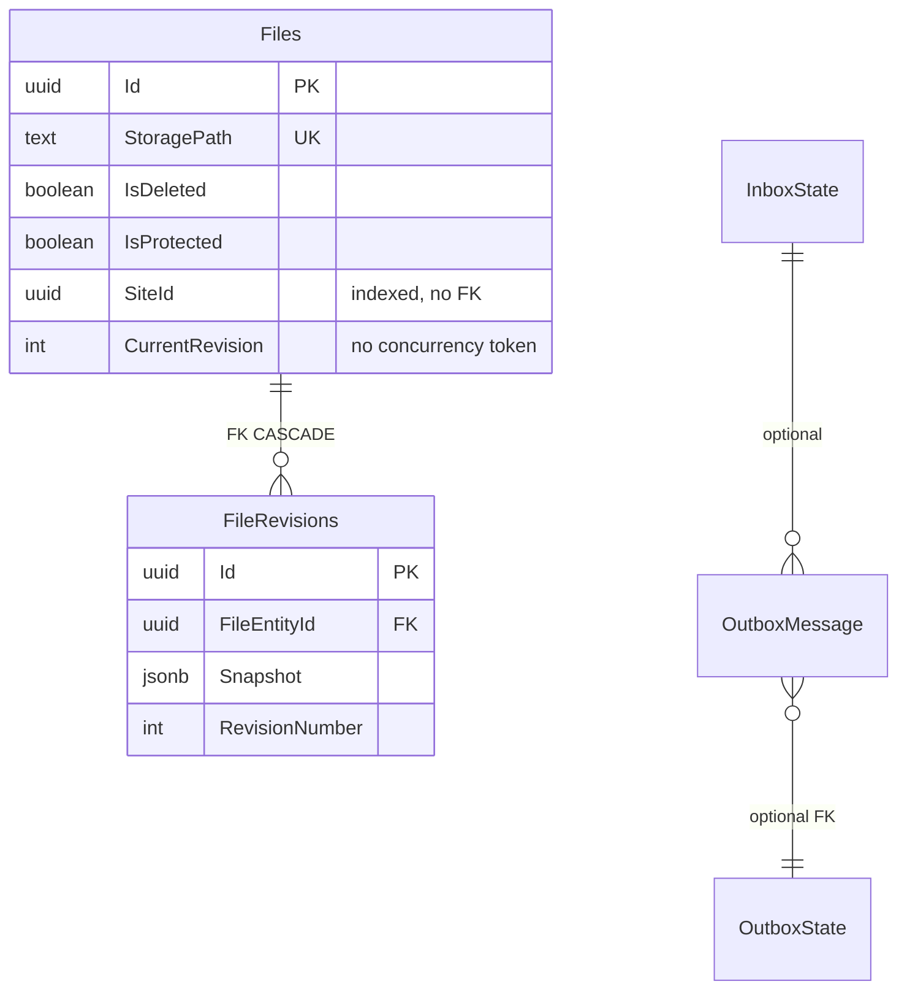

# DCC Database Audit

> Phase 2 Engineering Audit — Persistence, EF Core, Migrations, Query Patterns  
> Scope: `ApplicationDbContext`, configurations, migrations, and all DB access in `FileService`

---

## Audit Summary

| Severity | Count |
|----------|-------|
| Critical | 1 |
| High | 8 |
| Medium | 11 |
| Low | 7 |
| **Total** | **27** |

---

## DbContext Overview

**File:** `Microservices/DCC/Infrastructure/Persistence/ApplicationDbContext.cs`

| Aspect | Finding |
|--------|---------|
| Base | `DbContext` with primary constructor injection |
| Tenancy | Implements `ITenantDbContext`; calls `ApplyTenantQueryFilters` |
| MassTransit | Inbox/Outbox entities registered |
| DbSets | `Files`, `FileRevisions` |
| Interceptors | None configured |
| Retry strategy | None (no `EnableRetryOnFailure`) |
| Connection resilience | Not configured |

---

## Critical Findings

### AUD-DB-001 — No Transaction Wrapping Multi-Step Lifecycle Operations

| Field | Value |
|-------|-------|
| **Severity** | Critical |
| **Category** | Transaction Boundaries |
| **File** | `Microservices/DCC/Infrastructure/Services/FileService.cs` |
| **Class** | `FileService` |
| **Method** | `SoftDeleteFileAsync` (lines 156–190), `RestoreFileAsync` (lines 205–238) |
| **Problem** | `ExecuteUpdateAsync` commits independently, then a separate query reads state and inserts `FileRevision`, then `SaveChangesAsync`. Not wrapped in `BeginTransaction`. |
| **Technical impact** | If revision insert fails, file row reflects incremented revision and `IsDeleted=true` without audit row. Partial aggregate state. |
| **Business impact** | Audit trail incomplete for compliance; state inconsistent with revision count. |
| **Recommendation** | Wrap update + revision insert in explicit database transaction. |
| **Priority** | P0 |

---

## High Findings

### AUD-DB-002 — FileEntity Not Subject to Tenant Query Filters

| Field | Value |
|-------|-------|
| **Severity** | High |
| **Category** | Multi-Tenancy |
| **File** | `Microservices/DCC/Domain/Entities/FileEntity.cs` |
| **Class** | `FileEntity` |
| **Method** | N/A |
| **Problem** | Entity has `SiteId` but does not implement `ISiteEntity`. `ApplyTenantQueryFilters` in `ApplicationDbContext.OnModelCreating` skips it. |
| **Technical impact** | All queries return files across all sites. Tenancy relies solely on application-layer checks (incomplete). |
| **Business impact** | Cross-tenant data exposure at persistence layer. |
| **Recommendation** | Implement `ISiteEntity` (nullable handling via filter adjustment) or global filter on `SiteId`. |
| **Priority** | P1 |

---

### AUD-DB-003 — No Optimistic Concurrency Token

| Field | Value |
|-------|-------|
| **Severity** | High |
| **Category** | Concurrency |
| **File** | `FileEntityConfiguration.cs`, `ApplicationDbContextModelSnapshot.cs` |
| **Class** | `FileEntityConfiguration` |
| **Method** | `Configure` |
| **Problem** | No `[Timestamp]`, `RowVersion`, or ` xmin` concurrency column on `FileEntity` or `FileRevision`. |
| **Technical impact** | Concurrent soft-delete/restore/upload upsert can lost-update without detection. `ExecuteUpdateAsync` bypasses change tracking entirely. |
| **Business impact** | Revision counter and delete flags may be wrong under concurrent admin actions. |
| **Recommendation** | Add `RowVersion` byte array or use `CurrentRevision` as concurrency token with check on update. |
| **Priority** | P1 |

---

### AUD-DB-004 — Upload Upsert Logic With Mapster and Tracked Entity

| Field | Value |
|-------|-------|
| **Severity** | High |
| **Category** | Query Patterns / Tracking |
| **File** | `Microservices/DCC/Infrastructure/Services/FileService.cs` |
| **Class** | `FileService` |
| **Method** | `UploadFileAsync` (lines 53–63) |
| **Problem** | On path collision: fetches tracked entity, maps incoming `file` onto it via `file.Adapt(currentFile)`, but returns separate `file` object. `CurrentRevision`, `IsDeleted`, access fields may not map as intended. |
| **Technical impact** | Re-upload overwrites metadata unpredictably; may reset or preserve wrong fields depending on Mapster config. |
| **Business impact** | Re-upload of same filename in same month corrupts lifecycle state. |
| **Recommendation** | Explicit update policy; exclude immutable fields; increment revision on overwrite. |
| **Priority** | P1 |

---

### AUD-DB-005 — Hard Delete Uses Remove Without Revision Archive

| Field | Value |
|-------|-------|
| **Severity** | High |
| **Category** | Audit / Soft Delete |
| **File** | `Microservices/DCC/Infrastructure/Services/FileService.cs` |
| **Class** | `FileService` |
| **Method** | `DeleteFileAsync` (lines 88–97) |
| **Problem** | Non-protected delete removes DB row and cascades revisions with no final audit entry. |
| **Technical impact** | Complete loss of audit history for unprotected files. |
| **Business impact** | Cannot answer "who deleted this file" for majority of files (consumers don't set `IsProtected`). |
| **Recommendation** | Always write final revision before hard delete, or default uploads to `IsProtected=true` for consumer services. |
| **Priority** | P1 |

---

### AUD-DB-006 — Purge Uses ExecuteDeleteAsync Without Audit

| Field | Value |
|-------|-------|
| **Severity** | High |
| **Category** | Audit |
| **File** | `Microservices/DCC/Infrastructure/Services/FileService.cs` |
| **Class** | `FileService` |
| **Method** | `PurgeFileAsync` (lines 255–257) |
| **Problem** | Bulk delete via `ExecuteDeleteAsync` removes file and cascaded revisions atomically in DB but records no purge audit. `purgedBy` parameter discarded. |
| **Technical impact** | No forensic trail for SUPERADMIN purges. |
| **Business impact** | Regulatory audit failure for destructive admin actions. |
| **Recommendation** | Insert purge audit record to separate immutable log table before delete. |
| **Priority** | P1 |

---

### AUD-DB-007 — Migration Startup Without Health Gate

| Field | Value |
|-------|-------|
| **Severity** | High |
| **Category** | Migration Quality |
| **File** | `Microservices/DCC/Abstractions/Extensions/DbExtensions.cs` |
| **Class** | `DbExtensions` |
| **Method** | `DbInitializer` |
| **Problem** | `MigrateAsync()` on every startup; failures swallowed; 10s blind delay instead of connection retry. |
| **Technical impact** | Race with K8s readiness; app serves traffic on stale schema. |
| **Business impact** | Runtime 500s after deploy. |
| **Recommendation** | Fail startup on migration failure; use EF retry + Polly; run migrations as init container in K8s. |
| **Priority** | P1 |

---

### AUD-DB-008 — No Index on IsDeleted

| Field | Value |
|-------|-------|
| **Severity** | High |
| **Category** | Indexes / Performance |
| **File** | `FileEntityConfiguration.cs` |
| **Class** | `FileEntityConfiguration` |
| **Method** | `Configure` |
| **Problem** | `IsDeleted` frequently used in restore/filter scenarios but not indexed. |
| **Technical impact** | Full table scan for admin "list deleted files" features if added. |
| **Business impact** | Performance degradation as file count grows. |
| **Recommendation** | Add composite index `(IsDeleted, OwnerService)` or partial index `WHERE IsDeleted = true`. |
| **Priority** | P2 |

---

### AUD-DB-009 — Shared DbContext for Business and Outbox

| Field | Value |
|-------|-------|
| **Severity** | High |
| **Category** | Architecture |
| **File** | `ApplicationDbContext.cs` |
| **Class** | `ApplicationDbContext` |
| **Method** | `OnModelCreating` |
| **Problem** | Same context handles Files, FileRevisions, OutboxMessage, InboxState. High write contention potential when outbox dispatch runs. |
| **Technical impact** | Outbox polling queries compete with file metadata operations on same connection pool. |
| **Business impact** | Latency spikes under message load. |
| **Recommendation** | Monitor; consider separate outbox DB or dedicated context for MT infrastructure at scale. |
| **Priority** | P2 |

---

## Medium Findings

### AUD-DB-010 — All String Columns Use text Type

| Field | Value |
|-------|-------|
| **Severity** | Medium |
| **Category** | Schema Design |
| **File** | `20260708095740_Initial.cs` |
| **Class** | Migration `Initial` |
| **Method** | `Up` |
| **Problem** | `ContentType`, `FileName`, `OwnerService`, `StoragePath`, etc. use unbounded `text` without max length. |
| **Technical impact** | Larger index sizes; no DB-level length enforcement. |
| **Business impact** | Accidental huge strings stored. |
| **Recommendation** | Apply reasonable `HasMaxLength` (e.g., StoragePath 500, FileName 255). |
| **Priority** | P3 |

---

### AUD-DB-011 — No Foreign Key from Files to Site

| Field | Value |
|-------|-------|
| **Severity** | Medium |
| **Category** | Foreign Keys |
| **File** | `FileEntityConfiguration.cs` |
| **Class** | `FileEntityConfiguration` |
| **Method** | `Configure` |
| **Problem** | `SiteId` is nullable UUID with index but no FK to a Sites table (cross-database reference to Dejban). |
| **Technical impact** | Orphan site IDs possible if site deleted in Dejban. |
| **Business impact** | Files reference deleted sites; access rules break silently. |
| **Recommendation** | Document as intentional cross-service reference; validate site on upload via Dejban RPC or cache. |
| **Priority** | P3 |

---

### AUD-DB-012 — FileRevision.Action Unconstrained String

| Field | Value |
|-------|-------|
| **Severity** | Medium |
| **Category** | Data Integrity |
| **File** | `FileRevisionConfiguration.cs` |
| **Class** | `FileRevisionConfiguration` |
| **Method** | `Configure` |
| **Problem** | `Action` is free-text (`SoftDeleted`, `Restored` magic strings in code). |
| **Technical impact** | Typos in action names break reporting. |
| **Recommendation** | Enum column or check constraint. |
| **Priority** | P3 |

---

### AUD-DB-013 — Snapshot JSONB Without Schema Version

| Field | Value |
|-------|-------|
| **Severity** | Medium |
| **Category** | Audit |
| **File** | `FileRevision.cs`, `FileRevisionConfiguration.cs` |
| **Class** | `FileRevision` |
| **Method** | N/A |
| **Problem** | Full entity serialized to JSONB without schema version field. |
| **Technical impact** | Entity shape changes make historical snapshots hard to deserialize interpretively. |
| **Business impact** | Audit replay tools fragile across releases. |
| **Recommendation** | Add `SnapshotSchemaVersion` column. |
| **Priority** | P3 |

---

### AUD-DB-014 — FindAsync Used Without AsNoTracking for Read Paths

| Field | Value |
|-------|-------|
| **Severity** | Medium |
| **Category** | Tracking |
| **File** | `FileService.cs` |
| **Class** | `FileService` |
| **Method** | `DownloadFileAsync`, `GetFileMeta`, `GetFileEntityAsync` |
| **Problem** | `FindAsync` tracks entities in scoped DbContext unnecessarily for read-only operations. |
| **Technical impact** | Extra memory; potential stale tracked state if same scope mutates later. |
| **Recommendation** | Use `AsNoTracking()` queries for reads. |
| **Priority** | P3 |

---

### AUD-DB-015 — No Composite Index for Common Query Pattern

| Field | Value |
|-------|-------|
| **Severity** | Medium |
| **Category** | Indexes / Performance |
| **File** | `FileEntityConfiguration.cs` |
| **Class** | `FileEntityConfiguration` |
| **Method** | `Configure` |
| **Problem** | `SearchFilesAsync` filters by `OwnerService` + `FileName.Contains`. Separate indexes exist but no composite; `Contains` cannot use index efficiently. |
| **Technical impact** | Sequential scan on keyword search. |
| **Business impact** | Slow admin search at scale. |
| **Recommendation** | Add pg_trgm index on FileName if search needed; or use dedicated search engine. |
| **Priority** | P3 |

---

### AUD-DB-016 — CreatedAt Has No Default at Database Level

| Field | Value |
|-------|-------|
| **Severity** | Medium |
| **Category** | Audit Fields |
| **File** | `FileEntity.cs`, migration |
| **Class** | `FileEntity` |
| **Method** | N/A |
| **Problem** | `CreatedAt` default only in C# property initializer; DB column has no `DEFAULT now()`. |
| **Technical impact** | Raw SQL inserts omitting CreatedAt get `0001-01-01`. |
| **Recommendation** | `HasDefaultValueSql("NOW() AT TIME ZONE 'UTC'")` in configuration. |
| **Priority** | P3 |

---

### AUD-DB-017 — No UpdatedAt Audit Column

| Field | Value |
|-------|-------|
| **Severity** | Medium |
| **Category** | Audit Fields |
| **File** | `FileEntity.cs` |
| **Class** | `FileEntity` |
| **Method** | N/A |
| **Problem** | No `UpdatedAt` or `ModifiedBy` for metadata changes (IsProtected post-save, soft delete fields). |
| **Technical impact** | Cannot query "when was file last modified" without parsing revisions. |
| **Business impact** | Operational reporting gap. |
| **Recommendation** | Add standard audit columns or rely solely on FileRevision (document choice). |
| **Priority** | P3 |

---

### AUD-DB-018 — ExecuteUpdateAsync Bypasses Domain and Change Trackers

| Field | Value |
|-------|-------|
| **Severity** | Medium |
| **Category** | DDD / Consistency |
| **File** | `FileService.cs` |
| **Class** | `FileService` |
| **Method** | `SoftDeleteFileAsync`, `RestoreFileAsync` |
| **Problem** | Bulk update APIs skip EF change tracking and any future interceptors (audit, domain events). |
| **Technical impact** | SaveChanges interceptors won't fire on main state change. |
| **Recommendation** | Accept for performance or load-track-modify-save for rich domain. |
| **Priority** | P3 |

---

### AUD-DB-019 — Id Column Client-Generated Without DB Default

| Field | Value |
|-------|-------|
| **Severity** | Medium |
| **Category** | Keys |
| **File** | Migration `Initial`, `FileEntity.cs` |
| **Class** | N/A |
| **Method** | N/A |
| **Problem** | UUID primary key without `gen_random_uuid()` default in PostgreSQL. |
| **Technical impact** | Depends on EF client-side generation; raw SQL inserts must supply Id. |
| **Recommendation** | Configure `HasDefaultValueSql("gen_random_uuid()")` for defense in depth. |
| **Priority** | P4 |

---

### AUD-DB-020 — Cascade Delete on Revisions Only

| Field | Value |
|-------|-------|
| **Severity** | Medium |
| **Category** | Cascade Delete |
| **File** | `FileRevisionConfiguration.cs` |
| **Class** | `FileRevisionConfiguration` |
| **Method** | `Configure` (line 18) |
| **Problem** | `OnDelete(DeleteBehavior.Cascade)` — purging parent deletes all audit history simultaneously. |
| **Technical impact** | Intended for purge; conflicts with audit retention requirements. |
| **Business impact** | Cannot retain audit after file removal. |
| **Recommendation** | Separate immutable audit store if retention required. |
| **Priority** | P2 |

---

## Low Findings

### AUD-DB-021 — Inconsistent Indentation in ApplicationDbContext

| Field | Value |
|-------|-------|
| **Severity** | Low |
| **Category** | Code Quality |
| **File** | `ApplicationDbContext.cs` |
| **Class** | `ApplicationDbContext` |
| **Method** | N/A |
| **Problem** | 2-space indent inside class body vs 4-space project convention. |
| **Priority** | P4 |

---

### AUD-DB-022 — No Owned Types for Access Policy

| Field | Value |
|-------|-------|
| **Severity** | Low |
| **Category** | Schema Design |
| **File** | `FileEntity.cs` |
| **Class** | `FileEntity` |
| **Method** | N/A |
| **Problem** | Access control fields flat on entity rather than owned type `FileAccessPolicy`. |
| **Priority** | P4 |

---

### AUD-DB-023 — Single Migration Only

| Field | Value |
|-------|-------|
| **Severity** | Low |
| **Category** | Migration Quality |
| **File** | `Migrations/20260708095740_Initial.cs` |
| **Class** | N/A |
| **Method** | N/A |
| **Problem** | Only initial migration exists — greenfield. No drift history to audit. |
| **Priority** | N/A |

---

### AUD-DB-024 — Outbox Tables Share Database Without Partitioning

| Field | Value |
|-------|-------|
| **Severity** | Low |
| **Category** | Performance |
| **File** | Migration `Initial` |
| **Class** | N/A |
| **Method** | N/A |
| **Problem** | OutboxMessage table will grow; no archival strategy documented. |
| **Priority** | P3 |

---

### AUD-DB-025 — No N+1 Risk Currently

| Field | Value |
|-------|-------|
| **Severity** | Low |
| **Category** | N+1 |
| **File** | `FileService.cs` |
| **Class** | `FileService` |
| **Method** | N/A |
| **Problem** | Revisions navigation never eagerly loaded in queries — no N+1 today. Future list endpoints would need `.Include()` strategy. |
| **Priority** | P4 — informational |

---

### AUD-DB-026 — No Split Query Usage

| Field | Value |
|-------|-------|
| **Severity** | Low |
| **Category** | Query Patterns |
| **File** | N/A |
| **Class** | N/A |
| **Method** | N/A |
| **Problem** | No multi-include queries exist; split query not applicable yet. |
| **Priority** | P4 — informational |

---

### AUD-DB-027 — HashSha256 Not Indexed

| Field | Value |
|-------|-------|
| **Severity** | Low |
| **Category** | Indexes |
| **File** | `FileEntityConfiguration.cs` |
| **Class** | `FileEntityConfiguration` |
| **Method** | `Configure` |
| **Problem** | Deduplication by hash would require sequential scan. |
| **Priority** | P4 |

---

## Schema Diagram

---

## Query Pattern Inventory

| Operation | Method | EF API | Tracking | Transaction |
|-----------|--------|--------|----------|-------------|
| Upload insert | `UploadFileAsync` | `Add` / Mapster update | Yes | Single SaveChanges |
| Upload upsert | `UploadFileAsync` | `SingleOrDefaultAsync` + Adapt | Yes | Single SaveChanges |
| Download meta | `GetFileEntityAsync` | `FindAsync` | Yes | None |
| Download bytes | `DownloadFileAsync` | `FindAsync` | Yes | None |
| Soft delete | `SoftDeleteFileAsync` | `ExecuteUpdateAsync` + `Add` | Mixed | **None explicit** |
| Restore | `RestoreFileAsync` | `ExecuteUpdateAsync` + `Add` | Mixed | **None explicit** |
| Hard delete | `DeleteFileAsync` | `Remove` | Yes | Single SaveChanges |
| Purge | `PurgeFileAsync` | `ExecuteDeleteAsync` | N/A | None |
| Search | `SearchFilesAsync` | LINQ `ToListAsync` | Yes | None |

---

## Index Inventory

| Table | Index | Unique | Assessment |
|-------|-------|--------|------------|
| Files | StoragePath | Yes | Good — enforces path uniqueness |
| Files | FileName | No | Low selectivity alone |
| Files | OwnerService | No | OK for filter |
| Files | SiteId | No | OK |
| Files | AccessExpiresAt | No | Unused until expiry enforced |
| FileRevisions | FileEntityId | No | OK for FK lookups |
| FileRevisions | Action, ActionAt | No | OK for audit queries |
| Files | **IsDeleted** | **Missing** | Gap |

---

## Related Audits

- [Code Audit](./DCC_CODE_AUDIT.md)
- [Event Audit](./DCC_EVENT_AUDIT.md)
- [Storage Audit](./DCC_STORAGE_AUDIT.md)
