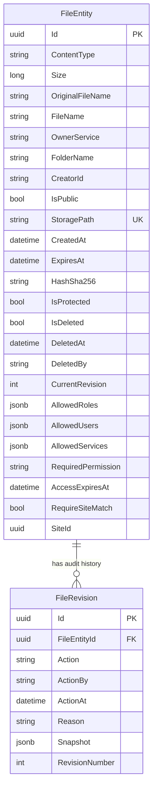
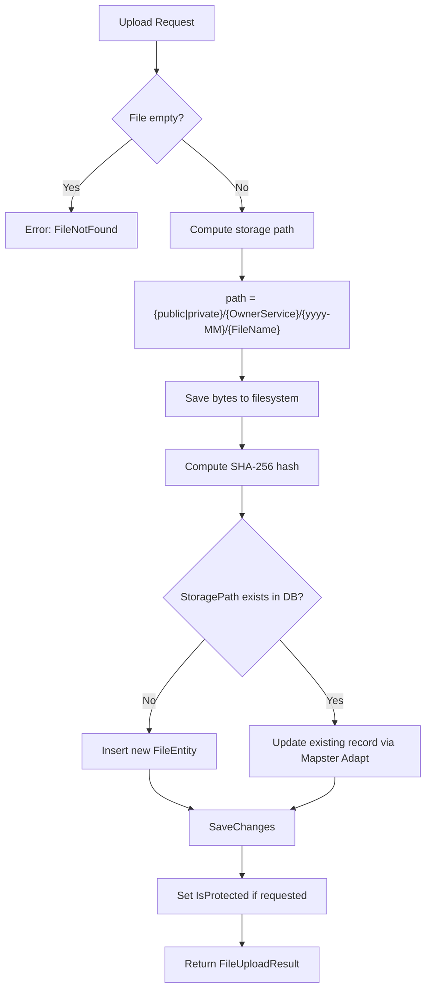
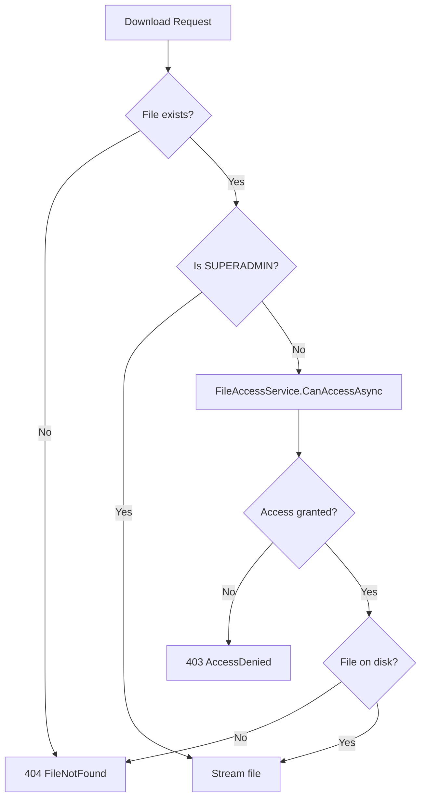
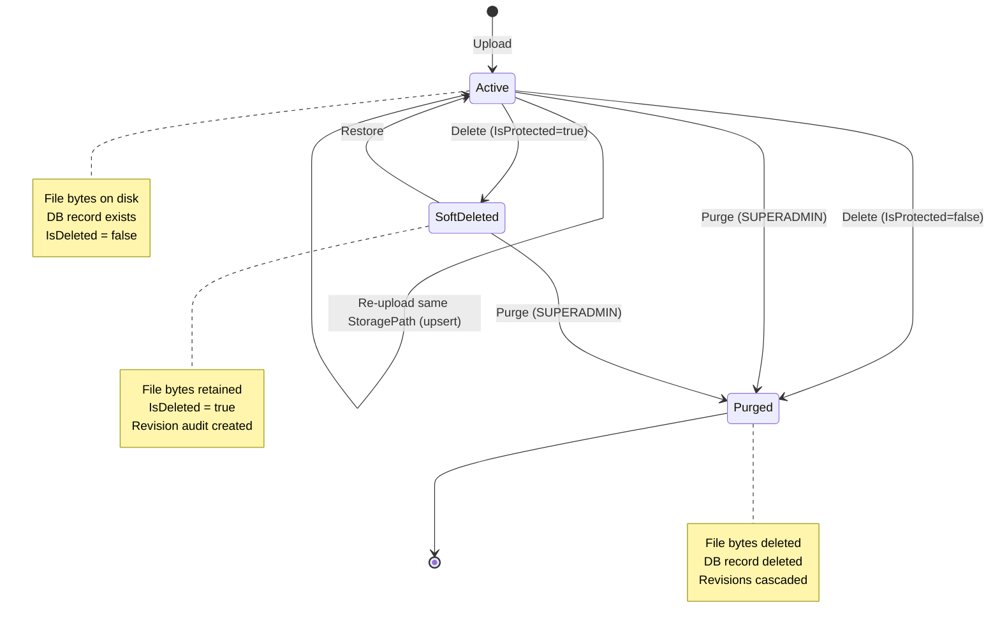
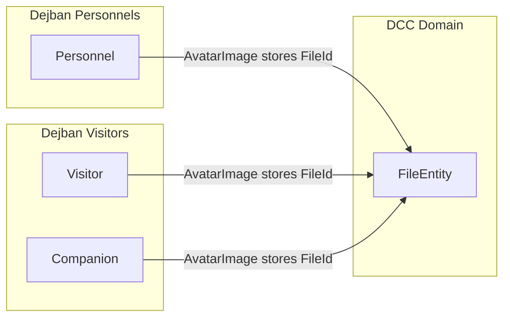
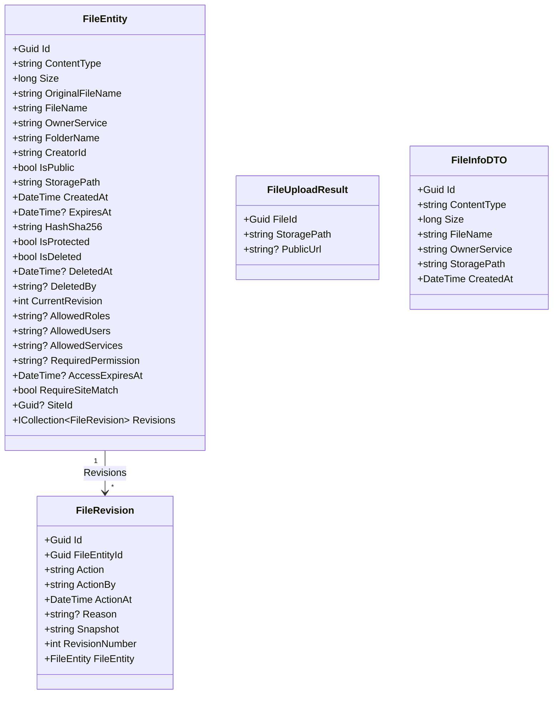

# DCC Domain Model

> Complete domain reverse-engineering for the Document Control Center module.

---

## 1. Business Purpose

DCC is the platform's **centralized document and media store**. It answers:

- Where are uploaded files physically stored?
- What metadata describes each file (owner, type, size, hash)?
- Who can download a file?
- What happened to a file over its lifetime (audit)?

Business domains that **reference** DCC but do not own file bytes:

| Domain | Usage | Stored reference |
|--------|-------|------------------|
| Dejban Personnels | Employee avatar photo | `Personnel.AvatarImage` = DCC `FileId` (string) |
| Dejban Visitors | Visitor photo | `Visitor.AvatarImage` = DCC `FileId` |
| Dejban Visitors | Companion photos | `Companion.AvatarImage` = DCC `FileId` |
| IdentityServer | Potential avatar storage | `DCCFolders.IdentityServer_Avatars` defined but unused |

---

## 2. Conceptual Domain Model

---

## 3. Aggregate Analysis

### 3.1 Aggregate Root: `FileEntity`

**Location:** `Microservices/DCC/Domain/Entities/FileEntity.cs`

The file record is the natural aggregate root. All operations (upload, download, delete, restore, purge) key off `FileEntity.Id` or `StoragePath`.

**Identity:** `Guid Id` (generated by EF/database on insert)

**Uniqueness invariant:** `StoragePath` has a unique index — the same physical path cannot map to two records. Upload logic upserts if path collision occurs.

### 3.2 Entity: `FileRevision`

**Location:** `Microservices/DCC/Domain/Entities/FileRevision.cs`

Child entity capturing point-in-time snapshots of `FileEntity` state after significant actions.

**Relationship:** Many-to-one with cascade delete — purging a file removes all revisions.

---

## 4. Entity Attribute Reference

### 4.1 FileEntity — Core Metadata

| Property | Type | Description |
|----------|------|-------------|
| `ContentType` | string | MIME type (from upload) |
| `Size` | long | Byte size of file content |
| `OriginalFileName` | string | Client-provided filename |
| `FileName` | string | Storage filename (often `{entityId}.jpg`) |
| `OwnerService` | string | Logical owner (e.g. `Dejban.Visitors`) |
| `FolderName` | string | Logical folder (e.g. `visitors/photos`) |
| `CreatorId` | string | ID of creating entity/user |
| `StoragePath` | string | Relative path under storage root |
| `HashSha256` | string | SHA-256 hex digest computed after save |
| `CreatedAt` | DateTime | UTC creation timestamp (default `UtcNow`) |
| `ExpiresAt` | DateTime? | Optional file expiry (not enforced in handlers) |

### 4.2 FileEntity — Visibility & Access

| Property | Type | Description |
|----------|------|-------------|
| `IsPublic` | bool | If true, any authenticated user can download |
| `RequireSiteMatch` | bool | If true, caller's site IDs must include `SiteId` |
| `SiteId` | Guid? | Associated site (set from uploader's JWT on upload) |
| `AllowedRoles` | string? (JSONB) | Planned: JSON array of role names |
| `AllowedUsers` | string? (JSONB) | Planned: JSON array of user IDs |
| `AllowedServices` | string? (JSONB) | Planned: JSON array of service names |
| `RequiredPermission` | string? | Planned: permission claim required |
| `AccessExpiresAt` | DateTime? | Planned: time-bound access (check commented out) |

### 4.3 FileEntity — Lifecycle

| Property | Type | Description |
|----------|------|-------------|
| `IsProtected` | bool | If true, delete becomes soft delete |
| `IsDeleted` | bool | Soft delete flag |
| `DeletedAt` | DateTime? | When soft deleted |
| `DeletedBy` | string? | User ID who deleted |
| `CurrentRevision` | int | Incremented on soft delete/restore |

---

## 5. Value Objects

**None defined.** The domain uses primitive types and strings throughout. Candidates that could be value objects in a richer model:

| Concept | Current representation |
|---------|------------------------|
| Storage path | `string StoragePath` |
| Content hash | `string HashSha256` |
| Owner identity | `string OwnerService` + `string FolderName` |
| Access policy | Multiple nullable columns |

---

## 6. Repositories & Specifications

| Pattern | Status |
|---------|--------|
| `IFileRepository` | **Not implemented** |
| Specifications | **Not implemented** |
| Query logic | Inline in `FileService` (`FindAsync`, `ExecuteUpdateAsync`, LINQ) |

`FileService` acts as an **application/infrastructure service** combining repository and domain service responsibilities.

---

## 7. Business Rules

### 7.1 Upload Rules

**Additional upload behavior:**

- `SiteId` = first site ID from uploader's JWT claims
- `IsPublic` determines `public/` vs `private/` root folder
- FluentValidation requires: File, OwnerService, FileName, FolderName, CreatorId, IsPublic, RequireSiteMatch

### 7.2 Download Rules

**Current access logic (simplified):**

1. User must be authenticated (unless SUPERADMIN bypass)
2. If `IsPublic` → grant
3. If `RequireSiteMatch` and `SiteId` set → caller header site IDs must contain `SiteId`
4. Otherwise → grant (permissive default for non-public, non-site-matched files)

### 7.3 Delete Rules

| Condition | Action |
|-----------|--------|
| File not found | Return false → handler returns 404 |
| `IsProtected = false` | **Hard delete** — remove DB row + delete file from disk |
| `IsProtected = true` | **Soft delete** — set `IsDeleted=true`, create `FileRevision` with action `SoftDeleted` |

### 7.4 Restore Rules

| Condition | Action |
|-----------|--------|
| File not found OR not deleted | Return false |
| Otherwise | Clear delete flags, increment revision, create `FileRevision` with action `Restored` |

### 7.5 Purge Rules

| Condition | Action |
|-----------|--------|
| Caller not SUPERADMIN | 403 AccessDenied |
| File not found | 404 |
| Otherwise | Delete file from disk + `ExecuteDeleteAsync` on DB row (cascades revisions) |

---

## 8. Entity Lifecycle & State Transitions

### State Matrix

| State | `IsDeleted` | On disk | Downloadable | Metadata query |
|-------|-------------|---------|--------------|----------------|
| Active | false | Yes | Yes (with access rules) | Yes |
| SoftDeleted | true | Yes | Not checked in handlers* | Yes (GetFileMeta still works) |
| Purged | N/A | No | No | No |

*Download handler does not explicitly check `IsDeleted` — potential gap.

---

## 9. FileRevision — Audit Model

Revisions are created on:

| Action | Trigger | `Action` value |
|--------|---------|----------------|
| Soft delete | `SoftDeleteFileAsync` | `SoftDeleted` |
| Restore | `RestoreFileAsync` | `Restored` |

Each revision stores:

- Full JSON snapshot of `FileEntity` at that moment
- `RevisionNumber` matching `FileEntity.CurrentRevision` after increment
- `ActionBy` (user ID from JWT)
- Optional `Reason` (soft delete only)

**Not revision-tracked:** initial upload, hard delete, purge, metadata updates (`IsProtected` post-upload).

---

## 10. Domain Events

**None.** DCC does not raise or publish domain events. State changes are synchronous and local.

MassTransit outbox tables exist for infrastructure-level message reliability, not domain event sourcing.

---

## 11. Relationships to External Domains

**Coupling pattern:** Loose reference by GUID string. No FK constraint across databases. If DCC file is purged, Dejban retains a dangling reference.

**OwnerService values in production code:**

| Value | FolderName | FileName pattern |
|-------|------------|------------------|
| `Dejban.Personnels` | `personnel/photos` | `{personnelId}.jpg` |
| `Dejban.Visitors` | `visitors/photos` | `{visitorId}.jpg` |
| `Dejban.Visitors` | `visitors/companion-photos` | `{scheduleId}-companion-{index}.jpg` |

---

## 12. DTOs & Contracts

### 12.1 Internal DTOs

| Type | Location | Usage |
|------|----------|-------|
| `DownloadFileResponse` | Application/Queries | Stream + content type + filename |
| `FileInfoDTO` | Common/FileService | Metadata returned by GetFileMeta |
| `FileUploadResult` | Common/Abstractions/Contracts | Upload response (FileId, StoragePath, PublicUrl) |
| `FileSearchResultDTO` | Common/FileService | Defined but no search endpoint exposed |

### 12.2 Command/Query Records

| Record | Implements |
|--------|------------|
| `UploadFileCommand` | `IRequest<ErrorOr<FileUploadResult>>` |
| `DeleteFileCommand` | `IRequest<ErrorOr<Deleted>>` |
| `RestoreFileCommand` | `IRequest<ErrorOr<Deleted>>` |
| `PurgeFileCommand` | `IRequest<ErrorOr<Deleted>>` |
| `DownloadFileQuery` | `IRequest<ErrorOr<DownloadFileResponse>>` |
| `GetFileMetaQuery` | `IRequest<ErrorOr<object>>` |

---

## 13. Error Catalog

Defined in `Application/Files/Errors/Errors.Files.cs`:

| Code | HTTP | Persian message (localized) |
|------|------|----------------------------|
| `Files.FileNotFound` | 404 | فایل یافت نشد |
| `Files.AccessDenied` | 403 | شما مجوز انجام این عملیات را ندارید |
| `Files.DbOperationFailed` | 500 | خطا در عملیات پایگاه داده |
| `Files.RevisionDeletionFailed` | 500 | حذف نسخه‌های فایل با شکست مواجه شد |

Client-side DCC errors (`IDccHttpClient`):

| Code | Meaning |
|------|---------|
| `Dcc.UploadFailed` | Non-success HTTP status from DCC |
| `Dcc.InvalidResponse` | Empty/unparseable response body |
| `Dcc.Exception` | Network or unexpected error |

---

## 14. Validation Rules

### UploadFileCommandValidator

All fields required with localized Persian messages:

- `File`, `OwnerService`, `FileName`, `FolderName`, `CreatorId`, `IsPublic`, `RequireSiteMatch`

### DeleteFileCommandValidator

- `Id` must not be empty

---

## 15. Indexes & Query Patterns

From `FileEntityConfiguration`:

| Index | Unique | Query support |
|-------|--------|---------------|
| `StoragePath` | Yes | Upsert detection, deduplication |
| `FileName` | No | Search by filename |
| `OriginalFileName` | No | Search |
| `FolderName` | No | Filter by logical folder |
| `OwnerService` | No | Filter by owning service |
| `SiteId` | No | Site-scoped queries (manual) |
| `AccessExpiresAt` | No | Planned expiry queries |

`FileService.SearchFilesAsync` supports filtering by `ownerService` and keyword (filename contains) but **no API endpoint exposes search**.

---

## 16. Domain Model Maturity Assessment

| DDD Building Block | Present | Notes |
|--------------------|---------|-------|
| Aggregate Root | Partial | FileEntity treated as root; no encapsulation |
| Entities | Yes | FileEntity, FileRevision |
| Value Objects | No | |
| Domain Services | No | Logic in FileService |
| Repositories | No | |
| Specifications | No | |
| Domain Events | No | |
| Factories | No | EF + object initializer |
| Ubiquitous Language | Partial | OwnerService, FolderName, IsProtected |

The model is **database-centric with audit support**, optimized for delivery speed over strict DDD purity. Access control fields suggest **planned RBAC** that is partially scaffolded but not active.

---

## 17. Complete Domain Class Diagram

---

## 18. Related Documentation

- [Workspace Map](./DCC_WORKSPACE_MAP.md)
- [Architecture](./DCC_ARCHITECTURE.md)
- [Onboarding Guide](./DCC_ONBOARDING_GUIDE.md)
