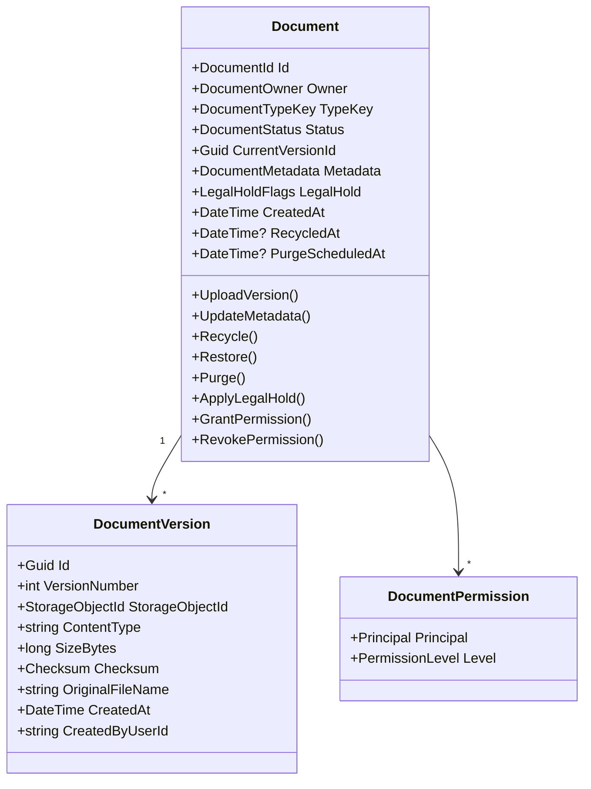
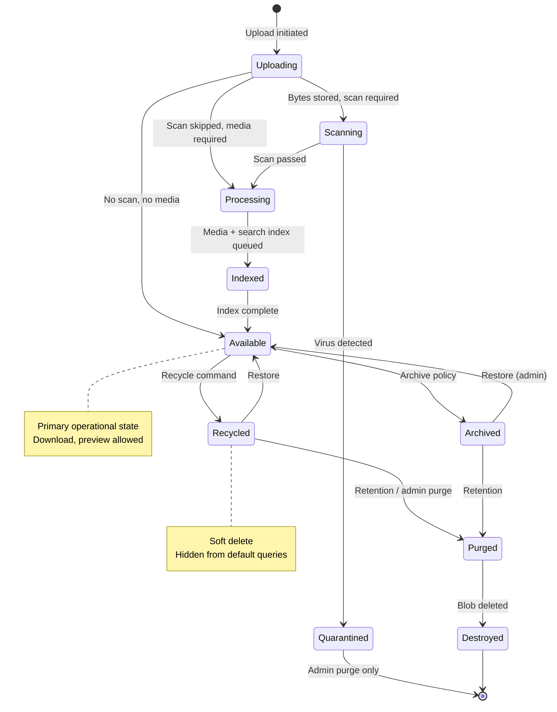
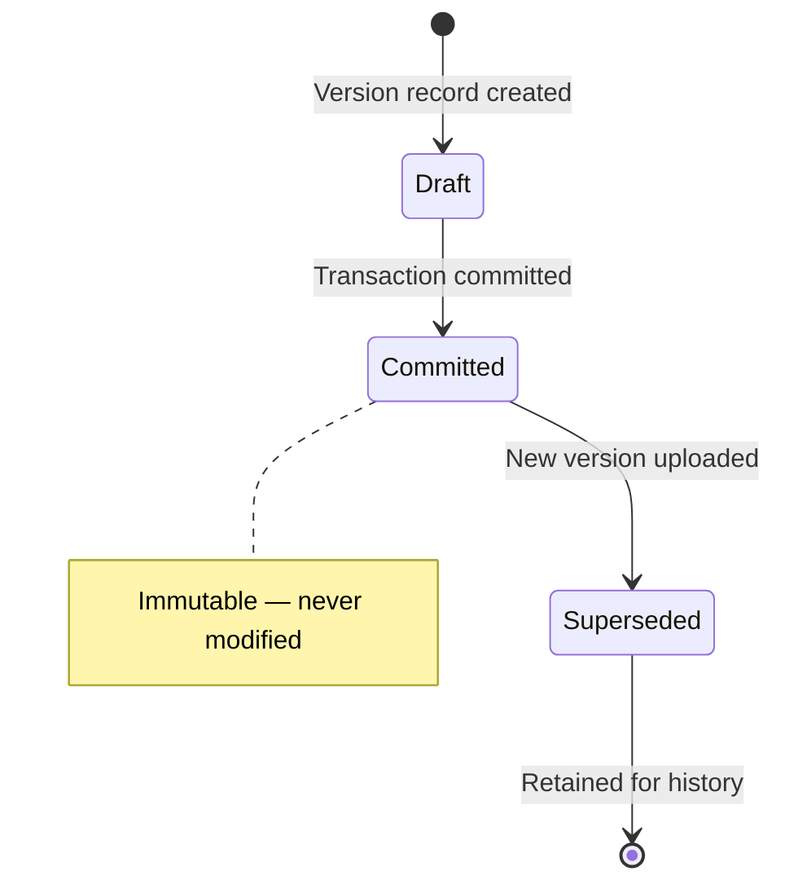
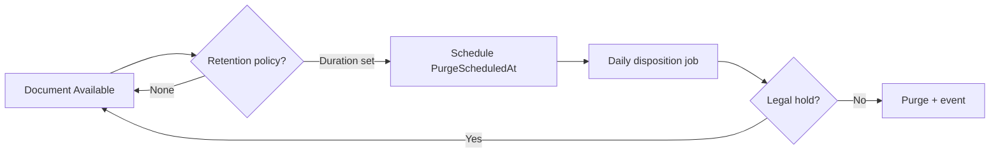

# DCC Domain Specification

> Domain model, aggregates, value objects, and lifecycle — normative specification

---

## 1. Bounded Context

**Single bounded context:** `DCC Platform`

**Ubiquitous language:**

| Term | Definition |
|------|------------|
| Document | Platform registry entry for one logical file across versions |
| DocumentVersion | Immutable point-in-time content snapshot |
| StorageObject | Binary blob in object store |
| DocumentType | Registered classification with metadata and processing profile |
| Owner | Business module + entity reference |
| Recycle | Soft delete — recoverable |
| Purge | Permanent destruction |
| Disposition | Retention-driven purge |

---

## 2. Core Aggregates

### 2.1 Document (Aggregate Root)

**Identity:** `DocumentId` (Guid)

**Consistency boundary:** Document + active permissions + current version pointer + metadata + lifecycle state.



#### Invariants

1. `CurrentVersionId` must reference an existing version when Status ≥ Available
2. Cannot Purge when LegalHold active
3. Cannot transition to Available until virus scan passes (if required by DocumentType)
4. OwnerModule must match registered DocumentType.Module
5. Metadata must validate against active MetadataProfile

#### Domain Events (internal)

- `DocumentCreatedDomainEvent`
- `DocumentVersionAddedDomainEvent`
- `DocumentMetadataUpdatedDomainEvent`
- `DocumentRecycledDomainEvent`
- `DocumentRestoredDomainEvent`
- `DocumentPurgedDomainEvent`
- `DocumentLegalHoldAppliedDomainEvent`

---

### 2.2 DocumentTypeRegistry (Aggregate Root)

**Identity:** `DocumentTypeKey` (value object — e.g. `Personnel.Avatar`)

| Property | Description |
|----------|-------------|
| Module | Owning Dejban module prefix |
| Key | Short key within module |
| MetadataProfileId | FK to profile version |
| MediaProfile | Thumbnail sizes, OCR enabled, watermark |
| RetentionPolicyId | Optional default retention |
| ScanRequired | bool |
| IsActive | bool |

**Operations:** `Register`, `UpdateProfile`, `Deactivate`

**Why separate aggregate:** DocumentType changes must not lock Document rows; event-driven profile version bump.

---

### 2.3 RetentionPolicy (Aggregate Root)

**Identity:** `RetentionPolicyId`

| Property | Description |
|----------|-------------|
| Name | Admin label |
| DurationDays | int? null = indefinite |
| ActionOnExpiry | Recycle / Purge / Archive |
| AppliesToDocumentTypes | Collection of keys |

**Operations:** `EvaluateDispositionDate(Document)`, `ScheduleDisposition`

---

### 2.4 StorageObject (Entity — not aggregate root)

Referenced by DocumentVersion. May be shared when dedup enabled.

| Property | Description |
|----------|-------------|
| StorageObjectId | Guid |
| Provider | enum |
| Bucket | string |
| ObjectKey | string |
| Checksum | SHA-256 |
| SizeBytes | long |
| Tier | Hot/Warm/Cold |
| ReferenceCount | int |

**Rule:** Delete blob only when ReferenceCount reaches 0.

---

### 2.5 MediaAsset (Entity)

Derivative linked to DocumentVersion.

| Property | Description |
|----------|-------------|
| MediaAssetId | Guid |
| DocumentVersionId | Guid |
| AssetKind | Thumbnail / Preview / OcrText |
| StorageObjectId | Guid |
| Variant | e.g. `256x256` |

---

### 2.6 AuditEntry (Append-only Entity)

Not part of Document aggregate — separate consistency (insert only).

| Property | Description |
|----------|-------------|
| AuditEntryId | long (identity) |
| DocumentId | Guid? |
| Actor | Principal |
| Action | enum |
| Timestamp | DateTime UTC |
| CorrelationId | Guid |
| Details | JSONB |

---

### 2.7 Folder (Aggregate Root — Phase C, Optional)

**Deferred aggregate** for admin organization.

| Property | Description |
|----------|-------------|
| FolderId | Guid |
| SiteId | Guid |
| ParentFolderId | Guid? |
| Path | materialized `/a/b/c` |
| Name | string |

Documents may optionally reference FolderId — modules use Owner model primarily.

---

## 3. Value Objects

| Value Object | Members | Validation |
|--------------|---------|------------|
| `DocumentId` | Guid | non-empty |
| `DocumentOwner` | OwnerModule, OwnerEntityId, SiteId | module registered |
| `OwnerModule` | string | matches `Dejban.[A-Za-z]+` |
| `DocumentTypeKey` | Module + Key | registered |
| `Checksum` | Hex string SHA-256 | 64 chars |
| `ContentType` | MIME | RFC 6838 pattern |
| `FileName` | string | no path separators, no `..` |
| `StorageKey` | string | generated, opaque |
| `Principal` | Type (User/Service/Role), Id | |
| `PermissionLevel` | Read / Write / Delete / Admin | flags |
| `SignedUrlToken` | string, ExpiresAt | |
| `DocumentMetadata` | JsonDocument | validates against schema |
| `LegalHoldFlags` | bool + Reason + AppliedBy | |

All value objects: **immutable**, equality by value.

---

## 4. Document Lifecycle State Machine



### Status enum

`Uploading | Scanning | Processing | Indexed | Available | Quarantined | Recycled | Archived | Purged | Destroyed`

**Module-visible states:** Available, Recycled, Quarantined (error), Purged (via event only).

---

## 5. Version Lifecycle



- Version numbers: monotonic int starting at 1
- `Document.CurrentVersionId` points to latest Committed
- Old versions remain for audit; blob retained until retention policy disposes

---

## 6. Deletion Strategy

| Operation | Blob | Document row | Versions | Module reference |
|-----------|------|--------------|----------|------------------|
| **Recycle** | Retained | Status=Recycled | Retained | Module keeps DocumentId until notified |
| **Restore** | Retained | Status=Available | Retained | — |
| **Purge** | Deleted async | Status=Purged then removed | Cascade archive | **DocumentPurged event** — module clears ref |
| **Legal hold** | Retained | Blocks recycle/purge | Retained | — |

**Default for non-protected types:** Recycle (not immediate purge).

---

## 7. Retention Strategy



Modules register policy per DocumentType — DCC executes.

---

## 8. Archive Strategy

- Transition `Available → Archived`
- StorageObject tier → Cold (S3 IA / Glacier)
- Document still queryable; download may have higher latency
- Restore to Hot on explicit admin/module request

---

## 9. Domain Events → Integration Events

| Domain Event | Integration Event | Subscribers |
|--------------|-------------------|-------------|
| DocumentCreated | `DocumentCreatedIntegrationEvent` | Search indexer, modules |
| DocumentVersionAdded | `DocumentVersionAddedIntegrationEvent` | Search, media |
| DocumentRecycled | `DocumentRecycledIntegrationEvent` | Modules (optional UI) |
| DocumentRestored | `DocumentRestoredIntegrationEvent` | Modules |
| DocumentPurged | `DocumentPurgedIntegrationEvent` | **Modules must clear refs** |
| DocumentQuarantined | `DocumentQuarantinedIntegrationEvent` | Modules, admin |
| RetentionDispositionDue | `DocumentRetentionExpiredIntegrationEvent` | Modules |

See [Event Specification](./DCC_EVENT_SPECIFICATION.md) for payloads.

---

## 10. Tags and Labels

**Tag** — value object collection on Document (optional, Phase B).

- Flat strings, lowercase normalized
- Set by module at upload/update
- Indexed in search — not stored in module DB

**Label** — platform-managed (e.g. `Retention.Applied`, `LegalHold`) — not user tags.

---

## 11. SearchIndex (Read Model)

Not an aggregate — projection document in OpenSearch:

```json
{
  "documentId": "uuid",
  "ownerModule": "Dejban.Personnels",
  "ownerEntityId": "uuid",
  "siteId": "uuid",
  "documentTypeKey": "Personnel.Avatar",
  "fileName": "photo.jpg",
  "contentType": "image/jpeg",
  "metadata": { },
  "extractedText": "",
  "tags": [],
  "status": "Available",
  "createdAt": "ISO8601",
  "sizeBytes": 12345
}
```

---

## 12. Preview and Thumbnail

**MediaAsset** entities — not exposed as paths.

- `Preview` — PDF or HTML render of document
- `Thumbnail` — JPEG PNG variants (128, 256, 512)

Lifecycle: Generated async on `DocumentVersionAdded`; regeneration on new version.

---

## 13. Aggregate Consistency Rules Summary

| Operation | Atomic with |
|-----------|-------------|
| Upload | Document + Version + StorageObject ref + Outbox |
| Recycle | Document status + Audit + Outbox |
| Purge | Document status + Outbox; blob delete eventual |
| Permission grant | DocumentPermission + Audit |
| Media complete | MediaAsset + Document status transition + Outbox |

---

## Related Documents

- [Architecture Bible](./DCC_ARCHITECTURE_BIBLE.md)
- [Database Specification](./DCC_DATABASE_SPECIFICATION.md)
- [Event Specification](./DCC_EVENT_SPECIFICATION.md)
