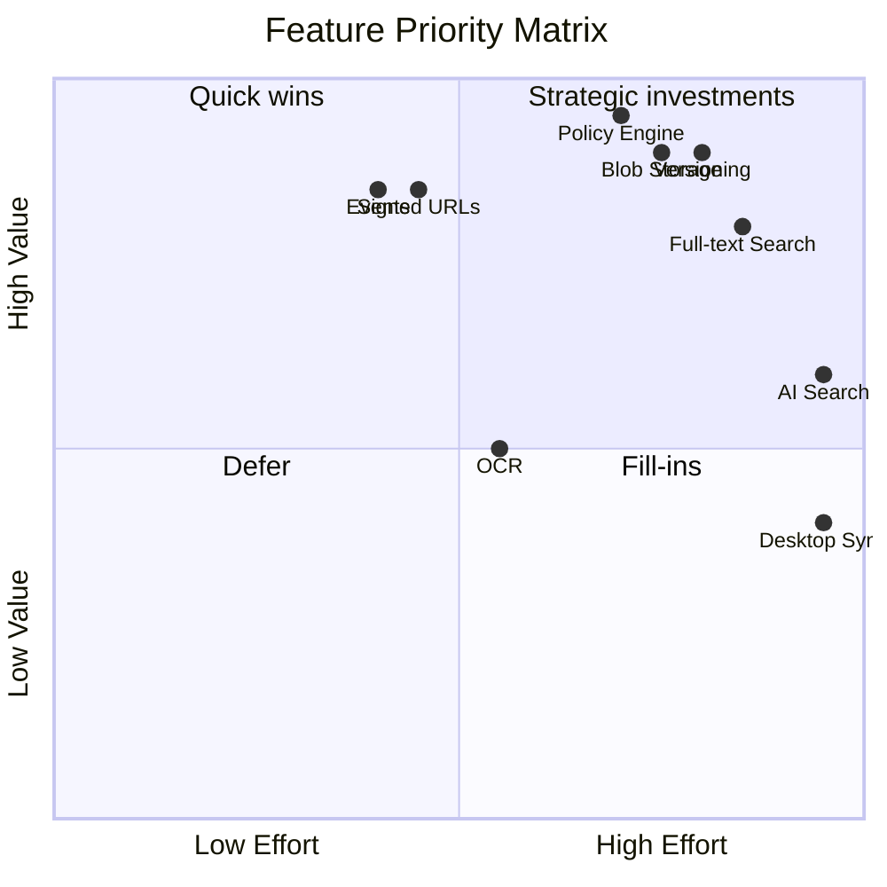

# DCC Enterprise Features

> Feature gap analysis vs enterprise DMS platforms and complete target capability catalog  
> Benchmarks: SharePoint, OpenText, Alfresco, M-Files, Laserfiche, Google Drive Enterprise, OneDrive Enterprise, Box Enterprise

---

## 1. Enterprise Benchmark Summary

### 1.1 Current DCC Capability Matrix

| Capability Area | SharePoint / M-Files / Box | DCC Today | Gap |
|-----------------|---------------------------|-----------|-----|
| Folder hierarchy | Full tree + metadata views | Flat logical `FolderName` string | **Critical** |
| Versioning | Major/minor, restore any version | Upsert overwrite only | **Critical** |
| Check-in / Check-out | Lock + co-authoring controls | None | **High** |
| Metadata templates | Content types, custom fields | Fixed columns | **Critical** |
| Workflow / Approval | Built-in or integrated BPM | None | **High** |
| Retention / Records | Policy-driven disposition | Columns unused | **Critical** |
| Full-text search | Enterprise search index | None | **Critical** |
| OCR / Preview | Native or integrated | None | **High** |
| External sharing | Guest links, expiry, password | Public flag only | **High** |
| Audit | Immutable access + change log | Partial FileRevision | **High** |
| Storage backend | Cloud-scale blob + CDN | Local disk | **Critical** |
| Encryption | At-rest + in-transit + BYOK | TLS only | **High** |
| Virus scan | Integrated | None | **High** |
| Quota / Analytics | Per-tenant dashboards | None | **Medium** |
| Digital signature | Integrated | None | **Medium** |
| AI search | Copilot / semantic | None | **Medium** (future) |
| Mobile / Sync | Native clients | None | **Medium** (Phase D) |
| Webhooks / SDK | Extensive | HTTP upload only | **High** |

### 1.2 Benchmark Insights by Platform

| Platform | Strengths to emulate | Not applicable to DCC |
|----------|---------------------|----------------------|
| **SharePoint** | Content types, libraries, retention labels, eDiscovery | Office 365 suite integration |
| **OpenText** | Records management, compliance, archive | Mainframe-era UX patterns |
| **Alfresco** | Open API, content repository model, workflow | Heavy Java stack |
| **M-Files** | Metadata-driven views (no folders) | Desktop-first UX |
| **Laserfiche** | Capture, forms, records | Forms builder |
| **Google Drive / OneDrive** | Sync, sharing links, preview | Consumer UX as primary |
| **Box** | Enterprise sharing, watermark, Box Shield | Standalone SaaS billing |

**DCC differentiation:** Metadata-driven governance integrated with PayamGostar sites, IdentityServer claims, and Dejban modules — not a standalone document portal.

---

## 2. Feature Module Groups

Features are organized into **10 modules** (see [Module Roadmap](./DCC_MODULE_ROADMAP.md)):

1. Core Storage
2. Document Management
3. Search & Discovery
4. Security & Compliance
5. Workflow & Lifecycle
6. Media Processing
7. Sharing & Delivery
8. Administration & Analytics
9. Integrations & Platform
10. AI & Intelligence

Each feature below uses ID prefix: `F-{MODULE}-{NNN}`.

---

## 3. Core Storage Module

### F-CORE-001 — Pluggable Storage Providers (S3 / Azure Blob / MinIO)

| Field | Detail |
|-------|--------|
| **Business problem** | Local disk prevents horizontal scaling, DR, and cloud deployment |
| **Business value** | Unlimited scale, geo-redundancy, ops-managed backups |
| **Technical value** | Stateless DCC pods, standard cloud patterns |
| **Enterprise pattern** | Box/SharePoint use object storage + CDN; Alfresco binary store abstraction |
| **Suggested architecture** | `IObjectStore` port with `S3ObjectStore`, `AzureBlobStore`, `FileSystemStore` (dev); blob key = `{tenant}/{documentId}/{versionId}` |
| **Aggregates** | `StoredObject` (value object within Document aggregate) |
| **Entities** | `StorageLocation`, `StorageProviderConfig` |
| **Value objects** | `BlobKey`, `StorageTier`, `Checksum` |
| **Database** | `StorageProviders`, `DocumentBlobs` (provider, bucket, key, tier, size, checksum) |
| **API** | Internal; transparent to existing upload/download |
| **CQRS** | Commands unchanged; infrastructure adapter swap |
| **Events** | `BlobStored`, `BlobDeleted`, `BlobTierChanged` |
| **Storage** | Primary migration from path-based to key-based |
| **Complexity** | High |
| **Est. time** | 8–10 weeks |
| **Dependencies** | Phase A security fixes |
| **Risks** | Migration of existing files; dual-write period |
| **Priority** | P0 |

---

### F-CORE-002 — Folder Hierarchy & Nested Folders

| Field | Detail |
|-------|--------|
| **Business problem** | Files scattered by convention string; no navigable structure |
| **Business value** | Users and admins organize content like enterprise libraries |
| **Technical value** | Parent FK enables permission inheritance, quota scoping |
| **Enterprise pattern** | SharePoint document libraries; M-Files uses views but equivalent hierarchy |
| **Suggested architecture** | `Folder` aggregate with materialized path or closure table; `Document.FolderId` FK |
| **Aggregates** | `Folder` (root per Site + OwnerService) |
| **Entities** | `Folder`, `FolderPermission` |
| **Value objects** | `FolderPath`, `Depth` |
| **Database** | `Folders` (Id, SiteId, ParentId, Name, Path, OwnerService) |
| **API** | `POST/GET/DELETE /api/v2/Folders`, move document |
| **CQRS** | `CreateFolder`, `MoveDocument`, `RenameFolder`, `ListFolderContents` |
| **Events** | `FolderCreated`, `DocumentMoved` |
| **Complexity** | Medium |
| **Est. time** | 4–6 weeks |
| **Dependencies** | F-SEC-001 authorization |
| **Risks** | Cycle detection; deep nesting performance |
| **Priority** | P0 |

---

### F-CORE-003 — Collections / Smart Folders

| Field | Detail |
|-------|--------|
| **Business problem** | Same document needed in multiple logical groupings |
| **Business value** | Curated sets (e.g., "Audit Q3 2026") without duplication |
| **Technical value** | Many-to-many without copy |
| **Enterprise pattern** | SharePoint views; Box collections |
| **Suggested architecture** | `Collection` aggregate with `CollectionMembership`; optional saved query for dynamic collections |
| **Aggregates** | `Collection` |
| **Entities** | `Collection`, `CollectionItem` |
| **Database** | `Collections`, `CollectionItems` |
| **API** | CRUD collections, add/remove documents |
| **Complexity** | Medium |
| **Est. time** | 3–4 weeks |
| **Dependencies** | F-CORE-002 |
| **Priority** | P2 |

---

### F-CORE-004 — Bulk Upload / Download / Delete

| Field | Detail |
|-------|--------|
| **Business problem** | Single-file API inadequate for migration and batch ops |
| **Business value** | Admin efficiency, migration from legacy systems |
| **Technical value** | Async job pattern, zip streaming |
| **Enterprise pattern** | Box bulk API; SharePoint migration tools |
| **Suggested architecture** | `BulkJob` aggregate; background worker; zip to temp blob |
| **Aggregates** | `BulkOperationJob` |
| **Entities** | `BulkJob`, `BulkJobItem` |
| **Database** | `BulkJobs` with status, progress |
| **API** | `POST /bulk/upload`, `GET /bulk/{id}/status`, download zip |
| **CQRS** | Commands enqueue; queries poll status |
| **Events** | `BulkJobCompleted`, `BulkJobFailed` |
| **Complexity** | Medium |
| **Est. time** | 4–5 weeks |
| **Dependencies** | F-CORE-001, background processing (F-INT-003) |
| **Priority** | P1 |

---

### F-CORE-005 — Storage Tiering & Lifecycle (Hot / Warm / Cold)

| Field | Detail |
|-------|--------|
| **Business problem** | All files on expensive storage regardless of age |
| **Business value** | Cost optimization at scale |
| **Technical value** | S3 IA / Glacier transitions |
| **Enterprise pattern** | OpenText archive tiers; Azure Blob tiers |
| **Suggested architecture** | Policy engine triggers tier transition jobs |
| **Aggregates** | Extends `Document` with `StorageTier` |
| **Database** | `StorageTier`, `TierChangedAt` on blob |
| **Events** | `BlobTierTransitioned` |
| **Complexity** | Medium |
| **Est. time** | 3–4 weeks |
| **Dependencies** | F-CORE-001, F-WF-002 retention |
| **Priority** | P2 |

---

## 4. Document Management Module

### F-DOC-001 — Document Versioning (Major Versions)

| Field | Detail |
|-------|--------|
| **Business problem** | Overwrite destroys history; no rollback |
| **Business value** | Compliance, mistake recovery, audit |
| **Technical value** | Immutable version blobs; metadata points to current |
| **Enterprise pattern** | SharePoint version history; Alfresco versioning |
| **Suggested architecture** | `Document` aggregate root; `DocumentVersion` entity; new blob per version |
| **Aggregates** | `Document` (replaces `FileEntity` concept) |
| **Entities** | `Document`, `DocumentVersion` |
| **Value objects** | `VersionNumber`, `VersionLabel` |
| **Database** | `Documents`, `DocumentVersions` (VersionNumber, BlobId, CreatedBy, Comment) |
| **API** | `POST /documents/{id}/versions`, `GET /versions`, `POST /versions/{v}/restore` |
| **CQRS** | `UploadNewVersion`, `ListVersions`, `RestoreVersion` |
| **Events** | `DocumentVersionCreated`, `DocumentVersionRestored` |
| **Complexity** | High |
| **Est. time** | 6–8 weeks |
| **Dependencies** | F-CORE-001, F-DOC-002 |
| **Risks** | Storage multiplication; migration from FileEntity |
| **Priority** | P0 |

---

### F-DOC-002 — Check-In / Check-Out & File Locking

| Field | Detail |
|-------|--------|
| **Business problem** | Concurrent edits cause lost updates |
| **Business value** | Controlled editing for regulated documents |
| **Technical value** | Optimistic + pessimistic lock modes |
| **Enterprise pattern** | SharePoint checkout; OpenText lock |
| **Suggested architecture** | `DocumentLock` value object on aggregate; Redis for distributed lock TTL |
| **Aggregates** | `Document.CheckOut()` / `CheckIn()` |
| **Entities** | `DocumentLock` (DocumentId, LockedBy, LockedAt, ExpiresAt) |
| **Database** | `DocumentLocks` or Redis-only with DB audit |
| **API** | `POST /documents/{id}/checkout`, `checkin`, `undo-checkout` |
| **Events** | `DocumentCheckedOut`, `DocumentCheckedIn` |
| **Complexity** | Medium |
| **Est. time** | 3–4 weeks |
| **Dependencies** | F-DOC-001 |
| **Priority** | P1 |

---

### F-DOC-003 — Metadata Templates (Content Types)

| Field | Detail |
|-------|--------|
| **Business problem** | Fixed schema cannot model visitor forms, contracts, IDs |
| **Business value** | Structured metadata for search and workflow |
| **Technical value** | JSON Schema or EAV with validation |
| **Enterprise pattern** | SharePoint content types; Alfresco models |
| **Suggested architecture** | `ContentType` aggregate defines fields; `Document.Metadata` validated JSONB |
| **Aggregates** | `ContentType`, `Document` |
| **Entities** | `ContentType`, `ContentTypeField`, `DocumentMetadata` |
| **Value objects** | `FieldDefinition`, `MetadataValue` |
| **Database** | `ContentTypes`, `ContentTypeFields`, extend `Documents.Metadata` JSONB |
| **API** | Admin CRUD content types; upload specifies ContentTypeId |
| **CQRS** | `DefineContentType`, `ValidateMetadata` (domain service) |
| **Events** | `ContentTypePublished` |
| **Complexity** | High |
| **Est. time** | 6–8 weeks |
| **Dependencies** | F-DOC-001 |
| **Priority** | P1 |

---

### F-DOC-004 — Tags & Labels

| Field | Detail |
|-------|--------|
| **Business problem** | Flat folder insufficient for cross-cutting classification |
| **Business value** | Flexible discovery and policy application |
| **Technical value** | Many-to-many tag index |
| **Enterprise pattern** | SharePoint managed metadata; Box metadata |
| **Suggested architecture** | `Tag` entity; `DocumentTag` join; optional `RetentionLabel` link |
| **Database** | `Tags`, `DocumentTags` |
| **API** | Tag CRUD, assign/remove tags |
| **Complexity** | Low |
| **Est. time** | 2 weeks |
| **Dependencies** | F-DOC-001 |
| **Priority** | P1 |

---

### F-DOC-005 — Recycle Bin & Restore

| Field | Detail |
|-------|--------|
| **Business problem** | Hard delete and inconsistent soft delete |
| **Business value** | User confidence; accidental delete recovery |
| **Technical value** | Unified deleted state with retention window |
| **Enterprise pattern** | SharePoint recycle bin (two-stage) |
| **Suggested architecture** | `Document.MarkDeleted()` → RecycleBin; purge after N days |
| **Aggregates** | `Document` state machine: Active → Recycled → Purged |
| **Database** | `DeletedAt`, `RecycledBy`, `PurgeScheduledAt` |
| **API** | `GET /recycle-bin`, `POST /restore`, admin `purge` |
| **Events** | `DocumentRecycled`, `DocumentRestored`, `DocumentPurged` |
| **Complexity** | Medium |
| **Est. time** | 3 weeks |
| **Dependencies** | F-DOC-001, F-SEC-001 |
| **Priority** | P0 |

---

### F-DOC-006 — Duplicate Detection (Hash-Based)

| Field | Detail |
|-------|--------|
| **Business problem** | Same file uploaded repeatedly wastes storage |
| **Business value** | Storage savings, single canonical copy |
| **Technical value** | Content-addressable storage option |
| **Enterprise pattern** | Box dedup; SharePoint optional |
| **Suggested architecture** | On upload, query by SHA-256 + size; optional link vs new blob |
| **Aggregates** | `Document` may reference shared `Blob` |
| **Database** | Unique index on `(Checksum, Size)` per tenant; `BlobRefCount` |
| **Complexity** | Medium |
| **Est. time** | 3 weeks |
| **Dependencies** | F-CORE-001, hash on upload (fix Phase 2 gap) |
| **Priority** | P1 |

---

## 5. Search & Discovery Module

### F-SRC-001 — Full-Text Search

| Field | Detail |
|-------|--------|
| **Business problem** | Finding documents by GUID impossible for humans |
| **Business value** | Productivity, support, investigations |
| **Technical value** | OpenSearch/Elasticsearch index |
| **Enterprise pattern** | All benchmark platforms |
| **Suggested architecture** | Index on `DocumentUploaded`, `MetadataChanged`; OpenSearch cluster |
| **Aggregates** | Read model: `DocumentSearchProjection` |
| **Database** | OpenSearch index + optional PostgreSQL `DocumentSearchView` |
| **API** | `GET /search?q=&filters=` |
| **CQRS** | Query-only; index via integration event handlers |
| **Events** | Consume: `DocumentCreated`, `MetadataUpdated`, `DocumentDeleted` |
| **Complexity** | High |
| **Est. time** | 8–10 weeks |
| **Dependencies** | F-DOC-001, F-DOC-003, event infrastructure |
| **Priority** | P1 |

---

### F-SRC-002 — Faceted / Filtered Search

| Field | Detail |
|-------|--------|
| **Business problem** | Keyword search alone insufficient at scale |
| **Business value** | Filter by site, type, date, tag, owner |
| **Technical value** | OpenSearch aggregations |
| **Enterprise pattern** | M-Files metadata views |
| **Suggested architecture** | Search query builder with tenant-scoped filters |
| **Complexity** | Medium |
| **Est. time** | 3 weeks (with F-SRC-001) |
| **Priority** | P2 |

---

### F-SRC-003 — AI Semantic Search

| Field | Detail |
|-------|--------|
| **Business problem** | Keywords miss conceptual matches |
| **Business value** | "Find safety incident photos near loading dock" |
| **Technical value** | Vector embeddings + hybrid search |
| **Enterprise pattern** | SharePoint Copilot; Box AI |
| **Suggested architecture** | Embedding pipeline on OCR text + metadata; pgvector or OpenSearch kNN |
| **Complexity** | Very High |
| **Est. time** | 10–12 weeks |
| **Dependencies** | F-SRC-001, F-MED-001 OCR, LLM service |
| **Risks** | Cost, hallucination in ranking |
| **Priority** | P3 (Phase D) |

---

### F-SRC-004 — Similarity Search (Visual / Content)

| Field | Detail |
|-------|--------|
| **Business problem** | Find duplicate or related images across visitors |
| **Business value** | Security investigations, duplicate visitor detection |
| **Technical value** | Perceptual hash or CLIP embeddings for images |
| **Enterprise pattern** | Specialized DAM systems |
| **Complexity** | High |
| **Est. time** | 6–8 weeks |
| **Dependencies** | F-MED-003 thumbnails, vector store |
| **Priority** | P3 |

---

## 6. Security & Compliance Module

### F-SEC-001 — Unified Authorization Policy Engine

| Field | Detail |
|-------|--------|
| **Business problem** | Phase 2: delete/metadata/download auth broken |
| **Business value** | Enterprise-grade access control |
| **Technical value** | Single `IAccessPolicyEvaluator` used by all handlers |
| **Enterprise pattern** | SharePoint permissions; Box shield policies |
| **Suggested architecture** | Policy based on: site, role, permission claim, document ACL, content type defaults |
| **Aggregates** | `DocumentPermission`, `FolderPermission` |
| **Entities** | `AccessControlEntry` (principal, permission, inherit) |
| **Value objects** | `Principal`, `PermissionSet` |
| **Database** | `AccessControlEntries`, `PermissionInheritance` |
| **API** | `POST /documents/{id}/permissions` |
| **CQRS** | `GrantAccess`, `RevokeAccess`; query `EffectivePermissions` |
| **Events** | `DocumentAccessGranted`, `DocumentAccessRevoked` |
| **Complexity** | High |
| **Est. time** | 6–8 weeks |
| **Dependencies** | IdentityServer claims (existing) |
| **Priority** | P0 |

---

### F-SEC-002 — Encryption at Rest

| Field | Detail |
|-------|--------|
| **Business problem** | Blob storage readable if disk compromised |
| **Business value** | Compliance (ISO 27001, local regulations) |
| **Technical value** | SSE-S3, Azure SSE, or client-side envelope encryption |
| **Enterprise pattern** | All enterprise platforms |
| **Suggested architecture** | Provider-native encryption + optional CMK per site |
| **Complexity** | Medium |
| **Est. time** | 3–4 weeks |
| **Dependencies** | F-CORE-001 |
| **Priority** | P1 |

---

### F-SEC-003 — Virus / Malware Scanning

| Field | Detail |
|-------|--------|
| **Business problem** | Uploaded malware threatens platform |
| **Business value** | Security liability reduction |
| **Technical value** | Async scan gate before `DocumentAvailable` state |
| **Enterprise pattern** | Box Shield; SharePoint ATP |
| **Suggested architecture** | ClamAV sidecar or cloud API; `ScanStatus` on document |
| **Aggregates** | `Document` states: PendingScan → Available / Quarantined |
| **Database** | `ScanStatus`, `ScanResult`, `ScannedAt` |
| **Events** | `DocumentScanCompleted`, `DocumentQuarantined` |
| **Complexity** | Medium |
| **Est. time** | 4 weeks |
| **Dependencies** | F-INT-003 background jobs |
| **Priority** | P1 |

---

### F-SEC-004 — Audit Timeline (Access + Change)

| Field | Detail |
|-------|--------|
| **Business problem** | FileRevision incomplete; no access log |
| **Business value** | Investigations, compliance audits |
| **Technical value** | Append-only audit store |
| **Enterprise pattern** | All enterprise DMS |
| **Suggested architecture** | `AuditEntry` immutable log; separate table or SIEM stream |
| **Entities** | `AuditEntry` (Who, What, When, Where, DocumentId, Action, IP) |
| **Database** | `AuditLog` (partitioned by month) |
| **API** | `GET /documents/{id}/audit`, admin export |
| **Events** | All domain events fan-in to audit |
| **Complexity** | Medium |
| **Est. time** | 4 weeks |
| **Dependencies** | Event infrastructure |
| **Priority** | P0 |

---

### F-SEC-005 — Download History & Access History

| Field | Detail |
|-------|--------|
| **Business problem** | Cannot answer "who viewed this file" |
| **Business value** | Insider threat detection, compliance |
| **Technical value** | Structured access events |
| **Enterprise pattern** | Box insights; SharePoint audit |
| **Suggested architecture** | Hook on every download/preview; store in audit |
| **Complexity** | Low |
| **Est. time** | 2 weeks |
| **Dependencies** | F-SEC-004 |
| **Priority** | P1 |

---

### F-SEC-006 — Watermark on Download/Preview

| Field | Detail |
|-------|--------|
| **Business problem** | Sensitive docs leak via screenshots |
| **Business value** | Deterrent + traceability (user id in watermark) |
| **Technical value** | PDF/image processing pipeline |
| **Enterprise pattern** | Box; SharePoint sensitivity labels |
| **Complexity** | Medium |
| **Est. time** | 3–4 weeks |
| **Dependencies** | F-MED-002 preview |
| **Priority** | P2 |

---

### F-SEC-007 — Digital Signature Integration

| Field | Detail |
|-------|--------|
| **Business problem** | Contracts and approvals need non-repudiation |
| **Business value** | Legal validity for signed documents |
| **Technical value** | Integrate national PKI or DocuSign-style API |
| **Enterprise pattern** | Laserfiche signatures; OpenText |
| **Suggested architecture** | `SignatureRequest` aggregate; webhook from provider |
| **Complexity** | Very High |
| **Est. time** | 10+ weeks |
| **Dependencies** | F-WF-001, legal review |
| **Priority** | P3 |

---

## 7. Workflow & Lifecycle Module

### F-WF-001 — Approval Workflow

| Field | Detail |
|-------|--------|
| **Business problem** | Documents published without review |
| **Business value** | Quality and compliance gates |
| **Technical value** | Integrate RequestTracker or external BPMN |
| **Enterprise pattern** | SharePoint approval; Alfresco workflows |
| **Suggested architecture** | `WorkflowInstance` linked to Document; states Draft → InReview → Approved → Published |
| **Aggregates** | `Document`, `WorkflowInstance` (or external) |
| **Database** | `WorkflowInstances`, `Document.Status` |
| **API** | Submit for approval, approve, reject |
| **Events** | `DocumentSubmittedForReview`, `DocumentApproved`, `DocumentRejected` |
| **Complexity** | High |
| **Est. time** | 8 weeks (with RequestTracker integration) |
| **Dependencies** | F-DOC-001, RequestTracker |
| **Priority** | P2 |

---

### F-WF-002 — Retention Policy & Disposition

| Field | Detail |
|-------|--------|
| **Business problem** | `ExpiresAt` exists but unenforced |
| **Business value** | Legal retention compliance, auto-disposal |
| **Technical value** | Scheduled jobs apply policies |
| **Enterprise pattern** | SharePoint retention labels; OpenText records |
| **Suggested architecture** | `RetentionPolicy` aggregate; labels on document/folder |
| **Aggregates** | `RetentionPolicy`, `RetentionLabel` |
| **Entities** | `RetentionPolicy`, `DispositionJob` |
| **Database** | `RetentionPolicies`, `DocumentRetentionLabels`, `PurgeScheduledAt` |
| **API** | Admin policy CRUD; apply label |
| **Events** | `RetentionApplied`, `DocumentDisposed` |
| **Complexity** | High |
| **Est. time** | 6–8 weeks |
| **Dependencies** | F-DOC-005, F-INT-003 |
| **Priority** | P1 |

---

### F-WF-003 — Legal Hold

| Field | Detail |
|-------|--------|
| **Business problem** | Litigation requires freeze despite retention |
| **Business value** | eDiscovery compliance |
| **Technical value** | Override flag blocks purge |
| **Enterprise pattern** | All records management systems |
| **Suggested architecture** | `LegalHold` on site/folder/document; blocks disposition |
| **Complexity** | Medium |
| **Est. time** | 3 weeks |
| **Dependencies** | F-WF-002 |
| **Priority** | P2 |

---

### F-WF-004 — Archive Policy

| Field | Detail |
|-------|--------|
| **Business problem** | Active storage cluttered with old content |
| **Business value** | Performance + cost |
| **Technical value** | Move to cold tier + read-only flag |
| **Enterprise pattern** | OpenText archive |
| **Complexity** | Medium |
| **Est. time** | 3 weeks |
| **Dependencies** | F-CORE-005, F-WF-002 |
| **Priority** | P2 |

---

## 8. Media Processing Module

### F-MED-001 — OCR (Text Extraction)

| Field | Detail |
|-------|--------|
| **Business problem** | Scanned PDFs/images not searchable |
| **Business value** | Searchable archives |
| **Technical value** | Tesseract or cloud OCR; index extracted text |
| **Enterprise pattern** | Laserfiche capture; SharePoint |
| **Suggested architecture** | Async worker; store `ExtractedText` on document |
| **Complexity** | Medium |
| **Est. time** | 4–5 weeks |
| **Dependencies** | F-INT-003, F-SRC-001 |
| **Priority** | P2 |

---

### F-MED-002 — Preview Generation

| Field | Detail |
|-------|--------|
| **Business problem** | Must download to view |
| **Business value** | UX; faster review |
| **Technical value** | PDF/image preview cache in blob |
| **Enterprise pattern** | All enterprise drives |
| **Suggested architecture** | LibreOffice headless / cloud converter; `PreviewBlobId` |
| **Complexity** | High |
| **Est. time** | 6 weeks |
| **Dependencies** | F-CORE-001, F-INT-003 |
| **Priority** | P1 |

---

### F-MED-003 — Thumbnail Generation

| Field | Detail |
|-------|--------|
| **Business problem** | Grid views need thumbnails |
| **Business value** | UI performance and UX |
| **Technical value** | ImageMagick / SkiaSharp async |
| **Enterprise pattern** | Standard DAM |
| **Complexity** | Low |
| **Est. time** | 2 weeks |
| **Dependencies** | F-INT-003 |
| **Priority** | P1 |

---

### F-MED-004 — PDF Conversion

| Field | Detail |
|-------|--------|
| **Business problem** | Mixed formats hard to unify |
| **Business value** | Standard deliverable format |
| **Technical value** | Conversion pipeline |
| **Complexity** | Medium |
| **Est. time** | 3 weeks |
| **Priority** | P2 |

---

### F-MED-005 — Image Optimization & Compression

| Field | Detail |
|-------|--------|
| **Business problem** | Raw photos consume bandwidth/storage |
| **Business value** | Cost and mobile performance |
| **Technical value** | Auto-resize on upload for defined content types |
| **Complexity** | Low |
| **Est. time** | 2 weeks |
| **Priority** | P2 |

---

## 9. Sharing & Delivery Module

### F-SHR-001 — Signed URLs / Temporary Links

| Field | Detail |
|-------|--------|
| **Business problem** | Public static `/files` bypasses auth (Phase 2) |
| **Business value** | Controlled time-limited access |
| **Technical value** | HMAC-signed URL or short-lived JWT with object key |
| **Enterprise pattern** | S3 presigned; Box shared links |
| **Suggested architecture** | `ShareLink` aggregate: token, expiry, max downloads, password optional |
| **Aggregates** | `ShareLink` |
| **Entities** | `ShareLink`, `ShareLinkAccessLog` |
| **Database** | `ShareLinks` |
| **API** | `POST /documents/{id}/share`, public `GET /s/{token}` |
| **Events** | `ShareLinkCreated`, `ShareLinkAccessed` |
| **Complexity** | Medium |
| **Est. time** | 4 weeks |
| **Dependencies** | F-SEC-001, F-CORE-001 |
| **Priority** | P0 |

---

### F-SHR-002 — External Sharing (Guest Access)

| Field | Detail |
|-------|--------|
| **Business problem** | Partners need files without platform accounts |
| **Business value** | B2B collaboration |
| **Technical value** | Guest tokens + audit |
| **Enterprise pattern** | Box external collab |
| **Complexity** | Medium |
| **Est. time** | 4 weeks |
| **Dependencies** | F-SHR-001 |
| **Priority** | P2 |

---

### F-SHR-003 — CDN Integration

| Field | Detail |
|-------|--------|
| **Business problem** | Origin serving does not scale globally |
| **Business value** | Latency and bandwidth cost |
| **Technical value** | CloudFront / Azure CDN in front of blob |
| **Complexity** | Medium |
| **Est. time** | 3 weeks |
| **Dependencies** | F-CORE-001, F-SHR-001 |
| **Priority** | P2 |

---

## 10. Administration & Analytics Module

### F-ADM-001 — Quota Management

| Field | Detail |
|-------|--------|
| **Business problem** | Unbounded storage growth |
| **Business value** | Cost control per site/service |
| **Technical value** | Counter aggregate per tenant |
| **Database** | `StorageQuotas`, `StorageUsage` materialized |
| **API** | Admin set quota; upload rejects over limit |
| **Complexity** | Medium |
| **Est. time** | 3 weeks |
| **Priority** | P1 |

---

### F-ADM-002 — Storage Analytics Dashboard

| Field | Detail |
|-------|--------|
| **Business problem** | No visibility into usage patterns |
| **Business value** | Capacity planning, chargeback |
| **Technical value** | Time-series metrics to Reporting service |
| **Events** | Emit usage metrics daily |
| **Complexity** | Medium |
| **Est. time** | 4 weeks |
| **Dependencies** | Reporting microservice |
| **Priority** | P2 |

---

### F-ADM-003 — Storage Health Monitoring

| Field | Detail |
|-------|--------|
| **Business problem** | No health checks (Phase 2) |
| **Business value** | Uptime SLA |
| **Technical value** | `/health` blob R/W test, index lag, queue depth |
| **Complexity** | Low |
| **Est. time** | 1–2 weeks |
| **Priority** | P0 |

---

### F-ADM-004 — Admin Console API

| Field | Detail |
|-------|--------|
| **Business problem** | No admin operations surface |
| **Business value** | Ops without DB access |
| **Technical value** | Secured admin endpoints |
| **Complexity** | Medium |
| **Est. time** | Ongoing with each module |
| **Priority** | P1 |

---

## 11. Integrations & Platform Module

### F-INT-001 — Public API v2 + OpenAPI

| Field | Detail |
|-------|--------|
| **Business problem** | v1 API tied to FileEntity; incomplete auth |
| **Business value** | Stable integrator contract |
| **Technical value** | Versioned REST + OpenAPI 3.1 |
| **Complexity** | Medium |
| **Est. time** | 4 weeks (parallel with domain redesign) |
| **Priority** | P0 |

---

### F-INT-002 — Platform SDK (.NET + TypeScript)

| Field | Detail |
|-------|--------|
| **Business problem** | `IDccClient` upload-only, wrong abstraction level |
| **Business value** | Developer velocity across modules |
| **Technical value** | NuGet + npm packages wrapping v2 API |
| **Complexity** | Medium |
| **Est. time** | 4–6 weeks |
| **Dependencies** | F-INT-001 |
| **Priority** | P1 |

---

### F-INT-003 — Background Processing / Job Engine

| Field | Detail |
|-------|--------|
| **Business problem** | All work synchronous in HTTP request |
| **Business value** | Reliable long-running ops |
| **Technical value** | MassTransit consumers + Hangfire/Quartz (align with Dejban) |
| **Suggested architecture** | Job queue for scan, OCR, bulk, tier transition |
| **Complexity** | Medium |
| **Est. time** | 4 weeks |
| **Priority** | P0 |

---

### F-INT-004 — Webhooks

| Field | Detail |
|-------|--------|
| **Business problem** | Consumers poll or miss lifecycle changes |
| **Business value** | Real-time integration |
| **Technical value** | Webhook subscriptions + retry + signature |
| **Aggregates** | `WebhookSubscription` |
| **Database** | `WebhookSubscriptions`, `WebhookDeliveries` |
| **Events** | Fan-out from all integration events |
| **Complexity** | Medium |
| **Est. time** | 4 weeks |
| **Dependencies** | Event infrastructure |
| **Priority** | P1 |

---

### F-INT-005 — Domain & Integration Events (Complete)

| Field | Detail |
|-------|--------|
| **Business problem** | Phase 2: outbox configured, nothing published |
| **Business value** | Dejban modules react to delete/purge |
| **Technical value** | Transactional outbox on every mutation |
| **Events** | `DocumentCreated`, `DocumentUpdated`, `DocumentDeleted`, `DocumentPurged`, `DocumentVersionAdded` |
| **Complexity** | Medium |
| **Est. time** | 4 weeks |
| **Priority** | P0 |

---

### F-INT-006 — IdentityServer Endpoint Sync

| Field | Detail |
|-------|--------|
| **Business problem** | GetDCCServiceEndpoints not wired |
| **Business value** | Endpoint-based permissions in admin UI |
| **Technical value** | Wire existing consumer |
| **Complexity** | Low |
| **Est. time** | 1 week |
| **Priority** | P0 |

---

### F-INT-007 — Comments & Annotations

| Field | Detail |
|-------|--------|
| **Business problem** | No collaboration on documents |
| **Business value** | Review feedback in context |
| **Technical value** | Separate `Comment` aggregate |
| **Database** | `Comments`, `Annotations` (page, coords, text) |
| **Complexity** | Medium |
| **Est. time** | 4 weeks |
| **Priority** | P3 |

---

### F-INT-008 — Notification Integration

| Field | Detail |
|-------|--------|
| **Business problem** | Users unaware of shares, approvals, quota |
| **Business value** | Engagement and SLA adherence |
| **Technical value** | Publish to notification bus (email/SMS/push via platform) |
| **Complexity** | Medium |
| **Est. time** | 3 weeks |
| **Dependencies** | Platform notification service |
| **Priority** | P2 |

---

## 12. AI & Intelligence Module (Phase D)

### F-AI-001 — Content Moderation

| Field | Detail |
|-------|--------|
| **Business problem** | Inappropriate uploads |
| **Business value** | Brand and legal protection |
| **Technical value** | Vision API classification async |
| **Complexity** | Medium |
| **Est. time** | 4 weeks |
| **Priority** | P3 |

---

### F-AI-002 — Auto-Classification / Tagging

| Field | Detail |
|-------|--------|
| **Business problem** | Manual metadata entry slow |
| **Business value** | Faster ingestion |
| **Technical value** | LLM suggests content type + tags |
| **Complexity** | High |
| **Est. time** | 6 weeks |
| **Priority** | P3 |

---

### F-AI-003 — Document Summarization

| Field | Detail |
|-------|--------|
| **Business problem** | Long documents slow review |
| **Business value** | Executive summaries |
| **Complexity** | Medium |
| **Est. time** | 4 weeks |
| **Priority** | P3 |

---

## 13. Client & Sync (Phase D)

### F-CLI-001 — Desktop Sync Client

| Field | Detail |
|-------|--------|
| **Business problem** | Offline and bulk file workflows |
| **Business value** | Parity with OneDrive/Box |
| **Technical value** | Delta sync API, conflict resolution |
| **Complexity** | Very High |
| **Est. time** | 16+ weeks |
| **Priority** | P4 |

---

### F-CLI-002 — Mobile SDK / Optimized API

| Field | Detail |
|-------|--------|
| **Business problem** | Mobile guards need photo capture upload |
| **Business value** | Field operations |
| **Technical value** | Resumable upload, compression |
| **Complexity** | High |
| **Est. time** | 8 weeks |
| **Priority** | P3 |

---

## 14. Feature Priority Matrix

---

## 15. Complete Feature Checklist (Missing vs Today)

| Feature | ID | Phase |
|---------|-----|-------|
| Folder hierarchy | F-CORE-002 | A |
| Nested folders | F-CORE-002 | A |
| Collections | F-CORE-003 | C |
| Tags | F-DOC-004 | B |
| Labels | F-DOC-004 | B |
| Metadata templates | F-DOC-003 | B |
| Dynamic metadata | F-DOC-003 | B |
| Document versioning | F-DOC-001 | A |
| Version history | F-DOC-001 | A |
| Check-In / Check-Out | F-DOC-002 | B |
| File locking | F-DOC-002 | B |
| Approval workflow | F-WF-001 | C |
| Review workflow | F-WF-001 | C |
| Retention policy | F-WF-002 | B |
| Archive policy | F-WF-004 | C |
| Recycle Bin | F-DOC-005 | A |
| Restore | F-DOC-005 | A |
| Duplicate detection | F-DOC-006 | B |
| Hash validation | F-DOC-006 | B |
| Integrity verification | F-DOC-006 | B |
| S3 / Azure / MinIO | F-CORE-001 | A |
| CDN | F-SHR-003 | C |
| Encryption | F-SEC-002 | B |
| OCR | F-MED-001 | C |
| Thumbnails | F-MED-003 | B |
| Preview | F-MED-002 | B |
| Watermark | F-SEC-006 | C |
| Digital signature | F-SEC-007 | D |
| PDF conversion | F-MED-004 | C |
| Image optimization | F-MED-005 | B |
| Bulk operations | F-CORE-004 | B |
| File sharing | F-SHR-001 | A |
| External sharing | F-SHR-002 | C |
| Temporary links | F-SHR-001 | A |
| Signed URLs | F-SHR-001 | A |
| Download history | F-SEC-005 | B |
| Access history | F-SEC-005 | B |
| Audit timeline | F-SEC-004 | A |
| Comments | F-INT-007 | D |
| Annotations | F-INT-007 | D |
| Full-text search | F-SRC-001 | B |
| AI semantic search | F-SRC-003 | D |
| Similarity search | F-SRC-004 | D |
| Virus scanning | F-SEC-003 | B |
| Content moderation | F-AI-001 | D |
| Quota management | F-ADM-001 | B |
| Storage analytics | F-ADM-002 | C |
| Storage health | F-ADM-003 | A |
| Lifecycle policies | F-WF-002 | B |
| Notifications | F-INT-008 | C |
| Background jobs | F-INT-003 | A |
| Event-driven | F-INT-005 | A |
| Workflow engine | F-WF-001 | C |
| Webhooks | F-INT-004 | B |
| Public API v2 | F-INT-001 | A |
| SDK | F-INT-002 | B |
| Desktop sync | F-CLI-001 | D |
| Mobile SDK | F-CLI-002 | D |

---

## Related Documents

- [Product Vision](./DCC_PRODUCT_VISION.md)
- [Module Roadmap](./DCC_MODULE_ROADMAP.md)
- [Implementation Plan](./DCC_IMPLEMENTATION_PLAN.md)
