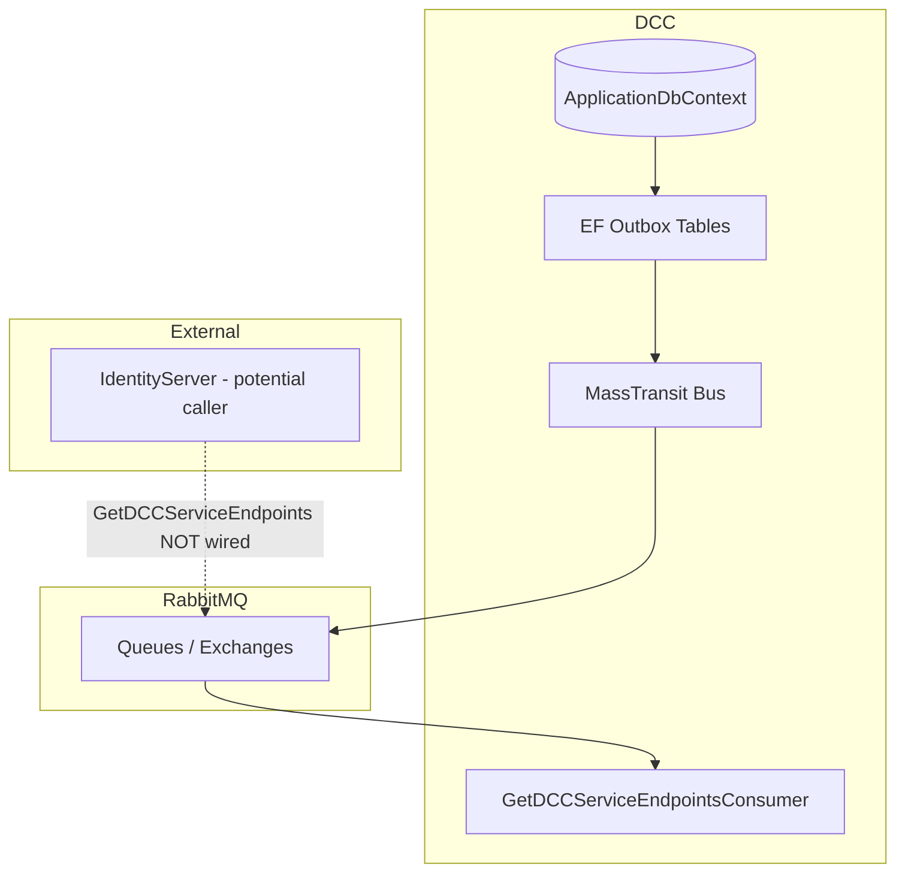

# DCC Event Audit

> Phase 2 Engineering Audit — MassTransit, RabbitMQ, Outbox/Inbox, Consumers, Publishers  
> Scope: All event-related code in DCC and its MassTransit configuration

---

## Audit Summary

| Severity | Count |
|----------|-------|
| Critical | 0 |
| High | 4 |
| Medium | 8 |
| Low | 6 |
| **Total** | **18** |

**Overall event maturity:** Infrastructure-heavy, behavior-light. DCC configures enterprise messaging patterns but publishes no domain or integration events and consumes only one RPC-style request.

---

## Event Architecture Overview

---

## Inventory

| Component | Count | Location |
|-----------|-------|----------|
| Domain Events | 0 | — |
| Integration Events (published) | 0 | — |
| Consumers | 1 | `GetDCCServiceEndpointsConsumer` |
| Publishers | 0 | — |
| Request/Response handlers | 1 | Same consumer |
| Outbox | Configured | `ServiceCollectionExtensions.AddMassTransit` |
| Inbox | Tables only | Migration `Initial` |
| Hosted outbox dispatcher | MassTransit built-in | Bus outbox |
| Background jobs | 0 | — |

---

## High Findings

### AUD-EVT-001 — Endpoint Discovery Consumer Not Wired to IdentityServer Sync

| Field | Value |
|-------|-------|
| **Severity** | High |
| **Category** | Integration / Dead Infrastructure |
| **File** | `Microservices/IdentityServer/Application/ClaimsManagement/Queries/GetServicesEndpoints/GetServicesEndpointsQueryHandler.cs` |
| **Class** | `GetServicesEndpointsQueryHandler` |
| **Method** | `Handle` (lines 26–31) |
| **Problem** | IdentityServer requests endpoints from Dejban, ACLServer, and RequestTracker only. `GetDCCServiceEndpoints` consumer exists in DCC but is never called during permission catalog sync. |
| **Technical impact** | DCC API routes absent from IdentityServer endpoint claims. Endpoint-based authorization cannot grant DCC permissions. |
| **Business impact** | Incomplete RBAC catalog; DCC endpoints invisible to admin permission UI. |
| **Recommendation** | Add `IRequestClient<GetDCCServiceEndpoints>` to IdentityServer sync task list (and Reporting if applicable). |
| **Priority** | P1 |

**Related DCC file:** `Application/Consumers/GetDCCServiceEndpointsConsumer.cs`

---

### AUD-EVT-002 — Outbox Configured Without Producers

| Field | Value |
|-------|-------|
| **Severity** | High |
| **Category** | Over-Engineering / Operational Cost |
| **File** | `Microservices/DCC/Abstractions/Extensions/ServiceCollectionExtensions.cs` |
| **Class** | `ServiceCollectionExtensions` |
| **Method** | `AddMassTransit` (lines 130–134, 140–146) |
| **Problem** | Full EF outbox (bus outbox + endpoint outbox callback) configured but no handler publishes messages via outbox. |
| **Technical impact** | Outbox tables polled continuously; Serilog filters explicitly suppress outbox SQL noise (Program.cs lines 23–27). Operational overhead with zero benefit. |
| **Business impact** | Extra DB load and complexity without event-driven capabilities. |
| **Recommendation** | Remove outbox until first integration event needed, or publish events (FileUploaded, FileDeleted) to justify infrastructure. |
| **Priority** | P2 |

---

### AUD-EVT-003 — ClaimService MassTransit Client Unused

| Field | Value |
|-------|-------|
| **Severity** | High |
| **Category** | Integration / Dead Code |
| **File** | `Microservices/DCC/Infrastructure/Services/ClaimService.cs` |
| **Class** | `ClaimService` |
| **Method** | `GetUserSiteClaimsAsync` |
| **Problem** | Uses `IRequestClient<GetUserSiteClaims>` to call IdentityServer via RabbitMQ. Registered in DI but never consumed by DCC handlers. |
| **Technical impact** | Implies planned event-driven auth enrichment not delivered. Request client may still hold bus resources. |
| **Business impact** | Access decisions do not use live claim data from IdentityServer. |
| **Recommendation** | Integrate into `FileAccessService` or remove until required. |
| **Priority** | P2 |

---

### AUD-EVT-004 — No Domain Events for File Lifecycle

| Field | Value |
|-------|-------|
| **Severity** | High |
| **Category** | Domain Events |
| **File** | `FileService.cs`, `FileEntity.cs` |
| **Class** | `FileService` |
| **Method** | All mutation methods |
| **Problem** | Upload, delete, restore, purge mutate state without raising domain or integration events. Dejban modules cannot react to file deletion (orphan AvatarImage references). |
| **Technical impact** | Tight coupling via synchronous HTTP upload only; no eventual consistency or cleanup workflows. |
| **Business impact** | Stale file references in Personnels/Visitors; manual cleanup required. |
| **Recommendation** | Publish `FileUploaded`, `FileDeleted`, `FilePurged` integration events via outbox. |
| **Priority** | P2 |

---

## Medium Findings

### AUD-EVT-005 — GetDCCServiceEndpointsConsumer Excluded From Outbox Callback

| Field | Value |
|-------|-------|
| **Severity** | Medium |
| **Category** | Outbox Configuration |
| **File** | `ServiceCollectionExtensions.cs` |
| **Class** | `ServiceCollectionExtensions` |
| **Method** | `AddRabbitMqConfigureEndpointsCallback` (lines 140–146) |
| **Problem** | Endpoint named `get-dccservice-endpoints` skips `UseEntityFrameworkOutbox`. Correct for request/response latency, but inconsistent with other endpoints. |
| **Technical impact** | If consumer later publishes during handling, those messages won't use outbox on this endpoint. |
| **Recommendation** | Document exclusion; revisit when consumer logic expands. |
| **Priority** | P3 |

---

### AUD-EVT-006 — Consumer Has No Error Handling or Logging

| Field | Value |
|-------|-------|
| **Severity** | Medium |
| **Category** | Observability |
| **File** | `GetDCCServiceEndpointsConsumer.cs` |
| **Class** | `GetDCCServiceEndpointsConsumer` |
| **Method** | `Consume` |
| **Problem** | No try/catch, no logging, no timeout handling. Failure relies on MassTransit retry only. |
| **Technical impact** | Silent failures in endpoint discovery RPC; IdentityServer receives empty list on timeout (if wired). |
| **Recommendation** | Add structured logging; return partial results with error flag. |
| **Priority** | P3 |

---

### AUD-EVT-007 — Retry Policy Applied Globally Without Idempotency Guards

| Field | Value |
|-------|-------|
| **Severity** | Medium |
| **Category** | Retry / Idempotency |
| **File** | `ServiceCollectionExtensions.cs` |
| **Class** | `ServiceCollectionExtensions` |
| **Method** | `AddMassTransit` (lines 154–159) |
| **Problem** | Exponential retry (5 attempts, up to 5 min) configured on all endpoints. Consumer `GetDCCServiceEndpoints` is read-only/idempotent, but future non-idempotent consumers inherit same policy. |
| **Technical impact** | Duplicate side effects if stateful consumers added without inbox deduplication. |
| **Business impact** | Future event handlers may double-process. |
| **Recommendation** | Configure per-consumer retry; use inbox for idempotent consumers. |
| **Priority** | P3 |

---

### AUD-EVT-008 — Inbox Tables Present Without Custom Idempotent Consumers

| Field | Value |
|-------|-------|
| **Severity** | Medium |
| **Category** | Inbox |
| **File** | `ApplicationDbContext.cs`, migration |
| **Class** | `ApplicationDbContext` |
| **Method** | `OnModelCreating` (line 18) |
| **Problem** | `AddInboxStateEntity()` creates inbox schema; no consumer uses `[ConsumerDefinition]` with inbox or manual dedup. |
| **Technical impact** | Schema complexity without current benefit. |
| **Recommendation** | Remove inbox until needed or document future plan. |
| **Priority** | P4 |

---

### AUD-EVT-009 — Circuit Breaker May Drop Endpoint Discovery Requests

| Field | Value |
|-------|-------|
| **Severity** | Medium |
| **Category** | Resilience |
| **File** | `ServiceCollectionExtensions.cs` |
| **Class** | `ServiceCollectionExtensions` |
| **Method** | `AddMassTransit` (lines 162–168) |
| **Problem** | Circuit breaker trips after 15 failures/minute on entire bus configuration. |
| **Technical impact** | During RabbitMQ outages, endpoint discovery fails open with empty permissions after circuit opens. |
| **Business impact** | Admin permission sync incomplete during incidents. |
| **Recommendation** | Separate receive endpoints; critical vs non-critical breakers. |
| **Priority** | P3 |

---

### AUD-EVT-010 — Tenant Context Filters on Bus Without File Event Producers

| Field | Value |
|-------|-------|
| **Severity** | Medium |
| **Category** | Tenancy |
| **File** | `ServiceCollectionExtensions.cs` |
| **Class** | `ServiceCollectionExtensions` |
| **Method** | `UsingRabbitMq` (line 151) |
| **Problem** | `UseTenantContextFilters` propagates site context on messages, but DCC publishes no tenant-scoped events. |
| **Technical impact** | Prepared for future; no validation that consumer respects tenant. |
| **Priority** | P4 |

---

### AUD-EVT-011 — No Poison Message / Dead Letter Handling Documented

| Field | Value |
|-------|-------|
| **Severity** | Medium |
| **Category** | Poison Messages |
| **File** | `ServiceCollectionExtensions.cs` |
| **Class** | `ServiceCollectionExtensions` |
| **Method** | `AddMassTransit` |
| **Problem** | Retry + circuit breaker configured; no explicit error queue, dead letter exchange, or alert on exhausted retries. |
| **Technical impact** | Failed messages may disappear or retry indefinitely depending on MT version defaults. |
| **Recommendation** | Configure `_error` queues; monitor in RabbitMQ management. |
| **Priority** | P3 |

---

### AUD-EVT-012 — Event Consistency With DB Not Applicable Yet

| Field | Value |
|-------|-------|
| **Severity** | Medium |
| **Category** | Event Consistency |
| **File** | N/A |
| **Class** | N/A |
| **Method** | N/A |
| **Problem** | File mutations do not emit events, so transactional outbox pattern provides no cross-service consistency benefit. |
| **Technical impact** | Upload succeeds in DCC but Dejban reference update is separate HTTP-less transaction — already eventually inconsistent. |
| **Recommendation** | When adding events, use outbox in same `SaveChanges` as file metadata. |
| **Priority** | P2 — forward looking |

---

## Low Findings

### AUD-EVT-013 — DisableUsageTelemetry Called

| Field | Value |
|-------|-------|
| **Severity** | Low |
| **Category** | Configuration |
| **File** | `ServiceCollectionExtensions.cs` |
| **Class** | `ServiceCollectionExtensions` |
| **Method** | `AddMassTransit` (line 128) |
| **Problem** | `DisableUsageTelemetry()` — fine for privacy; document choice. |
| **Priority** | P4 |

---

### AUD-EVT-014 — RabbitMQ Credentials in appsettings

| Field | Value |
|-------|-------|
| **Severity** | Low |
| **Category** | Security |
| **File** | `Microservices/DCC/appsettings.json` |
| **Class** | N/A |
| **Method** | N/A |
| **Problem** | Default credentials in config file (consistent with other services). |
| **Recommendation** | Use secrets manager in production. |
| **Priority** | P3 |

---

### AUD-EVT-015 — No Message Ordering Requirements Defined

| Field | Value |
|-------|-------|
| **Severity** | Low |
| **Category** | Ordering |
| **File** | N/A |
| **Class** | N/A |
| **Method** | N/A |
| **Problem** | Single consumer, RPC pattern — ordering not relevant today. |
| **Priority** | P4 — informational |

---

### AUD-EVT-016 — Duplicate Message Handling N/A for RPC Consumer

| Field | Value |
|-------|-------|
| **Severity** | Low |
| **Category** | Idempotency |
| **File** | `GetDCCServiceEndpointsConsumer.cs` |
| **Class** | `GetDCCServiceEndpointsConsumer` |
| **Method** | `Consume` |
| **Problem** | Read-only endpoint enumeration is naturally idempotent. |
| **Priority** | P4 — informational |

---

### AUD-EVT-017 — definitions.json Not DCC-Specific

| Field | Value |
|-------|-------|
| **Severity** | Low |
| **Category** | RabbitMQ |
| **File** | `Common/EventBus/eventbus_init/definitions.json` |
| **Class** | N/A |
| **Method** | N/A |
| **Problem** | Shared RabbitMQ queue definitions; no DCC-specific queue pre-declared (MassTransit auto-creates). |
| **Priority** | P4 |

---

### AUD-EVT-018 — GetUserSiteClaims Queue Exists Platform-Wide

| Field | Value |
|-------|-------|
| **Severity** | Low |
| **Category** | Integration |
| **File** | `Common/EventBus/eventbus_init/definitions.json` |
| **Class** | N/A |
| **Method** | N/A |
| **Problem** | Queue `get-user-site-claims` pre-defined; DCC `ClaimService` could use it but doesn't. |
| **Priority** | P4 |

---

## Consumer Detail: GetDCCServiceEndpointsConsumer

**File:** `Microservices/DCC/Application/Consumers/GetDCCServiceEndpointsConsumer.cs`

| Aspect | Assessment |
|--------|------------|
| Message type | `GetDCCServiceEndpoints` (marker implementing `IServiceEndpoints`) |
| Pattern | Request/response RPC |
| Response | `GetServiceEndpointsResponse` with `List<EndpointDTO>` |
| Idempotency | Safe — read-only reflection over ASP.NET endpoints |
| Side effects | None |
| Version handling | Expands `{version:apiVersion}` routes |
| OpenAPI exclusion | Skips `/openapi` routes |
| Async | `Consume` is async but no await until `RespondAsync` |
| Cancellation | Does not pass `context.CancellationToken` to response |

**Endpoint metadata source:** `EndpointDescription` attributes on controller actions (Persian descriptions).

---

## Publisher Inventory

| Event | Published? | Location |
|-------|------------|----------|
| FileUploaded | No | — |
| FileDeleted | No | — |
| FileRestored | No | — |
| FilePurged | No | — |
| Any integration event | No | — |

---

## Outbox / Inbox Table Assessment

| Table | Purpose | Used by DCC? |
|-------|---------|--------------|
| `OutboxMessage` | Reliable publish | Infrastructure only — no messages produced |
| `OutboxState` | Outbox dispatch state | MassTransit dispatcher |
| `InboxState` | Idempotent consume | No custom consumers |

**Serilog mitigation:** Program.cs filters out outbox/inbox SQL log noise — confirms polling occurs in production.

---

## Retry & Resilience Configuration

| Policy | Setting | Location |
|--------|---------|----------|
| Retry | Exponential, 5 attempts, 1s–5min | `AddMassTransit` line 154 |
| Circuit breaker | 15 failures/min, 5min reset | `AddMassTransit` line 162 |
| Consumer timeout | Not configured | Default MassTransit |
| Request timeout (ClaimService) | Not set on unused client | — |

---

## Comparison With Dejban Modules

| Capability | Dejban Module | DCC |
|------------|---------------|-----|
| Domain events | Yes | No |
| Integration events | Yes (published) | No |
| Outbox for domain events | Yes | Configured, unused |
| Inbox idempotent handlers | Yes | No |
| Quartz scheduled jobs | Yes (outbox purge) | No |
| Event-driven cross-module sync | Yes | HTTP client only |

---

## Recommended Event Roadmap (Audit Recommendations Only)

1. **Wire** `GetDCCServiceEndpoints` into IdentityServer sync (P1)
2. **Decide** keep or remove outbox until events needed (P2)
3. **Publish** file lifecycle integration events when consumers need reactive cleanup (P2)
4. **Integrate** or remove `ClaimService` (P2)
5. **Add** monitoring for error queues and outbox backlog (P3)

---

## Related Audits

- [Code Audit](./DCC_CODE_AUDIT.md)
- [Database Audit](./DCC_DATABASE_AUDIT.md)
- [Storage Audit](./DCC_STORAGE_AUDIT.md)
