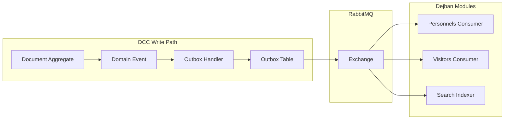
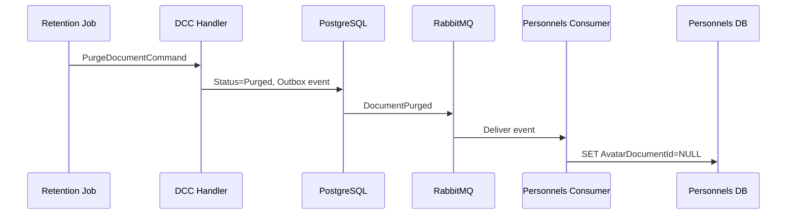

# DCC Event Specification

> Domain events and integration events — normative contracts

---

## 1. Event Architecture



| Layer | Event type | Visibility |
|-------|------------|------------|
| Domain | `*DomainEvent` | In-process only |
| Integration | `*IntegrationEvent` | Cross-service via MassTransit |
| Audit | AuditEntry insert | Query API |

**Rule:** Modules **never** subscribe to domain events — integration events only (`DCC.Contracts` assembly).

---

## 2. Integration Event Catalog

### 2.1 DocumentCreatedIntegrationEvent

```json
{
  "eventId": "uuid",
  "occurredAt": "ISO8601",
  "documentId": "uuid",
  "ownerModule": "Dejban.Personnels",
  "ownerEntityId": "uuid",
  "documentTypeKey": "Personnel.Avatar",
  "siteId": "uuid",
  "versionNumber": 1,
  "status": "Scanning",
  "correlationId": "uuid"
}
```

**Subscribers:** Search indexer (Phase B), optional module cache warm  
**Module obligation:** None — reference already saved by uploader

---

### 2.2 DocumentVersionAddedIntegrationEvent

```json
{
  "documentId": "uuid",
  "versionNumber": 2,
  "previousVersionNumber": 1,
  "ownerModule": "Dejban.Personnels",
  "ownerEntityId": "uuid",
  "siteId": "uuid"
}
```

**Subscribers:** Media pipeline, search indexer

---

### 2.3 DocumentAvailableIntegrationEvent

Emitted when status reaches `Available` (scan + media complete).

```json
{
  "documentId": "uuid",
  "ownerModule": "Dejban.Visitors",
  "ownerEntityId": "uuid",
  "documentTypeKey": "Visitor.Photo"
}
```

**Subscribers:** Modules may enable UI features that require processed document

---

### 2.4 DocumentRecycledIntegrationEvent

```json
{
  "documentId": "uuid",
  "ownerModule": "Dejban.Visitors",
  "ownerEntityId": "uuid",
  "recycledAt": "ISO8601",
  "recycledBy": "userId"
}
```

**Module obligation:** Optional — hide in UI; **keep DocumentId** until Purged

---

### 2.5 DocumentRestoredIntegrationEvent

Inverse of recycled — modules re-enable UI.

---

### 2.6 DocumentPurgedIntegrationEvent ⚠️ CRITICAL

```json
{
  "documentId": "uuid",
  "ownerModule": "Dejban.Personnels",
  "ownerEntityId": "uuid",
  "documentTypeKey": "Personnel.Avatar",
  "purgedAt": "ISO8601"
}
```

**Module obligation:** **MUST** clear any reference storing `documentId` — mandatory integration event handler per module with document refs.

**Idempotency:** Handler must tolerate duplicate events (Inbox pattern).

---

### 2.7 DocumentQuarantinedIntegrationEvent

```json
{
  "documentId": "uuid",
  "reason": "VirusDetected",
  "scanDetails": "EICAR"
}
```

**Module obligation:** Clear reference or mark entity invalid; notify user via module UX

---

### 2.8 DocumentRetentionExpiredIntegrationEvent

Same payload shape as Purged — disposition due to policy.

**Module obligation:** Same as Purged — clear references

---

### 2.9 DocumentMetadataUpdatedIntegrationEvent

For modules caching metadata read models (optional).

---

## 3. Domain Events (Internal)

Raised by aggregates, handled in-process to dispatch integration events:

| Domain Event | Triggers Integration Event |
|--------------|---------------------------|
| DocumentCreatedDomainEvent | DocumentCreated |
| DocumentVersionAddedDomainEvent | DocumentVersionAdded |
| DocumentStatusChangedDomainEvent (→ Available) | DocumentAvailable |
| DocumentRecycledDomainEvent | DocumentRecycled |
| DocumentRestoredDomainEvent | DocumentRestored |
| DocumentPurgedDomainEvent | DocumentPurged |
| DocumentQuarantinedDomainEvent | DocumentQuarantined |

---

## 4. MassTransit Configuration

| Setting | Value |
|---------|-------|
| Transport | RabbitMQ |
| Outbox | EF Core + PostgreSQL |
| Naming | Kebab-case endpoints |
| Retry | Exponential 5x, 1s–5min |
| Circuit breaker | 15 failures / minute |
| Tenant filter | `UseTenantContextFilters` (existing) |

### Consumer registration (DCC)

| Consumer | Queue purpose |
|----------|---------------|
| `GetDCCServiceEndpointsConsumer` | IdentityServer catalog (existing) |
| `VirusScanConsumer` | Internal |
| `ThumbnailGeneratorConsumer` | Internal |
| `SearchIndexConsumer` | Internal |

### Request/Response (not events)

| Message | Purpose |
|---------|---------|
| `GetDCCServiceEndpoints` | Endpoint permission sync |

---

## 5. Module Consumer Registration

Each Dejban module Infrastructure:

```csharp
x.AddConsumer<DocumentPurgedIntegrationEventHandler>();
// Optional: DocumentQuarantined, DocumentRetentionExpired
```

Endpoint naming: `{module-name}-document-purged`

**Shared base class:** `DocumentReferenceCleanupHandler<TModule>` in Dejban.Common.Infrastructure (Phase A).

---

## 6. Event Ordering

| Guarantee | Scope |
|-----------|-------|
| Per-document ordering | Same correlation + documentId partition key (Phase B) |
| Global ordering | Not guaranteed |
| At-least-once delivery | Yes — consumers must be idempotent |

---

## 7. Poison Message Handling

| Stage | Action |
|-------|--------|
| Retry exhausted | Move to `_error` queue |
| Alert | Prometheus metric + log |
| Manual replay | MassTransit retry tool |

---

## 8. Event Flow — Purge



---

## 9. Contract Assembly

**Project:** `DCC.Contracts`

Contains:
- All `*IntegrationEvent` records
- Public DTOs shared with SDK
- No dependencies on Domain or Infrastructure

Referenced by:
- DCC.Infrastructure (publish)
- Dejban module IntegrationEvents (subscribe)

---

## Related Documents

- [Architecture Bible](./DCC_ARCHITECTURE_BIBLE.md)
- [SDK Specification](./DCC_SDK_SPECIFICATION.md)
- [Module Integration Guide](./DCC_MODULE_INTEGRATION_GUIDE.md)
