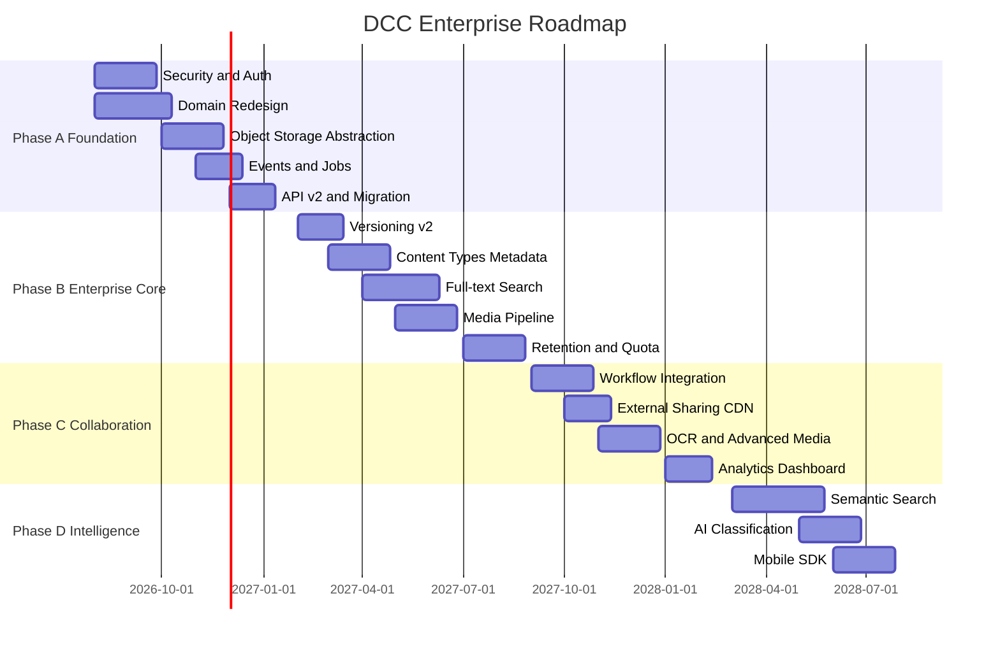
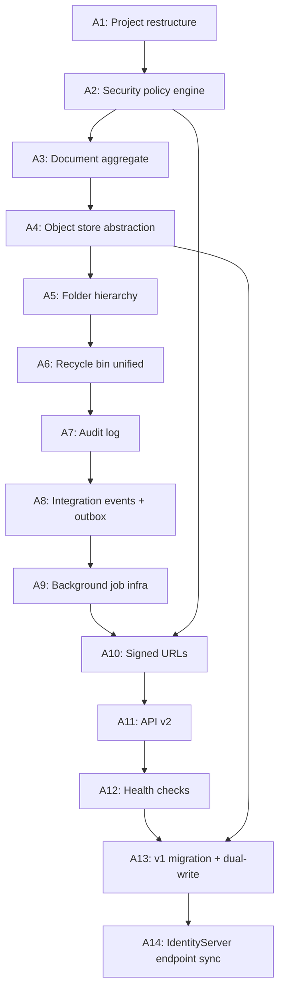
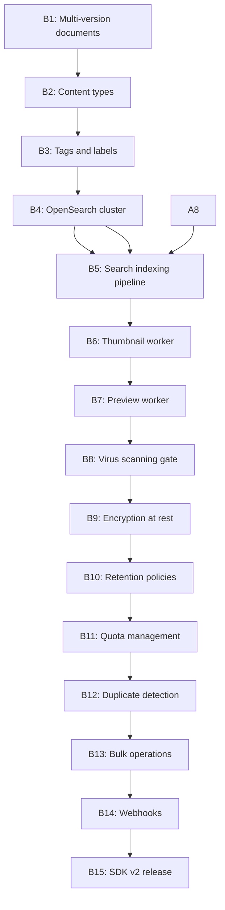
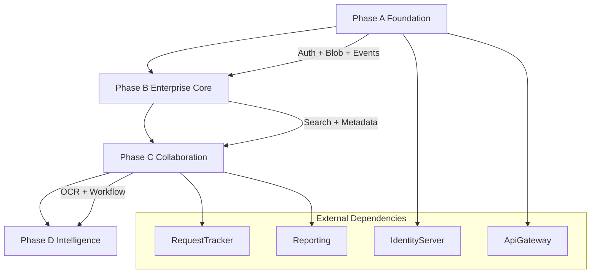

# DCC Implementation Plan

> Phased roadmap Phases A–D with dependencies, timelines, and rationale  
> Estimated calendar: **24–30 months** with 4–6 engineer platform squad

---

## 1. Roadmap Overview

---

## 2. Phase A — Foundation (Months 1–6)

**Theme:** *Production-safe platform core — fix Phase 2 audit class, establish domain model, storage abstraction, events.*

**Exit criteria:**

- Zero Critical/High findings from Phase 2 audit category (auth, path traversal, disk/DB ordering)
- v2 API live alongside v1 compat layer
- All Dejban consumers migrated to SDK v2 upload
- Integration events published for create/delete/purge
- Blob storage on MinIO/S3 in Docker dev

### Phase A Feature Sequence

### A1 — Project Restructure (Weeks 1–3)

| Item | Detail |
|------|--------|
| **Features** | Multi-project layout per Module Roadmap |
| **Why first** | Enforces boundaries before code accumulates |
| **Deliverables** | DCC.Domain, DCC.Application, DCC.Infrastructure, DCC.Api projects; ArchUnit tests |
| **Effort** | 3 weeks |
| **Risk** | Low — structural only |

### A2 — Security Policy Engine (Weeks 2–8)

| Item | Detail |
|------|--------|
| **Features** | F-SEC-001 |
| **Why early** | Blocks all other features; Phase 2 Critical findings |
| **Deliverables** | `IAccessPolicyEvaluator`; ACL tables; fix PurgeFile, Delete, GetFileMeta, Download |
| **Effort** | 6 weeks |
| **Dependencies** | A1 |
| **Risk** | Medium — IdentityServer claim format coupling |

### A3 — Document Aggregate (Weeks 4–10)

| Item | Detail |
|------|--------|
| **Features** | F-DOC-001 (v1 single version), F-DOC-005 |
| **Why** | Replace anemic FileEntity; foundation for all modules |
| **Deliverables** | `Document` aggregate, status state machine, migration mapping from FileEntity |
| **Effort** | 6 weeks |
| **Dependencies** | A1, A2 |

### A4 — Object Store Abstraction (Weeks 8–14)

| Item | Detail |
|------|--------|
| **Features** | F-CORE-001 |
| **Why** | Unblocks scaling, signed URLs, CDN, encryption |
| **Deliverables** | `IObjectStore`, MinIO dev, S3 prod config, path sanitization |
| **Effort** | 6 weeks |
| **Dependencies** | A3 |
| **Risk** | High — data migration from local disk |

### A5 — Folder Hierarchy (Weeks 12–16)

| Item | Detail |
|------|--------|
| **Features** | F-CORE-002 |
| **Why** | Enterprise baseline; permission inheritance anchor |
| **Deliverables** | Folder CRUD, document move, site-scoped roots |
| **Effort** | 4 weeks |
| **Dependencies** | A3, A2 |

### A6 — Unified Recycle Bin (Weeks 14–17)

| Item | Detail |
|------|--------|
| **Features** | F-DOC-005 |
| **Why** | Replace inconsistent soft/hard delete |
| **Deliverables** | Recycle → restore → scheduled purge |
| **Effort** | 3 weeks |
| **Dependencies** | A3 |

### A7 — Audit Log (Weeks 15–18)

| Item | Detail |
|------|--------|
| **Features** | F-SEC-004 |
| **Why** | Compliance baseline; required before wider rollout |
| **Deliverables** | Append-only AuditLog table, all mutations + access logged |
| **Effort** | 3 weeks |
| **Dependencies** | A2 |

### A8 — Integration Events (Weeks 16–20)

| Item | Detail |
|------|--------|
| **Features** | F-INT-005 |
| **Why** | Dejban orphan cleanup; search/media in Phase B |
| **Deliverables** | DocumentCreated/Deleted/Purged/Restored via outbox |
| **Effort** | 4 weeks |
| **Dependencies** | A3, A7 |

### A9 — Background Job Infrastructure (Weeks 18–22)

| Item | Detail |
|------|--------|
| **Features** | F-INT-003 |
| **Why** | Required for scan, migration, purge scheduler |
| **Deliverables** | MassTransit consumers + Quartz scheduled jobs (align Dejban pattern) |
| **Effort** | 4 weeks |
| **Dependencies** | A8 |

### A10 — Signed URLs (Weeks 20–24)

| Item | Detail |
|------|--------|
| **Features** | F-SHR-001 |
| **Why** | Replace insecure public static `/files` serving |
| **Deliverables** | ShareLink aggregate, presigned GET, expiry, access log |
| **Effort** | 4 weeks |
| **Dependencies** | A2, A4 |
| **Risk** | ApiGateway config change coordination |

### A11 — API v2 (Weeks 22–26)

| Item | Detail |
|------|--------|
| **Features** | F-INT-001 |
| **Why** | Stable contract for document model |
| **Deliverables** | `/api/v2/documents`, OpenAPI, v1 shim |
| **Effort** | 4 weeks |
| **Dependencies** | A3–A6 |

### A12 — Health Checks (Week 24)

| Item | Detail |
|------|--------|
| **Features** | F-ADM-003 |
| **Why** | Production orchestration |
| **Effort** | 1 week |

### A13 — Migration & Consumer Update (Weeks 24–28)

| Item | Detail |
|------|--------|
| **Why** | Existing Personnels/Visitors use v1 IDccClient |
| **Deliverables** | Dual-read v1/v2; migrate blobs; update Dejban handlers; deprecate v1 timeline |
| **Effort** | 4 weeks |
| **Dependencies** | A4, A11 |

### A14 — IdentityServer Endpoint Sync (Week 26)

| Item | Detail |
|------|--------|
| **Features** | F-INT-006 |
| **Why** | Wire existing consumer; admin permissions |
| **Effort** | 1 week |

### Phase A Summary

| Metric | Value |
|--------|-------|
| **Duration** | ~6 months |
| **Engineering** | 4 FTE |
| **Features delivered** | 14 |
| **Critical risks** | Blob migration, auth regression |

---

## 3. Phase B — Enterprise Core (Months 7–14)

**Theme:** *Make content discoverable, rich, and governed.*

**Exit criteria:**

- Full-text search live for all new documents
- Content types for Personnels, Visitors, Patrols
- Retention policies enforceable
- Virus scan gate active
- SDK v2 published to NuGet

### Phase B Sequence

| ID | Feature | Effort | Depends On |
|----|---------|--------|------------|
| B1 | F-DOC-001 full versioning | 6w | Phase A complete |
| B2 | F-DOC-003 content types | 8w | B1 |
| B3 | F-DOC-004 tags | 2w | B1 |
| B4–B5 | F-SRC-001 full-text search | 10w | B2, A8 |
| B6 | F-MED-003 thumbnails | 2w | A9, A4 |
| B7 | F-MED-002 preview | 6w | B6 |
| B8 | F-SEC-003 virus scan | 4w | A9 |
| B9 | F-SEC-002 encryption | 3w | A4 |
| B10 | F-WF-002 retention | 6w | B1, A9 |
| B11 | F-ADM-001 quota | 3w | A4 |
| B12 | F-DOC-006 dedup | 3w | B1 |
| B13 | F-CORE-004 bulk ops | 4w | A9 |
| B14 | F-INT-004 webhooks | 4w | A8 |
| B15 | F-INT-002 SDK | 4w | A11 |

### Phase B Summary

| Metric | Value |
|--------|-------|
| **Duration** | ~8 months |
| **Engineering** | 5 FTE |
| **Why after A** | Search indexes document model; media needs blob + jobs; retention needs versioning |

---

## 4. Phase C — Collaboration & Compliance (Months 15–20)

**Theme:** *Workflow, external collaboration, advanced media, operational visibility.*

**Exit criteria:**

- Approval workflow for at least one Dejban module
- External share links with password option
- OCR searchable PDFs
- Storage analytics in Reporting dashboard

| ID | Feature | Effort | Depends On |
|----|---------|--------|------------|
| C1 | F-DOC-002 check-in/out | 4w | B1 |
| C2 | F-WF-001 approval workflow | 8w | B1, RequestTracker |
| C3 | F-WF-003 legal hold | 3w | B10 |
| C4 | F-WF-004 archive policy | 3w | B10, F-CORE-005 |
| C5 | F-CORE-005 storage tiering | 4w | A4 |
| C6 | F-SHR-002 external sharing | 4w | A10 |
| C7 | F-SHR-003 CDN | 3w | A4, A10 |
| C8 | F-MED-001 OCR | 5w | B7 |
| C9 | F-MED-004 PDF conversion | 3w | B7 |
| C10 | F-SEC-006 watermark | 4w | B7 |
| C11 | F-SEC-005 download history UI | 2w | A7 |
| C12 | F-ADM-002 analytics | 4w | B11, Reporting |
| C13 | F-INT-008 notifications | 3w | C2, platform notifications |
| C14 | F-CORE-003 collections | 4w | A5 |
| C15 | F-SRC-002 faceted search | 3w | B5 |

### Phase C Summary

| Metric | Value |
|--------|-------|
| **Duration** | ~6 months |
| **Engineering** | 4–5 FTE |
| **Why after B** | Workflow needs stable document + metadata; OCR feeds search; CDN needs signed URLs |

---

## 5. Phase D — Intelligence & Scale (Months 21–30)

**Theme:** *AI-powered discovery, mobile, advanced compliance.*

**Exit criteria:**

- Semantic search pilot on visitor/personnel archives
- Mobile upload SDK in field app
- Digital signature pilot for one document type

| ID | Feature | Effort | Depends On |
|----|---------|--------|------------|
| D1 | F-SRC-003 semantic search | 12w | B5, C8 |
| D2 | F-SRC-004 similarity search | 8w | B6 |
| D3 | F-AI-001 content moderation | 4w | B8 |
| D4 | F-AI-002 auto-classification | 6w | B2, D1 |
| D5 | F-AI-003 summarization | 4w | D1 |
| D6 | F-SEC-007 digital signature | 10w | C2 |
| D7 | F-INT-007 comments/annotations | 4w | B7 |
| D8 | F-CLI-002 mobile SDK | 8w | B15, A10 |
| D9 | F-CLI-001 desktop sync evaluation | 4w spike | B15 |

### Phase D Summary

| Metric | Value |
|--------|-------|
| **Duration** | ~10 months |
| **Engineering** | 4 FTE + ML specialist part-time |
| **Why last** | Requires mature index, OCR text, stable API; highest cost and compliance review |

---

## 6. Dependency Graph (Cross-Phase)

---

## 7. Dejban Consumer Migration Plan

| Module | Current | Phase A | Phase B |
|--------|---------|---------|---------|
| Personnels avatar | v1 upload, FileId string | SDK v2, DocumentId, folder | Content type `PersonnelPhoto` |
| Visitors photo | v1 upload, warn on fail | SDK v2, event on DocumentCreated | Tag `visitor` + retention 7y |
| Patrols attachments | Not using DCC | Adopt SDK v2 | Content type `PatrolReport` |
| Inventory docs | Not using DCC | Evaluate | Bulk upload |
| Armory | Not using DCC | Phase C | Approval workflow |

**Event-driven cleanup (Phase A):**

When `DocumentPurged` → Dejban handlers null out `AvatarImage` reference.

---

## 8. Infrastructure Provisioning by Phase

| Infrastructure | Phase A | Phase B | Phase C | Phase D |
|--------------|---------|---------|---------|---------|
| PostgreSQL dccdb | Extend schema | + search metadata | — | + pgvector optional |
| MinIO / S3 | Deploy | Production | + CDN origin | — |
| Redis | Existing | + quota cache | — | — |
| RabbitMQ | Existing | + more consumers | — | — |
| OpenSearch | — | 3-node cluster | Scale | + vector |
| ClamAV sidecar | — | Deploy | — | — |
| OCR workers | — | — | Deploy | — |
| GPU/LLM endpoint | — | — | — | Deploy |

---

## 9. Risk Register

| Risk | Phase | Mitigation |
|------|-------|------------|
| Blob migration data loss | A | Dual-write, checksum verify, rollback plan |
| Auth regression breaks Dejban | A | Integration test suite, feature flags |
| OpenSearch ops burden | B | Managed service or shared cluster |
| Scope creep in workflow | C | Integrate RequestTracker, not custom BPMN |
| AI data residency | D | On-prem LLM or anonymized embeddings |
| Team capacity | All | Phase gates; defer Phase D if B slips |

---

## 10. Phase Gate Criteria

### Gate A → B

- [ ] All Phase 2 Critical audit categories resolved
- [ ] 100% Dejban photo uploads on v2 API
- [ ] Integration events consumed by at least one module
- [ ] MinIO/S3 in staging and production
- [ ] Load test: 100 concurrent uploads, 1000 docs/sec metadata read

### Gate B → C

- [ ] Search returns results < 500ms p95
- [ ] Virus scan blocks EICAR test file
- [ ] Retention job disposes test documents
- [ ] SDK v2 documented and adopted by 3 modules

### Gate C → D

- [ ] Approval workflow in production for one module
- [ ] OCR index coverage > 90% of PDF uploads
- [ ] Storage analytics dashboard live
- [ ] Business case approved for AI infrastructure cost

---

## 11. Effort Summary

| Phase | Duration | Features | Est. Person-Months |
|-------|----------|----------|-------------------|
| A — Foundation | 6 mo | 14 | 24 |
| B — Enterprise Core | 8 mo | 15 | 40 |
| C — Collaboration | 6 mo | 15 | 30 |
| D — Intelligence | 10 mo | 9 | 35 |
| **Total** | **~30 mo** | **53** | **~129 PM** |

With 5 FTE average: **~26 months** elapsed (aligns with 24–30 month target).

---

## 12. Quick Wins (First 90 Days)

Prioritized subset if full Phase A bandwidth unavailable:

| Week | Deliverable | Feature |
|------|-------------|---------|
| 1–2 | Remove AllowAnonymous PurgeFile; auth on GetFileMeta/Delete | F-SEC-001 partial |
| 3–4 | Path sanitization + storage root validation | F-CORE-001 partial |
| 5–6 | Health checks + fail-fast migrations | F-ADM-003 |
| 7–8 | Wire GetDCCServiceEndpoints to IdentityServer | F-INT-006 |
| 9–10 | Publish DocumentDeleted/Purged events | F-INT-005 partial |
| 11–12 | Signed URL MVP replacing static /files | F-SHR-001 partial |

---

## 13. Success Tracking

| KPI | Phase A | Phase B | Phase C | Phase D |
|-----|---------|---------|---------|---------|
| Critical security findings | 0 | 0 | 0 | 0 |
| Modules on DCC | 2 | 4 | 6 | 8+ |
| Documents in system | 10K | 100K | 500K | 1M+ |
| Search adoption (% admin searches) | — | 50% | 80% | 90% |
| Avg upload latency p95 | < 2s | < 1.5s | < 1s | < 1s |
| Storage cost per GB | baseline | -10% (dedup) | -25% (tiering) | -30% |

---

## Related Documents

- [Product Vision](./DCC_PRODUCT_VISION.md)
- [Enterprise Features](./DCC_ENTERPRISE_FEATURES.md)
- [Module Roadmap](./DCC_MODULE_ROADMAP.md)
- Phase 1–2 docs: architecture, domain, audits

---

*"Phase A earns the right to build Phase B. Each gate protects the investment in the previous phase."*
