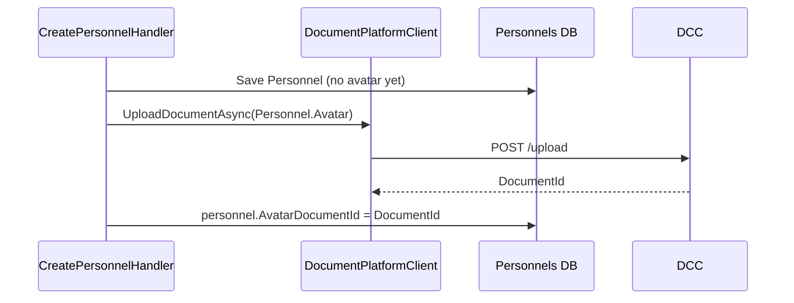

# DCC Module Integration Guide

> Normative guide for every Dejban module integrating with DCC Platform

---

## 1. Integration Principles

1. **One SDK** — `IDocumentPlatformClient` only
2. **One reference** — `DocumentId` Guid in business DB
3. **One event handler minimum** — `DocumentPurgedIntegrationEvent`
4. **Register DocumentTypes** before first upload in environment
5. **Module owns business rules** — when to upload; DCC owns how

---

## 2. Standard Integration Checklist

- [ ] Add reference to `PayamGostar.Dejban.DocumentPlatform` / Common
- [ ] Remove direct `AddDccClient` — use shared `AddDocumentPlatform()`
- [ ] Register DocumentTypes in module startup config
- [ ] Replace `*Image` string columns with `*DocumentId` Guid?
- [ ] Inject `IDocumentPlatformClient` in handlers
- [ ] Implement `DocumentPurgedIntegrationEventHandler`
- [ ] Implement `DocumentQuarantinedIntegrationEventHandler` (recommended)
- [ ] Add architecture test — no forbidden columns in Domain
- [ ] Update UI to use signed URLs / thumbnail API for display
- [ ] Remove any local file I/O

---

## 3. DocumentType Registration

Each module registers types at deployment:

| Module | DocumentTypeKey | MetadataProfile | Retention |
|--------|-----------------|-----------------|-----------|
| Personnels | `Personnel.Avatar` | `{ }` empty | 7y after employment end* |
| Personnels | `Personnel.Attachment` | `{ docType, description }` | 7y |
| Visitors | `Visitor.Photo` | `{ }` | 2y after visit |
| Visitors | `Visitor.CompanionPhoto` | `{ companionIndex }` | 2y |
| Visitors | `Visitor.IdScan` | `{ scanType }` | 2y |
| Inventory | `Inventory.ItemImage` | `{ sku }` | Indefinite |
| Inventory | `Inventory.Receipt` | `{ receiptNumber }` | 7y |
| Vehicles | `Vehicle.Photo` | `{ plateNumber }` | Life of vehicle |
| Vehicles | `Vehicle.Registration` | `{ }` | Life of vehicle |
| Armory | `Armory.WeaponPhoto` | `{ serialNumber }` | Regulatory |
| Armory | `Armory.Certificate` | `{ certType }` | Regulatory |
| Patrol | `Patrol.Evidence` | `{ incidentId, gps }` | 5y |
| Patrol | `Patrol.Report` | `{ shiftId, reportType }` | 5y |
| CashLogistics | `CashLogistics.Proof` | `{ transferId }` | 7y |
| WeighBridge | `WeighBridge.TicketImage` | `{ ticketNumber }` | 3y |
| Contracts | `Contract.Document` | `{ contractNumber, party }` | Legal hold aware |
| Finance | `Finance.Invoice` | `{ invoiceNumber }` | 10y |

*Retention enforced by DCC when module publishes employment end event or scheduled policy.

---

## 4. Module Specifications

### 4.1 Personnels



| Aspect | Specification |
|--------|---------------|
| **Reference column** | `Personnel.AvatarDocumentId` (Guid?, rename from AvatarImage) |
| **OwnerModule** | `Dejban.Personnels` |
| **OwnerEntityId** | `Personnel.Id` |
| **Upload timing** | After personnel persisted (needs Id) |
| **Upload failure** | Return error or proceed without avatar — **module business decision** (recommend: proceed with warning log) |
| **Delete personnel** | Call `RecycleDocumentAsync` if AvatarDocumentId set; or rely on retention |
| **Events consumed** | DocumentPurged, DocumentQuarantined |
| **Events published** | None required — optional PersonnelDeleted → module may call Recycle |

---

### 4.2 Visitors

| Aspect | Specification |
|--------|---------------|
| **References** | `Visitor.PhotoDocumentId`, companion photos via `VisitSchedule` JSON or join table with DocumentIds |
| **OwnerModule** | `Dejban.Visitors` |
| **DocumentTypes** | Visitor.Photo, Visitor.CompanionPhoto, Visitor.IdScan |
| **Upload timing** | After visitor/schedule saved (current pattern) |
| **Upload failure** | Log warning, continue (current) — acceptable |
| **Visit cancelled** | Module calls Recycle for associated DocumentIds |
| **Events consumed** | DocumentPurged — clear Visitor.PhotoDocumentId and companion refs |

---

### 4.3 Inventory

| Aspect | Specification |
|--------|---------------|
| **References** | `InventoryItem.PrimaryImageDocumentId`; `InventoryItemAttachment.DocumentId` join table for multiples |
| **OwnerModule** | `Dejban.Inventory` |
| **Bulk import** | Use Bulk Upload API (Phase B) |
| **Search** | Module UI calls DCC Search with OwnerModule filter |
| **Events consumed** | DocumentPurged — clear item/attachment refs |

---

### 4.4 Vehicles

| Aspect | Specification |
|--------|---------------|
| **References** | `Vehicle.PhotoDocumentId`, `Vehicle.RegistrationDocumentId` |
| **OwnerModule** | `Dejban.Vehicles` |
| **Replace photo** | `CreateVersionAsync` or new upload + update ref |
| **Events consumed** | DocumentPurged |

---

### 4.5 Armory

| Aspect | Specification |
|--------|---------------|
| **References** | Weapon/cert DocumentIds on armory entities |
| **OwnerModule** | `Dejban.Armory` |
| **Watermark** | DocumentType policy enables watermark on download |
| **Legal hold** | Module calls ApplyLegalHold when investigation open |
| **Events consumed** | DocumentPurged, DocumentRetentionExpired |

---

### 4.6 Security Patrols

| Aspect | Specification |
|--------|---------------|
| **References** | Evidence + report DocumentIds on patrol/incident entities |
| **OwnerModule** | `Dejban.SecurityPatrols` |
| **OCR** | Enabled on Patrol.Report — search via DCC |
| **Classification** | Metadata includes incidentId, shiftId |
| **Events consumed** | DocumentPurged |

---

### 4.7 Cash Logistics

| Aspect | Specification |
|--------|---------------|
| **References** | Proof-of-delivery DocumentId on transfer record |
| **OwnerModule** | `Dejban.CashLogistics` |
| **Retention** | 7y financial policy via DCC |
| **Events consumed** | DocumentPurged |

---

### 4.8 WeighBridge

| Aspect | Specification |
|--------|---------------|
| **References** | Ticket image DocumentId on weigh ticket |
| **OwnerModule** | `Dejban.WeighBridge` |
| **Events consumed** | DocumentPurged |

---

### 4.9 Contracts (Future)

| Aspect | Specification |
|--------|---------------|
| **References** | `Contract.PrimaryDocumentId`, addendum DocumentIds |
| **OwnerModule** | `Dejban.Contracts` |
| **Workflow** | Approval in RequestTracker — **not in DCC** |
| **Versioning** | Heavy use of CreateVersionAsync during negotiation |
| **Legal hold** | Required capability |
| **Digital signature** | Phase D — module orchestrates, DCC stores signed blob |
| **Events consumed** | All lifecycle events |

---

### 4.10 Finance (Future)

| Aspect | Specification |
|--------|---------------|
| **References** | Invoice PDF DocumentId |
| **OwnerModule** | `Dejban.Finance` |
| **Retention** | 10y regulatory |
| **Immutability** | No Replace after posted — version-only |

---

### 4.11 Operations (Future)

Generic module — pattern same as Inventory for SOP attachments.

---

## 5. Reference Strategy

### Single reference

```csharp
public Guid? AvatarDocumentId { get; private set; }

public void SetAvatarDocumentId(Guid documentId) => AvatarDocumentId = documentId;
public void ClearAvatarDocumentId() => AvatarDocumentId = null;
```

### Multiple attachments

```csharp
public class EntityAttachment
{
    public Guid EntityId { get; set; }
    public Guid DocumentId { get; set; }  // ONLY reference
    public string AttachmentRole { get; set; }  // business semantics — OK in module DB
}
```

**Forbidden:** `FilePath`, `Hash`, `ThumbnailUrl` persistent columns.

---

## 6. Error Handling

| SDK error | Module handler action |
|-----------|----------------------|
| Quarantined | Clear pending ref; return validation error to user |
| AccessDenied | Fail command with forbidden |
| NotFound on download | Clear stale ref; show placeholder |
| Unavailable | Polly retry 3x; fail with service unavailable |
| QuotaExceeded | Surface admin message |

---

## 7. Synchronization

| Direction | Mechanism |
|-----------|-----------|
| Module → DCC | SDK commands (sync) |
| DCC → Module | Integration events (async) |
| UI display | Signed URL at render time (short TTL) — optional cache 5m in Redis at module |

**No dual writes.** Module saves DocumentId only after successful upload.

---

## 8. UI Integration

| Need | API |
|------|-----|
| Show avatar | `GetThumbnailUriAsync` or signed URL |
| Download attachment | `GenerateSignedUrlAsync` for browser |
| Upload form | Module API receives IFormFile → handler streams to SDK |

Browser **never** calls DCC directly except via signed URL.

---

## 9. Architecture Tests (Module Domain)

```csharp
// Conceptual — enforce in each module ArchitectureTests
Types.InAssembly(DomainAssembly)
    .Should().NotHavePropertyMatching("*StoragePath*");

Types.InAssembly(DomainAssembly)
    .Should().NotHavePropertyMatching("*Blob*");
```

---

## 10. Migration from Current IDccClient

| Step | Action |
|------|--------|
| 1 | Add AvatarDocumentId column |
| 2 | Backfill Guid from AvatarImage string where valid |
| 3 | Switch handler to IDocumentPlatformClient |
| 4 | Deploy DocumentPurged handler |
| 5 | Remove AvatarImage column after validation |

---

## Related Documents

- [SDK Specification](./DCC_SDK_SPECIFICATION.md)
- [Event Specification](./DCC_EVENT_SPECIFICATION.md)
- [Responsibility Boundaries](./DCC_RESPONSIBILITY_BOUNDARIES.md)
