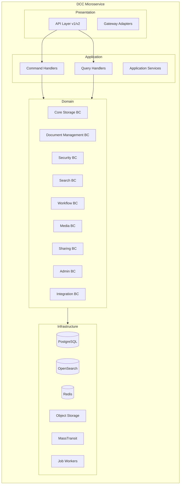
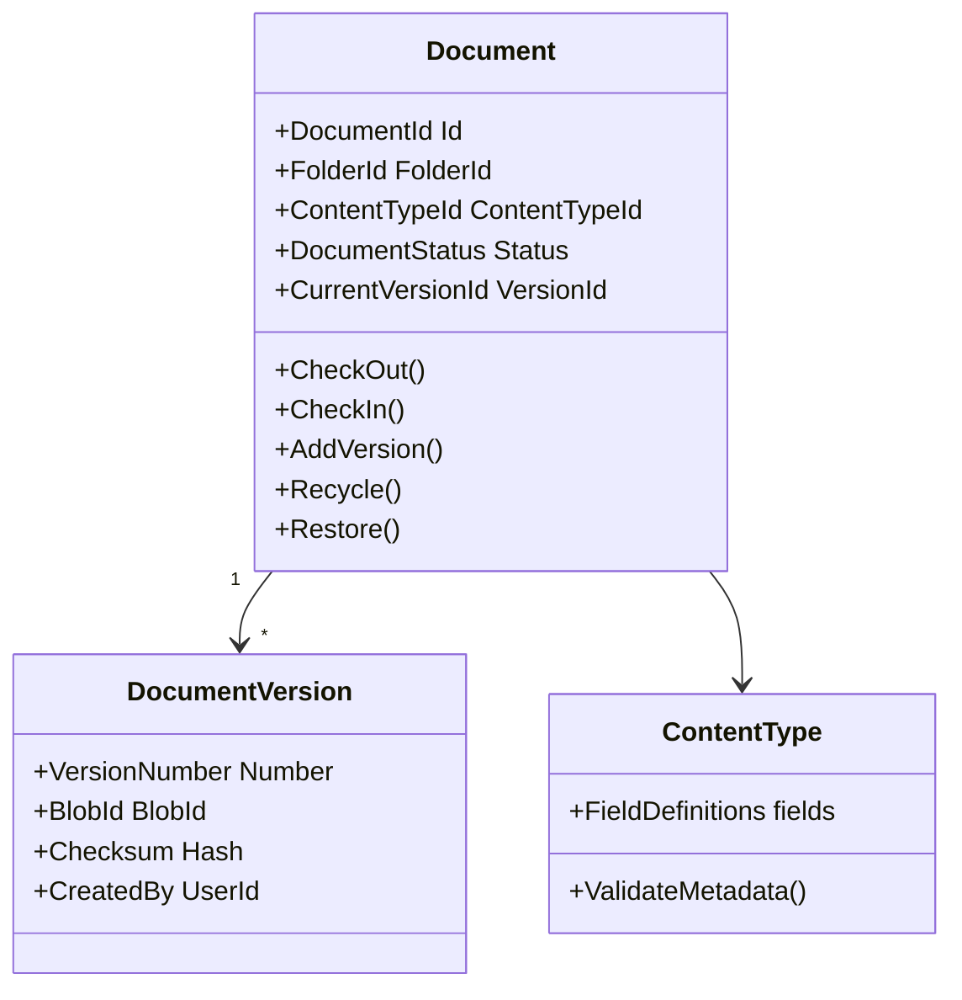
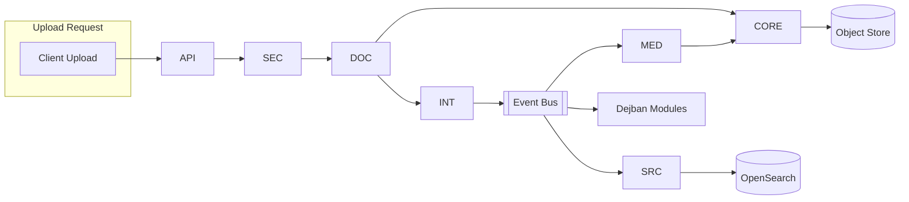

# DCC Module Roadmap

> Logical module decomposition for enterprise DCC platform  
> Maps features to bounded contexts and internal architecture

---

## 1. Module Architecture Overview

DCC evolves from a **single-project microservice** to a **modular monolith** — one deployable unit with strict internal bounded contexts. This preserves operational simplicity while enabling team parallelization.



---

## 2. Module Catalog

| # | Module | Bounded Context | Primary Aggregates | Phase |
|---|--------|-----------------|-------------------|-------|
| 1 | **Core Storage** | Binary persistence & hierarchy | `Folder`, `Blob`, `StorageLocation` | A |
| 2 | **Document Management** | Document lifecycle & metadata | `Document`, `DocumentVersion`, `ContentType` | A–B |
| 3 | **Security & Compliance** | Access, audit, encryption | `AccessPolicy`, `AuditEntry`, `ShareLink` | A–B |
| 4 | **Integrations & Platform** | Events, jobs, API, SDK | `BulkJob`, `WebhookSubscription` | A–B |
| 5 | **Search & Discovery** | Indexing & query | `DocumentSearchProjection` (read model) | B |
| 6 | **Media Processing** | Transform & enrich | `ProcessingJob`, `PreviewAsset` | B–C |
| 7 | **Workflow & Lifecycle** | Retention, approval, hold | `RetentionPolicy`, `WorkflowInstance` | B–C |
| 8 | **Sharing & Delivery** | Links, CDN, external access | `ShareLink`, `DeliveryChannel` | A–C |
| 9 | **Administration & Analytics** | Quota, metrics, health | `StorageQuota`, `UsageSnapshot` | A–C |
| 10 | **AI & Intelligence** | Semantic, moderation, classify | `EmbeddingIndex`, `ModerationResult` | D |

---

## 3. Module 1 — Core Storage

### Purpose

Own **where bytes live** and **how content is organized** in a hierarchy. No business metadata beyond storage concerns.

### Responsibilities

- Object store abstraction (S3, Azure, MinIO, filesystem)
- Folder tree per site/service
- Blob upload, download, delete, tier transition
- Path/key generation and sanitization
- Storage health probes

### Does NOT Own

- Permissions (delegates to Security)
- Document metadata schema (delegates to Document Management)
- Search indexing (publishes events for Search)

### Key Ports (Interfaces)

```
IObjectStore          — Put, Get, Delete, Exists, Presign
IFolderRepository     — Tree CRUD
IBlobRepository       — Blob metadata persistence
IStoragePathPolicy    — Key naming, sanitization
```

### Key Integration Events (Published)

- `BlobStored`
- `BlobDeleted`
- `FolderCreated`
- `FolderDeleted`

### Dependencies

- PostgreSQL (folder + blob metadata)
- Object storage provider
- Redis (optional cache for folder tree)

### Migration from Current

| Current | Target |
|---------|--------|
| `FileStorage` | `IObjectStore` implementations |
| `FileEntity.StoragePath` | `Blob.StorageKey` |
| `FolderName` string | `Folder` aggregate |

---

## 4. Module 2 — Document Management

### Purpose

**System of record for document identity** — what the file is, its versions, metadata, tags, and lifecycle state.

### Responsibilities

- Document aggregate root (replaces `FileEntity`)
- Version management (immutable version chain)
- Content types and dynamic metadata validation
- Tags and labels
- Recycle bin state machine
- Duplicate detection policy

### Aggregates



### Dependencies

- Core Storage (blob references)
- Security (authorization before mutations)
- Integrations (publish domain events)

---

## 5. Module 3 — Security & Compliance

### Purpose

**Unified trust layer** — who can do what, audit proof, encryption, malware gate.

### Responsibilities

- Access policy evaluation (single pipeline for all handlers)
- ACL on documents and folders with inheritance
- Immutable audit log (access + change)
- Share link token issuance and validation
- Scan status gate (quarantine until clean)
- Encryption configuration per site

### Critical Design Decision

Every command/query passes through:

```
IAccessPolicyEvaluator.EvaluateAsync(user, resource, action)
```

No handler implements ad-hoc auth (fixes Phase 2 audit class).

### Aggregates

- `AccessControlList` (value object on Document/Folder)
- `AuditEntry` (append-only)
- `ShareLink`
- `ScanResult`

### Dependencies

- IdentityServer (JWT, claims)
- Redis (rate limit, lock)
- ClamAV or cloud scan API

---

## 6. Module 4 — Integrations & Platform

### Purpose

**External face and nervous system** of DCC.

### Responsibilities

- REST API v1 (legacy compat) and v2 (document model)
- .NET and TypeScript SDK
- MassTransit integration event publishing (outbox)
- Webhook delivery
- Background job orchestration
- IdentityServer endpoint catalog sync

### Event Catalog (Target)

| Event | Consumers |
|-------|-----------|
| `DocumentCreated` | Search, Dejban modules, Webhooks |
| `DocumentDeleted` | Dejban cleanup, Search, Audit |
| `DocumentPurged` | Dejban orphan cleanup |
| `DocumentVersionAdded` | Search, Preview worker |
| `DocumentScanned` | Availability gate |
| `ShareLinkAccessed` | Audit, Analytics |

### Dependencies

- RabbitMQ (existing)
- All domain modules (event sources)

---

## 7. Module 5 — Search & Discovery

### Purpose

Human and machine **findability** across all content.

### Responsibilities

- OpenSearch index management
- Full-text on metadata + OCR text
- Faceted filters (site, type, tag, date)
- Search API with tenant scoping
- (Phase D) Vector / semantic search

### Pattern

Classic **CQRS read side** — no domain mutations; projection handlers consume integration events.

### Dependencies

- OpenSearch cluster
- Document Management events
- Media Processing (OCR text)

---

## 8. Module 6 — Media Processing

### Purpose

**Derived assets** — previews, thumbnails, OCR text, conversions, watermarks.

### Responsibilities

- Async processing pipeline (MassTransit consumers)
- Preview/thumbnail blob storage (separate keys)
- OCR text extraction
- PDF conversion
- Image optimization profiles per content type

### State Machine

```
Uploaded → Processing → Available
                    ↘ Failed (retry)
```

### Dependencies

- Core Storage (read source, write derivatives)
- Job engine
- Optional: GPU workers for heavy conversion

---

## 9. Module 7 — Workflow & Lifecycle

### Purpose

**Time-based and approval-based** document governance.

### Responsibilities

- Retention policy definition and application
- Legal hold override
- Archive transitions (with Core Storage tiering)
- Approval workflow integration (RequestTracker / external BPMN)

### Integration Strategy

Do **not** build full BPMN engine. Publish `DocumentSubmittedForApproval` → RequestTracker handles task → callback `DocumentApproved`.

### Dependencies

- Document Management (status field)
- RequestTracker microservice
- Job scheduler (disposition dates)

---

## 10. Module 8 — Sharing & Delivery

### Purpose

**Controlled content delivery** outside standard API auth.

### Responsibilities

- Signed URL / share link generation
- External guest access policies
- CDN origin configuration
- Download streaming with range support
- Watermark application (coordination with Media)

### Replaces

ApiGateway anonymous `/files` static serving → signed URL or authenticated proxy only.

---

## 11. Module 9 — Administration & Analytics

### Purpose

**Operate and measure** the platform.

### Responsibilities

- Per-site/per-service storage quotas
- Usage aggregation and export to Reporting
- Health checks (DB, blob, search lag, queue depth)
- Admin API for policies, content types, quotas
- Migration tools (v1 FileEntity → v2 Document)

### Dependencies

- Reporting microservice
- Prometheus/OpenTelemetry metrics

---

## 12. Module 10 — AI & Intelligence (Phase D)

### Purpose

**Next-generation discovery and automation**.

### Responsibilities

- Embedding generation and vector index
- Semantic / hybrid search
- Auto-tagging and content type suggestion
- Content moderation scores
- Document summarization

### Dependencies

- Search module (vector index)
- Media module (OCR text)
- External LLM API (policy: data residency)

---

## 13. Cross-Module Interaction Map



---

## 14. Project Structure (Target)

```
Microservices/DCC/
├── DCC.Api/                    # Presentation (controllers, middleware)
├── DCC.Application/            # CQRS handlers, behaviors
├── DCC.Domain/
│   ├── CoreStorage/
│   ├── Documents/
│   ├── Security/
│   ├── Workflow/
│   ├── Sharing/
│   └── Admin/
├── DCC.Infrastructure/
│   ├── Persistence/
│   ├── ObjectStore/            # S3, Azure, FileSystem
│   ├── Search/
│   ├── Media/
│   ├── Messaging/
│   └── Jobs/
└── DCC.Contracts/              # Public DTOs, integration events
```

**Why split csproj (Phase A task):** Enforce dependency rules — Domain has zero infrastructure references; Architecture tests like Dejban modules.

---

## 15. Module Maturity Target

| Module | Phase A | Phase B | Phase C | Phase D |
|--------|---------|---------|---------|---------|
| Core Storage | MVP | Tiering | — | — |
| Document Mgmt | MVP | Content types | Collections | — |
| Security | MVP | Scan, encrypt | Watermark | — |
| Integrations | MVP | SDK, webhooks | — | — |
| Search | — | MVP | Facets | Semantic |
| Media | — | Thumbs, preview | OCR, PDF | — |
| Workflow | — | Retention | Approval, hold | — |
| Sharing | MVP links | External | CDN | — |
| Admin | Health | Quota | Analytics | — |
| AI | — | — | — | MVP |

---

## 16. Team Ownership Model

| Squad | Modules | Size |
|-------|---------|------|
| **Platform Core** | Core Storage, Document Mgmt, Integrations | 2 engineers |
| **Trust & Policy** | Security, Workflow, Admin | 1–2 engineers |
| **Experience** | Search, Media, Sharing | 1–2 engineers |
| **Intelligence** | AI (Phase D) | 1 engineer (part-time until D) |

Total steady-state: **4–6 engineers** plus shared DevOps and security review.

---

## Related Documents

- [Enterprise Features](./DCC_ENTERPRISE_FEATURES.md)
- [Implementation Plan](./DCC_IMPLEMENTATION_PLAN.md)
- [Product Vision](./DCC_PRODUCT_VISION.md)
