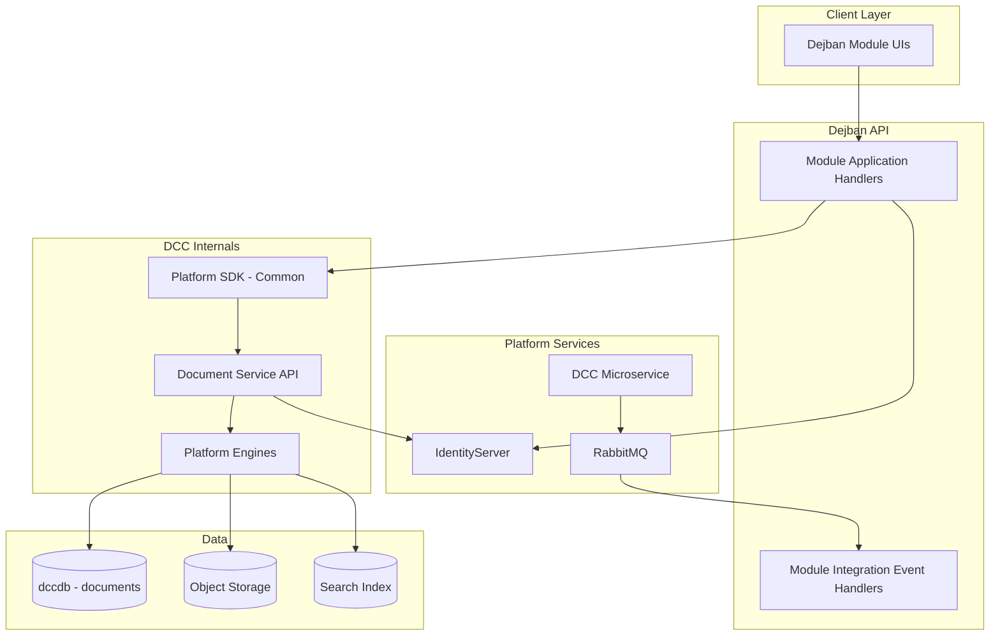
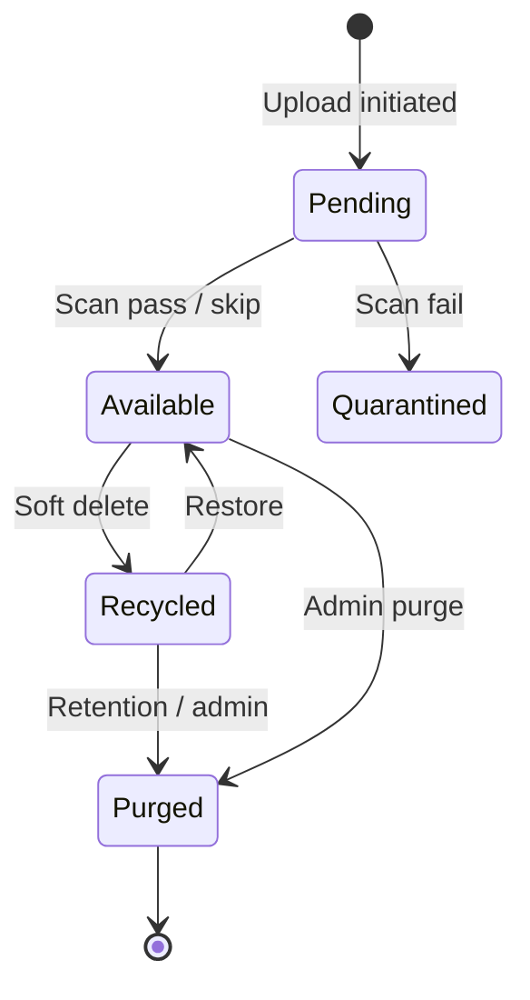
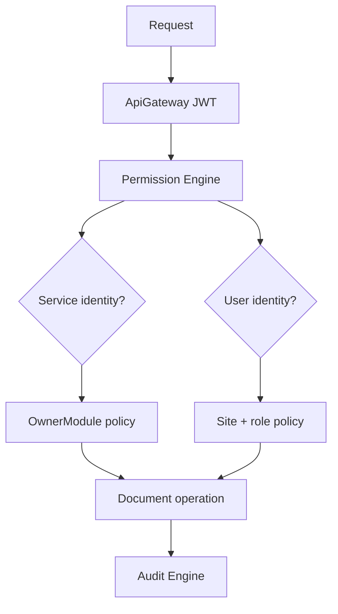

# DCC Platform Architecture

> Technical architecture for DCC as Dejban's internal Document Platform

---

## 1. Architectural Position



DCC exposes **northbound** APIs to Dejban modules and **southbound** adapters to storage, search, and scan services. It does not call Dejban module databases.

---

## 2. Platform Engines — Detailed Design

### 2.1 Storage Engine

**Owns:** bytes, blob keys, provider config, tier, checksum verification on write.

| Port | Implementation |
|------|----------------|
| `IObjectStore` | S3, Azure Blob, MinIO, FileSystem (dev) |
| `IStorageKeyPolicy` | `{site}/{ownerModule}/{documentId}/{versionId}` |
| `IPathSanitizer` | Reject traversal — fixes Phase 2 finding |

**Module contract:** modules never receive storage keys in persistent storage — optional ephemeral URLs from API responses only.

---

### 2.2 Document Engine

**Owns:** `Document` aggregate — platform identity and lifecycle.



Core properties:

```
DocumentId, OwnerModule, OwnerEntityId, DocumentType, SiteId,
CurrentVersionId, Status, CreatedAt, CreatedByService
```

**Replaces:** current `FileEntity` + ad-hoc `OwnerService` string.

---

### 2.3 Metadata Engine

**Owns:** DocumentType registry and MetadataProfile schemas.

| Concept | Example |
|---------|---------|
| DocumentType | `Visitor.Photo` |
| MetadataProfile | `{ captureDevice?, visitId? }` — JSON Schema |
| Registration | Module declares at startup via `DocumentTypeRegistration` event or config |

Validation runs on upload/update — modules supply metadata payload; DCC validates and stores.

---

### 2.4 Version Engine

**Owns:** immutable `DocumentVersion` rows linked to blob versions.

- Module references **DocumentId** only — not version id
- `CurrentVersionId` on Document for latest
- Optional `GET /documents/{id}/versions` for audit UI in modules
- Upload new version: same DocumentId, new version — OwnerEntityId unchanged

---

### 2.5 Permission Engine

**Owns:** all access decisions — single pipeline.

Evaluation inputs:

| Input | Source |
|-------|--------|
| User JWT | IdentityServer via gateway |
| Service identity | Module-to-module calls (client credentials or forwarded user) |
| SiteId | Tenant context |
| OwnerModule | Document record |
| DocumentType policy | Default: module service role + site match |
| Document ACL | Optional overrides set by owning module |

**Module pattern:**

```csharp
// Personnels handler uploads on behalf of user — SDK forwards JWT
await documentPlatform.UploadAsync(new PlatformUploadRequest {
    OwnerModule = "Dejban.Personnels",
    OwnerEntityId = personnel.Id,
    DocumentType = "Personnel.Avatar",
    SiteId = personnel.SiteId,
    File = request.AvatarImage
});
```

---

### 2.6 Search Engine

**Owns:** OpenSearch (or PostgreSQL FTS initially) index.

Queries always scoped:

```
OwnerModule = @module AND SiteId IN @userSites
[+ DocumentType, metadata filters]
```

Modules embed search in their UI — no standalone DCC search portal required.

---

### 2.7 Audit Engine

**Owns:** append-only `PlatformAuditLog`.

Events: upload, download, metadata change, permission change, purge, retention disposition.

Modules may **query audit by DocumentId** for compliance screens — not duplicate logging locally.

---

### 2.8 Retention Engine

**Owns:** policies attached to DocumentType + Site.

| Policy | Behavior |
|--------|----------|
| `Personnel.Avatar` | Retain while Personnel active + 7 years |
| `Visitor.Photo` | 2 years after visit closed |
| `Patrol.Attachment` | 5 years |

On disposition: publish `DocumentRetentionExpired` → modules clear references.

**Legal hold:** module sets hold flag via API — Retention Engine skips disposition.

---

### 2.9 Integration Engine

**Owns:** outward platform contract.

| Mechanism | Use |
|-----------|-----|
| **Document Service API** | REST v2 primary |
| **IDocumentPlatformClient** | .NET SDK in Common / Dejban.Common |
| **Integration events** | Primary async contract |
| **Outbox** | Reliable publish |
| Webhooks | Optional — external systems only |

#### Integration Event Catalog

| Event | Module action |
|-------|---------------|
| `DocumentCreated` | Optional cache warm |
| `DocumentVersionAdded` | Refresh UI cache |
| `DocumentRecycled` | Hide in UI |
| `DocumentRestored` | Show in UI |
| `DocumentPurged` | **Clear DocumentId reference** |
| `DocumentRetentionExpired` | Clear or archive reference |
| `DocumentQuarantined` | Block business operation |

---

### 2.10 Media Processing Engine

**Owns:** derivatives as platform blobs linked to DocumentVersion.

| Profile (by DocumentType) | Processing |
|---------------------------|------------|
| `*.Avatar`, `*.Photo` | Thumbnail 128/256, JPEG optimize |
| `*.Attachment`, `*.Report` | Preview PDF, OCR text → Search Engine |
| `*.Evidence` | Watermark on download if policy says so |

Modules request `GET /documents/{id}/thumbnail` — never generate locally.

---

## 3. Unified Platform SDK

**Location (target):** `Common/DocumentPlatform/` or `Dejban.Common.Application/DocumentPlatform/`

Replaces and extends current `IDccClient` (upload-only).

```csharp
public interface IDocumentPlatformClient
{
    Task<ErrorOr<DocumentReference>> UploadAsync(PlatformUploadRequest request, CancellationToken ct);
    Task<ErrorOr<DocumentReference>> UploadVersionAsync(Guid documentId, Stream content, CancellationToken ct);
    Task<ErrorOr<DocumentMetadata>> GetMetadataAsync(Guid documentId, CancellationToken ct);
    Task<ErrorOr<Stream>> DownloadAsync(Guid documentId, CancellationToken ct);
    Task<ErrorOr<Uri>> GetPreviewUrlAsync(Guid documentId, CancellationToken ct);
    Task<ErrorOr<Uri>> GetThumbnailUrlAsync(Guid documentId, CancellationToken ct);
    Task<ErrorOr<Deleted>> RecycleAsync(Guid documentId, CancellationToken ct);
    Task<ErrorOr<IReadOnlyList<DocumentSummary>>> SearchAsync(PlatformSearchQuery query, CancellationToken ct);
}
```

`DocumentReference` returns only `DocumentId` (+ optional ephemeral URLs) — **never** storage path.

---

## 4. Document Service API (v2)

Base path: `/api/v2/platform/documents`

| Method | Purpose | Caller |
|--------|---------|--------|
| POST `/upload` | Create document | Module via SDK |
| POST `/{id}/versions` | New version | Module |
| GET `/{id}` | Metadata | Module / UI |
| GET `/{id}/content` | Download stream | Module / UI via gateway |
| GET `/{id}/preview` | Preview redirect | UI |
| GET `/{id}/thumbnail` | Thumbnail | UI |
| DELETE `/{id}` | Recycle | Module |
| POST `/{id}/restore` | Restore | Module |
| GET `/search` | Platform search | Module |
| POST `/bulk` | Bulk operations | Migration admin |

v1 `/Files/*` maintained during migration — deprecated.

---

## 5. Owner Module Abstraction

| Field | Validation |
|-------|------------|
| `OwnerModule` | Must match registered module prefix e.g. `Dejban.{ModuleName}` |
| `OwnerEntityId` | Opaque GUID — DCC does not validate existence in module DB |
| `CorrelationId` | Optional — module operation id for audit |

**Document Sets** (revised Collections): group documents sharing same `OwnerModule` + `OwnerEntityId` (e.g. all Inventory attachments for Item X) — query via `GET /documents?ownerModule=&ownerEntityId=`.

---

## 6. Cross-Module Concerns

| Concern | Owner |
|---------|-------|
| Business workflow (approve visitor) | Visitors module |
| Document retention for visitor photos | DCC Retention Engine |
| Who can approve visit | Visitors + IdentityServer |
| Who can download visitor photo | DCC Permission Engine |
| Visit schedule entity | Visitors DB |
| Photo DocumentId | Visitors DB — **reference only** |

---

## 7. Deployment Topology (Unchanged)

DCC remains independent microservice:

- `dccdb` PostgreSQL
- Object storage volume / S3
- Redis (cache, locks)
- RabbitMQ (events)
- Optional OpenSearch cluster (Phase B)

Dejban.Api pods call DCC via internal network — not through user browser for uploads from server handlers.

---

## 8. Security Architecture (Platform)



Module service accounts may upload/read documents for their OwnerModule only.

---

## 9. Migration from Current DCC

| Current | Platform target |
|---------|-----------------|
| `FileEntity` | `Document` |
| `OwnerService` string | `OwnerModule` |
| `CreatorId` | `CreatedByUserId` + `OwnerEntityId` |
| `FolderName` | `DocumentType` + optional logical grouping |
| `AvatarImage` string FileId | `AvatarDocumentId` Guid |
| `IDccClient.UploadFileAsync` | `IDocumentPlatformClient.UploadAsync` |
| Static `/files` public | Signed URL from DCC |

---

## 10. What We Do Not Build

- Standalone DCC web UI (except OpenAPI/Scalar for developers)
- Module-specific business screens
- Approval workflow engine (RequestTracker / modules)
- Email/notification delivery
- External B2B sharing portal
- Desktop sync client

---

## Related Documents

- [Platform Vision](./DCC_PLATFORM_VISION.md)
- [Responsibility Boundaries](./DCC_RESPONSIBILITY_BOUNDARIES.md)
- [Platform Roadmap](./DCC_PLATFORM_ROADMAP.md)
