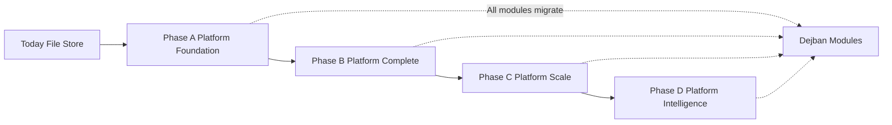
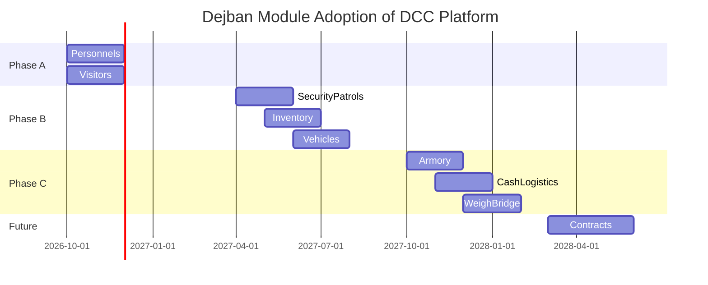

# DCC Platform Roadmap

> Engine-level roadmap for DCC as Dejban's central Document Platform  
> Optimized for **module reuse**, not standalone DMS features

---

## 1. Roadmap Overview

| Phase | Theme | Duration | Module adoption target |
|-------|-------|----------|------------------------|
| **A** | Safe platform foundation | ~5 months | Personnels, Visitors |
| **B** | Full platform services | ~7 months | + Patrols, Inventory, Vehicles |
| **C** | Scale & advanced media | ~5 months | All 8 modules + Contracts prep |
| **D** | Intelligence (optional) | ~6 months | Targeted module features |

**Total:** ~23 months with 4–5 platform engineers

---

## 2. Platform Engine Delivery Map

| Engine | Phase A | Phase B | Phase C | Phase D |
|--------|---------|---------|---------|---------|
| **Storage Engine** | S3/MinIO, sanitization | Dedup | Tiering | — |
| **Document Engine** | Document model, OwnerModule/Entity | Document Sets | — | — |
| **Metadata Engine** | DocumentType registry v1 | MetadataProfiles (JSON Schema) | Module self-registration API | AI suggest type |
| **Version Engine** | Single version (compat) | Full version chain | — | — |
| **Permission Engine** | Unified evaluator, fix audit gaps | DocumentType policies | Service account matrix | — |
| **Search Engine** | — | Module-scoped FTS | Facets | Semantic (optional) |
| **Audit Engine** | Platform audit log | Export API | SIEM stream | — |
| **Retention Engine** | Recycle + purge events | Policies by DocumentType | Legal hold API | — |
| **Integration Engine** | SDK v2, events, API v2 | Bulk API | Webhooks (external only) | — |
| **Media Processing** | — | Thumbnail + optimize | Preview, OCR, PDF | Moderation |

---

## 3. Phase A — Platform Foundation

**Goal:** Every module can safely upload, reference, download, and react to purge via one SDK.

### Deliverables

| ID | Deliverable | Engine | Module impact |
|----|-------------|--------|---------------|
| PA-01 | Multi-project DCC structure + architecture tests | All | — |
| PA-02 | Permission Engine — fix Critical audit class | Permission | All API calls secured |
| PA-03 | Document aggregate + OwnerModule/OwnerEntityId/DocumentType | Document | Replace FileEntity mental model |
| PA-04 | Storage Engine — IObjectStore, MinIO dev | Storage | No paths in module DBs |
| PA-05 | Platform recycle + DocumentPurged event | Document + Integration | Modules clear references |
| PA-06 | Audit Engine — append-only log | Audit | Compliance baseline |
| PA-07 | Integration events (Created, Recycled, Purged) + outbox | Integration | Event handlers in modules |
| PA-08 | IDocumentPlatformClient SDK (upload, download, metadata) | Integration | Replace IDccClient |
| PA-09 | Document Service API v2 | Integration | Gateway routes |
| PA-10 | Signed URL delivery (replace static /files) | Permission + Storage | UI photo display |
| PA-11 | DocumentType registry — initial types (Personnel.Avatar, Visitor.Photo) | Metadata | Personnels, Visitors |
| PA-12 | Health checks + migration fail-fast | Storage | Ops |
| PA-13 | IdentityServer endpoint sync | Integration | Admin permissions |
| PA-14 | Migrate Personnels + Visitors to SDK v2 | Integration | **Mandatory module update** |
| PA-15 | Rename AvatarImage → AvatarDocumentId (modules) | — | DB migration in modules |

### Exit gate

- [ ] 100% Personnels/Visitors uploads via SDK v2
- [ ] Zero Critical Phase 2 security findings
- [ ] DocumentPurged handler in Personnels + Visitors
- [ ] No module DB column stores path/hash/blob

---

## 4. Phase B — Platform Complete

**Goal:** Modules get versions, rich metadata, search, media derivatives, retention — without building any of it locally.

### Deliverables

| ID | Deliverable | Engine | Module impact |
|----|-------------|--------|---------------|
| PB-01 | Version Engine — multi-version documents | Version | Optional version upload API |
| PB-02 | MetadataProfiles per DocumentType | Metadata | Modules pass validated JSON |
| PB-03 | Search Engine — OpenSearch, module-scoped queries | Search | Patrol/Inventory search UI |
| PB-04 | Media: thumbnails + avatar optimization | Media | UI uses thumbnail URL |
| PB-05 | Virus scan gate on upload | Media + Permission | Quarantine DocumentType |
| PB-06 | Encryption at rest (provider SSE) | Storage | Transparent |
| PB-07 | Retention Engine v1 — policies per DocumentType | Retention | Register policies per module |
| PB-08 | Quota per OwnerModule + Site | Storage + Admin | Capacity planning |
| PB-09 | Duplicate detection (hash) | Storage | Storage savings |
| PB-10 | Bulk upload API | Integration | Inventory migration |
| PB-11 | Preview API (PDF/image) | Media | In-module document viewers |
| PB-12 | SDK: search, preview, recycle, version | Integration | Developer experience |
| PB-13 | Adopt Patrols, Inventory, Vehicles | Integration | 3 more modules |

### DocumentType expansion

| Module | DocumentTypes |
|--------|---------------|
| Personnels | `Personnel.Avatar`, `Personnel.Document` |
| Visitors | `Visitor.Photo`, `Visitor.CompanionPhoto`, `Visitor.IdScan` |
| SecurityPatrols | `Patrol.Report`, `Patrol.Evidence` |
| Inventory | `Inventory.ItemImage`, `Inventory.Receipt` |
| Vehicles | `Vehicle.Photo`, `Vehicle.Registration` |
| Armory | `Armory.WeaponPhoto`, `Armory.Certificate` |

### Exit gate

- [ ] 6 modules on platform SDK
- [ ] Search API used by at least 2 modules
- [ ] Retention job running in staging
- [ ] Architecture tests pass in all module Domain projects

---

## 5. Phase C — Platform Scale

**Goal:** Enterprise durability and heavy document workloads for operational modules.

### Deliverables

| ID | Deliverable | Engine |
|----|-------------|--------|
| PC-01 | Storage tiering (hot/cold) | Storage |
| PC-02 | Document Sets (by OwnerEntityId) | Document |
| PC-03 | OCR pipeline → Search index | Media + Search |
| PC-04 | PDF normalization | Media |
| PC-05 | Watermark policy per DocumentType | Media + Permission |
| PC-06 | Legal hold API | Retention |
| PC-07 | Audit export + Reporting integration | Audit |
| PC-08 | Edit lock API (exclusive write) | Version |
| PC-09 | CDN optional layer for signed URLs | Storage |
| PC-10 | CashLogistics, Armory, WeighBridge adoption | Integration |
| PC-11 | Platform Admin API (types, policies, quotas) | Metadata + Retention |

### Exit gate

- [ ] All 8 Dejban modules on DCC
- [ ] Storage analytics in Reporting dashboard
- [ ] OCR searchable for Patrol reports

---

## 6. Phase D — Platform Intelligence (Optional)

**Goal:** Assist modules — not replace module logic.

| ID | Deliverable | Use case |
|----|-------------|----------|
| PD-01 | Image similarity API | Visitor duplicate detection — **Visitors module** |
| PD-02 | DocumentType classification suggest | Upload UX in modules |
| PD-03 | Content moderation on photo types | Security gate |
| PD-04 | Semantic search API (if justified) | Patrol evidence search |
| PD-05 | Resumable upload in SDK | Mobile guard apps via Dejban UI |

**Not in Phase D:** desktop sync, external sharing portal, DCC-owned workflows.

---

## 7. Module Adoption Timeline

---

## 8. SDK Evolution Roadmap

| SDK version | Capabilities |
|-------------|--------------|
| v1 (current IDccClient) | Upload only — **deprecated Phase A** |
| v2.0 (Phase A) | Upload, download, metadata, recycle |
| v2.1 (Phase B) | Versions, search, preview, thumbnail URLs |
| v2.2 (Phase C) | Bulk, legal hold, document sets |
| v2.3 (Phase D) | Resumable upload, similarity query |

**Single registration:** `services.AddDocumentPlatform(configuration)` in `Dejban.Common.Infrastructure`.

---

## 9. Removed from Roadmap (vs Previous Plan)

| Removed | Reason |
|---------|--------|
| Standalone admin console UI | Dejban admin consumes Platform Admin API |
| External guest sharing product | Visitors module owns guest access |
| Desktop sync client | Not platform scope |
| DCC approval workflow engine | RequestTracker + modules |
| Comments/annotations in DCC | Business collaboration in modules |
| DCC notification hub | Modules listen to events |
| General AI summarization | Module-specific — not platform |

---

## 10. Platform Maturity Model

| Level | Description | Target date |
|-------|-------------|-------------|
| **L0** | Ad-hoc file storage (today) | — |
| **L1** | Safe platform API + SDK + events | Phase A end |
| **L2** | Versions, metadata, search, media | Phase B end |
| **L3** | Retention, tiering, all modules | Phase C end |
| **L4** | AI-assisted platform APIs | Phase D optional |

---

## Related Documents

- [Revised Implementation Plan](./DCC_REVISED_IMPLEMENTATION_PLAN.md)
- [Platform Architecture](./DCC_PLATFORM_ARCHITECTURE.md)
- [Previous Analysis Review](./DCC_PREVIOUS_ANALYSIS_REVIEW.md)
