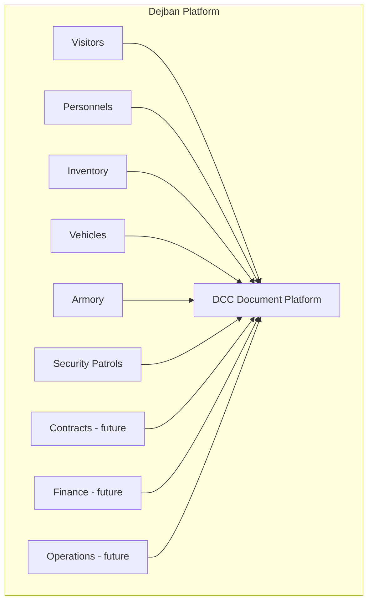
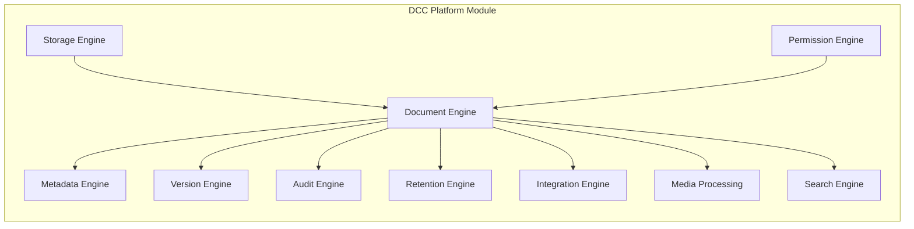
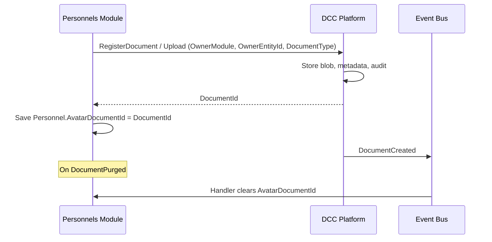

# DCC Platform Vision

> Document Control Center — Core Platform Module of the Dejban Ecosystem

---

## 1. What DCC Is

**DCC (Document Control Center) is the internal Document Platform of Dejban.**

It is infrastructure and platform business capability — not a user-facing product and not a standalone document management suite. Every Dejban module that handles files **must** use DCC. No module may store blobs, paths, hashes, thumbnails, or document metadata in its own database.



---

## 2. What DCC Is Not

| DCC is NOT | Why |
|------------|-----|
| SharePoint / Google Drive / Box | Those are end-user collaboration products |
| Owner of Personnel, Visitors, Inventory | Business domains stay in their modules |
| A place to store business rules | Modules own workflows and validation |
| A general external file-sharing product | External access is mediated by business modules |
| Optional for modules that "need files" | **Mandatory** platform service for all binary content |

Enterprise DMS platforms inform **how** we build storage, versioning, audit, and search — they do not define **what** we ship.

---

## 3. Platform Mission

> Provide a **single, secure, auditable, searchable document lifecycle** for the entire Dejban platform, addressable by every module through a unified SDK and event contract.

### 3.1 Primary Consumers

| Consumer | Integration style |
|----------|-------------------|
| Dejban module Application handlers | `IDocumentPlatformClient` SDK |
| Dejban module Infrastructure | MassTransit integration event handlers |
| Dejban Presentation (UI) | Download/preview URLs from DCC API |
| ApiGateway | Proxy authenticated Document Service API |
| IdentityServer | Endpoint permissions catalog |
| Reporting | Storage metrics export |

End users never "log into DCC." They use Visitors, Personnels, etc. — those modules call DCC.

---

## 4. Platform Engines

DCC is organized as **engines** — cohesive platform subsystems:



| Engine | Platform responsibility |
|--------|-------------------------|
| **Storage Engine** | Blobs, providers (S3/MinIO), keys, tiers, integrity |
| **Document Engine** | Document identity, lifecycle state, OwnerModule/Entity binding |
| **Metadata Engine** | DocumentTypes, MetadataProfiles, validation |
| **Version Engine** | Immutable version chain per DocumentId |
| **Permission Engine** | Access decisions for module principals and user contexts |
| **Search Engine** | Index and query by module, site, type, metadata |
| **Audit Engine** | Append-only platform audit |
| **Retention Engine** | Policies by DocumentType/Site; disposition jobs |
| **Integration Engine** | Events, outbox, SDK, service API |
| **Media Processing** | Thumbnails, previews, OCR, optimization |

---

## 5. Database Principle

### Business modules store ONLY:

```csharp
// Personnels module
public Guid? AvatarDocumentId { get; private set; }

// Visitors module  
public Guid? PhotoDocumentId { get; private set; }

// Inventory module
public Guid? PrimaryImageDocumentId { get; private set; }
```

### Business modules MUST NOT store:

- File bytes, blob content, Base64
- Storage paths, bucket keys
- SHA-256 hashes, MIME details (unless ephemeral UI cache from API)
- Thumbnail paths
- Document metadata JSON (beyond optional read-model cache fed by events)
- Version numbers

**The entire document lifecycle belongs to DCC.**

---

## 6. Platform Identity Model

Every document is addressed by platform coordinates:

| Field | Example | Purpose |
|-------|---------|---------|
| `DocumentId` | `3fa85f64-...` | Global platform identifier |
| `OwnerModule` | `Dejban.Personnels` | Which module owns the business link |
| `OwnerEntityId` | `{PersonnelId}` | Which business row references this doc |
| `DocumentType` | `Personnel.Avatar` | Schema, retention, processing profile |
| `SiteId` | `{SiteGuid}` | Tenancy (from Dejban site model) |

Modules register DocumentTypes at deploy time or via Platform Admin API.

---

## 7. Integration Philosophy



**Prefer events over callbacks.** Modules subscribe to `DocumentPurged`, `DocumentRetentionExpired` — they do not poll DCC.

---

## 8. Success Criteria

| Metric | Target |
|--------|--------|
| Modules using DCC for all files | 100% (8 current + future modules) |
| Business DB columns storing blob/path/hash | 0 |
| Orphan DocumentId references after purge | 0 (event-driven cleanup) |
| Platform auth failures (Critical audit class) | 0 |
| Module integration pattern | Single SDK + events — no ad-hoc HTTP |
| Time for new module to add file upload | < 1 day with registered DocumentType |

---

## 9. Relationship to PayamGostar Microservices

DCC remains a **separate deployable microservice** in the monorepo (like IdentityServer, ACLServer) but is **logically part of Dejban's platform layer**:

| Layer | Services |
|-------|----------|
| Edge | ApiGateway |
| Identity & access | IdentityServer, ACLServer |
| **Platform content** | **DCC** |
| Business | Dejban.Api (modular monolith) |
| Supporting | Reporting, RequestTracker |

---

## 10. Roadmap Philosophy (Revised)

| Phase | Focus |
|-------|-------|
| **A** | Platform foundation — safe storage, Document model, SDK, events, permissions |
| **B** | Platform completeness — versions, metadata profiles, search, media, retention |
| **C** | Platform scale — tiering, bulk, advanced media, module-wide adoption |
| **D** | Platform intelligence — optional AI assist for classification and similarity |

**Deprioritized:** end-user collaboration, external sharing product, desktop sync, module-external workflows inside DCC.

---

## 11. Document Map

| Document | Purpose |
|----------|---------|
| [Platform Architecture](./DCC_PLATFORM_ARCHITECTURE.md) | Engines, API, SDK, events |
| [Responsibility Boundaries](./DCC_RESPONSIBILITY_BOUNDARIES.md) | DCC vs module ownership |
| [Platform Roadmap](./DCC_PLATFORM_ROADMAP.md) | Engine-level delivery plan |
| [Revised Implementation Plan](./DCC_REVISED_IMPLEMENTATION_PLAN.md) | Phased execution |
| [Previous Analysis Review](./DCC_PREVIOUS_ANALYSIS_REVIEW.md) | Keep / Modify / Remove matrix |

---

*"One document platform. Every module. Zero duplicate file logic."*
