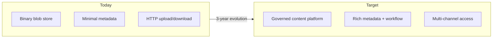
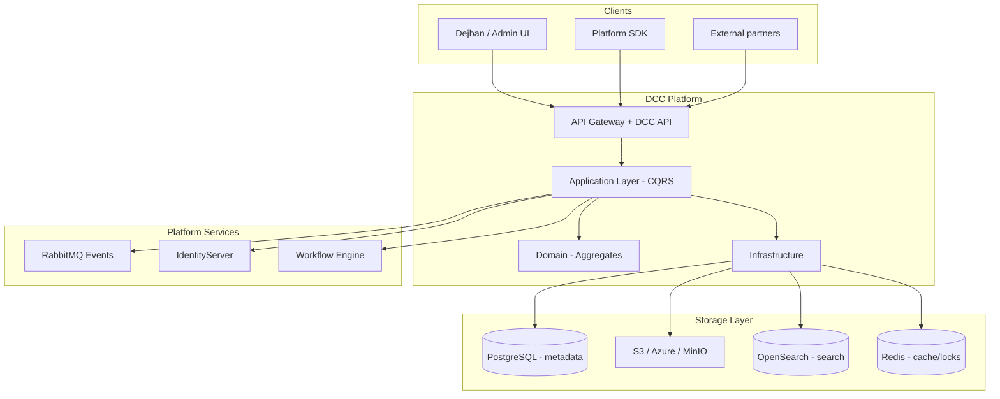

# DCC Product Vision

> Document Control Center — Strategic Product Direction  
> Audience: Engineering leadership, product owners, enterprise architects  
> Status: Target-state design (not current implementation)

---

## 1. Vision Statement

**DCC will become the PayamGostar platform's enterprise Document Management Platform (DMP)** — a centralized, policy-driven system for storing, securing, discovering, governing, and delivering all digital content across Dejban and partner services.

Today DCC is a **file storage microservice**. Tomorrow it is the **system of record for unstructured data**, comparable in capability to mid-market enterprise DMS offerings (M-Files, Laserfiche) while remaining native to our microservices architecture.

---

## 2. Strategic Position

| Dimension | Today | Target (36 months) |
|-----------|-------|-------------------|
| Primary user | Backend services (Dejban) | Services + end users + admins |
| Content types | Photos, ad-hoc files | Documents, media, records, templates |
| Governance | None effective | Retention, legal hold, audit, compliance |
| Discovery | By GUID only | Full-text, semantic, faceted search |
| Storage | Local disk | Multi-provider, encrypted, CDN-backed |
| Integration | HTTP client upload | Events, webhooks, SDK, sync clients |

---

## 3. Problem We Solve

### 3.1 Platform Problem

PayamGostar microservices generate and consume unstructured content — personnel photos, visitor images, patrol reports, inventory attachments, contracts, and compliance documents. Without a unified DMP:

- Each module reinvents storage, metadata, and access patterns
- Cross-service references become orphaned GUID strings
- Security and retention policies cannot be enforced consistently
- Operations cannot answer: *who accessed what, when, and why*

### 3.2 Enterprise Problem

Regulated environments (government, finance, critical infrastructure — aligned with Dejban's security domain) require:

- Document lifecycle management (draft → approved → archived → disposed)
- Audit trails defensible in investigations
- Role and site-scoped access with external sharing controls
- Retention schedules and legal hold
- Integrity verification and non-repudiation

Current DCC satisfies **none** of these at production grade.

---

## 4. Product Principles

| # | Principle | Implication |
|---|-----------|-------------|
| 1 | **Content is a first-class domain** | Files are not rows with paths — they are governed documents with lifecycle |
| 2 | **Policy over code** | Retention, access, workflow configured by admins, not hardcoded per consumer |
| 3 | **API-first, event-native** | Every state change emits integration events; HTTP is one transport |
| 4 | **Storage is pluggable** | Business logic never depends on filesystem paths |
| 5 | **Secure by default** | Private, encrypted, audited — public is explicit opt-in with controls |
| 6 | **Modular monolith internally, microservice externally** | DCC remains one deployable service with clear internal bounded contexts |
| 7 | **Progressive disclosure** | Phase A fixes foundations; advanced AI/workflow layers on proven core |

---

## 5. Target Personas

| Persona | Needs | Primary interfaces |
|---------|-------|-------------------|
| **Platform Developer** | Upload/download API, SDK, webhooks, stable contracts | REST, gRPC, NuGet SDK |
| **End User (Guard/Admin)** | Find documents, preview, share, comment | Dejban UI via DCC APIs |
| **Records Manager** | Retention, legal hold, disposition, audit export | Admin console |
| **Security Officer** | Access reports, DLP, virus scan status, encryption | Admin + SIEM integration |
| **System Integrator** | Bulk migration, metadata mapping, SSO | Migration API, SCIM |

---

## 6. Competitive Positioning

DCC is **not** competing with SharePoint as a collaboration suite. It competes as **embedded enterprise content services** for the PayamGostar ecosystem.

| Capability | SharePoint / M-Files | DCC Target |
|------------|---------------------|------------|
| Deep Office integration | Native | Via conversion APIs |
| Platform-native multi-tenancy (sites) | Add-on | Built-in (Dejban sites) |
| Microservice event bus | Limited | MassTransit-native |
| Physical security domain fit | Generic | Tailored (visitors, personnel, patrols) |
| Deployment | SaaS / on-prem suite | Containerized microservice |

**Differentiator:** Policy-driven content layer deeply integrated with Dejban identity, sites, ACL, and workflows — without forcing a separate DMS product.

---

## 7. Success Metrics (36-Month)

| Metric | Target |
|--------|--------|
| Platform services using DCC | 100% of modules with file needs |
| Orphan file references | < 0.1% (event-driven cleanup) |
| Mean time to find document | < 3 seconds (search) |
| Audit export completeness | 100% of access + lifecycle events |
| Uptime SLA | 99.9% |
| Storage cost visibility | Per-site/per-service breakdown |
| Security findings (auth/storage) | Zero Critical/High from Phase 2 audit class |

---

## 8. Non-Goals (Explicit)

- Replacing IdentityServer or Dejban module databases
- Real-time collaborative co-editing (Google Docs style) in Phase A–C
- Full BPMN engine competing with Camunda — integrate, don't rebuild
- Building a desktop sync client before API/SDK maturity (Phase D)

---

## 9. Architecture North Star

---

## 10. Relationship to Phase 2 Audit

Phase 2 findings **directly inform Phase A priorities**:

| Audit theme | Vision response |
|-------------|-----------------|
| Authorization gaps | Security module — unified policy engine |
| Filesystem-only storage | Storage abstraction module — S3/MinIO |
| No domain events | Event-native architecture — every lifecycle transition |
| Anemic domain | Rich aggregates — Document, Folder, Policy |
| No search | Search module — Phase B |
| Public static bypass | Signed URLs + CDN module |

Phase A is **not** feature expansion — it is **platform foundation** without which enterprise features collapse.

---

## 11. Document Map

| Document | Purpose |
|----------|---------|
| [Enterprise Features](./DCC_ENTERPRISE_FEATURES.md) | Complete feature catalog vs enterprise benchmark |
| [Module Roadmap](./DCC_MODULE_ROADMAP.md) | Logical module decomposition |
| [Implementation Plan](./DCC_IMPLEMENTATION_PLAN.md) | Phased delivery A–D with dependencies |
| Phase 1 docs | Current-state reference (workspace, architecture, domain, audits) |

---

## 12. Executive Summary for Leadership

**Invest in DCC** because unstructured content volume and compliance pressure will grow faster than per-module file handling can scale. A unified DMP reduces duplicate engineering, closes security gaps identified in Phase 2, and unlocks workflow, search, and analytics that enterprise buyers expect.

**Recommended commitment:** 4 phases over ~24–30 months with a dedicated platform squad (3–5 engineers) plus security review cadence.

**First milestone (Phase A, ~4–6 months):** Production-safe core — authorization, blob storage abstraction, domain events, folder model, versioning v1, audit trail — with zero Critical findings from current audit class.

---

*"From file store to content platform — governed, discoverable, and built for the next decade of PayamGostar."*
