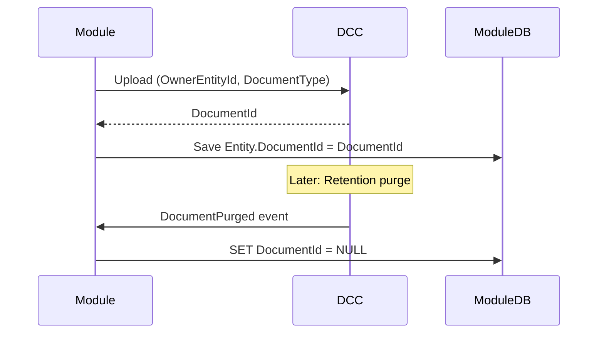

# DCC Responsibility Boundaries

> Clear ownership between DCC (Document Platform) and Dejban business modules

---

## 1. Boundary Principle

```
Business modules own MEANING.
DCC owns MEDIA and DOCUMENT LIFECYCLE.
```

If a decision depends on **what the file means to the business**, it belongs in the module.  
If it depends on **how the file is stored, secured, found, or destroyed**, it belongs in DCC.

---

## 2. Ownership Matrix

| Concern | Business Module | DCC Platform |
|---------|-----------------|--------------|
| Personnel entity, national code | **Module** | — |
| Personnel avatar photo bytes | — | **DCC** |
| AvatarDocumentId on Personnel | **Module** (reference) | — |
| When avatar is required on hire | **Module** rule | — |
| Avatar image optimization profile | — | **DCC** (DocumentType config) |
| Visitor visit approval workflow | **Module** | — |
| Visitor photo storage | — | **DCC** |
| Who may upload visitor photo | **Module** invokes; **DCC** enforces | Shared |
| Patrol report PDF retention years | **Module** registers policy | **DCC** executes |
| Patrol route business logic | **Module** | — |
| Inventory item primary image | — | **DCC** |
| Stock quantity | **Module** | — |
| Contract approval states | **Module** / RequestTracker | — |
| Signed contract PDF blob | — | **DCC** |
| File SHA-256 | — | **DCC** |
| Download audit log | — | **DCC** |
| SiteId tenancy | **Module** entity | **DCC** copies on document |
| JWT / roles | IdentityServer | **DCC** evaluates |

---

## 3. Data Storage Rules

### 3.1 Allowed in Business Module Database

| Column type | Example | Notes |
|-------------|---------|-------|
| Document reference | `AvatarDocumentId UNIQUEIDENTIFIER NULL` | Preferred |
| Multiple references | `AttachmentDocumentIds` via join table | DocumentId only |
| Optional read cache | `AvatarThumbnailUrl` with TTL | **Must** be refreshable from DCC API — not source of truth |
| Business metadata | `Personnel.FirstName` | Never file-related |

### 3.2 Forbidden in Business Module Database

| Anti-pattern | Why forbidden |
|--------------|---------------|
| `byte[] PhotoData` | Duplicates platform storage |
| `string StoragePath` | Leaks infrastructure; bypasses Permission Engine |
| `string FileHash` | DCC owns integrity |
| `string ContentType`, `long FileSize` | Query DCC metadata API |
| `string ThumbnailPath` | DCC Media Processing |
| JSON metadata blob mirroring DCC | Single source of truth violation |
| Version number | DCC Version Engine |

### 3.3 Reference Lifecycle



**Module obligation:** subscribe to purge/retention events and clear references.

---

## 4. API Responsibility Split

### Module calls DCC for:

- Upload / new version
- Download / preview / thumbnail URL
- Recycle / restore (when business rules allow)
- Search documents for OwnerModule + OwnerEntityId
- Register DocumentType metadata profile (admin/setup)
- Set legal hold flag (compliance module)

### Module does NOT:

- Construct storage paths
- Write files to local disk or module-specific folders
- Implement virus scan
- Maintain version history tables
- Log download events locally (query DCC audit if needed)

### DCC does NOT:

- Validate Personnel exists in Personnels DB
- Decide if visit is approved before photo upload (module gates the call)
- Execute visitor blacklist rules
- Send SMS to visitor
- Render Personnel UI

---

## 5. Per-Module Integration Profile

### Personnels

| Aspect | Owner |
|--------|-------|
| `Personnel` aggregate | Module |
| `Personnel.AvatarDocumentId` | Module stores reference |
| DocumentType `Personnel.Avatar` | Registered jointly — schema owned by DCC registry |
| Upload after personnel created | Module handler |
| Clear reference on personnel hard delete | Module publishes event OR listens DocumentPurged |

### Visitors

| Aspect | Owner |
|--------|-------|
| Visitor / VisitSchedule | Module |
| `Visitor.PhotoDocumentId`, companion photos | Module references |
| DocumentTypes `Visitor.Photo`, `Visitor.CompanionPhoto` | Platform registry |
| Upload after visitor saved | Module (current pattern — keep) |
| Photo required for entry | **Module** business rule |

### Inventory (future)

| Aspect | Owner |
|--------|-------|
| Item, SKU, quantity | Module |
| Item images (multiple) | DocumentIds in join table |
| DocumentType `Inventory.ItemImage` | Platform |
| Bulk image import | Module orchestrates — DCC bulk API executes |

### Security Patrols (future)

| Aspect | Owner |
|--------|-------|
| Patrol, shift, route | Module |
| Evidence photos, reports | DCC documents |
| DocumentType `Patrol.Evidence` with watermark policy | Platform |
| Chain of custody business rules | Module |

### Armory, Vehicles, Cash Logistics, WeighBridge

Same pattern: business entity in module; attachments/photos/certificates as DocumentIds.

---

## 6. Workflow Boundaries

| Workflow step | Where it lives |
|---------------|----------------|
| "Manager must approve document before publish" | **Business module** or RequestTracker |
| "Document moves to Recycled when visit cancelled" | Module calls `RecycleAsync` — DCC executes |
| "Document purged 2 years after visit" | **DCC Retention Engine** |
| "Module notified of purge" | **Integration event** → module handler |

DCC exposes **lifecycle hooks** (status, events) — not workflow orchestration.

---

## 7. Permission Boundaries

| Question | Answered by |
|----------|-------------|
| Can this user create a visit? | Visitors module + IdentityServer |
| Can this user upload on behalf of module? | DCC Permission Engine — module service + user |
| Can this user download this DocumentId? | DCC Permission Engine |
| Should this DocumentType require site match? | DocumentType policy in DCC |
| Module-specific role "Reception" | IdentityServer claim — DCC evaluates |

Default policy: **user must have site access matching Document.SiteId** AND **appropriate permission for OwnerModule**.

---

## 8. Search Boundaries

| Module wants | Approach |
|--------------|----------|
| All photos for Visitor X | `Search(ownerModule, ownerEntityId)` |
| All patrol evidence at Site Y | `Search(ownerModule=Patrol, siteId, documentType)` |
| Full-text in report PDFs | DCC Search Engine — module passes query |
| Personnel by name | **Personnels DB** — not DCC |

DCC indexes document metadata and extracted text — not business entity fields.

---

## 9. Anti-Patterns to Eliminate

| Current / risk | Correction |
|----------------|------------|
| `personnel.AvatarImage = fileId.ToString()` | Rename to `AvatarDocumentId` (Guid) |
| Upload failure silent in Personnels | Module decides; platform returns structured errors |
| Dejban module stores file path in future | Architecture test forbids column names `*Path*`, `*Blob*` |
| Each module adds `AddDccClient` differently | Single `AddDocumentPlatform()` in Dejban.Common.Infrastructure |
| ApiGateway static `/files` bypass | Signed URLs from DCC Permission Engine |
| Duplicate `AddDccClient` in Program + Infrastructure | Consolidate platform registration |

---

## 10. Architecture Enforcement

Recommended **Dejban.ArchitectureTests** rules:

1. Module Domain projects must not reference `System.IO` file APIs
2. Module Domain entities must not have properties matching `*Blob*`, `*StoragePath*`, `*FileHash*`
3. Module Application may only access files via `IDocumentPlatformClient`
4. Module IntegrationEvents must handle `DocumentPurged` for modules with DocumentId references

---

## 11. Decision Guide

When unsure where logic belongs, ask:

```
Q1: Would another module need the same behavior for its documents?
     YES → DCC platform
     NO  → Q2

Q2: Does it reference a business rule unique to one domain?
     YES → Business module
     NO  → Q3

Q3: Is it about bytes, versions, audit, retention, or access?
     YES → DCC platform
```

---

## Related Documents

- [Platform Vision](./DCC_PLATFORM_VISION.md)
- [Platform Architecture](./DCC_PLATFORM_ARCHITECTURE.md)
- [Previous Analysis Review](./DCC_PREVIOUS_ANALYSIS_REVIEW.md)
