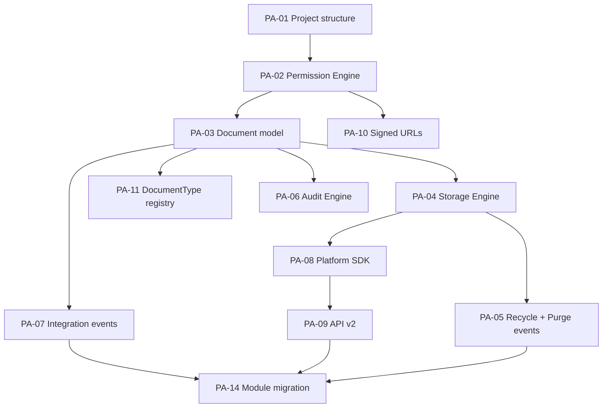
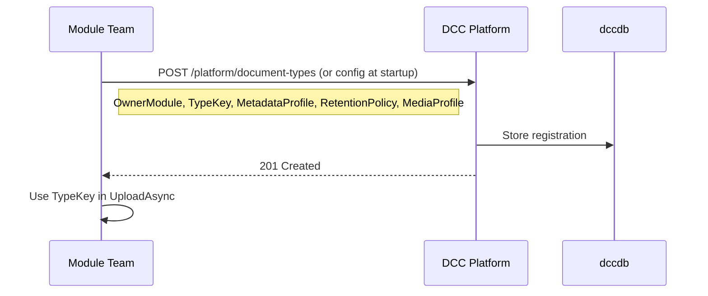

# DCC Revised Implementation Plan

> Platform-first execution plan — Phases A through D  
> Supersedes `DCC_IMPLEMENTATION_PLAN.md`

---

## 1. Planning Context

This plan optimizes for:

1. **Module adoption** — Personnels and Visitors first, all 8 modules by Phase C
2. **Reference-only business DBs** — DocumentId, never blobs/paths
3. **Single SDK + events** — no per-module file logic
4. **Phase 2 audit closure** — platform cannot be trusted until Critical findings fixed

Enterprise DMS patterns are used **only** where they strengthen platform reuse (versioning, audit, search, retention).

---

## 2. Team & Timeline Summary

| Phase | Months | FTE | Person-months |
|-------|--------|-----|---------------|
| A — Foundation | 5 | 4 | 20 |
| B — Complete | 7 | 5 | 35 |
| C — Scale | 5 | 4 | 20 |
| D — Intelligence | 6 | 3 | 18 |
| **Total** | **~23** | avg 4 | **~93 PM** |

Shorter than previous plan because standalone product features were removed.

---

## 3. Phase A — Platform Foundation (Months 1–5)

### Theme

*Make DCC trustworthy and adoptable by Personnels and Visitors.*

### Dependency graph

### Sprint-level plan

#### Month 1 — Structure & Security

| Week | Work | Output |
|------|------|--------|
| 1–2 | PA-01: Split DCC into Domain/Application/Infrastructure/Api projects; ArchUnit tests | Enforceable boundaries |
| 2–4 | PA-02: Permission Engine — central evaluator; fix PurgeFile, Delete, GetFileMeta, Download; remove AllowAnonymous purge | Critical audit closed |
| 3–4 | PA-12: Health checks; DbInitializer fail-fast | Ops ready |

**Parallel (Dejban team):** Draft `DocumentPurged` handlers in Personnels + Visitors (stub).

#### Month 2 — Document Model & Storage

| Week | Work | Output |
|------|------|--------|
| 1–3 | PA-03: `Document` aggregate — DocumentId, OwnerModule, OwnerEntityId, DocumentType, SiteId, Status | Domain model |
| 2–4 | PA-04: IObjectStore + MinIO; path sanitization; migrate existing blobs | Storage Engine |
| 4 | PA-11: DocumentType registry — Personnel.Avatar, Visitor.Photo, Visitor.CompanionPhoto | Metadata Engine v1 |

#### Month 3 — Integration & Audit

| Week | Work | Output |
|------|------|--------|
| 1–2 | PA-06: Platform audit log on all operations | Audit Engine |
| 2–4 | PA-07: DocumentCreated, Recycled, Restored, Purged + outbox | Integration Engine |
| 3–4 | PA-05: Unified recycle bin; purge publishes event | Document Engine |

#### Month 4 — SDK & API

| Week | Work | Output |
|------|------|--------|
| 1–3 | PA-09: Document Service API v2 (`/api/v2/platform/documents`) | REST contract |
| 2–4 | PA-08: IDocumentPlatformClient in Common — upload, download, metadata, recycle | Unified SDK |
| 3–4 | PA-10: Signed URLs; ApiGateway remove anonymous static /files | Secure delivery |
| 4 | PA-13: Wire GetDCCServiceEndpoints in IdentityServer | Permission catalog |

**Consolidate:** Single `AddDocumentPlatform()` — remove duplicate AddDccClient registrations.

#### Month 5 — Module Migration

| Week | Work | Output |
|------|------|--------|
| 1–2 | PA-14: Personnels — SDK v2, AvatarDocumentId column migration | Module on platform |
| 2–3 | PA-14: Visitors — SDK v2, PhotoDocumentId naming | Module on platform |
| 3–4 | Integration tests: upload → reference → purge → reference cleared | End-to-end proof |
| 4 | v1 API deprecation notice; dual-read period begins | Migration path |

### Phase A exit criteria

- [ ] Personnels + Visitors 100% on SDK v2
- [ ] DocumentPurged handlers clear references
- [ ] Architecture test: no blob/path in module Domain
- [ ] Load test: 50 concurrent uploads, permission check < 50ms p95
- [ ] Zero Critical/High from Phase 2 auth/storage audit category

---

## 4. Phase B — Platform Complete (Months 6–12)

### Theme

*Give modules versions, search, media, retention — zero local file infrastructure.*

### Sequence

| Month | Focus | Deliverables |
|-------|-------|--------------|
| 6 | Version Engine | PB-01: multi-version; SDK UploadVersion |
| 7 | Metadata | PB-02: MetadataProfiles; modules supply JSON |
| 7–8 | Search | PB-03: OpenSearch; module-scoped search API |
| 8 | Media basics | PB-04: thumbnails; PB-11: preview |
| 9 | Security | PB-05: virus scan; PB-06: encryption |
| 10 | Retention | PB-07: policies; PB-08: quotas |
| 10 | Efficiency | PB-09: dedup; PB-10: bulk upload |
| 11–12 | Module adoption | PB-13: Patrols, Inventory, Vehicles + DocumentTypes |

### Module integration checklist (each module)

1. Register DocumentTypes with MetadataProfiles
2. Replace any local file logic with SDK
3. Store DocumentId references only
4. Implement DocumentPurged + DocumentRetentionExpired handlers
5. Add architecture test coverage
6. UI: thumbnail/preview URLs from DCC

### Phase B exit criteria

- [ ] 6 modules on platform
- [ ] Search API integrated in ≥2 modules
- [ ] Retention disposes test documents correctly
- [ ] SDK v2.1 published with docs

---

## 5. Phase C — Platform Scale (Months 13–17)

### Theme

*Operational hardening for remaining modules and heavy document loads.*

| Month | Deliverables |
|-------|--------------|
| 13 | PC-01 tiering; PC-02 document sets |
| 14 | PC-03 OCR; PC-04 PDF normalization |
| 15 | PC-05 watermark policies; PC-06 legal hold |
| 16 | PC-07 audit export → Reporting; PC-08 edit lock |
| 17 | PC-10 Armory, CashLogistics, WeighBridge; PC-11 Platform Admin API |

### Phase C exit criteria

- [ ] All 8 modules on DCC
- [ ] No module bypasses SDK (grep gate in CI)
- [ ] Storage metrics visible in Reporting

---

## 6. Phase D — Platform Intelligence (Months 18–23, Optional)

Proceed only if Phase C stable and business case approved.

| Month | Deliverables |
|-------|--------------|
| 18–19 | PD-01 similarity API for Visitors |
| 20 | PD-02 classification suggest; PD-03 moderation |
| 21–22 | PD-04 semantic search (if Patrol/Contracts need) |
| 23 | PD-05 resumable upload in SDK |

---

## 7. Cross-Cutting Workstreams

### WS-1: Dejban.Common Integration

| Task | Phase | Owner |
|------|-------|-------|
| `AddDocumentPlatform()` extension | A | Platform |
| Shared integration event contracts in Common or Dejban.Common | A | Platform |
| Base handler `DocumentPurgedIntegrationEventHandler<T>` | A | Platform + modules |
| Architecture tests package | A | Platform |

### WS-2: ApiGateway

| Task | Phase |
|------|-------|
| Route `/api/v2/platform/documents/*` to DCC | A |
| Remove static `/files` anonymous serve | A |
| Rate limit upload routes | B |

### WS-3: Documentation

| Task | Phase |
|------|-------|
| Module integration guide (how to add DocumentType) | A |
| SDK reference | A |
| DocumentType catalog | B |

---

## 8. DocumentType Registration Process

Phase A: config-file registration  
Phase B: Admin API + versioning of profiles  
Phase C: Module self-service with approval

---

## 9. Migration from Current State

### DCC internal

| Step | Action |
|------|--------|
| 1 | Create Document alongside FileEntity |
| 2 | Dual-write new uploads to both (2 weeks max) |
| 3 | Background job migrates FileEntity → Document |
| 4 | Switch SDK to Document API |
| 5 | Deprecate FileEntity; remove after 90 days |

### Personnels example

| Before | After |
|--------|-------|
| `AvatarImage` string | `AvatarDocumentId` Guid? |
| `IDccClient.UploadFileAsync` | `IDocumentPlatformClient.UploadAsync` |
| `ownerService: "Dejban.Personnels"` | `OwnerModule: "Dejban.Personnels"`, `DocumentType: "Personnel.Avatar"` |
| No purge handler | `DocumentPurgedEventHandler` clears reference |

### Visitors example

Same pattern for `PhotoDocumentId`, companion photos as separate DocumentIds linked to VisitSchedule via OwnerEntityId.

---

## 10. Risk Register (Revised)

| Risk | Mitigation |
|------|------------|
| Modules resist migration | Mandate via architecture tests + lead time in Phase A |
| Dual-write complexity | Time-box 2 weeks; prioritize new uploads on Document |
| OpenSearch ops burden | Start PostgreSQL FTS in B if OpenSearch delayed |
| Scope creep (standalone features) | Product owner gate — "does this serve all modules?" |
| Personnels/Visitors production regression | Feature flag SDK v2 per module |

---

## 11. First 60 Days (Critical Path)

| Day | Milestone |
|-----|-----------|
| 1–14 | Permission Engine live; Critical auth fixed |
| 15–30 | Document model + MinIO storage |
| 31–45 | SDK v2 alpha + DocumentCreated/Purged events |
| 46–60 | Personnels migration in staging |

---

## 12. Success Metrics by Phase

| Metric | A | B | C |
|--------|---|---|---|
| Modules on SDK v2 | 2 | 6 | 8 |
| DocumentTypes registered | 4 | 15 | 25+ |
| Purge handler coverage | 2 modules | 6 | 8 |
| Critical security findings | 0 | 0 | 0 |
| Avg upload latency p95 | <2s | <1.5s | <1s |
| Module file anti-pattern violations | 0 | 0 | 0 |

---

## 13. Document Supersession

| Superseded | Replaced by |
|------------|-------------|
| DCC_PRODUCT_VISION.md | DCC_PLATFORM_VISION.md |
| DCC_IMPLEMENTATION_PLAN.md | This document |
| DCC_MODULE_ROADMAP.md | DCC_PLATFORM_ROADMAP.md |
| Standalone DMS feature priorities in DCC_ENTERPRISE_FEATURES.md | DCC_PREVIOUS_ANALYSIS_REVIEW.md + this plan |

Phase 1–2 technical docs (architecture, domain, audits) **remain valid** as current-state reference.

---

## Related Documents

- [Platform Vision](./DCC_PLATFORM_VISION.md)
- [Platform Roadmap](./DCC_PLATFORM_ROADMAP.md)
- [Responsibility Boundaries](./DCC_RESPONSIBILITY_BOUNDARIES.md)
- [Previous Analysis Review](./DCC_PREVIOUS_ANALYSIS_REVIEW.md)

---

*"Ship the platform Personnels and Visitors can trust in Phase A. Everything else builds on that adoption."*
