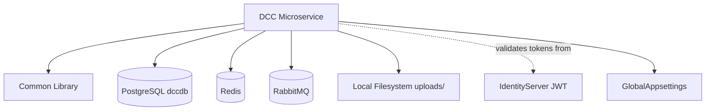
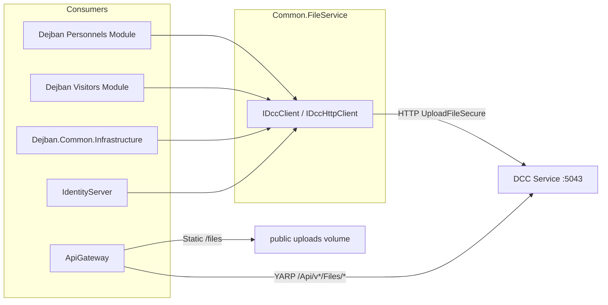
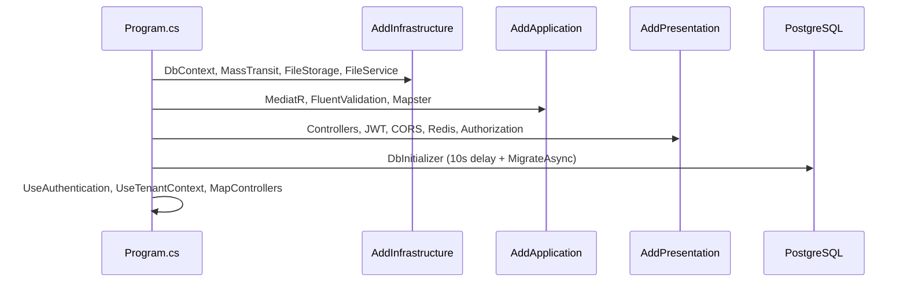

# DCC Workspace Map

> Document Control Center (DCC) — workspace discovery and dependency graph  
> Generated from full reverse-engineering of `Microservices/DCC` and all related projects.

---

## 1. Repository Overview

| Item | Location / Value |
|------|------------------|
| Solution file | `PG_Microservices.slnx` |
| Product | PayamGostar Microservices (Dejban security platform) |
| Runtime | .NET 10 (`net10.0`) |
| Entry gateway | `ApiGateway` (YARP, port 7036 dev) |
| DCC dev port | `5043` (`Microservices/DCC/Properties/launchSettings.json`) |
| Docker orchestration | `docker-compose.yml` + environment overlays |
| Shared config | `GlobalAppsettings/` (loaded by every service at startup) |
| Central packages | `Directory.Packages.props` |

The repository is a **monorepo** containing multiple independently deployable microservices plus a modular Dejban application composed of nine feature modules.

---

## 2. Top-Level Structure

```
dejban_backend_new/
├── ApiGateway/                 # YARP reverse proxy — external HTTP entry point
├── Common/                     # Cross-service shared library (auth, event bus, DCC client)
├── GlobalAppsettings/          # JWT, Serilog, SuperAdmin, MediaMTX settings
├── Microservices/
│   ├── DCC/                    # Document Control Center (this module)
│   ├── IdentityServer/
│   ├── ACLServer/
│   ├── Dejban/                 # Modular monolith (9 bounded-context modules)
│   ├── Reporting/
│   ├── RequestTracker/
│   ├── BaskoolService/
│   ├── ClientServiceManagement/
│   ├── ServerServiceManagement/
│   ├── TiamGrpcServer/
│   ├── VirdiGrpcServer/
│   └── ZKGrpcServer/
├── docker-compose*.yml
├── PG_Microservices.slnx
└── Directory.Packages.props
```

---

## 3. Solution Projects (63 `.csproj` files)

### 3.1 Standalone Microservice Hosts

| Project | Path | References `Common` | Docker |
|---------|------|---------------------|--------|
| ApiGateway | `ApiGateway/ApiGateway.csproj` | Yes | Yes |
| DCC | `Microservices/DCC/DCC.csproj` | Yes | Yes |
| IdentityServer | `Microservices/IdentityServer/IdentityServer.csproj` | Yes | Yes |
| ACLServer | `Microservices/ACLServer/ACLServer.csproj` | Yes | Yes |
| Dejban.Api | `Microservices/Dejban/API/Dejban.Api/Dejban.Api.csproj` | Transitive | Yes |
| Reporting | `Microservices/Reporting/Reporting.csproj` | Yes | Yes |
| RequestTracker | `Microservices/RequestTracker/RequestTracker.csproj` | Yes | Yes |
| BaskoolService | `Microservices/BaskoolService/BaskoolService.csproj` | Yes | No |
| ServerServiceManagement | `Microservices/ServerServiceManagement/ServerServiceManagement.csproj` | Yes | No |
| TiamGrpcServer | `Microservices/TiamGrpcServer/TiamGrpcServer.csproj` | Yes | No |
| VirdiGrpcServer | `Microservices/VirdiGrpcServer/VirdiGrpcServer.csproj` | Yes | No |
| ZKGrpcServer | `Microservices/ZKGrpcServer/ZKGrpcServer.csproj` | Yes | No |
| ClientServiceManagement | `Microservices/ClientServiceManagement/ClientServiceManagement.csproj` | No | No |

### 3.2 Dejban Module Layers (per module)

Each Dejban module follows Clean Architecture with up to six projects:

```
Dejban.Modules.{Module}.Domain
Dejban.Modules.{Module}.Application
Dejban.Modules.{Module}.Infrastructure
Dejban.Modules.{Module}.Presentation
Dejban.Modules.{Module}.IntegrationEvents
```

Modules: **Armory**, **CashLogistics**, **Inventory**, **Personnels**, **SecurityPatrols**, **Vehicles**, **Visitors**, **WeighBridge**.

Dejban shared layers:

```
Dejban.Common.Domain      → Common
Dejban.Common.Application → Dejban.Common.Domain
Dejban.Common.Infrastructure → Dejban.Common.Application (+ AddDccClient)
Dejban.Common.Presentation   → Dejban.Common.Domain
```

---

## 4. Shared Libraries

### 4.1 Root `Common` Library

Path: `Common/Common.csproj`

| Area | Purpose | DCC relevance |
|------|---------|---------------|
| `Abstractions/` | JWT auth, API versioning, caching, HTTP extensions | Used by DCC startup and handlers |
| `Abstractions/Contracts/` | `IDccClient`, `DCCFolders`, `FileUploadResult` | Client contract for upload |
| `FileService/` | `IDccHttpClient`, `DccAuthForwardingHandler`, `FileInfoDTO` | Service-to-service HTTP client |
| `Authentication/` | Claim extensions, JWT helpers | Upload/download authorization |
| `Authorization/` | Policy handlers, endpoint/role/permission filters | Registered in DCC |
| `Caching/` | Redis hybrid cache, token blacklist | Token revocation |
| `Tenancy/` | `TenantContext`, middleware, query filters | Site-scoped requests |
| `EventBus/Contracts/` | MassTransit message contracts | `GetDCCServiceEndpoints`, `GetUserSiteClaims` |
| `Claims/` | `IClaimService` interface | Implemented in DCC (unused in handlers) |
| `Protos/` | gRPC definitions (ZK, Virdi, Tiam, SSM) | Not used by DCC |

### 4.2 Global Configuration

All services load:

```
GlobalAppsettings/globalAppsettings.json
GlobalAppsettings/globalAppsettings.{Environment}.json
```

DCC-specific settings live in `Microservices/DCC/appsettings*.json` (Postgres, Redis, RabbitMQ, Storage).

The `Dcc:BaseUrl` configuration key is read by `AddDccClient()` but is **not present in GlobalAppsettings** — callers fall back to `http://localhost:5043`.

---

## 5. Infrastructure Services (Docker)

From `docker-compose.yml`:

| Service | Purpose | DCC relationship |
|---------|---------|-------------------|
| `dccdb` | PostgreSQL (`payamgostar_dcc`) | DCC primary database |
| `eventbus` | RabbitMQ | MassTransit transport + outbox |
| `redis` | Cache / token blacklist | Shared with DCC |
| `dcc-storage` | Docker volume | Shared between DCC uploads and ApiGateway static files |

DCC container mounts:

- `./GlobalAppsettings` → `/app/GlobalAppsettings`
- `dcc-storage` → `/app/uploads`

ApiGateway mounts `dcc-storage` read-only at `/app/public-assets` for serving public files at `/files`.

---

## 6. Dependency Graph

### 6.1 What DCC Depends On



**Direct project reference:** `DCC.csproj` → `Common.csproj`

**NuGet packages (DCC-specific):** MediatR, FluentValidation, Mapster, MassTransit (+ EF Outbox), Npgsql EF Core, Serilog, Scalar, Redis caching.

### 6.2 What Depends On DCC



| Consumer | Integration type | Operations used |
|----------|------------------|-----------------|
| **Dejban Personnels** | `IDccClient` via HTTP | Upload personnel avatar photos |
| **Dejban Visitors** | `IDccClient` via HTTP | Upload visitor & companion photos |
| **Dejban.Api** | Registers `AddDccClient` | Enables modules above |
| **IdentityServer** | Registers `AddDccClient` | Registered but **no handler usage found** |
| **ApiGateway** | YARP reverse proxy | Proxies file API; serves public assets |
| **IdentityServer (indirect)** | MassTransit request/response | Could call `GetDCCServiceEndpoints` — consumer exists but **not wired** in endpoint sync |

### 6.3 DCC Internal Project Layout

DCC is a **single deployable project** with logical layers (not separate assemblies):

```
Microservices/DCC/
├── Program.cs
├── Controllers/           # Presentation (FilesController, ApiController)
├── Application/           # CQRS handlers, services, consumers
├── Domain/Entities/       # FileEntity, FileRevision
├── Infrastructure/        # EF Core, FileStorage, FileService
└── Abstractions/          # DI extensions, validation pipeline, exceptions
```

---

## 7. ApiGateway Routing to DCC

Configured in `ApiGateway/appsettings.json` under `ReverseProxy:DCC`:

| Route ID | Path | Auth | Destination |
|----------|------|------|-------------|
| `dcc-scalar-route-v1` | `/dccscalar/{**catch-all}` | anonymous | DCC cluster |
| `file-routes-v1` | `/Api/v{apiVersion}/Files/{**catch-all}` | default (JWT) | DCC cluster |

Cluster address: `http://localhost:5043` (dev) / `http://dcc` (Docker).

Public static files bypass DCC and are served directly:

```
GET /files/{path}  →  {DCC uploads}/public/{path}
```

---

## 8. Event Bus Contracts Involving DCC

| Message | Direction | Purpose |
|---------|-----------|---------|
| `GetDCCServiceEndpoints` | Inbound to DCC | Returns API endpoint catalog for authorization claims |
| `GetUserSiteClaims` | Outbound from DCC | Used by `ClaimService` (registered, not invoked by handlers) |

DCC uses **MassTransit EF Outbox** (`OutboxMessage`, `OutboxState`, `InboxState` tables) for reliable messaging, though DCC currently publishes no domain integration events.

---

## 9. File Inventory (DCC Module — 54 source files)

Every file under `Microservices/DCC/` was inspected. Key groupings:

| Layer | Files |
|-------|-------|
| Entry | `Program.cs`, `DCC.csproj`, `Dockerfile` |
| Controllers | `FilesController.cs`, `ApiController.cs` |
| Commands | Upload, Delete, Restore, Purge (+ handlers, validators) |
| Queries | Download, GetFileMeta (+ handlers) |
| Domain | `FileEntity.cs`, `FileRevision.cs` |
| Infrastructure | `ApplicationDbContext`, configurations, migrations, `FileStorage`, `FileService`, `ClaimService` |
| Cross-cutting | `ServiceCollectionExtensions`, `ValidationBehavior`, `GlobalExceptionHandler`, resources |
| Consumer | `GetDCCServiceEndpointsConsumer.cs` |

Related Common files: `IDccClient.cs`, `DccHttpClient.cs`, `DccAuthForwardingHandler.cs`, `FileInfoDTO.cs`, `DCCFolders.cs`, `GetDCCServiceEndpoints.cs`.

---

## 10. Startup Sequence (DCC)



Registration is defined in `DCC.Abstractions.Extensions.ServiceCollectionExtensions`.

---

## 11. Key Observations for Maintainers

1. **DCC is intentionally small** — one bounded context (file storage/metadata) as an isolated microservice.
2. **Consumers are upload-only** — `IDccClient` exposes upload; download/delete are accessed via DCC HTTP API or gateway.
3. **Endpoint discovery is incomplete** — `GetDCCServiceEndpointsConsumer` exists but IdentityServer's `GetServicesEndpointsQueryHandler` does not yet request DCC endpoints.
4. **`ClaimService` in DCC is dead code** — registered but never injected into handlers.
5. **`DCCFolders` constant class** has only one entry (`IdentityServer_Avatars`) and is unused in current upload flows.
6. **Duplicate `AddDccClient` registration** in Dejban (`InfrastructureConfiguration` + `Program.cs`) — harmless due to `IHttpClientFactory` but worth knowing.

---

## 12. Related Documentation

- [DCC Architecture](./DCC_ARCHITECTURE.md) — patterns, layers, communication
- [DCC Domain Model](./DCC_DOMAIN_MODEL.md) — entities, rules, lifecycle
- [DCC Onboarding Guide](./DCC_ONBOARDING_GUIDE.md) — how to learn the module as a senior developer
