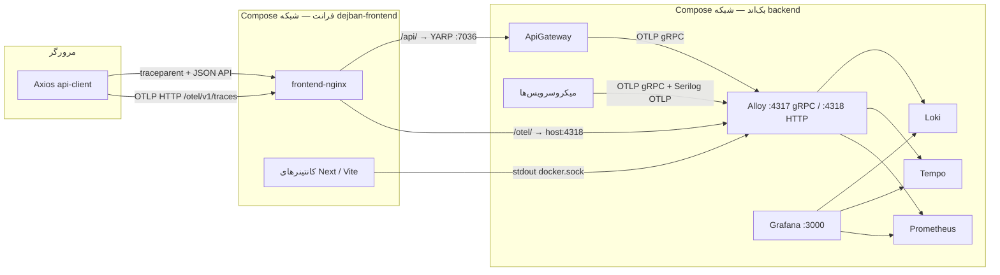

# معماری Observability

## سه سیگنال

| سیگنال | سؤال عملیاتی | ذخیره | UI در Grafana |
|---|---|---|---|
| **Logs** | چه خطایی نوشته شد؟ | Loki | Explore → Loki |
| **Traces** | این درخواست از کجا آمد و به کجا رسید؟ | Tempo | Explore → Tempo |
| **Metrics** | نرخ و تأخیر در بازه زمان چقدر است؟ | Prometheus | Explore → Prometheus |

Log به‌تنهایی مسیر بین سرویس‌ها را نشان نمی‌دهد. Trace به‌تنهایی متن خطای کسب‌وکار را ندارد. همبستگی با **یک `TraceId` مشترک** است.

## استاندارد

- جمع‌آوری: **OpenTelemetry (OTLP)**
- انتشار بین سرویس‌ها: **W3C Trace Context** (`traceparent`، در صورت وجود `tracestate`)
- Collector: **Grafana Alloy** (نه Jaeger؛ بلوک Jaeger در Compose کامنت است)

هر سرویس مقصد را از کلید پیکربندی `OTEL_EXPORTER_OTLP_ENDPOINT` می‌خواند. در Docker مقدار آن `http://alloy:4317` است (gRPC).

## جریان تأییدشده از روی فایل‌ها

شبکه Compose فرانت از شبکه `backend` جدا است. فرانت Alloy را با DNS داخلی `alloy` نمی‌بیند. به همین دلیل:

- مرورگر OTLP را به **همان origin** می‌فرستد (`/otel/...`)
- Nginx آن را به `OTEL_COLLECTOR` (پیش‌فرض `host.docker.internal:4318`) می‌دهد
- Alloy پورت **4318** را روی host publish می‌کند

لاگ stdout فرانت نیاز به شبکه مشترک ندارد: Alloy با **Docker socket** کانتینرهای `frontend-*` را می‌خواند.

## یک درخواست از کلیک تا مقصد

1. کاربر در `/dejban/...` یک API می‌زند.
2. `packages/api-client` یک span با `service.name = frontend-dejban` می‌سازد.
3. Header `traceparent` روی درخواست Axios می‌رود.
4. Nginx `/api/` را به ApiGateway می‌فرستد (headerها forward می‌شوند).
5. `AddAspNetCoreInstrumentation` در Gateway همان Trace را ادامه می‌دهد، نه Trace جدید.
6. YARP درخواست را به سرویس مقصد می‌برد؛ آن سرویس هم instrumentation ASP.NET دارد.
7. Span مرورگر با OTLP HTTP به Alloy می‌رود؛ spanهای .NET با OTLP gRPC.
8. Tempo همه spanهای با یک `TraceId` را در یک waterfall نشان می‌دهد.

اگر `traceparent` نباشد، Tempo از Gateway به بعد پر می‌شود و «این درخواست از کدام اپ فرانت آمد» دیده نمی‌شود.

## همبستگی Log و Trace

Provisioning Loki در Grafana فیلد مشتق **TraceID** دارد: از متن لاگ با regex `"TraceId":"..."` لینک به Tempo ساخته می‌شود.

مسیر معکوس: Tempo → Logs با `filterByTraceID` روی datasource Loki تنظیم شده است.

شرط: Serilog باید `TraceId` را در رویداد بنویسد (Activity جاری در ASP.NET). اگر sink OTLP نرسد، Loki خالی است حتی اگر Tempo پر باشد.
