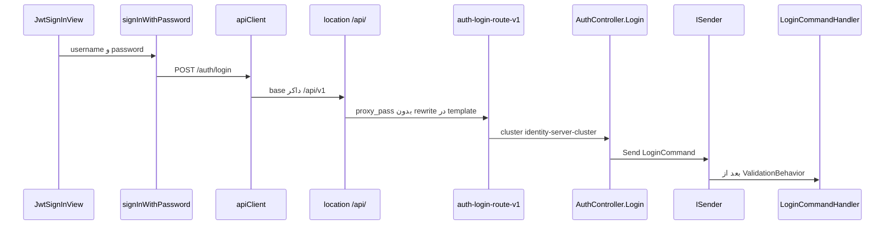

# مسیر اجرای Login

این سند نقشهٔ hopبه‌hop ورود است. اپ اجرا نشده است. هر hop یکی از این وضعیت‌ها را دارد:

| وضعیت | معنی |
|---|---|
| `verified` | اتصال از روی کد یا پیکربندی همین مخزن دیده شد |
| `documented` | رفتار لایه از سند رسمی همان نسخه است، نه از اجرای این سامانه |
| `inferred` | دو شاهد کنار هم این نتیجه را محتمل می‌کنند، ولی درخواست واقعی زده نشد |
| `unresolved` | هنوز شاهد کافی نیست |

مسیر فرانت نسبت به `dejban_frontend_new` است. بقیه نسبت به `dejban_backend_new` است.

## نقشه

نمودار ترتیب نمادها را نشان می‌دهد. موفق بودن match حروف `/api` با `/Api` در بخش جداگانه است و اینجا به‌عنوان اجرای زنده ادعا نشده است.

## Hopها

### 1. صفحه

- مسیر: `apps/main/src/app/auth/jwt/sign-in/page.jsx`
- نماد: صفحه، `JwtSignInView`
- ورودی: مسیر UI ورود. خروجی: همان view.
- اتصال بعدی: `apps/main/src/auth/view/jwt/jwt-sign-in-view.jsx` تابع `onSubmit`.
- وضعیت: `verified`

`jwt-sign-in-view.jsx` اسکیمای Zod را به react-hook-form می‌دهد. `username` و `password` هر کدام `min(1)` دارند. `onSubmit` فقط بعد از قبول این اسکیما اجرا می‌شود و `signInWithPassword({ username, password })` را از `apps/main/src/auth/context/jwt/action.js` صدا می‌زند.

### 2. ساخت درخواست

- مسیر: `apps/main/src/auth/context/jwt/action.js`، تابع `signInWithPassword`
- ورودی: `{ username, password }`. خروجی: `apiClient.post(endpoints.auth.login, { username, password })`.
- `endpoints.auth.login` در `packages/api-client/src/axiosInstance.ts` برابر `/auth/login` است.
- base در `createApiClient`: اگر `NEXT_PUBLIC_SERVER_URL` باشد همان، وگرنه در Vite مقدار `VITE_SERVER_URL`، وگرنه رشتهٔ خالی.
- `dejban_frontend_new/docker-compose.yml` برای اپ‌های Next مقدار `NEXT_PUBLIC_SERVER_URL: /api/v1` دارد.
- اتصال بعدی: URL داکر `/api/v1/auth/login`. اگر env در dev خالی باشد، درخواست نسبت به origin صفحه است. آن حالت اجرا نشد.
- وضعیت base داکر: `verified`. وضعیت dev بدون env: `unresolved`.

`packages/ui/src/auth/context/jwt/action.js` همان شکل `post` را دارد. صفحهٔ main از کپی داخل `apps/main` استفاده می‌کند، نه مستقیم از پکیج UI.

پاسخ را همین تابع می‌خواند: `data.accessToken` و `data.user`. اگر `accessToken` باشد `tokenStorage.setAccess` آن را نگه می‌دارد.

### 3. Nginx

- مسیر: `docker/nginx/default.conf.template`
- نماد: `location /api/` و `proxy_pass https://${API_GATEWAY}`
- پیش‌فرض Compose فرانت: `API_GATEWAY` برابر `host.docker.internal:7036`. بک‌اند در `docker/compose.backend.yml` پورت `7036:443` را برای `apigateway` منتشر می‌کند.
- هدرهای ست‌شده: `Host`، `X-Real-IP`، `X-Forwarded-For`، `X-Forwarded-Proto`.
- در این location دستور rewrite مسیر نیست. `proxy_pass` بخش URI ندارد.
- وضعیت وجود location و نبود rewrite: `verified`. اینکه Nginx در اجرا URI را بایت‌به‌بایت جلو بفرستد: `inferred` از شکل directive، چون درخواست زده نشد.
- اتصال بعدی: gateway روی پورت host. کامنت Compose فرانت می‌گوید این stack به شبکهٔ بک‌اند وصل نیست. این hop از راه پورت منتشرشده است.

`location /Api/` هم جداگانه به همان gateway می‌رود. جزئیات حروف در `00-api-path-case-investigation.md` است.

### 4. ثبت YARP و route ورود

- مسیر: `ApiGateway/Program.cs`
- نماد: یک زنجیرهٔ `AddReverseProxy().LoadFromMemory(...).LoadFromConfig(...)` و در پایان `MapReverseProxy`
- route حافظه: `ApiGateway/Abstractions/DynamicRoutes/IdentityServerRoutes.cs`، فیلد `routes`، آرایهٔ خالی. دو `RouteConfig` ورود comment شده‌اند.
- route فعال: کلید `ReverseProxy:IdentityServer` از `ApiGateway/Abstractions/Constants/ConfigConstants.cs`.
- در `ApiGateway/appsettings.DockerDevelopment.json` شناسه `auth-login-route-v1`:
  - `Match.Path` برابر `/Api/v{apiVersion}/Auth/Login/{**catch-all}`
  - `AuthorizationPolicy` برابر `anonymous`
  - `RateLimiterPolicy` برابر `Auth_RateLimiter_PerIp`
  - `ClusterId` برابر `identity-server-cluster`
  - آدرس مقصد `http://identityserver`
  - transformها فقط `RequestHeaderOriginalHost` و `X-Forwarded-Proto=https` هستند. `PathPattern` یا `PathRemovePrefix` روی این route نیست.
- Compose بک‌اند `ASPNETCORE_ENVIRONMENT` را `DockerDevelopment` می‌گذارد، پس همین فایل محیطی روی `appsettings.json` می‌نشیند.
- همان شناسه در `appsettings.json`، `appsettings.Development.json`، `appsettings.Docker.json`، و `appsettings-sample.json` هم هست. آدرس cluster در فایل‌های localhost با داکر فرق دارد. سند YARP همان تفاوت را گفته است.
- وضعیت تعریف route: `verified`. وضعیت match حروف `/api/v1/auth/login` با این الگو: `documented` در سند حروف، نه اجرای این gateway.
- اتصال بعدی: مقصد `http://identityserver` و مسیر اصلی، چون transform مسیر ندارد.

`UseRateLimiter` قبل از `MapReverseProxy` است. اینکه metadata به نام `Auth_RateLimiter_PerIp` واقعاً policy همان نام را انتخاب کند از روی کد YARP 2.3 در این فاز خط‌به‌خط خوانده نشد. وجود policy در `AddCustomRateLimiters` جداگانه `verified` است. انتخاب‌شدنش توسط YARP: `unresolved`.

### 5. میزبان هویت

- مسیر: `Microservices/IdentityServer/Program.cs`
- ترتیب مرتبط بعد از Build: `UseExceptionHandler`، `UseAuthentication`، `UseTenantContext`، `UseAuthorization`، `MapControllers`.
- تفاوت با دژبان: tenant اینجا بین authentication و authorization است.
- Login با `[AllowAnonymous]` است، پس رد شدن به‌خاطر نبود توکن از این attribute نمی‌آید.
- وضعیت ترتیب middleware: `verified`. اثر tenant روی بدنهٔ login اجرا نشد. چون action اجازهٔ anonymous دارد، این hop برای خود Login لازم است فقط به این اندازه که pipeline قبل از controller ساخته شده باشد.

### 6. Controller

- مسیر: `Microservices/IdentityServer/Controllers/AuthController.cs`
- نماد: کلاس `AuthController`، متد `Login`
- route کلاس: `/api/v{version:apiVersion}/[controller]` با `[ApiVersion("1.0")]`
- متد: `[HttpPost("Login")]` و `[AllowAnonymous]`
- ورودی: `[FromBody] LoginCommand`. خروجی: `ISender.Send` و `result.Match(Ok, Problem)`.
- وضعیت: `verified` برای اتصال به MediatR.
- bind شدن JSON با کلید `username` به پراپرتی `UserName`: `unresolved`. در `IdentityServer/Abstractions/Extensions/ServiceCollectionExtensions.cs` فقط `ReferenceHandler.IgnoreCycles` روی JSON ست شده است. `PropertyNameCaseInsensitive` این‌جا نیست. پیش‌فرض فریم‌ورک در این فاز از روی سورس ASP.NET Core 10 خوانده نشد و درخواست نمونه زده نشد.

### 7. اعتبارسنجی و handler

- ثبت: همان `ServiceCollectionExtensions`، `config.AddOpenBehavior(typeof(ValidationBehavior<,>))`.
- `IdentityServer/Abstractions/Behaviors/ValidationBehavior.cs` دو قید دارد: `TRequest : IRequest<TResponse>` و `TResponse : IErrorOr`. `LoginCommand` خودش `IRequest<ErrorOr<object>>` است، پس این behavior قبل از handler در pipeline می‌آید. وضعیت این اتصال: `verified` از روی امضا، نه از روی اجرای یک login نامعتبر.
- handler: `IdentityServer/Application/Auth/Commands/Login/LoginCommandHandler.cs`، متد `Handle`.
- کاربر از `PayamGostarUserManager.Users` با تلفن، نام کاربری نرمال‌شده، یا ایمیل نرمال‌شده پیدا می‌شود. `Sites` و `UserTokens` با `AsSplitQuery` می‌آیند.
- رمز با `CheckPasswordSignInAsync(..., lockoutOnFailure: true)` چک می‌شود.
- موفقیت: توکن دسترسی، refresh، و cookieهای `HttpOnly` و `Secure` و `SameSite=None`. بدنهٔ JSON فقط `user` و `accessToken` است.
- وضعیت زنجیره تا handler: `verified` از روی کد. ماندن cookie با `Secure` روی صفحهٔ HTTP پورت 80: `unresolved`.

### 8. داده

- context هویت `ApplicationDbContext : IdentityDbContext` است.
- نام دیتابیس `payamgostar_identity` از environment سرویس identity در Compose است، نه از داخل handler.
- وضعیت کوئری EF داخل handler: `verified`. وضعیت اینکه Compose واقعاً همان connection را به پردازه داده: `inferred` از environment سرویس، چون پردازه اجرا نشد.

### 9. برگشت به UI

- controller با `Ok` بدنه را می‌سازد.
- YARP و Nginx در این مسیر transform بدنه ندارند.
- `signInWithPassword` فقط `accessToken` را در storage می‌گذارد. refresh در JSON نیست.
- وضعیت شکل کد: `verified`. رسیدن واقعی 200 به مرورگر: `unresolved`.

## اتصال مرحله به مرحله

فهرست فایل کافی نیست. هر فلش پایین همان چیزی است که در کد مرحلهٔ بعد را صدا می‌زند.

1. `page.jsx` از `src/auth/view/jwt` مقدار `JwtSignInView` را import می‌کند. `index.js` همان پوشه فایل `jwt-sign-in-view.jsx` را export می‌کند. وضعیت: `verified`.
2. view از `../../context/jwt` تابع `signInWithPassword` را import می‌کند. `context/jwt/index.js` فایل `action.js` را export می‌کند. `onSubmit` فقط بعد از رد شدن Zod در react-hook-form به این تابع می‌رسد. وضعیت: `verified`.
3. `action.js` از `@repo/api-client` هر دو `apiClient` و `endpoints` را import می‌کند. `post(endpoints.auth.login, { username, password })` یعنی مسیر `/auth/login` به base کلاینت چسبانده می‌شود. در Compose فرانت base برابر `/api/v1` است. وضعیت ساخت رشته: `verified`. رسیدن این رشته به Nginx: `inferred`، چون مرورگر باز نشد.
4. template اناجین‌ایکس location با پیشوند `/api/` را به `proxy_pass` بدون URI می‌فرستد. اتصال به gateway از روی این directive است، نه از روی access log. وضعیت: `verified` برای پیکربندی، `unresolved` برای اجرای زنده.
5. `MapReverseProxy` روی همان `AddReverseProxy` است که `LoadFromConfig(ReverseProxy:IdentityServer)` را دارد. داخل آن section شناسهٔ `auth-login-route-v1` به cluster `identity-server-cluster` و آدرس `http://identityserver` در فایل DockerDevelopment وصل است. transform مسیر ندارد. اینکه این الگو با URL فرانت match شود در سند حروف `documented` است و اجرا نشده.
6. `AuthController` با `[ApiController]` و route شامل `[controller]` به نام کلاس `Auth` و اکشن `Login` وصل است. متد `Login` همان شیء را به `_mediator.Send` می‌دهد. وضعیت: `verified`. نام JSON `username` در برابر پراپرتی `UserName` هنوز `unresolved` است.
7. `AddMediatR` در هویت `RegisterServicesFromAssemblyContaining<ApplicationAssemblyReference>` را صدا می‌زند. این نوع و `LoginCommandHandler` هر دو داخل پروژهٔ `IdentityServer.csproj` هستند. handler این است: `IRequestHandler<LoginCommand, ErrorOr<object>>`. MediatR با همین اینترفیس `Send` را به `Handle` می‌رساند. `ValidationBehavior` به‌خاطر `TResponse : IErrorOr` جلوتر از handler است. وضعیت ثبت: `verified`.
8. handler از `PayamGostarUserManager` و `SignInManager` استفاده می‌کند، که روی `ApplicationDbContext : IdentityDbContext` نشسته‌اند. نام دیتابیس Compose جدا از این کلاس است و `inferred` می‌ماند.

پس زنجیرهٔ منبع از صفحه تا `Handle` وصل است. سه چیز هنوز منبع را به رفتار اجراشده وصل نمی‌کند: match حروف مسیر، bind نام JSON، و ذخیرهٔ cookie با `Secure` روی HTTP.

## چه چیزی در این مسیر نیست

ورود از SignalR، gRPC، Dapper، RabbitMQ، یا Quartz رد نمی‌شود. آن‌ها برای این POST در کد این زنجیره صدا زده نمی‌شوند.

`LoadFromMemory` روی همین proxy است، ولی آرایه‌اش خالی است و route ورود را تأمین نمی‌کند. توضیح در `00-yarp-config-investigation.md` است.
