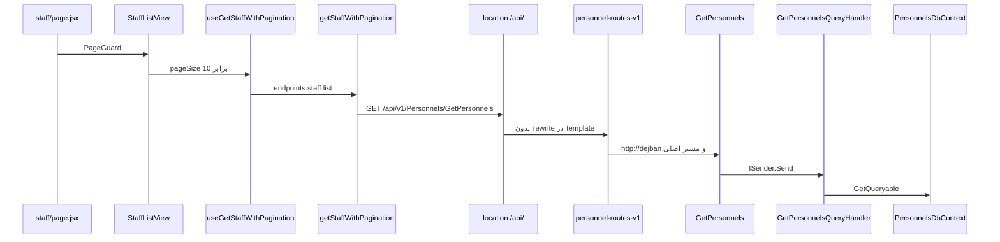

# مسیر اجرای فهرست پرسنل

این سند صفحهٔ «پرسنل» را تا دیتابیس دنبال می‌کند. اپ اجرا نشده است. معنی `verified`، `documented`، `inferred`، و `unresolved` همان جدول `00-login-execution-path.md` است.

`useGetPersonnels` در `apps/dejban/src/services/personnels/personnels.service.js` هم به `endpoints.personnels.list` می‌زند و آن ثابت هم `/Personnels/GetPersonnels` است. صفحهٔ فهرست این hook نیست. صفحه، `StaffListView` است.

## نقشه

## Hopها

### 1. صفحه و state

- مسیر: `apps/dejban/src/app/dashboard/personnel/staff/page.jsx`
- ورودی: route داشبورد. `apps/dejban/next.config.mjs` مقدار `basePath` را `/dejban` می‌گذارد، پس URL مرورگر پیشوند اپ را دارد. این پیشوند به Axios نمی‌چسبد. Axios مسیر API را جدا می‌سازد.
- خروجی: `PageGuard` و داخلش `StaffListView`.
- state لیست در `apps/dejban/src/sections/staff/view/staff-list-view.jsx` است. `useState` با `page` برابر 1 و `pageSize` برابر 10.
- وضعیت: `verified`

جدول `data?.items` و `data?.totalCount` را می‌خواند. نوع سرور پایین‌تر است. جور بودن نام JSON با این دو کلید هنوز `unresolved` است.

### 2. React Query و HTTP

- `useGetStaffWithPagination` در `apps/dejban/src/services/staff/staff.service.js`.
- `queryFn` برابر `staffApi.getStaffWithPagination` است. `placeholderData` دادهٔ قبلی را نگه می‌دارد.
- `getStaffWithPagination` در `apps/dejban/src/services/staff/staff.http.js` به `axiosInstance.get(endpoints.staff.list, { params })` می‌زند.
- `apps/dejban/src/lib/api.js` مقدار `staff.list` را `/Personnels/GetPersonnels` گذاشته و در پایان `apiClient` مشترک را export می‌کند.
- پیش‌فرض داخل تابع اگر `pageSize` نیاید 9999 است. صفحه همیشه 10 را می‌فرستد، پس آن پیش‌فرض در این صفحه استفاده نمی‌شود.
- پارامترها: `page`، `pageSize`، `searchTerm`، `sortColumn`، `sortOrder`، و در صورت وجود `filters`.
- base داکر از همان `NEXT_PUBLIC_SERVER_URL=/api/v1` است. URL ساخته‌شده: `/api/v1/Personnels/GetPersonnels` به‌علاوهٔ query.
- وضعیت: `verified` برای ساخت URL. interceptor هدر `X-Site-Id` و `Authorization` در `axiosInstance.ts` است. این فاز بدنهٔ interceptor را دوباره خط‌به‌خط نخواند. وجود فایل و export کلاینت: `verified`. مقدار دقیق هدر در یک نشست مرورگر: `unresolved`.

### 3. Nginx

همان `location /api/` سند login. مسیر این درخواست با `/api/` شروع می‌شود، پس همان location آن را می‌گیرد. `location /Api/` برای این URL ساخته‌شدهٔ فرانت انتخاب نمی‌شود، چون فرانت داکر حرف کوچک می‌فرستد.

وضعیت انتخاب location از روی پیشوند نوشته‌شده در template: `verified`. اجرای Nginx: نشده.

### 4. YARP

- شناسه `personnel-routes-v1` در `ApiGateway/appsettings.DockerDevelopment.json`.
- `Match.Path` برابر `/Api/v{apiVersion}/Personnels/{**catch-all}`.
- `AuthorizationPolicy` برابر `default`.
- `ClusterId` برابر `dejban-cluster` و آدرس `http://dejban`.
- transform مسیر نیست. فقط هدر host اصلی و `X-Forwarded-Proto=https`.
- این route زیر section مربوط به `ConfigConstants.DejbanProxy` یعنی `ReverseProxy:Dejban` است و با `LoadFromConfig` روی همان `AddReverseProxy` ثبت می‌شود.
- وضعیت تعریف: `verified`.
- معنی دقیق policy به نام `default` در YARP 2.3 از روی سورس policy خوانده نشد: `unresolved`. اثر عملی‌اش این است که route برچسب anonymous ندارد، پس احراز هویت gateway قبل از forward در مسیر است. اینکه YARP برای مقدار `default` دقیقاً کدام policy را برمی‌دارد هنوز از سند کتابخانه در این فاز نقل نشد.
- match حروف `/api` با `/Api` و `Personnels` با خودش: لایهٔ routing در سند حروف `documented` است. اجرای این پردازه نشده.

### 5. میزبان دژبان

- `Microservices/Dejban/API/Dejban.Api/Program.cs`
- ماژول پرسنل با `AddPersonnelsModule` ثبت می‌شود.
- بعد از Build، ترتیب مرتبط: `UseExceptionHandler`، `UseAuthentication`، `UseAuthorization`، `UseTenantContext`، `MapEndpoints`.
- tenant اینجا بعد از authorization است. این با هویت فرق دارد.
- `MapEndpoints` در `Microservices/Dejban/Common/Dejban.Common.Presentation/Endpoints/EndpointExtensions.cs` نوع‌های `IEndpoint` را map می‌کند.
- `GetPersonnels` این اینترفیس را پیاده می‌کند و `AddEndpoints` آن را Transient ثبت می‌کند. این ثبت در درس 01 از روی `EndpointExtensions` آمده است.
- وضعیت ترتیب و وجود endpoint: `verified`.

روی این GET، RabbitMQ و Quartz و Dapper در handler صدا زده نمی‌شوند.

### 6. Endpoint

- مسیر: `Microservices/Dejban/Modules/Personnels/Dejban.Modules.Personnels.Presentation/Personnels/GetPersonnels.cs`
- نماد: `GetPersonnels.MapEndpoint`
- `MapGet("/api/v{version:apiVersion}/Personnels/GetPersonnels")`
- نسخهٔ API برابر 1.0 با `MapToApiVersion`
- `RequireAuthorization`
- آرگومان `[AsParameters] GetPersonnelsQuery` و سپس `ISender.Send`
- خروجی: `result.Match(Results.Ok, ApiResults.Problem)`
- وضعیت اتصال به MediatR: `verified`
- bind شدن query با نام `searchTerm` به `SearchTerm`: `unresolved`. رکورد نام‌ها را PascalCase تعریف کرده و attribute نام query ندارد.

### 7. MediatR و اعتبارسنجی

- `GetPersonnelsQuery` این است: `IPagedQuery` و `IQuery<PagedList<object>>`.
- `ValidationPipelineBehavior` قید `where TRequest : IBaseCommand` دارد. این query آن اینترفیس را ندارد، پس آن behavior روی این درخواست نیست.
- اعتبار صفحه و فیلتر و sort داخل `GetPersonnelsQueryHandler.Handle` است، نه داخل pipeline سراسری command.
- `ExceptionHandlingPipelineBehavior` قید `TRequest : class` دارد. `RequestLoggingPipelineBehavior` همان قید را به‌علاوهٔ `TResponse : IErrorOr` دارد. `IQuery<TResponse>` برابر `IRequest<ErrorOr<TResponse>>` است، پس هر دو behavior از نظر امضا روی این query می‌نشینند. ترتیب ثبت در `AddApplication` این است: exception، logging، validation. validation به‌خاطر `IBaseCommand` کنار می‌ماند. وضعیت امضا: `verified`. اجرای pipeline روی یک GET واقعی: نشده.

### 8. Handler و repository

- `GetPersonnelsQueryHandler.Handle`
- اگر مجوز `PersonnelPermissions.StaffView` نباشد و شناسهٔ کاربر Guid باشد، فیلتر به `personnel.Id == userId` محدود می‌شود. این 403 نیست.
- `PersonnelRepository.GetQueryable` فقط `context.Personnels` را برمی‌گرداند.
- ثبت repository: `AddScoped<IPersonnelRepository, PersonnelRepository>` در `PersonnelsModule`.
- `PersonnelsDbContext` با `UseNpgsql` ساخته می‌شود. schema از `Schemas.Personnels` برابر `personnels` است.
- در `OnModelCreating` هر دو `ApplyTenantQueryFilters(this)` و `ApplySoftDeleteQueryFilters()` صدا زده می‌شوند. پس `IQueryable` برگشتی، قبل از SQL، آن فیلترهای مدل را دارد. متن predicate فیلتر tenant در این فاز باز نشد. وضعیت فراخوانی: `verified`. وضعیت متن دقیق فیلتر: `unresolved` تا خواندن متد `ApplyTenantQueryFilters`.
- نتیجه با `PagedList<object>.CreateAsync` ساخته می‌شود. آن متد `Count` و `ToList` را همزمان اجرا می‌کند و اگر page نیاید 1 و اگر pageSize نیاید 10 می‌گذارد. صفحهٔ staff هر دو را می‌فرستد.
- پراپرتی‌های `PagedList<T>`: `Items`، `Page`، `PageSize`، `TotalCount`، `HasNextPage`، `HasPreviousPage`، `Links`.
- `ConfigureHttpJsonOptions` در `Dejban.Api/Extensions/ServiceCollectionExtension.cs` naming policy ست نمی‌کند. UI دنبال `items` و `totalCount` است. اینکه serializer پیش‌فرض minimal API این نام‌ها را camelCase کند: `unresolved`.

### 9. پاسخ

`Results.Ok` شیء `PagedList` را به JSON می‌فرستد. YARP بدنه را برای این route عوض نمی‌کند. جدول فقط وقتی ردیف نشان می‌دهد که JSON کلید `items` داشته باشد. این آخرین hop از نظر کد است و از نظر اجرا `unresolved` مانده است.

## اتصال مرحله به مرحله

1. `staff/page.jsx` از `src/sections/staff/view/staff-list-view` کامپوننت `StaffListView` را import می‌کند و آن را داخل `PageGuard` می‌گذارد. وضعیت: `verified`.
2. view از `src/services/staff/staff.service` تابع `useGetStaffWithPagination` را import می‌کند و state محلی `pageSize: 10` را به آن می‌دهد. وضعیت: `verified`.
3. service فایل `./staff.http` را به‌صورت `staffApi` import می‌کند. `queryFn` برابر `staffApi.getStaffWithPagination` است. وضعیت: `verified`.
4. `staff.http.js` از `src/lib/api` هم default export و هم `endpoints` را می‌گیرد. default همان `apiClient` از `@repo/api-client` است، چون `api.js` آن را import و دوباره `export default` می‌کند. `endpoints.staff.list` برابر `/Personnels/GetPersonnels` است. `get` این مسیر را به base می‌چسباند. وضعیت ساخت URL: `verified`.
5. Nginx و YARP مثل login هستند، با این تفاوت که section برابر `ReverseProxy:Dejban` و شناسه برابر `personnel-routes-v1` و آدرس DockerDevelopment برابر `http://dejban` است. `personnel-routes-v1` بین کلید `"Dejban"` و کلید بعدی `"PublicFiles"` در همان JSON نشسته است. match حروف هنوز اجرا نشده.
6. `AddPersonnelsModule` متد `AddEndpoints(Presentation.AssemblyReference.Assembly)` را صدا می‌زند. `AddEndpoints` هر `IEndpoint` آن اسمبلی را `Transient` ثبت می‌کند. `GetPersonnels` همان اینترفیس را پیاده می‌کند. `MapEndpoints` با `GetRequiredService<IEnumerable<IEndpoint>>()` برای هر کدام `MapEndpoint` را صدا می‌زند. این اتصال ثبت route است. وضعیت: `verified`.
7. `Dejban.Api/Program.cs` اسمبلی `Dejban.Modules.Personnels.Application` را داخل `moduleApplicationAssemblies` می‌گذارد و به `AddApplication` می‌دهد. آنجا `RegisterServicesFromAssemblies` همان اسمبلی را به MediatR می‌دهد. `GetPersonnelsQueryHandler` این است: `IQueryHandler<GetPersonnelsQuery, PagedList<object>>`، و آن اینترفیس از `IRequestHandler<TQuery, ErrorOr<TResponse>>` ارث می‌برد. `ISender.Send` با همین امضا به `Handle` می‌رسد. وضعیت: `verified`.
8. `Handle` متد `personnelRepository.GetQueryable()` را صدا می‌زند. ثبت `AddScoped<IPersonnelRepository, PersonnelRepository>` در `PersonnelsModule` این اینترفیس را به کلاسی وصل می‌کند که `context.Personnels` را برمی‌گرداند. `PersonnelsDbContext` در `OnModelCreating` فیلتر tenant و soft delete را روی مدل می‌گذارد. وضعیت فراخوانی: `verified`. متن predicate فیلتر tenant و نام camelCase در JSON هنوز `unresolved` است.

زنجیرهٔ منبع از صفحه تا `Handle` و `GetQueryable` وصل است. بسته نیست، چون match حروف، bind نام query، و نام فیلد JSON پاسخ اجرا یا از روی تنظیم serializer ثابت نشده‌اند.

## مصرف‌کنندهٔ دوم

`getPersonnelsList` در `personnels.http.js` همان مسیر `/Personnels/GetPersonnels` را با پیش‌فرض pageSize برابر 9999 می‌زند، اگر صداکننده pageSize ندهد. این مسیر صفحهٔ staff نیست. هر دو به یک endpoint بک‌اند می‌رسند.
