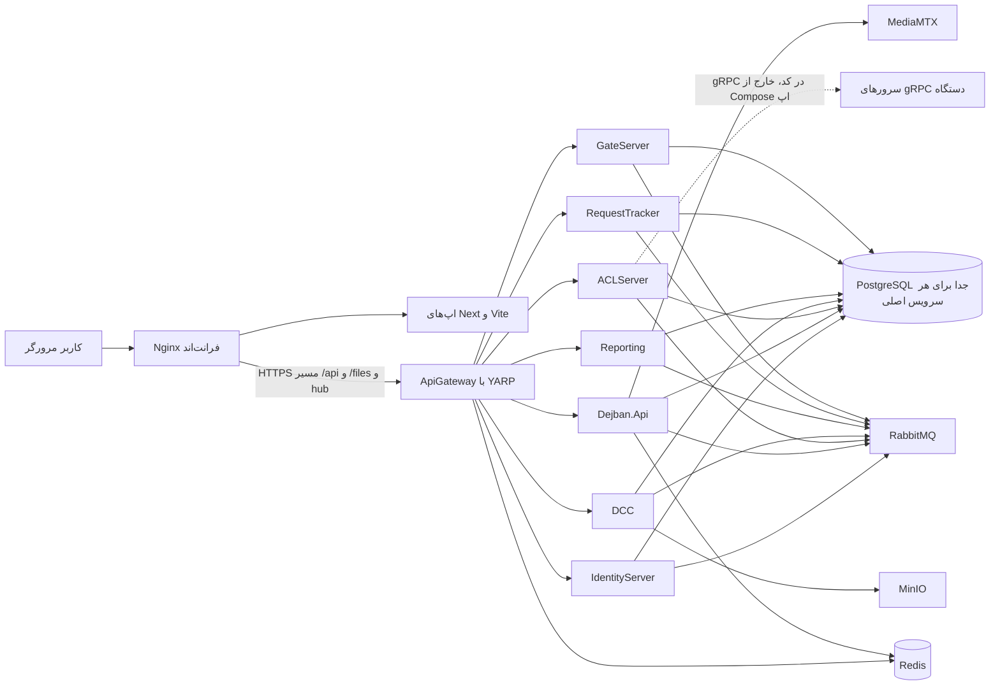

# فاز A — کشف مخزن

این سند فقط نتیجهٔ کشف است. درس‌های فناوری، سؤال مصاحبه، و توضیح خط‌به‌خط هنوز نوشته نشده‌اند.

تاریخ بررسی: 2026-10-25.

## دامنه

دو مخزن کنار هم بررسی شده‌اند:

| مخزن | مسیر | آنچه در مخزن دیده شد |
|---|---|---|
| Backend | `dejban_backend_new` | سرویس‌های ASP.NET Core، کتابخانهٔ مشترک، Compose، و اسکریپت بازیابی PostgreSQL |
| Frontend | `dejban_frontend_new` | monorepo با npm workspaces و Turborepo؛ چند اپ مرورگر و پکیج مشترک |

مخزن `learning` محصول این سامانه نیست و در این کشف وارد نشده است.

`README.md` بک‌اند می‌گوید این پروژه سرویس‌های شرکت PayamGostar را پیاده می‌کند و سرویس‌ها می‌توانند مستقل اجرا شوند و با هم کار کنند. `README.md` فرانت‌اند هنوز متن starter توربورپو است و اپ‌های واقعی (`dejban`، `main`، `gate`، `dcc`، `access-control`) را توصیف نمی‌کند. برای معماری، کد و Compose بر آن README مقدم است.

محدودهٔ این سند چیزی است که در همین دو مخزن قابل مشاهده است. توپولوژی واقعی production، مالک تیم‌ها، و مخاطب کسب‌وکار از روی کد به‌تنهایی ثابت نمی‌شود.

## روش

- ورودی‌ها، `Program.cs`، ثبت سرویس، مسیر YARP، کلاینت HTTP فرانت‌اند، و Compose خوانده شد.
- نسخهٔ پکیج به‌تنهایی «استفاده» حساب نشد. استفاده وقتی ثبت شد که فراخوانی یا ارجاع در کد دیده شد.
- مقدار رمز، connection string کامل، و آدرس‌های شبکهٔ خصوصی در این سند نیامده است. فایل‌های Compose و `appsettings` این مقدارها را دارند.
- برای ادعاهای حساس به نسخه، مستند Context7 هم دیده شد:
  - Next.js `16.2.9`: قرارداد فایل‌های `app` (`page` و `layout`) هنوز پایهٔ App Router است. منبع: `/vercel/next.js/v16.2.9`.
  - YARP `2.3.0`: `LoadFromConfig` مسیر را به cluster و مقصد وصل می‌کند و `MapReverseProxy` درخواست منطبق را به آن مقصد می‌فرستد. منبع: `/dotnet/yarp/v2.3.0`.
  - Npgsql EF Core provider: `UseNpgsql` روی `DbContextOptionsBuilder` پرووایدر PostgreSQL را فعال می‌کند. سند Context7 از شاخهٔ `main` بود، نه tag متناظر با پکیج `10.0.0` این مخزن. رفتار schema history از خود کد این مخزن نقل می‌شود، نه از آن سند.

## حقایق تأییدشده

### شکل کلی سیستم

بک‌اند یک solution به نام `PG_Microservices.slnx` است. پروژه‌های اجرایی `TargetFramework` برابر `net10.0` دارند. نسخهٔ پکیج‌ها در `Directory.Packages.props` متمرکز است.

فرانت‌اند `package.json` ریشه نام `pg_frontend` دارد، `packageManager` آن `npm@10.9.2` است، `engines.node` حداقل `20` است، و workspaceها `apps/*` و `packages/*` هستند. Turborepo در devDependency ریشه `turbo` نسخه `^2.10.12` است. `.gitlab-ci.yml` فرانت‌اند روی runner با `nvm use 22` دستور `npx turbo run build` را اجرا می‌کند.

اپ‌های مرورگر:

| اپ | مسیر | اجرا | پورت dev در script | پایهٔ مسیر |
|---|---|---|---|---|
| `main` | `dejban_frontend_new/apps/main` | Next.js | `3031` با `--experimental-https`؛ script مربوط به `start` پورت `3035` است | در `next.config` این اپ `basePath` مانند dejban دیده نشد |
| `dejban` | `apps/dejban` | Next.js | `3034` | `basePath: '/dejban'` در `apps/dejban/next.config.mjs` |
| `gate` | `apps/gate` | Next.js | `3036` | `basePath: '/gate'` |
| `dcc` | `apps/dcc` | Next.js | `3037` | `basePath: '/dcc'` |
| `access-control` | `apps/access-control` | Vite | `3033` در `vite.config.js` | `base: process.env.VITE_BASE \|\| '/access-control'` |

نسخه‌های اعلام‌شده در `apps/dejban/package.json`: `next` `^16.2.6`، `react` و `react-dom` `^19.1.1`، `@mui/material` `^7.3.2`، `@tanstack/react-query` `^5.90.12`. optionalDependency ریشه `@next/swc-win32-x64-msvc` را روی `16.2.12` pin کرده است. وجود این pin نسخهٔ runtime نصب‌شده روی هر ماشین را ثابت نمی‌کند.

`apps/dejban`، `gate`، `dcc` و `main` پوشهٔ `src/app` و `layout.jsx` دارند. این با قرارداد App Router در مستند Next.js 16 جور است: `layout` رابط مشترک segment است و `page` خود route را می‌سازد. `access-control` از `createBrowserRouter` در `apps/access-control/src/main.jsx` استفاده می‌کند و Next.js نیست.

### کانتینرهای اجرایی بک‌اند

`Program.cs` این میزبان‌ها را نشان می‌دهد:

| میزبان | ورودی | در Compose اپ دیده شد؟ |
|---|---|---|
| ApiGateway | `ApiGateway/Program.cs` | بله، `apigateway` |
| IdentityServer | `Microservices/IdentityServer/Program.cs` | بله |
| Dejban.Api | `Microservices/Dejban/API/Dejban.Api/Program.cs` | بله، سرویس `dejban` |
| ACLServer | `Microservices/ACLServer/Program.cs` | بله |
| DCC | `Microservices/DCC/Program.cs` | بله |
| Reporting | `Microservices/Reporting/Program.cs` | بله |
| RequestTracker | `Microservices/RequestTracker/Program.cs` | بله |
| GateServer | `Microservices/GateServer/Program.cs` | بله |
| BaskoolService | `Microservices/BaskoolService/Program.cs` | در لیست `container_name` فایل‌های Compose بررسی‌شده نیست |
| ZKGrpcServer | `Microservices/ZKGrpcServer/Program.cs` | نیست |
| VirdiGrpcServer | `Microservices/VirdiGrpcServer/Program.cs` | نیست |
| TiamGrpcServer | `Microservices/TiamGrpcServer/Program.cs` | نیست |
| ServerServiceManagement | `Microservices/ServerServiceManagement/Program.cs` | نیست |
| ClientServiceManagement | `Microservices/ClientServiceManagement/Program.cs` | نیست |

Compose اپ در `docker/compose.backend.yml` همین هشت تصویر را بالا می‌آورد: `identityserver`، `dcc`، `reporting`، `requesttracker`، `aclserver`، `dejban`، `gateserver`، `apigateway`. پورت منتشرشدهٔ gateway در همین فایل `7036:443` است. `ASPNETCORE_ENVIRONMENT` روی `DockerDevelopment` است.

داده در `docker-compose.yml` و `docker/compose.data.yml` جدا از اپ است. نام دیتابیس‌ها و پورت host در `docker/compose.data.yml`:

| سرویس Compose | دیتابیس | پورت host به `5432` |
|---|---|---|
| `identitydb` | `payamgostar_identity` | `18001` |
| `requesttrackerdb` | `payamgostar_requesttracker` | `18002` |
| `aclserverdb` | `payamgostar_aclserver` | `18003` |
| `dejbandb` | `payamgostar_dejban` | `18004` |
| `dccdb` | `payamgostar_dcc` | `18005` |
| `reportingdb` | `payamgostar_reporting` | `18006` |
| `gateserverdb` | `payamgostar_gateserver` | `18007` |

همان پورت‌ها در connection stringهای `docker/compose.backend.yml` تکرار شده‌اند. مقدار رمز آن فایل اینجا نقل نمی‌شود.

کنار PostgreSQL این سرویس‌ها در Compose داده هستند: `rabbitmq:management` با نام `eventbus`، `redis`، `quay.io/minio/minio` با init برای bucket `dcc-files`، و `bluenviron/mediamtx`. تعریف صف RabbitMQ از `Common/EventBus/eventbus_init/definitions.json` لود می‌شود.

تصویر PostgreSQL در `docker-compose.yml` فقط `postgres` است و tag ندارد. `infrastructure/postgres-dr/README.md` می‌گوید پیش‌فرض کیت DR مقدار `POSTGRES_IMAGE=postgres:18.1` است و `latest` بین دو ماشین ممکن است فرق کند. این دو شاهد یک نسخهٔ در حال اجرا را ثابت نمی‌کنند.

### Dejban یک میزبان و چند ماژول است

`Dejban.Api/Program.cs` یک `WebApplication` می‌سازد و این ماژول‌ها را با هم ثبت می‌کند:

`Visitors`، `Personnels`، `SecurityPatrols`، `Vehicles`، `Armory`، `CashLogistics`، `Inventory`، `WeighBridge`.

هر ماژول در `Microservices/Dejban/Modules/<Name>` لایه‌های `Domain`، `Application`، `Infrastructure`، `Presentation` و اغلب `IntegrationEvents` دارد. تست معماری `Dejban.ArchitectureTests` به `Dejban.Api` ارجاع دارد و پکیج `NetArchTest.Rules` را استفاده می‌کند. محتوای ruleها در این فاز خوانده نشد.

`ApplicationConfiguration.AddApplication` در `Dejban.Common.Application` این‌ها را ثبت می‌کند:

- MediatR `12.5.0` از assembly ماژول‌ها
- behaviorهای `ExceptionHandlingPipelineBehavior`، `RequestLoggingPipelineBehavior`، `ValidationPipelineBehavior`
- FluentValidation `12.1.0`
- Mapster `7.4.0` با `NameMatchingStrategy.Flexible`
- `Dapper.DefaultTypeMap.MatchNamesWithUnderscores = true`

`InfrastructureConfiguration.AddInfrastructure` این‌ها را ثبت می‌کند:

- JWT از راه `AddCustomJwtAuth`
- `ITenantContext`
- Quartz `3.15.1` و `AddQuartzHostedService`
- Redis cache و token blacklist
- MassTransit `8.5.7` با `UsingRabbitMq`
- OpenTelemetry `1.15.x` با OTLP exporter، instrumentation برای ASP.NET Core، HttpClient، EF Core، Redis، Npgsql، و ActivitySource مربوط به MassTransit
- `HttpClient` برای MediaMTX

endpointها controller نیستند. `GetPersonnels` اینترفیس `IEndpoint` را پیاده می‌کند و `MapGet("/api/v{version:apiVersion}/Personnels/GetPersonnels", ...)` را صدا می‌زند، بعد `ISender.Send` به `GetPersonnelsQuery`. `EndpointExtensions` نوع‌های `IEndpoint` را با reflection ثبت می‌کند. نتیجه با `ErrorOr` و `result.Match(Results.Ok, ApiResults.Problem)` برمی‌گردد.

هر ماژول schema خودش را در همان دیتابیس `payamgostar_dejban` دارد:

| ماژول | ثابت schema | فایل |
|---|---|---|
| Personnels | `personnels` | `.../Personnels.Infrastructure/Database/Schemas.cs` |
| Visitors | `visitors` | `.../Visitors.Infrastructure/Database/Schemas.cs` |
| Vehicles | `vehicles` | `.../Vehicles.Infrastructure/Database/Schemas.cs` |
| SecurityPatrols | `security_patrols` | `.../SecurityPatrols.Infrastructure/Database/Schemas.cs` |
| Armory | `armory` | `.../Armory.Infrastructure/Database/Schemas.cs` |
| Inventory | `inventory` | `.../Inventory.Infrastructure/Database/Schemas.cs` |
| CashLogistics | `cash_logistics` | `.../CashLogistics.Infrastructure/Database/Schemas.cs` |
| WeighBridge | `weigh_bridge` | `.../WeighBridge.Infrastructure/Database/Schemas.cs` |

`PersonnelsModule` و بقیه `UseNpgsql` را با `MigrationsHistoryTable(..., schema)` صدا می‌زنند. `VehiclesDbContext.OnModelCreating` هم `HasDefaultSchema(Schemas.Vehicles)` دارد.

outbox/inbox دژبان job کوارتز است، نه outbox داخلی MassTransit. نمونه: `ProcessOutboxJob : IJob` و `ConfigureProcessOutboxJob` که `AddJob<ProcessOutboxJob>` می‌زند. Dapper در همین jobها و در `PatrolReportService` استفاده شده است.

IdentityServer مسیر دیگری دارد: `AddEntityFrameworkOutbox<ApplicationDbContext>` با `UsePostgres()` و `UseBusOutbox()` در `IdentityServer/Abstractions/Extensions/ServiceCollectionExtensions.cs`. پس «outbox» در این مخزن یک مکانیزم واحد نیست.

### Gateway و هویت

`ApiGateway/Program.cs`:

- `globalAppsettings.json` و فایل محیطی را از `GlobalAppsettings` بارگذاری می‌کند.
- Redis، token blacklist، CORS، JWT، ForwardedHeaders، rate limiter، و output cache را ثبت می‌کند.
- `AddReverseProxy()` را با `LoadFromMemory(IdentityServerRoutes.routes, [])` و چند `LoadFromConfig` برای IdentityServer، RequestTracker، DCC، ACLServer، Dejban، Reporting، GateServer، و PublicFiles صدا می‌زند.
- در Development و DockerDevelopment، Scalar را برای OpenAPI همان سرویس‌ها map می‌کند.
- اگر `PublicFiles:Provider` برابر `Local` باشد فایل استاتیک `/files` را از دیسک می‌دهد. در غیر این صورت کامنت کد می‌گوید route پروکسی `/files` به MinIO می‌رود.
- ترتیب middleware شامل `UseForwardedHeaders`، CORS، rate limiter، `AccessTokenQueryMiddleware`، `UseTokenRevoke`، authentication، authorization، `ClientIpForwardingMiddleware`، `ProxyErrorHandlingMiddleware`، `RequestMetricsMiddleware`، و `MapReverseProxy` است.

نمونهٔ route در `ApiGateway/appsettings-sample.json`:

- `personnel-routes-v1` مسیر `/Api/v{apiVersion}/Personnels/{**catch-all}` را به cluster `dejban-cluster` می‌فرستد و `AuthorizationPolicy` آن `default` است.
- مقصد نمونهٔ `dejban-cluster` در همین فایل `http://localhost:5042` است. این آدرس نمونهٔ development است. Compose داکر نام سرویس `dejban` را در شبکهٔ خودش دارد؛ آدرس داخل کانتینر production از این فایل sample ثابت نشد.
- `baskool-hub` مسیر `/baskoolhub/{**catch-all}` را به `dejban-baskool-cluster` و آدرس نمونهٔ `http://localhost:5053` می‌فرستد.

`AuthController` در IdentityServer:

- route کلاس: `/api/v{version:apiVersion}/[controller]` با `[ApiVersion("1.0")]`
- `Login` متد `HttpPost` و `AllowAnonymous` است و `LoginCommand` را با `ISender` می‌فرستد
- `GetMe` متد `HttpGet("GetMe")` است

`ApplicationDbContext` هویت از `IdentityDbContext` ارث می‌برد و `AddIdentity` با EF store در `ServiceCollectionExtensions` ثبت شده است. این Duende IdentityServer یا OpenIddict نیست؛ نام پوشه `IdentityServer` است ولی پیاده‌سازی، ASP.NET Core Identity به‌علاوهٔ JWT است.

### فرانت‌اند تا بک‌اند

`packages/api-client/src/axiosInstance.ts` تابع `createApiClient` یک instance از Axios `^1.18.0` می‌سازد. `baseURL` از `NEXT_PUBLIC_SERVER_URL` یا، برای Vite، از `VITE_SERVER_URL` می‌آید. `withCredentials: true` است. interceptor درخواست این هدرها را می‌گذارد:

- `Accept-Language` از `localStorage` کلید `i18nextLng`، وگرنه `fa-IR`
- `X-Site-Id` از Zustand store سایت‌ها، چند id با کاما
- `Authorization: Bearer` از `tokenStorage`، به‌جز درخواست refresh

interceptor پاسخ 401 را به refresh وصل می‌کند و برای 503 به `/error/503` می‌رود.

`packages/ui/src/auth/context/jwt/action.js` تابع `signInWithPassword` به `endpoints.auth.login` یعنی `/auth/login` پست می‌کند و `accessToken` را در storage می‌گذارد.

در `dejban_frontend_new/docker-compose.yml` آرگومان build برای اپ‌های Next مقدار `NEXT_PUBLIC_SERVER_URL: /api/v1` است و برای access-control مقدار `VITE_SERVER_URL: /api/v1`. Nginx در `docker/nginx/default.conf.template` مکان `/api/` را به `https://${API_GATEWAY}` پروکسی می‌کند. پیش‌فرض `API_GATEWAY` در Compose فرانت `host.docker.internal:7036` است. مکان‌های `/dejban/`، `/gate/`، `/dcc/`، `/access-control/` و `/` هر کدام به upstream جدا می‌روند. hubهای SignalR هم به همان gateway پروکسی می‌شوند: `tickethub`، `platereaderhub`، `devicehub`، `ssmhub`، `vehiclepolicyhub`، `manualaccesshub`، `baskoolhub`، `timeserverhub`.

`TenantContextMiddleware` هدر سایت را با `GetHeaderSiteIds()` می‌خواند. ثابت نام هدر در `Common/Abstractions/Extensions/HttpContextAccessorExtensions.cs` برابر `X-Site-Id` است. اگر هدر خالی باشد site idهای claim کاربر استفاده می‌شود. اگر کاربر super-admin باشد هدر همان سایت مؤثر است. در غیر این صورت اشتراک claim و هدر استفاده می‌شود.

### دو مسیر نماینده

مسیر ورود:

1. `signInWithPassword` در `packages/ui/src/auth/context/jwt/action.js`
2. Axios به `/auth/login` با base `/api/v1` در build داکر
3. Nginx مکان `/api/` را به gateway روی پورت `7036` می‌فرستد
4. YARP در sample مسیر `/Api/v{apiVersion}/Auth/Login/{**catch-all}` را به `identity-server-cluster` می‌دهد
5. `AuthController.Login` دستور `LoginCommand` را به MediatR می‌دهد

مسیر لیست پرسنل:

1. `getPersonnelsList` در `apps/dejban/src/services/personnels/personnels.http.js` به `endpoints.personnels.list` یعنی `/Personnels/GetPersonnels` در `apps/dejban/src/lib/api.js` درخواست GET می‌دهد. default export آن فایل همان `apiClient` پکیج است.
2. React Query در `apps/dejban/src/services/personnels/personnels.service.js` این تابع را به‌عنوان `queryFn` استفاده می‌کند.
3. URL کامل در build داکر با base `/api/v1` ساخته می‌شود.
4. YARP route `personnel-routes-v1` آن را به `dejban-cluster` می‌فرستد.
5. `GetPersonnels.MapEndpoint` کوئری `GetPersonnelsQuery` را به `GetPersonnelsQueryHandler` می‌دهد. handler از `BasePagedQueryHandler<GetPersonnelsQuery, Personnel>` ارث می‌برد.

اختلاف حروف `/auth/login` و `/Api/.../Auth/Login` در کد هست. اجرای واقعی یک درخواست برای اثبات match انجام نشده است.

### ارتباط سرویس‌ها

- MassTransit روی RabbitMQ در IdentityServer، Dejban، ACLServer، DCC، Reporting، RequestTracker، و GateServer ثبت شده است. Dejban در `Program.cs` consumer و receive endpoint هر ماژول را به پیکربندی مشترک می‌دهد. retry نمایی و circuit breaker در همان `UsingRabbitMq` هست.
- Reporting علاوه بر دیتابیس خودش، `DejbanPostgres` و `IdentityPostgres` را در `Reporting/Program.cs` می‌خواند. `ReportRepository.GetConnectionString` برای contextهای پرسنل، مهمات، نقدی، گشت، خودرو، بازدیدکننده، باسکول، و انبار همان connection دژبان را برمی‌گرداند. Stimulsoft `2024.3.2` در همین repository استفاده شده است.
- `docker/compose.backend.yml` متغیر `ConnectionStrings__AclPostgres` را هم به reporting می‌دهد. در کد C# زیر `Microservices/Reporting` ارجاعی به `AclPostgres` پیدا نشد. این متغیر در Compose هست و مصرف‌کننده‌اش در آن جستجو دیده نشد.
- DCC فایل را با `AmazonS3Client` در `DCC/Infrastructure/Services/S3FileStorage.cs` نگه می‌دارد. Compose اپ `Storage__Provider: S3` و endpoint پورت `19000` را ست می‌کند. اسکریپت `MigrateLocalFilesToS3.cs` هم کلاینت S3 می‌سازد.
- ACLServer کلاینت gRPC دستگاه دارد. `VirdiGrpcClientWrapper` از `Common.Protos.Virdi` استفاده می‌کند. ثبت strategy برای Virdi، ZK، و Tiam پشت flag در `ACLServer/Abstractions/Extensions/ServiceCollectionExtensions.cs` است. `AddGrpcClient<SSM.SSMClient>` هم همان‌جا هست. سرورهای `ZKGrpcServer`، `VirdiGrpcServer`، `TiamGrpcServer`، و `ServerServiceManagement` خودشان `MapGrpcService` دارند و `UseWindowsService` / `UseSystemd` را پشتیبانی می‌کنند.
- Hangfire در RequestTracker با `UsePostgreSqlStorage` و schema `hangfire` روی connection `Postgres` است. در ACLServer پیاده‌سازی فعال `UseMemoryStorage` است و بلوک PostgreSQL همان فایل comment شده است.
- SignalR hubها: IdentityServer `TimeHub` روی `/timeserverhub` و `UserActivityHub` روی `/useractivityhub`؛ ACLServer روی `/devicehub`، `/ssmhub`، `/platereaderhub`، `/vehiclepolicyhub`، `/manualaccesshub`؛ RequestTracker روی `/tickethub`؛ GateServer روی `/gateStatusHub`؛ BaskoolService روی `/baskoolhub`.
- Dejban بعد از build، `ApplyMigrations`، `ApplySeedData`، و `ApplyMediaMTXAsync` را صدا می‌زند و health check برای Npgsql و Redis دارد.
- کیت `infrastructure/postgres-dr` برای هفت دیتابیس standby و backup می‌سازد. README همان پوشه می‌گوید Redis، MinIO، و RabbitMQ در این کیت replicate نمی‌شوند و connection string را خودش عوض نمی‌کند.
- `tools/scanner-agent` در فرانت‌اند یک برنامهٔ .NET محلی است. README آن می‌گوید با WIA به اسکنر ویندوز وصل می‌شود و `npm run dev` اپ dejban آن را روی `http://127.0.0.1:19787` بالا می‌آورد اگر در حال اجرا نباشد.

### تست و CI که دیده شد

- بک‌اند: xunit، FluentAssertions، Testcontainers برای PostgreSQL و Redis، `Microsoft.AspNetCore.Mvc.Testing`، و پروژهٔ معماری با NetArchTest. اجرای تست در این فاز انجام نشد.
- فرانت‌اند: Playwright در ریشه و چند اپ، Vitest در script واحد `apps/main`، Testing Library در devDependency ریشه. دامنهٔ پوشش تست خوانده نشد.
- CI فرانت‌اند: `.gitlab-ci.yml` فقط stage `deploy` دارد و روی سرور `npm ci` و build توربو می‌زند. فایل GitHub Actions در `.github` بک‌اند پیدا نشد.

## استنباط‌های معقول

این‌ها از کنار هم گذاشتن شاهدها آمده‌اند و با اجرای سیستم ثابت نشده‌اند.

- سامانهٔ قابل استقرار، چند سرویس ASP.NET Core پشت یک YARP است و مرورگر فقط با Nginx و آن gateway حرف می‌زند. شواهد: Compose فرانت، template اناجین‌ایکس، `MapReverseProxy`، و base URL برابر `/api/v1`.
- Dejban یک modular monolith است: یک پردازه و یک دیتابیس PostgreSQL، با schema و assembly جدا برای هر حوزه. شواهد: یک `Program.cs`، یک connection `Postgres`، و schemaهای جدا.
- سرویس‌های دستگاه (ZK، Virdi، Tiam)، Baskool، و دو برنامهٔ ServiceManagement برای اجرا روی ویندوز یا systemd کنار سخت‌افزار طراحی شده‌اند، چون در Compose اپ نیستند و `UseWindowsService` دارند. ممکن است جای دیگری هم deploy شوند که در این مخزن نیست.
- کاربران از روی UI و claim سایت چند نقش عملیاتی دارند: هویت و سایت در IdentityServer، پرسنل و گشت و خودرو در Dejban، تردد دستگاه در ACL، فایل در DCC، تیکت در RequestTracker، گیت در GateServer. persona رسمی محصول در README نیامده است.
- حروف بزرگ و کوچک route بین Axios، YARP، و ASP.NET Core در عمل match می‌شود، چون هر دو طرف مسیر `Auth/Login` و `Personnels/GetPersonnels` را با همین نام ساخته‌اند. این match اجرا نشده است.
- Reporting برای گزارش به دیتابیس دژبان و هویت مستقیم وصل می‌شود و از رویداد به‌تنهایی تغذیه نمی‌شود. شاهدش connection string دوم و `ReportRepository` است. اینکه این اتصال در production فقط خواندنی است از روی کد `GetConnectionString` ثابت نشد.
- OpenTelemetry فقط در Dejban به شکلی که خوانده شد به OTLP وصل است. Jaeger و Seq در Compose توسعه comment شده‌اند، پس collector فعال از روی Compose فعلی ثابت نیست.

## پرسش‌های باز

- آدرس clusterها در `appsettings.Docker.json` و `globalAppsettings` واقعی چیست؟ sample فقط `localhost` را نشان می‌دهد. برای جلوگیری از نقل secret، آن فایل‌های محیطی کامل خوانده نشدند.
- نسخهٔ PostgreSQL که واقعاً روی سرور بالا است چند است؟ Compose ریشه tag ندارد و README بازیابی `18.1` را پیش‌فرض کیت خودش می‌داند.
- `ClientServiceManagement` فقط MVC با `ServiceManager` را نشان داد. رابطهٔ دقیق آن با `ServerServiceManagement` و gRPC SSM در این فاز بسته نشد.
- ruleهای `Dejban.ArchitectureTests` چه قیدی را واقعاً fail می‌کنند؟
- کدام job کوارتز با چه interval ثبت می‌شود؟ فقط الگوی `AddJob` دیده شد، نه جدول کامل triggerها.
- Polly `8.6.5`، Scrutor `7.0.0`، و `Microsoft.Identity.Client` در `Directory.Packages.props` هستند. مصرف مستقیم‌شان در این فاز اثبات نشد.
- `Azure.Identity` در `Reporting.csproj` ارجاع شده است. جستجوی Stimulsoft و Dapper مصرف S3/Azure را در Reporting نشان نداد. نقش این پکیج باز است.
- SWR و Zustand هر دو در اپ dejban dependency هستند. Axios و React Query و Zustand سایت در مسیرهای خوانده‌شده استفاده شده‌اند. سهم SWR در برابر React Query اندازه‌گیری نشد.
- `gateStatusHub` در template Nginx لیست نشده است. معلوم نیست کلاینت گیت این hub را از همان origin می‌گیرد یا مسیر دیگری دارد.
- production از GitLab frontend به‌تنهایی deploy می‌شود یا pipeline بک‌اند جای دیگری است؟ در بک‌اند workflow گیت‌هاب پیدا نشد.
- آیا schema ماژول‌ها روی سرور با migration داخل repo اعمال می‌شود یا فرآیند `migrationesho` بیرون از این commit؟ قانون مخزن می‌گوید migration روی سرور اعمال می‌شود، ولی اجرای آن مشاهده نشد.

## زمینهٔ سیستم

این نمودار کانتینرهای C4 است، نه کانتینر داکر به‌تنهایی. خط نقطه‌چین به دستگاه استنباطی است: کد کلاینت و سرور gRPC وجود دارد، ولی هر دو سر در یک فایل Compose اپ نیستند.

انسان‌ها در نمودار فقط به‌صورت «کاربر مرورگر» آمده‌اند. نقش‌های دقیق نگهبان، اپراتور گیت، یا مدیر سیستم در یک سند محصول دیده نشد.

## نمای مؤلفه برای Dejban.Api

این تنها containerی است که در این فاز تا حد مؤلفه شکسته شد، چون بیشترین مرز داخلی را دارد.

| مؤلفه | شاهد | مسئولیت مشاهده‌شده |
|---|---|---|
| Composition root | `Dejban.Api/Program.cs` | بارگذاری پیکربندی، ثبت ماژول‌ها، migration و seed، middleware، `MapEndpoints` |
| Application مشترک | `Dejban.Common.Application` | MediatR، validation، Mapster، لینک صفحه‌بندی |
| Infrastructure مشترک | `Dejban.Common.Infrastructure` | JWT، Quartz، RabbitMQ، OpenTelemetry، Redis، MediaMTX |
| Presentation مشترک | `Dejban.Common.Presentation/Endpoints` | کشف `IEndpoint` |
| ماژول‌ها | `Microservices/Dejban/Modules/*` | endpoint، handler، `DbContext`، outbox/inbox |
| کتابخانهٔ مشترک کل solution | `Common/` | claim، tenancy، قرارداد رویداد، proto، cache |

هویت، ACL، DCC، Reporting، RequestTracker، و GateServer هم MediatR دارند، ولی پوشهٔ ماژول چندتایی مثل Dejban ندارند. آن‌ها بیشتر Controller یا ساختار سه‌لایهٔ خودشان را دارند. برای IdentityServer نمونهٔ controller همان `AuthController` است.

## فناوری: نصب در برابر استفاده

جزئیات ردیف‌به‌ردیف در `00-source-evidence-index.md` است. خلاصه:

- استفادهٔ تأییدشده: ASP.NET Core روی `net10.0`، YARP `2.3.0`، EF Core و Npgsql `10.0.0`، ASP.NET Identity، JWT bearer، MediatR، FluentValidation، ErrorOr، Mapster، MassTransit RabbitMQ، Quartz در Dejban، Hangfire در RequestTracker و ACL، Dapper، Stimulsoft در Reporting، AWSSDK.S3 در DCC، SignalR، gRPC، OpenTelemetry در Dejban، Serilog، Scalar، Redis cache، MinIO از Compose و کلاینت S3، MediaMTX، Next.js App Router، Vite، React 19، MUI، Axios، TanStack Query، Zustand برای سایت، i18next، Playwright، xunit.
- فقط در فهرست پکیج یا Compose، بدون مصرف اثبات‌شده در این فاز: Polly، Scrutor، `Microsoft.Identity.Client`، `Hangfire.PostgreSql` برای ACL (کد فعال memory است؛ پکیج PostgreSQL را RequestTracker استفاده می‌کند)، Seq و Jaeger به‌صورت comment، `ConnectionStrings__AclPostgres`.
- دو الگوی رقیب که هر دو واقعاً در کد هستند: outbox کوارتز در Dejban و EF outbox در MassTransit برای IdentityServer؛ Hangfire memory در ACL و Hangfire PostgreSQL در RequestTracker؛ React Query در dejban و وجود همزمان dependency به SWR.

## آنچه در این فاز ساخته نشد

فهرست سندهای آینده در `00-learning-catalog.md` است و وضعیت‌شان در `00-progress.md`. هیچ‌کدام از آن سندهای فناوری نوشته نشده است.
