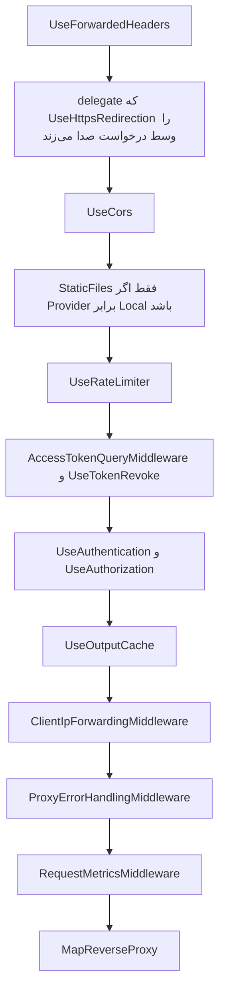

# YARP در ApiGateway

شناسهٔ کاتالوگ: `04-yarp`

**پیش‌نیاز مفهومی:** `01-dotnet-aspnetcore.md`. این سند فقط **پروکسی معکوس** را درس می‌دهد. مسیر کامل از مرورگر تا handler در `30-request-paths.md` است.

## چطور این سند را بخوانیم

| برچسب | معنی |
| --- | --- |
| **از کد** | از فایل‌های خود مخزن (C#، JSON پیکربندی) خوانده شده و قطعی است. |
| **از مستند YARP** | از مستند YARP نسخهٔ `2.3.0` که در فاز A خوانده شد؛ نه از اجرای این مخزن. |
| **استنباط** | از کد نتیجه گرفته شده ولی اجرا نشده. |
| **بررسی نشد** | با درخواست زنده یا سورس کتابخانه تأیید نشده. |

نکتهٔ مهم: **هیچ درخواست زنده‌ای زده نشد** و جدول routeهای زمان اجرا چاپ نشد. همهٔ نتیجه‌ها از کد و فایل‌های پیکربندی‌اند. رشته‌های پیکربندی خود مخزن قطعی‌اند، ولی معنای دقیق بعضی policyهای داخلی YARP (مثل `anonymous` و `default`) در این درس از مستند رسمی تأیید نشد.

---

## خلاصهٔ یک‌دقیقه‌ای

1. **پروکسی معکوس** یک سرویس جلویی است. کلاینت فقط با او حرف می‌زند؛ او مسیر را با یک جدول مقایسه می‌کند، مقصد را انتخاب می‌کند و درخواست را می‌فرستد.
2. **YARP** (کتابخانهٔ `Yarp.ReverseProxy` نسخهٔ `2.3.0`) این جدول را داخل ASP.NET Core پیاده می‌کند و پروکسی واقعی این سامانه است.
3. چهار مفهوم اصلی: **route** (قانون match)، **cluster** (مجموعهٔ مقصدها)، **destination** (آدرس یک نمونه) و **transform** (تغییر درخواست قبل از ارسال).
4. در این مخزن، `ApiGateway` پروکسی جلوی هشت پردازه است. routeها بیشتر از بخش‌های `ReverseProxy:*` در JSON می‌آیند. `LoadFromMemory` امروز **خالی** است.
5. در Docker مقصدها نام سرویس هستند (`http://dejban`)، ولی در نمونهٔ development `localhost` است. باسکول استثناست: `host.docker.internal:5053`.
6. بعد از پروکسی، یک middleware هر خطای ۵۰۰ و ۵۰۲ را برای کلاینت API به **۵۰۳ دوستانه** تبدیل می‌کند؛ این برای عیب‌یابی گران است.

---

## نسخه و جایگاه در کد

نسخهٔ پکیج در `Directory.Packages.props` برابر `Yarp.ReverseProxy` `2.3.0` است و `ApiGateway/ApiGateway.csproj` همان پکیج را بدون نسخهٔ جدا ارجاع می‌دهد.

**از مستند YARP (فاز A):** `LoadFromConfig` مسیر را به cluster و آدرس مقصد وصل می‌کند و `MapReverseProxy` درخواست منطبق را به آن مقصد می‌فرستد.

### کاتالوگ در برابر کد

کاتالوگ گفته بود YARP با `LoadFromConfig` و `LoadFromMemory` استفاده می‌شود. هر دو فراخوانی در `ApiGateway/Program.cs` هستند و YARP واقعاً پروکسی این سامانه است. **اختلاف** این است که آرایهٔ `IdentityServerRoutes.routes` الان **خالی** است و routeهای داخلش comment شده‌اند. routeهای JSON روی همان builder ثبت شده‌اند. این از روی کد و فایل پیکربندی است، نه از جدول route در زمان اجرا. بحث ادغام لیست خالی با JSON در `00-yarp-config-investigation.md` است.

---

## پروکسی معکوس چه مسئله‌ای را حل می‌کند؟

مرورگر نباید آدرس داخلی هر میکروسرویس را بداند. اگر صفحهٔ پرسنل مستقیم به `http://dejban` وصل شود:

- احراز هویت، محدودیت نرخ و CORS باید در **هر سرویس** تکرار شود،
- و نام سرویس داکر به شبکهٔ کاربر **نشت** می‌کند.

### کار پروکسی معکوس

1. درخواست را از کلاینت می‌گیرد،
2. مسیر را با یک جدول مقایسه می‌کند،
3. یک مقصد انتخاب می‌کند،
4. درخواست را می‌فرستد،
5. پاسخ را برمی‌گرداند.

«معکوس» یعنی **سرور** مخفی می‌شود. در مقابل، forward proxy معمولاً **کلاینت** را مخفی می‌کند و جلوی کلاینت می‌نشیند.

### چهار مفهوم YARP

| مفهوم | معنی ساده |
| --- | --- |
| **Route** | می‌گوید چه مسیری با چه قانونی match شود. |
| **Cluster** | می‌گوید آن route به کدام مقصدها برود. |
| **Destination** | آدرس پایهٔ یک نمونه از سرویس. |
| **Transform** | درخواست را قبل از فرستادن عوض می‌کند: پیشوند مسیر، هدر یا الگوی مسیر. |


### جایگاه YARP

در این مخزن پردازهٔ جلویی `ApiGateway` است. **Nginx** جلوی مرورگر هنوز یک پروکسی دیگر است و درسش `28-nginx-edge.md` است. پس YARP **بین Nginx و سرویس‌های .NET** نشسته است.

---

## ثبت در کد

`ApiGateway/Program.cs` بعد از CORS، JWT، ForwardedHeaders، rate limiter و output cache این زنجیره را می‌سازد:

```csharp
builder.Services.AddReverseProxy()
    .LoadFromMemory(IdentityServerRoutes.routes, [])
    .LoadFromConfig(builder.Configuration.GetSection(ApiGatewayConfigConstants.IdentityServerProxy))
    .LoadFromConfig(builder.Configuration.GetSection(ApiGatewayConfigConstants.RequestTrackerProxy))
    .LoadFromConfig(builder.Configuration.GetSection(ApiGatewayConfigConstants.DCC))
    .LoadFromConfig(builder.Configuration.GetSection(ApiGatewayConfigConstants.ACLServerProxy))
    .LoadFromConfig(builder.Configuration.GetSection(ApiGatewayConfigConstants.DejbanProxy))
    .LoadFromConfig(builder.Configuration.GetSection(ApiGatewayConfigConstants.ReportingProxy))
    .LoadFromConfig(builder.Configuration.GetSection(ApiGatewayConfigConstants.GateServerProxy))
    .LoadFromConfig(builder.Configuration.GetSection(ApiGatewayConfigConstants.PublicFilesProxy));
```

ثابت‌ها در `ApiGateway/Abstractions/Constants/ConfigConstants.cs`:

| ثابت | بخش configuration |
| --- | --- |
| `IdentityServerProxy` | `ReverseProxy:IdentityServer` |
| `RequestTrackerProxy` | `ReverseProxy:RequestTracker` |
| `DCC` | `ReverseProxy:DCC` |
| `ACLServerProxy` | `ReverseProxy:ACLServer` |
| `DejbanProxy` | `ReverseProxy:Dejban` |
| `ReportingProxy` | `ReverseProxy:Reporting` |
| `GateServerProxy` | `ReverseProxy:GateServer` |
| `PublicFilesProxy` | `ReverseProxy:PublicFiles` |

### `LoadFromMemory` امروز چیزی اضافه نمی‌کند

`LoadFromMemory` در `IdentityServerRoutes` یک `RouteConfig[]` می‌گیرد. هر دو route آن فایل (`auth-login-route` و `auth-refresh-route`) **comment** هستند و آرایه خالی است. آرگومان clusterها هم `[]` است. پس این فراخوانی امروز route فعالی اضافه نمی‌کند. login واقعی در JSON با شناسهٔ `auth-login-route-v1` است.

### جای `MapReverseProxy`

`MapReverseProxy` آخر `Program.cs` است، بعد از middlewareهای خود gateway. درخواست‌هایی که route جداگانهٔ minimal API خورده‌اند، مثل `/health/reporting-routes` و `/api/v1/gateway/request-metrics`، به پروکسی نمی‌رسند **اگر** مسیریاب آن‌ها را زودتر انتخاب کند. این سند ترتیب ثبت را دیده است، نه برندهٔ نهایی مسیریاب را با یک درخواست زنده (**بررسی نشد**).

---

## دو فایل مقصد را عوض می‌کنند

`WebApplication.CreateBuilder` فایل `appsettings.json` و `appsettings.{Environment}.json` را بار می‌کند. Compose اپ در `docker/compose.backend.yml` محیط را `DockerDevelopment` می‌گذارد. بنابراین فایل مؤثر داکر `ApiGateway/appsettings.DockerDevelopment.json` است (**استنباط**، از قرارداد میزبان).

- `appsettings.Docker.json` آدرس‌های هم‌شکل دارد.
- `appsettings.json`، `appsettings.Development.json` و `appsettings-sample.json` به‌جای نام سرویس، `localhost` و پورت دارند.

### مقصدها در محیط Docker

مقصدهایی که در `appsettings.Docker.json` خوانده شد:

| cluster | آدرس |
| --- | --- |
| `identity-server-cluster` | `http://identityserver` |
| `request-tracker-cluster` | `http://requesttracker` |
| `dcc-cluster` | `http://dcc` |
| `acl-server-cluster` | `http://aclserver` |
| `dejban-cluster` | `http://dejban` |
| `dejban-baskool-cluster` | `http://host.docker.internal:5053` |
| `reporting-cluster` | `http://reporting` |
| `gate-server-cluster` | `http://gateserver` |
| `dcc-public-files-cluster` | `http://dcc/` |

### چرا باسکول استثناست؟

نمونهٔ development برای دژبان در `appsettings-sample.json` برابر `http://localhost:5042` است. این همان `applicationUrl` پروفایل `Dejban` در launchSettings است، **نه آدرس کانتینر**.

باسکول در داکر به `host.docker.internal` می‌رود، چون `BaskoolService` در Compose اپ سرویس ندارد و در `01-dotnet-aspnetcore.md` به‌عنوان میزبان جدا آمده است.

### یک مقصد برای هر cluster

هر cluster بالا یک destination دارد. سیاست load balancing در این بخش‌ها دیده نشد. پس با یک مقصد، انتخاب بین چند نمونه موضوع این پیکربندی نیست.

---

## routeهایی که رفتار را نشان می‌دهند

همه از `appsettings.Docker.json` هستند.

### جدول خلاصه

| شناسهٔ route | cluster | policy احراز هویت | مسیر | transform |
| --- | --- | --- | --- | --- |
| `auth-login-route-v1` | `identity-server-cluster` | `anonymous` | `/Api/v{apiVersion}/Auth/Login/{**catch-all}` | فقط دو هدر |
| `personnel-routes-v1` | `dejban-cluster` | `default` | `/Api/v{apiVersion}/Personnels/{**catch-all}` | فقط دو هدر |
| `identityserver-scalar-route-v1` | هویت | `anonymous` | `/identityserverscalar/{**catch-all}` | دو هدر و `PathRemovePrefix` |
| `reporting-scalar-route-v1` | گزارش | — | `/reportingscalar/...` | حذف پیشوند `/reportingscalar` |
| `timeserver-hub` | هویت | `default` | `/Api/v{apiVersion}/timeserverhub/{**catch-all}` | `PathPattern` برابر `/timeserverhub/{**catch-all}` |
| `gate-status-hub` | `gate-server-cluster` | `anonymous` | `/gateStatusHub/{**catch-all}` | ندارد |
| `minio-public-files-v1` | `dcc-public-files-cluster` | `anonymous` | `/files/{**catch-all}` | `PathPattern` برابر `/api/v1/Files/public/{**catch-all}` |
| `baskool-hub` | `dejban-baskool-cluster` | `default` | `/baskoolhub/{**catch-all}` | ندارد |

**«دو هدر»** یعنی `RequestHeaderOriginalHost` برابر true، و هدر `X-Forwarded-Proto` با مقدار ثابت `https`.

### ورود (`auth-login-route-v1`)

- `ClusterId` برابر `identity-server-cluster`
- `AuthorizationPolicy` برابر `anonymous`
- `RateLimiterPolicy` برابر `Auth_RateLimiter_PerIp`
- مسیر `/Api/v{apiVersion}/Auth/Login/{**catch-all}`

این route مسیر را **بازنویسی نمی‌کند.** `{**catch-all}` ته مسیر است (یعنی «هر چیزی بعد از این هم بیاید قبول است»). خود `Login` در الگوی مسیر هست، پس بخش متغیر معمولاً خالی است. مقصد `http://identityserver` است و مسیر اصلی، جز همان هدرها، به هویت می‌رسد.

اینکه YARP حروف `/api` و `/Api` را یکی می‌گیرد، با درخواست آزمایش نشد (**بررسی نشد**). سند `30-request-paths.md` همین را به‌عنوان hop تأییدنشده علامت می‌زند.

### پرسنل (`personnel-routes-v1`)

- cluster برابر `dejban-cluster`
- `AuthorizationPolicy` برابر `default`
- مسیر `/Api/v{apiVersion}/Personnels/{**catch-all}`
- همان دو transform هدر، **بدون حذف پیشوند**

پس `/Api/v1/Personnels/GetPersonnels` اگر match شود به `http://dejban` با همان مسیر می‌رود. endpoint دژبان دقیقاً `/api/v{version}/Personnels/GetPersonnels` را map کرده است. پروکسی این تکه را به مسیر دیگری ترجمه نمی‌کند.

### Scalar هویت و گزارش

برای `identityserver-scalar-route-v1`:

- policy برابر `anonymous`
- مسیر `/identityserverscalar/{**catch-all}`
- علاوه بر دو هدر، `PathRemovePrefix` برابر `/identityserverscalar`

یعنی پیشوند مستندات **قبل از رسیدن به هویت کنده می‌شود.** گزارش هم برای `reporting-scalar-route-v1` پیشوند `/reportingscalar` را برمی‌دارد.

### hub زمان (`timeserver-hub`)

- policy برابر `default`
- مسیر `/Api/v{apiVersion}/timeserverhub/{**catch-all}`
- `PathPattern` برابر `/timeserverhub/{**catch-all}`

هویت hub را روی `/timeserverhub` map کرده، **نه** زیر `/api/v1`. این transform همان اختلاف را پر می‌کند.

**سؤال باز:** Nginx در فرانت مسیر `/timeserverhub` را مستقیم به gateway می‌فرستد، ولی route داکر بالا الگوی `/Api/v.../timeserverhub` است. اینکه کدام الگو درخواست Nginx را می‌گیرد، به route دیگری بستگی دارد که در این بخش دیده نشد: باید در فایل دنبال مسیر **بدون پیشوند** `/timeserverhub` گشت. در همین خواندن، hub گیت جدا است.

### hub گیت (`gate-status-hub`)

- cluster برابر `gate-server-cluster`
- policy برابر `anonymous`
- مسیر `/gateStatusHub/{**catch-all}`
- transform در این بلوک نیست

این با `MapHub<GateConnectionStatusHub>("/gateStatusHub")` در GateServer هم‌نام است. template Nginx که در فاز A خوانده شد این hub را در فهرست upgrade نداشت. این سند فقط route درگاه را ثابت می‌کند.

### فایل عمومی در Docker (`minio-public-files-v1`)

- ریشهٔ `PublicFiles:Provider` در همین فایل برابر `MinIO` است و `Mode` برابر `DccProxy`.
- چون provider برابر `Local` نیست، شاخهٔ `UseStaticFiles` در `Program.cs` **اجرا نمی‌شود.**
- cluster برابر `dcc-public-files-cluster` با آدرس `http://dcc/`
- policy برابر `anonymous`
- مسیر `/files/{**catch-all}`
- `PathPattern` برابر `/api/v1/Files/public/{**catch-all}`

**تناقض:** کامنت `Program.cs` می‌گوید provider برابر MinIO یعنی YARP مسیر `/files` را به bucket مین‌یو بفرستد. JSON داکر چیز دیگری می‌گوید: مقصد سرویس `dcc` است و مسیر به API فایل (دژبان/DCC) بازنویسی می‌شود. نام cluster هنوز `dcc-public-files-cluster` است و پروکسی مستقیم به پورت MinIO در این route نیست. **کامنت با پیکربندی فعلی یکی نیست و پیکربندی ملاک اجراست.**

### باسکول (`baskool-hub`)

- cluster برابر `dejban-baskool-cluster`
- policy برابر `default`
- مسیر `/baskoolhub/{**catch-all}`
- آدرس داکر `http://host.docker.internal:5053`
- transform در این بلوک نیست

---

## خط لوله تا پروکسی

ترتیب بعد از `Build` در `ApiGateway/Program.cs`:



### هدرهای فوروارد و IP کلاینت

- `AddTrustedForwardedHeaders` فقط `XForwardedFor` را قبول می‌کند، `ForwardLimit` را ۱ می‌گذارد و IP یا CIDR را از `ForwardedHeaders:KnownProxies` و `ForwardedHeaders:KnownNetworks` پر می‌کند.
- کامنت کد می‌گوید loopback همیشه مورد اعتماد است و هدر ساختگی کلاینت از جای دیگر نادیده گرفته می‌شود.
- مقدار IPهای known در این سند نقل نشده است.

`ClientIpForwardingMiddleware`:

- هدر `X-Real-IP` آمده از کلاینت را **پاک می‌کند** و IP حل‌شدهٔ `GetClientIp` را دوباره می‌گذارد.
- `GetClientIp` از `Connection.RemoteIpAddress` می‌خواند، بعد از آنکه `UseForwardedHeaders` (اگر پروکسی مورد اعتماد باشد) آن را عوض کرده باشد.
- IPv4-mapped IPv6 به IPv4 تبدیل می‌شود.

### Rate limiter

در `ApiGateway/Abstractions/Extensions/ServiceCollectionExtensions.cs`:

| limiter | پنجره | سقف | segment | صف | کلید |
| --- | --- | --- | --- | --- | --- |
| policy نام‌دار `Auth_RateLimiter_PerIp` | لغزان، ۳۰ ثانیه | ۶ مجوز | ۶ | ۰ | IP |
| `GlobalLimiter` | یک دقیقه | ۵۰۰ | ۱ | ۰ | IP |

- رد شدن: وضعیت **۴۲۹**، هدر `Retry-After` اگر metadata باشد، و عنوان فارسی، مگر اینکه `Accept-Language` دقیقاً `en-US` باشد.
- اسم policy روی route ورود با اسم ثبت‌شده یکی است و `UseRateLimiter` در خط لوله هست.
- اینکه YARP با کلید `RateLimiterPolicy` همان policy را برای هر route انتخاب می‌کند، از سورس YARP دوباره خوانده نشد (**بررسی نشد**).
- limiter سراسری چون `GlobalLimiter` ست شده، قرارداد خود middleware نرخ ASP.NET Core است و به route خاص وابسته نیست.

### Output cache

`AddCustomCachePolicies` یک policy به نام `Default_CachePolicy` با انقضای ۲۰ ثانیه می‌سازد و `UseOutputCache` در خط لوله است. ولی در JSONهای `ApiGateway` ارجاعی به `Default_CachePolicy` پیدا نشد. پس **ثبت policy ثابت است و استفادهٔ یک route از آن ثابت نیست.** نباید گفت پاسخ APIها بیست ثانیه cache می‌شوند.

### متریک درخواست‌ها

`RequestMetricsMiddleware` برای GET و POST و PUT و DELETE زمان و status را در `RequestMetricsStore` نگه می‌دارد. endpoint `/api/v1/gateway/request-metrics` این snapshot را با `RequireAuthorization` برمی‌گرداند. asset و health و scalar در کامنت middleware از اندازه‌گیری مستثنا شده‌اند. شرط دقیق `ShouldTrack` از خط ۳۵ به بعد است و در این درس فقط وجود استثنا نقل می‌شود.

---

## خطا، امنیت و مشاهده‌پذیری

### `ProxyErrorHandlingMiddleware`

بعد از `next`، اگر وضعیت ۵۰۲ یا ۵۰۰ باشد:

1. نام cluster را از `IReverseProxyFeature` می‌خواند.
2. اگر feature نباشد، از روی زیررشتهٔ مسیر حدس می‌زند.
3. جدول نام نمایشی clusterها را دارد: identity، request tracker، DCC، ACL، dejban، reporting، gate و `public-files-cluster`.

`dejban-baskool-cluster` و `dcc-public-files-cluster` در آن دیکشنری **نیستند**:

- برای باسکول، اگر feature پر باشد، `GetValueOrDefault` خود cluster id را برمی‌گرداند چون کلید نیست.
- اگر feature خالی باشد و مسیر `/baskoolhub` با هیچ `Contains` آن متد نخورد، `systemName` برابر `Unknown System` می‌شود.

### چه چیزی به کلاینت می‌رسد؟

- درخواست با `Accept: text/html`: redirect به `/error/503?system=...`.
- بقیه: وضعیت ۵۰۳ و JSON با `systemName` و پیام فارسی یا انگلیسی (بر اساس وجود `fa` در `Accept-Language`).

یعنی **۵۰۰ سرویس مقصد هم برای کلاینت API به شکل «سیستم در دسترس نیست» درمی‌آید.** خطای دامنهٔ ۵۰۰ با قطع بودن پردازه قاطی می‌شود. این رفتار کد است، نه حدس.

میان‌افزار بدنهٔ پاسخ را قبل از `next` عوض نمی‌کند و `originalBodyStream` را فقط به متد نوشتن می‌دهد. اگر پاسخ از قبل شروع شده باشد، نوشتن دوباره می‌تواند خطا پرتاب کند. این مسیر در این فاز اجرا نشد.

### احراز هویت دو لایه

- gateway خودش `AddCustomJwtAuth` و `UseAuthorization` دارد و بسیاری routeها `AuthorizationPolicy` برابر `default` دارند.
- سرویس مقصد هم اغلب `RequireAuthorization` دارد.
- توکن باید از gateway رد شود تا به مقصد برسد.
- routeهای `anonymous` مثل login این سد اول را برمی‌دارند.

معنای دقیق کلمهٔ `default` در موتور YARP در این جلسه از سند رسمی دوباره گرفته نشد (**بررسی نشد**). آنچه قطعی است:

- login در JSON مقدار `anonymous` دارد و `AuthController.Login` هم `[AllowAnonymous]` است.
- پرسنل در JSON مقدار `default` دارد و `GetPersonnels` هم `RequireAuthorization` دارد.

### `X-Forwarded-Proto` همیشه `https`

`X-Forwarded-Proto` همیشه به `https` ست می‌شود، حتی اگر زنجیره تا gateway روی HTTP داخلی داکر باشد. سرویس مقصد اگر redirect یا لینک مطلق بسازد، scheme را https می‌بیند. این با `RequestHeaderOriginalHost` کنار هم است تا **میزبان اصلی مرورگر** حفظ شود و scheme از دید مقصد https باشد.

### health چک routeهای reporting (یک ناهماهنگی)

- health چک routeهای reporting در کد بخش `Reporting:Routes` را می‌خواند.
- routeهای واقعی زیر `ReverseProxy:Reporting` هستند، از جمله `reporting-js-routes-v1` و `reporting-health-assets-route-v1` که در فایل داکر وجود دارند.
- رشتهٔ بخش در endpoint سلامت با مسیر واقعی configuration **یکی نیست.**

**استنباط قوی (اجرا نشده):** `GetSection("Reporting:Routes")` آن routeها را نمی‌بیند و چون `configured` برابر false می‌شود، پاسخ ۵۰۳ است.

---

## مزیت، هزینه، اشتباه

### مزیت

- یک جدول route جلوی **هشت پردازه** است.
- تغییر مقصد در داکر فقط آدرس cluster را عوض می‌کند.
- login می‌تواند anonymous و rate-limit باشد، در حالی که پرسنل `default` است.
- transform اجازه می‌دهد hub زیر مسیر API به مسیر واقعی hub برود.

### هزینه

- جدول بزرگ و تکراری است. هر خانوادهٔ URL یک بلوک JSON دارد.
- غلط بودن یک رشتهٔ مسیر یعنی ۴۰۴ از **خود gateway**، نه از سرویس.
- دو فایل development و docker مقصد متفاوت دارند. باسکول به host می‌رود و بقیه به DNS داکر.

### اشتباه‌های رایج

- فرض اینکه `LoadFromMemory` login را می‌سازد. آرایه خالی است.
- فرض اینکه کامنت MinIO یعنی `/files` مستقیم به مین‌یو می‌رود. در داکر به `http://dcc/` و مسیر `/api/v1/Files/public/...` می‌رود.
- فرض اینکه `localhost:5042` مقصد کانتینر است. آن آدرس مال sample و launchSettings است.
- فرض اینکه output cache بیست‌ثانیه‌ای روی API روشن است. policy ثبت شده و ارجاع route پیدا نشد.
- یکی گرفتن ۵۰۰ دامنه با ۵۰۲ قطع سرویس، چون middleware هر دو را برای API به ۵۰۳ دوستانه تبدیل می‌کند.

### سناریوهای شکست

- **سرویس `dejban` در شبکهٔ داکر نیست:** YARP ۵۰۲ می‌دهد و middleware برای کلاینت غیر HTML بدنهٔ ۵۰۳ با نام Dejban Core می‌سازد، اگر feature cluster پر باشد.
- **KnownProxies خالی است و Nginx از IP غیر loopback وصل است:** `UseForwardedHeaders` هدر را نادیده می‌گیرد، rate limit روی IP خود Nginx جمع می‌شود و `X-Real-IP` پایین‌دست IP پروکسی است نه کاربر.
- **محیط Development با فایل localhost بالا است ولی سرویس‌ها فقط داخل Compose هستند:** پروکسی به `localhost:5042` از داخل کانتینر gateway به **خودش** می‌رود نه به دژبان.
- **health گزارش همیشه قرمز می‌ماند** اگر مسیر configuration واقعاً اشتباه باشد، در حالی که خود reporting سالم است.

---

## حقایق، استنباط‌ها، پرسش‌های باز

### حقایق (از کد)

ثبت `AddReverseProxy` و `MapReverseProxy`، خالی بودن `IdentityServerRoutes.routes`، مسیر و cluster و transform نمونه‌های بالا، آدرس‌های Docker در برابر localhost نمونه، rate limit ۶ و ۵۰۰، و منطق ۵۰۲/۵۰۰ در middleware.

### استنباط‌ها

- محیط `DockerDevelopment` فایل `appsettings.DockerDevelopment.json` را روی `appsettings.json` می‌اندازد، چون این قرارداد میزبان است. آدرس `http://dejban` در آن فایل هم هست.
- health routeهای reporting به‌خاطر اختلاف `Reporting:Routes` و `ReverseProxy:Reporting` ناسالم برمی‌گردد. اجرا نشده است.
- match حروف بزرگ و کوچک مسیر login هنوز آزمایش نشده است.

### پرسش‌های باز (بررسی نشد)

- فهرست کامل routeها در این سند نیامده؛ فقط نمونه‌هایی که رفتار متفاوت دارند.
- آیا YARP برای `RateLimiterPolicy` متادیتا را خودش به middleware نرخ وصل می‌کند؟ نام‌ها یکی است ولی سورس کتابخانه باز نشد.
- مقدار `ForwardedHeaders:KnownProxies` در configuration محیطی نقل نشد.
- معنای دقیق policyهای `anonymous` و `default` در موتور YARP.

---

## رابطه با بقیه

| سند | پیوند |
| --- | --- |
| `30-request-paths.md` | login و پرسنل از همین routeها رد می‌شوند. |
| `05-jwt-identity.md` | JWT روی خود gateway و دوباره روی مقصد. |
| `19-redis.md` | blacklist توکن قبل از `MapReverseProxy`. |
| `16-dcc-s3.md` | `/files` در داکر به DCC می‌رود، نه مستقیم به MinIO. |
| `13-signalr.md` | transform هاب زمان و route هاب گیت و باسکول. |
| `28-nginx-edge.md` | Nginx فقط `/api/` را به پورت `7036` می‌دهد. |

---

## واژه‌نامهٔ ساده

| واژه | معنی ساده |
| --- | --- |
| **Reverse proxy (پروکسی معکوس)** | سرویس جلویی که جای سرورهای پشتش با کلاینت حرف می‌زند. |
| **Forward proxy** | پروکسی جلوی کلاینت که درخواست او را به بیرون می‌برد. |
| **API Gateway** | دروازهٔ ورودی API که کارهای مشترک (احراز هویت، محدودیت نرخ) را در یک جا انجام می‌دهد. در این مخزن همان `ApiGateway` است. |
| **Route** | قانون match مسیر در YARP. |
| **Cluster** | مجموعهٔ مقصدها برای یک route. |
| **Destination** | آدرس پایهٔ یک نمونه از سرویس. |
| **Transform** | تغییر درخواست قبل از ارسال (پیشوند، هدر، الگوی مسیر). |
| **`{**catch-all}`** | بخشی از الگوی مسیر که هر چیز بعد از آن را (حتی خالی) قبول می‌کند. |
| **`PathRemovePrefix`** | حذف یک پیشوند از مسیر قبل از ارسال. |
| **`PathPattern`** | جایگزین کردن مسیر با یک الگوی تازه. |
| **Sliding window (پنجرهٔ لغزان)** | روش rate limit که پنجرهٔ زمانی را به بخش‌های کوچک (segment) تقسیم می‌کند و با گذشت زمان بخش‌ها را کنار می‌زند. |
| **429** | «درخواست‌های زیاد»؛ سقف نرخ پر شده. |
| **502** | «Bad Gateway»؛ gateway از مقصد پاسخ معتبر نگرفته یا به آن نرسیده. |
| **503** | «سرویس در دسترس نیست». |
| **Forwarded headers** | هدرهایی که پروکسی می‌گذارد تا IP و پروتکل اصلی کلاینت به سرویس‌های پشتی برسد. |
| **Output cache** | نگه‌داری موقت پاسخ تا درخواست تکراری دوباره به مقصد نرود. |

---

## راهنمای عملی: برای هر route این پنج سؤال را بپرسید

1. **مسیر چیست و `{**catch-all}` دارد؟**
2. **به کدام cluster و کدام destination می‌رود؟** (در Docker نام سرویس، در development معمولاً localhost)
3. **policy احراز هویت چیست؟** (`anonymous` یا `default`)
4. **rate limit دارد؟** (مثلاً `Auth_RateLimiter_PerIp`)
5. **transform دارد؟** (حذف پیشوند، `PathPattern`، یا فقط هدرها)

---

## سؤال‌های مصاحبه

(پاسخ‌ها عمداً ساده نوشته شده‌اند.)

### ۱. پروکسی معکوس با forward proxy چه فرقی دارد و YARP اینجا کدام است؟

Forward proxy معمولاً جلوی کلاینت است و درخواست او را به اینترنت می‌برد. Reverse proxy جلوی سرورهاست و از دید کلاینت خودش سرور است. `ApiGateway` با `Yarp.ReverseProxy` 2.3.0 درخواست را به clusterهایی مثل `dejban-cluster` می‌فرستد. مرورگر آدرس `http://dejban` را نمی‌بیند. Nginx قبل از YARP هم reverse proxy است، ولی مرز این سند خود YARP است.

**سؤال دنباله:** چرا هم Nginx و هم YARP لازم شده‌اند؟
**جواب:** Nginx در Compose فرانت اپ‌های Next و Vite را هم سرو می‌کند و `/api/` را به gateway می‌دهد. YARP داخل شبکهٔ بک‌اند مسیر API را بین هویت، دژبان، ACL و بقیه تقسیم می‌کند و JWT و rate limit را روی همان پردازه دارد. یکی جای دیگری را در این مخزن کامل نکرده است.

### ۲. route و cluster و destination در پیکربندی داکر چیست؟

Route قانون match است. `personnel-routes-v1` مسیر `/Api/v{apiVersion}/Personnels/{**catch-all}` را به cluster `dejban-cluster` وصل می‌کند. Cluster مجموعهٔ مقصد است. Destination آدرس پایه است: در `appsettings.Docker.json` برای این cluster برابر `http://dejban`. YARP مسیر matchشده را، مگر transform عوضش کند، به آن پایه می‌فرستد.

**سؤال دنباله:** اگر دو replica از دژبان داشته باشیم این فایل چه کم دارد؟
**جواب:** فقط یک destination به نام `destination1` هست و سیاست load balancing در این بلوک نیست. اضافه کردن replica یعنی destination دوم و تصمیم دربارهٔ سلامت و توزیع. امروز این کار در JSON دیده نمی‌شود.

### ۳. چرا `LoadFromMemory` هست اگر login از JSON می‌آید؟

`Program.cs` هر دو را صدا می‌زند. `IdentityServerRoutes.routes` آرایهٔ خالی است و routeهای قدیمی (مثل `/V1/Auth/Login`) داخل comment هستند؛ آن‌ها `PathPattern`ی داشتند که پیشوند را عوض می‌کرد. route فعال `auth-login-route-v1` در JSON است، policy آن `anonymous` است و مسیر را بازنویسی نمی‌کند. provider حافظه صفر route اضافه می‌کند و routeهای JSON را پاک نمی‌کند. این ادغام در زمان اجرا شمرده نشده است.

**سؤال دنباله:** اگر کسی comment را بدون توجه به JSON برگرداند چه می‌شود؟
**جواب:** ممکن است دو route برای login ثبت شود و YARP در تداخل یکی را برنده کند. مسیر comment قدیمی با JSON فعلی یکی نیست و `PathPattern` آن مسیر را به شکلی عوض می‌کرد که با مسیر فعلی controller (`/api/v1/Auth/Login`) فرق دارد. فعال کردن comment بدون تست، مسیر دومی می‌سازد که به action فعلی نمی‌خورد.

### ۴. transformهای `PathRemovePrefix` و `PathPattern` و «هیچ» چه فرقی دارند؟

`PathRemovePrefix` روی Scalar هویت پیشوند `/identityserverscalar` را حذف می‌کند تا سرویس OpenAPI خودش را ببیند. `PathPattern` روی hub زمان مسیر `/Api/v.../timeserverhub/...` را به `/timeserverhub/...` عوض می‌کند، چون `MapHub` هویت زیر `/api` نیست. route پرسنل هیچ‌کدام را ندارد، پس مسیر API تا `GetPersonnels` دست نمی‌خورد. `RequestHeaderOriginalHost` و ست کردن `X-Forwarded-Proto` به `https` روی بیشتر routeها هست، به‌جز چند hub که فقط path دارند یا transform ندارند.

**سؤال دنباله:** چرا scheme اجباری https خطرناک یا مفید است؟
**جواب:** مفید است اگر سرویس لینک مطلق را با scheme درخواست بسازد و مرورگر فقط https را قبول کند. خطرناک است اگر مقصد فکر کند اتصال خودش https بوده و cookie امن یا redirect را اشتباه بسازد، در حالی که hop داخلی `http://dejban` است. کد مقدار را ثابت `https` گذاشته است.

### ۵. ورود چطور هم anonymous است و هم rate limit دارد؟

`auth-login-route-v1` مقدار `AuthorizationPolicy` را `anonymous` گذاشته تا بدون توکن به هویت برسد. همان route مقدار `RateLimiterPolicy` را `Auth_RateLimiter_PerIp` گذاشته. آن policy در کد سقف ۶ درخواست در ۳۰ ثانیه برای هر IP است و صف ندارد. علاوه بر آن `GlobalLimiter` سقف ۵۰۰ در دقیقه برای هر IP دارد. رد شدن ۴۲۹ است و پیام پیش‌فرض فارسی است.

**سؤال دنباله:** اگر همهٔ کاربرها از یک Nginx بیایند و KnownProxies خالی باشد، این سقف به چه کسی می‌خورد؟
**جواب:** `GetClientIp` از `RemoteIpAddress` بعد از ForwardedHeaders است. اگر هدر فوروارد قبول نشود، IP همان Nginx است و ۶ بار login در ۳۰ ثانیه برای کل آن پروکسی است، نه برای هر مرورگر. این همان دلیلی است که `ForwardLimit` و KnownProxies در کد آمده‌اند.

### ۶. خطای ۵۰۲ با خطای ۵۰۰ دامنه در این gateway چه فرقی برای کلاینت دارد؟

برای کلاینت API تقریباً هیچ. `ProxyErrorHandlingMiddleware` هر دو وضعیت را بعد از `next` می‌گیرد. اگر `Accept` شامل `text/html` باشد، redirect به `/error/503` می‌کند؛ وگرنه وضعیت را ۵۰۳ می‌کند و JSON با `systemName` می‌نویسد. نام از `IReverseProxyFeature` یا از حدس مسیر می‌آید. `dejban-cluster` نام نمایشی Dejban Core دارد.

**سؤال دنباله:** چرا این برای دیباگ گران است؟
**جواب:** handler دژبان ممکن است ۵۰۰ با ProblemDetails ساخته باشد. middleware بدنه را با پیام «سیستم در دسترس نیست» عوض می‌کند. پشتیبانی فکر می‌کند پردازه پایین است، در حالی که exception دامنه بوده. لاگ middleware وضعیت اصلی را قبل از این تبدیل با `LogWarning` می‌نویسد، ولی آن لاگ جای بدنهٔ کلاینت را نمی‌گیرد.

### ۷. `/files` در داکر به MinIO می‌رود یا به DCC؟

`PublicFiles:Provider` در `appsettings.Docker.json` برابر `MinIO` است، پس `UseStaticFiles` اجرا نمی‌شود. route `minio-public-files-v1` مقصد `http://dcc/` دارد و مسیر را به `/api/v1/Files/public/{**catch-all}` تبدیل می‌کند. `Mode` برابر `DccProxy` است. کامنت `Program.cs` که از bucket مین‌یو حرف می‌زند با این JSON یکی نیست. MinIO را خود DCC با `S3FileStorage` استفاده می‌کند؛ آن درس مال سند فایل است، نه مال این route.

**سؤال دنباله:** چه زمانی دیسک محلی سرو می‌شود؟
**جواب:** فقط اگر `PublicFiles:Provider` خالی یا `Local` باشد. آن وقت `PhysicalFileProvider` زیر `/files` از پوشهٔ `uploads/public` (یا در محیط غیر Development/Production از `/app/public-assets/public`) فایل می‌دهد. در فایل داکر خوانده‌شده این شاخه خاموش است.

### ۸. health چک `/health/reporting-routes` چه چیزی را واقعاً نگاه می‌کند؟

کد بخش `Reporting:Routes` را می‌خواند و شش نام را لازم دارد، از جمله `reporting-js-routes-v1` و `reporting-health-assets-route-v1`. این نام‌ها در `appsettings.Docker.json` زیر `ReverseProxy` و بعد `Reporting` و بعد `Routes` هستند. رشتهٔ `GetSection` پیشوند `ReverseProxy` را ندارد. اگر provider دیگری آن بخش ریشه را نسازد، `Exists` برابر false است و endpoint وضعیت ۵۰۳ با `Unhealthy` برمی‌گرداند، حتی اگر YARP همان route را برای ترافیک واقعی بار کرده باشد.

**سؤال دنباله:** این چه نوع باگی است، باگ پروکسی یا باگ مشاهده‌پذیری؟
**جواب:** بار کردن YARP از `ReverseProxy:Reporting` است و به این endpoint وابسته نیست. باگ در پروب است: هشدار سلامت دروغ می‌گوید سرویس route ندارد. اصلاح مفهومی این است که همان بخشی خوانده شود که `LoadFromConfig` می‌خواند. این سند آن کد را عوض نکرده است.

### ۹. چرا آدرس داکر با launchSettings فرق دارد و اشتباه گرفتنشان چه می‌کند؟

launchSettings دژبان `http://localhost:5042` است و sample و `appsettings.json` gateway همان را برای `dejban-cluster` دارند. داخل Compose، `localhost` پردازهٔ gateway خودش است نه دژبان. `appsettings.DockerDevelopment.json` آدرس را `http://dejban` گذاشته تا DNS شبکهٔ Compose پردازه را پیدا کند. باسکول استثناست: `host.docker.internal:5053`، چون در Compose اپ نیست.

**سؤال دنباله:** اگر کسی فایل Docker را روی ماشین توسعه بدون Compose اجرا کند چه می‌شود؟
**جواب:** نام `dejban` resolve نمی‌شود، مگر در hosts یا شبکهٔ داکر باشد؛ پروکسی ۵۰۲ می‌دهد. برعکس، اگر کانتینر gateway با فایل localhost بالا بیاید، به پورت داخل خودش وصل می‌شود نه به سرویس خواهر.

### ۱۰. یک درخواست پرسنل از دید فقط YARP چه مراحلی دارد؟

درخواست به `MapReverseProxy` می‌رسد اگر middleware قبلی آن را تمام نکرده باشد. rate limit سراسری ممکن است ۴۲۹ بدهد. authorization مسیر `default` ممکن است ۴۰۱ بدهد اگر توکن از `UseAuthentication` معتبر نباشد. اگر رد شود، route `personnel-routes-v1` match می‌شود، cluster `dejban-cluster` تنها destination را انتخاب می‌کند، هدر host اصلی و `X-Forwarded-Proto: https` ست می‌شود و درخواست به `http://dejban` با همان مسیر API می‌رود. پاسخ از همان راه برمی‌گردد. اگر اتصال شکست بخورد، middleware خطا برای API یک ۵۰۳ با نام سیستم می‌سازد.

**سؤال دنباله:** کجای این داستان هنوز آزمایش نشده است؟
**جواب:** تطبیق حروف `/api/v1/personnels/...` با الگوی `/Api/v{apiVersion}/Personnels/...`، و اینکه policy کلمهٔ `default` دقیقاً کدام scheme احراز هویت YARP را صدا می‌زند. کد مقصد و JSON هر دو authorization می‌خواهند. یک درخواست زنده در این فاز زده نشد.

### سؤال‌های عمومی برای آمادگی بیشتر

### ۱۱. API Gateway و Reverse Proxy و Load Balancer چه فرقی دارند؟

Reverse proxy درخواست را به مقصد می‌رساند. Load balancer بین چند نمونهٔ یک سرویس توزیع می‌کند. API Gateway معمولاً یک reverse proxy است که کارهای مشترک API (احراز هویت، محدودیت نرخ، لاگ، تبدیل مسیر) را هم انجام می‌دهد. در این مخزن `ApiGateway` با YARP هم reverse proxy است و هم کارهای مشترک API را انجام می‌دهد، ولی load balancing عملاً مطرح نیست، چون هر cluster فقط یک destination دارد.

### ۱۲. فرق ۴۰۱ و ۴۰۳ و ۴۲۹ و ۵۰۲ و ۵۰۳ و ۵۰۴ چیست؟

۴۰۱: هویت شناخته نشد (توکن نیست یا نامعتبر است). ۴۰۳: هویت شناخته شد ولی اجازه ندارد. ۴۲۹: درخواست‌ها بیش از سقف است. ۵۰۲: gateway از مقصد پاسخ معتبر نگرفت یا به آن نرسید. ۵۰۳: سرویس در دسترس نیست (در این مخزن middleware ۵۰۰ و ۵۰۲ را هم به آن تبدیل می‌کند). ۵۰۴: gateway در مهلت مقرر پاسخی نگرفت.

### ۱۳. چرا پروکسی `X-Forwarded-For` را فقط از پروکسی‌های مورد اعتماد می‌پذیرد؟

چون هر کلاینتی می‌تواند این هدر را جعل کند. اگر gateway آن را بی‌قید بپذیرد، مهاجم می‌تواند IP دلخواه بگذارد و rate limit را دور بزند. به همین دلیل کد `KnownProxies` و `KnownNetworks` و `ForwardLimit` دارد و `X-Real-IP` ارسالی کلاینت را پاک می‌کند.

### ۱۴. Sliding window rate limiter چه فرقی با fixed window دارد؟

در fixed window شمارنده در پایان هر پنجره صفر می‌شود، پس کلاینت می‌تواند در مرز دو پنجره دو برابر سقف بفرستد. در sliding window پنجره به چند segment تقسیم می‌شود و با گذشت زمان segmentهای قدیمی کنار می‌روند؛ پس توزیع نرم‌تر است. در این مخزن policy ورود ۶ مجوز در ۳۰ ثانیه با ۶ segment دارد (هر segment حدود ۵ ثانیه).

### ۱۵. چرا `{**catch-all}` در انتهای مسیر route می‌گذاریم؟

تا هر چیزی بعد از آن مسیر هم به همان route برسد. بدون آن، فقط مسیر دقیقاً برابر match می‌شد و آدرس‌های زیرمسیر (مثل `/Personnels/GetPersonnels`) ۴۰۴ می‌گرفتند.

---

## مرور نهایی

YARP 2.3 پروکسی `ApiGateway` است و با چند `LoadFromConfig` از بخش‌های `ReverseProxy:*` پر می‌شود. `LoadFromMemory` امروز خالی است. مقصد داکر نام سرویس است و مقصد sample برابر localhost است. transform همیشگی نیست: پرسنل مسیر را حفظ می‌کند، Scalar پیشوند را برمی‌دارد، hub زمان مسیر را عوض می‌کند و `/files` در داکر به API دی‌سی‌سی می‌رود نه به مین‌یو.

**اگر فقط یک نمودار را باید به خاطر بسپارید،** همان خط لوله تا `MapReverseProxy` است؛ به‌خصوص rate limit و authorization که **قبل از** پروکسی‌اند، و تبدیل ۵۰۰ و ۵۰۲ به پیام ۵۰۳ که **بعد از** آن.

**اگر فقط یک جمله بخواهید یادتان بماند:** «route می‌گوید کدام مسیر، cluster می‌گوید به کجا، transform می‌گوید چه چیزی عوض شود؛ و هر چیزی که از ۵۰۰ یا ۵۰۲ برگردد برای کلاینت API ۵۰۳ می‌شود.»