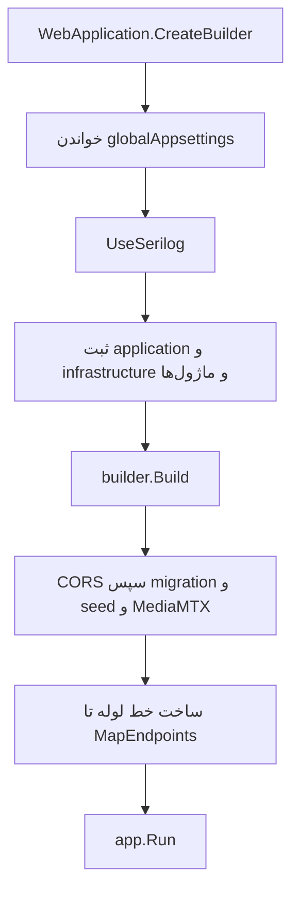
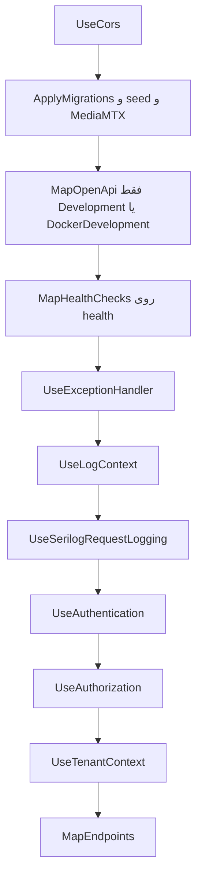

# .NET و ASP.NET Core در این مخزن

شناسهٔ کاتالوگ: `01-dotnet-aspnetcore`.

این سند درس فناوری است. کشف کلی سامانه در `00-project-discovery.md` مانده و اینجا تکرار نمی‌شود. پیش‌نیاز سند دیگری ندارد. سندهای بعدی، از جمله `04-yarp.md` و `30-request-paths.md`، به مدل میزبان همین صفحه تکیه می‌کنند.

Context7 در این جلسه در دسترس نبود. رفتار عمومی host و middleware از مدلی گفته می‌شود که خود کد با `WebApplication.CreateBuilder`، `Build` و `Run` استفاده می‌کند. جایی که پیش‌فرض یک کتابخانه در این مخزن ست نشده، همان محدودیت نوشته شده است. هیچ قابلیتی فقط به‌خاطر وجود `PackageReference` «فعال» حساب نشده است.

## مسئله

یک درخواست HTTP باید به کد دامنه برسد، ولی دامنه نباید بداند سوکت، هدر، یا سریال‌سازی JSON چیست. اگر هر سرویس این کار را خودش از صفر بنویسد، ترتیب احراز هویت، لاگ، و خطا در هر پردازه فرق می‌کند و باگ‌ها تکرار می‌شوند.

.NET محیطی است که برنامهٔ C# روی آن اجرا می‌شود. ASP.NET Core همان محیط را برای برنامهٔ وب گسترش می‌دهد: یک میزبان که پیکربندی را می‌خواند، سرویس‌ها را در یک ظرف dependency injection نگه می‌دارد، و هر درخواست را از یک خط لولهٔ middleware رد می‌کند تا به endpoint برسد.

در این مخزن چند پردازهٔ جدا این کار را می‌کنند. `Dejban.Api`، `IdentityServer` و `ApiGateway` هر سه با `WebApplication.CreateBuilder` بالا می‌آیند، ولی شکل endpoint و ترتیب middlewareشان یکی نیست.

## .NET چیست

.NET یک پلتفرم اجرای کد مدیریت‌شده است. برنامه به زبان C# نوشته می‌شود، کامپایلر آن را به IL تبدیل می‌کند، و runtime آن IL را اجرا می‌کند. کتابخانهٔ پایه کارهایی مثل فایل، شبکه، زمان، و مجموعه را می‌دهد تا هر پروژه آن‌ها را دوباره نسازد.

نسخهٔ هدف این مخزن در پروژهٔ وب `net10.0` است. نمونه:

- `Microservices/Dejban/API/Dejban.Api/Dejban.Api.csproj` با `Sdk="Microsoft.NET.Sdk.Web"` و `TargetFramework` برابر `net10.0`
- `Microservices/IdentityServer/IdentityServer.csproj` با همان SDK و همان TFM
- `ApiGateway/ApiGateway.csproj` با همان SDK و همان TFM

`Microsoft.NET.Sdk.Web` یعنی پروژه علاوه بر کتابخانهٔ پایه، ارجاع‌های لازم برای میزبان وب ASP.NET Core را دارد. `ImplicitUsings` فعال است، پس usingهای رایج چارچوب در هر فایل دست‌نویس نمی‌شوند. `Nullable` فعال است، پس ارجاع‌های نال‌پذیر در امضای متد معنی دارند.

نسخهٔ پکیج‌های NuGet در `Directory.Packages.props` با `ManagePackageVersionsCentrally` متمرکز است. خود csproj اغلب فقط نام پکیج را می‌آورد. این تمرکز، نسخه را یک‌جا نگه می‌دارد؛ مصرف واقعی را ثابت نمی‌کند. مصرف را باید در کد دید.

`PG_Microservices.slnx` این پروژه‌ها را در یک solution جمع کرده است. solution واحد deploy نیست. هر `Program.cs` یک پردازهٔ جدا است.

## ASP.NET Core چه چیزی اضافه می‌کند

ASP.NET Core سه قطعهٔ اصلی را روی .NET می‌گذارد.

میزبان وب، درخواست HTTP را می‌پذیرد. در مدل فعلی، `WebApplication.CreateBuilder` هم generic host را می‌سازد و هم سرویس‌های پیش‌فرض وب را ثبت می‌کند: پیکربندی، logging، سرور Kestrel، و ظرف DI. خود مخزن کلاس سرور را عوض نکرده است. Kestrel پیش‌فرض همین `CreateBuilder` است، مگر اینکه host جای دیگری جایگزین شده باشد. چنین جایگزینی در `Program.cs`های خوانده‌شده دیده نشد.

dependency injection یعنی کلاس‌ها خودشان `new` وابستگی‌شان را صدا نزنند. میزبان هنگام ساخت هر درخواست، پیاده‌سازی ثبت‌شده را می‌دهد. طول عمر سه حالت رایج دارد: singleton برای کل پردازه، scoped برای یک درخواست یا یک scope، و transient برای هر بار گرفتن از ظرف.

middleware تابعی است که `HttpContext` را می‌بیند، کاری می‌کند، و یا درخواست را تمام می‌کند یا `next` را صدا می‌زند. ترتیب ثبت، ترتیب اجراست. endpoint آخرین قطعه است: controller یا minimal API.

این مخزن هر سه سبک endpoint را دارد:

| سبک | کجا دیده شد | نماد |
|---|---|---|
| Minimal API با کشف نوع | دژبان | `IEndpoint.MapEndpoint` و `MapGet` در `GetPersonnels` |
| Controller | هویت | `AuthController` و `MapControllers` |
| Minimal API دستی | gateway | `MapGet("/health/reporting-routes", ...)` و `MapReverseProxy` |
| MVC با view | `ClientServiceManagement` | `AddControllersWithViews` و `MapControllerRoute` |
| gRPC | سرورهای دستگاه | `MapGrpcService` |

پس «این سامانه فقط controller است» یا «فقط minimal API است» با کد نمی‌خواند.

## چرخهٔ بالا آمدن

کد top-level در `Program.cs` متد `Main` دست‌نویس ندارد. کامپایلر C# برای این شکل فایل نقطهٔ ورود می‌سازد. در دژبان بعد از `app.Run()` این خط هست:

```csharp
public partial class Program;
```

این کلاس پاره‌ای همان نوع `Program` است که `WebApplicationFactory<Program>` لازم دارد. دو کارخانهٔ تست به آن وصل‌اند:

- `Microservices/Dejban/test/Dejban.IntegrationTests/Abstractions/IntegrationTestWebAppFactory.cs`
- `Microservices/Dejban/Modules/Visitors/Dejban.Modules.Visitors.IntegrationTests/Abstractions/IntegrationTestWebAppFactory.cs`

اجرای آن تست‌ها در این فاز انجام نشد. وجود کارخانه فقط نشان می‌دهد نقطهٔ ورود برای تست یکپارچه در نظر گرفته شده است.

جریان بالا آمدن `Dejban.Api`، که در `Microservices/Dejban/API/Dejban.Api/Program.cs` خوانده شد، این است.



قبل از `Build` فقط ثبت انجام می‌شود. درخواست HTTP هنوز قبول نمی‌شود. `Build` ظرف را قفل می‌کند و pipeline را از middlewareهایی می‌سازد که بعد از آن با `Use` و `Map` اضافه شده‌اند. `Run` پردازه را زنده نگه می‌دارد تا سرور بسته شود.

بین `Build` و `Run`، دژبان کار همزمان با شبکه و دیتابیس می‌کند. این کار دیگر «ثبت سرویس» نیست؛ startup blocking است:

1. `UseCors`
2. `ApplyMigrations` در `Dejban.Api/Extensions/MigrationExtensions.cs`
3. `ApplySeedData` در `Dejban.Api/Extensions/SeedDataExtensions.cs`
4. `ApplyMediaMTXAsync` در `Dejban.Api/Extensions/MediaMTXSyncExtension.cs`

`ApplyMigrations` اول `Task.Delay(10000)` را await می‌کند، بعد با `CreateScope` این contextها را می‌گیرد و `Database.Migrate` را صدا می‌زند: `VisitorsDbContext`، `PersonnelsDbContext`، `SecurityPatrolsDbContext`، `VehiclesDbContext`، `ArmoryDbContext`، `CashLogisticsDbContext`، `InventoryDbContext`، `WeighBridgeDbContext`. یعنی هر بالا آمدن دژبان، اگر به این خط برسد، دست‌کم ده ثانیه صبر می‌کند و بعد هشت migration را پشت سر هم اجرا می‌کند. اگر PostgreSQL آماده نباشد، شکست همین‌جا پردازه را بالا نمی‌آورد. جزئیات schema مال سند `09-ef-core-postgresql.md` است.

## پیکربندی که میزبان واقعاً می‌خواند

`CreateBuilder` به‌تنهایی `appsettings.json` کنار content root و متغیرهای محیط را بار می‌کند. این رفتار پیش‌فرض host است و در این سند به‌عنوان دانش عمومی مدل `WebApplication` آمده، چون سورس خود runtime باز نشد.

آنچه این مخزن علاوه بر آن انجام می‌دهد صریح است. اگر `EnvironmentName` برابر `Development` باشد، مسیر `GlobalAppsettings` چهار پوشه بالاتر از content root دژبان است. در غیر این صورت همان پوشهٔ `GlobalAppsettings` داخل content root است. بعد دو فایل اجباری اضافه می‌شود:

- `globalAppsettings.json`
- `globalAppsettings.{EnvironmentName}.json`

هر دو `optional: false` و `reloadOnChange: true` هستند. نبود فایل، بالا آمدن را با خطا قطع می‌کند. مقدار داخل این فایل‌ها در سند یادگیری نقل نشده است.

هویت دو پوشه بالا می‌رود (`..`, `..`). Gateway یک پوشه (`..`). اختلاف به‌خاطر عمق پوشهٔ پروژه است، نه به‌خاطر دو سیستم پیکربندی متفاوت.

بعد از ثبت ماژول‌ها، دژبان `AddModuleConfiguration` را با نام‌های `visitors`، `personnels`، `security_patrols`، `vehicles`، `armory`، `cash_logistics`، `inventory` و `weigh_bridge` صدا می‌زند. connection string با `GetConnectionStringOrThrow("Postgres")` و `GetConnectionStringOrThrow("Redis")` خوانده می‌شود. نبودن کلید، قبل از `Build` پرتاب می‌شود.

پروفایل اجرای محلی دژبان در `Microservices/Dejban/API/Dejban.Api/Properties/launchSettings.json` مقدار `ASPNETCORE_ENVIRONMENT` را `Development` و `applicationUrl` را `http://localhost:5042` گذاشته است. این آدرس همان مقصد نمونهٔ cluster دژبان در `ApiGateway/appsettings-sample.json` است. Compose داکر محیط `DockerDevelopment` دارد و این پورت launchSettings را الزاماً منتشر نمی‌کند. سند `03-docker-compose.md` باید این دو حالت را از هم جدا کند.

## ثبت سرویس در دژبان

`AddApplication` در `Microservices/Dejban/Common/Dejban.Common.Application/ApplicationConfiguration.cs` این کارها را می‌کند:

- `Dapper.DefaultTypeMap.MatchNamesWithUnderscores = true` را ست می‌کند. این یک تنظیم ایستای Dapper است، نه یک سرویس DI.
- MediatR را از هشت assembly اپلیکیشن ماژول‌ها ثبت می‌کند.
- سه pipeline behavior را به ترتیب اضافه می‌کند: `ExceptionHandlingPipelineBehavior`، `RequestLoggingPipelineBehavior`، `ValidationPipelineBehavior`.
- FluentValidation را با `AddValidatorsFromAssemblies(..., includeInternalTypes: true)` ثبت می‌کند.
- Mapster را روی assembly همان پروژهٔ common اسکن می‌کند و `NameMatchingStrategy.Flexible` را پیش‌فرض می‌گذارد.
- `LinkProvider` را singleton می‌کند.

کد، طول عمر handlerهای MediatR را خودش پاس نمی‌دهد. پیش‌فرض بستهٔ MediatR 12.5 در این فاز از سورس پکیج خوانده نشد.

`AddInfrastructure` در `Dejban.Common.Infrastructure/InfrastructureConfiguration.cs` احراز هویت، tenant، Quartz، Redis، MassTransit، و OpenTelemetry را ثبت می‌کند. درس هر کدام سند جدا دارد. برای میزبان همین کافی است که این متد قبل از `Build` روی `builder.Services` صدا زده می‌شود و اتصال RabbitMQ را با `UsingRabbitMq` پیکربندی می‌کند.

`AddAuthenticationInternal` فقط `AddCustomJwtAuth` و `AddHttpContextAccessor` است. `AddCustomJwtAuth` در `Common/Abstractions/Extensions/ServiceCollectionExtensions.cs` scheme پیش‌فرض را `JwtBearerDefaults.AuthenticationScheme` می‌گذارد، `RequireHttpsMetadata` را false می‌کند، امضای کلید متقارن را اجباری می‌کند، `ValidIssuer` و `ValidAudience` و `ClockSkew = TimeSpan.Zero` را از بخش `JwtSettings` می‌خواند. اگر آن بخش نباشد، `ArgumentNullException` پرتاب می‌شود. مقدار secret در این سند نیست.

همان متد رویداد `OnMessageReceived` دارد. اگر هدر `Authorization` پر باشد کاری نمی‌کند. وگرنه به ترتیب cookie، query با نام `access_token`، و query با نام ثابت `ConfigConstants.AccessToken` را به‌عنوان توکن می‌پذیرد. این رفتار برای viewer گزارش Stimulsoft در کامنت همان متد آمده است. نتیجهٔ امنیتی: توکن ممکن است در query string باشد و در لاگ دسترسی دیده شود. `ValidateIssuer` و `ValidateAudience` در این قطعه صریح true نشده‌اند. پیش‌فرض کتابخانهٔ اعتبارسنجی در این فاز از سورس پکیج چک نشد.

`AddPresentation` در `Dejban.Api/Extensions/ServiceCollectionExtension.cs` مبدل‌های JSON سخت‌گیر برای Guid و تاریخ، `JsonStringEnumConverter`، و `ReferenceHandler.IgnoreCycles` را روی `HttpJsonOptions` می‌گذارد. بعد `AddSignalR`، CORS سفارشی، `AddScalarDocumentation`، و localization را صدا می‌زند.

`AddScalarDocumentation` در `Dejban.Api/Extensions/ScalarExtensions.cs` فقط `AddOpenApi` و bind گزینهٔ `Scalar` است. در `Program.cs` دژبان `MapScalarApiReference` دیده نشد. UI مربوط به Scalar برای چند سرویس در gateway و فقط در Development و DockerDevelopment map شده است. پس مرجع OpenAPI در دژبان ثبت می‌شود، ولی صفحهٔ Scalar خود این پردازه در `Program.cs` آن map نشده است.

`AddSignalR` در دژبان سرویس‌های SignalR را در DI می‌گذارد. در `Dejban.Api/Program.cs` هیچ `MapHub` نیست. hubهای دیده‌شده مال هویت، ACL، RequestTracker، GateServer، و BaskoolService هستند. ثبت سرویس بدون `MapHub` به‌معنی سرو کردن hub از دژبان نیست.

هر ماژول endpointهای خودش را ثبت می‌کند. `PersonnelsModule.AddPersonnelsModule` در نهایت `AddEndpoints(Presentation.AssemblyReference.Assembly)` را صدا می‌زند. `EndpointExtensions.AddEndpoints` نوع‌های concrete که `IEndpoint` هستند را `Transient` روی `IEnumerable<IEndpoint>` می‌گذارد (`TryAddEnumerable`).

`PersonnelsModule` همچنین `AddDbContext<PersonnelsDbContext>` را بدون آرگومان طول عمر صدا می‌زند و repositoryها را `AddScoped` می‌کند. طول عمر صریح `DbContext` در این فراخوانی نیست. پیش‌فرض `AddDbContext` در EF Core به‌طور تاریخی scoped است؛ این پیش‌فرض از سورس پکیج 10.0.0 در این فاز باز نشد. آنچه قطعی است: repository پرسنل برای هر scope یک‌بار ساخته می‌شود و همان scope باید context را هم ببیند، وگرنه context دور ریخته‌شده به repository می‌رسد.

## خط لولهٔ دژبان بعد از Build

ترتیب در `Program.cs` این است.



`MapHealthChecks("health", ...)` و `MapOpenApi` قبل از exception handler ثبت شده‌اند. health check نویسندهٔ `UIResponseWriter.WriteHealthCheckUIResponse` را دارد. مسیر نسبی `health` است، نه الزاماً `/health` با اسلش ابتدایی در خود کد؛ مسیریاب ASP.NET Core آن را نسبت به ریشه می‌بندد. این سند ادعا نمی‌کند که gateway همین مسیر را بدون پیشوند پروکسی می‌کند.

`UseExceptionHandler` به `IExceptionHandler` ثبت‌شده وصل است. `GlobalExceptionHandler.TryHandleAsync` سه شکل را می‌شناسد:

- `InvalidParameterException` یا inner آن: وضعیت 400، عنوان فارسی «پارامتر نامعتبر»، و extensionهای `parameterName` و `parameterType`
- `BadHttpRequestException`: همان status code استثنا، عنوان `Bad request`
- هر چیز دیگر: 500 با عنوان `Server failure`. متن exception فقط اگر محیط `Development` یا `DockerDevelopment` باشد در `Detail` می‌آید

`UseLogContext` میان‌افزار `LogContextTraceLoggingMiddleware` را اضافه می‌کند. بدنهٔ آن میان‌افزار در این سند باز نشد.

`UseTenantContext` بعد از `UseAuthorization` است. میان‌افزار authorization قبل از صدا زدن `next` تصمیم اجازه را می‌گیرد. پس handlerهای authorization قبل از `TenantContextMiddleware.InvokeAsync` اجرا می‌شوند. در پوشهٔ `Common/Authorization` ارجاعی به `TenantContextAccessor` پیدا نشد. آن handlerها هدر و claim را مستقیم از `HttpContext` می‌خوانند. فیلتر کوئری و handler دامنه که داخل endpoint اجرا می‌شوند، بعد از ست شدن context در `InvokeAsync` هستند، چون endpoint بعد از `next` همان میان‌افزار است.

این ترتیب یک دام عملی است: اگر کسی در authorization handler به context تنانت که میان‌افزار می‌سازد تکیه کند، آن context هنوز ست نشده است. کد فعلی authorization این تکیه را نشان نمی‌دهد.

هویت ترتیب دیگری دارد، در `Microservices/IdentityServer/Program.cs`:

1. `UseForwardedHeaders` اول خط لوله است. کامنت کد می‌گوید IP واقعی باید از gateway بیاید.
2. `UseCors`
3. `DbInitializer` قبل از شنیدن درخواست
4. `MapOpenApi` در Development یا DockerDevelopment
5. لاگ Serilog، exception handler، status code pages
6. localization
7. `UseTokenRevoke`
8. `UseAuthentication`، بعد `UseTenantContext`، بعد `UseAuthorization`
9. `MapHub<TimeHub>("/timeserverhub")` و `MapHub<UserActivityHub>("/useractivityhub")`
10. `MapControllers`

در هویت، tenant بین authentication و authorization است. در دژبان، tenant بعد از authorization است. این اختلاف در کد است و نباید در ذهن یکی شود.

`AddPresentation` هویت `AddControllers` را با `SuppressImplicitRequiredAttributeForNonNullableReferenceTypes = true` صدا می‌زند. یعنی reference type غیرنال‌پذیر به‌تنهایی فیلد را required ضمنی نمی‌کند. JSON هم `ReferenceHandler.IgnoreCycles` دارد. `AuthController` از `ApiController` ارث می‌برد. کلاس پایه `[ApiController]` و `[Authorize]` دارد. `Problem(List<Error>)` خطای ErrorOr را به 400، 401، 403، 404، 409، یا 500 نگاشت می‌کند و خطای validation را به `ValidationProblem` می‌برد.

## یک درخواست تا handler

نمونهٔ minimal API: `GetPersonnels` در `Microservices/Dejban/Modules/Personnels/Dejban.Modules.Personnels.Presentation/Personnels/GetPersonnels.cs`.

وقتی `MapEndpoints` اجرا می‌شود، ظرف همهٔ `IEndpoint`های transient را می‌دهد و برای هر کدام `MapEndpoint` را صدا می‌زند. `GetPersonnels.MapEndpoint` یک version set با نسخهٔ `1.0` می‌سازد و این route را map می‌کند:

`/api/v{version:apiVersion}/Personnels/GetPersonnels`

متد HTTP برابر GET است. `RequireAuthorization` دارد. نام endpoint برابر `GetPersonnels` است. بدنه این است:

1. model binder پارامترهای `GetPersonnelsQuery` را از درخواست می‌سازد (`[AsParameters]`).
2. `ISender` را از DI همان درخواست می‌گیرد. `ISender` انتزاع MediatR است.
3. `sender.Send(request)` کوئری را وارد pipeline می‌کند: اول behaviorها، بعد `GetPersonnelsQueryHandler`.
4. `result.Match(Results.Ok, ApiResults.Problem)` یا 200 با بدنه می‌دهد یا ProblemDetails.

اگر binder نتواند Guid یا تاریخ را با مبدل سخت‌گیر بخواند، استثنا ممکن است به `GlobalExceptionHandler` برسد و 400 برگردد. validation دامنه داخل `ValidationPipelineBehavior` است و درسش در `08-cqrs-mediatr.md` است. این سند فقط نشان می‌دهد که ASP.NET Core تا درِ MediatR می‌آید و نتیجه را به HTTP برمی‌گرداند.

Controller هویت همین نقش را با attribute می‌گیرد. `AuthController` مسیر کلاس `/api/v{version:apiVersion}/[controller]` و نسخهٔ `1.0` دارد. `Login` متد POST و `AllowAnonymous` است، پس `[Authorize]` کلاس پایه را برای همان action برمی‌دارد. بدنه `LoginCommand` را به `ISender` می‌دهد و `result.Match(Ok, Problem)` را برمی‌گرداند.

## gateway به‌عنوان میزبان ASP.NET Core

`ApiGateway/Program.cs` هم یک `WebApplication` است. YARP درس سند `04-yarp.md` است. از نظر میزبان، این پردازه middleware و endpoint خودش را دارد و فقط یک پروکسی خام نیست:

- Redis و blacklist توکن و JWT و CORS و rate limiter و output cache ثبت می‌شوند.
- `AddReverseProxy` چند بار `LoadFromConfig` می‌شود. کلید بخش‌ها در `ApiGateway/Abstractions/Constants/ConfigConstants.cs` است، مثل `ReverseProxy:Dejban`.
- بعد از `Build`، `UseForwardedHeaders` اولین middleware است.
- یک `Use` سفارشی اگر مسیر با `CameraAuthApi` یعنی `/api/v1/auth/cameraauth` شروع شود مستقیم `next` را صدا می‌زند. در غیر این صورت داخل همان delegate، `app.UseHttpsRedirection()` را صدا می‌زند و بعد `next`.

این فراخوانی `UseHttpsRedirection` بعد از `Build` و داخل اجرای درخواست است. خط لوله یک‌بار ساخته می‌شود. اضافه کردن middleware وسط یک درخواست، روش پشتیبانی‌شدهٔ ASP.NET Core برای عوض کردن pipeline همان درخواست نیست. کامنت اطراف کد قصد دارد camera auth را از redirect معاف کند. اینکه redirect واقعاً برای بقیهٔ مسیرها اجرا می‌شود از روی این قطعه ثابت نیست و در این فاز با درخواست آزمایش نشد. این یک سناریوی شکست واقعی است: قصد نویسنده و اثر اجرا یکی فرض می‌شود.

بقیهٔ ترتیب gateway: CORS، StaticFiles برای `/files` فقط وقتی `PublicFiles:Provider` برابر `Local` یا خالی باشد، rate limiter، `AccessTokenQueryMiddleware`، `UseTokenRevoke`، authentication، authorization، output cache، `ClientIpForwardingMiddleware`، `ProxyErrorHandlingMiddleware`، `RequestMetricsMiddleware`، دو `MapGet`، و `MapReverseProxy`.

`MapGet` متریک‌ها `RequireAuthorization` دارد. health مربوط به routeهای reporting `AllowAnonymous` است.

## مزیت، هزینه، و اشتباه رایج

مزیت این مدل برای همین مخزن این است که هشت ماژول دژبان یک خط لولهٔ احراز هویت و یک DI دارند، در حالی که هویت و gateway می‌توانند ترتیب مخصوص خودشان را داشته باشند. endpoint جدید پرسنل با یک کلاس `IEndpoint` وارد route table می‌شود و `Program.cs` برای هر route عوض نمی‌شود.

هزینه‌اش پراکندگی است. سه `Program.cs` اصلی سه ترتیب middleware دارند. tenant یک‌جا قبل از authorization است و یک‌جا بعد از آن. startup دژبان به دیتابیس و ده ثانیه تأخیر وابسته است. gateway هم DI و JWT دارد، پس خرابی Redis یا تنظیم JWT می‌تواند خود درگاه را بالا نیاورد، حتی اگر سرویس مقصد سالم باشد.

اشتباه‌های رایج:

- فرض اینکه پکیج `Serilog.Sinks.Seq` در csproj دژبان یعنی Seq روشن است. `UseSerilog` از configuration می‌خواند. فعال بودن sink به همان configuration بستگی دارد و در این سند باز نشد. Jaeger و Seq در Compose توسعه comment شده‌اند.
- فرض اینکه `AddSignalR` در دژبان hub می‌سازد. `MapHub` در آن `Program.cs` نیست.
- فرض اینکه `AddScalarDocumentation` صفحهٔ Scalar را روی خود دژبان map می‌کند. فقط OpenAPI ثبت می‌شود. `MapOpenApi` هم فقط در Development و DockerDevelopment است.
- صدا زدن `Use...` بعد از ساخته شدن pipeline، مثل قطعهٔ HTTPS در gateway.
- گرفتن `DbContext` یا repository به‌صورت singleton. repositoryهای پرسنل scoped هستند. اگر یک singleton آن‌ها را در constructor بگیرد، scope درخواست تمام شده و context دفعهٔ بعد خراب است.
- تکیه بر ترتیب دژبان برای هویت. در هویت tenant هنوز قبل از authorization است.

سناریوهای شکست:

- نبود `globalAppsettings.{Environment}.json` چون `optional: false` است.
- نبود `ConnectionStrings:Postgres` یا `JwtSettings` قبل از شنیدن ترافیک.
- PostgreSQL در ده ثانیهٔ اول `ApplyMigrations` بالا نیست و `Migrate` پرتاب می‌کند. health check بعد از این مرحله map می‌شود، پس تا migration تمام نشود endpoint سلامت هم در دسترس نیست.
- محیط Production متن exception را در 500 برنمی‌گرداند. اگر کسی فقط بدنهٔ HTTP را ببیند، علت در لاگ Serilog است نه در JSON.
- توکن داخل query string در access log پروکسی می‌ماند، چون `OnMessageReceived` آن را عمداً می‌پذیرد.
- `RequireHttpsMetadata = false` اجازه می‌دهد metadata توکن بدون HTTPS هم قبول شود. در لبهٔ اینترنت این انتخاب خطرناک است. کد همین مقدار را گذاشته است.

## حقایق، استنباط، پرسش باز

حقایق از فایل‌های همین سند آمده‌اند: TFM، شکل `Program.cs`، ترتیب middleware، ثبت `IEndpoint` به‌صورت transient، route دقیق `GetPersonnels`، و تأخیر ده ثانیه‌ای migration.

استنباط‌ها:

- سرور پیش‌فرض `CreateBuilder` همان Kestrel است، چون در این فایل‌ها سرور دیگری ثبت نشده است.
- `AddDbContext` بدون طول عمر، از پیش‌فرض EF استفاده می‌کند و آن پیش‌فرض scoped است. آرگومان طول عمر در کد نیست.
- آدرس `http://localhost:5042` در launchSettings همان مقصد development نمونهٔ YARP است، چون هر دو رشته یکی است. اینکه پروفایل launch واقعاً همراه gateway اجرا شود در این فاز مشاهده نشد.

پرسش‌های باز:

- طول عمر ثبت‌شدهٔ handler در MediatR 12.5 از روی سورس پکیج چک نشد.
- پیش‌فرض `ValidateIssuer` وقتی فقط `ValidIssuer` ست شده باشد از روی پکیج چک نشد.
- بدنهٔ `LogContextTraceLoggingMiddleware` و `AddCustomCors` دژبان در این سند خط‌به‌خط نیامده است.
- آیا `UseHttpsRedirection` داخل delegate درگاه در runtime استثنا می‌دهد یا بی‌اثر است؟ اجرا نشد.
- Context7 برای تطبیق این رفتارها با سند رسمی .NET 10 در دسترس نبود.

## رابطه با بقیهٔ فناوری‌های مخزن

| فناوری | رابطه با میزبان |
|---|---|
| YARP | یک middleware و endpoint روی همین `WebApplication` در gateway. سند `04-yarp.md` |
| مسیر login و پرسنل | از همین routing و DI رد می‌شود. سند `30-request-paths.md` |
| MediatR و FluentValidation | داخل endpoint، بعد از binder. سند `08-cqrs-mediatr.md` |
| EF Core | `DbContext` scoped و `Migrate` در startup. سند `09-ef-core-postgresql.md` |
| JWT و Identity | scheme در DI، اجرای scheme در `UseAuthentication`. سند `05-jwt-identity.md` |
| Tenant | middleware بعد یا قبل از authorization، بسته به پردازه. سند `06-tenancy-authorization.md` |
| SignalR، gRPC، Hangfire، Quartz | هر کدام روی همان host سوار می‌شوند، ولی map یا hosted service خودشان را دارند |

## سؤال‌های مصاحبه

### 1. تفاوت .NET و ASP.NET Core چیست و در این مخزن کجا دیده می‌شود؟

.NET پلتفرم اجرا و کتابخانهٔ پایه است. ASP.NET Core چارچوب وب روی همان پلتفرم است: میزبان HTTP، DI، middleware، و routing. در این مخزن پروژه‌های وب `Microsoft.NET.Sdk.Web` و `net10.0` دارند و نقطهٔ ورودشان `WebApplication.CreateBuilder` است. یک class library دامنه می‌تواند فقط SDK معمولی داشته باشد و HTTP نداند. دژبان HTTP را در لایهٔ Presentation و `Program.cs` نگه داشته است.

دنباله: اگر `TargetFramework` برابر `net10.0` باشد ولی SDK برابر `Microsoft.NET.Sdk` باشد، آیا `MapGet` در دسترس است؟

جواب: خیر، مگر ارجاع جدا به پکیج‌های ASP.NET Core اضافه شود. `Sdk.Web` همان ارجاع را برای پروژهٔ اجرایی می‌آورد. دیدن `net10.0` به‌تنهایی پروژه را وب نمی‌کند.

### 2. از اجرای پردازه تا قبول اولین درخواست در `Dejban.Api` چه مراحلی رخ می‌دهد؟

کامپایلر top-level statements را به‌عنوان نقطهٔ ورود اجرا می‌کند. `CreateBuilder` host و پیکربندی اولیه را می‌سازد. کد، فایل‌های `globalAppsettings` را اجباری اضافه می‌کند، Serilog را به host وصل می‌کند، و سرویس‌ها را ثبت می‌کند. `Build` ظرف را می‌سازد. بعد CORS ثبت می‌شود، migration با ده ثانیه تأخیر و seed و همگام‌سازی MediaMTX اجرا می‌شود، endpoint سلامت و در محیط توسعه OpenAPI map می‌شود، middlewareها به ترتیب exception، log context، Serilog، authentication، authorization، و tenant اضافه می‌شوند، `MapEndpoints` routeها را می‌سازد، و `Run` گوش دادن را شروع می‌کند.

دنباله: چرا health check تا تمام شدن migration در دسترس نیست؟

جواب: `MapHealthChecks` بعد از `await app.ApplyMigrations()` نوشته شده است. تا آن await برنگردد، حتی ثبت route سلامت انجام نمی‌شود و `Run` هنوز صدا زده نشده است.

### 3. چرا `public partial class Program` ته فایل دژبان هست؟

`WebApplicationFactory<Program>` باید نوع نقطهٔ ورود را ببیند. top-level statements نوع `Program` را internal می‌سازند. کلاس پاره‌ای public همان نوع را برای پروژهٔ تست قابل استفاده می‌کند. `IntegrationTestWebAppFactory` از همین نوع ارث می‌برد. این خط رفتار درخواست production را عوض نمی‌کند.

دنباله: اگر این خط پاک شود چه چیزی می‌شکند؟

جواب: کامپایل پروژهٔ تستی که `WebApplicationFactory<Program>` دارد، چون نوع public در دسترس نیست. خود `dotnet run` روی API الزاماً نمی‌شکند. این فاز تست را اجرا نکرد.

### 4. Transient و Scoped در ثبت endpoint و repository پرسنل چه فرقی دارند؟

`AddEndpoints` هر پیاده‌سازی `IEndpoint` را transient ثبت می‌کند. `MapEndpoints` موقع بالا آمدن این نمونه‌ها را می‌گیرد تا route ساخته شود، نه برای هر درخواست HTTP. repositoryهایی مثل `IPersonnelRepository` با `AddScoped` ثبت شده‌اند تا در طول یک scope همان نمونه بمانند و با `DbContext` همان scope کار کنند. اگر repository را singleton کنید و داخلش context scoped را نگه دارید، بعد از تمام شدن درخواست اول context dispose شده است.

دنباله: خود `GetPersonnels` به‌ازای هر GET دوباره ساخته می‌شود؟

جواب: نه لزوماً. کلاس endpoint فقط موقع `MapEndpoints` برای ثبت route لازم است. delegate داخل `MapGet` برای هر درخواست اجرا می‌شود و `ISender` را همان وقت از DI درخواست می‌گیرد. transient بودن `IEndpoint` طول عمر handler مدیاتور نیست.

### 5. Minimal API دژبان و controller هویت چه تفاوت اجرایی دارند؟

در دژبان یک کلاس `IEndpoint` route را با `MapGet` می‌سازد و `ISender` پارامتر delegate است. در هویت `AddControllers` و `MapControllers` جدول route را از attributeها می‌سازد. `AuthController.Login` متد کلاس است و `ISender` در constructor ذخیره شده است. هر دو در نهایت یک دستور یا کوئری را به MediatR می‌دهند و `ErrorOr` را به نتیجهٔ HTTP تبدیل می‌کنند. شکل خطا یکی نیست: دژبان `ApiResults.Problem` دارد و هویت متد `Problem` روی `ApiController` که کد ErrorOr را به status code نگاشت می‌کند.

دنباله: چرا `Login` بدون توکن کار می‌کند اگر کلاس پایه `[Authorize]` دارد؟

جواب: خود action با `[AllowAnonymous]` علامت خورده است. این attribute اجازهٔ ناشناس را برای همان action برمی‌گرداند. بقیهٔ actionهای controller همچنان authorize می‌مانند، مگر خودشان هم استثنا شده باشند.

### 6. ترتیب `UseAuthentication`، `UseAuthorization`، و `UseTenantContext` چرا بین دژبان و هویت خطرناک است؟

Authentication هویت کاربر را از توکن روی `HttpContext.User` می‌گذارد. Authorization تصمیم اجازه را می‌گیرد. TenantContext از claim و هدر `X-Site-Id` مجموعهٔ سایت مؤثر را در accessor می‌گذارد. در هویت ترتیب این است: authentication، tenant، authorization. در دژبان: authentication، authorization، tenant. handlerهای پوشهٔ `Common/Authorization` به `TenantContextAccessor` ارجاع ندارند و هدر را از `HttpContext` می‌خوانند، پس این اختلاف فعلاً آن‌ها را نشکسته است. handler داخل endpoint دژبان tenant را بعد از میان‌افزار می‌بیند.

دنباله: اگر یک `IAuthorizationHandler` جدید مستقیم `TenantContextAccessor` را بخواند در دژبان چه می‌شود؟

جواب: authorization middleware قبل از tenant middleware تصمیم می‌گیرد، پس accessor هنوز برای آن handler پر نشده است. باید یا handler مثل بقیه هدر را از `HttpContext` بخواند، یا tenant در دژبان مثل هویت قبل از `UseAuthorization` بیاید. جابه‌جایی بدون تست handlerهای فعلی توصیهٔ این سند نیست؛ فقط اثر ترتیب فعلی است.

### 7. `GlobalExceptionHandler` چه چیزی را به کلاینت می‌دهد و چه چیزی را مخفی می‌کند؟

پیاده‌سازی `IExceptionHandler` است. پارامتر نامعتبر و `BadHttpRequestException` را به ProblemDetails با 400 تبدیل می‌کند. بقیه 500 با عنوان `Server failure` است. `Detail` فقط در Development و DockerDevelopment پر می‌شود. `CustomizeProblemDetails` در `Program.cs` مقدار `instance` و `requestId` را هم اضافه می‌کند، به شرطی که همان pipeline مشکل را از مسیر ProblemDetails عبور دهد.

دنباله: خطای validation مدیاتور هم از همین handler رد می‌شود؟

جواب: نه لزوماً. اگر `ValidationPipelineBehavior` خطا را به‌صورت `ErrorOr` برگرداند و endpoint `Match` کند، پاسخ را خود endpoint می‌سازد و استثنای ناخواسته رخ نداده است. handler برای استثنایی است که از pipeline به exception middleware برسد. این مرز را سند MediatR باید با خود behavior ثابت کند. از روی endpoint پرسنل فقط `Match` به `Results.Ok` یا `ApiResults.Problem` دیده می‌شود.

### 8. چرا startup دژبان به دیتابیس وابسته است و این چه خرابی‌ای می‌سازد؟

`ApplyMigrations` قبل از `Run` هشت `Database.Migrate` را صدا می‌زند و قبلش ده ثانیه صبر می‌کند. هدف عملی این است که schema قبل از ترافیک آماده باشد. هزینه این است که یک پردازهٔ وب تا تمام شدن migration شنوندهٔ مفید نیست، چند instance همزمان ممکن است با هم migrate کنند، و خرابی شبکهٔ دیتابیس کل API را down نشان می‌دهد. health check هم بعد از این await است.

دنباله: تأخیر ده ثانیه کدام مشکل را حل می‌کند و کدام را نه؟

جواب: فقط زمان می‌خرد، مثلاً اگر دیتابیس کمی دیرتر از API بالا بیاید. آمادگی را چک نمی‌کند، retry ندارد، و اگر بعد از ده ثانیه هم دیتابیس خراب باشد همان `Migrate` پرتاب می‌شود. health check خود PostgreSQL که پایین‌تر با `AddNpgSql` ثبت شده برای این انتظار استفاده نشده است.

### 9. `AddSignalR` و `Serilog.Sinks.Seq` در csproj دژبان چه چیزی را ثابت می‌کنند؟

`AddSignalR` ثابت می‌کند سرویس SignalR در DI هست. بدون `MapHub` در `Program.cs` دژبان، hubی از این پردازه سرو نمی‌شود. `PackageReference` مربوط به `Serilog.Sinks.Seq` ثابت می‌کند اسمبلی sink قابل استفاده است. `UseSerilog` از configuration می‌خواند. تا وقتی بخش sink در configuration دیده نشود، Seq فعال حساب نمی‌شود. در Compose توسعه سرویس Seq کامنت است.

دنباله: پس لاگ درخواست دژبان کجا می‌رود؟

جواب: `UseSerilogRequestLogging` middleware لاگ درخواست را به pipeline سرilog می‌دهد و آن pipeline `ReadFrom.Configuration` دارد. مقصد واقعی به configuration همان محیط بستگی دارد. این سند مقصد production را حدس نمی‌زند. فیلتر کد، فرمان SQL که نام `OutboxState` یا `InboxState` یا `OutboxMessage` دارد را از لاگ حذف می‌کند.

### 10. یک باگ کلاسیک این `Program.cs`ها در مصیاحبه چیست؟

قوی‌ترین نمونه در gateway است: داخل middleware درخواست، `app.UseHttpsRedirection()` صدا زده می‌شود تا مسیر camera auth از redirect جدا شود. pipeline بعد از شروع درخواست با `Use` عوض نمی‌شود. مصاحبه‌شونده باید بگوید قصد کد چیست، چرا این محل برای ثبت middleware دیر است، و چطور باید شاخه را با یک middleware عادی نوشت که یا redirect کند یا `next` را صدا بزند، نه اینکه `Use` را دوباره صدا بزند.

دنباله: در دژبان چه باگ ترتیبی را مثال می‌زنید اگر فقط یک مورد حق انتخاب داشته باشید؟

جواب: `UseTenantContext` بعد از `UseAuthorization`. امروز handlerهای authorization به accessor تنانت وصل نیستند، پس رفتار فعلی‌شان با این ترتیب سازگار است. خطر وقتی است که نفر بعدی فرض کند «چون tenant در `Program.cs` هست، هنگام authorize هم پر است». تفاوت با هویت، که tenant را قبل از authorization گذاشته، نشان می‌دهد این فرض در کل solution درست نیست.

## مرور

.NET 10 سکوی اجرای این سرویس‌هاست و ASP.NET Core میزبان HTTP آن‌هاست. هر پردازه یک `WebApplication` دارد. دژبان endpoint را با `IEndpoint` و MediatR سرو می‌کند، هویت با controller، و gateway با middleware خودش به YARP می‌رسد. DI، ترتیب middleware، و startup blocking را باید از روی همان `Program.cs` خواند، نه از روی اسم پکیج.

اگر یک روز بعد فقط پنج نماد یادتان ماند، این‌ها باشند: `WebApplication.CreateBuilder`، `AddEndpoints`، `MapEndpoints`، `UseAuthentication` قبل از endpoint، و `ApplyMigrations` قبل از `Run`.
