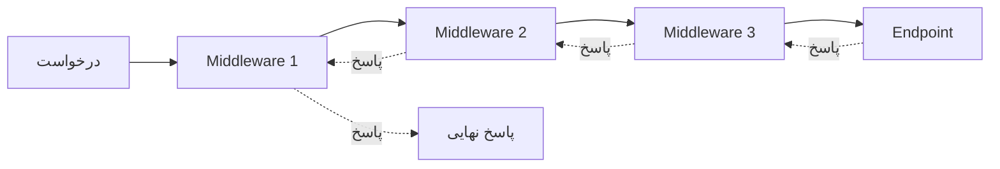
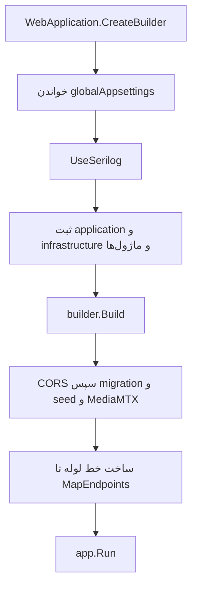
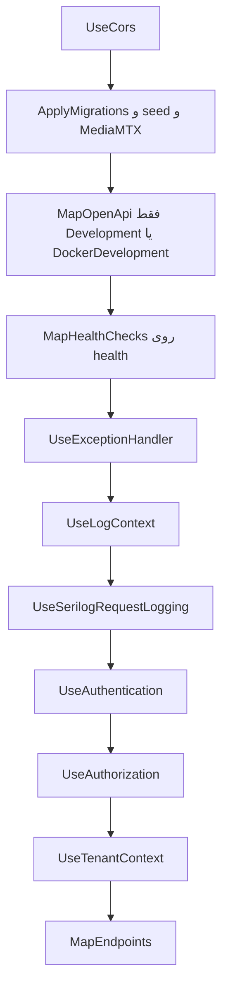
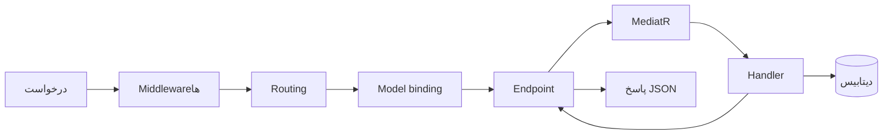

# .NET و ASP.NET Core در این مخزن

شناسهٔ کاتالوگ: `01-dotnet-aspnetcore`

این سند یک درس فناوری است. هدفش این است که بعد از خواندنش بدانید:

- .NET چیست و ASP.NET Core چه چیزی روی آن اضافه می‌کند،
- هر برنامهٔ وب چطور بالا می‌آید و یک درخواست را چطور تا کد شما می‌رساند،
- و این‌ها در پروژهٔ شما (دژبان، هویت و gateway) دقیقاً چطور پیاده شده‌اند.

کشف کلی سامانه در `00-project-discovery.md` است و اینجا تکرار نمی‌شود. این سند پیش‌نیاز ندارد و ساده‌ترین نقطهٔ شروع است. سندهای بعدی، از جمله `04-yarp.md` و `30-request-paths.md`، به «مدل میزبان» همین صفحه تکیه می‌کنند.

## چطور این سند را بخوانیم

در متن، چهار نوع جمله داریم و هر کدام معنی مشخصی دارد:

| برچسب | معنی |
| --- | --- |
| **از کد** | از فایل‌های خود مخزن خوانده شده و قطعی است. |
| **دانش عمومی** | رفتار عمومی ASP.NET Core است که در هر پروژه‌ای صدق می‌کند. |
| **استنباط** | نتیجه‌ای است که از کد گرفته شده، ولی خودِ کد آن را صریح نگفته. |
| **بررسی نشد** | با کد یا اجرا تأیید نشده و باید جداگانه چک شود. |

یک نکتهٔ مهم: وجود یک `PackageReference` در csproj به این معنی نیست که آن قابلیت «روشن» است. پکیج فقط یعنی کدش در دسترس است. روشن بودن را باید در `Program.cs` یا پیکربندی دید.

---

## خلاصهٔ یک‌دقیقه‌ای

1. **.NET** پلتفرمی است که برنامهٔ C# روی آن اجرا می‌شود. مثل موتور ماشین.
2. **ASP.NET Core** چیزی است که روی .NET گذاشته می‌شود تا برنامهٔ **وب و API** بسازید. مثل بدنهٔ ماشین روی موتور.
3. هر برنامهٔ ASP.NET Core یک **میزبان (host)** دارد. میزبان تنظیمات را می‌خواند، سرویس‌ها را نگه می‌دارد، و هر درخواست را از یک **خط لولهٔ مرحله‌به‌مرحله (pipeline)** رد می‌کند تا به کد شما برسد.
4. در این مخزن چند پردازهٔ جدا داریم: `Dejban.Api`، `IdentityServer` و `ApiGateway`. هر کدام `Program.cs` خودش را دارد و ترتیب مرحله‌هایش با بقیه فرق می‌کند.
5. چیزی که باید همیشه بخوانید خود `Program.cs` است، نه اسم پکیج‌ها.

---

## مسئله: چرا به این چارچوب نیاز داریم؟

یک درخواست HTTP می‌آید. کدی که کار اصلی را می‌کند (مثلاً «فهرست پرسنل را بده») نباید بداند:

- سوکت شبکه چیست،
- هدرها چطور خوانده می‌شوند،
- و JSON چطور ساخته و خوانده می‌شود.

اگر هر سرویس همهٔ این کارها را از صفر بنویسد، ترتیب احراز هویت، لاگ و مدیریت خطا در هر پردازه فرق می‌کند و باگ‌ها تکرار می‌شوند.

پس به یک «محیط» نیاز داریم که:

- درخواست را بگیرد،
- کارهای مشترک (احراز هویت، لاگ، خطا) را با ترتیب ثابت انجام دهد،
- و بعد درخواست را به کد اصلی بدهد.

این محیط همان ASP.NET Core است. در این مخزن چند پردازهٔ جدا از آن استفاده می‌کنند. `Dejban.Api`، `IdentityServer` و `ApiGateway` هر سه با `WebApplication.CreateBuilder` بالا می‌آیند، ولی شکل endpoint و ترتیب middlewareشان یکی نیست.

---

## .NET چیست؟

.NET یک پلتفرم برای اجرای کد C# است. کارش را می‌شود در چهار قدم گفت:

1. شما کد را به زبان C# می‌نویسید.
2. کامپایلر آن را به یک زبان میانی به اسم **IL** تبدیل می‌کند.
3. **runtime** (محیط اجرا) آن IL را اجرا می‌کند. به همین دلیل به آن «کد مدیریت‌شده» می‌گویند.
4. یک **کتابخانهٔ پایه** هم هست که کارهای روزمره را آماده دارد: فایل، شبکه، زمان، مجموعه‌ها و غیره. هر پروژه مجبور نیست آن‌ها را دوباره بسازد.

### نسخهٔ هدف در این مخزن (از کد)

پروژه‌های وب روی `net10.0` هستند. نمونه‌ها:

- `Microservices/Dejban/API/Dejban.Api/Dejban.Api.csproj` با `Sdk="Microsoft.NET.Sdk.Web"` و `TargetFramework` برابر `net10.0`
- `Microservices/IdentityServer/IdentityServer.csproj` با همان SDK و همان نسخه
- `ApiGateway/ApiGateway.csproj` با همان SDK و همان نسخه

(به نام نسخهٔ هدف، مثل `net10.0`، می‌گویند TFM.)

### معنی چند تنظیم در csproj

| تنظیم | معنی ساده |
| --- | --- |
| `Sdk="Microsoft.NET.Sdk.Web"` | پروژه فقط کتابخانهٔ پایه ندارد؛ ارجاع‌های لازم برای **میزبان وب ASP.NET Core** را هم دارد. |
| `ImplicitUsings` فعال | `using`های رایج چارچوب را لازم نیست در هر فایل دستی بنویسید. |
| `Nullable` فعال | کامپایلر به شما می‌گوید یک مقدار «می‌تواند خالی (null) باشد یا نه». بسیاری از خطاها همان موقع نوشتن گرفته می‌شوند. |

### نسخهٔ پکیج‌ها (NuGet)

نسخهٔ پکیج‌ها در فایل `Directory.Packages.props` و با `ManagePackageVersionsCentrally` یک‌جا نگه داشته می‌شود. خود csproj اغلب فقط نام پکیج را می‌آورد. فایدهٔ این کار این است که نسخه‌ها یک‌جا هستند. ولی این **ثابت نمی‌کند** که پکیج واقعاً استفاده می‌شود؛ برای آن باید کد را دید.

### Solution

فایل `PG_Microservices.slnx` این پروژه‌ها را در یک solution جمع کرده است. solution **واحد deploy نیست**؛ فقط جایی برای کنار هم گذاشتن پروژه‌هاست. هر `Program.cs` یک پردازهٔ جدا است.

---

## ASP.NET Core چه چیزی اضافه می‌کند؟

سه قطعهٔ اصلی را روی .NET می‌گذارد.

### ۱) میزبان وب و Kestrel

میزبان درخواست HTTP را می‌پذیرد. در مدل فعلی، `WebApplication.CreateBuilder` این کارها را برای شما می‌کند:

- میزبان عمومی را می‌سازد،
- پیکربندی را بار می‌کند،
- سیستم لاگ را آماده می‌کند،
- سرور **Kestrel** (وب‌سرور داخلی .NET) را می‌گذارد،
- و ظرف **DI** را می‌سازد.

**استنباط:** مخزن کلاس سرور را عوض نکرده، پس Kestrel همان پیش‌فرض `CreateBuilder` است. در `Program.cs`هایی که خوانده شد جایگزینی دیده نشد.

### ۲) Dependency Injection (تزریق وابستگی)

به‌جای اینکه یک کلاس خودش `new` بزند و وابستگی‌اش را بسازد، فقط می‌گوید «من یک `IEmailSender` لازم دارم» و میزبان آن را به او می‌دهد. فایده: عوض کردنش آسان است و تست‌نویسی هم ساده‌تر می‌شود.

طول عمر (lifetime) هر سرویس سه حالت رایج دارد:

| حالت | معنی | تشبیه |
| --- | --- | --- |
| **Singleton** | یک نمونه برای کل پردازه | یک چاپگر مشترک برای کل اداره |
| **Scoped** | یک نمونه برای هر درخواست (یا هر scope) | هر مشتری یک پوشه دارد که فقط تا پایان همان مراجعه می‌ماند |
| **Transient** | هر بار که بخواهید، یک نمونهٔ تازه | هر بار یک برگهٔ کاغذ نو |

**قانون طلایی:** یک Singleton نباید یک Scoped را نگه دارد (مثلاً `DbContext`). چون scope درخواست تمام می‌شود، ولی singleton هنوز زنده است و چیزی را در دست دارد که دیگر معتبر نیست.

### ۳) Middleware (ایستگاه‌های مسیر درخواست)

middleware تابعی است که `HttpContext` (همهٔ اطلاعات درخواست و پاسخ فعلی) را می‌بیند و یک کار انجام می‌دهد. بعد یا:

- درخواست را **تمام می‌کند** (مثلاً «۴۰۱، وارد نشده‌اید»)، یا
- `next` را صدا می‌زند تا درخواست به ایستگاه بعدی برود.

**ترتیب ثبت همان ترتیب اجراست.** پاسخ هم در برگشت از آخر به اول عبور می‌کند.



### ۴) Routing و Endpoint

Routing تعیین می‌کند «این آدرس (مثلاً `GET /api/v1/Personnels/GetPersonnels`) به کدام کد وصل است». آن کد را **endpoint** می‌گویند. endpoint آخرین قطعهٔ مسیر است: یک controller یا یک minimal API.

### ۵) چند مفهوم عمومی دیگر (دانش عمومی)

- **پیکربندی:** میزبان از چند منبع می‌خواند: `appsettings.json`، `appsettings.{Environment}.json`، در محیط Development «user secrets»، بعد متغیرهای محیطی، و در آخر آرگومان‌های خط فرمان. منبعِ دیرتر مقدار منبع زودتر را **بازنویسی** می‌کند.
- **محیط (Environment):** با متغیر `ASPNETCORE_ENVIRONMENT` تعیین می‌شود (`Development`، `Production` و در این پروژه `DockerDevelopment` هم دیده می‌شود). اگر تنظیم نشود، پیش‌فرض `Production` است.
- **لاگ:** `ILogger` از طریق DI در دسترس است. در این مخزن Serilog به میزبان وصل شده است.
- **الگوی Options:** یک بخش از تنظیمات را به یک کلاس C# وصل می‌کنید (مثل `JwtSettings` و `Scalar` در این مخزن).
- **Health check:** آدرسی که می‌گوید «پردازه سالم است یا نه».
- **سرویس‌های پس‌زمینه:** کارهایی که همراه پردازه بالا می‌آیند و پشت صحنه می‌دوند (مثل Quartz در این مخزن).

### یک نمونهٔ کوچک عمومی (فقط برای آشنایی، نه از مخزن)

```csharp
var builder = WebApplication.CreateBuilder(args);     // ۱) ساختن میزبان و پیکربندی
builder.Services.AddScoped<IMyService, MyService>();  // ۲) ثبت سرویس در DI

var app = builder.Build();                            // ۳) قفل شدن ظرف DI و ساختن برنامه

app.UseAuthentication();                              // ۴) ترتیب middleware = ترتیب اجرا
app.UseAuthorization();

app.MapGet("/hello", (IMyService s) => s.Hello());    // ۵) یک endpoint

app.Run();                                            // ۶) شروع گوش دادن
```

شکل کلی تمام `Program.cs`های این مخزن همین است؛ فقط بزرگ‌تر.

### سبک‌های endpoint در این مخزن (از کد)

این مخزن چند سبک endpoint دارد:

| سبک | کجا دیده شد | نماد |
| --- | --- | --- |
| Minimal API با کشف نوع | دژبان | `IEndpoint.MapEndpoint` و `MapGet` در `GetPersonnels` |
| Controller | هویت | `AuthController` و `MapControllers` |
| Minimal API دستی | gateway | `MapGet("/health/reporting-routes", ...)` و `MapReverseProxy` |
| MVC با view | `ClientServiceManagement` | `AddControllersWithViews` و `MapControllerRoute` |
| gRPC | سرورهای دستگاه | `MapGrpcService` |

پس جملهٔ «این سامانه فقط controller است» یا «فقط minimal API است» با کد نمی‌خواند. هر دو (و بیشتر) هست.

---

## چرخهٔ بالا آمدن `Dejban.Api`

فایل: `Microservices/Dejban/API/Dejban.Api/Program.cs`.

### شکل فایل

`Program.cs` متد `Main` دست‌نویس ندارد. به این شکل می‌گویند **top-level statements**: کامپایلر C# خودش نقطهٔ ورود را می‌سازد.

در دژبان بعد از `app.Run()` این خط هست:

```csharp
public partial class Program;
```

این خط برای تست است. `WebApplicationFactory<Program>` باید نوع `Program` را ببیند، ولی top-level statements آن را `internal` می‌سازند. این خط آن را public می‌کند. دو کارخانهٔ تست به آن وصل‌اند:

- `Microservices/Dejban/test/Dejban.IntegrationTests/Abstractions/IntegrationTestWebAppFactory.cs`
- `Microservices/Dejban/Modules/Visitors/Dejban.Modules.Visitors.IntegrationTests/Abstractions/IntegrationTestWebAppFactory.cs`

اجرای این تست‌ها در این فاز انجام نشد. وجود کارخانه فقط نشان می‌دهد که نقطهٔ ورود برای تست یکپارچه در نظر گرفته شده است.

### جریان کلی



### معنی هر مرحله

- **قبل از `Build`:** فقط «ثبت» انجام می‌شود (سرویس‌ها، پیکربندی). هنوز هیچ درخواست HTTP قبول نمی‌شود.
- **`Build`:** ظرف DI را **قفل** می‌کند (بعد از این نمی‌شود سرویس جدید ثبت کرد) و خط لوله را از middlewareهایی که بعدتر با `Use` و `Map` اضافه می‌شوند می‌سازد.
- **بین `Build` و `Run`:** دژبان با شبکه و دیتابیس کار می‌کند. این دیگر «ثبت سرویس» نیست؛ به آن **startup blocking** می‌گویند، یعنی کار سنگینی که قبل از شروع گوش دادن پردازه را منتظر نگه می‌دارد. به ترتیب:
  1. `UseCors`
  2. `ApplyMigrations` در `Dejban.Api/Extensions/MigrationExtensions.cs`
  3. `ApplySeedData` در `Dejban.Api/Extensions/SeedDataExtensions.cs`
  4. `ApplyMediaMTXAsync` در `Dejban.Api/Extensions/MediaMTXSyncExtension.cs`
- **`Run`:** پردازه را زنده نگه می‌دارد تا سرور بسته شود.

### `ApplyMigrations` دقیقاً چه می‌کند؟

(migration یعنی اعمال تغییرات ساختار جدول‌های دیتابیس.)

1. اول `Task.Delay(10000)` را await می‌کند؛ یعنی **ده ثانیه صبر** می‌کند.
2. بعد با `CreateScope` این contextها را می‌گیرد و برای هر کدام `Database.Migrate` را صدا می‌زند: `VisitorsDbContext`، `PersonnelsDbContext`، `SecurityPatrolsDbContext`، `VehiclesDbContext`، `ArmoryDbContext`، `CashLogisticsDbContext`، `InventoryDbContext` و `WeighBridgeDbContext`.

نتیجه: هر بار که دژبان بالا بیاید و به این خط برسد، دست‌کم ده ثانیه صبر می‌کند و بعد هشت migration را پشت سر هم اجرا می‌کند. اگر PostgreSQL آماده نباشد، همین‌جا شکست می‌خورد و پردازه بالا نمی‌آید. جزئیات schema در سند `09-ef-core-postgresql.md` است.

---

## پیکربندی‌ای که میزبان واقعاً می‌خواند

`CreateBuilder` به‌تنهایی `appsettings.json` کنار content root و متغیرهای محیطی را بار می‌کند. این رفتار پیش‌فرض ASP.NET Core است و به‌عنوان **دانش عمومی** آمده (سورس خود runtime در این فاز باز نشد).

### آنچه این مخزن اضافه می‌کند (از کد)

- اگر `EnvironmentName` برابر `Development` باشد، مسیر `GlobalAppsettings` **چهار پوشه بالاتر** از content root دژبان است.
- در غیر این صورت، همان پوشهٔ `GlobalAppsettings` **داخل** content root است.
- بعد دو فایل **اجباری** اضافه می‌شود:
  - `globalAppsettings.json`
  - `globalAppsettings.{EnvironmentName}.json`

هر دو `optional: false` و `reloadOnChange: true` هستند:

- `optional: false`: اگر فایل نباشد، بالا آمدن با خطا قطع می‌شود.
- `reloadOnChange: true`: اگر فایل عوض شود، مقدارها خودکار به‌روز می‌شوند.

مقدارهای داخل این فایل‌ها در سند نیامده است.

هویت برای رسیدن به همین پوشه دو پوشه بالا می‌رود (`..`، `..`) و gateway یک پوشه (`..`). این اختلاف به‌خاطر **عمق پوشهٔ پروژه** است، نه اینکه دو سیستم پیکربندی متفاوت داشته باشیم.

### بعد از ثبت ماژول‌ها

دژبان `AddModuleConfiguration` را با این نام‌ها صدا می‌زند: `visitors`، `personnels`، `security_patrols`، `vehicles`، `armory`، `cash_logistics`، `inventory` و `weigh_bridge`.

connection stringها با `GetConnectionStringOrThrow("Postgres")` و `GetConnectionStringOrThrow("Redis")` خوانده می‌شوند. نبودن کلید **قبل از `Build`** خطا پرتاب می‌کند (یعنی زود و قبل از بالا آمدن سرور).

### اجرای محلی

در `Microservices/Dejban/API/Dejban.Api/Properties/launchSettings.json`:

- `ASPNETCORE_ENVIRONMENT` برابر `Development`
- `applicationUrl` برابر `http://localhost:5042`

این آدرس همان مقصد نمونهٔ cluster دژبان در `ApiGateway/appsettings-sample.json` است. Compose داکر محیط `DockerDevelopment` دارد و این پورت launchSettings را الزاماً منتشر نمی‌کند. سند `03-docker-compose.md` باید این دو حالت را از هم جدا کند.

---

## ثبت سرویس‌ها در دژبان

### `AddApplication`

فایل: `Microservices/Dejban/Common/Dejban.Common.Application/ApplicationConfiguration.cs`. این کارها را می‌کند:

- `Dapper.DefaultTypeMap.MatchNamesWithUnderscores = true` را ست می‌کند. این یک تنظیم **ایستا** در Dapper است، نه یک سرویس DI. (یعنی نام ستون‌هایی که با `_` نوشته می‌شوند با نام propertyها جور می‌شوند.)
- MediatR را از هشت assembly اپلیکیشن ماژول‌ها ثبت می‌کند.
- سه pipeline behavior را به ترتیب اضافه می‌کند: `ExceptionHandlingPipelineBehavior`، `RequestLoggingPipelineBehavior`، `ValidationPipelineBehavior`.
- FluentValidation را با `AddValidatorsFromAssemblies(..., includeInternalTypes: true)` ثبت می‌کند.
- Mapster را روی assembly همان پروژهٔ common اسکن می‌کند و `NameMatchingStrategy.Flexible` را پیش‌فرض می‌گذارد.
- `LinkProvider` را singleton می‌کند.

کد، طول عمر handlerهای MediatR را خودش مشخص نمی‌کند. پیش‌فرض MediatR 12.5 از روی سورس پکیج چک نشد (**بررسی نشد**).

### `AddInfrastructure`

فایل: `Dejban.Common.Infrastructure/InfrastructureConfiguration.cs`. احراز هویت، tenant، Quartz، Redis، MassTransit و OpenTelemetry را ثبت می‌کند. درس هر کدام سند جدا دارد. برای میزبان همین کافی است که این متد قبل از `Build` روی `builder.Services` صدا زده می‌شود و اتصال RabbitMQ را با `UsingRabbitMq` پیکربندی می‌کند.

### `AddAuthenticationInternal`

فقط `AddCustomJwtAuth` و `AddHttpContextAccessor` است.

`AddCustomJwtAuth` در `Common/Abstractions/Extensions/ServiceCollectionExtensions.cs`:

- scheme پیش‌فرض را `JwtBearerDefaults.AuthenticationScheme` می‌گذارد،
- `RequireHttpsMetadata` را `false` می‌کند،
- امضای با کلید متقارن را اجباری می‌کند،
- `ValidIssuer`، `ValidAudience` و `ClockSkew = TimeSpan.Zero` را از بخش `JwtSettings` می‌خواند،
- اگر آن بخش نباشد، `ArgumentNullException` پرتاب می‌شود.

مقدار secret در این سند نیست.

همین متد رویداد `OnMessageReceived` را هم دارد:

- اگر هدر `Authorization` پر باشد، کاری نمی‌کند.
- وگرنه به ترتیب این‌ها را به‌عنوان توکن می‌پذیرد: **cookie**، **query با نام `access_token`**، و **query با نام ثابت `ConfigConstants.AccessToken`**.
- دلیلش (طبق کامنت همان متد): viewer گزارش Stimulsoft.

**نتیجهٔ امنیتی:** توکن ممکن است داخل query string باشد و در لاگ دسترسی دیده شود. همچنین `ValidateIssuer` و `ValidateAudience` در این قطعه صریحاً `true` نشده‌اند. پیش‌فرض کتابخانه از روی سورس پکیج چک نشد (**بررسی نشد**).

### `AddPresentation`

فایل: `Dejban.Api/Extensions/ServiceCollectionExtension.cs`. روی `HttpJsonOptions` این‌ها را می‌گذارد:

- مبدل‌های JSON سخت‌گیر برای `Guid` و تاریخ،
- `JsonStringEnumConverter` (enum به‌صورت متن)،
- `ReferenceHandler.IgnoreCycles` (چرخهٔ بین آبجکت‌ها نادیده گرفته می‌شود).

بعد `AddSignalR`، CORS سفارشی، `AddScalarDocumentation` و localization را صدا می‌زند.

### سه جای گمراه‌کننده

**۱) Scalar.** `AddScalarDocumentation` (در `Dejban.Api/Extensions/ScalarExtensions.cs`) فقط `AddOpenApi` را ثبت و گزینهٔ `Scalar` را bind می‌کند. در `Program.cs` دژبان `MapScalarApiReference` دیده نشد. رابط Scalar برای چند سرویس در **gateway** و فقط در Development و DockerDevelopment map شده است. پس مرجع OpenAPI در دژبان ثبت می‌شود، ولی صفحهٔ Scalar خود این پردازه map نشده است.

**۲) SignalR.** `AddSignalR` سرویس‌های SignalR را در DI می‌گذارد، ولی در `Dejban.Api/Program.cs` هیچ `MapHub` نیست. hubهایی که در مخزن دیده شد مال هویت، ACL، RequestTracker، GateServer و BaskoolService هستند. **ثبت سرویس بدون `MapHub` یعنی دژبان hub سرو نمی‌کند.**

**۳) Seq.** وجود `Serilog.Sinks.Seq` در csproj یعنی «Seq روشن است»؟ **نه.** `UseSerilog` از configuration می‌خواند و فعال بودن sink به همان تنظیمات بستگی دارد که در این سند باز نشد. Jaeger و Seq در Compose توسعه comment شده‌اند.

### ثبت endpointها

هر ماژول endpointهای خودش را ثبت می‌کند. `PersonnelsModule.AddPersonnelsModule` در نهایت `AddEndpoints(Presentation.AssemblyReference.Assembly)` را صدا می‌زند. `EndpointExtensions.AddEndpoints` همهٔ نوع‌های concrete که `IEndpoint` هستند را به‌صورت **Transient** روی `IEnumerable<IEndpoint>` می‌گذارد (`TryAddEnumerable`).

`PersonnelsModule` همچنین:

- `AddDbContext<PersonnelsDbContext>` را **بدون آرگومان طول عمر** صدا می‌زند،
- و repositoryها را با `AddScoped` ثبت می‌کند.

طول عمر صریح `DbContext` در آن فراخوانی نیست. پیش‌فرض `AddDbContext` در EF Core به‌طور تاریخی scoped است؛ این پیش‌فرض از سورس پکیج 10.0.0 باز نشد (**استنباط**). آنچه قطعی است: repository پرسنل برای هر scope یک بار ساخته می‌شود و همان scope باید context را هم ببیند؛ وگرنه context دورریخته‌شده به repository می‌رسد.

---

## خط لولهٔ دژبان بعد از `Build`

ترتیب در `Program.cs` این است:



### Health check

`MapHealthChecks("health", ...)` و `MapOpenApi` **قبل از** exception handler ثبت شده‌اند. نویسندهٔ پاسخ health برابر `UIResponseWriter.WriteHealthCheckUIResponse` است. مسیر در کد نسبی است (`health`، نه لزوماً `/health` با اسلش)؛ مسیریاب ASP.NET Core آن را نسبت به ریشه می‌بندد. این سند ادعا نمی‌کند که gateway همین مسیر را بدون پیشوند پروکسی می‌کند.

### Exception handler

`UseExceptionHandler` به `IExceptionHandler` ثبت‌شده وصل است. `GlobalExceptionHandler.TryHandleAsync` سه حالت را می‌شناسد:

| خطا | نتیجه |
| --- | --- |
| `InvalidParameterException` (یا inner آن) | وضعیت **400**، عنوان فارسی «پارامتر نامعتبر» و extensionهای `parameterName` و `parameterType` |
| `BadHttpRequestException` | همان status code خودِ استثنا، با عنوان `Bad request` |
| هر چیز دیگر | **500** با عنوان `Server failure`. متن استثنا فقط در محیط `Development` یا `DockerDevelopment` در `Detail` می‌آید |

### لاگ

- `UseLogContext` میان‌افزار `LogContextTraceLoggingMiddleware` را اضافه می‌کند. بدنهٔ آن در این سند باز نشد.
- `UseSerilogRequestLogging` لاگ هر درخواست را می‌نویسد.

### Tenant و authorization (نکتهٔ مهم)

`UseTenantContext` **بعد از** `UseAuthorization` است. میان‌افزار authorization قبل از صدا زدن `next` تصمیم اجازه را می‌گیرد. پس handlerهای authorization **قبل از** `TenantContextMiddleware.InvokeAsync` اجرا می‌شوند.

- در پوشهٔ `Common/Authorization` ارجاعی به `TenantContextAccessor` پیدا نشد. آن handlerها هدر و claim را مستقیم از `HttpContext` می‌خوانند.
- فیلتر کوئری و handler دامنه که داخل endpoint اجرا می‌شوند، بعد از ست شدن context هستند؛ چون endpoint بعد از `next` همان میان‌افزار می‌آید.

**دام عملی:** اگر کسی در یک authorization handler به context تنانتی تکیه کند که این میان‌افزار می‌سازد، آن context هنوز ست نشده است. کد فعلی چنین تکیه‌ای را نشان نمی‌دهد.

---

## هویت (IdentityServer): ترتیب متفاوت

فایل: `Microservices/IdentityServer/Program.cs`. ترتیب:

1. `UseForwardedHeaders` اول خط لوله است. کامنت کد می‌گوید IP واقعی باید از gateway بیاید.
2. `UseCors`
3. `DbInitializer` قبل از شنیدن درخواست
4. `MapOpenApi` در Development یا DockerDevelopment
5. لاگ Serilog، exception handler، status code pages
6. localization
7. `UseTokenRevoke`
8. `UseAuthentication`، بعد `UseTenantContext`، بعد `UseAuthorization`
9. `MapHub<TimeHub>("/timeserverhub")` و `MapHub<UserActivityHub>("/useractivityhub")`
10. `MapControllers`

**در هویت، tenant بین authentication و authorization است. در دژبان، tenant بعد از authorization است.** این اختلاف در کد هست و نباید در ذهن یکی شود.

### جزئیات دیگر هویت

- `AddPresentation` هویت `AddControllers` را با `SuppressImplicitRequiredAttributeForNonNullableReferenceTypes = true` صدا می‌زند. یعنی reference type غیرنال‌پذیر به‌تنهایی فیلد را «اجباری ضمنی» نمی‌کند.
- JSON هم `ReferenceHandler.IgnoreCycles` دارد.
- `AuthController` از `ApiController` ارث می‌برد. کلاس پایه `[ApiController]` و `[Authorize]` دارد.
- `Problem(List<Error>)` خطای ErrorOr را به 400، 401، 403، 404، 409 یا 500 نگاشت می‌کند و خطای validation را به `ValidationProblem` می‌برد.

---

## یک درخواست تا رسیدن به handler

### نمونهٔ Minimal API: `GetPersonnels`

فایل: `Microservices/Dejban/Modules/Personnels/Dejban.Modules.Personnels.Presentation/Personnels/GetPersonnels.cs`.

**هنگام بالا آمدن:** `MapEndpoints` همهٔ `IEndpoint`های transient را از ظرف می‌گیرد و برای هر کدام `MapEndpoint` را صدا می‌زند. `GetPersonnels.MapEndpoint` یک version set با نسخهٔ `1.0` می‌سازد و این route را map می‌کند:

`/api/v{version:apiVersion}/Personnels/GetPersonnels`

متد HTTP برابر GET است، `RequireAuthorization` دارد و نام endpoint برابر `GetPersonnels` است.

**هنگام هر درخواست:**

1. model binder پارامترهای `GetPersonnelsQuery` را از درخواست می‌سازد (`[AsParameters]`).
2. `ISender` را از DI همان درخواست می‌گیرد. `ISender` انتزاع MediatR است.
3. `sender.Send(request)` کوئری را وارد pipeline می‌کند: اول behaviorها، بعد `GetPersonnelsQueryHandler`.
4. `result.Match(Results.Ok, ApiResults.Problem)` یا ۲۰۰ با بدنه می‌دهد یا ProblemDetails.

اگر binder نتواند `Guid` یا تاریخ را با مبدل سخت‌گیر بخواند، استثنا ممکن است به `GlobalExceptionHandler` برسد و ۴۰۰ برگردد. validation دامنه داخل `ValidationPipelineBehavior` است و درسش در `08-cqrs-mediatr.md` است. این سند فقط نشان می‌دهد ASP.NET Core تا درِ MediatR می‌آید و نتیجه را به HTTP برمی‌گرداند.

### نمونهٔ Controller: `AuthController.Login`

مسیر کلاس `/api/v{version:apiVersion}/[controller]` و نسخهٔ `1.0` است. `Login` متد POST و `AllowAnonymous` است؛ پس `[Authorize]` کلاس پایه برای همین action کنار می‌رود. بدنه `LoginCommand` را به `ISender` می‌دهد و `result.Match(Ok, Problem)` را برمی‌گرداند.

### مسیر کلی



---

## ApiGateway به‌عنوان یک میزبان ASP.NET Core

`ApiGateway/Program.cs` هم یک `WebApplication` است. YARP درس سند `04-yarp.md` است. از دید میزبان، این پردازه middleware و endpoint خودش را دارد و فقط یک پروکسی خام نیست:

- Redis، blacklist توکن، JWT، CORS، rate limiter و output cache ثبت می‌شوند.
- `AddReverseProxy` چند بار `LoadFromConfig` می‌شود. کلید بخش‌ها در `ApiGateway/Abstractions/Constants/ConfigConstants.cs` است، مثل `ReverseProxy:Dejban`.
- بعد از `Build`، `UseForwardedHeaders` اولین middleware است.
- یک `Use` سفارشی: اگر مسیر با `CameraAuthApi` شروع شود (یعنی `/api/v1/auth/cameraauth`)، مستقیم `next` را صدا می‌زند. در غیر این صورت، داخل همان delegate `app.UseHttpsRedirection()` را صدا می‌زند و بعد `next`.

### نقطهٔ حساس gateway

فراخوانی `UseHttpsRedirection` **بعد از `Build` و داخل اجرای یک درخواست** است. خط لوله فقط یک‌بار ساخته می‌شود. اضافه کردن middleware وسط یک درخواست، روش پشتیبانی‌شدهٔ ASP.NET Core برای تغییر pipeline همان درخواست نیست.

کامنت اطراف کد قصد دارد camera auth را از redirect معاف کند. ولی اینکه redirect واقعاً برای بقیهٔ مسیرها اجرا می‌شود، از روی این قطعه ثابت نیست و با درخواست آزمایشی چک نشد (**بررسی نشد**). این یک سناریوی شکست واقعی است: **قصد نویسنده و اثر اجرا یکی فرض شده‌اند.**

### بقیهٔ ترتیب gateway

CORS، StaticFiles برای `/files` (فقط وقتی `PublicFiles:Provider` برابر `Local` یا خالی باشد)، rate limiter، `AccessTokenQueryMiddleware`، `UseTokenRevoke`، authentication، authorization، output cache، `ClientIpForwardingMiddleware`، `ProxyErrorHandlingMiddleware`، `RequestMetricsMiddleware`، دو `MapGet` و در پایان `MapReverseProxy`.

`MapGet` متریک‌ها `RequireAuthorization` دارد. health مربوط به routeهای reporting `AllowAnonymous` است.

---

## مقایسهٔ سریع سه پردازه

| موضوع | Dejban.Api | IdentityServer | ApiGateway |
| --- | --- | --- | --- |
| سبک endpoint | Minimal API با `IEndpoint` | Controller | Minimal API دستی و `MapReverseProxy` |
| جای tenant | **بعد از** authorization | **بین** authentication و authorization | در فهرست middlewareهای gateway نیست |
| کار سنگین در startup | ده ثانیه صبر، هشت migration، seed و MediaMTX | `DbInitializer` | ندارد (ولی Redis، JWT و پیکربندی باید درست باشد) |
| Hub (SignalR) | هیچ `MapHub` | `TimeHub` و `UserActivityHub` | ندارد |
| پوشهٔ `GlobalAppsettings` | چهار پوشه بالاتر (در Development) | دو پوشه بالاتر | یک پوشه بالاتر |
| `UseForwardedHeaders` | در لیست نیست | اول خط لوله | اول خط لوله |

---

## مزیت، هزینه و اشتباه‌های رایج

### مزیت

- هشت ماژول دژبان یک خط لولهٔ احراز هویت و یک DI مشترک دارند، در حالی که هویت و gateway می‌توانند ترتیب مخصوص خودشان را داشته باشند.
- endpoint جدید پرسنل با یک کلاس `IEndpoint` وارد جدول route می‌شود و `Program.cs` برای هر route عوض نمی‌شود.

### هزینه

- **پراکندگی:** سه `Program.cs` اصلی، سه ترتیب middleware.
- tenant یک‌جا قبل از authorization است و یک‌جا بعد از آن.
- startup دژبان به دیتابیس و ده ثانیه تأخیر وابسته است.
- gateway هم DI و JWT دارد؛ پس خرابی Redis یا تنظیم نادرست JWT می‌تواند خود درگاه را بالا نیاورد، حتی اگر سرویس مقصد سالم باشد.

### اشتباه‌های رایج

- فرض اینکه `Serilog.Sinks.Seq` در csproj یعنی Seq روشن است.
- فرض اینکه `AddSignalR` در دژبان hub می‌سازد. `MapHub` در آن `Program.cs` نیست.
- فرض اینکه `AddScalarDocumentation` صفحهٔ Scalar را روی خود دژبان map می‌کند. فقط OpenAPI ثبت می‌شود و `MapOpenApi` هم فقط در Development و DockerDevelopment است.
- صدا زدن `Use...` بعد از ساخته شدن pipeline (مثل قطعهٔ HTTPS در gateway).
- گرفتن `DbContext` یا repository به‌صورت singleton. repositoryهای پرسنل scoped هستند. اگر یک singleton آن‌ها را در constructor بگیرد، scope درخواست تمام شده و context دفعهٔ بعد خراب است.
- تکیه بر ترتیب دژبان برای هویت. در هویت، tenant هنوز قبل از authorization است.

### سناریوهای شکست

- نبود `globalAppsettings.{Environment}.json`، چون `optional: false` است.
- نبود `ConnectionStrings:Postgres` یا `JwtSettings` قبل از شنیدن ترافیک.
- PostgreSQL در ده ثانیهٔ اول `ApplyMigrations` بالا نیست و `Migrate` خطا می‌دهد. health check بعد از این مرحله map می‌شود؛ پس تا migration تمام نشود، endpoint سلامت هم در دسترس نیست.
- محیط Production متن استثنا را در پاسخ ۵۰۰ برنمی‌گرداند. اگر کسی فقط بدنهٔ HTTP را ببیند، علت را باید در لاگ Serilog جست‌وجو کند، نه در JSON.
- توکن داخل query string در access log پروکسی می‌ماند، چون `OnMessageReceived` آن را عمداً می‌پذیرد.
- `RequireHttpsMetadata = false` اجازه می‌دهد metadata توکن بدون HTTPS هم پذیرفته شود. در لبهٔ اینترنت این انتخاب خطرناک است؛ کد همین مقدار را گذاشته است.

---

## حقایق، استنباط‌ها و پرسش‌های باز

### حقایق (از فایل‌های مخزن)

نسخهٔ `net10.0` و SDK وب، شکل `Program.cs`، ترتیب middleware در سه پردازه، ثبت `IEndpoint` به‌صورت transient، route دقیق `GetPersonnels`، و تأخیر ده‌ثانیه‌ای migration.

### استنباط‌ها

- سرور پیش‌فرض `CreateBuilder` همان Kestrel است، چون در این فایل‌ها سرور دیگری ثبت نشده.
- `AddDbContext` بدون طول عمر از پیش‌فرض EF استفاده می‌کند و آن پیش‌فرض scoped است. آرگومان طول عمر در کد نیست.
- آدرس `http://localhost:5042` در launchSettings همان مقصد development نمونهٔ YARP است، چون هر دو رشته یکی است. اینکه این پروفایل واقعاً همراه gateway اجرا شود، در این فاز مشاهده نشد.

### پرسش‌های باز (بررسی نشد)

- طول عمر handler در MediatR 12.5 از روی سورس پکیج چک نشد.
- پیش‌فرض `ValidateIssuer` وقتی فقط `ValidIssuer` ست شده باشد، از روی پکیج چک نشد.
- بدنهٔ `LogContextTraceLoggingMiddleware` و `AddCustomCors` دژبان خط‌به‌خط در این سند نیامده است.
- آیا `UseHttpsRedirection` داخل delegate درگاه در runtime خطا می‌دهد یا بی‌اثر است؟ اجرا نشد.
- تطبیق این رفتارها با مستند رسمی .NET 10 انجام نشد.

---

## رابطه با بقیهٔ فناوری‌های مخزن

| فناوری | رابطه با میزبان | سند |
| --- | --- | --- |
| YARP | یک middleware و endpoint روی همین `WebApplication` در gateway | `04-yarp.md` |
| مسیر login و پرسنل | از همین routing و DI رد می‌شود | `30-request-paths.md` |
| MediatR و FluentValidation | داخل endpoint، بعد از binder | `08-cqrs-mediatr.md` |
| EF Core | `DbContext` در scope و `Migrate` در startup | `09-ef-core-postgresql.md` |
| JWT و Identity | scheme در DI ثبت می‌شود و در `UseAuthentication` اجرا می‌شود | `05-jwt-identity.md` |
| Tenant | middleware قبل یا بعد از authorization، بسته به پردازه | `06-tenancy-authorization.md` |
| Docker Compose | محیط `DockerDevelopment` و پورت‌ها | `03-docker-compose.md` |
| SignalR، gRPC، Hangfire، Quartz | هر کدام روی همان host سوار می‌شوند، ولی `Map` یا hosted service خودشان را دارند | — |

---

## واژه‌نامهٔ ساده

| واژه | معنی ساده |
| --- | --- |
| **Host (میزبان)** | چیزی که برنامه را بالا می‌آورد و زنده نگه می‌دارد. |
| **Kestrel** | وب‌سرور داخلی .NET که درخواست HTTP را می‌گیرد. |
| **DI (تزریق وابستگی)** | به‌جای `new` زدن، می‌گویید چه چیزی لازم دارید و میزبان آن را می‌دهد. |
| **Service (سرویس)** | کلاسی که کاری انجام می‌دهد و در DI ثبت شده است. |
| **Singleton / Scoped / Transient** | سه نوع طول عمر: کل پردازه / هر درخواست / هر بار. |
| **Middleware** | یک ایستگاه در مسیر درخواست که می‌تواند کاری کند یا درخواست را ببندد. |
| **Pipeline (خط لوله)** | زنجیرهٔ middlewareها به ترتیب. |
| **Endpoint** | آخرین قطعهٔ مسیر؛ کدی که پاسخ را می‌سازد. |
| **Routing (مسیریابی)** | پیدا کردن endpoint مناسب برای یک آدرس. |
| **Minimal API** | endpoint کوتاه با `MapGet` و مانند آن، بدون کلاس controller. |
| **Controller** | کلاسی با متدهایی که با attribute به آدرس‌ها وصل می‌شوند. |
| **HttpContext** | همهٔ اطلاعات درخواست و پاسخ جاری. |
| **TFM** | نام نسخهٔ هدف .NET، مثل `net10.0`. |
| **IL** | زبان میانی که کامپایلر C# تولید می‌کند. |
| **Migration** | اعمال تغییر ساختار جدول‌های دیتابیس از طریق کد. |
| **Seed** | پر کردن اولیهٔ دیتابیس با داده‌های پیش‌فرض. |
| **Startup blocking** | کار سنگین قبل از `Run` که پردازه را منتظر نگه می‌دارد. |
| **Tenant** | «سایت» یا «مشتریِ» جدا در سامانه (در این پروژه با هدر `X-Site-Id` مشخص می‌شود). |
| **ProblemDetails** | شکل استاندارد JSON برای پاسخ خطا. |
| **Health check** | آدرسی که می‌گوید پردازه سالم است یا نه. |
| **Top-level statements** | `Program.cs` بدون `Main` و بدون کلاس. |
| **Options pattern** | وصل کردن یک بخش از تنظیمات به یک کلاس. |

---

## راهنمای خواندن یک `Program.cs`

هر بار یک `Program.cs` باز کردید، این هشت سؤال را از خودتان بپرسید:

1. **`CreateBuilder`:** این پردازه چه نوعی است؟ (API، gateway، ...)
2. **پیکربندی:** چه فایل‌هایی اضافه می‌شوند؟ اختیاری‌اند یا اجباری؟
3. **`builder.Services...`:** چه سرویس‌هایی ثبت می‌شوند؟
4. **`Build`:** قبل از آن فقط ثبت، بعد از آن خط لوله.
5. **بین `Build` و `Run` چیزی هست؟** (migration، seed، کار سنگین)
6. **ترتیب `Use...`:** authentication قبل از authorization است؟ tenant کجاست؟
7. **`Map...`:** چه endpointهایی؟ (`MapEndpoints`، `MapControllers`، `MapHub`، `MapReverseProxy`)
8. **`Run`:** بعد از آن نباید چیزی اضافه شود.

اگر فقط پنج نماد یادتان ماند، این‌ها باشند: `WebApplication.CreateBuilder`، `AddEndpoints`، `MapEndpoints`، `UseAuthentication` قبل از endpoint، و `ApplyMigrations` قبل از `Run`.

---

## سؤال‌های مصاحبه

(پاسخ‌ها عمداً ساده نوشته شده‌اند.)

### ۱. تفاوت .NET و ASP.NET Core چیست و در این مخزن کجا دیده می‌شود؟

.NET پلتفرم اجرا و کتابخانهٔ پایه است. ASP.NET Core چارچوب وب روی همان پلتفرم است: میزبان HTTP، DI، middleware و routing. در این مخزن، پروژه‌های وب `Microsoft.NET.Sdk.Web` و `net10.0` دارند و نقطهٔ ورودشان `WebApplication.CreateBuilder` است. یک class library دامنه می‌تواند فقط SDK معمولی داشته باشد و اصلاً HTTP را نشناسد. دژبان HTTP را در لایهٔ Presentation و `Program.cs` نگه داشته است.

**سؤال دنباله:** اگر `TargetFramework` برابر `net10.0` باشد ولی SDK برابر `Microsoft.NET.Sdk` باشد، آیا `MapGet` در دسترس است؟
**جواب:** خیر، مگر اینکه ارجاع جدا به پکیج‌های ASP.NET Core اضافه شود. `Sdk.Web` همان ارجاع‌ها را می‌آورد. دیدن `net10.0` به‌تنهایی پروژه را وب نمی‌کند.

### ۲. از اجرای پردازه تا قبول اولین درخواست در `Dejban.Api` چه مراحلی رخ می‌دهد؟

کامپایلر top-level statements را به‌عنوان نقطهٔ ورود اجرا می‌کند. `CreateBuilder` میزبان و پیکربندی اولیه را می‌سازد. کد فایل‌های `globalAppsettings` را اجباری اضافه می‌کند، Serilog را وصل می‌کند و سرویس‌ها را ثبت می‌کند. `Build` ظرف را می‌سازد. بعد CORS، migration (با ده ثانیه تأخیر)، seed و همگام‌سازی MediaMTX اجرا می‌شود. سپس endpoint سلامت (و در توسعه OpenAPI) map می‌شود، middlewareها به ترتیب (exception، log، authentication، authorization، tenant) اضافه می‌شوند، `MapEndpoints` routeها را می‌سازد و `Run` گوش دادن را شروع می‌کند.

**سؤال دنباله:** چرا health check تا تمام شدن migration در دسترس نیست؟
**جواب:** چون `MapHealthChecks` بعد از `await app.ApplyMigrations()` نوشته شده است. تا آن await برنگردد، route سلامت ثبت نمی‌شود و `Run` هم هنوز صدا زده نشده است.

### ۳. چرا `public partial class Program` ته فایل دژبان هست؟

برای تست یکپارچه. `WebApplicationFactory<Program>` باید نوع نقطهٔ ورود را ببیند، ولی top-level statements نوع `Program` را internal می‌سازند. کلاس partial عمومی همان نوع را برای پروژهٔ تست قابل استفاده می‌کند. این خط رفتار درخواست‌های production را عوض نمی‌کند.

**سؤال دنباله:** اگر این خط پاک شود چه چیزی می‌شکند؟
**جواب:** کامپایل پروژهٔ تستی که `WebApplicationFactory<Program>` دارد، چون نوع عمومی در دسترس نیست. خود `dotnet run` الزاماً نمی‌شکند. (اجرای تست‌ها در این فاز انجام نشد.)

### ۴. Transient و Scoped در ثبت endpoint و repository پرسنل چه فرقی دارند؟

`AddEndpoints` هر `IEndpoint` را transient ثبت می‌کند، ولی `MapEndpoints` این نمونه‌ها را فقط **هنگام بالا آمدن** می‌گیرد تا route ساخته شود، نه برای هر درخواست HTTP. repositoryهایی مثل `IPersonnelRepository` با `AddScoped` ثبت شده‌اند تا در یک scope همان نمونه بماند و با `DbContext` همان scope کار کند. اگر repository را singleton کنید و context scoped را داخلش نگه دارید، بعد از تمام شدن درخواست اول، context بسته شده است.

**سؤال دنباله:** آیا `GetPersonnels` برای هر درخواست GET دوباره ساخته می‌شود؟
**جواب:** نه لزوماً. کلاس endpoint فقط موقع `MapEndpoints` برای ثبت route لازم است. delegate داخل `MapGet` برای هر درخواست اجرا می‌شود و `ISender` را همان لحظه از DI می‌گیرد. transient بودن `IEndpoint` ربطی به طول عمر handler مدیاتور ندارد.

### ۵. Minimal API دژبان و controller هویت چه تفاوت اجرایی دارند؟

در دژبان، یک کلاس `IEndpoint` با `MapGet` route را می‌سازد و `ISender` پارامتر delegate است. در هویت، `AddControllers` و `MapControllers` جدول route را از روی attributeها می‌سازند و `ISender` در constructor نگه داشته می‌شود. هر دو در نهایت یک دستور یا کوئری را به MediatR می‌دهند و `ErrorOr` را به نتیجهٔ HTTP تبدیل می‌کنند. شکل تبدیل خطا یکی نیست: دژبان `ApiResults.Problem` دارد و هویت متد `Problem` روی `ApiController`.

**سؤال دنباله:** چرا `Login` بدون توکن کار می‌کند، با اینکه کلاس پایه `[Authorize]` دارد؟
**جواب:** چون خود action با `[AllowAnonymous]` علامت خورده و اجازهٔ ناشناس را فقط برای همان action برمی‌گرداند. بقیهٔ actionها همچنان authorize می‌مانند.

### ۶. چرا ترتیب `UseAuthentication`، `UseAuthorization` و `UseTenantContext` بین دژبان و هویت خطرناک است؟

authentication هویت کاربر را از توکن روی `HttpContext.User` می‌گذارد. authorization تصمیم اجازه را می‌گیرد. TenantContext از claim و هدر `X-Site-Id` مجموعهٔ سایت مؤثر را در accessor می‌گذارد. در هویت: authentication، tenant، authorization. در دژبان: authentication، authorization، tenant. handlerهای `Common/Authorization` به `TenantContextAccessor` ارجاع ندارند و هدر را از `HttpContext` می‌خوانند؛ پس این اختلاف فعلاً آن‌ها را نشکسته است.

**سؤال دنباله:** اگر یک `IAuthorizationHandler` جدید مستقیم `TenantContextAccessor` را بخواهد، در دژبان چه می‌شود؟
**جواب:** authorization قبل از tenant تصمیم می‌گیرد، پس accessor هنوز پر نشده است. یا handler باید مثل بقیه هدر را از `HttpContext` بخواند، یا tenant در دژبان باید مثل هویت قبل از `UseAuthorization` بیاید. جابه‌جایی بدون تست handlerهای فعلی توصیه نمی‌شود.

### ۷. `GlobalExceptionHandler` چه چیزی را به کلاینت می‌دهد و چه چیزی را پنهان می‌کند؟

پارامتر نامعتبر و `BadHttpRequestException` را به ProblemDetails با کد ۴۰۰ تبدیل می‌کند. بقیه ۵۰۰ با عنوان `Server failure` است. `Detail` فقط در Development و DockerDevelopment پر می‌شود. `CustomizeProblemDetails` در `Program.cs` مقدار `instance` و `requestId` را هم اضافه می‌کند.

**سؤال دنباله:** خطای validation مدیاتور هم از همین handler رد می‌شود؟
**جواب:** نه لزوماً. اگر `ValidationPipelineBehavior` خطا را به‌صورت `ErrorOr` برگرداند و endpoint `Match` کند، پاسخ را خود endpoint می‌سازد. handler برای استثنایی است که تا exception middleware برسد. این مرز را سند MediatR باید با خود behavior ثابت کند.

### ۸. چرا startup دژبان به دیتابیس وابسته است و این چه خرابی‌ای می‌سازد؟

`ApplyMigrations` قبل از `Run` هشت `Database.Migrate` را صدا می‌زند و قبلش ده ثانیه صبر می‌کند. هدف: schema قبل از ترافیک آماده باشد. هزینه: پردازه تا تمام شدن migration مفید نیست، چند instance همزمان ممکن است با هم migrate کنند، و قطع شدن شبکهٔ دیتابیس کل API را down نشان می‌دهد. health check هم بعد از همین await است.

**سؤال دنباله:** تأخیر ده‌ثانیه‌ای کدام مشکل را حل می‌کند و کدام را نه؟
**جواب:** فقط زمان می‌خرد، مثلاً اگر دیتابیس کمی دیرتر از API بالا بیاید. آمادگی را چک نمی‌کند و retry ندارد؛ اگر بعد از ده ثانیه هم دیتابیس خراب باشد، همان `Migrate` خطا می‌دهد. health check خود PostgreSQL (`AddNpgSql`) برای این انتظار استفاده نشده است.

### ۹. `AddSignalR` و `Serilog.Sinks.Seq` در csproj دژبان چه چیزی را ثابت می‌کنند؟

`AddSignalR` ثابت می‌کند سرویس SignalR در DI هست. بدون `MapHub` در `Program.cs` دژبان، هیچ hubی از این پردازه سرو نمی‌شود. `PackageReference` مربوط به `Serilog.Sinks.Seq` فقط ثابت می‌کند اسمبلی sink قابل استفاده است. `UseSerilog` از configuration می‌خواند و تا وقتی بخش sink در configuration دیده نشود، Seq فعال حساب نمی‌شود. در Compose توسعه، سرویس Seq comment شده است.

**سؤال دنباله:** پس لاگ درخواست دژبان کجا می‌رود؟
**جواب:** `UseSerilogRequestLogging` لاگ درخواست را به pipeline Serilog می‌دهد و آن pipeline `ReadFrom.Configuration` دارد. مقصد واقعی به configuration همان محیط بستگی دارد و این سند مقصد production را حدس نمی‌زند. فیلتر کد، فرمان SQL با نام `OutboxState`، `InboxState` یا `OutboxMessage` را از لاگ حذف می‌کند.

### ۱۰. یک باگ کلاسیک این `Program.cs`ها در مصاحبه چیست؟

قوی‌ترین نمونه در gateway است: داخل middleware درخواست، `app.UseHttpsRedirection()` صدا زده می‌شود تا مسیر camera auth از redirect جدا شود. pipeline بعد از شروع درخواست با `Use` عوض نمی‌شود. مصاحبه‌شونده باید بگوید قصد کد چیست، چرا این محل برای ثبت middleware دیر است، و چطور باید این شاخه را با یک middleware عادی نوشت که یا redirect کند یا `next` را صدا بزند، نه اینکه `Use` را دوباره صدا بزند.

**سؤال دنباله:** در دژبان چه باگ ترتیبی را مثال می‌زنید، اگر فقط یک مورد اجازه داشته باشید؟
**جواب:** `UseTenantContext` بعد از `UseAuthorization`. امروز handlerهای authorization به accessor تنانت وصل نیستند، پس رفتار فعلی‌شان با این ترتیب سازگار است. خطر وقتی است که نفر بعدی فرض کند «چون tenant در `Program.cs` هست، هنگام authorize هم پر است». تفاوت با هویت، که tenant را قبل از authorization گذاشته، نشان می‌دهد این فرض در کل solution درست نیست.

### سؤال‌های عمومی برای آمادگی بیشتر

### ۱۱. Middleware چیست و چرا ترتیبش مهم است؟

middleware یک ایستگاه در مسیر درخواست است. هر کدام می‌تواند درخواست را تمام کند یا به ایستگاه بعدی بدهد. ترتیب ثبت همان ترتیب اجراست. مثلاً اگر `UseAuthorization` قبل از `UseAuthentication` بیاید، authorization هنوز نمی‌داند کاربر کیست. پاسخ هم در برگشت از آخر به اول رد می‌شود.

### ۱۲. تفاوت `AddSingleton`، `AddScoped` و `AddTransient` چیست؟

Singleton یک نمونه برای کل پردازه است، Scoped یک نمونه برای هر درخواست، و Transient هر بار یک نمونهٔ تازه. یک singleton نباید یک scoped (مثل `DbContext`) را نگه دارد، چون scope تمام می‌شود ولی singleton زنده می‌ماند.

### ۱۳. `Build()` چه چیزی را عوض می‌کند؟

قبل از `Build` فقط ثبت سرویس‌هاست. `Build` ظرف DI را قفل می‌کند؛ بعد از آن نمی‌شود سرویس جدید اضافه کرد.

### ۱۴. تنظیمات در ASP.NET Core از چه منابعی و با چه ترتیبی خوانده می‌شوند؟

`appsettings.json`، بعد `appsettings.{Environment}.json`، بعد (در Development) user secrets، بعد متغیرهای محیطی، بعد خط فرمان. منبع دیرتر، مقدار منبع زودتر را بازنویسی می‌کند. در این مخزن فایل‌های `globalAppsettings` هم اضافه می‌شوند.

### ۱۵. Kestrel چیست و آیا باید جلویش پروکسی گذاشت؟

Kestrel وب‌سرور داخلی ASP.NET Core است. می‌تواند مستقیم به اینترنت وصل باشد، ولی اغلب پشتش یک reverse proxy (مثل gateway این پروژه) می‌گذارند. در این حالت باید `UseForwardedHeaders` فعال باشد تا IP و پروتکل واقعی از پروکسی خوانده شود. هویت و gateway در این مخزن همین کار را می‌کنند.

---

## مرور نهایی

.NET 10 بستر اجرای این سرویس‌هاست و ASP.NET Core میزبان HTTP آن‌هاست. هر پردازه یک `WebApplication` دارد. دژبان endpoint را با `IEndpoint` و MediatR سرو می‌کند، هویت با controller، و gateway با middleware خودش به YARP می‌رسد. DI، ترتیب middleware و startup blocking را باید از روی همان `Program.cs` خواند، نه از روی اسم پکیج.

**اگر فقط یک جمله بخواهید یادتان بماند:** «درخواست به ترتیب از middlewareها رد می‌شود، به endpoint می‌رسد، endpoint با MediatR کار را انجام می‌دهد و پاسخ از همان مسیر برمی‌گردد؛ و همهٔ این قطعه‌ها با DI به هم وصل شده‌اند.»
