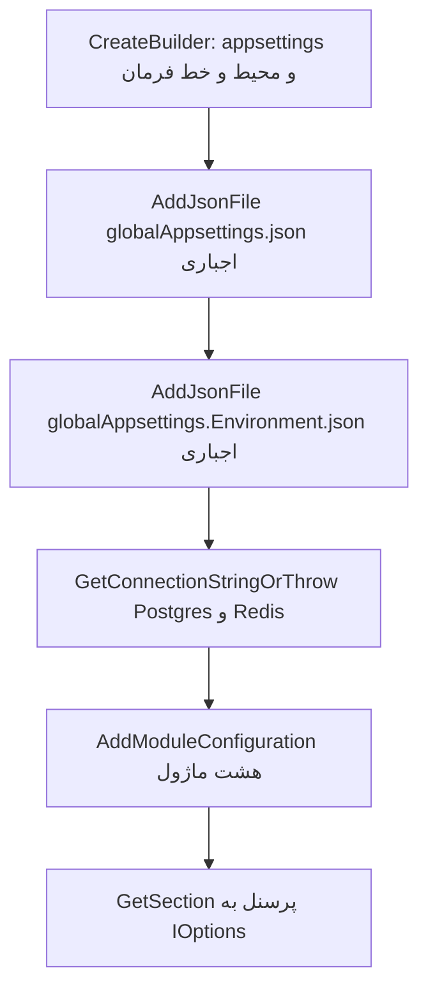

# پیکربندی (Configuration) در این مخزن

شناسهٔ کاتالوگ: `02-configuration`

**پیش‌نیاز:** `01-dotnet-aspnetcore.md`.

این سند یک سؤال را جواب می‌دهد: **هر مقدار تنظیمات از کجا می‌آید، و اگر چند منبع یک مقدار را داشته باشند، کدام برنده می‌شود؟**

- خودِ middleware و endpoint در درس ۰۱ است.
- Compose به‌عنوان فایل اجرا در `03-docker-compose.md` می‌آید. اینجا فقط کلیدهایی از Compose می‌آید که روی `IConfiguration` اثر دارند.
- مقدار secret، رمز و connection string کامل در این سند **نیست**. فقط نام کلید و شکل فایل‌ها آمده است.

## چطور این سند را بخوانیم

| برچسب | معنی |
| --- | --- |
| **از کد** | از فایل‌های خود مخزن خوانده شده و قطعی است. |
| **از مستند Learn** | از مستند رسمی Microsoft Learn (صفحهٔ Configuration in ASP.NET Core، نسخهٔ `aspnetcore-10.0`) آمده، نه از اجرای پردازهٔ این مخزن. |
| **استنباط** | نتیجه‌ای است که از کد گرفته شده، ولی خود کد آن را صریح نگفته. |
| **بررسی نشد** | با اجرا یا کد تأیید نشده. |

نکتهٔ مهم: در این فاز هیچ پردازه‌ای اجرا نشد تا «مقدار نهایی» یک کلید چاپ شود. همهٔ نتیجه‌گیری‌های «کدام برنده می‌شود» از **ترتیب providerها** در کد و مستند آمده‌اند.

---

## خلاصهٔ یک‌دقیقه‌ای

1. پیکربندی یعنی **جدا کردن داده‌های محیط از کد**. یک برنامه روی لپ‌تاپ و داخل کانتینر با همان باینری کار می‌کند؛ فقط مقدارها عوض می‌شوند.
2. برنامه یک **درخت کلید** می‌سازد. کد فقط کلید را می‌خواند (مثلاً `GetConnectionString("Postgres")`)، و محیط تصمیم می‌گیرد مقدارش چیست.
3. درخت از چند **منبع (provider)** ساخته می‌شود: فایل JSON، متغیر محیطی، خط فرمان و غیره. **منبعِ دیرتر برنده است** (ولی فقط روی کلیدهایی که خودش دارد).
4. این مخزن بعد از `CreateBuilder` دو فایل JSON اجباری (`globalAppsettings*.json`) را **به ته لیست** اضافه می‌کند. پس برای کلیدهایی که داخل آن فایل‌ها هست (مثل `JwtSettings`)، آن فایل‌ها حتی بر متغیر محیطی برنده می‌شوند.
5. برای کلیدهایی که در آن فایل‌ها **نیست** (مثل `ConnectionStrings` و `RabbitMqTransport`)، متغیر محیطی Compose واقعاً برنده است.

---

## مسئله: چرا پیکربندی لازم است؟

یک باینری باید هم روی لپ‌تاپ توسعه‌دهنده و هم داخل کانتینر کار کند، بدون اینکه آدرس دیتابیس داخل کد کامپایل شود. اگر هر برنامه‌نویس مقدار را در کد بنویسد:

- عوض کردن آدرس میزبان یعنی **build دوباره**،
- و رمزها وارد مخزن کد می‌شوند.

راه‌حل: برنامه یک درخت کلید می‌سازد و کد به‌جای رشتهٔ ثابت، کلید را می‌خواند، مثلاً `GetConnectionString("Postgres")` یا `GetSection("JwtSettings")`.

### provider چیست و قانون برنده شدن چیست؟

در ASP.NET Core این درخت از چند **provider** ساخته می‌شود. provider یعنی «منبع»: یک فایل JSON، متغیر محیطی یا آرگومان خط فرمان.

- providerها **به ترتیب اضافه شدن** خوانده می‌شوند.
- اگر دو منبع یک کلید را داشته باشند، **آنکه دیرتر اضافه شده** مقدار را عوض می‌کند.
- منبع دیرتر کلیدهایی را که **ندارد** پاک نمی‌کند.

(این قانون از مستند Learn است.)

**تشبیه:** مثل چند لایهٔ شفاف نقاشی روی هم. هر لایه فقط جاهایی را که خودش رنگ دارد می‌پوشاند و بقیه از لایهٔ زیرین دیده می‌شود.

---

## ترتیب پیش‌فرض میزبان (از مستند Learn)

`WebApplication.CreateBuilder` قبل از خط‌های دست‌نویس `Program.cs` منبع‌های پیش‌فرض را ثبت می‌کند. اولویت، از **برنده‌تر به بازنده‌تر**:

1. آرگومان خط فرمان
2. متغیرهای محیطی (به‌جز آن‌هایی که پیشوند `ASPNETCORE_` یا `DOTNET_` دارند و جدا برای پیکربندی خود میزبان مصرف می‌شوند)
3. user secrets، **فقط** وقتی نام محیط `Development` است
4. `appsettings.{Environment}.json`
5. `appsettings.json`
6. پیکربندی fallback خود میزبان

پس در حالت پیش‌فرض، متغیر محیطی بر `appsettings.json` و `appsettings.{Environment}.json` برتری دارد، و خط فرمان بر متغیر محیطی.

### فایل‌های appsettings دژبان (از کد)

این مخزن برای `appsettings.json` خودش `AddJsonFile` صدا نمی‌زند؛ همان الگوی پیش‌فرض است. برای دژبان این فایل‌ها هستند:

- `Microservices/Dejban/API/Dejban.Api/appsettings.json`
- `appsettings.Development.json`
- `appsettings.Docker.json`
- `appsettings.DockerDevelopment.json`
- `appsettings-sample.json`

**فایل sample یک نمونهٔ مستند برای انسان است، نه منبع اجرا.** نامش با الگوی `appsettings.{Environment}.json` یکی نیست و هیچ خطی در `Program.cs` آن را بار نمی‌کند (از کد). اینکه میزبان دقیقاً کدام دو نام قراردادی را بار می‌کند از مستند Learn است، نه از خروجی یک پردازه.

### نام محیط

- نام محیط از `ASPNETCORE_ENVIRONMENT` می‌آید.
- پروفایل `Dejban` در `launchSettings.json` آن را `Development` می‌گذارد.
- Compose در `docker/compose.backend.yml` با یک anchor به نام `app-env` آن را `DockerDevelopment` می‌گذارد.
- ثابت همین رشته در `Common/Abstractions/Constants/ConfigConstants.cs` برابر `DockerDevelopment` است.

**دام:** `DockerDevelopment` همان `Environments.Development` **نیست**. کدی که فقط `Environments.Development` را چک می‌کند، داخل کانتینر Compose وارد آن شاخه نمی‌شود.

---

## آنچه این مخزن بعد از `CreateBuilder` اضافه می‌کند

بعد از برگشتن `CreateBuilder`، providerهای جدید **به ته لیست** می‌چسبند. کلیدهای داخل آن‌ها بر متغیر محیطی و حتی بر خط فرمان برتری دارند، ولی **فقط برای همان کلیدهایی که خود فایل دارد**.

این الگو در gateway، هویت، دژبان و چند میزبان دیگر مشترک است. نمونهٔ دژبان در `Microservices/Dejban/API/Dejban.Api/Program.cs`:

```csharp
string globalConfigPath = Path.Combine(builder.Environment.ContentRootPath, "GlobalAppsettings");

if (builder.Environment.EnvironmentName.Equals(Environments.Development, StringComparison.OrdinalIgnoreCase))
{
    globalConfigPath = Path.Combine(builder.Environment.ContentRootPath, "..", "..", "..", "..", "GlobalAppsettings");
}

builder.Configuration.AddJsonFile(..., path: "globalAppsettings.json", optional: false, reloadOnChange: true);
builder.Configuration.AddJsonFile(..., $"globalAppsettings.{builder.Environment.EnvironmentName}.json", optional: false, reloadOnChange: true);
```

### معنی دو پارامتر

- **`optional: false`**: اگر فایل نباشد، بالا آمدن با خطا قطع می‌شود.
- **`reloadOnChange: true`**: provider می‌تواند تغییر فایل را ببیند. این **با تازه شدن گزینه‌هایی که قبلاً در یک شیء دیگر کپی شده‌اند یکی نیست** (در بخش JWT توضیح داده شده است).

### چرا تعداد `..` فرق می‌کند؟

تعداد `..` به **عمق پوشهٔ پروژه** برمی‌گردد، نه به یک سیستم پیکربندی دوم:

| میزبان | شرط `Development` | چرا |
| --- | --- | --- |
| دژبان | چهار بار `..` | از `Dejban.Api` تا ریشهٔ مخزن چهار پوشه است |
| هویت | دو بار `..` | `Microservices/IdentityServer` |
| gateway | یک بار `..` | `ApiGateway` کنار ریشه است |

اگر نام محیط `Development` نباشد، مسیر برابر `ContentRoot/GlobalAppsettings` است. Compose این پوشه را با volume به `/app/GlobalAppsettings` وصل می‌کند و محیط `DockerDevelopment` است؛ پس شاخهٔ `..` اجرا نمی‌شود و همان mount دیده می‌شود.

- مسیرها از کد و Compose **قطعی** هستند.
- اینکه volume واقعاً داخل کانتینر mount شده، **اجرا نشد**.

### فایل محیطی اجباری

- برای Compose: `globalAppsettings.DockerDevelopment.json` (در `GlobalAppsettings/` هست).
- برای پروفایل محلی: `globalAppsettings.Development.json`.

---

## کلیدها، بدون مقدار

کلیدهای سطح اول این فایل‌ها خوانده شد. مقدارها نقل نمی‌شوند.

**`globalAppsettings.json`** این نام‌ها را دارد: `OrganizationName`، `SubSiteName`، `SubSiteDescription`، `SubUnitName`، `SubUnitDescription`، `SubUnitFloorNumber`، `SubUnitCallExtension`، `AllowedHosts`، `AllowedOrigins`، `SuperAdminSettings`، `JwtSettings`، `MediaMTXSettings`، `Serilog`، `OTEL_EXPORTER_OTLP_ENDPOINT`.

**`globalAppsettings.DockerDevelopment.json` و `globalAppsettings.Development.json`:** کلید `AllowedHosts` و `AllowedOrigins` را در سطح اول ندارند و `ForwardedHeaders` را اضافه دارند. بقیهٔ نام‌های مشترک با فایل پایه در فایل محیطی هم هستند.

**نبود یک کلید در فایل محیطی آن کلید را پاک نمی‌کند.** مثلاً `AllowedHosts` از فایل پایه می‌ماند، مگر اینکه منبعی که هنوز دیرتر است همان کلید را بدهد. فایل ماژول دژبان این کلید را ندارد.

**کلیدی که در هیچ‌کدام از این سه فایل نیست:** `ConnectionStrings`، `ReverseProxy` و `RabbitMqTransport`. جستجوی `ReverseProxy` در شش فایل `GlobalAppsettings/` خالی بود.

**`appsettings.json` دژبان** کلیدهای `ConnectionStrings`، `RabbitMqTransport` و `Serilog` را دارد. `appsettings.Development.json` و `appsettings.DockerDevelopment.json` همان‌ها را به‌علاوهٔ `DccHttpClient` دارند.

---

## متغیر محیطی در Compose بر کدام کلید می‌نشیند؟

کامنت `docker/compose.backend.yml` می‌گوید connection stringها متغیر محیطی‌اند تا بشود میزبان را بدون build دوباره عوض کرد. این جمله برای کلیدهایی درست است که **provider دیرتر همان کلید را دوباره ننویسد**.

### کلیدهای anchor به نام `app-env` (از کد)

`ASPNETCORE_ENVIRONMENT`، `ASPNETCORE_HTTP_PORTS`، `ConnectionStrings__Redis`، `RabbitMqTransport__Host`، `RabbitMqTransport__User`، `RabbitMqTransport__Pass`.

- سرویس‌ها جداگانه `ConnectionStrings__Postgres` دارند.
- سرویس گزارش علاوه بر آن `ConnectionStrings__DejbanPostgres`، `ConnectionStrings__IdentityPostgres` و `ConnectionStrings__AclPostgres` دارد.
- gateway به‌جای رشتهٔ دیتابیس، `ASPNETCORE_HTTPS_PORTS` و مسیر گواهی Kestrel را می‌گذارد.

### معنی `__`

`__` (دو زیرخط) در متغیر محیطی همان `:` در درخت پیکربندی است. پس `ConnectionStrings__Postgres` یعنی `ConnectionStrings:Postgres`، همان کلیدی که `GetConnectionString("Postgres")` می‌خواند. (از مستند Learn؛ علتش این است که خود `:` در همهٔ پوسته‌ها قابل اعتماد نیست.)

نام کلیدها در Compose از کد **قطعی** است. اینکه کدام برنده می‌شود از ترتیب provider است، نه از چاپ مقدار داخل یک کانتینر.

### چه کلیدهایی واقعاً با متغیر محیطی عوض می‌شوند؟

چون `globalAppsettings*.json` کلید `ConnectionStrings` و `RabbitMqTransport` را ندارد، فایل‌هایی که بعد از متغیر محیطی اضافه می‌شوند این دو درخت را عوض نمی‌کنند. متغیر محیطی هنوز بعد از `appsettings.json` و `appsettings.DockerDevelopment.json` است. **پس کامنت Compose برای همین کلیدها با ترتیب کد می‌خواند.**

### برعکس، `JwtSettings` و `Serilog`

این دو داخل global JSON هستند و آن JSON **بعد از** متغیر محیطی اضافه می‌شود. اگر کسی `JwtSettings__...` را در محیط بگذارد، فایل global که همان کلید را دارد بر محیط برتری می‌یابد. Compose فعلی چنین کلیدی در `app-env` ندارد. نتیجه: **JWT در این مسیر از global JSON می‌آید، نه از anchor محیط.**

### جدول خلاصه: «این کلید از کجا می‌آید و کدام برنده است؟»

| کلید | کجا تعریف شده | چه چیزی برنده است (استنباط از ترتیب provider) |
| --- | --- | --- |
| `ConnectionStrings:Postgres`، `ConnectionStrings:Redis` | `appsettings*.json` دژبان و متغیر محیطی Compose | **متغیر محیطی** (چون global این کلید را ندارد) |
| `RabbitMqTransport:*` | `appsettings*.json` دژبان و متغیر محیطی Compose | **متغیر محیطی** |
| `JwtSettings:*` | `globalAppsettings*.json` | **فایل global** (دیرتر از محیط اضافه می‌شود) |
| `Serilog:*` | `appsettings*.json` و global | **فایل global** برای کلیدهای مشترک |
| `AllowedHosts` | فقط `globalAppsettings.json` | همان مقدار فایل پایه (فایل محیطی آن را پاک نمی‌کند) |
| `Personnels:*` | `modules.personnels*.json` | فایل `Development` بر فایل پایه (بخش بعدی) |

### Serilog

`UseSerilog(... ReadFrom.Configuration ...)` در دژبان و هویت **بعد از** `AddJsonFile`های global صدا زده می‌شود. پس Serilog همان درختی را می‌بیند که global روی `appsettings` نشانده است. اینکه کدام sink واقعاً وصل می‌شود به مقدار همان بخش بستگی دارد و در این درس باز نشد.

---

## دژبان و فایل‌های ماژول

`AddModuleConfiguration` در `Microservices/Dejban/API/Dejban.Api/Extensions/ConfigurationExtensions.cs` برای هر ماژول دو فایل می‌خواهد:

```csharp
configurationBuilder.AddJsonFile($"modules.{module}.json", false, true);
configurationBuilder.AddJsonFile($"modules.{module}.Development.json", true, true);
```

- آرگومان دوم `false` یعنی فایل پایه **اجباری** است.
- آرگومان دوم `true` یعنی فایل `Development` **اختیاری** است.
- **نام فایل دوم همیشه `Development` است.** از `EnvironmentName` ساخته نمی‌شود.

### کجا صدا زده می‌شود؟

در `Program.cs` دژبان، بعد از `GetConnectionStringOrThrow` و بعد از `AddInfrastructure`، و قبل از `AddPersonnelsModule`. نام ماژول‌ها: `visitors`، `personnels`، `security_patrols`، `vehicles`، `armory`، `cash_logistics`، `inventory`، `weigh_bridge`. هر هشت جفت فایل در پوشهٔ `Dejban.Api` هست.

### مثال: `modules.personnels.json`

این فایل فقط شیء `Personnels` را دارد، با سه بخش `Outbox`، `Inbox` و `Import`.

- `BatchSize` صندوق ورودی در فایل پایه **۵۰** است و در `modules.personnels.Development.json` برابر **۲۰**.
- بقیهٔ عددهایی که خوانده شد در دو فایل یکی است.
- فایل `Development` دیرتر و **بدون شرط محیط** اضافه می‌شود. پس اگر هر دو فایل کنار content root باشند، **۲۰ بر ۵۰ برتری دارد، حتی وقتی محیط `DockerDevelopment` است.** (از ترتیب `AddJsonFile` و وجود هر دو فایل.)

### یک سؤال باز

اینکه image منتشرشده هر دو فایل را در `/app` کپی می‌کند، در csproj با `CopyToOutputDirectory` دیده نشد و publish در این فاز اجرا نشد (**بررسی نشد**). اگر فایل پایه در content root نباشد، `optional: false` بالا آمدن را می‌شکند.

### اتصال به options

`PersonnelsModule` بخش‌های زیر را به کلاس options وصل می‌کند:

| بخش پیکربندی | کلاس options |
| --- | --- |
| `Personnels:Import` | `PersonnelImportOptions` |
| `Personnels:Outbox` | `OutboxOptions` |
| `Personnels:Inbox` | `InboxOptions` |

`ConfigureProcessPersonnelImportJob` همان options را با `IOptions<PersonnelImportOptions>` می‌گیرد. پس فاصله و اندازهٔ دستهٔ import پرسنل از همین JSON می‌آید، نه از یک عدد ثابت داخل job.

---

## دو بار خواندن رشتهٔ اتصال

دژبان اول این را می‌خواند و در متغیر محلی نگه می‌دارد:

```csharp
string databaseConnectionString = builder.Configuration.GetConnectionStringOrThrow("Postgres");
string redisConnectionString = builder.Configuration.GetConnectionStringOrThrow("Redis");
```

این متد در `Dejban.Common.Infrastructure/Configuration/ConfigurationExtensions.cs` است. اگر `GetConnectionString` مقدار خالی (null) برگرداند، `InvalidOperationException` با متنی شبیه «was not found» پرتاب می‌شود و کار به `Build` نمی‌رسد. همان رشته به `AddInfrastructure` و health check می‌رود.

بعداً `PersonnelsModule` دوباره `configuration.GetConnectionString("Postgres")` را روی همان `IConfiguration` می‌خواند، این بار **بعد از** `AddModuleConfiguration`. فایل ماژول کلید `ConnectionStrings` ندارد، پس این خواندن دوم درخت اتصال را عوض نمی‌کند. بنابراین دو خواندن باید یک مقدار ببینند. **این استنباط است** (از نبود کلید)، نه نتیجهٔ مقایسهٔ دو رشته در زمان اجرا.

### نکتهٔ کوچک دربارهٔ `GetValueOrThrow<T>`

این متد همان متن «connection string» را برای هر کلیدی پرتاب می‌کند. نامش عمومی است ولی پیامش هنوز مخصوص رشتهٔ اتصال است (در کد همان کلاس دیده می‌شود).

### فقط دژبان این را صدا می‌زند

هویت و gateway `GetConnectionStringOrThrow` را در `Program.cs` خودشان صدا نمی‌زنند. پس نبودن `Postgres` فقط بالا آمدن دژبان را با این استثنا قطع می‌کند.

---

## JWT فقط یک بار کپی می‌شود

`AddCustomJwtAuth` در `Common/Abstractions/Extensions/ServiceCollectionExtensions.cs` بخش `JwtSettings.SectionName` (برابر `"JwtSettings"`) را:

- هم به `Configure<JwtSettings>` می‌دهد،
- و هم **همان لحظه** `Get<JwtSettings>()` می‌کند.

اگر بخش خالی باشد `ArgumentNullException` می‌دهد. پارامترهای `TokenValidationParameters` از همان شیء محلی ساخته می‌شوند.

### چرا تغییر زندهٔ فایل کلید امضا را عوض نمی‌کند؟

- `LoginCommandHandler` و `TokenProvider` بعداً `IOptions<JwtSettings>` می‌گیرند، نه `IOptionsMonitor<JwtSettings>`.
- `IOptions` معمولی برای عمر پردازه کش می‌شود. آنکه با عوض شدن `IConfiguration` خبر می‌دهد `IOptionsMonitor` است. (از مدل options خود .NET.)
- پارامترهای bearer هم موقع ثبت سرویس کپی شده‌اند.

پس **`reloadOnChange: true` روی فایل global به‌تنهایی کلید امضای داخل `JwtBearer` را عوض نمی‌کند.**

- کپی شدن در کد: **قطعی**.
- کش شدن `IOptions`: از مدل options، نه از آزمایش تغییر فایل روی پردازهٔ در حال اجرا (**بررسی نشد**).

---

## user secrets

فقط `ApiGateway/ApiGateway.csproj` ویژگی `UserSecretsId` دارد. `Dejban.Api.csproj` و `IdentityServer.csproj` ندارند.

مستند Learn می‌گوید user secrets وقتی محیط `Development` است بار می‌شود. حتی gateway هم در Compose با محیط `DockerDevelopment` بالا می‌آید، نه `Development`. پس **user secrets مسیر کانتینر Compose نیست.**

- وجود یا نبود `UserSecretsId`: قطعی (از کد).
- بار شدن واقعی secrets روی لپ‌تاپ: اجرا نشد.

---

## جریان بالا آمدن دژبان از نظر پیکربندی



نمودار ترتیب صدا زدن در `Dejban.Api/Program.cs` است، به‌علاوهٔ منبع‌هایی که Learn برای خود `CreateBuilder` می‌شمارد. مقدار نهایی یک کلید داخل کانتینر چاپ نشد.

---

## اشتباه‌هایی که این کد ممکن می‌کند

- **ویرایش فایل global با این فرض که «مثل appsettings تحت فرمان متغیر محیطی است».** برای `JwtSettings` برعکس است، چون آن JSON دیرتر اضافه شده.
- **فکر کردن اینکه `modules.personnels.Development.json` فقط روی لپ‌تاپ بار می‌شود.** نام فایل ثابت است و `optional: true` فقط نبودن فایل را تحمل می‌کند، نه محیط را.
- **فرض کردن اینکه `reloadOnChange` تنظیم JWT را در حال اجرا عوض می‌کند.** پارامتر bearer همان لحظهٔ ثبت کپی شده است.
- **اجرای خروجی publish با `ASPNETCORE_ENVIRONMENT=Development`.** آن وقت مسیر global چهار پوشه بالاتر از content root می‌رود. در کانتینر content root برابر `/app` است و آن چهار پوشهٔ مخزن آنجا نیستند. Compose عمداً محیط را `DockerDevelopment` گذاشته تا از این شاخه خارج شود و volume را ببیند.
- **نبودن `globalAppsettings.DockerDevelopment.json` کنار mount.** هر دو `AddJsonFile` اجباری‌اند و بالا آمدن قبل از `Build` قطع می‌شود.

---

## رابطه با بقیهٔ درس‌ها

| درس | رابطه |
| --- | --- |
| `01-dotnet-aspnetcore.md` | میزبان و `CreateBuilder` را توضیح داده است. |
| `04-yarp.md` | routeهای YARP را از `appsettings` خود gateway می‌خواند، نه از `GlobalAppsettings`. کلید `ReverseProxy` آنجا نیست. (سند `00-yarp-config-investigation.md` همین را دارد.) |
| `09-ef-core-postgresql.md` | رشتهٔ `Postgres` که اینجا برنده می‌شود همان است که `PersonnelsModule` به `UseNpgsql` می‌دهد. |
| `05-jwt-identity.md` | `LoginCommandHandler` از `IOptions<JwtSettings>` استفاده می‌کند. معنای توکن آنجاست؛ اینجا فقط **منبع مقدار** مهم است. |

---

## حقایق، استنباط‌ها و پرسش‌های باز

### حقایق (از کد و Compose)

مسیر `..` هر میزبان، `optional: false` برای global، نام محیط Compose، نبود `ConnectionStrings` در global، وجود هشت جفت `modules.*.json`، `BatchSize` صندوق ورودی (۵۰ در پایه و ۲۰ در فایل Development) و کپی `JwtSettings` داخل `AddJwtBearer`.

### از مستند Learn (نه از اجرای این پردازه)

ترتیب پیش‌فرض providerها، معنی `__`، و فرق `IOptions` با `IOptionsMonitor`.

### استنباط

دو خواندن `GetConnectionString("Postgres")` در دژبان یکی هستند، چون فایل ماژول آن کلید را ندارد.

### پرسش‌های باز (بررسی نشد)

- کپی شدن `modules.*.json` داخل image منتشرشده.
- مقدار نهایی یک کلید در یک کانتینر در حال اجرا.
- اینکه تغییر زندهٔ فایل global در عمل به مصرف‌کننده‌ای که `IOptions` دارد برسد یا نه.

---

## واژه‌نامهٔ ساده

| واژه | معنی ساده |
| --- | --- |
| **Configuration (پیکربندی)** | تنظیمات برنامه که از بیرون کد می‌آید. |
| **IConfiguration** | درخت کلید و مقدار که کد از آن می‌خواند. |
| **Provider** | یک منبع تنظیمات: فایل، متغیر محیطی، خط فرمان. |
| **Override (بازنویسی)** | وقتی منبع دیرتر مقدار منبع زودتر را عوض می‌کند. |
| **Environment (محیط)** | نام حالت اجرا: `Development`، `Production`، `DockerDevelopment` و غیره. |
| **Content root** | پوشه‌ای که برنامه از آن شروع می‌کند (در کانتینر `/app`). |
| **Section (بخش)** | یک شاخه از درخت پیکربندی، مثل `JwtSettings`. |
| **Options pattern** | وصل کردن یک بخش از تنظیمات به یک کلاس C#. |
| **IOptions** | مقدار options را یک‌بار می‌خواند و کش می‌کند. |
| **IOptionsMonitor** | مقدار options را می‌دهد و هنگام تغییر تنظیمات خبر می‌دهد. |
| **user secrets** | محل نگه‌داری رمزها روی لپ‌تاپ توسعه‌دهنده، بیرون از مخزن (فقط در `Development`). |
| **anchor (در YAML)** | یک بلوک تکرارشونده در فایل Compose که در چند سرویس استفاده می‌شود، مثل `app-env`. |
| **volume / mount** | وصل کردن یک پوشه از بیرون کانتینر به داخل آن. |
| **reloadOnChange** | provider تغییر فایل را می‌بیند (ولی کپی‌های قبلی خودکار تازه نمی‌شوند). |

---

## راهنمای عملی: برای هر کلید این چهار سؤال را بپرسید

1. **این کلید در کدام فایل‌ها یا متغیرهای محیطی تعریف شده؟**
2. **کدام منبع دیرتر اضافه می‌شود؟** (global بعد از محیط، فایل `Development` ماژول بعد از فایل پایه)
3. **آیا مقدارش موقع ثبت سرویس کپی می‌شود؟** (مثل `JwtSettings`؛ پس تغییر زنده اثر ندارد)
4. **اگر کلید نباشد چه می‌شود؟** (استثنای زودهنگام، `ArgumentNullException`، یا `optional: false`)

---

## سؤال‌های مصاحبه

(پاسخ‌ها عمداً ساده نوشته شده‌اند.)

### ۱. پیکربندی لایه‌ای چه مسئله‌ای را حل می‌کند؟

کد یک بار کامپایل می‌شود و در چند محیط اجرا می‌شود. آدرس دیتابیس و کلید امضا نباید داخل IL باشند. providerها یک درخت کلید می‌سازند و کد همان درخت را می‌خواند.

**سؤال دنباله:** اگر دو فایل یک کلید را داشته باشند، کدام می‌ماند؟
**جواب:** آنکه providerاش دیرتر به `IConfigurationBuilder` اضافه شده. فایل دیرتر فقط کلیدهای خودش را عوض می‌کند. `AllowedHosts` در `globalAppsettings.json` هست و در فایل `DockerDevelopment` نیست، پس با بار شدن فایل محیطی پاک نمی‌شود.

### ۲. ترتیب پیش‌فرض `CreateBuilder` چیست و این مخزن کجا آن را عوض می‌کند؟

طبق مستند Learn برای ASP.NET Core 10، اولویت این است: خط فرمان، بعد متغیر محیطی، بعد user secrets (در `Development`)، بعد `appsettings.{Environment}.json`، بعد `appsettings.json`. این مخزن بعد از آن `globalAppsettings.json` و `globalAppsettings.{Environment}.json` را با `AddJsonFile` اضافه می‌کند و آن دو **به ته لیست** می‌چسبند.

**سؤال دنباله:** پس آیا متغیر محیطی همیشه بر JSON برتری دارد؟
**جواب:** بر `appsettings` پیش‌فرض بله، اگر کلید در provider دیرتر تکرار نشود. بر `JwtSettings` داخل global نه، چون آن فایل بعد از provider محیطی اضافه شده و همان کلید را دارد.

### ۳. `optional: false` اینجا چه خرابی‌ای می‌سازد؟

اگر `globalAppsettings.json` یا `globalAppsettings.{EnvironmentName}.json` پیدا نشود، میزبان قبل از سرو کردن درخواست استثنا می‌دهد. Compose محیط را `DockerDevelopment` می‌گذارد، پس فایل دوم باید دقیقاً همان نام را داشته باشد. فایل `Development` جای آن را پر نمی‌کند.

**سؤال دنباله:** `modules.personnels.json` هم اجباری است؟
**جواب:** بله. در `AddModuleConfiguration` آرگومان optional برای فایل پایه `false` است. فایل `modules.personnels.Development.json` آرگومان `true` دارد و نبودنش بالا آمدن را نمی‌شکند.

### ۴. چرا در Development مسیر global چند پوشه بالا می‌رود؟

وقتی `dotnet run` از پوشهٔ پروژه اجرا می‌شود، content root همان پوشه است و `GlobalAppsettings` در ریشهٔ مخزن است. دژبان چهار سطح پایین‌تر است، هویت دو سطح و gateway یک سطح. فقط وقتی `EnvironmentName` برابر `Development` باشد این `..`ها اعمال می‌شوند. `DockerDevelopment` برابر `Environments.Development` نیست، پس کانتینر به‌جای بالا رفتن، `ContentRoot/GlobalAppsettings` را می‌خواند و Compose همان مسیر را mount می‌کند.

**سؤال دنباله:** اگر خروجی publish را با محیط `Development` اجرا کنیم چه می‌شود؟
**جواب:** مسیر نسبی از `/app` چهار پوشه بالا می‌رود، جایی که مخزن نیست. فایل اجباری پیدا نمی‌شود و پردازه بالا نمی‌آید. Compose برای همین محیط را `DockerDevelopment` گذاشته است.

### ۵. کامنت Compose که می‌گوید متغیر محیطی میزبان داخل image را عوض می‌کند، کی درست است؟

برای `ConnectionStrings__Postgres`، `ConnectionStrings__Redis` و `RabbitMqTransport__*` درست است، چون global JSON این کلیدها را ندارد و provider محیطی هنوز بعد از `appsettings.DockerDevelopment.json` است. برای `JwtSettings` درست نیست، چون global JSON آن کلید را دارد و دیرتر بار می‌شود. Compose در anchor محیطی کلید JWT نمی‌گذارد.

**سؤال دنباله:** `__` چیست؟
**جواب:** جایگزین `:` است. `ConnectionStrings__Postgres` همان کلیدی است که `GetConnectionString("Postgres")` می‌خواند. خود `:` در هر پوستهٔ محیطی قابل اعتماد نیست.

### ۶. چرا `modules.personnels.Development.json` ممکن است روی داکر هم اثر کند؟

نام فایل در کد ثابت است و به `EnvironmentName` وصل نیست. `AddJsonFile` آن را برای هر محیطی که فایل را ببیند اضافه می‌کند. `BatchSize` صندوق ورودی در فایل پایه ۵۰ و در فایل Development برابر ۲۰ است. اگر هر دو در content root باشند، ۲۰ می‌ماند، از جمله در `DockerDevelopment`.

**سؤال دنباله:** این مقدار کجا مصرف می‌شود؟
**جواب:** `PersonnelsModule` بخش `Personnels:Inbox` را به `InboxOptions` وصل می‌کند. `Personnels:Import` به `PersonnelImportOptions` می‌رود و `ConfigureProcessPersonnelImportJob` آن را با `IOptions` می‌خواند.

### ۷. چرا دژبان دو بار رشتهٔ Postgres را می‌خواند؟

یک بار قبل از فایل ماژول، با `GetConnectionStringOrThrow`، برای infrastructure مشترک و health check. یک بار داخل `PersonnelsModule` با `GetConnectionString`، بعد از `AddModuleConfiguration`. فایل ماژول آن کلید را ندارد، پس انتظار این است که هر دو یک مقدار ببینند. این مقایسه در زمان اجرا انجام نشد.

**سؤال دنباله:** اگر کلید نباشد چه استثنایی می‌آید؟
**جواب:** فقط در خواندن اول. `GetConnectionStringOrThrow` یک `InvalidOperationException` با پیام نبودن connection string می‌دهد. `GetValueOrThrow<T>` همان پیام را حتی برای کلیدی که رشتهٔ اتصال نیست پرتاب می‌کند.

### ۸. `reloadOnChange: true` روی JWT چه کاری نمی‌کند؟

`AddCustomJwtAuth` همان لحظه `Get<JwtSettings>()` می‌کند و نتیجه را داخل `TokenValidationParameters` می‌گذارد. handler ورود بعداً `IOptions<JwtSettings>` می‌گیرد، نه `IOptionsMonitor`. options معمولی تغییر فایل را به مصرف‌کنندهٔ قبلی نمی‌رساند. پس ذخیرهٔ دوبارهٔ global JSON کلید امضای bearer را که موقع ثبت کپی شده عوض نمی‌کند.

**سؤال دنباله:** اگر بخش `JwtSettings` نباشد؟
**جواب:** همان متد `ArgumentNullException` می‌دهد و می‌گوید تنظیمات JWT پیکربندی نشده است. پردازه به `Run` نمی‌رسد.

### ۹. user secrets در این مخزن کجا ممکن است و کجا نیست؟

فقط gateway در csproj ویژگی `UserSecretsId` دارد. دژبان و هویت ندارند. Learn می‌گوید این provider مخصوص محیط `Development` است. Compose حتی gateway را با `DockerDevelopment` بالا می‌آورد. پس secrets مسیر داکر این فایل Compose نیست.

**سؤال دنباله:** `appsettings-sample.json` چطور؟
**جواب:** نامش با الگوی `appsettings.{Environment}.json` یکی نیست و `Program.cs` آن را بار نمی‌کند. فقط برای انسان است.

### ۱۰. یک خرابی واقعی این طراحی در مصاحبه چیست؟

تیم رمز یا میزبان را در متغیر محیطی می‌گذارد و انتظار دارد بر global JSON برتری بگیرد، در حالی که همان کلید داخل `globalAppsettings.json` است و آن فایل دیرتر اضافه شده. یا برعکس، connection string را فقط داخل global می‌گذارد و فکر می‌کند Compose آن را عوض می‌کند، در حالی که امروز کلید `ConnectionStrings` در global نیست و محیط بر `appsettings` برتری دارد. جهت برنده شدن به ترتیب provider و حضور کلید بستگی دارد، نه به اسم فایل.

**سؤال دنباله:** بدون چاپ رمز، این را چطور در کد نشان می‌دهید؟
**جواب:** فهرست کلیدهای سطح اول global را با فهرست `ConnectionStrings__` در Compose مقایسه می‌کنید و جای `AddJsonFile` را نسبت به `CreateBuilder` نشان می‌دهید. نیازی به خواندن مقدارها نیست.

### سؤال‌های عمومی برای آمادگی بیشتر

### ۱۱. چرا رمزها نباید داخل مخزن کد باشند و چه جایگزینی هست؟

هر کس به مخزن دسترسی داشته باشد (یا تاریخچه‌اش را ببیند) رمز را می‌بیند، و عوض کردن آن یعنی commit و build دوباره. جایگزین‌ها: user secrets برای لپ‌تاپ توسعه‌دهنده، متغیر محیطی یا secret manager برای سرور و کانتینر.

### ۱۲. تفاوت `IOptions`، `IOptionsSnapshot` و `IOptionsMonitor` چیست؟

`IOptions` مقدار را یک‌بار می‌خواند و برای عمر پردازه نگه می‌دارد. `IOptionsSnapshot` برای هر درخواست (scope) مقدار تازه می‌خواند. `IOptionsMonitor` مقدار فعلی را می‌دهد و هنگام تغییر تنظیمات هم خبر می‌دهد.

### ۱۳. چرا در متغیر محیطی از `__` به‌جای `:` استفاده می‌کنیم؟

چون `:` در بعضی پوسته‌ها و سیستم‌ها قابل استفاده نیست. `__` خودکار به `:` تبدیل می‌شود تا درخت پیکربندی ساخته شود.

### ۱۴. اگر نام محیط را اشتباه بنویسیم (مثلاً `Develpment`) چه می‌شود؟

میزبان آن را یک محیط ناشناخته حساب می‌کند: فایل `appsettings.Develpment.json` (که وجود ندارد) پیدا نمی‌شود و شاخه‌هایی که `Environments.Development` را چک می‌کنند اجرا نمی‌شوند. در این مخزن، فایل `globalAppsettings.{EnvironmentName}.json` هم اجباری است، پس بالا آمدن با خطا قطع می‌شود.

### ۱۵. چرا کپی کردن یک بخش پیکربندی موقع ثبت سرویس ممکن است مشکل‌ساز باشد؟

چون شیء کپی‌شده دیگر به `IConfiguration` وصل نیست. اگر فایل تغییر کند، provider مقدار جدید را می‌بیند ولی آن کپی همان مقدار قدیمی را نگه می‌دارد. برای مقدارهایی که باید زنده عوض شوند، باید از `IOptionsMonitor` استفاده کرد.

---

## مرور نهایی

پیکربندی این مخزن همان درخت پیش‌فرض ASP.NET Core است، به‌علاوهٔ دو فایل اجباری global که دیرتر اضافه می‌شوند و فقط کلیدهای خودشان را می‌برند. Compose با `__` رشتهٔ اتصال و RabbitMQ را می‌دهد؛ و چون global آن کلیدها را ندارد، کامنت «متغیر محیطی میزبان را عوض می‌کند» برای همان کلیدها با کد می‌خواند. `JwtSettings` از global می‌آید و موقع ثبت JWT کپی می‌شود. فایل ماژول دژبان تنظیم صف و import است و نسخهٔ `Development` آن به نام محیط نگاه نمی‌کند.

هیچ‌کدام از این نتیجه‌ها با اجرای پردازه و چاپ مقدار نهایی چک نشده‌اند.

**اگر فقط یک جمله بخواهید یادتان بماند:** «منبعی که دیرتر اضافه می‌شود برنده است، ولی فقط روی کلیدهایی که خودش دارد؛ و این مخزن فایل‌های global را بعد از متغیر محیطی اضافه می‌کند.»
