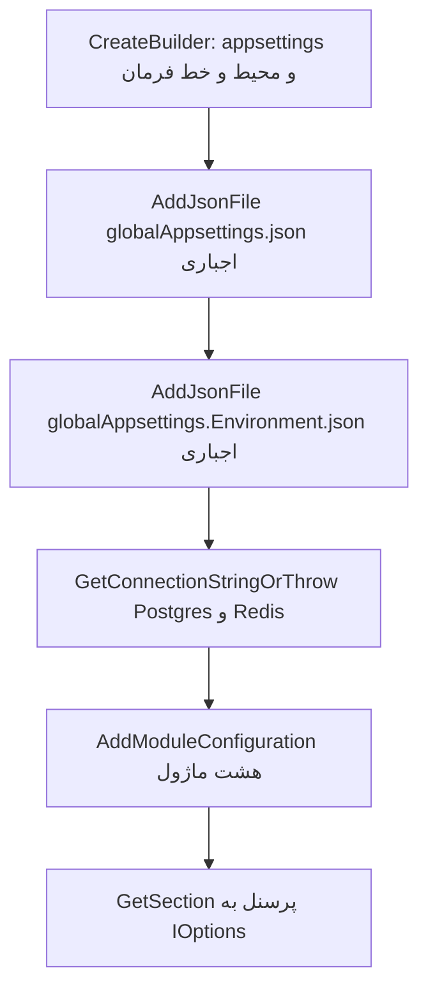

# پیکربندی در این مخزن

شناسهٔ کاتالوگ: `02-configuration`.

پیش‌نیاز: `01-dotnet-aspnetcore.md`. این سند می‌گوید مقدارها از کجا می‌آیند و کدام منبع بر دیگری می‌نشیند. خود middleware و endpoint در درس 01 است. Compose به‌عنوان فایل اجرا در `03-docker-compose.md` خواهد آمد. اینجا فقط کلیدهایی از Compose می‌آید که روی `IConfiguration` اثر دارند.

مقدار secret، رمز، و connection string کامل در این سند نیست. فقط نام کلید و شکل فایل آمده است.

## مسئله

یک باینری باید روی لپ‌تاپ توسعه‌دهنده و داخل کانتینر کار کند، بدون اینکه آدرس دیتابیس داخل کد کامپایل شود. اگر هر برنامه‌نویس مقدار را در کد بنویسد، عوض کردن میزبان یعنی build دوباره، و رمز وارد مخزن می‌شود.

پیکربندی یعنی جدا کردن دادهٔ محیط از کد. برنامه یک درخت کلید می‌سازد. کد به‌جای رشتهٔ ثابت، `GetConnectionString("Postgres")` یا `GetSection("JwtSettings")` را می‌خواند. محیط تصمیم می‌گیرد مقدار آن کلید چیست.

در ASP.NET Core این درخت از چند provider ساخته می‌شود. provider منبع است: فایل JSON، متغیر محیط، یا آرگومان خط فرمان. providerها به ترتیب اضافه می‌شوند. اگر دو منبع یک کلید را داشته باشند، منبعی که دیرتر اضافه شده همان کلید را عوض می‌کند. منبع دیرتر کلیدهایی را که ندارد پاک نمی‌کند. این قانون در Microsoft Learn، صفحهٔ Configuration in ASP.NET Core با moniker شامل `aspnetcore-10.0`، آمده است. اجرای یک پردازه برای دیدن مقدار نهایی در این فاز انجام نشد.

## ترتیب پیش‌فرض میزبان

`WebApplication.CreateBuilder` قبل از خط‌های دست‌نویس `Program.cs` منبع‌های پیش‌فرض را ثبت می‌کند. سند Learn ترتیب اولویت را از بالا به پایین، یعنی از برنده‌تر به بازنده‌تر، این‌طور می‌نویسد:

1. آرگومان خط فرمان
2. متغیرهای محیط، به‌جز آن‌هایی که پیشوند پیکربندی میزبان `ASPNETCORE_` یا `DOTNET_` دارند و جدا مصرف می‌شوند
3. user secrets، فقط وقتی نام محیط `Development` است
4. `appsettings.{Environment}.json`
5. `appsettings.json`
6. پیکربندی fallback خود host

همان سند می‌گوید providerها به ترتیبی که اضافه می‌شوند خوانده می‌شوند و آخرین مقدار یک کلید می‌ماند. پس در حالت پیش‌فرض، متغیر محیط بر `appsettings.json` و `appsettings.{Environment}.json` می‌نشیند، و خط فرمان بر متغیر محیط.

این مخزن برای `appsettings.json` خودش `AddJsonFile` صدا نمی‌زند. وجود فایل‌ها کنار پروژه با این الگوی پیش‌فرض می‌خواند. برای دژبان این فایل‌ها هستند:

- `Microservices/Dejban/API/Dejban.Api/appsettings.json`
- `appsettings.Development.json`
- `appsettings.Docker.json`
- `appsettings.DockerDevelopment.json`
- `appsettings-sample.json`

فایل sample نامش `appsettings.{Environment}.json` نیست. هیچ خطی در `Program.cs` آن را بار نمی‌کند. پس sample سند انسان است، نه منبع اجرا. وضعیت: `verified` برای نبود فراخوانی. اینکه میزبان دقیقاً کدام دو نام قراردادی را بار می‌کند از سند Learn است، نه از dump یک پردازه. وضعیت آن بخش: `documented`.

نام محیط از `ASPNETCORE_ENVIRONMENT` می‌آید. پروفایل `Dejban` در `launchSettings.json` این نام را `Development` می‌گذارد. Compose در `docker/compose.backend.yml` با anchor به نام `app-env` آن را `DockerDevelopment` می‌گذارد. ثابت همین رشته در `Common/Abstractions/Constants/ConfigConstants.cs` برابر `DockerDevelopment` است. این نام جزو `Environments.Development` نیست. کدهایی که فقط `Environments.Development` را چک می‌کنند در کانتینر Compose وارد آن شاخه نمی‌شوند.

## چه چیزی را این مخزن بعد از CreateBuilder اضافه می‌کند

بعد از بازگشت `CreateBuilder`، providerهای جدید به ته لیست می‌چسبند. کلیدهای داخل آن‌ها بر متغیر محیط و حتی بر خط فرمان می‌نشینند، ولی فقط برای همان کلیدهایی که خود فایل دارد.

الگوی مشترک gateway، هویت، دژبان، و چند میزبان دیگر این است. نمونهٔ دژبان در `Microservices/Dejban/API/Dejban.Api/Program.cs`:

```csharp
string globalConfigPath = Path.Combine(builder.Environment.ContentRootPath, "GlobalAppsettings");

if (builder.Environment.EnvironmentName.Equals(Environments.Development, StringComparison.OrdinalIgnoreCase))
{
    globalConfigPath = Path.Combine(builder.Environment.ContentRootPath, "..", "..", "..", "..", "GlobalAppsettings");
}

builder.Configuration.AddJsonFile(..., path: "globalAppsettings.json", optional: false, reloadOnChange: true);
builder.Configuration.AddJsonFile(..., $"globalAppsettings.{builder.Environment.EnvironmentName}.json", optional: false, reloadOnChange: true);
```

`optional: false` یعنی نبود فایل، بالا آمدن را با خطا قطع می‌کند. `reloadOnChange: true` یعنی provider می‌تواند تغییر فایل را ببیند. این با تازه‌شدن گزینه‌هایی که قبلاً در شیء دیگری کپی شده‌اند یکی نیست. پایین‌تر در JWT جدا شده است.

عمق `..` به عمق پروژه برمی‌گردد، نه به یک سیستم پیکربندی دوم:

| میزبان | شرط `Development` | چرا |
|---|---|---|
| دژبان | چهار بار `..` | از `Dejban.Api` تا ریشهٔ مخزن چهار پوشه است |
| هویت | دو بار `..` | `Microservices/IdentityServer` |
| gateway | یک بار `..` | `ApiGateway` کنار ریشه است |

اگر نام محیط `Development` نباشد، مسیر `ContentRoot/GlobalAppsettings` است. Compose این پوشه را با volume به `/app/GlobalAppsettings` وصل می‌کند و محیط `DockerDevelopment` است، پس شاخهٔ `..` اجرا نمی‌شود و همان mount دیده می‌شود. وضعیت مسیرها: `verified` از روی کد و Compose. اینکه volume واقعاً داخل کانتینر mount شده اجرا نشد.

فایل محیطی اجباری است. برای Compose نامش `globalAppsettings.DockerDevelopment.json` است و در `GlobalAppsettings/` وجود دارد. برای پروفایل محلی، `globalAppsettings.Development.json`.

## کلیدها، بدون مقدار

کلیدهای سطح اول این فایل‌ها خوانده شد. مقدارها نقل نمی‌شوند.

`globalAppsettings.json` این نام‌ها را دارد: `OrganizationName`، `SubSiteName`، `SubSiteDescription`، `SubUnitName`، `SubUnitDescription`، `SubUnitFloorNumber`، `SubUnitCallExtension`، `AllowedHosts`، `AllowedOrigins`، `SuperAdminSettings`، `JwtSettings`، `MediaMTXSettings`، `Serilog`، `OTEL_EXPORTER_OTLP_ENDPOINT`.

`globalAppsettings.DockerDevelopment.json` و `globalAppsettings.Development.json` کلید `AllowedHosts` و `AllowedOrigins` را در سطح اول ندارند و `ForwardedHeaders` را اضافه دارند. بقیهٔ نام‌های مشترک با فایل پایه در فایل محیطی هم هستند.

نبود `AllowedHosts` در فایل محیطی آن کلید را پاک نمی‌کند. مقدارش از فایل پایه می‌ماند، مگر منبعی که هنوز دیرتر است همان کلید را بدهد. فایل ماژول دژبان این کلید را ندارد.

هیچ‌کدام از این سه فایل کلید `ConnectionStrings` یا `ReverseProxy` یا `RabbitMqTransport` را ندارند. جستجوی `ReverseProxy` در شش فایل `GlobalAppsettings/` در فاز D خالی بود و فهرست کلید فاز F همان را برای سه فایل بازشده تأیید می‌کند.

`appsettings.json` دژبان کلید `ConnectionStrings`، `RabbitMqTransport`، و `Serilog` دارد. `appsettings.Development.json` و `appsettings.DockerDevelopment.json` همان‌ها را به‌علاوهٔ `DccHttpClient` دارند.

## متغیر محیط در Compose بر کدام کلید می‌نشیند

کامنت `docker/compose.backend.yml` می‌گوید connection stringها متغیر محیط‌اند تا میزبان داخل image را عوض کنند و build دوباره نخواهند. این جمله برای کلیدهایی درست است که provider دیرتر همان کلید را دوباره ننویسد.

کلیدهای مشترک anchor به نام `app-env` این‌ها هستند: `ASPNETCORE_ENVIRONMENT`، `ASPNETCORE_HTTP_PORTS`، `ConnectionStrings__Redis`، `RabbitMqTransport__Host`، `RabbitMqTransport__User`، `RabbitMqTransport__Pass`. سرویس‌ها جداگانه `ConnectionStrings__Postgres` دارند. گزارش علاوه بر آن `ConnectionStrings__DejbanPostgres`، `ConnectionStrings__IdentityPostgres`، و `ConnectionStrings__AclPostgres` دارد. gateway به‌جای رشتهٔ دیتابیس، `ASPNETCORE_HTTPS_PORTS` و مسیر گواهی Kestrel را می‌گذارد.

`__` در متغیر محیط همان `:` درخت پیکربندی است. `ConnectionStrings__Postgres` یعنی `ConnectionStrings:Postgres`، همان چیزی که `GetConnectionString("Postgres")` می‌خواند. این قرارداد در سند provider متغیر محیط Learn آمده است. وضعیت نام کلیدها در Compose: `verified`. وضعیت برنده شدن نهایی: از ترتیب provider است، نه از چاپ مقدار داخل یک کانتینر.

چون `globalAppsettings*.json` کلید `ConnectionStrings` و `RabbitMqTransport` ندارد، فایل‌هایی که بعد از متغیر محیط اضافه می‌شوند این دو درخت را عوض نمی‌کنند. متغیر محیط هنوز بعد از `appsettings.json` و `appsettings.DockerDevelopment.json` است. پس کامنت Compose برای همین کلیدها با ترتیب کد می‌خواند.

برعکس، `JwtSettings` و `Serilog` داخل global JSON هستند و آن JSON بعد از متغیر محیط اضافه می‌شود. اگر کسی `JwtSettings__...` را در محیط بگذارد، فایل global که همان کلید را دارد بر محیط می‌نشیند. Compose فعلی چنین کلیدی در `app-env` ندارد. نتیجه: JWT این مسیر از global JSON می‌آید، نه از anchor محیط. مقدارش اینجا نیست.

`UseSerilog(... ReadFrom.Configuration ...)` در دژبان و هویت بعد از `AddJsonFile`های global صدا زده می‌شود. پس Serilog همان درختی را می‌بیند که global روی `appsettings` نشانده است. کدام sink واقعاً وصل می‌شود به مقدار همان بخش بستگی دارد و در این درس باز نشده است.

## دژبان و فایل ماژول

`AddModuleConfiguration` در `Microservices/Dejban/API/Dejban.Api/Extensions/ConfigurationExtensions.cs` برای هر نام دو فایل می‌خواهد:

```csharp
configurationBuilder.AddJsonFile($"modules.{module}.json", false, true);
configurationBuilder.AddJsonFile($"modules.{module}.Development.json", true, true);
```

آرگومان دوم `false` یعنی فایل پایه اجباری است. آرگومان دوم `true` یعنی فایل Development اختیاری است. نام فایل دوم همیشه `Development` است. از `EnvironmentName` ساخته نمی‌شود.

این صدا در `Program.cs` دژبان بعد از `GetConnectionStringOrThrow` و بعد از `AddInfrastructure` است، و قبل از `AddPersonnelsModule`. نام‌ها: `visitors`، `personnels`، `security_patrols`، `vehicles`، `armory`، `cash_logistics`، `inventory`، `weigh_bridge`. هر هشت جفت فایل در پوشهٔ `Dejban.Api` وجود دارد.

`modules.personnels.json` فقط شیء `Personnels` را دارد، با `Outbox`، `Inbox`، و `Import`. `BatchSize` صندوق ورودی در فایل پایه 50 است و در `modules.personnels.Development.json` برابر 20 است. بقیهٔ عددهای همین دو فایل که خوانده شد یکی است. چون فایل Development دیرتر و بدون شرط محیط اضافه می‌شود، اگر هر دو کنار content root باشند، 20 بر 50 می‌نشیند، حتی وقتی محیط `DockerDevelopment` است. این از ترتیب `AddJsonFile` و از وجود هر دو فایل است. اینکه image منتشرشده هر دو فایل را در `/app` کپی می‌کند در csproj با `CopyToOutputDirectory` نیامده و در این فاز publish اجرا نشد. وضعیت کپی داخل image: `unresolved`. اگر فایل پایه در content root نباشد، `optional: false` بالا آمدن را می‌شکند.

`PersonnelsModule` این بخش‌ها را به options وصل می‌کند:

- `configuration.GetSection("Personnels:Import")` به `PersonnelImportOptions`
- `Personnels:Outbox` به `OutboxOptions`
- `Personnels:Inbox` به `InboxOptions`

`ConfigureProcessPersonnelImportJob` همان options را با `IOptions<PersonnelImportOptions>` می‌گیرد. پس فاصله و اندازهٔ دستهٔ import پرسنل از همین JSON است، نه از یک عدد داخل job.

## دو بار خواندن رشتهٔ اتصال

دژبان اول این را می‌خواند و در متغیر محلی نگه می‌دارد:

```csharp
string databaseConnectionString = builder.Configuration.GetConnectionStringOrThrow("Postgres");
string redisConnectionString = builder.Configuration.GetConnectionStringOrThrow("Redis");
```

متد در `Dejban.Common.Infrastructure/Configuration/ConfigurationExtensions.cs` است. اگر `GetConnectionString` نال برگرداند، `InvalidOperationException` با متن «was not found» پرتاب می‌شود و کار به `Build` نمی‌رسد. همان رشته به `AddInfrastructure` و health check می‌رود.

بعداً `PersonnelsModule` دوباره `configuration.GetConnectionString("Postgres")` را روی همان `IConfiguration` می‌خواند، این بار بعد از `AddModuleConfiguration`. فایل ماژول کلید `ConnectionStrings` ندارد، پس این خواندن دوم درخت اتصال را عوض نمی‌کند. دو خواندن از نظر کلیدهای موجود باید یکی باشند. این استنباط از نبود کلید است، نه از مقایسهٔ دو رشته در زمان اجرا. وضعیت: `inferred`.

`GetValueOrThrow<T>` همان متن «connection string» را برای هر کلیدی پرتاب می‌کند. نام متد عمومی است و پیامش هنوز مخصوص رشتهٔ اتصال است. این را در کد همین کلاس می‌شود دید.

هویت و gateway این `GetConnectionStringOrThrow` را در `Program.cs` خودشان صدا نمی‌زنند. دژبان صدا می‌زند. نبودن `Postgres` فقط بالا آمدن دژبان را با این استثنا قطع می‌کند.

## JWT یک‌بار کپی می‌شود

`AddCustomJwtAuth` در `Common/Abstractions/Extensions/ServiceCollectionExtensions.cs` بخش `JwtSettings.SectionName` را، که برابر `"JwtSettings"` است، هم به `Configure<JwtSettings>` می‌دهد و هم همان لحظه `Get<JwtSettings>()` می‌کند. اگر بخش خالی باشد `ArgumentNullException` می‌دهد. پارامترهای `TokenValidationParameters` از همان شیء محلی ساخته می‌شوند.

`LoginCommandHandler` و `TokenProvider` بعداً `IOptions<JwtSettings>` می‌گیرند، نه `IOptionsMonitor<JwtSettings>`. options معمولی برای عمر پردازه کش می‌شود. `IOptionsMonitor` است که با عوض شدن `IConfiguration` خبر می‌دهد. این تفاوت نوع‌ها در مدل options خود .NET است. پس `reloadOnChange: true` روی فایل global به‌تنهایی کلید امضای داخل `JwtBearer` را عوض نمی‌کند، چون آن پارامترها موقع ثبت سرویس کپی شده‌اند. وضعیت کپی در کد: `verified`. وضعیت کش `IOptions` : `documented` از مدل options، نه از یک آزمایش تغییر فایل روی پردازهٔ در حال اجرا.

## user secrets

فقط `ApiGateway/ApiGateway.csproj` ویژگی `UserSecretsId` دارد. `Dejban.Api.csproj` و `IdentityServer.csproj` این ویژگی را ندارند. سند Learn می‌گوید user secrets وقتی محیط `Development` است بار می‌شود. حتی gateway در Compose محیطش `DockerDevelopment` است، نه `Development`. پس user secrets مسیر کانتینر Compose نیست. وضعیت وجود یا نبود `UserSecretsId`: `verified`. بار شدن واقعی secrets روی لپ‌تاپ اجرا نشد.

## جریان بالا آمدن دژبان از نظر پیکربندی



نمودار ترتیب صدا زدن در `Dejban.Api/Program.cs` است، به‌علاوهٔ منبع‌هایی که Learn برای خود `CreateBuilder` می‌شمارد. مقدار برنده‌شدهٔ یک کلید داخل کانتینر چاپ نشد.

## اشتباه‌هایی که این کد ممکن می‌کند

فایل global را با این فرض ویرایش کردن که «مثل appsettings تحت فرمان متغیر محیط است». برای `JwtSettings` برعکس است، چون JSON دیرتر اضافه شده است.

فکر کردن که `modules.personnels.Development.json` فقط روی لپ‌تاپ بار می‌شود. نام فایل ثابت است و `optional: true` فقط نبودن فایل را تحمل می‌کند، نه محیط را.

فرض کردن که `reloadOnChange` تنظیم JWT در حال اجرا را عوض می‌کند. پارامتر bearer همان لحظهٔ ثبت کپی شده است.

اجرای خروجی publish با `ASPNETCORE_ENVIRONMENT=Development`. آن وقت مسیر global چهار پوشه بالاتر از content root می‌رود. در کانتینر content root برابر `/app` است و آن چهار پوشهٔ مخزن آنجا نیستند. Compose عمداً محیط را `DockerDevelopment` گذاشته تا از این شاخه خارج شود و volume را ببیند.

نبودن `globalAppsettings.DockerDevelopment.json` کنار mount. هر دو `AddJsonFile` اجباری‌اند. بالا آمدن قبل از `Build` قطع می‌شود.

## رابطه با بقیه

درس 01 میزبان و `CreateBuilder` را گفته است. درس 04 routeهای YARP را از `appsettings` خود gateway می‌خواند، نه از `GlobalAppsettings`. کلید `ReverseProxy` آنجا نیست. سند `00-yarp-config-investigation.md` همین را دارد.

رشتهٔ `Postgres` که اینجا برنده می‌شود همان رشته‌ای است که `PersonnelsModule` به `UseNpgsql` می‌دهد. جزئیات EF در درس 09 است.

`LoginCommandHandler` از `IOptions<JwtSettings>` استفاده می‌کند. معنای توکن در درس 05 است. اینجا فقط منبع مقدار است.

## حقایق، استنباط، پرسش باز

حقایق از روی فایل: مسیر `..` هر میزبان، `optional: false` برای global، نام محیط Compose، نبود `ConnectionStrings` در global، وجود هشت جفت `modules.*.json`، `BatchSize` صندوق ورودی 50 در پایه و 20 در فایل Development، و کپی `JwtSettings` داخل `AddJwtBearer`.

از سند Learn، نه از اجرای این پردازه: ترتیب پیش‌فرض providerها، معنی `__`، و فرق `IOptions` با `IOptionsMonitor`.

استنباط: دو خواندن `GetConnectionString("Postgres")` در دژبان یکی هستند، چون فایل ماژول آن کلید را ندارد.

باز: کپی شدن `modules.*.json` داخل image منتشرشده. مقدار نهایی یک کلید در یک کانتینر در حال اجرا. اینکه تغییر زندهٔ فایل global در عمل به consumerی که `IOptions` دارد برسد.

## سؤال‌های مصاحبه

### 1. پیکربندی لایه‌ای چه مسئله‌ای را حل می‌کند؟

کد یک‌بار کامپایل می‌شود و در چند محیط اجرا می‌شود. آدرس دیتابیس و کلید امضا نباید داخل IL باشند. providerها یک درخت کلید می‌سازند و کد همان درخت را می‌خواند.

دنباله: اگر دو فایل یک کلید را داشته باشند کدام می‌ماند؟

جواب: آن که providerاش دیرتر به `IConfigurationBuilder` اضافه شده. فایل دیرتر فقط کلیدهای خودش را عوض می‌کند. `AllowedHosts` در `globalAppsettings.json` هست و در فایل `DockerDevelopment` نیست، پس با بار شدن فایل محیطی پاک نمی‌شود.

### 2. ترتیب پیش‌فرض `CreateBuilder` چیست و این مخزن کجا آن را عوض می‌کند؟

Learn برای ASP.NET Core 10 اولویت را این‌طور می‌شمارد: خط فرمان، بعد متغیر محیط، بعد user secrets در `Development`، بعد `appsettings.{Environment}.json`، بعد `appsettings.json`. این مخزن بعد از آن `globalAppsettings.json` و `globalAppsettings.{Environment}.json` را با `AddJsonFile` اضافه می‌کند. آن دو به ته لیست می‌چسبند.

دنباله: پس آیا متغیر محیط همیشه بر JSON می‌نشیند؟

جواب: بر `appsettings` پیش‌فرض بله، اگر کلید در provider دیرتر تکرار نشود. بر `JwtSettings` داخل global نه، چون آن فایل بعد از provider محیط اضافه شده و همان کلید را دارد.

### 3. `optional: false` این‌جا چه خرابی‌ای می‌سازد؟

اگر `globalAppsettings.json` یا `globalAppsettings.{EnvironmentName}.json` پیدا نشود، host قبل از سرو کردن درخواست استثنا می‌دهد. Compose محیط را `DockerDevelopment` می‌گذارد، پس فایل دوم باید همان نام را داشته باشد. فایل `Development` جای آن را پر نمی‌کند.

دنباله: `modules.personnels.json` هم اجباری است؟

جواب: بله. در `AddModuleConfiguration` آرگومان optional برای فایل پایه `false` است. فایل `modules.personnels.Development.json` آرگومان `true` دارد و نبودنش بالا آمدن را نمی‌شکند.

### 4. چرا در Development مسیر global چند پوشه بالا می‌رود؟

وقتی `dotnet run` از پوشهٔ پروژه اجرا می‌شود، content root همان پوشه است و `GlobalAppsettings` در ریشهٔ مخزن است. دژبان چهار سطح پایین‌تر است، هویت دو سطح، gateway یک سطح. فقط وقتی `EnvironmentName` برابر `Development` باشد این `..`ها اعمال می‌شوند. `DockerDevelopment` برابر `Environments.Development` نیست، پس کانتینر به‌جای بالا رفتن، `ContentRoot/GlobalAppsettings` را می‌خواند و Compose همان مسیر را mount می‌کند.

دنباله: اگر خروجی publish را با محیط `Development` اجرا کنیم چه می‌شود؟

جواب: مسیر نسبی از `/app` چهار پوشه بالا می‌رود، جایی که مخزن نیست. فایل اجباری پیدا نمی‌شود و پردازه بالا نمی‌آید. Compose برای همین محیط را `DockerDevelopment` گذاشته است.

### 5. کامنت Compose که می‌گوید متغیر محیط میزبان داخل image را عوض می‌کند، کی درست است؟

برای `ConnectionStrings__Postgres`، `ConnectionStrings__Redis`، و `RabbitMqTransport__*` درست است، چون global JSON این کلیدها را ندارد و provider محیط هنوز بعد از `appsettings.DockerDevelopment.json` است. برای `JwtSettings` درست نیست، چون global JSON آن کلید را دارد و دیرتر بار می‌شود. Compose در anchor محیط کلید JWT نمی‌گذارد.

دنباله: `__` چیست؟

جواب: جایگزین `:` است. `ConnectionStrings__Postgres` همان کلیدی است که `GetConnectionString("Postgres")` می‌خواند. خود `:` در هر پوستهٔ محیط قابل اعتماد نیست.

### 6. چرا `modules.personnels.Development.json` ممکن است روی داکر هم اثر کند؟

نام فایل در کد ثابت است و به `EnvironmentName` وصل نیست. `AddJsonFile` آن را برای هر محیطی که فایل را ببیند اضافه می‌کند. `BatchSize` صندوق ورودی در فایل پایه 50 و در فایل Development برابر 20 است. اگر هر دو در content root باشند، 20 می‌ماند، از جمله در `DockerDevelopment`.

دنباله: این مقدار کجا مصرف می‌شود؟

جواب: `PersonnelsModule` بخش `Personnels:Inbox` را به `InboxOptions` وصل می‌کند. `Personnels:Import` به `PersonnelImportOptions` می‌رود و `ConfigureProcessPersonnelImportJob` آن را با `IOptions` می‌خواند.

### 7. چرا دژبان دو بار رشتهٔ Postgres را می‌خواند؟

یک‌بار قبل از فایل ماژول، با `GetConnectionStringOrThrow`، برای infrastructure مشترک و health check. یک‌بار داخل `PersonnelsModule` با `GetConnectionString`، بعد از `AddModuleConfiguration`. فایل ماژول آن کلید را ندارد، پس انتظار این است که هر دو یک مقدار ببینند. این مقایسه در زمان اجرا انجام نشد.

دنباله: اگر کلید نباشد چه استثنایی می‌آید؟

جواب: فقط خواندن اول. `GetConnectionStringOrThrow` عبارت `InvalidOperationException` با متن نبودن connection string می‌دهد. `GetValueOrThrow<T>` همان متن را حتی برای کلیدی که رشتهٔ اتصال نیست پرتاب می‌کند. این پیام در خود متد نوشته شده است.

### 8. `reloadOnChange: true` روی JWT چه نمی‌کند؟

`AddCustomJwtAuth` همان لحظه `Get<JwtSettings>()` می‌کند و نتیجه را داخل `TokenValidationParameters` می‌گذارد. handler ورود بعداً `IOptions<JwtSettings>` می‌گیرد، نه `IOptionsMonitor`. options معمولی تغییر فایل را به مصرف‌کنندهٔ قبلی برنمی‌گرداند. پس ذخیرهٔ دوبارهٔ global JSON کلید امضای bearer را که موقع ثبت کپی شده عوض نمی‌کند.

دنباله: اگر بخش `JwtSettings` نباشد؟

جواب: همان متد `ArgumentNullException` می‌دهد و می‌گوید تنظیمات JWT پیکربندی نشده است. پردازه به `Run` نمی‌رسد.

### 9. user secrets در این مخزن کجا ممکن است و کجا نیست؟

فقط gateway در csproj ویژگی `UserSecretsId` دارد. دژبان و هویت ندارند. Learn می‌گوید این provider مخصوص محیط `Development` است. Compose حتی gateway را با `DockerDevelopment` بالا می‌آورد. پس secrets مسیر داکر این فایل Compose نیست.

دنباله: `appsettings-sample.json` چطور؟

جواب: نامش با الگوی `appsettings.{Environment}.json` یکی نیست و `Program.cs` آن را بار نمی‌کند. برای انسان است.

### 10. یک خرابی واقعی این طراحی در مصاحبه چیست؟

تیم رمز یا میزبان را در متغیر محیط می‌گذارد و انتظار دارد بر global JSON بنشیند، در حالی که همان کلید داخل `globalAppsettings.json` است و آن فایل دیرتر اضافه شده. یا برعکس، connection string را فقط داخل global می‌گذارد و فکر می‌کند Compose آن را عوض می‌کند، در حالی که امروز کلید `ConnectionStrings` در global نیست و محیط بر `appsettings` می‌نشیند. جهت برنده شدن به ترتیب provider و به حضور کلید بستگی دارد، نه به اسم فایل.

دنباله: چطور بدون چاپ رمز این را در کد نشان می‌دهید؟

جواب: فهرست کلید سطح اول global را با فهرست `ConnectionStrings__` در Compose مقایسه می‌کنید و جای `AddJsonFile` را نسبت به `CreateBuilder` نشان می‌دهید. مقدار را لازم نیست بخوانید.

## مرور

پیکربندی این مخزن همان درخت پیش‌فرض ASP.NET Core است، به‌علاوهٔ دو فایل اجباری global که دیرتر اضافه می‌شوند و فقط کلیدهای خودشان را می‌برند. Compose با `__` رشتهٔ اتصال و RabbitMQ را می‌دهد و چون global آن کلیدها را ندارد، کامنت override برای همان کلیدها با کد می‌خواند. `JwtSettings` از global می‌آید و موقع ثبت JWT کپی می‌شود. فایل ماژول دژبان تنظیم صف و import است و نسخهٔ Development آن به نام محیط نگاه نمی‌کند. هیچ‌کدام از این نتیجه‌ها با اجرای پردازه و چاپ مقدار نهایی چک نشده‌اند.
