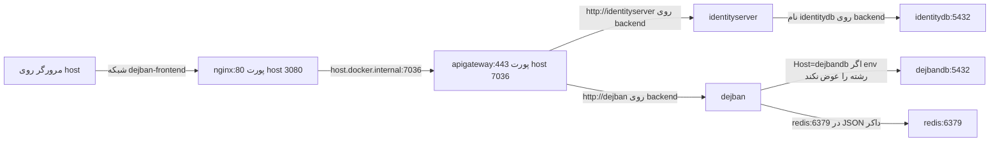

# Docker و Docker Compose در این مخزن

شناسهٔ کاتالوگ: `03-docker-compose`

**پیش‌نیاز:** `02-configuration.md`. آن درس می‌گوید متغیر محیطی با `__` به درخت ASP.NET Core می‌رسد و `globalAppsettings` فقط کلیدهایی را می‌برد که خودش دارد. این درس همان کلیدها را **از دید کانتینر** دنبال می‌کند.

رمز، connection string کامل و مقدار secretها در این سند نیست. در این فاز **هیچ کانتینری اجرا و هیچ imageای ساخته نشد**؛ همه‌چیز از روی فایل‌ها خوانده شده است.

## چطور این سند را بخوانیم

| برچسب | معنی |
| --- | --- |
| **از کد** | از فایل‌های خود مخزن (YAML، Dockerfile، اسکریپت، JSON) خوانده شده و قطعی است. |
| **رفتار پیش‌فرض Docker** | رفتار شناخته‌شدهٔ Docker است، ولی با اجرای build در این فاز تأیید نشد. |
| **استنباط** | از کد نتیجه گرفته شده ولی خود فایل آن را صریح نگفته. |
| **بررسی نشد** | با اجرا یا مشاهدهٔ image تأیید نشده و باید جداگانه چک شود. |

---

## خلاصهٔ یک‌دقیقه‌ای

1. **image** بستهٔ آماده‌ای است که runtime و DLLهای برنامه را دارد. **کانتینر** یک نمونهٔ در حال اجرا از آن است.
2. **Dockerfile** دستور ساخت image است. **Compose** چند کانتینر، شبکه و volume را کنار هم توصیف می‌کند.
3. این مخزن **دو روش** برای بالا آوردن بک‌اند دارد:
   - **روش ادغامی:** سه فایل Compose با اسکریپت `start-offline.sh` با هم ادغام می‌شوند و داده و اپ روی یک شبکهٔ `backend` هستند.
   - **روش split:** `docker/compose.data.yml` و `docker/compose.backend.yml` دو پروژه و دو شبکهٔ جدا هستند و اپ با **پورت host** به داده وصل می‌شود.
4. عوض کردن connection string در Compose به build دوباره نیاز ندارد (چون موقع start تزریق می‌شود)، ولی عوض کردن کد C# نیاز دارد.
5. `JwtSettings` از bind mount پوشهٔ `GlobalAppsettings` می‌آید، نه از `environment`. **Redis ماندگار نیست.** و نام‌گذاری image پستیگرس در سه جا سه شکل متفاوت دارد.

---

## کانتینر چه مسئله‌ای را حل می‌کند؟

یک سرویس .NET به runtime، کتابخانه‌ها و فایل پیکربندی وابسته است. اگر هر سرور این‌ها را دستی نصب کند، نسخهٔ runtime روی لپ‌تاپ با سرور فرق می‌کند و جملهٔ «روی ماشین من کار می‌کرد» بی‌معنی می‌شود.

### ماشین مجازی و کانتینر

- **ماشین مجازی** یک سیستم‌عامل کامل را تقلید می‌کند: هسته، دیسک و شبکهٔ خودش را دارد. سنگین است، چون هر نمونه یک OS جدا بالا می‌آورد.
- **کانتینر** هستهٔ سیستم‌عامل میزبان را با بقیه **شریک** می‌شود و فقط پردازه، فایل‌سیستم و شبکهٔ خودش را جدا می‌کند.

برای این مخزن یعنی `dejban` و `identityserver` دو پردازهٔ جدا هستند و هر کدام فایل‌های image خودشان را دارند، ولی لازم نیست برای هر کدام یک ویندوز یا لینوکس مجازی ساخته شود.

### image و کانتینر

- **image (تصویر):** بستهٔ آماده: runtime و DLLهای publishشده.
- **کانتینر:** یک نمونهٔ در حال اجرا از آن image.

از یک image مثل `dejban:latest` می‌شود چند کانتینر ساخت. ولی در Compose این مخزن برای هر سرویس اپ یک `container_name` ثابت هست؛ پس از همان نام بیش از یک کانتینر همزمان ساخته نمی‌شود.

### Dockerfile و Compose

- **Dockerfile** = دستور ساخت یک image.
- **Docker Compose** = توصیف چند کانتینر، شبکه و volume با هم. Compose خودش کد C# را کامپایل نمی‌کند، مگر اینکه سرویسی بلوک `build` داشته باشد.

### زمان build و زمان start

| لحظه | چه اتفاقی می‌افتد |
| --- | --- |
| **زمان build** | `dotnet publish` داخل stageهای Dockerfile اجرا می‌شود و فایل‌ها داخل image کپی می‌شوند. |
| **زمان start** | کانتینر از image ساخته می‌شود، متغیرهای محیطی به پردازه می‌رسند و `ENTRYPOINT` اجرا می‌شود. |

نتیجهٔ عملی:

- عوض کردن `ConnectionStrings__Postgres` در Compose **به build دوباره نیاز ندارد**، چون متغیر موقع start تزریق می‌شود.
- عوض کردن کد C# **بدون build یا load کردن image جدید** به کانتینر نمی‌رسد.

---

## واژه‌هایی که Compose استفاده می‌کند

| واژه | معنی ساده |
| --- | --- |
| **سرویس (service)** | یک کانتینر توصیف‌شده در فایل YAML. نام سرویس در شبکهٔ Compose به **DNS** تبدیل می‌شود (یعنی کانتینرهای دیگر با همین نام آن را پیدا می‌کنند). |
| **`container_name`** | اسم دیگری برای همان کانتینر در دستور `docker ps`. در این مخزن اغلب با نام سرویس یکی است، مثل `dejban`. |
| **شبکهٔ bridge** | کانتینرهای همان شبکه را به هم وصل می‌کند. کانتینرِ شبکهٔ دیگر آن نام را **نمی‌بیند**، مگر پورت روی host منتشر شده باشد و ارتباط از راه host برگردد. |
| **volume نام‌دار** | داده را بیرون از لایهٔ قابل‌نوشتن کانتینر نگه می‌دارد. Docker آن را مدیریت می‌کند و با `stop` معمولی پاک نمی‌شود. |
| **bind mount** | یک پوشهٔ مشخص از host را داخل کانتینر نشان می‌دهد. |
| **فایل‌سیستم خود کانتینر** | اگر هیچ‌کدام از دو مورد بالا نباشد، با حذف کانتینر از بین می‌رود. |
| **پورت داخلی** | پورتی که پردازه داخل کانتینر روی آن گوش می‌دهد. |
| **`host:container`** | نگاشت پورت. `18004:5432` یعنی از بیرون میزبان به پورت 18004 وصل می‌شوی و Docker آن را به پورت 5432 داخل کانتینر Postgres می‌رساند. کانتینر هم‌شبکه لازم نیست از 18004 استفاده کند؛ نام سرویس و پورت داخلی برایش کافی است. |
| **`depends_on`** | فقط **ترتیب شروع** را می‌گوید. |
| **`condition: service_healthy`** | healthcheck آن سرویس باید موفق شده باشد. |
| **`condition: service_started`** | پردازه شروع شده است، نه اینکه دیتابیس آمادهٔ query باشد. |
| **`restart: unless-stopped`** | بعد از خطا Docker دوباره اجرا می‌کند، مگر کسی خودش stop کرده باشد. |

---

## فایل‌های این مخزن

- هیچ‌کدام از Composeهای خوانده‌شده کلید `profiles` ندارند.
- جایی که `build` هست، کلید `target` نیست. در Dockerfile مرحلهٔ آخر `final` است. ننوشتن `target` یعنی Docker همان **آخرین stage** را می‌سازد. این رفتار پیش‌فرض Docker است و با اجرای build تأیید نشد. نبود `target` در YAML از کد قطعی است.

### الف) روش ادغامی: سه فایل با اسکریپت

`infrastructure/offline-mode/start-offline.sh` در تابع `start_backend` این سه فایل را با هم به `docker compose` می‌دهد:

- `docker-compose.yml`
- `docker-compose.development.yml`
- `docker-compose.docker-development.yml`

`docker/import-and-run.sh` همان سه فایل را بعد از `docker load` بالا می‌آورد. هر دو اسکریپت `--no-build --pull never` دارند؛ یعنی انتظارشان این است که image از قبل load شده باشد، نه اینکه آنلاین build یا دانلود شود.

#### `docker-compose.yml` (فایل پایه)

- شبکهٔ `backend` با subnet برابر `10.10.0.0/24` را می‌سازد و سرویس‌های داده را روی آن می‌گذارد.
- image پستیگرس: `postgres` **بدون tag**. Redis: `redis` بدون tag. RabbitMQ: `rabbitmq:management`.
- **پورت host برای دیتابیس‌ها در این فایل نیست.**
- volume نام‌دار هست، مثلاً `identityserverdb-data` روی `/var/lib/postgresql`.
- healthcheck پستیگرس `pg_isready` است.
- Redis در این فایل volume فعال ندارد. بلوک volume و `redis-server --save` کامنت شده‌اند؛ پس **داده‌های Redis ماندگار نیست**.

#### `docker-compose.development.yml`

فقط **پورت host** را به سرویس‌های همان پروژه اضافه می‌کند:

- `18001:5432` تا `18007:5432` برای هفت دیتابیس،
- `5672` و `15672` برای RabbitMQ،
- `6379` برای Redis،
- `19000:9000` و `19001:9001` برای MinIO.

Seq و Jaeger داخل کامنت‌اند و سرویس فعال نیستند.

#### `docker-compose.docker-development.yml`

هشت سرویس اپ را اضافه می‌کند. هر کدام:

- `build.context` برابر `.` و یک Dockerfile دارند،
- `networks: [backend]` دارند،
- محیط `ASPNETCORE_ENVIRONMENT=DockerDevelopment` دارند،
- و `./GlobalAppsettings:/app/GlobalAppsettings` را bind می‌کنند.

وابستگی‌ها:

- `depends_on` دژبان: `dejbandb` و `eventbus` و `redis` با `service_healthy`، و `mediamtx` با `service_started`.
- gateway پورت `7036:443` را منتشر می‌کند و به شروع `identityserver` با `service_started` وابسته است.
- این فایل کلید `ConnectionStrings__Postgres` **ندارد**.

#### نگاشت پورت دیتابیس‌ها

در override توسعه (و با فایل پایه یکی):

| سرویس | پورت host | پورت داخل کانتینر | `POSTGRES_DB` |
| --- | --- | --- | --- |
| `identitydb` | 18001 | 5432 | `payamgostar_identity` |
| `requesttrackerdb` | 18002 | 5432 | `payamgostar_requesttracker` |
| `aclserverdb` | 18003 | 5432 | `payamgostar_aclserver` |
| `dejbandb` | 18004 | 5432 | `payamgostar_dejban` |
| `dccdb` | 18005 | 5432 | `payamgostar_dcc` |
| `reportingdb` | 18006 | 5432 | `payamgostar_reporting` |
| `gateserverdb` | 18007 | 5432 | `payamgostar_gateserver` |

همین نام‌ها در `docker-compose.yml` و `docker/compose.data.yml` هم نوشته شده‌اند. پورت host از `docker-compose.development.yml` و از خود `compose.data.yml` می‌آید، نه از فایل پایه.

### ب) روش split: دو فایل جدا برای داده و اپ

#### `docker/compose.data.yml`

- پروژهٔ Compose به نام `dejban-data` و شبکهٔ `dejban-data`.
- کامنت فایل می‌گوید **اپ اینجا نیست** و اپ از پورت‌های منتشرشدهٔ host وصل می‌شود.
- image پستیگرس اینجا `postgres:latest` است، نه `postgres` بدون tag و نه `postgres:18.1`.
- پورت‌ها همان 18001 تا 18007 هستند.
- Redis دستور `redis-server --bind 0.0.0.0 --protected-mode no` دارد، پورت `6379:6379` و **بدون volume**.
- MinIO داده را در volume نام‌دار `minio-data` روی `/data` می‌گذارد.

#### `docker/compose.backend.yml`

- پروژهٔ جدا به نام `dejban-backend` و شبکهٔ `dejban-backend`.
- هشت image **از قبل ساخته‌شده** را صدا می‌زند: `identityserver:latest`، `dcc:latest`، `reporting:latest`، `requesttracker:latest`، `aclserver:latest`، `dejban:latest`، `gateserver:latest`، `apigateway:latest`.
- بلوک `build` ندارد.
- فقط gateway پورت منتشر می‌کند: `7036:443`.
- healthcheck اپ در این فایل نیست.
- `restart: unless-stopped` از anchor به نام `app` می‌آید.

#### دو فایل به هم وصل نیستند

این دو پروژه به شبکهٔ هم وصل نیستند و کامنت `compose.data.yml` همین را می‌گوید. اسکریپتی در مخزن که `compose.data.yml` را اجرا کند در جستجوی `*.sh` پیدا نشد. `infrastructure/postgres-dr/README.md` می‌گوید `./offline.sh data start` همان فایل را بالا می‌آورد، ولی فایلی به نام `offline.sh` در درخت جست‌وجو نبود. پس **قصد** از روی کامنت و README است و اجرای آن اسکریپت غایب تأیید نشد.

### مقایسهٔ دو روش

| موضوع | روش ادغامی (سه فایل) | روش split (`docker/`) |
| --- | --- | --- |
| چه کسی بالا می‌آورد | `start-offline.sh` و `import-and-run.sh` | اسکریپتی پیدا نشد |
| شبکه | یک شبکه: `backend` | دو شبکه: `dejban-data` و `dejban-backend` |
| اپ به داده چطور وصل می‌شود | با **نام سرویس** (مثل `dejbandb`) | با **پورت host** (`${DATA_HOST}` و 18004) |
| `ConnectionStrings__Postgres` روی اپ | نیست (JSON داکر می‌ماند) | هست |
| imageهای اپ | با `build` در Compose، ولی اسکریپت `--no-build` می‌زند | از قبل ساخته‌شده، بدون `build` |
| پورت منتشرشدهٔ gateway | `7036:443` | `7036:443` |

### بقیهٔ فایل‌ها

- **`docker-compose.docker-production.yml`:** همان سرویس‌های اپ را با `build` و image به شکل `${DOCKER_REGISTRY-}...` توصیف می‌کند و باز `GlobalAppsettings` را mount می‌کند. Seq و Jaeger کامنت‌اند.
- **`docker-compose.development-clean.yml`:** شبکه و سرویس داده‌ای خودش را دارد و اسم بعضی volumeها پسوند `-new` دارد، مثل `identityserverdb-data-new`. این **همان** volume به نام `identityserverdb-data` نیست. بالا آوردنش داده‌های فایل اصلی را نشان نمی‌دهد و داده‌ٔ جدید جدا می‌سازد.
- **`docker-compose.minio.yml`:** فقط MinIO را جدا توصیف می‌کند.
- **`infrastructure/postgres-dr/docker-compose.standby.yml` و `docker-compose.backup.yml`:** image را از `POSTGRES_IMAGE` می‌گیرند و پیش‌فرض README برابر `postgres:18.1` است. README هشدار می‌دهد که `postgres:latest` روی دو ماشین ممکن است یک نسخه نباشد.

**سه رشتهٔ پستیگرس را یکی ندانید:**

| کجا | رشته |
| --- | --- |
| `docker-compose.yml` | `postgres` (بدون tag) |
| `docker/compose.data.yml` | `postgres:latest` |
| کیت DR (پیش‌فرض README) | `postgres:18.1` |

### فرانت

`dejban_frontend_new/docker-compose.yml`:

- پروژهٔ `dejban-frontend` و شبکهٔ `dejban-frontend`. کامنت می‌گوید به شبکهٔ بک‌اند وصل نیست و اسم کانتینر بک‌اند را دوباره استفاده نمی‌کند.
- سرویس‌ها: `nginx` (image برابر `nginx:1.27-alpine`) و `main`، `dejban`، `gate`، `dcc`، `access-control`.
- اپ‌های Next با `docker/Dockerfile.next` و build arg از جمله `NEXT_PUBLIC_SERVER_URL: /api/v1` ساخته می‌شوند. access-control با `docker/Dockerfile.access-control` و `VITE_SERVER_URL: /api/v1`.
- Nginx پورت `${FRONTEND_PORT:-3080}:80` را منتشر می‌کند و `API_GATEWAY` پیش‌فرضش `host.docker.internal:7036` است.
- `depends_on` فقط فهرست اپ‌هاست، بدون healthcheck.

`docker-compose.nginx-only.yml` پروژه و کانتینر دیگری است (`frontend-nginx-only`) و اپ Next را build نمی‌کند.

---

## Dockerfile چه می‌سازد؟

هشت Dockerfile بک‌اند الگوی **چندمرحله‌ای (multi-stage)** دارند:

| مرحله | کار |
| --- | --- |
| `base` | از `mcr.microsoft.com/dotnet/aspnet:10.0`؛ `WORKDIR /app` و `EXPOSE 80`. |
| `build` | از `mcr.microsoft.com/dotnet/sdk:10.0`؛ csprojها را کپی می‌کند، `dotnet restore` می‌زند، بعد `COPY . .` و `dotnet build`. |
| `publish` | `dotnet publish ... -o /app/publish /p:UseAppHost=false`. |
| `final` | فقط خروجی publish را در image اجرا کپی می‌کند. |

`ENTRYPOINT` برای دژبان `dotnet Dejban.Api.dll` است و برای بقیه به همان شکل با نام DLL خودشان.

**فایدهٔ multi-stage:** SDK سنگین فقط برای build لازم است. image نهایی روی `aspnet` (فقط runtime) می‌ماند و کوچک‌تر است. (دانش عمومی.)

### `EXPOSE` پورت را باز نمی‌کند

`EXPOSE 80` پورت را روی host منتشر نمی‌کند؛ فقط **مستندات** image است. گوش دادن واقعی از `ASPNETCORE_HTTP_PORTS=80` در Compose می‌آید. برای gateway علاوه بر آن `ASPNETCORE_HTTPS_PORTS=443` هست، چون نگاشت `7036:443` است.

### `ARG` و `target`

Dockerfileها `ARG BUILD_CONFIGURATION=Release` دارند و `dotnet publish` از همان متغیر استفاده می‌کند. بلوک‌های `build` در `docker-compose.docker-development.yml` کلید `args` و `target` ندارند. پس اگر Compose build کند، مقدار پیش‌فرض ARG می‌ماند و stage آخر ساخته می‌شود. این رفتار پیش‌فرض Docker است و در این فاز build اجرا نشد.

### تفاوت کاربر (USER) در Dockerfileها

- `ApiGateway/Dockerfile`: در stage نهایی با `USER root` پوشهٔ `/app/public-assets/public` را می‌سازد و دوباره `USER app` می‌شود.
- `Microservices/DCC/Dockerfile`: در stage نهایی روی `USER root` **می‌ماند**.
- Reporting: در stage پایه فونت نصب می‌کند و قبل از `EXPOSE` به `USER app` برمی‌گردد.

### `GlobalAppsettings` داخل image نیست

کپی `GlobalAppsettings` داخل Dockerfile نیست. فایل global با bind mount به `/app/GlobalAppsettings` می‌رسد. اگر mount نباشد و فایل داخل image هم نباشد، `AddJsonFile` با `optional: false` بالا آمدن را می‌شکند. (این نتیجه از درس ۰۲ و از نبود دستور COPY برای آن پوشه در Dockerfile است.)

### `modules.*.json` داخل image (بررسی نشد)

- `Dejban.Api.csproj` برای `modules.*.json` ویژگی `CopyToOutputDirectory` یا `CopyToPublishDirectory` ندارد.
- Dockerfile هم آن فایل‌ها را جدا COPY نمی‌کند. فقط خروجی `dotnet publish` به image نهایی می‌رود.
- زیر پوشهٔ `Dejban.Api` فقط `modules.personnels.json` کنار خود csproj است، نه یک کپی زیر `bin` یا `publish`.
- هدف‌های پیش‌فرض SDK وب هم در این فاز از روی فایل targets نصب‌شده خوانده نشد.

پس **معلوم نیست image منتشرشده آن JSONها را دارد یا نه.** اگر content root داخل کانتینر فایل اجباری `modules.{module}.json` را نداشته باشد، `AddModuleConfiguration` بالا آمدن دژبان را قطع می‌کند. اگر SDK آن‌ها را جزو content پابلیش کند، هستند. این دو حالت با هم جمع نمی‌شوند و وضعیتش **بررسی نشد** است.

---

## سه کلید پیکربندی، از Compose تا .NET

Docker متغیرهای بلوک `environment` را به پردازهٔ `ENTRYPOINT` می‌دهد. ASP.NET Core نام را با `__` به `:` درخت پیکربندی تبدیل می‌کند؛ پس `ConnectionStrings__Postgres` یعنی `ConnectionStrings:Postgres`. این قرارداد در درس ۰۲ آمده است.

قانون برنده شدن (از درس ۰۲): provider دیرتر فقط کلیدی را عوض می‌کند که **خودش دارد**. فایل global کلید `ConnectionStrings` ندارد. پس رشتهٔ اتصال یا از `appsettings*.json` می‌ماند، یا اگر Compose همان کلید را گذاشته باشد، متغیر محیطی بر JSON پیش‌فرض برتری می‌گیرد.

### ۱) `ConnectionStrings__Postgres`

**در روش split** (`docker/compose.backend.yml`) هر سرویس اپ مقدار خودش را می‌گیرد:

- میزبان برابر `${DATA_HOST}` است و پورت، **پورت host** است (نه پورت داخلی 5432).
- دژبان: پورت 18004 و دیتابیس `payamgostar_dejban`. هویت: 18001 و `payamgostar_identity`.
- گزارش علاوه بر `Postgres` کلیدهای `DejbanPostgres`، `IdentityPostgres` و `AclPostgres` را هم دارد.
- gateway این کلید را ندارد.

این مقدار بر `appsettings.DockerDevelopment.json` برتری می‌گیرد، چون متغیر محیطی بعد از آن JSON اضافه می‌شود و global همان کلید را ندارد.

**در روش ادغامی** (`start-offline.sh`) سرویس `dejban` این متغیر را **ندارد**؛ پس JSON محیطی می‌ماند:

- در `appsettings.DockerDevelopment.json` دژبان، کلید Postgres مقدار `Host=dejbandb` دارد و در رشته‌ای که خوانده شد قطعهٔ `Port=` نبود.
- `dejbandb` نام سرویس روی شبکهٔ `backend` است. پورت 18004 فقط نگاشت host است. کانتینر هم‌شبکه به پورت داخلی (5432) می‌رسد، **اگر** درایور در نبود `Port=` پورت پیش‌فرض خودش (5432) را بزند.

وضعیت:
- `Host=dejbandb`: از کد، قطعی.
- پیش‌فرض پورت درایور (Npgsql در نبود `Port=`): **بررسی نشد.**

**پس این دو توپولوژی را قاطی نکنید:** فایل split به **host و پورت منتشرشده** وصل است. فایل ادغامی، در غیاب متغیر، به **نام سرویس Docker** وصل است.

### ۲) `ConnectionStrings__Redis`

**در روش split:** anchor به نام `app-env` در `compose.backend.yml` این کلید را `${DATA_HOST}:6379` می‌گذارد. همهٔ سرویس‌هایی که `<<: *app-env` دارند آن را می‌گیرند، از جمله gateway. رمز داخل این مقدار در آن خط نیست؛ فقط host و پورت است.

**در روش ادغامی:** این کلید روی سرویس دژبان ست نشده است. `appsettings.DockerDevelopment.json` دژبان مقدار `redis:6379` دارد و gateway در فایل DockerDevelopment خودش هم `redis:6379` دارد. در مقابل، `appsettings.json` و `appsettings.Development.json` دژبان `localhost:6379` هستند.

**چرا مهم است؟** `redis` نام سرویس در Compose است. `localhost` **داخل کانتینر، خودِ همان کانتینر** است، نه Redis کناری.

یادآوری: Redis در Compose داده volume ندارد؛ restart کانتینر داده‌ای را که داخل لایهٔ کانتینر است نگه نمی‌دارد.

### ۳) `JwtSettings`

هیچ بلوک `environment` در `compose.backend.yml` یا `docker-compose.docker-development.yml` این کلید را نمی‌گذارد. منبعش فایل global است که با bind mount به `/app/GlobalAppsettings` می‌رسد و `Program.cs` آن را **بعد از** provider محیطی بار می‌کند. چون فایل global این کلید را دارد، حتی اگر کسی همان کلید را در محیط بگذارد، JSON دیرتر برنده می‌شود. (درس ۰۲ این را گفته؛ اینجا فقط mount اضافه می‌شود.) مقدار JWT نقل نمی‌شود.

`AddCustomJwtAuth` همان مقدار را موقع ثبت سرویس در پارامترهای bearer **کپی** می‌کند. پس عوض کردن فایل روی volume، **بدون restart پردازه**، آن کپی را عوض نمی‌کند.

---

## شبکه و آدرس

### نکته‌هایی دربارهٔ نمودار

- نمودار **روش ادغامی به‌علاوهٔ فرانت جدا** است، چون `start-offline.sh` بک‌اند را همان‌طور بالا می‌آورد و فرانت را با Compose جدا.
- فلش دژبان به `dejbandb` فقط وقتی است که `ConnectionStrings__Postgres` ست نشده باشد. در `compose.backend.yml` این فلش عوض می‌شود و به `${DATA_HOST}:18004` می‌رود.
- فلش هویت هم همین شرط را دارد: `appsettings.DockerDevelopment.json` هویت مقدار `Host=identitydb` دارد و قطعهٔ `Port=` در آن رشته نیست.

### آدرس‌های YARP که خوانده شد

`http://identityserver`، `http://requesttracker`، `http://dcc`، `http://aclserver`، `http://dejban`، `http://reporting`، `http://gateserver`، و `http://host.docker.internal:5053` برای باسکول.

- این نام‌ها با `container_name` سرویس‌های اپ در Compose ادغامی یکی هستند و هر دو روی شبکهٔ `backend`اند.
- باسکول در این Composeها **سرویس نیست.** `5053` پورت host بیرون از این فایل‌هاست.

### فرانت و بک‌اند یک شبکه نیستند

فرانت به شبکهٔ `backend` وصل نیست. اگر کسی به‌جای `host.docker.internal:7036` نام `apigateway` را در Nginx بگذارد، DNS آن شبکه آن نام را ندارد.

---

## ماندگاری داده و ریسک‌ها

### چه چیزی ماندگار است؟

| سرویس | وضعیت |
| --- | --- |
| **Postgres** (فایل پایه و فایل داده) | volume نام‌دار روی `/var/lib/postgresql` |
| **RabbitMQ** (`docker-compose.yml`) | `/var/lib/rabbitmq` به `eventbusdb-data` وصل است و `definitions.json` bind می‌شود |
| **MinIO** (فایل داده) | `/data` به `minio-data` وصل است |
| **Redis** | **عمداً ماندگار نیست** (کامنت فایل پایه این را نشان می‌دهد) |
| **`dcc-storage`** در `compose.backend.yml` | فقط‌خواندنی روی `/app/uploads` سرویس `dcc` |
| **`/app/public-assets` gateway ادغامی** | mount آن کامنت است |

**هشدار دربارهٔ مسیر Postgres:** اینکه `/var/lib/postgresql` همان دایرکتوری داده‌ٔ image واقعی `postgres` یا `postgres:latest` باشد، اجرا نشد. اگر image داده‌اش را جای دیگری بنویسد، volume خالی می‌ماند و داده داخل لایهٔ کانتینر می‌رود. این را باید با مستند همان tag چک کرد، نه با حدس.

### ریسک امنیتی (بدون نقل مقدار)

- `compose.backend.yml` و فایل ادغامی برای رمز دیتابیس، RabbitMQ، MinIO و رمز گواهی gateway یا fallback **داخل YAML** دارند یا مقدار را مستقیم در `environment` نوشته‌اند.
- `start-offline.sh` هم برای نبودن فایل pfx به یک رمز ثابت اشاره می‌کند.
- هر کس مخزن را داشته باشد این مقدارها را می‌بیند. این با secret manager یکی نیست.
- user secrets هم، طبق درس ۰۲، مسیر این کانتینرها نیست، چون محیط `DockerDevelopment` است.

### خطر `down -v`

`docker compose down -v` volume نام‌دار را **پاک می‌کند**. کامنت `compose.data.yml` می‌گوید این سوئیچ را نزنید. این درس هیچ volumeای را عوض نکرد.

---

## اگر چیزی بالا نیامد

این دستورها فقط **می‌خوانند**. `down`، `rm`، `volume rm` و `-v` در این فهرست نیستند.

### سرویس اصلاً start نمی‌شود

`docker compose ps` و `docker compose logs` همان سرویس را ببینید. اگر پیام نبودن `globalAppsettings.{Environment}.json` بود، یا mount غلط است یا نام محیط. محیط ادغامی و فایل split هر دو `DockerDevelopment` هستند؛ پس فایل باید `globalAppsettings.DockerDevelopment.json` باشد، نه فقط فایل `Development`.

### وصل نشدن به Postgres

1. ببینید کدام Compose بالاست.
2. در **split:** host باید `${DATA_HOST}` و پورت 18004 برای دژبان باشد و از داخل کانتینر اپ به آن host برسد. در anchor فایل split، `extra_hosts: host.docker.internal:host-gateway` هست.
3. در **ادغامی:** اگر متغیر اتصال ست نشده، host باید نام سرویس `dejbandb` باشد و هر دو روی شبکهٔ `backend` باشند.
4. healthcheck `pg_isready` فقط وضعیت همان کانتینر دیتابیس را می‌گوید. `depends_on` با `service_started` روی gateway آماده بودن Postgres را **ضمانت نمی‌کند.**

### وصل نشدن به Redis

- در split آدرس `${DATA_HOST}:6379` است و Redis داده `protected-mode` را خاموش کرده تا اتصال غیر از loopback را بپذیرد.
- در ادغامی JSON می‌گوید `redis:6379`.
- `localhost:6379` داخل کانتینر اپ به Redis کناری نمی‌رسد.
- اگر Redis restart شده و volume نداشته، داده‌ٔ قبلی نیست. این **خطای پیکربندی نیست؛ فراموشی ماندگاری** است.

### پورت اشغال است

نگاشت‌های 7036، 3080، 18001 تا 18007، 6379، 5672 و 15672 را با چیزی که روی host گوش می‌دهد مقایسه کنید. دو Compose که هر دو 18004 را منتشر کنند، با هم بالا نمی‌آیند. `docker-compose.yml` تنها پورت دیتابیس را منتشر نمی‌کند؛ override توسعه و `compose.data.yml` منتشر می‌کنند. اگر هر دو پروژه همزمان همان پورت host را بگیرند، دومی خطا می‌دهد.

### gateway و خطای 502

- YARP وقتی مقصد را نرسد، 502 می‌دهد.
- `ProxyErrorHandlingMiddleware` وضعیت 502 و 500 را به **503** بدل می‌کند و برای مرورگر به `/error/503` می‌رود. پس در مرورگر 503 می‌بینید، در حالی که علت پروکسی 502 بوده است.
- اول ببینید نام مقصد با سرویس همان شبکه یکی است. `http://dejban` روی شبکهٔ `dejban-frontend` حل نمی‌شود.
- `http://localhost:5042` داخل کانتینر gateway، خودِ gateway است، نه دژبان. آن آدرس مال `appsettings` نمونه و پروفایل محلی است، نه مال `DockerDevelopment`.

### فرق اجرای محلی و Docker

| موضوع | `dotnet run` محلی | Docker |
| --- | --- | --- |
| محیط | `Development` | `DockerDevelopment` |
| آدرس دژبان | `http://localhost:5042` | نام سرویس (`http://dejban`) |
| پوشهٔ global | چهار پوشه بالاتر از پروژه | mount در `/app/GlobalAppsettings` |
| Postgres دژبان | `localhost` و پورت 18004 (به شرط انتشار پورت host توسط داده) | نام سرویس یا `${DATA_HOST}` |
| DNSهای `dejbandb` و `identityserver` | وجود ندارند (مثلاً روی ویندوز) | وجود دارند |

---

## واژه‌نامهٔ ساده

| واژه | معنی ساده |
| --- | --- |
| **Image** | بستهٔ آمادهٔ برنامه با runtime. |
| **Container** | نمونهٔ در حال اجرای یک image. |
| **Dockerfile** | دستور ساخت image. |
| **Compose** | فایل YAML برای توصیف چند کانتینر کنار هم. |
| **Multi-stage build** | ساخت image در چند مرحله تا ابزار سنگین build وارد image نهایی نشود. |
| **Bridge network** | شبکهٔ داخلی که کانتینرهای هم‌شبکه را به هم وصل می‌کند. |
| **Port mapping** | نگاشت پورت host به پورت داخل کانتینر. |
| **Volume** | محل نگه‌داری داده بیرون از کانتینر که با حذف کانتینر نمی‌رود. |
| **Bind mount** | وصل کردن یک پوشهٔ مشخص host به داخل کانتینر. |
| **Healthcheck** | دستوری که سالم بودن یک سرویس را می‌سنجد. |
| **Anchor (در YAML)** | بلوک تکرارشونده‌ای که در چند سرویس استفاده می‌شود، مثل `app-env` و `app`. |
| **`host.docker.internal`** | نامی که کانتینر با آن به خود host می‌رسد. |
| **`DockerDevelopment`** | نام محیط ASP.NET Core در کانتینرهای Compose (غیر از `Development`). |

---

## راهنمای عملی: برای هر مشکل این پنج سؤال را بپرسید

1. **کدام توپولوژی بالاست؟** (ادغامی یا split)
2. **سرویس‌ها روی یک شبکه‌اند؟** (نام سرویس فقط روی همان شبکه حل می‌شود)
3. **آدرس مقصد نام سرویس است یا پورت host؟**
4. **این کلید از `environment` می‌آید یا از JSON؟** (درس ۰۲: دیرتر برنده است)
5. **داده روی volume است یا داخل کانتینر؟**

---

## سؤال‌های مصاحبه

(پاسخ‌ها عمداً ساده نوشته شده‌اند.)

### ۱. کانتینر با ماشین مجازی چه فرقی دارد و این مخزن کدام را توصیف می‌کند؟

ماشین مجازی هستهٔ جدا دارد. کانتینر هسته را با host شریک می‌شود و فقط پردازه و فایل را جدا می‌کند. Dockerfileهای این مخزن image را از `mcr.microsoft.com/dotnet/aspnet:10.0` می‌سازند و Compose چند کانتینر را روی یک شبکهٔ bridge می‌گذارد. فایل VM در این مسیرها نیست.

**سؤال دنباله:** image با کانتینر چه فرقی دارد؟
**جواب:** image خروجی build یا `docker load` است، مثل `dejban:latest`. کانتینر نمونهٔ در حال اجرای آن است و در این فایل‌ها `container_name: dejban` دارد.

### ۲. چرا عوض کردن connection string در Compose به build دوباره نیاز ندارد، ولی عوض کردن کد نیاز دارد؟

متغیر `environment` موقع start به پردازه می‌رسد. `ENTRYPOINT` همان `dotnet Dejban.Api.dll` داخل image است. کد داخل image در stage `publish` با `dotnet publish` ثابت شده است. اسکریپت آفلاین هم عمداً `--no-build` می‌زند.

**سؤال دنباله:** `EXPOSE 80` پورت را باز می‌کند؟
**جواب:** نه. فقط مستندات image است. باز شدن روی host کار `ports` در Compose است. gateway `7036:443` دارد. بقیهٔ اپ‌ها در `compose.backend.yml` پورت host ندارند.

### ۳. دو روش بالا آوردن بک‌اند این مخزن چیست؟

**روش اسکریپت‌دار:** `start-offline.sh` سه فایل `docker-compose.yml` و `docker-compose.development.yml` و `docker-compose.docker-development.yml` را ادغام می‌کند. داده و اپ روی شبکهٔ `backend` هستند.

**روش فایل‌های `docker/`:** `docker/compose.data.yml` و `docker/compose.backend.yml`: دو پروژه و دو شبکهٔ جدا. اپ با پورت host به داده وصل می‌شود. اسکریپت `offline.sh` که README به آن ارجاع می‌دهد در درخت جست‌وجو نبود.

**سؤال دنباله:** اگر فقط فایل پایه را بدون override توسعه بالا بیاورید، از لپ‌تاپ به Postgres وصل می‌شوید؟
**جواب:** نه از روی پورت host. خود `docker-compose.yml` برای دیتابیس `ports` ندارد. پورت 18004 از override یا از `compose.data.yml` می‌آید.

### ۴. `18004:5432` را کانتینر دژبان چطور باید ببیند؟

18004 پورت host است و 5432 پورت داخل کانتینر `dejbandb`. در فایل split رشتهٔ اتصال دژبان پورت 18004 و host برابر `${DATA_HOST}` دارد، چون اپ در شبکهٔ داده نیست. در ادغام سه‌فایلی متغیر Postgres روی دژبان نیست و JSON داکر `Host=dejbandb` دارد؛ آن نام فقط روی شبکهٔ `backend` حل می‌شود.

**سؤال دنباله:** `localhost` داخل کانتینر دژبان یعنی چه؟
**جواب:** خود همان کانتینر. Postgres کناری را نشان نمی‌دهد. `appsettings.Development.json` با `localhost` برای `dotnet run` روی host است، جایی که پورت 18004 روی خود ماشین منتشر شده باشد.

### ۵. `ConnectionStrings__Redis` و `JwtSettings` در Docker از یک منبع می‌آیند؟

نه. Redis در `compose.backend.yml` از anchor محیطی به شکل `${DATA_HOST}:6379` به پردازه می‌رسد و چون global این کلید را ندارد، بر JSON برتری می‌گیرد. در ادغام سه‌فایلی آن متغیر نیست و JSON داکر `redis:6379` را نگه می‌دارد. `JwtSettings` در `environment` این Composeها نیست؛ از bind پوشهٔ `GlobalAppsettings` می‌آید و چون آن JSON دیرتر بار می‌شود، کلیدهای خودش را می‌برد.

**سؤال دنباله:** چرا global کل پیکربندی را عوض نمی‌کند؟
**جواب:** provider دیرتر فقط کلیدهایی را که دارد جایگزین می‌کند. `AllowedHosts` در فایل پایهٔ global هست و در فایل `DockerDevelopment` نیست؛ پس پاک نمی‌شود. `ConnectionStrings` در global نیست؛ پس محیط یا `appsettings` همان درخت را نگه می‌دارد.

### ۶. healthcheck اینجا چه چیزی را ضمانت می‌کند و چه چیزی را نه؟

`pg_isready` و `redis-cli ping` و `rabbitmq-diagnostics ping` در فایل داده فقط همان سرویس را سالم می‌دانند. در ادغام، دژبان تا healthy شدن دیتابیس و Redis و Rabbit صبر می‌کند. gateway فقط تا `service_started` شدن `identityserver` صبر می‌کند، نه تا آماده شدن login. در `compose.backend.yml` اصلاً healthcheck اپ نیست و `identityserver` به شروع بقیهٔ اپ‌ها وابسته است، نه به Postgres.

**سؤال دنباله:** `restart: unless-stopped` جای healthcheck را می‌گیرد؟
**جواب:** نه. فقط بعد از خروج پردازه دوباره start می‌کند. اگر پردازه بالا باشد و دیتابیس را نبیند، restart نمی‌شود.

### ۷. چرا gateway در Docker به `http://dejban` می‌رود و روی لپ‌تاپ به `localhost:5042`؟

`appsettings.DockerDevelopment.json` درگاه آدرس cluster دژبان را `http://dejban` گذاشته و Compose ادغامی همان نام را روی شبکهٔ `backend` دارد. پروفایل محلی و sample از `http://localhost:5042` استفاده می‌کنند، چون آنجا کانتینر و DNS سرویس وجود ندارد. محیط `DockerDevelopment` فایل JSON متناظر را انتخاب می‌کند.

**سؤال دنباله:** باسکول چرا `host.docker.internal:5053` است؟
**جواب:** در همان JSON مقصد `dejban-baskool-cluster` این آدرس است و سرویس باسکول در Composeهای خوانده‌شده نیست. پس از شبکهٔ Docker به یک پورت روی host برمی‌گردد. اینکه آن پورت واقعاً باز باشد اجرا نشد.

### ۸. Redis چرا بعد از restart خالی به نظر می‌رسد؟

در `docker-compose.yml` ذخیره و volume کامنت است. در `compose.data.yml` سرویس Redis اصلاً `volumes` ندارد. داده روی فایل‌سیستم خود کانتینر است. Postgres برعکس volume نام‌دار دارد. قاطی کردن این دو رفتار یعنی انتظار ماندگاری از سرویسی که فایلش ماندگاری را خاموش کرده است.

**سؤال دنباله:** MinIO چطور؟
**جواب:** در فایل داده، `/data` به volume نام‌دار `minio-data` وصل است. restart همان volume را دوباره mount می‌کند. `down -v` آن را پاک می‌کند. این دستور در این درس اجرا نشد.

### ۹. یک 502 از gateway را در این معماری کجا می‌گردید؟

اول شبکه. فرانت نام `apigateway` را نمی‌بیند؛ Nginx به `host.docker.internal:7036` می‌رود. gateway نام `dejban` را فقط اگر هر دو روی `backend` باشند می‌بیند. اگر مقصد down باشد YARP 502 می‌دهد و `ProxyErrorHandlingMiddleware` آن را برای کلاینت 503 می‌کند. پس لاگ پروکسی را ببینید، نه فقط status مرورگر.

**سؤال دنباله:** تفاوت اجرای محلی و Docker چیست؟
**جواب:** `dotnet run` محیط Development است، global را چند پوشه بالاتر از پوشهٔ پروژه می‌خواند و به `localhost` وصل است. کانتینر محیط DockerDevelopment است، global را از mount `/app/GlobalAppsettings` می‌خواند و به نام سرویس وصل است.

### ۱۰. کدام image پستیگرس را نباید یکی فرض کرد؟

`docker-compose.yml` مقدار `postgres` بدون tag دارد. `docker/compose.data.yml` مقدار `postgres:latest` دارد. کیت DR پیش‌فرض `postgres:18.1` دارد و README می‌گوید `latest` روی دو ماشین ممکن است فرق کند. tag بخشی از هویت image است. بدون tag یعنی Docker هر چه را برای آن نام محلی دارد استفاده می‌کند، نه الزاماً 18.1.

**سؤال دنباله:** `modules.*.json` حتماً داخل image دژبان است؟
**جواب:** از روی این مخزن ثابت نیست. csproj کپی صریح ندارد، Dockerfile فقط خروجی publish را برمی‌دارد و یک خروجی publish محلی که فایل را نشان بدهد پیدا نشد. اگر داخل image نباشند، start دژبان به‌خاطر `optional: false` می‌شکند. این را باید با محتوای image دید، نه با حدس SDK.

### سؤال‌های عمومی برای آمادگی بیشتر

### ۱۱. تفاوت volume نام‌دار و bind mount چیست؟

volume نام‌دار را خود Docker مدیریت می‌کند و محل دقیقش برای شما مهم نیست؛ مناسب داده‌های دیتابیس. bind mount یک پوشهٔ مشخص از host را داخل کانتینر نشان می‌دهد؛ مناسب فایل‌های پیکربندی که روی host ویرایش می‌شوند (مثل `GlobalAppsettings` در این مخزن).

### ۱۲. چرا نباید در محیط واقعی از `latest` استفاده کرد؟

چون `latest` یک نسخهٔ مشخص نیست و با گذر زمان یا روی ماشین‌های مختلف می‌تواند چیز دیگری باشد. tag مشخص (مثل `postgres:18.1`) باعث می‌شود همه یک نسخه را اجرا کنند و رفتار قابل تکرار باشد.

### ۱۳. چرا multi-stage build استفاده می‌کنیم؟

SDK سنگین فقط برای build و publish لازم است. با چند مرحله، image نهایی فقط runtime و خروجی publish را دارد؛ کوچک‌تر، سریع‌تر برای انتقال و با سطح حملهٔ کمتر.

### ۱۴. کانتینرها چطور همدیگر را پیدا می‌کنند؟

روی یک شبکهٔ Compose، نام سرویس به DNS تبدیل می‌شود. پس `dejban` می‌تواند با `dejbandb` حرف بزند. کانتینرِ شبکهٔ دیگر آن نام را نمی‌بیند و فقط از راه پورت منتشرشدهٔ host می‌شود وصل شد.

### ۱۵. `depends_on` چه چیزی را تضمین نمی‌کند؟

با `service_started` فقط ترتیب شروع پردازه‌ها را تضمین می‌کند، نه اینکه سرویس وابسته آمادهٔ پذیرش درخواست باشد. برای آمادگی باید `condition: service_healthy` و یک healthcheck واقعی داشت (یا برنامه باید retry داشته باشد).

---

## مرور نهایی

Compose این مخزن **دو توپولوژی** دارد. اسکریپت موجود، داده و اپ را روی شبکهٔ `backend` ادغام می‌کند و فرانت را جدا به پورت 7036 می‌فرستد. فایل‌های `docker/` داده و اپ را در دو شبکه می‌گذارند و اتصال را با پورت host می‌سازند.

- `ConnectionStrings__Postgres` فقط در فایل split به پردازه تزریق می‌شود. در ادغام، JSON داکر با نام سرویس می‌ماند.
- `JwtSettings` از mount می‌آید، نه از `environment`.
- Redis ماندگار نیست.
- image پستیگرس سه شکل متفاوت دارد.
- بودن `modules.*.json` در image هنوز باز است.
- و هیچ کانتینری در این فاز اجرا نشد.

**اگر فقط یک جمله بخواهید یادتان بماند:** «در Docker، کانتینرها با نام سرویس روی یک شبکه حرف می‌زنند و بین شبکه‌ها فقط پورت host راه است؛ و هر کلید از آخرین منبعی می‌آید که آن را دارد.»
