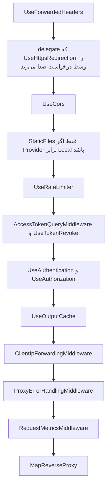

# YARP در ApiGateway

شناسهٔ کاتالوگ: `04-yarp`.

پیش‌نیاز مفهومی: `01-dotnet-aspnetcore.md`. این سند فقط پروکسی معکوس را درس می‌دهد. مسیر کامل از مرورگر تا handler در `30-request-paths.md` است.

نسخهٔ پکیج در `Directory.Packages.props` برابر `Yarp.ReverseProxy` `2.3.0` است و `ApiGateway/ApiGateway.csproj` همان پکیج را بدون نسخهٔ جدا ارجاع می‌دهد. در جلسهٔ فاز A سند YARP `2.3.0` از Context7 خوانده شد: `LoadFromConfig` مسیر را به cluster و آدرس مقصد وصل می‌کند و `MapReverseProxy` درخواست منطبق را به آن مقصد می‌فرستد. در جلسهٔ فاز B خود Context7 در دسترس نبود. معنای policyهای داخلی `anonymous` و `default` اینجا از همان رفتار شناخته‌شدهٔ کتابخانه نقل نمی‌شود، مگر جایی که کد این مخزن اثر را نشان بدهد. رشته‌های پیکربندی خود مخزن قطعی‌اند.

کاتالوگ گفته بود YARP با `LoadFromConfig` و `LoadFromMemory` استفاده می‌شود. هر دو فراخوانی در `ApiGateway/Program.cs` هستند. YARP واقعاً پروکسی این سامانه است. اختلاف این است که آرایهٔ `IdentityServerRoutes.routes` الان خالی است و routeهای داخلش comment شده‌اند. routeهای JSON روی همان builder ثبت شده‌اند. این از روی کد و فایل پیکربندی است، نه از روی dump جدول route در زمان اجرا. ادغام لیست خالی با JSON در `00-yarp-config-investigation.md` است.

## پروکسی معکوس چه مسئله‌ای را حل می‌کند

مرورگر نباید آدرس داخلی هر میکروسرویس را بداند. اگر صفحهٔ پرسنل مستقیم به `http://dejban` وصل شود، احراز هویت، محدودیت نرخ، و CORS باید در هر سرویس تکرار شود و نام سرویس داکر به شبکهٔ کاربر نشت می‌کند.

پروکسی معکوس یک سرویس جلویی است. کلاینت فقط با او حرف می‌زند. او مسیر را با یک جدول مقایسه می‌کند، یک مقصد انتخاب می‌کند، درخواست را به آن مقصد می‌فرستد، و پاسخ را برمی‌گرداند. «معکوس» یعنی مخفی کردن سرور، در برابر forward proxy که معمولاً کلاینت را مخفی می‌کند.

YARP این جدول را داخل ASP.NET Core پیاده می‌کند. route می‌گوید چه مسیری با چه قانونی match شود. cluster می‌گوید آن route به کدام مقصدها برود. destination آدرس پایهٔ یک نمونه است. transform درخواست را قبل از فرستادن عوض می‌کند: پیشوند مسیر، هدر، یا الگوی مسیر.

در این مخزن آن پردازهٔ جلویی `ApiGateway` است. Nginx جلوی مرورگر هنوز یک پروکسی دیگر است و درس `28-nginx-edge.md` است. YARP بین Nginx و سرویس‌های .NET نشسته است.

## ثبت در کد

`ApiGateway/Program.cs` بعد از CORS، JWT، ForwardedHeaders، rate limiter، و output cache این زنجیره را می‌سازد:

```csharp
builder.Services.AddReverseProxy()
    .LoadFromMemory(IdentityServerRoutes.routes, [])
    .LoadFromConfig(builder.Configuration.GetSection(ApiGatewayConfigConstants.IdentityServerProxy))
    .LoadFromConfig(builder.Configuration.GetSection(ApiGatewayConfigConstants.RequestTrackerProxy))
    .LoadFromConfig(builder.Configuration.GetSection(ApiGatewayConfigConstants.DCC))
    .LoadFromConfig(builder.Configuration.GetSection(ApiGatewayConfigConstants.ACLServerProxy))
    .LoadFromConfig(builder.Configuration.GetSection(ApiGatewayConfigConstants.DejbanProxy))
    .LoadFromConfig(builder.Configuration.GetSection(ApiGatewayConfigConstants.ReportingProxy))
    .LoadFromConfig(builder.Configuration.GetSection(ApiGatewayConfigConstants.GateServerProxy))
    .LoadFromConfig(builder.Configuration.GetSection(ApiGatewayConfigConstants.PublicFilesProxy));
```

ثابت‌ها در `ApiGateway/Abstractions/Constants/ConfigConstants.cs`:

| ثابت | بخش configuration |
|---|---|
| `IdentityServerProxy` | `ReverseProxy:IdentityServer` |
| `RequestTrackerProxy` | `ReverseProxy:RequestTracker` |
| `DCC` | `ReverseProxy:DCC` |
| `ACLServerProxy` | `ReverseProxy:ACLServer` |
| `DejbanProxy` | `ReverseProxy:Dejban` |
| `ReportingProxy` | `ReverseProxy:Reporting` |
| `GateServerProxy` | `ReverseProxy:GateServer` |
| `PublicFilesProxy` | `ReverseProxy:PublicFiles` |

`LoadFromMemory` در `IdentityServerRoutes` یک `RouteConfig[]` می‌گیرد. هر دو route آن فایل (`auth-login-route` و `auth-refresh-route`) comment هستند و آرایه خالی است. آرگومان clusterها هم `[]` است. پس این فراخوانی امروز route فعالی اضافه نمی‌کند. login واقعی در JSON با شناسهٔ `auth-login-route-v1` است.

`MapReverseProxy` آخر `Program.cs` است، بعد از middlewareهای خود gateway. درخواست‌هایی که route جداگانهٔ minimal API خورده‌اند، مثل `/health/reporting-routes` و `/api/v1/gateway/request-metrics`، به پروکسی نمی‌رسند اگر مسیریاب آن‌ها را زودتر انتخاب کند. این سند ترتیب ثبت را دیده است، نه برندهٔ نهایی مسیریاب را با یک درخواست زنده.

## دو فایل مقصد را عوض می‌کنند

`WebApplication.CreateBuilder` فایل `appsettings.json` و `appsettings.{Environment}.json` را بار می‌کند. Compose اپ در `docker/compose.backend.yml` محیط را `DockerDevelopment` می‌گذارد. بنابراین فایل مؤثر داکر `ApiGateway/appsettings.DockerDevelopment.json` است. `appsettings.Docker.json` آدرس‌های هم‌شکل دارد. `appsettings.json` و `appsettings.Development.json` و `appsettings-sample.json` به‌جای نام سرویس، `localhost` و پورت دارند.

مقصدهایی که در `appsettings.Docker.json` خوانده شد:

| cluster | آدرس |
|---|---|
| `identity-server-cluster` | `http://identityserver` |
| `request-tracker-cluster` | `http://requesttracker` |
| `dcc-cluster` | `http://dcc` |
| `acl-server-cluster` | `http://aclserver` |
| `dejban-cluster` | `http://dejban` |
| `dejban-baskool-cluster` | `http://host.docker.internal:5053` |
| `reporting-cluster` | `http://reporting` |
| `gate-server-cluster` | `http://gateserver` |
| `dcc-public-files-cluster` | `http://dcc/` |

نمونهٔ development برای دژبان در `appsettings-sample.json` برابر `http://localhost:5042` است. این همان `applicationUrl` پروفایل `Dejban` در launchSettings است، نه آدرس کانتینر. باسکول در داکر به `host.docker.internal` می‌رود، چون `BaskoolService` در Compose اپ سرویس ندارد و در `01-dotnet-aspnetcore.md` به‌عنوان میزبان جدا آمده است.

هر cluster بالا یک destination دارد. سیاست load balancing در این بخش‌ها دیده نشد. با یک مقصد، انتخاب بین چند نمونه موضوع این پیکربندی نیست.

## routeهایی که رفتار را نشان می‌دهند

همه از `appsettings.Docker.json` هستند.

ورود، شناسهٔ `auth-login-route-v1`:

- `ClusterId` برابر `identity-server-cluster`
- `AuthorizationPolicy` برابر `anonymous`
- `RateLimiterPolicy` برابر `Auth_RateLimiter_PerIp`
- مسیر `/Api/v{apiVersion}/Auth/Login/{**catch-all}`
- transformها: `RequestHeaderOriginalHost` برابر true، و هدر `X-Forwarded-Proto` با مقدار ثابت `https`

این route مسیر را بازنویسی نمی‌کند. `{**catch-all}` ته مسیر است. خود `Login` در الگوی مسیر هست، پس بخش متغیر معمولاً خالی است. مقصد `http://identityserver` است و مسیر اصلی، جز همان هدرها، به هویت می‌رسد. اینکه YARP حروف `/api` و `/Api` را یکی می‌گیرد در این فاز با درخواست آزمایش نشد. سند `30-request-paths.md` همین را به‌عنوان hop تأییدنشده علامت می‌زند.

پرسنل، شناسهٔ `personnel-routes-v1`:

- cluster برابر `dejban-cluster`
- `AuthorizationPolicy` برابر `default`
- مسیر `/Api/v{apiVersion}/Personnels/{**catch-all}`
- همان دو transform هدر، بدون حذف پیشوند

پس `/Api/v1/Personnels/GetPersonnels` اگر match شود به `http://dejban` با همان مسیر می‌رود. endpoint دژبان دقیقاً `/api/v{version}/Personnels/GetPersonnels` را map کرده است. پروکسی این تکه را به مسیر دیگری ترجمه نمی‌کند.

Scalar هویت، شناسهٔ `identityserver-scalar-route-v1`:

- policy برابر `anonymous`
- مسیر `/identityserverscalar/{**catch-all}`
- علاوه بر دو هدر، `PathRemovePrefix` برابر `/identityserverscalar`

یعنی پیشوند مستندات قبل از رسیدن به هویت کنده می‌شود. گزارش هم برای `reporting-scalar-route-v1` پیشوند `/reportingscalar` را برمی‌دارد.

hub زمان، شناسهٔ `timeserver-hub`:

- policy برابر `default`
- مسیر `/Api/v{apiVersion}/timeserverhub/{**catch-all}`
- `PathPattern` برابر `/timeserverhub/{**catch-all}`

هویت hub را روی `/timeserverhub` map کرده، نه زیر `/api/v1`. این transform همان اختلاف را پر می‌کند. Nginx در فرانت مسیر `/timeserverhub` را مستقیم به gateway می‌فرستد. route داکر بالا الگوی `/Api/v.../timeserverhub` است. اینکه کدام الگو درخواست Nginx را می‌گیرد به route دیگری هم بستگی دارد که در این بخش دیده شد: باید در فایل دنبال مسیر بدون پیشوند `/timeserverhub` گشت. در همین خواندن، hub گیت جدا است.

hub گیت، شناسهٔ `gate-status-hub`:

- cluster برابر `gate-server-cluster`
- policy برابر `anonymous`
- مسیر `/gateStatusHub/{**catch-all}`
- transform در این بلوک نیست

این با `MapHub<GateConnectionStatusHub>("/gateStatusHub")` در GateServer هم‌نام است. template اناجین‌ایکس که در فاز A خوانده شد این hub را در فهرست upgrade نداشت. این سند فقط route درگاه را ثابت می‌کند.

فایل عمومی در محیط داکر. ریشهٔ `PublicFiles:Provider` در همین فایل برابر `MinIO` است و `Mode` برابر `DccProxy`. چون provider برابر `Local` نیست، شاخهٔ `UseStaticFiles` در `Program.cs` اجرا نمی‌شود. route `minio-public-files-v1` می‌ماند:

- cluster برابر `dcc-public-files-cluster` با آدرس `http://dcc/`
- policy برابر `anonymous`
- مسیر `/files/{**catch-all}`
- `PathPattern` برابر `/api/v1/Files/public/{**catch-all}`

کامنت `Program.cs` می‌گوید provider برابر MinIO یعنی YARP مسیر `/files` را به bucket مین‌یو بفرستد. JSON داکر چیز دیگری می‌گوید: مقصد سرویس `dcc` است و مسیر به API فایل دژبان/DCC بازنویسی می‌شود. نام cluster هنوز `dcc-public-files-cluster` است. پروکسی مستقیم به پورت MinIO در این route نیست. کامنت با پیکربندی فعلی یکی نیست و پیکربندی ملاک اجراست.

باسکول، شناسهٔ `baskool-hub`:

- cluster برابر `dejban-baskool-cluster`
- policy برابر `default`
- مسیر `/baskoolhub/{**catch-all}`
- آدرس داکر `http://host.docker.internal:5053`
- transform در این بلوک نیست

## خط لوله تا پروکسی

ترتیب بعد از `Build` در `ApiGateway/Program.cs`:



`AddTrustedForwardedHeaders` فقط `XForwardedFor` را قبول می‌کند، `ForwardLimit` را 1 می‌گذارد، و IP یا CIDR را از `ForwardedHeaders:KnownProxies` و `ForwardedHeaders:KnownNetworks` پر می‌کند. کامنت کد می‌گوید loopback همیشه مورد اعتماد است و هدر ساختگی کلاینت از جای دیگر نادیده گرفته می‌شود. مقدار IPهای known در این سند نقل نشده است.

`ClientIpForwardingMiddleware` هدر `X-Real-IP` آمده از کلاینت را پاک می‌کند و IP حل‌شدهٔ `GetClientIp` را دوباره می‌گذارد. `GetClientIp` از `Connection.RemoteIpAddress` می‌خواند، بعد از آنکه `UseForwardedHeaders` اگر پروکسی مورد اعتماد باشد آن را عوض کرده باشد. IPv4-mapped IPv6 به IPv4 تبدیل می‌شود.

Rate limiter در `ApiGateway/Abstractions/Extensions/ServiceCollectionExtensions.cs`:

- policy نام‌دار `Auth_RateLimiter_PerIp`: پنجرهٔ لغزان 30 ثانیه، سقف 6 مجوز، 6 segment، صف 0، کلید برابر IP
- `GlobalLimiter`: پنجرهٔ یک دقیقه، سقف 500، یک segment، صف 0، کلید برابر IP
- رد شدن: وضعیت 429، هدر `Retry-After` اگر metadata باشد، و عنوان فارسی مگر اینکه `Accept-Language` دقیقاً `en-US` باشد

اسم policy روی route ورود با اسم ثبت‌شده یکی است. `UseRateLimiter` در خط لوله هست. اینکه متادیتای YARP با کلید `RateLimiterPolicy` همان policy را برای هر route انتخاب می‌کند، در این جلسه از سورس YARP دوباره خوانده نشد. limiter سراسری چون `GlobalLimiter` ست شده، قرارداد خود middleware نرخ ASP.NET Core است و به route خاص وابسته نیست.

`AddCustomCachePolicies` یک policy به نام `Default_CachePolicy` با انقضای 20 ثانیه می‌سازد و `UseOutputCache` در خط لوله است. در JSONهای `ApiGateway` ارجاعی به `Default_CachePolicy` پیدا نشد. پس ثبت policy ثابت است و استفادهٔ یک route از آن ثابت نیست. نباید گفت پاسخ APIها بیست ثانیه cache می‌شوند.

`RequestMetricsMiddleware` برای GET و POST و PUT و DELETE زمان و status را در `RequestMetricsStore` نگه می‌دارد. endpoint `/api/v1/gateway/request-metrics` این snapshot را با `RequireAuthorization` برمی‌گرداند. asset و health و scalar در کامنت middleware از اندازه‌گیری مستثنا شده‌اند. شرط دقیق `ShouldTrack` از خط 35 به بعد است و در این درس فقط وجود استثنا نقل می‌شود.

## خطا، امنیت، و مشاهده‌پذیری

`ProxyErrorHandlingMiddleware` بعد از `next` اگر وضعیت 502 یا 500 باشد نام cluster را از `IReverseProxyFeature` می‌خواند. اگر feature نباشد، از روی زیررشتهٔ مسیر حدس می‌زند. جدول نام نمایشی این clusterها را دارد: identity، request tracker، DCC، ACL، dejban، reporting، gate، و `public-files-cluster`.

`dejban-baskool-cluster` و `dcc-public-files-cluster` در آن دیکشنری نیستند. برای باسکول، اگر feature پر باشد، `GetValueOrDefault` خود cluster id را برمی‌گرداند چون کلید نیست. اگر feature خالی باشد و مسیر `/baskoolhub` با هیچ `Contains` آن متد نخورد، `systemName` برابر `Unknown System` می‌شود.

برای درخواست با `Accept: text/html` به `/error/503?system=...` redirect می‌کند. برای بقیه، وضعیت را 503 می‌کند و JSON با `systemName` و پیام فارسی یا انگلیسی بر اساس وجود `fa` در `Accept-Language` می‌نویسد. یعنی 500 سرویس مقصد هم برای کلاینت API به شکل «سیستم در دسترس نیست» درمی‌آید. خطای دامنهٔ 500 با قطع بودن پردازه قاطی می‌شود. این رفتار کد است، نه حدس.

میان‌افزار بدنهٔ پاسخ را قبل از `next` عوض نمی‌کند و `originalBodyStream` را فقط به متد نوشتن می‌دهد. اگر پاسخ از قبل شروع شده باشد، نوشتن دوباره می‌تواند پرتاب شود. این مسیر در این فاز اجرا نشد.

احراز هویت دو لایه است. gateway خودش `AddCustomJwtAuth` و `UseAuthorization` دارد و بسیاری routeها `AuthorizationPolicy` برابر `default` دارند. سرویس مقصد هم اغلب `RequireAuthorization` دارد. توکن باید از gateway رد شود تا به مقصد برسد. routeهای `anonymous` مثل login این سد اول را برمی‌دارند. معنای دقیق کلمهٔ `default` در موتور YARP در این جلسه از سند رسمی دوباره گرفته نشد. آنچه قطعی است: login در JSON مقدار `anonymous` دارد و `AuthController.Login` هم `[AllowAnonymous]` است. پرسنل در JSON مقدار `default` دارد و `GetPersonnels` هم `RequireAuthorization` دارد.

`X-Forwarded-Proto` همیشه به `https` ست می‌شود، حتی اگر زنجیره تا gateway روی HTTP داخلی داکر باشد. سرویس مقصد اگر redirect یا لینک مطلق بسازد، scheme را https می‌بیند. این با `RequestHeaderOriginalHost` کنار هم است تا میزبان اصلی مرورگر حفظ شود و scheme از دید مقصد https باشد.

health چک routeهای reporting در کد بخش `Reporting:Routes` را می‌خواند. routeهای واقعی زیر `ReverseProxy:Reporting` هستند، از جمله `reporting-js-routes-v1` و `reporting-health-assets-route-v1` که در فایل داکر وجود دارند. رشتهٔ بخش در endpoint سلامت با مسیر واقعی configuration یکی نیست. استنباط قوی: `GetSection("Reporting:Routes")` آن routeها را نمی‌بیند و چون `configured` false می‌شود پاسخ 503 است. این استنباط اجرا نشده است.

## مزیت، هزینه، اشتباه

مزیت: یک جدول route جلوی هشت پردازه است. تغییر مقصد داکر فقط آدرس cluster را عوض می‌کند. login می‌تواند anonymous و rate-limit باشد در حالی که پرسنل `default` است. transform اجازه می‌دهد hub زیر مسیر API به مسیر واقعی hub برود.

هزینه: جدول بزرگ و تکراری است. هر خانوادهٔ URL یک بلوک JSON دارد. غلط بودن یک رشتهٔ مسیر یعنی 404 از خود gateway، نه از سرویس. دو فایل development و docker مقصد متفاوت دارند. باسکول به host می‌رود و بقیه به DNS داکر.

اشتباه رایج:

- فرض اینکه `LoadFromMemory` login را می‌سازد. آرایه خالی است.
- فرض اینکه کامنت MinIO یعنی `/files` مستقیم به مین‌یو می‌رود. در داکر به `http://dcc/` و مسیر `/api/v1/Files/public/...` می‌رود.
- فرض اینکه `localhost:5042` مقصد کانتینر است. آن آدرس مال sample و launchSettings است.
- فرض اینکه output cache بیست‌ثانیه‌ای روی API روشن است. policy ثبت شده و ارجاع route پیدا نشد.
- یکی گرفتن 500 دامنه با 502 قطع سرویس، چون middleware هر دو را برای API به 503 دوستانه تبدیل می‌کند.

سناریوی شکست:

- سرویس `dejban` در شبکهٔ داکر نیست: YARP 502 می‌دهد و middleware برای کلاینت غیر HTML بدنهٔ 503 با نام Dejban Core می‌سازد، اگر feature cluster پر باشد.
- KnownProxies خالی است و Nginx از IP غیر loopback وصل است: `UseForwardedHeaders` هدر را نادیده می‌گیرد، rate limit روی IP خود Nginx جمع می‌شود، و `X-Real-IP` پایین‌دست IP پروکسی است نه کاربر.
- محیط Development با فایل localhost بالا است ولی سرویس‌ها فقط داخل Compose هستند: پروکسی به `localhost:5042` از داخل کانتینر gateway به خودش می‌رود نه به دژبان.
- health گزارش همیشه قرمز می‌ماند اگر مسیر configuration واقعاً اشتباه باشد، در حالی که خود reporting سالم است.

## حقایق، استنباط، پرسش باز

حقایق: ثبت `AddReverseProxy` و `MapReverseProxy`، خالی بودن `IdentityServerRoutes.routes`، مسیر و cluster و transform نمونه‌های بالا، آدرس‌های Docker در برابر localhost نمونه، rate limit 6 و 500، و منطق 502/500 در middleware.

استنباط‌ها:

- محیط `DockerDevelopment` فایل `appsettings.DockerDevelopment.json` را روی `appsettings.json` می‌اندازد، چون این قرارداد host است. آدرس `http://dejban` در آن فایل هم هست.
- health routeهای reporting به‌خاطر اختلاف `Reporting:Routes` و `ReverseProxy:Reporting` ناسالم برمی‌گردد. اجرا نشده است.
- match حروف بزرگ و کوچک مسیر login هنوز آزمایش نشده است.

پرسش‌های باز:

- فهرست کامل routeها در این سند نیامده است. فقط نمونه‌هایی که رفتار متفاوت دارند.
- آیا YARP برای `RateLimiterPolicy` متادیتا را خودش به middleware نرخ وصل می‌کند؟ نام‌ها یکی است. سورس کتابخانه در این جلسه باز نشد.
- مقدار `ForwardedHeaders:KnownProxies` در configuration محیطی نقل نشد.
- Context7 در فاز B در دسترس نبود.

## رابطه با بقیه

| سند بعدی | پیوند |
|---|---|
| `30-request-paths.md` | login و پرسنل از همین routeها رد می‌شوند |
| `05-jwt-identity.md` | JWT روی خود gateway و دوباره روی مقصد |
| `19-redis.md` | blacklist توکن قبل از `MapReverseProxy` |
| `16-dcc-s3.md` | `/files` در داکر به DCC می‌رود، نه مستقیم به MinIO |
| `13-signalr.md` | transform هاب زمان و route هاب گیت و باسکول |
| `28-nginx-edge.md` | Nginx فقط `/api/` را به پورت `7036` می‌دهد |

## سؤال‌های مصاحبه

### 1. پروکسی معکوس با forward proxy چه فرقی دارد و YARP این‌جا کدام است؟

Forward proxy معمولاً جلوی کلاینت است و درخواست او را به اینترنت می‌برد. Reverse proxy جلوی سرورهاست و از دید کلاینت خودش سرور است. `ApiGateway` با `Yarp.ReverseProxy` 2.3.0 درخواست را به clusterهایی مثل `dejban-cluster` می‌فرستد. مرورگر آدرس `http://dejban` را نمی‌بیند. Nginx قبل از YARP هم reverse proxy است، ولی مرز این سند خود YARP است.

دنباله: چرا هم Nginx و هم YARP لازم شده‌اند؟

جواب: Nginx در Compose فرانت اپ‌های Next و Vite را هم سرو می‌کند و `/api/` را به gateway می‌دهد. YARP داخل شبکهٔ بک‌اند مسیر API را بین هویت، دژبان، ACL و بقیه تقسیم می‌کند و JWT و rate limit را روی همان پردازه دارد. یکی جای دیگری را در این مخزن کامل نکرده است.

### 2. route و cluster و destination در پیکربندی داکر چیست؟

Route قانون match است. `personnel-routes-v1` مسیر `/Api/v{apiVersion}/Personnels/{**catch-all}` را به cluster `dejban-cluster` وصل می‌کند. Cluster مجموعهٔ مقصد است. destination آدرس پایه است: در `appsettings.Docker.json` برای این cluster برابر `http://dejban`. YARP مسیر matchشده را، مگر transform عوضش کند، به آن پایه می‌فرستد.

دنباله: اگر دو replica از دژبان داشته باشیم این فایل چه کم دارد؟

جواب: فقط یک destination به نام `destination1` هست و سیاست load balancing در این بلوک نیست. اضافه کردن replica یعنی destination دوم و تصمیم سلامت و توزیع. امروز این کار در JSON دیده نمی‌شود.

### 3. چرا `LoadFromMemory` هست اگر login از JSON می‌آید؟

`Program.cs` هر دو را صدا می‌زند. `IdentityServerRoutes.routes` آرایهٔ خالی است و routeهای قدیمی `/V1/Auth/Login` داخل comment هستند، با یک `PathPattern` که پیشوند را عوض می‌کرد. route فعال `auth-login-route-v1` در JSON است، policy آن `anonymous` است، و مسیر را بازنویسی نمی‌کند. provider حافظه صفر route اضافه می‌کند و routeهای JSON را پاک نمی‌کند. این ادغام در زمان اجرا شمرده نشده است.

دنباله: اگر کسی comment را بدون توجه به JSON برگرداند چه می‌شود؟

جواب: دو route ممکن است برای login ثبت شود. YARP در تداخل مسیر یک برنده انتخاب می‌کند. مسیر comment قدیمی `/V1/Auth/Login` حتی با JSON فعلی یکی نیست، ولی `PathPattern` آن پاسخ را به `/Auth/Login` می‌برد که با controller فعلی `/api/v1/Auth/Login` فرق دارد. فعال کردن comment بدون تست، مسیر دومی می‌سازد که به action فعلی نمی‌خورد.

### 4. transformهای `PathRemovePrefix` و `PathPattern` و «هیچ» چه فرقی دارند؟

`PathRemovePrefix` روی Scalar هویت پیشوند `/identityserverscalar` را حذف می‌کند تا سرویس OpenAPI خودش را ببیند. `PathPattern` روی hub زمان مسیر `/Api/v.../timeserverhub/...` را به `/timeserverhub/...` عوض می‌کند، چون `MapHub` هویت زیر `/api` نیست. route پرسنل هیچ‌کدام را ندارد، پس مسیر API تا `GetPersonnels` دست نمی‌خورد. `RequestHeaderOriginalHost` و ست کردن `X-Forwarded-Proto` به `https` روی هر دو مدل هست، به‌جز چند hub که فقط path دارند.

دنباله: چرا scheme اجباری https خطرناک یا مفید است؟

جواب: مفید است اگر سرویس لینک مطلق را با scheme درخواست بسازد و مرورگر فقط https را قبول کند. خطرناک است اگر مقصد فکر کند اتصال خودش https بوده و cookie امن یا redirect را اشتباه بسازد، در حالی که hop داخلی `http://dejban` است. کد مقدار را ثابت `https` گذاشته است.

### 5. ورود چطور هم anonymous است و هم rate limit دارد؟

`auth-login-route-v1` مقدار `AuthorizationPolicy` را `anonymous` گذاشته تا بدون توکن به هویت برسد. همان route مقدار `RateLimiterPolicy` را `Auth_RateLimiter_PerIp` گذاشته. آن policy در کد سقف 6 درخواست در 30 ثانیه برای هر IP است و صف ندارد. علاوه بر آن `GlobalLimiter` سقف 500 در دقیقه برای هر IP دارد. رد شدن 429 است و پیام پیش‌فرض فارسی است.

دنباله: اگر همهٔ کاربرها از یک Nginx بیایند و KnownProxies خالی باشد، این سقف به چه کسی می‌خورد؟

جواب: `GetClientIp` از `RemoteIpAddress` بعد از ForwardedHeaders است. اگر هدر فوروارد قبول نشود، IP همان Nginx است و 6 بار login در 30 ثانیه برای کل آن پروکسی است، نه برای هر مرورگر. این همان دلیلی است که `ForwardLimit` و KnownProxies در کد آمده‌اند.

### 6. خطای 502 با خطای 500 دامنه در این gateway چه فرقی برای کلاینت دارد؟

برای کلاینت API تقریباً هیچ. `ProxyErrorHandlingMiddleware` هر دو وضعیت را بعد از `next` می‌گیرد. اگر `Accept` شامل `text/html` باشد redirect به `/error/503` می‌کند. وگرنه وضعیت را 503 می‌کند و JSON با `systemName` می‌نویسد. نام از `IReverseProxyFeature` یا از حدس مسیر می‌آید. `dejban-cluster` نام نمایشی Dejban Core دارد.

دنباله: چرا این برای دیباگ گران است؟

جواب: handler دژبان ممکن است 500 با ProblemDetails ساخته باشد. middleware بدنه را با پیام «سیستم در دسترس نیست» عوض می‌کند. پشتیبانی فکر می‌کند پردازه پایین است، در حالی که exception دامنه بوده. لاگ middleware وضعیت اصلی را قبل از این تبدیل با `LogWarning` می‌نویسد. آن لاگ جای بدنهٔ کلاینت را نمی‌گیرد.

### 7. `/files` در داکر به MinIO می‌رود یا به DCC؟

`PublicFiles:Provider` در `appsettings.Docker.json` برابر `MinIO` است، پس `UseStaticFiles` اجرا نمی‌شود. route `minio-public-files-v1` مقصد `http://dcc/` دارد و مسیر را به `/api/v1/Files/public/{**catch-all}` تبدیل می‌کند. `Mode` برابر `DccProxy` است. کامنت `Program.cs` که از bucket مین‌یو حرف می‌زند با این JSON یکی نیست. MinIO را خود DCC با `S3FileStorage` استفاده می‌کند. آن درس مال سند فایل است، نه مال این route.

دنباله: چه زمانی دیسک محلی سرو می‌شود؟

جواب: فقط اگر `PublicFiles:Provider` خالی یا `Local` باشد. آن وقت `PhysicalFileProvider` زیر `/files` از پوشهٔ `uploads/public` یا در محیط غیر Development/Production از `/app/public-assets/public` فایل می‌دهد. در فایل داکر خوانده‌شده این شاخه خاموش است.

### 8. health چک `/health/reporting-routes` چه چیزی را واقعاً نگاه می‌کند؟

کد بخش `Reporting:Routes` را می‌خواند و شش نام را لازم دارد، از جمله `reporting-js-routes-v1` و `reporting-health-assets-route-v1`. این نام‌ها در `appsettings.Docker.json` زیر `ReverseProxy` و بعد `Reporting` و بعد `Routes` هستند. رشتهٔ `GetSection` پیشوند `ReverseProxy` را ندارد. اگر provider دیگری آن بخش ریشه را نسازد، `Exists` false است و endpoint وضعیت 503 با `Unhealthy` برمی‌گرداند، حتی اگر YARP همان route را برای ترافیک واقعی بار کرده باشد.

دنباله: این چه نوع باگی است، باگ پروکسی یا باگ مشاهده‌پذیری؟

جواب: بار کردن YARP از `ReverseProxy:Reporting` است و به این endpoint وابسته نیست. باگ در پروب است. هشدار سلامت دروغ می‌گوید سرویس route ندارد. اصلاح مفهومی این است که همان بخشی خوانده شود که `LoadFromConfig` می‌خواند. این سند آن کد را عوض نکرده است.

### 9. چرا آدرس داکر با launchSettings فرق دارد و اشتباه گرفتنشان چه می‌کند؟

launchSettings دژبان `http://localhost:5042` است و sample و `appsettings.json` gateway همان را برای `dejban-cluster` دارند. داخل Compose، پردازهٔ gateway لوکال‌هاست خودش است نه دژبان. `appsettings.DockerDevelopment.json` آدرس را `http://dejban` گذاشته تا DNS شبکهٔ Compose پردازه را پیدا کند. باسکول استثناست: `host.docker.internal:5053`، چون در Compose اپ نیست.

دنباله: اگر کسی فایل Docker را روی ماشین توسعه بدون Compose اجرا کند چه می‌شود؟

جواب: نام `dejban` resolve نمی‌شود، مگر در hosts یا شبکهٔ داکر باشد. پروکسی 502 می‌دهد. برعکس، اگر کانتینر gateway با فایل localhost بالا بیاید به پورت داخل خودش وصل می‌شود نه به سرویس خواهر.

### 10. یک درخواست پرسنل از دید فقط YARP چه مراحلی دارد؟

درخواست به `MapReverseProxy` می‌رسد اگر middleware قبلی آن را تمام نکرده باشد. rate limit سراسری ممکن است 429 بدهد. authorization مسیر `default` ممکن است 401 بدهد اگر توکن از `UseAuthentication` معتبر نباشد. اگر رد شود، route `personnel-routes-v1` match می‌شود، cluster `dejban-cluster` تنها destination را انتخاب می‌کند، هدر host اصلی و `X-Forwarded-Proto: https` ست می‌شود، و درخواست به `http://dejban` با همان مسیر API می‌رود. پاسخ از همان راه برمی‌گردد. اگر اتصال شکست بخورد، middleware خطا برای API یک 503 با نام سیستم می‌سازد.

دنباله: کجای این داستان هنوز آزمایش نشده است؟

جواب: تطبیق حروف `/api/v1/personnels/...` با الگوی `/Api/v{apiVersion}/Personnels/...`، و اینکه policy کلمهٔ `default` دقیقاً کدام scheme احراز هویت YARP را صدا می‌زند. کد مقصد و JSON هر دو authorization می‌خواهند. یک درخواست زنده در این فاز زده نشد.

## مرور

YARP 2.3 پروکسی `ApiGateway` است و با چند `LoadFromConfig` از بخش‌های `ReverseProxy:*` پر می‌شود. `LoadFromMemory` امروز خالی است. مقصد داکر نام سرویس است و مقصد sample برابر localhost است. transform همیشگی نیست: پرسنل مسیر را حفظ می‌کند، Scalar پیشوند را برمی‌دارد، hub زمان مسیر را عوض می‌کند، و `/files` در داکر به API دی‌سی‌سی می‌رود نه به مین‌یو.

اگر یک نمودار را باید به خاطر بسپارید، همان خط لوله تا `MapReverseProxy` است، به‌خصوص rate limit و authorization قبل از پروکسی، و تبدیل 500 و 502 به پیام 503 بعد از آن.
