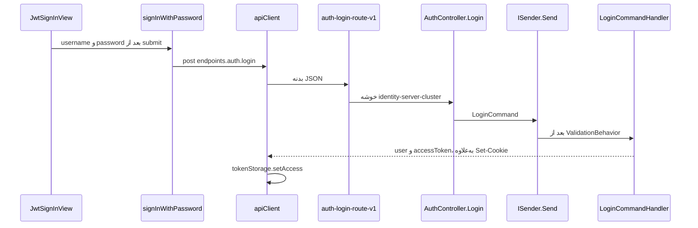
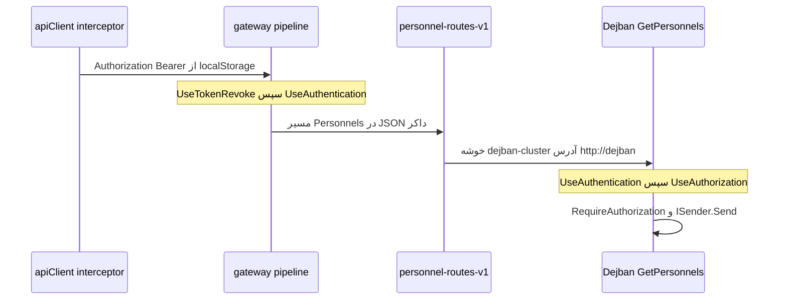

# JWT و هویت در این مخزن

شناسهٔ کاتالوگ: `05-jwt-identity`.

این درس روی `01-dotnet-aspnetcore.md`، `02-configuration.md`، `04-yarp.md`، و `30-request-paths.md` سوار است. مسیر صفحه تا handler در `00-login-execution-path.md` است. اینجا خود توکن، اعتبارسنجی، و زمان خواندن `JwtSettings` شرح داده می‌شود.

نام پروژه `IdentityServer` است. ثبت هویت با `AddIdentity` و `ApplicationDbContext : IdentityDbContext<...>` انجام می‌شود. در `*.csproj` ارجاعی به Duende پیدا نشد. مقدار کلید امضا، رمز کاربر، و connection string در این سند نیست. هیچ درخواستی اجرا نشد.

## احراز هویت و مجوز

احراز هویت جواب این سؤال است: این درخواست مال کیست؟ مجوز جواب سؤال بعدی است: همان شخص اجازهٔ این کار را دارد؟

یک مثال ساده: نگهبان درِ ساختمان کارت را می‌بیند و اسم را ثبت می‌کند. این احراز هویت است. اینکه همان شخص اجازهٔ ورود به اتاق سرور را دارد، مجوز است. کارت جعلی در مرحلهٔ اول رد می‌شود. کارت درست با اتاق اشتباه در مرحلهٔ دوم.

در این مخزن، login هویت را ثابت می‌کند و یک توکن می‌سازد. `GetPersonnels` با `RequireAuthorization()` فقط می‌گوید درخواست باید کاربر شناخته‌شده داشته باشد. نقش، permission، و سایت در توکن login نیستند. بعد از قبول امضا، `CustomClaimsTransformation` در سرویسی که `AddAuthorizationInternal` را صدا زده claimهای سایت را جداگانه بار می‌کند. جزئیات آن policyها درس `06-tenancy-authorization` است.

## JWT چیست

JWT یک رشتهٔ امضاشده است که سرویس می‌تواند بدون مراجعه به جدول نشست، صاحبش را بشناسد. سه بخش دارد که با نقطه جدا می‌شوند.

بخش اول header است. نوع توکن و نام الگوریتم را می‌گوید. `TokenProvider` الگوریتم را `SecurityAlgorithms.HmacSha256` می‌گذارد.

بخش دوم payload است. claimها این‌جا هستند: شناسهٔ کاربر، زمان انقضا، issuer، و audience. این بخش فقط Base64 است. هر کس رشته را ببیند محتوایش را می‌خواند. امضا محتوا را مخفی نمی‌کند.

بخش سوم signature است. سرویس با کلید مشترک، header و payload را دوباره حساب می‌کند. اگر نتیجه با بخش سوم یکی باشد، رشته بعد از صدور عوض نشده است. اگر کلید لو برود، دیگران هم می‌توانند توکن معتبر بسازند.

صدور و اعتبارسنجی دو کار جدا هستند. فقط سرویس هویت توکن را می‌سازد، چون `TokenProvider` آن‌جاست. gateway، دژبان، و بقیهٔ سرویس‌هایی که `AddCustomJwtAuth` را صدا می‌زنند همان کلید را برای بررسی دارند. آن‌ها توکن جدید نمی‌سازند.

## claim، issuer، audience، کلید، انقضا، و clock skew

claim یک جفت نام و مقدار داخل payload است. access token این مخزن `ClaimTypes.NameIdentifier` را برابر `user.Id` می‌گذارد و برای هر عضو `user.Sites` یک claim با نام `CustomClaims.Site`، یعنی رشتهٔ `"site"`، و مقدار شناسهٔ سایت. نقش و permission داخل این توکن نیستند.

issuer می‌گوید چه کسی توکن را ساخته. audience می‌گوید توکن برای کدام شنونده است. هر دو در `JwtSettings` هستند و `TokenProvider` آن‌ها را روی `SecurityTokenDescriptor` می‌گذارد.

کلید امضا در `AccessTokenSecret` است و refresh کلید جدا `RefreshTokenSecret` دارد. هر دو از نوع متقارن‌اند: همان رشته‌ای که امضا می‌کند، همان رشته‌ای که بررسی می‌کند. این با کلید عمومی/خصوصی فرق دارد. اینجا همهٔ سرویس‌های بررسی‌کننده باید همان راز را داشته باشند.

`ExpirationInMinutes` عمر access token است. `SessionExpirationInDays` عمر refresh token و همچنین `MaxAge` کوکی است. این دو عدد یکی نیستند.

clock skew فاصلهٔ ساعت مجاز بین دو ماشین است. `AddCustomJwtAuth` آن را `TimeSpan.Zero` می‌گذارد. در سورس `Microsoft.IdentityModel.Tokens` نسخهٔ 8.0.1، که بستهٔ `Microsoft.AspNetCore.Authentication.JwtBearer` نسخهٔ 10.0.0 از راه `Microsoft.IdentityModel.Protocols.OpenIdConnect` 8.0.1 به آن می‌رسد، مقدار پیش‌فرض `DefaultClockSkew` برابر 300 ثانیه است. این کد آن پیش‌فرض را برای bearer صفر می‌کند. توکن دقیقاً بعد از `exp` مردود است، مگر مسیر دیگری `ValidateLifetime` را خاموش کند. مسیر refresh همین کار را می‌کند و پایین‌تر جدا آمده است.

در همان سورس 8.0.1 سازندهٔ `TokenValidationParameters` این پیش‌فرض‌ها را می‌گذارد: `ValidateIssuer`، `ValidateAudience`، و `ValidateLifetime` برابر true، `RequireSignedTokens` و `RequireExpirationTime` و `RequireAudience` برابر true، و `ValidateIssuerSigningKey` برابر false. کد این مخزن مورد آخر را true می‌کند و `IssuerSigningKey` را از `AccessTokenSecret` می‌سازد. `ValidAlgorithms` را محدود نمی‌کند. الگوریتم قابل‌قبول، پیش‌فرض کتابخانه می‌ماند. وضعیت پیش‌فرض‌ها: از روی سورس tag 8.0.1 خوانده شد. اجرای یک توکن دستکاری‌شده در این فاز انجام نشد.

## access token و refresh token

در مفهوم عمومی، access token کوتاه‌عمر است و به API نشان داده می‌شود. refresh token بلندتر است و فقط برای گرفتن access جدید به سرویس هویت برمی‌گردد. دزدیده‌شدن access تا زمان انقضایش خطر دارد. refresh اگر جدا نگه داشته شود، سطح حمله را کوچک‌تر می‌کند.

این مخزن هر دو را دارد. این یک فرض از روی نام کلاس نیست.

`CreateAccessToken` توکن را با `AccessTokenSecret` می‌سازد و `Expires` را `DateTime.UtcNow.AddMinutes(ExpirationInMinutes)` می‌گذارد.

`CreateRefreshToken` توکن دیگری با `RefreshTokenSecret` می‌سازد. claimهایش `JwtRegisteredClaimNames.Jti` و `ClaimTypes.Hash` هستند. عمرش `AddDays(SessionExpirationInDays)` است. مقدار claim هش، خروجی `GenerateUserTokenAsync` از ASP.NET Core Identity است و `SetAuthenticationTokenAsync` همان هش را کنار کاربر ذخیره می‌کند. پس refresh دو لایه دارد: امضای JWT با کلید refresh، و تطبیق هش با رکورد Identity.

`RefreshCommandHandler` هر دو توکن را می‌خواند. access را با `GetClaimsPrincipalFromExpiredAccessTokenAsync` بررسی می‌کند و در آن پارامتر `ValidateLifetime = false` است، چون refresh معمولاً وقتی صدا زده می‌شود که access تمام شده باشد. refresh را با کلید refresh بررسی می‌کند. بعد `VerifyUserTokenAsync` هش را با ذخیرهٔ سرور تطبیق می‌دهد. اگر هش نخواند، کوکی‌ها پاک می‌شوند و `Errors.Auth.InvalidToken` برمی‌گردد. اگر بخواند، جفت تازه ساخته می‌شود و همان `jti` دوباره به `CreateRefreshToken` داده می‌شود.

## JWT bearer در ASP.NET Core، آن‌طور که این کد می‌بنددش

`AddCustomJwtAuth` در `Common/Abstractions/Extensions/ServiceCollectionExtensions.cs` طرح پیش‌فرض را `JwtBearerDefaults.AuthenticationScheme` می‌گذارد و `AddJwtBearer` را صدا می‌زند. `RequireHttpsMetadata` برابر false است. این پرچم مربوط به آدرس metadata طرح bearer است. این کد اصلاً metadata اوپن‌آیدی را از شبکه نمی‌خواند. کلید را از پیکربندی می‌گیرد.

`OnMessageReceived` توکن را با این ترتیب برمی‌دارد. اگر هدر `Authorization` خالی نباشد، همان را به رفتار پیش‌فرض bearer می‌سپارد. اگر خالی باشد و کوکی `ConfigConstants.AccessToken` مقدار داشته باشد، `context.Token` را از کوکی پر می‌کند. بعد query با نام `access_token`، و بعد query با نام `AccessToken`. نام ثابت کوکی و query برابر `"AccessToken"` است.

`AddAuthorization()` بدون policy سفارشی صدا زده می‌شود. `RequireAuthorization()` بدون آرگومان، مثل `GetPersonnels`، به policy پیش‌فرض همان ثبت وصل است. این مخزن آن policy را عوض نمی‌کند. معنای دقیق «کاربر احراز هویت شده» قرارداد خودِ API بدون آرگومان است. یک درخواست بدون توکن در این فاز زده نشد.

جای توکن فقط هدر نیست. کوکی و query هم پذیرفته می‌شوند. `AccessTokenQueryMiddleware` روی gateway، اگر هدر خالی باشد، `access_token` را از query یا از query داخل `Referer` به هدر `Authorization` کپی می‌کند تا مسیرهای StimulSoft به `[Authorize]` بخورند.

## کلید و توکن را کجا باید نگه داشت

کلید امضا باید بیرون از مخزن و جدا برای هر محیط باشد. توکن access اگر در محلی باشد که اسکریپت صفحه می‌خواند، با XSS دزدیده می‌شود. کوکی `HttpOnly` را اسکریپت صفحه نمی‌خواند. `Secure` یعنی مرورگر آن را فقط روی HTTPS بفرستد. `SameSite=None` یعنی کوکی روی درخواست cross-site هم برود، و مرورگرهای فعلی این حالت را با `Secure` می‌خواهند.

توکن داخل query در لاگ، تاریخچه، و هدر `Referer` می‌ماند. این مسیر برای گزارش و طراح StimulSoft در کد هست. استفادهٔ عمومی از آن سطح حمله را بزرگ می‌کند.

## شکست‌های معمول

توکن نرسیده باشد: bearer کاربر را خالی می‌گذارد و endpoint دارای `[Authorize]` یا `RequireAuthorization()` درخواست را رد می‌کند.

امضا نخواند: کلید صدور و کلید بررسی یکی نیست، یا رشته بعد از صدور عوض شده است.

`exp` گذشته باشد و `ValidateLifetime` روشن باشد: با `ClockSkew` صفر، تحمل پنج‌دقیقه‌ای پیش‌فرض کتابخانه این‌جا حذف شده است.

issuer یا audience با `ValidIssuer` و `ValidAudience` یکی نباشد. هر دو در این کد از `JwtSettings` پر می‌شوند و پیش‌فرض کتابخانه اعتبارسنجی‌شان را روشن می‌گذارد.

کوکی refresh به سرویس هویت نرسد: `GetRefreshToken` فقط کوکی `RefreshToken` را می‌خواند. هدر `Authorization` جای refresh را نمی‌گیرد.

توکن در فهرست ابطال باشد: `TokenRevokeMiddleware` قبل از authentication وضعیت 401 می‌گذارد. این middleware باید واقعاً در pipeline باشد. پایین‌تر معلوم می‌شود دژبان سرویس فهرست را ثبت می‌کند و `UseTokenRevoke` را صدا نمی‌زند.

## جریان login، از صفحه تا پاسخ

نمودار فقط پرش‌هایی است که از روی import، ثبت DI، یا کلید route خوانده شد. حروف `/api` و `/Api` اجرا نشد و همچنان `Runtime verification pending` است. سندش `00-api-path-case-investigation.md` است.

1. `apps/main/src/auth/view/jwt/jwt-sign-in-view.jsx` تابع `signInWithPassword` را از `../../context/jwt` import می‌کند و در submit همان را با `username` و `password` صدا می‌زند. وضعیت: `verified`. اسکیمای Zod در `00-login-execution-path.md` است و اینجا تکرار نمی‌شود.

2. `apps/main/src/auth/context/jwt/action.js` تابع `signInWithPassword` از `apiClient.post(endpoints.auth.login, { username, password })` استفاده می‌کند. `endpoints.auth.login` در `packages/api-client/src/axiosInstance.ts` برابر `'/auth/login'` است. `createApiClient` مقدار `withCredentials: true` دارد. وضعیت: `verified`. اینکه بدنهٔ `username` به ویژگی `UserName` روی `LoginCommand` بچسبد اجرا نشد. وضعیت bind: `runtime-unverified`.

3. route به نام `auth-login-route-v1` در `ApiGateway/appsettings.DockerDevelopment.json` مسیر `/Api/v{apiVersion}/Auth/Login/{**catch-all}`، خوشهٔ `identity-server-cluster`، `AuthorizationPolicy` برابر `anonymous`، و `RateLimiterPolicy` برابر `Auth_RateLimiter_PerIp` دارد. transformها فقط `RequestHeaderOriginalHost` و `X-Forwarded-Proto=https` هستند. تبدیلی که هدر `Authorization` یا `Cookie` را حذف کند در این route نیست. رسیدن آن هدرها به مقصد از روی نبودن transform حذف است، نه از روی لاگ پروکسی. وضعیت: `inferred`. رشتهٔ `"Anonymous"` داخل DLL بستهٔ YARP 2.3.0 هست. بدنهٔ متدی که `"anonymous"` داخل JSON را با آن مقایسه کند در این فاز خوانده نشد. اثر دقیق این policy روی gateway: `unresolved`.

4. `AuthController` در `Microservices/IdentityServer/Controllers/AuthController.cs` از `ApiController` ارث می‌برد. خود `ApiController` ویژگی `[Authorize]` دارد. متد `Login` ویژگی `[AllowAnonymous]` و `[HttpPost("Login")]` دارد و آرگومان `[FromBody] LoginCommand` را به `_mediator.Send` می‌دهد. `ISender` همان ثبت MediatR است. وضعیت: `verified`.

5. `LoginCommand` یک record با `UserName` و `Password` و `IRequest<ErrorOr<object>>` است. `ValidationBehavior` در `AddApplication` با `AddOpenBehavior` ثبت شده و `LoginCommandValidator` را، اگر برای همان نوع ثبت شده باشد، قبل از handler اجرا می‌کند. validator خالی‌نبودن هر دو فیلد را می‌خواهد و برای شکل ایمیل، موبایل، و نام کاربری قاعدهٔ جدا دارد. وضعیت ثبت: `verified`.

6. `LoginCommandHandler` کاربر را با `PhoneNumber`، یا `NormalizedUserName`، یا `NormalizedEmail` پیدا می‌کند و `Sites` و `UserTokens` را include می‌کند. نبود کاربر `Errors.Auth.InvalidCredentials` است. رمز با `CheckPasswordSignInAsync(user, command.Password, lockoutOnFailure: true)` چک می‌شود. این متد `PasswordSignInAsync` نیست. کوکی طرح Identity این‌جا ساخته نمی‌شود. قفل‌بودن `Errors.Auth.LockedOut` است. `IsNotAllowed` به `Errors.Auth.DeActivated` نگاشت می‌شود. بقیهٔ شکست رمز دوباره `InvalidCredentials` است. وضعیت: `verified`.

7. `IdentitySettings` در `Microservices/IdentityServer/appsettings.json` این‌ها را دارد: `SignIn.RequireConfirmedAccount` برابر true، `Password.RequiredLength` برابر 3، و هر چهار پرچم پیچیدگی رمز false. `Lockout.AllowedForNewUsers` برابر false، `MaxFailedAccessAttempts` برابر 5، و `DefaultLockoutTimeSpan` برابر 5. `AddCustomIdentity` همین بخش را به `AddIdentity` می‌دهد. `PasswordPolicyValidator` جداست و روی جریان‌های گذاشتن رمز Identity اجرا می‌شود. login خودش سیاست ساخت رمز را دوباره حساب نمی‌کند. هش ذخیره‌شده را چک می‌کند. وضعیت: `verified`.

8. بعد از رمز درست، `CreateAccessToken` و `CreateRefreshToken` صدا زده می‌شوند. پاسخ دو کوکی می‌نویسد: `AccessToken` و `RefreshToken`. هر دو `HttpOnly`، `Secure`، `SameSiteMode.None`، و `IsEssential` هستند. `MaxAge` و `Expires` از `SessionExpirationInDays` می‌آیند، نه از عمر پانزده‌دقیقه‌ای access. بدنهٔ JSON فقط `user` و `accessToken` است. refresh داخل JSON نیست. `AddPresentation` در هویت روی CORS مقدار `AllowCredentials()` دارد و در محیط `Development` و `DockerDevelopment` مبدأ را با `SetIsOriginAllowed` می‌پذیرد. بدون credential، مرورگر کوکی cross-site را با پاسخ همراه نمی‌کند. وضعیت: `verified`.

9. `signInWithPassword` اگر `accessToken` در پاسخ باشد `tokenStorage.setAccess` را صدا می‌زند. `packages/api-client/src/tokenStorage.ts` کلید `jwt_access_token` را در `localStorage` می‌گذارد. وضعیت: `verified`.

## درخواست بعدی که محافظت شده است

1. interceptor در `axiosInstance.ts` برای هر درخواستی که URL آن `endpoints.auth.refresh` نباشد، `tokenStorage.getAccess()` را در هدر `Authorization` به شکل `Bearer` می‌گذارد. درخواست refresh این هدر را عمداً نمی‌گذارد تا کوکی‌ها، با `withCredentials`، تنها حامل refresh باشند. اگر پاسخ 401 باشد و درخواست login یا refresh یا ticket عمومی نباشد، همان کلاینت `POST /auth/refresh` می‌زند و access تازه را دوباره در `localStorage` می‌گذارد. وضعیت: `verified`.

2. gateway در `ApiGateway/Program.cs` به ترتیب `AccessTokenQueryMiddleware`، `UseTokenRevoke`، `UseAuthentication`، و `UseAuthorization` را دارد و بعد پروکسی می‌کند. `AddCustomJwtAuth` و `AddTokenBlackList` همان‌جا ثبت شده‌اند. وضعیت: `verified`.

3. route به نام `personnel-routes-v1` مسیر `/Api/v{apiVersion}/Personnels/{**catch-all}`، خوشهٔ `dejban-cluster`، و `AuthorizationPolicy` برابر `default` دارد. آدرس مقصد در همان فایل `http://dejban` است. transformها همان host اصلی و `X-Forwarded-Proto` هستند. معنای رشتهٔ `default` برای YARP در این فاز از روی بدنهٔ متد خوانده نشد. وضعیت policy: `unresolved`. مقصد و مسیر: `verified`.

4. دژبان در `Dejban.Api/Program.cs` ترتیب `UseAuthentication`، `UseAuthorization`، و بعد `UseTenantContext` را دارد. `GetPersonnels` مسیر `MapGet("/api/v{version:apiVersion}/Personnels/GetPersonnels")` را با `RequireAuthorization()` می‌بندد و query را به `ISender.Send` می‌دهد. `AddAuthenticationInternal` همان `AddCustomJwtAuth` است و `InfrastructureConfiguration` مقدار `AddAuthorizationInternal` را صدا می‌زند. پس بعد از قبول JWT، `CustomClaimsTransformation` اگر شناسهٔ کاربر را در `ClaimTypes.NameIdentifier` یا `CustomClaims.Sub` ببیند claim سایت را بار می‌کند. وضعیت: `verified`. اینکه claim ساخته‌شده با `ClaimTypes.NameIdentifier` بعد از رفت‌وبرگشت JWT همان نوع claim را داشته باشد که `FindFirstValue` می‌گردد، به نگاشت پیش‌فرض کتابخانه بستگی دارد و این مخزن `MapInboundClaims` را تنظیم نمی‌کند. وضعیت نگاشت: `runtime-unverified`.

5. هویت ترتیب دیگری دارد: `UseTokenRevoke`، بعد `UseAuthentication`، بعد `UseTenantContext`، بعد `UseAuthorization`. tenant هویت بین احراز هویت و مجوز است. tenant دژبان بعد از مجوز است. این تفاوت از روی `Program.cs` هر دو میزبان است. وضعیت: `verified`.

## `JwtSettings` کی خوانده می‌شود

درس 02 می‌گوید بخش `JwtSettings` داخل global JSON است و آن فایل بعد از متغیر محیط اضافه می‌شود. Compose در anchor محیط این کلید را نمی‌گذارد. پس مقدار مؤثر از global می‌آید، نه از `ConnectionStrings__...`.

`JwtSettings` در `Common/Abstractions/BindingContracts/JwtSettings.cs` این عضو‌ها را دارد: `AccessTokenSecret`، `RefreshTokenSecret`، `ExpirationInMinutes`، `SessionExpirationInDays`، `Issuer`، `Audience`. `SectionName` برابر `"JwtSettings"` است.

پنج فایل غیرنمونهٔ `GlobalAppsettings/globalAppsettings.json`، `Development`، `Docker`، `DockerDevelopment`، و `Production` هر کدام این بخش را دارند. در هر پنج فایل `ExpirationInMinutes` برابر 15 است، `SessionExpirationInDays` برابر 7، و `Issuer` و `Audience` هر دو `https://localhost:7036`. طول UTF-8 هر دو راز 48 بایت است. راز access و راز refresh با هم فرق دارند. راز access بین این پنج فایل یکی است و راز refresh هم بین همان پنج فایل یکی است. خود رشته‌ها اینجا نوشته نمی‌شوند. فایل `globalAppsettings-sample.json` بار نمی‌شود. این را درس 02 گفته است.

`AddCustomJwtAuth` همان لحظهٔ ثبت دو کار می‌کند. `Configure<JwtSettings>` بخش را به options می‌بندد، و `Get<JwtSettings>()` یک شیء محلی می‌سازد. اگر `Get` مقدار null بدهد، `ArgumentNullException` پرتاب می‌شود. این throw برای نبودن بخش است. رشتهٔ خالی داخل بخش از این خط رد می‌شود، چون شیء ساخته شده است. `TokenValidationParameters` از همان شیء محلی پر می‌شود و داخل options مربوط به bearer می‌ماند.

`TokenProvider` با `AddSingleton` ثبت شده و در سازنده `jwtOptions.Value` را در فیلد `_jwtSettings` کپی می‌کند. `LoginCommandHandler` و `RefreshCommandHandler` هم `IOptions<JwtSettings>` می‌گیرند و در سازندهٔ خودشان `.Value` را نگه می‌دارند. هیچ‌کدام `IOptionsMonitor<JwtSettings>` نیست.

نتیجه از روی نوع‌ها: صدور و اعتبارسنجی هر دو مقدار زمان بالا آمدن را نگه می‌دارند. `reloadOnChange: true` روی global JSON درخت `IConfiguration` را عوض می‌کند، ولی کپی داخل bearer و فیلد singleton داخل `TokenProvider` را عوض نمی‌کند. پس با عوض کردن فایل، صدور و بررسی از هم جدا نمی‌شوند. هر دو روی مقدار قدیمی می‌مانند تا پردازه دوباره ساخته شود. وضعیت کپی در کد: `verified`. یک آزمایش تغییر فایل روی پردازهٔ زنده انجام نشد.

`AddTokenBlackList` هم `GetValue<int>("JwtSettings:ExpirationInMinutes")` را همان لحظهٔ ثبت به TTL می‌دهد. این عدد هم با reload فایل عوض نمی‌شود.

## ریسک‌هایی که از روی کد دیده می‌شوند

راز امضا داخل پنج فایل global در مخزن است و بین Development و Production یکی است. طول 48 بایت برای HMAC-SHA256 از حداقل 32 بایت بیشتر است، پس ضعف این‌جا کوتاه‌بودن کلید نیست. ضعف این است که هر کس مخزن را دارد می‌تواند access و refresh معتبر بسازد و سرویس‌هایی که `AddCustomJwtAuth` را با همین فایل بالا می‌آورند آن را می‌پذیرند. این یک نقص نگهداری راز است، نه نتیجهٔ یک نفوذ اجراشده. وضعیت: `verified`.

`Issuer` و `Audience` در فایل Production هم `https://localhost:7036` هستند. چون هر دو طرف صدور و بررسی همان رشته را می‌خوانند، توکن از نظر برابری رشته قبول می‌شود. این رشته میزبان واقعی Production را معرفی نمی‌کند. وضعیت پیکربندی: `verified`. اثر روی یک استقرار واقعی: `unresolved`، چون محیط اجرا خوانده نشد.

سیاست رمز Identity طول حداقل 3 و بدون الزام حرف، رقم، یا نشانه است. این قاعدهٔ ساخت رمز است. login هش موجود را می‌پذیرد. `PasswordPolicyValidator` روی گذاشتن رمز جداگانه صدا زده می‌شود و متن سیاستش به دادهٔ `IPasswordPolicyService` بستگی دارد. آن داده اینجا نقل نشد.

access token هم در بدنهٔ JSON است و هم در کوکی `HttpOnly`. فرانت نسخهٔ JSON را در `localStorage` با کلید `jwt_access_token` نگه می‌دارد. اسکریپت همان صفحه آن را می‌خواند. کوکی `Secure` و `SameSite=None` است. فرانت Docker پورت host را به پورت 80 کانتینر nginx وصل می‌کند. اینکه مرورگر روی صفحهٔ HTTP این کوکی را ذخیره کند اجرا نشد. اگر ذخیره نکند، access تا 15 دقیقه از `localStorage` کار می‌کند و refresh که فقط کوکی `RefreshToken` را می‌خواند می‌شکند. وضعیت پرچم‌ها: `verified`. وضعیت قبول کوکی توسط مرورگر: `runtime-unverified`.

هش refresh داخل خود JWT است، در claim از نوع `ClaimTypes.Hash`. دزدیدن کوکی refresh هم امضا را دارد و هم هشی را که سرور با `VerifyUserTokenAsync` چک می‌کند. هش، راز دومِ جدا از کوکی نیست. ابطال واقعی وقتی است که `RemoveAuthenticationTokenAsync` رکورد سرور را بردارد یا کوکی پاک شود.

`LogoutCommandHandler` access را در `ITokenBlackList` می‌گذارد و `TokenRevokeMiddleware` اگر توکن را revoked ببیند 401 می‌دهد. gateway و هویت `UseTokenRevoke` دارند. دژبان `AddTokenBlackList` را در `InfrastructureConfiguration` ثبت می‌کند و در `Dejban.Api/Program.cs` این middleware را صدا نمی‌زند. درخواست مستقیمی که به دژبان برسد، تا `exp`، از این فهرست رد نمی‌شود. اگر cache به‌خاطر قطع Redis به حافظهٔ پردازه برگردد، فهرست gateway و هویت هم مشترک نمی‌ماند. هر دو نتیجه از روی کد ثبت و pipeline است. یک logout زنده تست نشد.

gateway توکن را بررسی می‌کند و دژبان دوباره بررسی می‌کند، چون هر دو `AddCustomJwtAuth` دارند. این دو بررسی وقتی هم‌ارز هستند که هر دو همان global را دیده باشند. policy به نام `default` روی route پرسنل هنوز از روی متد YARP بسته نشده است. مجوز قطعی سمت دژبان، `RequireAuthorization()` روی endpoint است.

## سؤال‌های مصاحبه

### 1. احراز هویت و مجوز در login و لیست پرسنل این مخزن کجا از هم جدا می‌شوند؟

login با `CheckPasswordSignInAsync` رمز را می‌فهمد و توکن می‌سازد. این احراز هویت است. `GetPersonnels` با `RequireAuthorization()` می‌گوید بدون کاربر شناخته‌شده صدا زده نشود. این اولین لایهٔ مجوز است. permission داخل access token نیست. `CustomClaimsTransformation` بعد از قبول JWT آن را از `IClaimService` می‌آورد، آن هم فقط در سرویسی که `AddAuthorizationInternal` دارد.

دنباله: اگر توکن معتبر باشد و کاربر اجازهٔ پرسنل نداشته باشد، این درس کدام خطا را ثابت می‌کند؟

جواب: هیچ status زنده‌ای ثابت نشد. endpoint فقط `RequireAuthorization()` بدون policy نام‌دار دارد. فیلتر `StaffView` داخل handler پرسنل در درس 30 است و آنجا 403 نیست. policyهای `permission:` مال درس 06 هستند.

### 2. سه بخش JWT چه را ثابت می‌کنند و این کد کدام را مخفی نمی‌کند؟

header الگوریتم را می‌گوید، payload ادعاها را، signature صحت را. `JsonWebTokenHandler.CreateToken` هر سه را می‌سازد. payload رمزنگاری نشده است. `user.Id` و شناسهٔ سایت را هر کس از روی access token می‌خواند. چیزی که بدون `AccessTokenSecret` ساخته نشود، امضای معتبر است.

دنباله: چرا refresh کلید دیگری دارد؟

جواب: `CreateRefreshToken` از `RefreshTokenSecret` استفاده می‌کند و بررسی access در bearer از `AccessTokenSecret`. لو رفتن یکی، به‌تنهایی امضای دیگری را قابل‌ساخت نمی‌کند. هر دو راز البته کنار هم در همان فایل global هستند.

### 3. چرا این پروژه کلید متقارن دارد و خطرش چیست؟

`SigningCredentials` با `SymmetricSecurityKey` و `HmacSha256` ساخته می‌شود. سرویس هویت و هر API که توکن را می‌بیند همان راز را لازم دارند. `AddCustomJwtAuth` در gateway، دژبان، هویت، و چند سرویس دیگر صدا زده می‌شود. یک راز مشترک یعنی نشت فایل پیکربندی برای همهٔ آن‌ها کافی است. طول هر دو راز 48 بایت است. ضعف طول نیست. محل نگهداری است.

دنباله: `ValidateIssuerSigningKey` پیش‌فرض کتابخانه چیست و این کد چه می‌کند؟

جواب: در سورس 8.0.1 پیش‌فرض false است. این مخزن آن را true می‌گذارد و `IssuerSigningKey` را از راز access پر می‌کند.

### 4. access و refresh این‌جا چه فرقی در عمر، محل، و بررسی دارند؟

access حدود 15 دقیقه عمر دارد، در JSON و در کوکی `AccessToken` و بعد در `localStorage` است، و bearer آن را با `ValidateLifetime` پیش‌فرض true چک می‌کند. refresh حدود 7 روز عمر دارد، فقط در کوکی `RefreshToken` است، و `GetRefreshToken` هدر را نگاه نمی‌کند. بررسی refresh کلید جدا و هش Identity را هم می‌خواهد. کوکی access هم `MaxAge` هفت‌روزه دارد، ولی خود JWT داخلش بعد از 15 دقیقه برای bearer معمولی مردود است.

دنباله: چرا refresh عمداً `ValidateLifetime` را برای access خاموش می‌کند؟

جواب: `GetClaimsPrincipalFromExpiredAccessTokenAsync` این پرچم را false می‌گذارد. کلاینت وقتی 401 می‌گیرد refresh را می‌زند، یعنی access اغلب منقضی است. اگر عمر access هنوز چک می‌شد، همان مسیر تمدید می‌شکست. امضای access هنوز چک می‌شود.

### 5. کلاینت توکن را کجا می‌گذارد و سرور آن را از کجا برمی‌دارد؟

`tokenStorage` کلید `jwt_access_token` را در `localStorage` می‌نویسد. interceptor آن را به `Authorization: Bearer` تبدیل می‌کند، مگر URL برابر `/auth/refresh` باشد. سرور در `OnMessageReceived` اول هدر را می‌بیند، بعد کوکی `AccessToken`، بعد query. `GetAccessToken` همین ترتیب را برای handlerهای هویت دارد، با این تفاوت که query با نام `access_token` را در آن متد جدا نمی‌خواند. `AccessTokenQueryMiddleware` روی gateway همان query را قبل از authentication به هدر کپی می‌کند.

دنباله: اگر هدر و کوکی هر دو باشند کدام برنده است؟

جواب: هدر. هر دو متد اگر `Authorization` خالی نباشد کوکی را نمی‌خوانند.

### 6. `ClockSkew = TimeSpan.Zero` چه پیش‌فرضی را برمی‌دارد؟

سورس 8.0.1 مقدار `DefaultClockSkew` را 300 ثانیه می‌گذارد. این کد برای bearer و برای بررسی معمولی access و refresh آن را صفر می‌کند. دو سرور که ساعت‌شان چند دقیقه اختلاف دارد توکن را زودتر یا دیرتر رد می‌کنند. مسیر expired-access در refresh این خاصیت را دوباره تنظیم نمی‌کند، چون اصلاً عمر را چک نمی‌کند.

دنباله: کوکی هفت‌روزه با توکن پانزده‌دقیقه‌ای چه تناقضی ندارد؟

جواب: عمر کوکی مدت ماندن در مرورگر است. عمر JWT فیلد `exp` است. bearer به `exp` نگاه می‌کند، نه به `MaxAge` کوکی. کوکی می‌تواند هنوز حاضر باشد و توکن داخلش برای API مردود باشد. آن وقت کلاینت refresh را صدا می‌زند.

### 7. چرا ذخیرهٔ دوبارهٔ `globalAppsettings.json` کلید bearer را عوض نمی‌کند؟

`AddCustomJwtAuth` با `Get<JwtSettings>()` پارامترها را داخل `TokenValidationParameters` کپی می‌کند. `TokenProvider` یک singleton است و `.Value` را در فیلد نگه می‌دارد. handlerها `IOptions<JwtSettings>` هستند، نه `IOptionsMonitor`. options معمولی تغییر فایل را به مصرف‌کنندهٔ قبلی پس نمی‌دهد. صدور و بررسی هر دو روی کپی زمان شروع می‌مانند و به‌خاطر reload از هم جدا نمی‌شوند.

دنباله: اگر بخش `JwtSettings` اصلاً نباشد؟

جواب: `Get<JwtSettings>()` مقدار null می‌دهد و همان متد `ArgumentNullException` پرتاب می‌کند. بالا آمدن قطع می‌شود. این با رشتهٔ خالی داخل یک بخش موجود یکی نیست.

### 8. `[Authorize]` روی `ApiController` چطور با `[AllowAnonymous]` روی login جمع می‌شود؟

کلاس پایه `[Authorize]` دارد، پس actionهای بدون استثنا کاربر می‌خواهند. `Login`، `Refresh`، `Logout`، و `CameraAuth` روی خود متد `[AllowAnonymous]` دارند. `GetMe` این استثنا را ندارد. `GetPersonnels` کنترلر نیست. minimal API است و `RequireAuthorization()` دارد. gateway برای login رشتهٔ `anonymous` را در JSON گذاشته است. اثر دقیق آن رشته در YARP این‌جا از روی متد ثابت نشد. مقصد، `[AllowAnonymous]` را دارد.

دنباله: logout چرا anonymous است اگر توکن می‌خواهد؟

جواب: ویژگی کلاس را برمی‌دارد تا خود handler توکن را با `GetAccessToken` و `GetRefreshToken` بخواند و در صورت نبودن `Errors.Auth.TokenNotFound` بدهد. رد کردن در middleware مجوز، به این handler نمی‌رسد اگر `[AllowAnonymous]` نبود و توکن قبلاً مردود شده بود. ترتیب دقیق 401 middleware در برابر خطای handler اجرا نشد.

### 9. نگه داشتن access در `localStorage` کنار کوکی `HttpOnly` چه معنایی دارد؟

کوکی را جاوااسکریپت صفحه نمی‌خواند. `localStorage` را می‌خواند. interceptor برای API به نسخهٔ `localStorage` تکیه می‌کند. یک XSS همان access را تا زمان `exp` برمی‌دارد. refresh در JSON برنمی‌گردد و در `localStorage` نوشته نمی‌شود. مسیر دزدیدن refresh، کوکی است نه کلید `jwt_access_token`.

دنباله: `Secure` روی پورت 80 فرانت چه چیزی را باز می‌گذارد؟

جواب: پرچم در کد true است. ذخیرهٔ واقعی کوکی روی صفحهٔ HTTP اجرا نشد. اگر مرورگر کوکی را نگذارد، login از راه بدنهٔ JSON هنوز access را در `localStorage` دارد و refresh بعدی که فقط کوکی می‌خواهد می‌شکند.

### 10. این سرویس Duende است؟

خیر. جستجوی `*.csproj` برای Duende و `AddIdentityServer` موردی نداد. `ApplicationDbContext` از `IdentityDbContext` ارث می‌برد و `AddCustomIdentity` متد `AddIdentity<ApplicationUser, ApplicationRole>` را صدا می‌زند. نام پوشه `IdentityServer` نام microservice است. توکن را `TokenProvider` با `JsonWebTokenHandler` می‌سازد، نه یک سرور OpenID جدا.

دنباله: issuer برابر `https://localhost:7036` در فایل Production یعنی چه؟

جواب: یعنی رشته‌ای که داخل توکن و داخل `ValidIssuer` می‌نشیند همان مقدار فایل است. برابری رشته برقرار می‌ماند. این مقدار آدرس عمومی Production را توصیف نمی‌کند و بین پنج فایل global یکی است. توکن ساخته‌شده با راز مشترک این فایل‌ها برای سرویسی که همان فایل را خوانده قابل‌قبول است.

## مرور

login از `JwtSignInView` به `signInWithPassword`، بعد `AuthController.Login`، بعد `LoginCommandHandler` می‌رود. رمز با `CheckPasswordSignInAsync` چک می‌شود. access و refresh هر دو JWT هستند و کلیدشان جداست. access در JSON و `localStorage` و کوکی است. refresh فقط کوکی است. درخواست بعدی Bearer را می‌فرستد. gateway و دژبان هر دو `AddCustomJwtAuth` دارند. فهرست ابطال در pipeline هویت و gateway است و در pipeline دژبان صدا زده نمی‌شود. `JwtSettings` از global JSON می‌آید، موقع ثبت bearer کپی می‌شود، و reload فایل آن کپی را عوض نمی‌کند. رازها داخل مخزن‌اند. Duende در این کد نیست.
