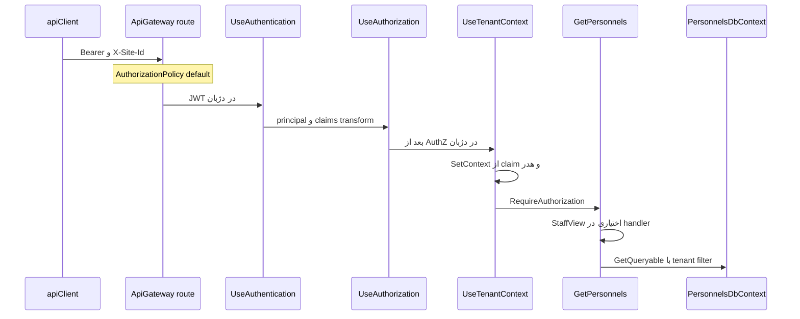
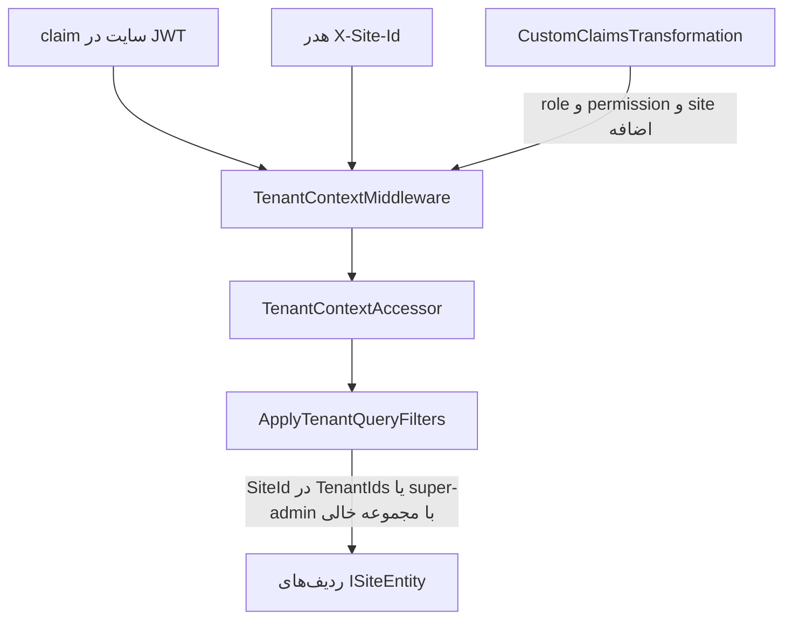

# Tenancy و Authorization در این مخزن

شناسهٔ کاتالوگ: `06-tenancy-authorization`.

پیش‌نیاز و ارجاع: `01-dotnet-aspnetcore.md` برای middleware، `05-jwt-identity.md` برای JWT و `AddCustomJwtAuth`، `04-yarp.md` برای پروکسی، `02-configuration.md` برای `SuperAdminSettings`، و `30-request-paths.md` برای مسیرهای login و پرسنل. این درس آن متن‌ها را دوباره نمی‌نویسد.

اپ و درخواست HTTP در این فاز اجرا نشد. مقدار claim و نقش واقعی کاربران نقل نشد.

## احراز هویت در برابر مجوز

احراز هویت می‌گوید درخواست مال کیست. مجوز می‌گوید همان شخص اجازهٔ این کار را دارد یا نه.

مثال: کارت شناسایی در درِ ساختمان احراز هویت است. اجازهٔ ورود به اتاق بایگانی مجوز است. بدون کارت، نگهبان شما را نمی‌شناسد. با کارت درست ولی بدون اجازهٔ بایگانی، باز هم داخل آن اتاق نمی‌روید.

در این مخزن login و JWT، موضوع درس 05 است. اینجا لایهٔ بعد از قبول توکن است: سایت، نقش، permission، و فیلتر داده.

## RBAC، claim، و policy

RBAC یعنی دسترسی بر اساس نقش ثابت، مثل `Admin` یا `Viewer`. مدل claim می‌گوید هر کاربر مجموعه‌ای از ادعا دارد. policy در ASP.NET Core یک قانون نام‌دار است که یک یا چند requirement را چک می‌کند.

این مخزن هر سه را مخلوط می‌کند، نه یکی را به‌تنهایی.

نقش‌ها به شکل claim با نوع `role` و مقدار `siteId|NormalizedName` بعد از `CustomClaimsTransformation` روی principal می‌نشینند. permission هم به شکل `siteId|permissionName` است. policyهای پویا در `AuthorizationPolicyProvider` از روی نام ساخته می‌شوند، مثلاً `permission:staffView`. بعضی endpointها فقط `RequireAuthorization()` دارند و چک permission را داخل handler می‌گذارند. بعضی ماژول‌ها مثل SecurityPatrols روی خود route متد `RequirePermissions(...)` را صدا می‌زنند.

## multi-tenancy یعنی چه

در صنعت، tenant معمولاً یک مشتری یا سازمان جداست که داده و تنظیماتش نباید با بقیه قاطی شود. شناسایی tenant یعنی بفهمی درخواست مال کدام tenant است. جداسازی یعنی بعد از شناسایی، کوئری و عملیات فقط همان محدوده را ببیند.

مدل‌های رایج:

- یک دیتابیس و یک schema، با ستون tenant روی ردیف‌ها.
- یک دیتابیس و schema جدا برای هر tenant.
- دیتابیس جدا برای هر tenant.

این مخزن مدل اول را برای دادهٔ دامنه‌ای که `ISiteEntity` دارد پیاده می‌کند: ستون `SiteId`، schema ماژول مثل `personnels`، و یک connection string مشترک برای آن سرویس. دیتابیس جدا برای هر سایت در Compose دیده نشد. «tenant» در کد این پروژه بیشتر همان **سایت** است، نه یک سازمان چندسایتهٔ جدا با connection جدا.

`ISiteEntity` به‌تنهایی multi-tenancy کامل نیست. فقط می‌گوید موجودیت یک `SiteId` دارد. جداسازی وقتی است که فیلتر کوئری یا چک صریح، ردیف‌های سایت دیگر را پنهان یا رد کند.

## شناسایی سایت در برابر جداسازی

شناسایی در این مخزن از چند منبع می‌آید:

1. claimهای `site` داخل JWT که `TokenProvider.CreateAccessToken` از `user.Sites` می‌سازد.
2. هدر `X-Site-Id` که کلاینت می‌فرستد. interceptor در `packages/api-client/src/axiosInstance.ts` شناسه‌های انتخاب‌شده را از Zustand به این هدر می‌گذارد.
3. claimهای غنی‌شدهٔ نقش و permission که `CustomClaimsTransformation` از `IClaimService` می‌گیرد. در دژبان پیاده‌سازی `RemoteClaimService` از راه MassTransit به هویت می‌رود. در هویت، `ClaimService` محلی است.

جداسازی داده در لایهٔ EF با `ApplyTenantQueryFilters` است. جداسازی دسترسی عملیات در handlerهای authorization و فیلترهای endpoint است. این دو یکی نیستند. یک کاربر می‌تواند احراز هویت شده باشد، به سایت A در هدر اشاره کند، و بدون permission هنوز بعضی لیست‌ها را با محدودیت ببیند.

## مفاهیم کلی که این مخزن پیاده نکرده یا کامل نکرده

اتصال جدا به ازای هر سایت: در Compose هر سرویس یک Postgres دارد، نه یک Postgres برای هر `SiteId`.

اعتماد کامل به gateway به‌جای بک‌اند: gateway بعضی routeها را با policy نام‌دار YARP محدود می‌کند، ولی دژبان دوباره JWT و، جایی که ثبت شده، permission را چک می‌کند.

tenant از hostname: در کد خوانده‌شده، شناسایی از claim و هدر است، نه از Host.

## انتزاع‌های tenancy این مخزن

| نماد | مسیر | نقش |
|---|---|---|
| `ISiteEntity` | `Common/Tenancy/ISiteEntity.cs` | موجودیت تک‌سایته با `SiteId` |
| `ISiteEntities<TSite>` | `Common/Tenancy/ISiteEntities.cs` | موجودیت چندسایته |
| `ISite` | `Common/Tenancy/ISite.cs` | سایت با `Id` |
| `ITenantContext` | `Common/Tenancy/ITenantContext.cs` | `SiteIds` و `IsSuperAdmin` |
| `TenantContext` | `Common/Tenancy/TenantContext.cs` | خواندن از `TenantContextAccessor` |
| `TenantContextAccessor` | `Common/Tenancy/TenantContextAccessor.cs` | `AsyncLocal<TenantInfo?>` |
| `TenantContextMiddleware` | `Common/Tenancy/TenantContextMiddleware.cs` | پر کردن accessor از User و هدر |
| `ApplyTenantQueryFilters` | `Common/Tenancy/TenantQueryFilterExtensions.cs` | global query filter روی مدل EF |
| `ITenantDbContext` | همان فایل | `TenantIds` و `IsSuperAdmin` برای فیلتر |

`Personnel` در دامنهٔ پرسنل `ISiteEntity` است. `PersonnelsDbContext` هم `ITenantDbContext` است و در `OnModelCreating` متد `ApplyTenantQueryFilters(this)` را صدا می‌زند. وضعیت: `verified`.

MassTransit هم context را جابه‌جا می‌کند: `TenantContextPublishFilter` و `TenantContextConsumeFilter` هدرهای سایت و super-admin را روی پیام می‌گذارند و موقع مصرف دوباره `SetContext` می‌کنند. این مسیر HTTP نیست، ولی همان accessor را پر می‌کند.

## `TenantContextMiddleware` چه می‌کند

فقط وقتی `user.Identity.IsAuthenticated` باشد اجرا می‌شود.

1. `user.GetUserSiteIds()` claimهای نوع `CustomClaims.Site` را می‌خواند.
2. `context.GetHeaderSiteIds()` هدر `X-Site-Id` را، با جداکنندهٔ ویرگول، به `Guid` تبدیل می‌کند.
3. نقش‌های claim از نوع `CustomClaims.Role` را با الگوی `siteId|roleName` جدا می‌کند. اگر نام نقش با `SuperAdminSettings:AdminRoleName` یا در نبودنش با `ConfigConstants.DefaultAdminRoleName` یعنی `"SuperAdmin"` یکی باشد، `isSuperAdmin` true است.
4. سایت مؤثر:
   - اگر هدر خالی باشد: همان سایت‌های کاربر.
   - اگر کاربر super-admin باشد: همان سایت‌های هدر، حتی اگر عضو آن سایت نباشد.
   - وگرنه: اشتراک سایت‌های کاربر و هدر.
5. `TenantContextAccessor.SetContext` را صدا می‌زند و در `finally` پاک می‌کند.

ترتیب pipeline فرق دارد.

در هویت: `UseAuthentication`، بعد `UseTenantContext`، بعد `UseAuthorization`.

در دژبان: `UseAuthentication`، بعد `UseAuthorization`، بعد `UseTenantContext`.

پس در دژبان، وقتی authorization اجرا می‌شود، accessor هنوز از این middleware پر نشده است. handlerهای permission به هدر و claim تکیه می‌کنند، نه به `ITenantContext`. فیلتر EF بعد از middleware و موقع اجرای endpoint به accessor نگاه می‌کند. وضعیت ترتیب: `verified`.

اگر کاربر authenticated نباشد، middleware اصلاً `SetContext` نمی‌کند. آن وقت `TenantContext.SiteIds` خالی و `IsSuperAdmin` برابر false است.

## فیلتر کوئری EF

`ApplySingleSiteFilter` برای `ISiteEntity` عبارتی می‌سازد که در عمل این است:

- اگر `IsSuperAdmin` و `TenantIds.Count == 0` باشد، ردیف قبول است.
- یا `TenantIds` شامل `e.SiteId` باشد.

کامنت داخل همان فایل می‌گوید super-admin وقتی هیچ سایتی انتخاب نشده همه را می‌بیند. با منطق middleware، وقتی هدر خالی است `effectiveSiteIds` برابر سایت‌های کاربر است، نه مجموعهٔ خالی. پس مسیر «همهٔ سایت‌ها» فقط وقتی `IsSuperAdmin` true است و مجموعهٔ مؤثر واقعاً خالی باشد فعال می‌شود، مثلاً اگر claim سایت روی principal نباشد. وضعیت منطق کد: `verified`. اینکه در دادهٔ واقعی super-admin همیشه سایت دارد یا نه: `runtime-unverified`.

برای `ISiteEntities<>` فیلتر می‌گوید حداقل یکی از `Sites` عضو `TenantIds` باشد. برای موجودیتی که خودش `ISiteEntity` نیست ولی navigation تک‌به‌تک به یک `ISiteEntity` دارد، فیلتر روی `SiteId` همان navigation می‌نشیند.

`IgnoreQueryFilters()` در چند repository و handler بیرون از مسیر `GetPersonnels` هست. آن callها فیلتر tenant و گاهی soft-delete را برمی‌دارند. این به‌معنی «همه جا نشت» نیست، ولی هر call بدون جبران صریح، مرز امنیتی را جابه‌جا می‌کند. `PersonnelRepository` برای لیست پرسنل `IgnoreQueryFilters` ندارد. وضعیت: `verified`.

## authorization این مخزن

ثبت مشترک در `Common/Authorization/AuthorizationServiceCollectionExtensions.cs` متد `AddAuthorizationInternal` این‌ها را می‌گذارد:

- `IClaimsTransformation` برابر `CustomClaimsTransformation`
- handlerهای `SiteAccess`، `EndpointAccess`، `Role`، `Position`، `Permission`
- `IAuthorizationPolicyProvider` برابر `AuthorizationPolicyProvider`

`AddCustomJwtAuth` خودش فقط `AddAuthorization()` ساده را صدا می‌زند. بدون `AddAuthorizationInternal`، policyهای پویا و claims transformation این پوشه ثبت نمی‌شوند.

دژبان در `InfrastructureConfiguration` هر دو را دارد. هویت هم `AddCustomJwtAuth` و `AddAuthorizationInternal` را دارد. gateway فقط `AddCustomJwtAuth` دارد و `AddAuthorizationInternal` و `UseTenantContext` ندارد. وضعیت: `verified`.

### claims transformation

بعد از authentication، `TransformAsync` اگر identity با نام `SiteClaims` نباشد، با `userId` از `ClaimTypes.NameIdentifier` یا `sub` به `IClaimService.GetUserSiteClaimsAsync` می‌رود و claimهای `site`، `role`، `permission`، `position`، `endpoint`، و `site_claims` را با پیشوند `siteId|` اضافه می‌کند. این claimها داخل JWT login نیستند. درس 05 همان را گفته است.

### policyهای نام‌دار

`AuthorizationPolicies.SiteAccess` برابر `"site_access"` و `EndpointAccess` برابر `"endpoint_access"` است. attributeهای `SiteAccessAuthorizationAttribute` و مشابه permission نام policy را روی `AuthorizeAttribute` می‌گذارند.

`AuthorizationPolicyProvider` اگر policy از پیش نباشد، از روی پیشوند می‌سازد:

- `position:...`
- `role:...`
- `permission:...`

و برای نام‌های ثابت `site_access` و `endpoint_access`.

### فیلترهای minimal API

`AuthorizationExtensions` متدهای `RequireSiteAccess`، `RequireEndpointAccess`، `RequireRoles`، `RequirePositions`، و `RequirePermissions` را دارد. این‌ها `IEndpointFilter` اضافه می‌کنند و مستقیماً 401 یا 403 برمی‌گردانند.

ماژول Personnels در Presentation هیچ‌کدام از `RequirePermissions` یا `RequireSiteAccess` را صدا نمی‌زند. `GetPersonnels` فقط `.RequireAuthorization()` دارد. ماژول‌هایی مثل SecurityPatrols و بخشی از Inventory روی route مقدار `RequirePermissions` دارند. وضعیت: `verified`.

### SiteAccess و Permission

`SiteAccessAuthorizationHandler` و `SiteAccessRequirementFilter` وقتی هدر سایت خالی باشد succeed نمی‌شوند یا `Forbid` می‌دهند. یعنی آن policy بدون `X-Site-Id` رد می‌شود.

`SiteScopedPermissionEvaluator.HasAnyPermission` هم اگر هدر خالی باشد false است. پس `permission:...` بدون سایت انتخاب‌شده succeed نمی‌شود.

### StaffView روی لیست پرسنل

`GetPersonnelsQueryHandler` اگر `UserId` یک `Guid` باشد و `HasPermissionAsync(PersonnelPermissions.StaffView)` شکست بخورد، کوئری را به `personnel.Id == userId` محدود می‌کند. 403 برنمی‌گرداند. `UserContext.HasPermissionAsync` همان `AuthorizeAsync` با نام `permission:staffView` است. بدون هدر سایت، این authorize طبق evaluator شکست می‌خورد، پس کاربر authenticated بدون `X-Site-Id` در عمل فقط ردیف خودش را می‌بیند، تازه اگر شناسهٔ کاربر با شناسهٔ پرسنل یکی باشد. وضعیت منطق: `verified`. نتیجهٔ واقعی روی داده: `runtime-unverified`.

## مسیر login و مسیر پرسنل از دید authorization

### Login

`AuthController.Login` روی کلاس پایهٔ `[Authorize]` است و روی متد `[AllowAnonymous]` دارد. route یارپ `auth-login-route-v1` مقدار `AuthorizationPolicy` برابر `anonymous` دارد. بک‌اند هویت بدون توکن login را می‌پذیرد. وضعیت: `verified`.

### لیست پرسنل

route یارپ `personnel-routes-v1` مقدار `AuthorizationPolicy` برابر `default` دارد. endpoint دژبان `.RequireAuthorization()` دارد. permission روی metadataٔ route نیست. محدودیت StaffView داخل handler است. فیلتر tenant از `PersonnelsDbContext` روی `Personnel.SiteId` اعمال می‌شود، به شرطی که middleware قبل از کوئری accessor را پر کرده باشد. وضعیت: `verified`.

## معنای `anonymous` و `default` در YARP 2.3

این دیگر از روی برچسب حدس نیست.

در بستهٔ `Yarp.ReverseProxy` نسخهٔ 2.3.0، فایل `ConfigurationSchema.json` می‌گوید `AuthorizationPolicy` مثلاً `Default` یا `Anonymous` است. مستند XML همان پکیج برای `RouteConfig.AuthorizationPolicy` می‌گوید مقدار `"Anonymous"` همهٔ چک‌های authorization این route را خاموش می‌کند.

صفحهٔ Microsoft Learn با عنوان «YARP authentication and authorization» می‌گوید نام policyها case-insensitive هستند و دو مقدار خاص دارد:

- `default`: از `AuthorizationOptions.DefaultPolicy` استفاده می‌کند. پیش‌فرض آن policy، کاربر authenticated است.
- `anonymous`: دسترسی ناشناس را اجازه می‌دهد، حتی اگر fallback policy چیز دیگری بخواهد.

اگر route اصلاً `AuthorizationPolicy` نگذارد، fallback استفاده می‌شود. پیش‌فرض fallback برابر null است و آن وقت YARP authorization اجباری روی آن route ندارد.

در JSON این مخزن رشته‌ها با حروف کوچک نوشته شده‌اند: `"anonymous"` و `"default"`. با قاعدهٔ case-insensitive همان دو مقدار خاص‌اند. وضعیت: `verified` از مستند YARP و schema پکیج 2.3.0. اجرای زندهٔ 401 روی gateway انجام نشد.

gateway با `AddCustomJwtAuth` مقدار `AddAuthorization()` را بدون عوض کردن `DefaultPolicy` صدا می‌زند. پس `default` روی route یعنی در gateway باید JWT معتبر باشد. این جایگزین `RequireAuthorization` بک‌اند نیست. هدر Bearer به‌طور پیش‌فرض به مقصد هم می‌رود و دژبان دوباره اعتبارسنجی می‌کند. درس 05 همان را گفته است.

gateway `AddAuthorizationInternal` ندارد. پس حتی اگر کسی روی route یارپ نام `permission:staffView` بگذارد، provider پویای این مخزن آن‌جا ثبت نشده است. امروز route پرسنل فقط `default` است.

## نمودار جریان authorization درخواست محافظت‌شده

مرحله‌های اختراع‌شده نیستند. `StaffView` روی metadataٔ endpoint نیست. فیلتر EF فقط برای موجودیت‌های مشمول `ApplyTenantQueryFilters` است.

## نمودار شناسایی سایت و جداسازی داده

اگر middleware اجرا نشود یا کاربر authenticated نباشد، accessor خالی می‌ماند و فیلتر برای `ISiteEntity` عملاً هیچ ردیفی را با `Contains` روی مجموعهٔ خالی راه نمی‌دهد، مگر شاخهٔ super-admin با count صفر که بدون SetContext هم `IsSuperAdmin` برابر false است.

## تحلیل امنیتی

| موضوع | طبقه | شاهد |
|---|---|---|
| فیلتر tenant روی `Personnel` و سایر `ISiteEntity` در DbContextهایی که `ApplyTenantQueryFilters` را صدا می‌زنند | جداسازی پیاده‌شده | `PersonnelsDbContext`، `TenantQueryFilterExtensions` |
| اعتماد به `X-Site-Id`ی که کلاینت می‌فرستد | ریسک بالقوه با جبران جزئی | برای کاربر عادی اشتراک با سایت‌های claim؛ برای super-admin هدر بدون اشتراک پذیرفته می‌شود. جعل هدر به‌تنهایی سایت جدید به کاربر عادی نمی‌دهد |
| `GetPersonnels` بدون `RequirePermissions` روی route | طراحی مشاهده‌شده، نه به‌تنهایی vulnerability | فقط authentication اجباری است؛ بدون StaffView لیست به خود کاربر جمع می‌شود |
| اتکا فقط به gateway | در این مسیر صدق نمی‌کند | دژبان دوباره JWT و `RequireAuthorization` دارد |
| gateway بدون tenant middleware | قابل‌اعمال | جداسازی داده در gateway نیست؛ در سرویس مقصد است |
| `IgnoreQueryFilters` در بعضی repositoryها | ریسک بالقوه | هر call باید جبران داشته باشد. مسیر لیست پرسنل این call را ندارد |
| نام `anonymous` / `default` | دیگر unresolved نیست | Learn و schema پکیج 2.3.0 |
| حروف `/api` در برابر `/Api` | Runtime verification pending | خارج از این درس؛ سند `00-api-path-case-investigation.md` |
| اثر واقعی StaffView بدون هدر روی داده | Runtime verification pending | منطق کد خوانده شد؛ درخواست زده نشد |

نباید نبودن یک attribute را به‌تنهایی «حفره» نامید. باید دید handler یا فیلتر EF همان کار را می‌کند یا نه.

## سؤال‌های مصاحبه

### 1. احراز هویت و مجوز در مسیر پرسنل این مخزن کجا جدا می‌شوند؟

JWT و `RequireAuthorization()` می‌گویند کاربر شناخته شده است. این احراز هویت به‌علاوهٔ حداقل مجوز «باید login کرده باشد» است. اینکه همهٔ پرسنل را ببیند یا فقط خودش را، در `GetPersonnelsQueryHandler` با `staffView` تصمیم گرفته می‌شود. اینکه کدام سایت‌ها در نتیجه بیایند، کار فیلتر EF روی `SiteId` است.

دنباله: اگر فقط gateway را با `default` ببندی و بک‌اند را باز بگذاری چه می‌شود؟

جواب: در این مخزن بک‌اند دژبان بسته نیست. خودش دوباره JWT را چک می‌کند. اگر کسی مستقیماً به پورت داخلی دژبان برسد و gateway را دور بزند، باز هم بدون توکن معتبر از `RequireAuthorization` رد نمی‌شود. پورت داخلی در Compose ادغامی روی host منتشر نشده است.

### 2. RBAC خالص با مدل این پروژه چه فرقی دارد؟

RBAC خالص معمولاً یک نقش سراسری دارد. اینجا نقش و permission به سایت گره خورده‌اند و مقدار claim به شکل `siteId|name` است. evaluator هم بدون `X-Site-Id` برای permission succeed نمی‌کند. پس دسترسی «Admin در سایت A» با «Admin در سایت B» یکی نیست.

دنباله: نقش از کجا روی principal می‌نشیند؟

جواب: از JWT نیست. `CustomClaimsTransformation` بعد از login از `IClaimService` می‌آورد. در دژبان این سرویس `RemoteClaimService` است.

### 3. سه مدل جداسازی دیتابیس را بگو. این مخزن کدام را برای سایت دارد؟

دیتابیس جدا، schema جدا، یا ستون tenant روی جدول مشترک. اینجا برای پرسنل، schema ماژول `personnels` و ستون `SiteId` با global query filter است. برای هر سایت یک Postgres جدا در Compose نیست.

دنباله: `ISiteEntity` یعنی جداسازی کامل؟

جواب: نه. فقط قرارداد مالکیت سایت است. بدون `ApplyTenantQueryFilters` یا چک صریح، interface به‌تنهایی ردیف را پنهان نمی‌کند.

### 4. `X-Site-Id` را کاربر می‌فرستد. چرا این به‌تنهایی کافی برای دزدیدن دادهٔ سایت دیگر نیست؟

برای کاربر غیر super-admin، middleware اشتراک هدر و سایت‌های claim را می‌گیرد. هدرِ سایت غریبه اشتراک را خالی یا بدون آن Guid می‌کند و فیلتر EF آن ردیف‌ها را نمی‌دهد. برای super-admin عمداً هدر بدون اشتراک پذیرفته می‌شود تا بتواند سایت انتخابی را ببیند.

دنباله: اگر هدر خالی باشد چه می‌شود؟

جواب: سایت مؤثر همان claimهای کاربر است. policyهایی مثل `site_access` و `permission:...` بدون هدر succeed نمی‌شوند. لیست پرسنل بدون permission در handler به ردیف خود کاربر جمع می‌شود.

### 5. `anonymous` و `default` در JSON یارپ چه می‌کنند؟

طبق مستند YARP و schema بستهٔ 2.3.0، و با case-insensitive بودن نام‌ها، `anonymous` چک authorization همان route را در gateway خاموش می‌کند و `default` همان `DefaultPolicy` را می‌خواهد که پیش‌فرضش کاربر authenticated است. این‌ها نام policy سفارشی ثبت‌شده در `AddAuthorizationInternal` نیستند.

دنباله: پس login چرا هم در یارپ anonymous است و هم روی action مقدار AllowAnonymous دارد؟

جواب: چون دفاع دفاع در عمق است. یارپ اجازه می‌دهد درخواست بدون توکن به خوشه برسد. هویت هم روی متد login استثنای کلاس `[Authorize]` را می‌گذارد. اگر فقط یکی بود و دیگری سخت می‌گرفت، login می‌شکست.

### 6. چرا gateway فیلتر tenant ندارد و آیا این باگ است؟

gateway دادهٔ `Personnel` را از Postgres نمی‌خواند. فقط پروکسی است. جداسازی ردیف مال DbContext مقصد است. نبود `UseTenantContext` روی gateway برای فیلتر EF طبیعی است. نبود `AddAuthorizationInternal` یعنی gateway permissionهای پویای این مخزن را اجرا نمی‌کند و امروز routeها به همان `default` یا `anonymous` بسنده‌اند.

دنباله: هدر Authorization به دژبان می‌رسد؟

جواب: transformهای route پرسنل فقط host اصلی و `X-Forwarded-Proto` را تنظیم می‌کنند. حذفی برای Authorization در آن JSON نیست. درس 05 می‌گوید bearer به‌طور پیش‌فرض جریان پیدا می‌کند.

### 7. ترتیب `UseTenantContext` در دژبان و هویت چه پیامدی دارد؟

در دژبان authorization قبل از پر شدن accessor است. چک permission از claim و هدر است. فیلتر EF بعداً از accessor می‌خواند. در هویت accessor قبل از authorization پر می‌شود. هر دو معتبرند، ولی فرض «همان لحظهٔ Authorize دیگر `ITenantContext` پر است» در دژبان غلط است.

دنباله: `AsyncLocal` چرا در `finally` پاک می‌شود؟

جواب: تا درخواست بعدی یا ادامهٔ همان جریان روی thread اشتباه، سایت قبلی را نبیند. فیلترهای MassTransit هم بعد از مصرف Clear می‌کنند.

### 8. یک سناریوی نشت cross-tenant را از روی این کد بساز.

فرض کن handler با `IgnoreQueryFilters()` یک `Personnel` را با Id خام از ورودی کاربر می‌خواند و چک `SiteId` نمی‌کند. فیلتر tenant برداشته شده و کاربر می‌تواند Id سایت دیگر را حدس بزند. مسیر `GetPersonnels` از `GetQueryable` بدون Ignore است، پس آن سناریو مال همین endpoint نیست. وضعیت آن فرض برای repositoryهای دارای Ignore: ریسک بالقوه تا وقتی جبران در همان متد دیده شود.

دنباله: soft-delete چه ربطی دارد؟

جواب: `ApplySoftDeleteQueryFilters` فیلتر جدا با نام خودش دارد. `IgnoreQueryFilters` هر دو را برمی‌دارد مگر فیلتر خاصی را نگه دارید.

### 9. `RequirePermissions` روی Presentation پرسنل نیست. آیا staffView بی‌اثر است؟

خیر. `UserContext.HasPermissionAsync` همان policy پویای `permission:staffView` را از `IAuthorizationService` می‌خواهد. تفاوت این است که شکست permission در این handler به 403 تبدیل نمی‌شود، بلکه نتیجه را محدود می‌کند. در Patrol، `RequirePermissions` روی route است و فیلتر endpoint مستقیماً Forbid می‌دهد.

دنباله: بدون `X-Site-Id`، `HasPermissionAsync` چه می‌شود؟

جواب: `SiteScopedPermissionEvaluator` با هدر خالی false برمی‌گرداند. پس Authorize شکست می‌خورد و شاخهٔ محدودسازی به `personnel.Id == userId` فعال می‌شود.

### 10. شناسایی tenant و جداسازی tenant را در یک جمله برای این مخزن بگو.

شناسایی از JWT و هدر `X-Site-Id` و claimهای بارشده است. جداسازی داده از global query filter روی `SiteId` است و جداسازی عملیات از policy و فیلتر endpoint و چک‌های داخل handler.

دنباله: اگر فقط interface بگذاری و فیلتر ننویسی؟

جواب: کامپایل ممکن است سبز باشد و دادهٔ همهٔ سایت‌ها برگردد. interface قرارداد است، نه enforcement.

## مرور

این مخزن multi-tenancy را بیشتر به‌صورت shared database با ستون `SiteId` و فیلتر EF پیاده کرده است. سایت از claim و هدر شناخته می‌شود. `ISiteEntity` بدون فیلتر کافی نیست. authorization ترکیبی از JWT، policy پویا، فیلتر endpoint، و چک داخل handler است. YARP با `anonymous` و `default` فقط لایهٔ gateway را تنظیم می‌کند و نام‌ها case-insensitive و مستند رسمی‌اند. دژبان و هویت ترتیب tenant middleware را یکسان نگذاشته‌اند. مسیر پرسنل authentication اجباری دارد و StaffView را در handler اعمال می‌کند، نه با `RequirePermissions` روی route.
