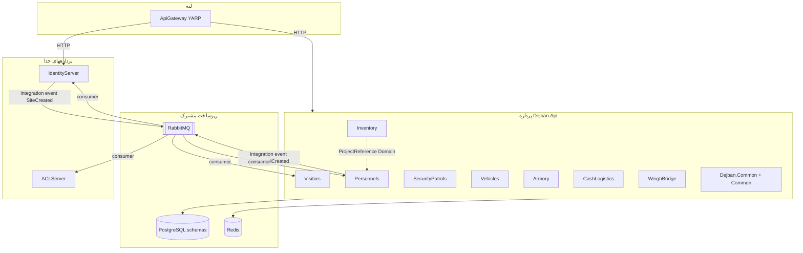

# Modular Monolith در دژبان

شناسهٔ کاتالوگ: `07-modular-monolith`.

این درس روی [01-dotnet-aspnetcore](01-dotnet-aspnetcore.md)، [02-configuration](02-configuration.md)، [04-yarp](04-yarp.md)، [05-jwt-identity](05-jwt-identity.md)، [06-tenancy-authorization](06-tenancy-authorization.md)، و [30-request-paths](30-request-paths.md) سوار است. مسیر پرسنل در [00-personnel-list-execution-path](00-personnel-list-execution-path.md) و نمایه در [00-execution-path-index](00-execution-path-index.md) است.

اپ، تست، و migration در این فاز اجرا نشد. نام پوشهٔ `Modules` به‌تنهایی کافی نیست؛ مرز و مدل اجرا از روی `Program.cs`، ارجاع پروژه‌ها، و قراردادهای پیام ثابت می‌شود.

## Monolith، modular monolith، و microservice

Monolith کلاسیک یعنی یک برنامهٔ deployشدنی که بیشتر قابلیت‌ها را داخل یک پردازه دارد. اگر همهٔ کد بدون مرز در هم پیچیده باشد، تغییر یک بخش بقیه را هم می‌شکند.

Microservice یعنی هر قابلیت، یا گروهی از قابلیت‌ها، پردازه و deploy جدا دارد و معمولاً از شبکه با هم حرف می‌زنند.

Modular monolith یعنی هنوز **یک پردازهٔ deployشدنی** دارید، ولی داخلش ماژول‌هایی با مرز کد، اسمبلی، و قرارداد ارتباطی دارید. شبکهٔ اجباری بین ماژول‌ها نیست؛ می‌توانید in-process صدا بزنید یا مثل این مخزن با پیام روی bus حرف بزنید، در حالی که همه داخل یک host بالا می‌آیند.

مثال همین مخزن: `Dejban.Api` یک host است و هشت ماژول را با هم ثبت می‌کند. `IdentityServer` و `ApiGateway` پردازهٔ جدا هستند. پس دور دژبان چند microservice هست، و خود دژبان یک modular monolith است. وضعیت: `verified`.

## کد ماژول، اسمبلی، و سرویس deployشده

| مفهوم | در این مخزن |
|---|---|
| ماژول کسب‌وکار | پوشهٔ زیر `Microservices/Dejban/Modules/` مثل `Personnels` یا `Visitors` |
| اسمبلی / پروژه | مثلاً `Dejban.Modules.Personnels.Domain` تا `...Presentation` و `...IntegrationEvents` |
| برنامهٔ deployشدنی | `Dejban.Api` برای همهٔ آن ماژول‌ها؛ به‌علاوهٔ سرویس‌های جدا مثل هویت و gateway |

مرز compile-time یعنی ارجاع `ProjectReference` و تست معماری. مرز runtime/deployment یعنی اینکه آیا دو قابلیت در دو پردازه اجرا می‌شوند یا یکی. اینجا ماژول‌های دژبان در یک پردازه هستند؛ ارتباط با هویت از شبکهٔ پیام (MassTransit/RabbitMQ) می‌گذرد.

## هشت ماژول و لایه‌ها

این هشت ماژول در `Program.cs` صریحاً ثبت می‌شوند:

1. Visitors  
2. Personnels  
3. SecurityPatrols  
4. Vehicles  
5. Armory  
6. CashLogistics  
7. Inventory  
8. WeighBridge  

برای هر کدام، پوشه‌های `Domain`، `Application`، `Infrastructure`، `Presentation`، و `IntegrationEvents` دیده شد. وضعیت وجود لایه‌ها: `verified`.

الگوی متداول داخل ماژول:

- Domain: موجودیت و domain event  
- Application: command/query و handlerهای MediatR  
- Infrastructure: `DbContext`، repository، outbox/inbox، کلاس `*Module` برای DI  
- Presentation: endpointهای `IEndpoint` و بعضی `IntegrationEventHandler`  
- IntegrationEvents: قراردادهایی مثل `IDoorApi` برای مصرف بیرونی احتمالی  

Infra مشترک زیر `Microservices/Dejban/Common/` است: `Dejban.Common.Application`، `Dejban.Common.Infrastructure`، `Dejban.Common.Presentation`، `Dejban.Common.Domain`. احراز هویت و tenancy از `Common/` ریشهٔ مخزن هم می‌آید؛ درس 05 و 06 همان را گفته‌اند.

## ثبت ماژول: صریح، نه کشف خودکار پوشه

ثبت ماژول‌ها با خواندن پوشهٔ `Modules` نیست. `Dejban.Api/Program.cs` سه کار جدا می‌کند.

اول، آرایهٔ اسمبلی‌های Application را دستی می‌سازد و به `AddApplication` می‌دهد. آن متد در `Dejban.Common.Application/ApplicationConfiguration.cs` با `RegisterServicesFromAssemblies` همهٔ handlerهای MediatR آن اسمبلی‌ها را ثبت می‌کند و behaviorهای مشترک را باز می‌کند.

دوم، `AddInfrastructure` لیست `ConfigureConsumers` و `ConfigureReceiveEndpoints` هر ماژول را می‌گیرد تا MassTransit داخل همان host پیکربندی شود.

سوم، بعد از `AddModuleConfiguration` برای فایل‌های `modules.*.json`، هشت متد را صدا می‌زند:

`AddVisitorsModule`، `AddPersonnelsModule`، `AddSecurityPatrolsModule`، `AddVehiclesModules`، `AddArmoryModule`، `AddCashLogisticsModule`، `AddInventoryModule`، `AddWeighBridgeModule`.

مثال Personnels در `PersonnelsModule.AddPersonnelsModule`:

1. `AddDomainEventHandlers` با reflection روی Application  
2. `AddIntegrationEventHandlers`  
3. `AddInfrastructure` برای `PersonnelsDbContext` و repositoryها  
4. `AddEndpoints(Presentation.AssemblyReference.Assembly)` که همهٔ `IEndpoint` غیرabstract را Transient ثبت می‌کند  

در پایان pipeline، `app.MapEndpoints()` همهٔ `IEndpoint`های ثبت‌شده را روی یک route builder می‌نشاند. وضعیت: `verified`.

پس discovery اسمبلی برای MediatR و endpoint هست، ولی **لیست ماژول‌ها** صریح است. افزودن ماژول نهم بدون دست زدن به `Program.cs` از روی کد فعلی اتفاق نمی‌افتد.

## مسیر ۱ — از startup تا DI پرسنل

```text
Dejban.Api/Program.cs
  → moduleApplicationAssemblies شامل Personnels.Application.AssemblyReference
  → AddApplication(...)
  → AddInfrastructure(..., PersonnelsModule.ConfigureConsumers, ...)
  → AddModuleConfiguration([..., "personnels", ...])
  → AddPersonnelsModule(configuration)
       → AddDomainEventHandlers / AddIntegrationEventHandlers
       → UseNpgsql + schema personnels + InsertOutboxMessagesInterceptor
       → AddEndpoints(Presentation)
  → بعد از Build: MapEndpoints()
```

`Dejban.Api.csproj` فقط به پروژه‌های `*.Infrastructure` هشت ماژول ارجاع می‌دهد، نه مستقیم به Domain همه. Infrastructure هر ماژول Application و Presentation خودش را می‌کشد. وضعیت: `verified`.

## مسیر ۲ — ارتباط واقعی بین ماژول‌ها با پیام

یک مثال کامل داخل دژبان و بیرون آن:

1. موجودیت `Personnel` در Domain رویداد `PersonnelCreatedDomainEvent` را `Raise` می‌کند.  
2. موقع `SaveChanges`، `InsertOutboxMessagesInterceptor` رویدادهای Domain را به جدول outbox همان DbContext می‌نویسد. وضعیت: `verified`.  
3. `ProcessOutboxJob` در Infrastructure پرسنل، پیام outbox را می‌خواند و `IDomainEventHandler`های همان ماژول را صدا می‌زند.  
4. `PersonnelCreatedDomainEventHandler` در Application با MediatR جزئیات را می‌گیرد و `IEventBus.PublishAsync(new PersonnelCreated(...))` می‌زند. قرارداد در `Common/EventBus/Contracts/Events/PersonnelCreated.cs` است.  
5. `EventBus` همان `IBus`ی MassTransit را صدا می‌زند.  
6. مصرف‌کننده‌ها داخل همان host دژبان ثبت شده‌اند، مثلاً `Visitors` با `PersonnelCreatedIntegrationEventHandler` که از `IReplicaHealer` کپی پرسنل در schema بازدیدکننده می‌سازد. ماژول‌های Vehicles، SecurityPatrols، Armory، و CashLogistics هم `IntegrationEventConsumer<PersonnelCreated>` ثبت کرده‌اند.  
7. بیرون از دژبان، `IdentityServer` و `ACLServer` و `RequestTracker` هم consumer برای `PersonnelCreated` دارند. آن‌ها پردازهٔ جدا هستند. وضعیت ثبت و کلاس‌ها: `verified`. تحویل واقعی روی bus در این فاز اجرا نشد: `runtime verification pending`.

جهت برعکس برای سایت: `IdentityServer` با `IPublishEndpoint` رویداد `SiteCreated` را منتشر می‌کند. `PersonnelsModule.ConfigureConsumers` مقدار `IntegrationEventConsumer<SiteCreated>` را ثبت می‌کند و `SiteCreatedIntegrationEventHandler` یک `Site` محلی در schema پرسنل می‌سازد. وضعیت: `verified`.

پس ارتباط ماژول-به-ماژول غالب در دژبان، **پیام integration روی bus** است، نه ارجاع مستقیم Application یک ماژول به Application ماژول دیگر. MediatR عمدتاً داخل همان ماژول (و اسمبلی‌های Application ثبت‌شده در یک host) است.

## ارتباط in-process دیگر

`IDoorApi` در `Personnels.IntegrationEvents` و پیاده‌سازی `DoorApi` در Infrastructure ثبت شده است. جستجوی inject این interface بیرون از خود Personnels موردی نشان نداد. وضعیت وجود API عمومی: `verified`. وضعیت مصرف توسط ماژول دیگر: در این بازرسی پیدا نشد.

برعکس، `Inventory.Domain` مستقیماً به `Personnels.Domain` ارجاع پروژه دارد و مثلاً `Warehouse` از `Dejban.Modules.Personnels.Domain.Sites` و `Units` استفاده می‌کند. این **مرز compile-time ضعیف** است: دامنهٔ انبار به دامنهٔ پرسنل وابسته شده، بدون اینکه لزوماً از bus رد شود. وضعیت: `verified`.

## زیرساخت مشترک

| منبع | استفاده در دژبان |
|---|---|
| یک connection string به نام `Postgres` | هر ماژول `DbContext` خودش را با schema جدا می‌سازد: `personnels`، `visitors`، `security_patrols`، `vehicles`، `armory`، `cash_logistics`، `inventory`، `weigh_bridge` |
| Redis | از `AddInfrastructure` مشترک host |
| JWT / tenancy | `AddAuthenticationInternal` و `AddAuthorizationInternal` و `UseTenantContext` روی همان host؛ درس 05 و 06 |
| RabbitMQ / MassTransit | یک bus در host؛ consumerهای هر ماژول در `ConfigureConsumers` |
| `modules.{name}.json` | پیکربندی per-module؛ درس 02 |

این مدل «یک دیتابیس منطقی، چند schema» است، نه دیتابیس جدا برای هر ماژول. جداسازی جدول با schema و DbContext جدا تقویت می‌شود، ولی هنوز یک instance پستیگرس در Compose برای دژبان است.

## جای YARP و سرویس‌های جدا

YARP در `ApiGateway` درخواست را به خوشهٔ `dejban` یا `identityserver` می‌فرستد؛ درس 04. Gateway ماژول‌های دژبان را host نمی‌کند. فقط HTTP را به پردازهٔ `Dejban.Api` می‌رساند. داخل آن پردازه، routeهای minimal API همهٔ ماژول‌ها با هم `MapEndpoints` شده‌اند.

## نمودار معماری تأییدشده



پیکان نقطه‌چین ارجاع compile-time است، نه پیام. فلش‌های RMQ از روی ثبت consumer و publish در کد است؛ تحویل زنده تست نشد.

## تحلیل مرز و ریسک

**مرز قوی یا نسبتاً قوی**

- هر ماژول DbContext و schema خودش را دارد.  
- ثبت consumer و endpoint per-module.  
- تست لایهٔ Visitors در `Dejban.Modules.Visitors.ArchitectureTests` وابستگی Domain→Application/Infrastructure و Application→Infrastructure/Presentation را ممنوع می‌کند.  
- قراردادهای integration در `Common.EventBus.Contracts` یا پروژهٔ IntegrationEvents.

**مرز قراردادی یا ضعیف**

- `Dejban.ArchitectureTests/Layers/ModuleTests.cs` برای Visitors آرایه‌های `otherModules` و `integrationEventsModules` را خالی گذاشته است. آن تست در عمل وابستگی بین‌ماژولی را رد نمی‌کند. وضعیت: `verified`.  
- `Inventory.Domain` → `Personnels.Domain` یعنی shared kernel اجباری در سطح دامنه.  
- همهٔ ماژول‌ها یک MediatR و یک pipeline host را شریک‌اند؛ اشتباه ثبت handler نام‌تکراری از نظر تئوری ممکن است، ولی در این فاز برخورد نام دیده نشد.

**Domain event در برابر integration event**

- Domain event داخل همان ماژول، اول در outbox همان schema، بعد handler همان Application.  
- Integration event از نوع `IntegrationEvent` / `IIntegrationEvent` روی bus؛ مصرف‌کننده می‌تواند ماژول دیگر یا سرویس دیگر باشد.  
- `IEventBus.PublishAsync` بلافاصله `bus.Publish` می‌کند. مسیر domain→integration معمولاً بعد از پردازش outbox است، نه هم‌زمان با HTTP response مگر outbox همان لحظه خالی شود. اجرای زمان‌بندی Quartz در این فاز دیده نشد: جزئیات زمان‌بندی `runtime verification pending`؛ وجود job و interceptor: `verified`.

**استخراج یک ماژول به microservice جدا**

از روی کد فعلی، برای جدا کردن مثلاً Personnels باید حداقل این‌ها عوض شود: host جدا، connection و schema، ثبت MassTransit و JWT/tenancy، حذف ارجاع Domain از Inventory، و routeهای YARP. outbox/inbox از قبل شبیه مرز سرویس طراحی شده‌اند؛ ارجاع Domain خلاف آن است.

**اشتراک جدول**

Replicaهای سایت و پرسنل در ماژول‌های دیگر با integration event پر می‌شوند، نه با join مستقیم به schema پرسنل از روی کد handler بازدیدکنندهٔ بالا. Inventory با ارجاع Domain به نوع‌های Personnels نزدیک‌تر به اشتراک مدل است تا به اشتراک جدول مستقیم؛ اینکه EF انبار به جدول `personnels` وصل شود از روی همین ارجاع به‌تنهایی ثابت نیست و نیاز به پیکربندی DbContext انبار دارد. وضعیت اتصال جدول: `unresolved` بدون خواندن همهٔ configurationهای Inventory؛ وابستگی نوع دامنه: `verified`.

## واژه‌نامه کوتاه

| اصطلاح | معنی کوتاه |
|---|---|
| Modular monolith | یک deploy، چند ماژول با مرز داخلی |
| In-process | فراخوانی داخل همان پردازه، بدون HTTP اجباری |
| Domain event | رویداد داخلی مدل؛ اینجا اول outbox |
| Integration event | قرارداد بین ماژول یا سرویس روی bus |
| Schema | فضای نام جدول در یک پستیگرس؛ اینجا per-module |
| Public API ماژول | رابطی مثل `IDoorApi` برای مصرف کنترل‌شده |

## سؤال‌های مصاحبه

### 1. Modular monolith با microservice چه فرقی دارد و دژبان کدام است؟

Modular monolith یک پردازه با مرز ماژول است. Microservice پردازه و deploy جدا دارد. `Dejban.Api` هشت ماژول را در یک host بالا می‌آورد؛ پس خود دژبان modular monolith است. هویت و gateway microserviceهای جدا دور آن هستند.

دنباله: آیا پوشهٔ `Modules` برای این ادعا کافی است؟

جواب: خیر. شاهد اصلی ثبت صریح در `Program.cs` و یک پروژهٔ web deployشدنی است.

### 2. مرز ماژول در دژبان کجا compile-time است و کجا runtime؟

Compile-time: پروژه‌های جدا، schema/DbContext جدا، و تا جایی که تست معماری لایه را نگه دارد. Runtime: هنوز یک پردازه؛ پیام‌ها روی bus حتی بین ماژول‌های همان host رد می‌شوند. ارجاع `Inventory.Domain` به `Personnels.Domain` مرز compile-time را سوراخ می‌کند.

دنباله: NetArchTest این‌جا چه چیزی را واقعاً تضمین می‌کند؟

جواب: تست لایهٔ Visitors وابستگی لایه‌ها را چک می‌کند. `ModuleTests` با آرایهٔ خالی practically وابستگی به ماژول دیگر را ممنوع نمی‌کند.

### 3. Dependency inversion بین ماژول‌ها چگونه دیده می‌شود؟

ایده این است که ماژول به abstraction وابسته باشد نه به جزئیات دیگری. `IDoorApi` در IntegrationEvents و پیاده‌سازی در Infrastructure همین الگو را نشان می‌دهد، ولی مصرف‌کنندهٔ بیرونی در این بازرسی پیدا نشد. مسیر واقعی امروز بیشتر قرارداد `PersonnelCreated` در `Common.EventBus.Contracts` است که ناشر و مصرف‌کننده هر دو به همان قرارداد وابسته‌اند، نه به Domain هم.

دنباله: چرا Inventory این الگو را برای Site نشکسته؟

جواب: چون مستقیماً به نوع‌های Domain پرسنل ارجاع داده، نه به یک DTO یا API جدا.

### 4. ارتباط in-process با شبکه چه فرقی دارد؟

In-process یعنی فراخوانی متد یا MediatR داخل همان پردازه. شبکه یعنی HTTP یا پیام روی RabbitMQ بین پردازهها، و حتی داخل یک host هم publish به bus از broker رد می‌شود. در دژبان، handlerهای یک ماژول با MediatR in-processاند؛ همگام‌سازی Visitors با پرسنل از integration event و MassTransit است.

دنباله: آیا `async` بودن متد یعنی پیام asynchronous است؟

جواب: خیر. `async` فقط مدل انتظار I/O است. asynchronous بودن کسب‌وکار وقتی است که کار بعداً از outbox/inbox یا consumer جدا انجام شود.

### 5. Domain event و integration event در این کد چه فرقی دارند؟

Domain event روی entity داخل ماژول است و با interceptor به outbox همان schema می‌رود. Integration event نوعی است که `IEventBus` روی MassTransit منتشر می‌کند و ماژول یا سرویس دیگر مصرف می‌کند. `PersonnelCreatedDomainEvent` داخل پرسنل است؛ `PersonnelCreated` قرارداد بیرونی است.

دنباله: کدام اول اجرا می‌شود؟

جواب: از روی کد، اول ذخیرهٔ outbox همراه SaveChanges، بعد job که domain handler را می‌دواند، و آن handler integration را publish می‌کند. ترتیب زمانی دقیق job نسبت به درخواست HTTP بدون اجرای Quartz تأیید نشد.

### 6. Shared database با schema جدا چه مزیت و ریسکی دارد؟

مزیت: یک عملیات backup و یک connection string برای host. ریسک: اشتباه join یا migration می‌تواند به schema دیگر برسد؛ تراکنش توزیع‌شده بین schemaها پیچیده است؛ استخراج ماژول بعداً باید داده را جدا کند. دژبان با DbContext جدا ریسک را کم می‌کند ولی instance را یکی نگه می‌دارد.

دنباله: replica پرسنل در Visitors چیست؟

جواب: کپی همگام‌شده با `PersonnelCreated` و `IReplicaHealer`، نه لزوماً همان جدول schema پرسنل.

### 7. ثبت ماژول و DI چگونه کشف می‌شود؟

لیست ماژول‌ها دستی در `Program.cs` است. داخل هر ماژول، MediatR از اسمبلی Application، endpoint از اسمبلی Presentation، و domain/integration handler با reflection ثبت می‌شوند. consumerهای MassTransit هم در `ConfigureConsumers` صریح‌اند.

دنباله: اگر فقط پروژه را به solution اضافه کنید چه می‌شود؟

جواب: تا `AddXModule` و اسمبلی Application و consumerها به `Program.cs` اضافه نشوند، host آن ماژول را بالا نمی‌آورد.

### 8. چه وقت یک ماژول را به microservice تبدیل می‌کنید؟

وقتی مقیاس، انتشار، یا تیم جدا لازم است و هزینهٔ شبکه و consistency قابل قبول است. در این مخزن، Personnels از قبل integration event به هویت و ACL می‌فرستد؛ استخراج آسان‌تر از Inventory است که Domain پرسنل را reference کرده. باید host، DI، YARP، و وابستگی‌های Domain پاک شوند.

دنباله: آیا وجود outbox یعنی از قبل microservice هستید؟

جواب: خیر. outbox الگوی قابلیت اطمینان پیام است و در modular monolith هم استفاده می‌شود.

### 9. تست و deploy این معماری چه پیامدی دارد؟

Deploy دژبان یک واحد است: همهٔ ماژول‌ها با یک image بالا می‌آیند. تست لایه می‌تواند per-module باشد. تست بین‌ماژولی یا به integration روی bus نیاز دارد یا به ArchitectureTests که امروز برای ممنوعیت وابستگی بین‌ماژولی Visitors عملاً خالی است. تغییر یک ماژول می‌تواند با build کل `Dejban.Api` منتشر شود.

دنباله: YARP چه نقشی در تست ماژول دارد؟

جواب: برای تست واحد ماژول لازم نیست. برای مسیر end-to-end از کلاینت، gateway جداست و باید عمداً در سناریو باشد.

### 10. این مفاهیم را روی مسیر ایجاد پرسنل اعمال کن.

HTTP به `Dejban.Api` می‌رسد، endpoint ماژول Personnels با MediatR command را داخل همان ماژول اجرا می‌کند، Domain event در outbox می‌نشیند، بعد integration `PersonnelCreated` روی bus می‌رود، Visitors داخل همان host replica می‌سازد، و IdentityServer در پردازهٔ دیگر کاربر می‌سازد. یک درخواست، یک modular monolith، و چند مصرف‌کنندهٔ پیام.

دنباله: کجا مرز ماژول برای انبار ضعیف است؟

جواب: در ارجاع `Inventory.Domain` به `Personnels.Domain` برای Site و Unit، که وابستگی compile-time مستقیم است.

## مرور

دژبان یک modular monolith با هشت ماژول لایه‌بندی‌شده داخل `Dejban.Api` است. ثبت ماژول صریح است؛ MediatR و endpoint با اسمبلی کشف می‌شوند. ارتباط غالب بین‌ماژولی و با سرویس‌های جدا از integration event و MassTransit است. schema جدا روی یک Postgres هست. ارجاع Domain انبار به پرسنل و خالی بودن آرایهٔ ممنوعیت در `ModuleTests` نقاط ضعف مرز هستند. YARP فقط ترافیک را به این host می‌رساند و خودش ماژول را اجرا نمی‌کند.
