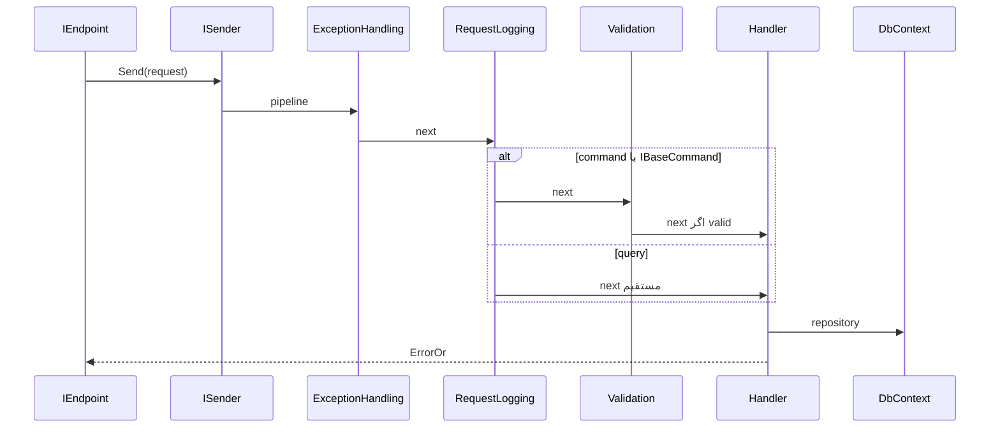

# CQRS و MediatR در دژبان

شناسهٔ کاتالوگ: `08-cqrs-mediatr`.

ارجاع: [01-dotnet-aspnetcore](01-dotnet-aspnetcore.md)، [05-jwt-identity](05-jwt-identity.md)، [06-tenancy-authorization](06-tenancy-authorization.md)، [07-modular-monolith](07-modular-monolith.md)، [30-request-paths](30-request-paths.md)، [00-personnel-list-execution-path](00-personnel-list-execution-path.md)، [00-login-execution-path](00-login-execution-path.md)، [00-execution-path-index](00-execution-path-index.md).

اپ و تست در این فاز اجرا نشد. MediatR صف توزیع‌شده نیست؛ فقط پیام in-process را به handler می‌رساند.

## CQRS یعنی چه

CQRS مخفف Command Query Responsibility Segregation است. ایده این است که عملیات تغییردهندهٔ وضعیت (command) از عملیات فقط‌خواندنی (query) جدا شود تا هر کدام مدل، اعتبارسنجی، یا حتی ذخیرهٔ خودش را داشته باشد.

جداسازی کامل خواندن و نوشتن روی دو دیتابیس یا دو مدل فیزیکی، «full CQRS» نامیده می‌شود. این مخزن آن ادعا را پشتیبانی نمی‌کند. اینجا عمدتاً **نوع درخواست و handler** جدا شده است. `GetPersonnels` و `CreatePersonnel` هر دو از `PersonnelsDbContext` و repositoryهای همان ماژول استفاده می‌کنند. وضعیت: `verified`.

## Mediator pattern در برابر MediatR در برابر message broker

الگوی Mediator می‌گوید فرستنده مستقیماً به گیرنده وابسته نباشد؛ یک واسطه پیام را برساند.

MediatR یک کتابخانهٔ .NET است که همان الگو را برای `IRequest` / `IRequestHandler` و اختیاریاً `INotification` پیاده می‌کند. فراخوانی داخل همان پردازه است.

RabbitMQ و MassTransit broker و consumer بین‌پردازه یا حداقل روی bus هستند. در این مخزن، `ISender.Send` به MediatR می‌رود؛ `IEventBus.PublishAsync` به `IBus`ی MassTransit می‌رود. این دو یکی نیستند. درس 07 مسیر integration را گفته است.

جستجوی `IPublisher` و `INotification` در کد دژبان موردی نشان نداد. domain eventها با `IDomainEventHandler` سفارشی و outbox جابه‌جا می‌شوند، نه با `mediator.Publish`. وضعیت: `verified`.

## نسخه‌ها و ثبت

از `Directory.Packages.props`:

| بسته | نسخه |
|---|---|
| `MediatR` | 12.5.0 |
| `FluentValidation.DependencyInjectionExtensions` | 12.1.0 |
| `ErrorOr` | 2.0.1 |
| `Mapster` | 7.4.0 |
| `Scrutor` | 7.0.0 |

`Dejban.Common.Application` به MediatR ارجاع دارد. `Dejban.Common.Infrastructure` به Scrutor ارجاع دارد و برای `Decorate` روی domain/integration handlerها استفاده می‌شود، نه برای عوض کردن `ISender`.

### دژبان

`ApplicationConfiguration.AddApplication` در `Dejban.Common.Application/ApplicationConfiguration.cs`:

1. `AddMediatR` با `RegisterServicesFromAssemblies(moduleAssemblies)`  
2. به ترتیب `AddOpenBehavior`:  
   - `ExceptionHandlingPipelineBehavior<,>`  
   - `RequestLoggingPipelineBehavior<,>`  
   - `ValidationPipelineBehavior<,>`  
3. `AddValidatorsFromAssemblies(moduleAssemblies, includeInternalTypes: true)`

`Dejban.Api/Program.cs` هشت اسمبلی Application را صریحاً به این متد می‌دهد. handlerها با assembly scan ثبت می‌شوند، نه با `AddTransient` دستی برای هر handler. وضعیت: `verified`.

### هویت و سرویس‌های مشابه

`IdentityServer` در `AddApplication` مقدار `RegisterServicesFromAssemblyContaining<ApplicationAssemblyReference>()` و یک `AddOpenBehavior(typeof(ValidationBehavior<,>))` دارد. ACLServer، Reporting، RequestTracker، و DCC الگوی مشابه validation دارند. GateServer فقط `RegisterServicesFromAssemblyContaining` دارد و در جستجو `AddOpenBehavior` نداشت. وضعیت: `verified`.

## قراردادهای Command و Query در دژبان

در `Dejban.Common.Application/Messaging`:

- `IBaseCommand` مارکر خالی است.  
- `ICommand` و `ICommand<TResponse>` از `IRequest<ErrorOr<...>>` و `IBaseCommand` ارث می‌برند.  
- `IQuery<TResponse>` فقط `IRequest<ErrorOr<TResponse>>` است و `IBaseCommand` نیست.  
- `ICommandHandler` / `IQueryHandler` روی `IRequestHandler` سوارند.

هویت این قراردادها را اجباری نکرده است. `LoginCommand` مستقیماً `IRequest<ErrorOr<object>>` است.

## مسیر ۱ — Query: GetPersonnels

جزئیات HTTP در [00-personnel-list-execution-path](00-personnel-list-execution-path.md) و [30-request-paths](30-request-paths.md) است. خلاصهٔ MediatR:

1. `GetPersonnels` (Presentation) با `ISender.Send(request)`  
2. `GetPersonnelsQuery` برابر `IPagedQuery` و `IQuery<PagedList<object>>`  
3. `GetPersonnelsQueryHandler` برابر `IQueryHandler<...>`  
4. `personnelRepository.GetQueryable()` روی همان `PersonnelsDbContext`

چون query مارکر `IBaseCommand` ندارد، `ValidationPipelineBehavior` روی آن اعمال نمی‌شود. `ExceptionHandling` و `RequestLogging` با قید `TRequest : class` و برای logging با `TResponse : IErrorOr` روی این مسیر می‌نشینند. وضعیت قیدها: `verified`.

## مسیر ۲ — Command: CreatePersonnel

1. `CreatePersonnel` endpoint مسیر `POST .../Personnels/Create` را با `[FromForm] CreatePersonnelCommand` و `sender.Send` می‌بندد.  
2. `CreatePersonnelCommand : ICommand<Guid>` پس `IBaseCommand` دارد و وارد validation pipeline می‌شود؛ validator در `CreatePersonnelCommandValidator.cs` است.  
3. `CreatePersonnelCommandHandler` سایت/واحد/کد ملی را چک می‌کند، `Personnel.CreateAsync` را صدا می‌زند (که domain event را Raise می‌کند)، `Insert` و `SaveChangesAsync` می‌کند.  
4. همان `SaveChanges` باعث می‌شود `InsertOutboxMessagesInterceptor` رویداد Domain را در outbox بنویسد. بعد از آن MediatR تمام شده است؛ پردازش outbox کار Quartz/`ProcessOutboxJob` است، نه `ISender`. وضعیت: `verified`. زمان دقیق job نسبت به پاسخ HTTP: `runtime verification pending`.

## مسیر ۳ — Domain event تا integration (بدون MediatR Publish)

همان مسیر درس 07، با تمرکز MediatR:

1. Domain event روی entity، نه `INotification`.  
2. Outbox → `IDomainEventHandler` با factory و Scrutor `Decorate` برای idempotent.  
3. `PersonnelCreatedDomainEventHandler` داخل Application دوباره `ISender.Send(new GetPersonnelQuery(...))` می‌زند (MediatR in-process)، بعد `IEventBus.PublishAsync(new PersonnelCreated(...))`.  
4. MassTransit مصرف‌کننده‌ها را در ماژول‌ها و سرویس‌های جدا می‌رساند.

پس MediatR در مرحلهٔ domain handler فقط برای خواندن جزئیات پرسنل است. پخش به Visitors از bus است.

## مسیر Login در هویت (مقایسه)

`AuthController.Login` → `_mediator.Send(LoginCommand)` → `ValidationBehavior` برای هر `IRequest` با `IErrorOr` → `LoginCommandHandler`. جزئیات JWT در درس 05. اینجا فقط یک pipeline تک‌behaviorی با scope گسترده‌تر از validation دژبان دیده می‌شود.

## Pipeline behaviors دژبان

ترتیب ثبت در `AddOpenBehavior`: اول ExceptionHandling، بعد RequestLogging، بعد Validation. در مدل پیازی MediatR، behavior اول معمولاً بیرونی‌ترین است و `next` را صدا می‌زند. با این فرضِ مستند کتابخانه (نه dump زمان اجرا):

```text
ExceptionHandling
  → RequestLogging
    → Validation (فقط اگر TRequest : IBaseCommand و TResponse : IErrorOr)
      → Handler
```

وضعیت ترتیب ثبت: `verified`. وضعیت تودرتویی واقعی در runtime: از قرارداد MediatR `inferred`؛ با debugger تأیید نشد.

| Behavior | قید | قبل از next | بعد از next / توقف |
|---|---|---|---|
| `ExceptionHandlingPipelineBehavior` | `TRequest : class` | try | catch → لاگ → `DejbanException` |
| `RequestLoggingPipelineBehavior` | `TRequest : class`، `TResponse : IErrorOr` | لاگ شروع، tag اکتیویتی | لاگ موفقیت یا خطا از `result.IsError` |
| `ValidationPipelineBehavior` | `IBaseCommand` و `IErrorOr` | FluentValidation | اگر خطا: `ErrorOr.From` یا `ValidationException`؛ وگرنه next |

Behavior جدا برای authorization یا transaction در پوشهٔ Behaviors دژبان دیده نشد. مجوز روی endpoint یا داخل handler است؛ درس 06.

در هویت، `ValidationBehavior` روی همهٔ `IRequest<TResponse>` با `TResponse : IErrorOr` است؛ پس Login هم validate می‌شود حتی بدون `IBaseCommand`.

## جدول مقایسه

| نوع | هدف | فراخوانندهٔ معمول | سازوکار | مرز شبکه در این مخزن |
|---|---|---|---|---|
| Command | تغییر وضعیت | endpoint با `ISender.Send` | MediatR + اختیاریاً validation | in-process داخل host |
| Query | خواندن | endpoint با `ISender.Send` | MediatR بدون ValidationPipeline دژبان | in-process |
| Domain event | واکنش داخل ماژول بعد از تغییر مدل | outbox job | `IDomainEventHandler`، نه `IPublisher` | in-process؛ بعداً ممکن است integration بسازد |
| Integration event | همگام‌سازی ماژول/سرویس دیگر | `IEventBus` / MassTransit | bus | معمولاً از broker؛ حتی بین ماژول‌های یک host |

## نمودار مسیر command و query



برای domain event، بعد از `SaveChanges` از این نمودار خارج می‌شوید و وارد outbox می‌شوید؛ آن بخش در درس 07 است.

## ریسک و نکات معماری

- نام CQRS این‌جا به معنای دو مدل خواندن/نوشتن جدا نیست؛ سوءتفاهم مصاحبه‌ای رایج است.  
- `RequestLoggingPipelineBehavior` چند `Console.WriteLine` برای دیباگ `GetModuleName` دارد؛ برای production نویز است. وضعیت وجود در کد: `verified`.  
- Validation فقط commandهای دژبان را می‌گیرد؛ query بدون validator pipeline ممکن است ورودی بد را تا handler ببرد مگر endpoint یا خود handler چک کند.  
- Domain event با MediatR notification یکی فرض نشود.  
- Scrutor روی handlerهای MediatR نیست؛ روی domain/integration handlerهاست.

## واژه‌نامه

| اصطلاح | معنی |
|---|---|
| `ISender` | واسط MediatR برای ارسال یک request به یک handler |
| `IRequest` / `IRequestHandler` | قرارداد پیام و پردازشگر MediatR |
| Pipeline behavior | لایه دور handler؛ مثل middleware برای MediatR |
| `IBaseCommand` | مارکر دژبان برای ورود به validation |
| `ErrorOr` | نتیجهٔ موفقیت یا لیست خطا بدون پرتاب اجباری |
| Outbox | جدول پیام برای پردازش بعدی domain event |

## سؤال‌های مصاحبه

### 1. CQRS با CRUD معمولی چه فرقی دارد و دژبان کدام را دارد؟

CRUD معمولاً یک سرویس/repository برای خواندن و نوشتن یک مدل است. CQRS خواندن و نوشتن را از هم جدا می‌کند. دژبان command و query را در نوع و handler جدا کرده، ولی همان DbContext پرسنل را برای هر دو به کار می‌برد. پس segregation در سطح درخواست است، نه دو store جدا.

دنباله: کی full CQRS لازم می‌شود؟

جواب: وقتی مدل خواندن با نوشتن خیلی فرق کند یا مقیاس خواندن جدا بخواهد. این مخزن آن را برای پرسنل پیاده نکرده است.

### 2. Command و Query در کد دژبان چطور از هم تشخیص داده می‌شوند؟

`ICommand` / `ICommand<T>` مارکر `IBaseCommand` دارند. `IQuery<T>` ندارد. validation pipeline فقط اولی را می‌گیرد. مثال: `CreatePersonnelCommand` در برابر `GetPersonnelsQuery`.

دنباله: Login در هویت چطور است؟

جواب: `LoginCommand` فقط `IRequest<ErrorOr<object>>` است؛ قرارداد دژبان را ندارد، ولی ValidationBehavior هویت همهٔ چنین requestهایی را می‌گیرد.

### 3. MediatR همان Mediator pattern است؟

MediatR یک پیاده‌سازی رایج آن الگو در .NET است. الگو مفهوم است؛ کتابخانه ابزار. می‌توان Mediator را بدون MediatR هم نوشت.

دنباله: آیا MediatR با RabbitMQ جایگزین می‌شود؟

جواب: خیر. MediatR داخل پردازه است. RabbitMQ برای پیام بین پردازه یا صف پایدار است. این مخزن هر دو را دارد.

### 4. `ISender.Send` با `IPublisher.Publish` چه فرقی دارد؟

`Send` یک request را به دقیقاً یک handler می‌رساند. `Publish` برای notification چندhandlerی MediatR است. در دژبان مسیر اصلی HTTP از `ISender` است و `IPublisher` در جستجو دیده نشد. رویداد چندمصرف‌کننده با integration روی MassTransit است.

دنباله: پس چند handler برای یک domain event چطور ثبت می‌شود؟

جواب: با چندین `IDomainEventHandler<>` و factory در outbox job، به‌علاوهٔ Decorate ایدمپوتنت.

### 5. handlerها چطور ثبت می‌شوند؟

دژبان اسمبلی‌های Application را به `RegisterServicesFromAssemblies` می‌دهد. هویت یک اسمبلی حاوی `ApplicationAssemblyReference` را اسکن می‌کند. افزودن handler جدید در همان اسمبلی معمولاً کافی است؛ افزودن ماژول جدید بدون گذاشتن اسمبلی در `Program.cs` کافی نیست.

دنباله: Scrutor این‌جا چه می‌کند؟

جواب: `services.Decorate` دور domain/integration handler برای idempotency؛ نه دور `IRequestHandler`های MediatR در کد دیده‌شده.

### 6. ترتیب pipeline دژبان چیست و از کجا معلوم است؟

ترتیب `AddOpenBehavior`: ExceptionHandling، RequestLogging، Validation. با مدل پیازی MediatR، اولی بیرونی‌ترین است. dump زمان اجرا نشده؛ ترتیب ثبت `verified` و تودرتویی `inferred`.

دنباله: Validation کجا می‌تواند pipeline را قطع کند؟

جواب: اگر خطا باشد و ساخت `ErrorOr` موفق شود، بدون صدا زدن handler برمی‌گردد؛ وگرنه `ValidationException` پرتاب می‌کند که ExceptionHandling آن را می‌گیرد.

### 7. Validation و Authorization کجا هستند؟

Validation ورودی command در pipeline (دژبان) یا ValidationBehavior (هویت) است. Authorization روی endpoint با `RequireAuthorization` / فیلتر permission یا داخل handler مثل StaffView است، نه به‌عنوان `IPipelineBehavior` جدا در Behaviors دژبان.

دنباله: چرا GetPersonnels validator pipeline ندارد؟

جواب: چون `IQuery` است و `ValidationPipelineBehavior` به `IBaseCommand` محدود است.

### 8. Domain event و integration event را با MediatR قاطی نکن

Domain event بعد از تغییر aggregate در outbox همان ماژول است. Integration event قرارداد بیرونی روی bus است. MediatR request مسیر HTTP تا handler است. یک جریان می‌تواند هر سه را پشت سر هم داشته باشد، مثل ایجاد پرسنل.

دنباله: آیا Publish مدیاتر به معنی رسیدن به Visitors است؟

جواب: خیر. Visitors از consumer مربوط به `PersonnelCreated` روی MassTransit تغذیه می‌شود.

### 9. MediatR در برابر MassTransit در معماری دژبان

MediatR: مرز endpoint و Application داخل host. MassTransit: همگام‌سازی بین ماژول‌ها و با Identity/ACL. هر دو ممکن است در یک سناریو باشند، ولی مسئولیت جدا دارند.

دنباله: outbox مال کدام است؟

جواب: مال اطمینان از پردازش domain event بعد از Persist است؛ قبل از یا همراه با ساخت integration، نه جایگزین MediatR برای HTTP.

### 10. این مفاهیم را روی ایجاد پرسنل جمع کن

کلاینت به endpoint می‌رسد، `ISender` command را از pipeline اعتبارسنجی‌شده به handler می‌رساند، EF ذخیره می‌کند و domain event در outbox می‌نشیند، job بعداً handler دامنه را می‌دواند، آن handler با MediatR query جزئیات را می‌خواند و integration را روی bus می‌فرستد. یک command، یک query کمکی، صفر `IPublisher`، یک صف پیام بیرونی.

دنباله: لیست پرسنل کجای این داستان است؟

جواب: فقط query روی همان DbContext، بدون outbox و بدون validation pipeline دژبان.

## پرسش‌های باز

- ترتیب تودرتویی واقعی pipeline در runtime با debugger یا تست تأیید نشده؛ فقط ترتیب `AddOpenBehavior` و قرارداد مستند MediatR مبناست.
- فاصلهٔ زمانی بین پاسخ HTTPی `CreatePersonnel` و اجرای `ProcessOutboxJob` / Quartz: `runtime verification pending`.
- آیا همهٔ سرویس‌های جانبی غیر از GateServer دقیقاً همان یک ValidationBehavior را دارند یا تفاوت جزئی در قید generic دارند: نمونه‌های ACL/Reporting/RequestTracker/DCC در این درس فقط از نظر «وجود الگوی مشابه» چک شدند، نه خط‌به‌خط هر فایل.
- match حروف مسیر `/api` در برابر `/Api` همچنان خارج از این درس و `Runtime verification pending` است.

## مرور

دژبان MediatR 12.5 را با اسکن اسمبلی‌های Application و سه open behavior ثبت می‌کند. CQRS این‌جا جداسازی command/query در نوع و handler است، نه دو دیتابیس. Validation فقط commandهای دارای `IBaseCommand` را می‌گیرد. Domain event از MediatR notification جداست و از outbox می‌گذرد. Integration از `IEventBus`/MassTransit است. هویت MediatR جدا با یک ValidationBehavior گسترده‌تر دارد.
