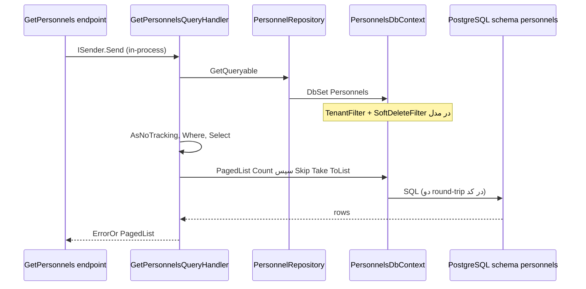

# EF Core و PostgreSQL در دژبان

شناسهٔ کاتالوگ: `09-ef-core-postgresql`.

ارجاع: [02-configuration](02-configuration.md)، [03-docker-compose](03-docker-compose.md)، [06-tenancy-authorization](06-tenancy-authorization.md)، [07-modular-monolith](07-modular-monolith.md)، [08-cqrs-mediatr](08-cqrs-mediatr.md)، [30-request-paths](30-request-paths.md)، [00-personnel-list-execution-path](00-personnel-list-execution-path.md)، [00-execution-path-index](00-execution-path-index.md).

اپ، تست، migration، و اتصال به دیتابیس در این فاز اجرا نشد. مقدار connection string و نسخهٔ دقیق سرور PostgreSQL در runtime نقل نمی‌شود.

## مشکل دادهٔ رابطه‌ای و نقش EF Core

برنامه باید موجودیت‌های دامنه را در جداول رابطه‌ای بخواند و بنویسد. بدون ORM یا لایهٔ نگاشت، هر handler باید SQL خام و ستون‌ها را بداند. EF Core یک ORM برای .NET است: مدل CLR را به جدول و ستون نگاشت می‌کند، LINQ را به SQL ترجمه می‌کند، و با change tracker تغییرات را در `SaveChanges` به دستورهای INSERT/UPDATE/DELETE تبدیل می‌کند.

PostgreSQL موتور دیتابیس است. Npgsql پرووایدر EF برای PostgreSQL است. در این مخزن، دژبان چند `DbContext` روی **یک** دیتابیس منطقی (نام پیکربندی‌شده مثل `payamgostar_dejban` در Compose؛ درس 03) با **schema جدا برای هر ماژول** دارد. هویت `ApplicationDbContext` جدا روی connection خودش است. وضعیت ساختار: `verified` از کد و درس‌های قبلی. وضعیت مقدار زندهٔ connection: از روی پیش‌فرض JSON به‌تنهایی ادعا نمی‌شود؛ کلید `Postgres` است و برندهٔ نهایی به ترتیب provider بستگی دارد (درس 02).

## نسخه‌ها و ثبت

از `Directory.Packages.props`:

| بسته | نسخه |
|---|---|
| `Microsoft.EntityFrameworkCore` | 10.0.0 |
| `Microsoft.EntityFrameworkCore.Design` / `Tools` | 10.0.0 |
| `Npgsql.EntityFrameworkCore.PostgreSQL` | 10.0.0 |
| `EFCore.NamingConventions` | 10.0.0-rc.2 |
| `Microsoft.AspNetCore.Identity.EntityFrameworkCore` | 10.0.0 |
| `MassTransit.EntityFrameworkCore` | 8.5.7 |

وضعیت: `verified`.

### دژبان — الگوی ماژول

مثال پرسنل در `PersonnelsModule.AddInfrastructure`:

1. `AddDbContext<PersonnelsDbContext>` (Scoped پیش‌فرض؛ نه `AddDbContextPool`)  
2. `UseNpgsql(configuration.GetConnectionString("Postgres"), npgsql => MigrationsHistoryTable(..., Schemas.Personnels))`  
3. `AddInterceptors(InsertOutboxMessagesInterceptor)`  
4. `UseSnakeCaseNamingConvention()`  

`PersonnelsDbContext` همزمان `IUnitOfWork` است و با `services.AddScoped<IUnitOfWork>(sp => sp.GetRequiredService<PersonnelsDbContext>())` ثبت می‌شود. وضعیت: `verified`.

جستجو در ماژول‌های دژبان برای `EnableRetryOnFailure` و `AddDbContextPool` در مسیر ثبت معمول ماژول‌ها موردی برای Personnels نشان نداد. بعضی سرویس‌های دیگر (مثل Inventory) برای منطق خاص `BeginTransactionAsync` دارند؛ آن‌ها تراکنش سراسری چندماژولی نیستند.

### هویت

`ServiceCollectionExtensions.AddInfrastructure`: `AddDbContext<ApplicationDbContext>` با `UseNpgsql(GetConnectionString("Postgres"))` و `SlowQueryInterceptor`. بدون `UseSnakeCaseNamingConvention` در همان ثبت. `OnModelCreating` فیلتر tenant و soft-delete را اعمال می‌کند و جداول inbox/outbox MassTransit را اضافه می‌کند. وضعیت: `verified`.

### گزارش

Reporting چند `DbContext` دژبان را با کلید `DejbanPostgres` و هویت را با `IdentityPostgres` ثبت می‌کند؛ جزئیات Stimulsoft در درس 17 است. اینجا فقط معلوم است که همان schemaهای دژبان از سرویس جدا خوانده می‌شوند.

## Schema در برابر database

در PostgreSQL، یک **database** چند **schema** دارد. جدول کامل می‌شود مثل `personnels.personnels` (schema.table). دژبان برای هر ماژول یک ثابت schema دارد:

| ماژول | schema | شاهد |
|---|---|---|
| Personnels | `personnels` | `.../Personnels.../Database/Schemas.cs` |
| Visitors | `visitors` | همان الگو |
| Vehicles | `vehicles` | |
| SecurityPatrols | `security_patrols` | |
| Armory | `armory` | |
| Inventory | `inventory` | |
| CashLogistics | `cash_logistics` | |
| WeighBridge | `weigh_bridge` | |

`HasDefaultSchema` در `OnModelCreating` و `MigrationsHistoryTable(..., schema)` باعث می‌شود تاریخچهٔ migration همان schema بماند، نه لزوماً `public`. وضعیت: `verified`. دیتابیس جدا برای هر ماژول در Compose دژبان دیده نشد؛ یک کلید `Postgres` برای همهٔ `DbContext`های ماژول‌های دژبان.

هویت دیتابیس جدا (`payamgostar_identity` در درس 03) و context جدا دارد. پس «چند schema روی یک DB دژبان» با «یک DB هویت» قاطی نشود.

## `PersonnelsDbContext` و نگاشت

`PersonnelsDbContext` در `.../Database/PersonnelsDbContext.cs`:

- از `DbContext` ارث می‌برد، `IUnitOfWork` و `ITenantDbContext` را پیاده می‌کند.  
- `TenantIds` / `IsSuperAdmin` از `ITenantContext` می‌آید.  
- `DbSet`های داخلی برای `Personnel`، درها، دوربین‌ها، سایت، واحد، outbox/inbox، و غیره.  
- `OnModelCreating`: `HasDefaultSchema(Schemas.Personnels)`، `ApplyConfiguration` برای هر موجودیت، بعد `ApplyTenantQueryFilters(this)` و `ApplySoftDeleteQueryFilters()`.

`PersonnelConfiguration`:

- ایندکس یکتا روی `PersonnelCode`، `NationalCode`، `ACLUserId` با فیلتر SQL `"is_deleted" = false`.  
- ایندکس یکتا روی `(SiteId, AccessCode)` با فیلتر مشابه.  
- `ContractIds` به‌صورت `PrimitiveCollection` با `HasColumnType("uuid[]")` — نوع آرایهٔ PostgreSQL.  
- روابط `HasOne` به Site/Unit با `OnDelete(Restrict)`؛ Employment و Position با `Cascade`؛ Degree/Major اختیاری با `Restrict`.  
- نام ستون‌ها با `UseSnakeCaseNamingConvention` به snake_case می‌روند (مثل `is_deleted` در فیلتر ایندکس). وضعیت: `verified`.

`Personnel` هم `ISiteEntity` است هم `ISoftDeletable`. `PersonnelDocument` فقط `Entity` است؛ با navigation به `Personnel` ممکن است فیلتر tenant مرتبط بگیرد (بخش tenancy).

مرز ماژول: FKهای EF داخل همان `PersonnelsDbContext` هستند. همگام‌سازی با Visitors از integration event است، نه FK بین schemaها (درس 07). ارجاع Inventory→Personnels Domain در سطح CLR است؛ ادعای FK مشترک بین contextها بدون migration مشترک اثبات نشد.

## مفاهیم ضروری با مثال این مخزن

### `DbContext` و thread-safety

`DbContext` واحد کار و tracker برای یک درخواست Scoped است. یک instance را بین threadهای موازی share نکنید؛ change tracker حالت mutable دارد. در دژبان، handler و repository همان Scoped context را از DI می‌گیرند. وضعیت الگوی Scoped: `verified`.

### `DbSet<T>`

ورودی کوئری و `Add`/`Remove` روی مجموعهٔ موجودیت‌هاست. `PersonnelRepository.GetQueryable` فقط `context.Personnels` برمی‌گرداند؛ هنوز SQL اجرا نشده است.

### حالت‌های موجودیت

بعد از `context.Personnels.Add(personnel)` حالت Added است. بعد از `SaveChangesAsync` موفق معمولاً Unchanged. تغییر property روی موجودیت tracked حالت Modified می‌سازد. `Remove` به Deleted می‌رود. soft-delete در پرسنل با `SoftDelete` روی entity و فیلتر `IsDeleted` است، نه لزوماً `Remove` فیزیکی.

### Tracking در برابر `AsNoTracking`

Tracking یعنی EF هویت ردیف را در حافظه نگه می‌دارد تا بعداً تغییر را تشخیص دهد. برای فقط‌خواندن هزینهٔ اضافه است. `GetPersonnelsQueryHandler` بلافاصله `.AsNoTracking()` می‌زند. وضعیت: `verified`.

### `IQueryable` در برابر `IEnumerable` و deferred execution

`IQueryable` درخت عبارت نگه می‌دارد تا provider (اینجا EF) آن را به SQL ترجمه کند. `IEnumerable` معمولاً در حافظه اجرا می‌شود. تا وقتی `Count`، `ToList`، `AnyAsync` و مشابه صدا نشده، کوئری فقط ساخته شده است. در `GetPersonnels`، فیلتر و `Select` هنوز deferred هستند؛ اجرا داخل `PagedList.CreateAsync` است.

### `Include` در برابر projection

`GetWithDocumentsAsync` از `Include(p => p.Documents)` استفاده می‌کند (eager load موجودیت کامل). `GetPersonnels` به‌جای `Include`، `Select` به anonymous type می‌زند (projection). Projection معمولاً ستون کمتری می‌آورد و برای لیست مناسب‌تر است. وضعیت هر دو الگو: `verified`.

Lazy loading proxy در ثبت Personnels دیده نشد. Explicit loading (`Entry(...).Collection.Load`) در مسیرهای این درس بررسی نشد.

### `SaveChanges` / `SaveChangesAsync`

`IUnitOfWork.SaveChangesAsync` همان متد context است. CreatePersonnel چند بار ممکن است آن را صدا بزند (بعد از Insert، بعد از آپلود آواتار، بعد از امضا). هر فراخوانی یک round-trip persist است و interceptor outbox را در `SavingChangesAsync` اجرا می‌کند.

### Pagination

`PagedList.CreateAsync` در `Common/Abstractions/Queries/PagedList.cs` ابتدا `query.Count()` و بعد `Skip`/`Take`/`ToList()` را صدا می‌زند. نام متد `async` است ولی بدنه `await Task.CompletedTask` دارد و از `CountAsync`/`ToListAsync` استفاده نمی‌کند. وضعیت کد: `verified`. اثر روی thread pool: ریسک بالقوه، نه اندازه‌گیری شده.

## مسیر query — `GetPersonnels`

جزئیات HTTP در [00-personnel-list-execution-path](00-personnel-list-execution-path.md) و MediatR در [08-cqrs-mediatr](08-cqrs-mediatr.md). لایهٔ EF:

1. `GetPersonnelsQueryHandler.Handle`  
2. `personnelRepository.GetQueryable()` → `context.Personnels` (`IQueryable`، با global filterهای tenant و soft-delete روی مدل)  
3. `.AsNoTracking()`  
4. اگر کاربر `StaffView` نداشته باشد: `Where(p => p.Id == userId)` (درس 06)  
5. جستجو، `ApplyFilters`، `ApplySorting` روی همان `IQueryable`  
6. `contractRepository.GetQueryable().AsNoTracking()` برای subquery قراردادها داخل `Select`  
7. `Select` به شکل پاسخ (شامل `Contracts = contracts.Where(...).ToList()` داخل projection)  
8. `PagedList.CreateAsync` → دو اجرای همزمان‌نما: `Count()` سپس صفحه با `ToList()`

فیلتر tenant قبل از این Whereها، در مدل EF است؛ نه داخل handler. وضعیت: `verified`. SQL نهایی و plan: `runtime verification pending`.

ریسک‌های منبع‌محور این مسیر:

- دو round-trip count + page در `PagedList` (تأییدشده در کد).  
- `Count()`/`ToList()` همگام داخل متد `async` (تأییدشده).  
- جستجوی چندستونه با `ToLower().Contains` ممکن است ترجمهٔ SQL غیر بهینه بسازد؛ plan دیده نشد → ریسک بالقوه.  
- subquery قراردادها برای هر ردیف صفحه در یک projection؛ رفتار واقعی SQL به ترجمهٔ EF بستگی دارد → `unresolved` بدون لاگ SQL.

## مسیر write — `CreatePersonnel`

1. چند `GetAsync` / `AnyAsync` روی repositoryها (سایت، واحد، یکتایی کد ملی و کد پرسنلی، و غیره). این‌ها SQL جدا هستند.  
2. `Personnel.CreateAsync` → تولید `ACLUserId` (داخلش ممکن است transaction روی sequence باشد؛ `ACLUserIdGenerator`) و `Raise(PersonnelCreatedDomainEvent)`.  
3. `personnelRepository.Insert` → `context.Personnels.Add` (Added).  
4. `unitOfWork.SaveChangesAsync` → قبل از commit منطقی، `InsertOutboxMessagesInterceptor.SavingChangesAsync` رویدادهای Domain را از tracker می‌خواند، پاک می‌کند، و `OutboxMessage` اضافه می‌کند؛ بعد EF INSERT پرسنل و outbox را می‌نویسد. وضعیت ترتیب interceptor نسبت به نوشتن: از قرارداد `SaveChangesInterceptor` و کد interceptor، `verified` برای «قبل از تکمیل SaveChanges، outbox به tracker اضافه می‌شود». تضمین اتمیک بودن پرسنل+outbox در یک تراکنش EF پیش‌فرض: `inferred` از یک `SaveChanges` واحد؛ dump تراکنش اجرا نشد.  
5. آپلود فایل به DCC (شبکهٔ جدا)، سپس در صورت موفقیت دوباره `SaveChangesAsync` برای مسیر تصویر.

پردازش بعدی outbox کار Quartz است، نه همان درخواست HTTP (درس 08 و 07). زمان job: `runtime verification pending`.

تراکنش چند context یا «SaveChanges و Publish روی bus در یک تراکنش توزیع‌شده» از این مسیر اثبات نمی‌شود. `IEventBus.PublishAsync` بعداً در domain handler است.

## فیلتر tenant و soft-delete

`ApplyTenantQueryFilters` در `Common/Tenancy/TenantQueryFilterExtensions.cs` روی هر entity که `ISiteEntity` یا `ISiteEntities<>` باشد، یا navigation تکی به `ISiteEntity` داشته باشد، `HasQueryFilter` با نام `GlobalQueryFilterNames.TenantFilter` می‌گذارد. منطق: اگر super-admin باشد و هیچ سایتی در context انتخاب نشده باشد همه را می‌بیند؛ وگرنه `SiteId` باید در `TenantIds` باشد. جزئیات هدر و middleware در درس 06.

`ApplySoftDeleteQueryFilters` برای `ISoftDeletable` فیلتر نام‌دار `SoftDeleteFilter` با `!IsDeleted` می‌گذارد.

`PersonnelsDbContext` و `ApplicationDbContext` هویت هر دو را صدا می‌زنند. همهٔ contextهای مخزن لزوماً این دو را ندارند؛ فقط جایی که در `OnModelCreating` دیده شود. وضعیت Personnels و Identity: `verified`.

### `IgnoreQueryFilters`

در پرسنل، `GetPersonnelDocumentsQueryHandler` روی `GetDocumentsQueryable().IgnoreQueryFilters()` می‌زند. این هر دو فیلتر نام‌دار را برای آن کوئری سندها برمی‌دارد. قبلش وجود پرسنل با `GetQueryable().AnyAsync` (با فیلترها) چک می‌شود؛ اگر پرسنل خارج از tenant یا soft-deleted باشد معمولاً `NotFound` برمی‌گردد. پس bypass سندها بعد از چک محدودشده است. وضعیت کد: `verified`. اینکه این الگو همیشه امن است بدون تست سناریو ادعا نمی‌شود → ریسک بالقوه اگر چک اول حذف شود.

در هویت، `ClaimService` و helperهای super-admin عمداً `IgnoreQueryFilters` زیاد دارند تا claimها را بدون فیلتر سایت بسازند؛ درس 06. CashLogistics repository هم موارد `IgnoreQueryFilters` دارد.

SQL خام یا Dapper در outbox job فیلتر EF را دور می‌زند چون اصلاً از `DbSet` همان کوئری استفاده نمی‌کند؛ جزئیات Dapper در درس 10. وضعیت وجود Dapper در outbox از کشف قبلی: ارجاع کاتالوگ؛ در این درس job خط‌به‌خط بازخوانی نشد برای ادعای ستون‌های خاص.

## Migrations و عملیات

- هر ماژول migrationهای خودش را زیر `...Infrastructure/Database/Migrations/` دارد؛ snapshot مثلاً `PersonnelsDbContextModelSnapshot` با `HasDefaultSchema("personnels")`.  
- مالکیت migration از نام context در Designer/Snapshot و از `MigrationsHistoryTable` همان schema مشخص می‌شود.  
- `Dejban.Api/Extensions/MigrationExtensions.ApplyMigrations` بعد از `Task.Delay(10000)` برای هشت context به‌ترتیب `context.Database.Migrate()` همگام صدا می‌زند. `Program.cs` دژبان `await app.ApplyMigrations()` را صدا می‌زند. وضعیت: `verified`.  
- Design-time factory جدا در جستجوی Personnels پیدا نشد.  
- قانون مخزن (rule پروژه) می‌گوید migration schema برای deploy سرور ممکن است بیرون از commit با فرآیند جدا باشد؛ با این حال کد startup فعلی `Migrate()` را دارد. هر دو واقعیت می‌توانند هم‌زمان باشند (migrate محلی/کانتینر در برابر فرآیند سرور). اجرای واقعی migrate در این فاز مشاهده نشد.  
- نسخهٔ سرور Postgres: imageهای Compose بدون یک tag واحد قطعی‌اند (درس 03: `postgres` / `postgres:latest` / پیش‌فرض DR `18.1`). نسخهٔ زنده: `unresolved`.

## نمودار مسیر تأییدشده

برای write، بعد از `SaveChangesAsync` ردیف outbox در همان schema نوشته می‌شود؛ job بعدی خارج از این نمودار است.

## جدول مقایسه

| موضوع | معنی کوتاه | در این مخزن |
|---|---|---|
| `IQueryable` vs `IEnumerable` | ترجمه به SQL در برابر اجرای حافظه | repositoryها `IQueryable` برمی‌گردانند |
| Tracking vs `AsNoTracking` | آمادگی برای Update در برابر خواندن سبک | لیست پرسنل `AsNoTracking` |
| `SaveChanges` vs `SaveChangesAsync` | همگام در برابر غیرهمگام روی I/O | handlerها `SaveChangesAsync`؛ خود `PagedList` هنوز sync |
| `Include` vs projection | گراف موجودیت در برابر شکل پاسخ | هر دو؛ لیست با `Select` |
| schema vs database | فضای نام جدول در برابر کاتالوگ جدا | هشت schema روی یک DB دژبان |
| global filter vs `Where` | شرط همیشگی مدل در برابر شرط همان کوئری | tenant/soft-delete سراسری؛ StaffView در handler |

## عملکرد و درستی — فهرست شاهد

| موضوع | مسیر / نماد | چه می‌کند | اهمیت | وضعیت | بهبود متناسب |
|---|---|---|---|---|---|
| Count+page sync | `PagedList.CreateAsync` | `Count()` و `ToList()` | دو SQL؛ بلوکه کردن thread async | ریسک تأییدشده در کد | `CountAsync`/`ToListAsync` و یک API واقعاً async |
| چند `SaveChanges` | `CreatePersonnelCommandHandler` | تا سه persist | چند تراکنش؛ outbox ممکن است چندبار | رفتار تأییدشده | یک persist بعد از آماده‌شدن فایل‌ها اگر ممکن |
| چند `AnyAsync` قبل از insert | همان handler | uniqueness جدا | race بدون قفل یکتا در سطح اپ؛ ایندکس یکتا DB پشتیبان است | ریسک بالقوه؛ ایندکس فیلترشده `verified` | تکیه به unique index + ترجمه خطای DB |
| `IgnoreQueryFilters` اسناد | `GetPersonnelDocumentsQueryHandler` | حذف فیلترها روی سند | اگر چک پرسنل نباشد نشتی tenant | الان با چک قبلی محدود شده | حفظ چک؛ یا فیلتر صریح به‌جای ignore کامل |
| جستجوی `ToLower().Contains` | `GetPersonnelsQueryHandler` | فیلتر متنی گسترده | ممکن است index استفاده نشود | unverified بدون plan | full-text یا trigram در صورت نیاز محصول |
| نبود retry ثبت‌شده | `PersonnelsModule` | بدون `EnableRetryOnFailure` در ثبت دیده‌شده | حساسیت به خطاهای گذرا | فقط نبود در کد | افزودن فقط با تصمیم عملیاتی |
| `Migrate()` در startup | `MigrationExtensions` | اعمال هر هشت context | تأخیر 10s + قفل مهاجرت در چند replica | کد `verified`؛ رفتار cluster اجرا نشد | migrate در job جدا (هم‌راستا با قانون سرور) |

## واژه‌نامه

| اصطلاح | معنی |
|---|---|
| ORM | نگاشت شیء به جدول |
| Change tracker | حافظهٔ حالت موجودیت‌های بارشده |
| Global query filter | شرط خودکار روی همهٔ کوئری‌های آن نوع |
| Schema (PostgreSQL) | فضای نام داخل یک database |
| Outbox | جدول پیام برای پردازش بعدی بعد از persist |
| Soft delete | علامت حذف به‌جای پاک کردن ردیف |
| Migration | نسخهٔ تغییر schema تحت کنترل کد |

## سؤال‌های مصاحبه

### 1. `DbContext` چیست و چرا thread-safe نیست؟

واحد کار EF است: مدل، مجموعهٔ موجودیت‌ها، و tracker. حالت داخلی mutable است؛ دو thread همزمان روی یک instance می‌توانند tracker را خراب کنند. در ASP.NET معمولاً Scoped per request است، مثل `PersonnelsDbContext` در دژبان.

دنباله: چرا Pool جدا از Scoped معمولی است؟

جواب: Pool instance را بازاستفاده می‌کند با محدودیت‌هایی؛ این مخزن برای پرسنل `AddDbContext` معمولی دارد، نه pool.

### 2. deferred execution چیست؟

ساخت `IQueryable` SQL را فوری اجرا نمی‌کند. اجرا با terminal operation مثل `ToList` یا `Count` است. در `GetPersonnels` فیلترها قبل از `PagedList.CreateAsync` فقط درخت را غنی می‌کنند.

دنباله: اگر وسط راه `foreach` روی `IEnumerable` بعد از `AsEnumerable` بزنید چه می‌شود؟

جواب: از آن نقطه ترجمهٔ SQL قطع می‌شود و بقیه در حافظه است.

### 3. فرق `IQueryable` و `IEnumerable`؟

`IQueryable` expression به provider می‌دهد. `IEnumerable` پیمایش حافظه است. برگرداندن `IQueryable` از repository یعنی مصرف‌کننده هنوز می‌تواند فیلتر را به SQL هل بدهد — الگوی `GetQueryable` پرسنل.

دنباله: خطر این الگو چیست؟

جواب: نشت جزئیات EF به Application و کوئری‌های سنگین کنترل‌نشده؛ اینجا با projection و pagination محدود شده است.

### 4. در `SaveChangesAsync` چه اتفاقی می‌افتد؟

Tracker موجودیت‌های Added/Modified/Deleted را به دستور SQL تبدیل می‌کند و به دیتابیس می‌فرستد. در دژبان، `InsertOutboxMessagesInterceptor` قبل از اتمام ذخیره، domain eventها را به `OutboxMessage` تبدیل و `AddRange` می‌کند تا در همان Save بنشینند.

دنباله: آیا این همان Publish به RabbitMQ است؟

جواب: خیر. Rabbit/MassTransit بعداً از job یا از handler دامنه است.

### 5. Tracking و `AsNoTracking`؟

Tracking برای به‌روزرسانی بعدی است. خواندن لیست با `AsNoTracking` حافظه و کار tracker را کم می‌کند. `GetPersonnels` همان را دارد.

دنباله: بعد از `AsNoTracking` اگر property را عوض کنید و Save بزنید؟

جواب: معمولاً EF تغییر را نمی‌بیند مگر attach/update صریح.

### 6. global query filter چطور tenant را جدا می‌کند؟

`HasQueryFilter` شرط را به همهٔ کوئری‌های آن نوع می‌چسباند مگر `IgnoreQueryFilters`. در دژبان شرط روی `SiteId` و وضعیت super-admin است و از `ITenantContext` روی خود context می‌خواند.

دنباله: اگر middleware سایت را پر نکند چه می‌شود؟

جواب: به مقادیر خالی یا پیش‌فرض context بستگی دارد؛ بدون سایت و بدون super-admin، شرط match سایت ممکن است هیچ ردیفی برنگرداند. جزئیات در درس 06.

### 7. migration چند context چطور مدیریت می‌شود؟

هر ماژول history table داخل schema خودش دارد و `Migrate()` جداگانه صدا زده می‌شود. یک migration از Inventory جدول Personnels را جابه‌جا نمی‌کند مگر عمداً به آن context وصل شود — که الگوی فعلی نیست.

دنباله: چرا history را داخل schema ماژول می‌گذارند؟

جواب: تا تاریخچهٔ هشت ماژول در `public` قاطی نشود و deploy ماژول واضح‌تر باشد.

### 8. N+1 از کجا می‌آید؟

وقتی برای هر ردیف یک کوئری جدا برای رابطه زده شود، مثلاً حلقه روی لیست و `Load` تنبل. `Include` یا projection یکجا می‌تواند جلویش را بگیرد. در `GetPersonnels` از projection استفاده شده؛ تأیید نبود N+1 بدون SQL log ممکن نیست، ولی الگوی حلقهٔ صریح در handler نیست.

دنباله: `Contracts = ...ToList()` داخل Select چیست؟

جواب:correlated subquery در expression؛ EF معمولاً آن را در SQL می‌گنجاند، نه لزوماً N کوئری C#. بدون log قطعی نیست.

### 9. تراکنش در برابر outbox؟

تراکنش مرز اتمیک چند دستور SQL روی یک connection/context است. Outbox الگوی «اول در DB بنویس، بعد پیام را پردازش کن» است تا اگر بعد از commit پردازه بمیرد، پیام از دست نرود. CreatePersonnel outbox را در Save می‌نویسد؛ bus جداست.

دنباله: آیا outbox همان تراکنش بین Personnels و Visitors است؟

جواب: خیر. Visitors بعداً از integration event همگام می‌شود.

### 10. EF در معماری دژبان چطور چیده شده؟

یک host، هشت `DbContext`، یک connection string کلید `Postgres`، schema جدا، snake_case، interceptor outbox، فیلتر tenant/soft-delete، repository که `IQueryable` می‌دهد، و `Migrate()` در startup. هویت context و DB جدا دارد. Reporting ممکن است همان schemaها را با کلید `DejbanPostgres` بخواند.

دنباله: آیا این full CQRS با read store جدا است؟

جواب: خیر؛ درس 08. همان `PersonnelsDbContext` برای خواندن و نوشتن پرسنل است.

## پرسش‌های باز

- نسخهٔ دقیق PostgreSQL در محیط اجرا و یکسان بودن tagهای Compose.  
- SQL و execution plan واقعی `GetPersonnels` و subquery قراردادها.  
- اینکه در استقرار چند replica، `Database.Migrate()` همزمان چه قفلی می‌گیرد.  
- فاصلهٔ زمانی Quartz تا مصرف outbox بعد از CreatePersonnel.  
- آیا همهٔ هشت ماژول دقیقاً همان ترکیب interceptor + snake_case + هر دو فیلتر را دارند (Inventory و Visitors در ثبت مشابه دیده شدند؛ خط‌به‌خط هر هشت فایل در این درس تکرار نشد).  
- match حروف `/api` همچنان خارج از این درس و `Runtime verification pending`.

## مرور

دژبان EF Core 10 و Npgsql 10 را با چند `DbContext` روی یک دیتابیس و schema جدا به کار می‌برد. `PersonnelsDbContext` فیلتر tenant و soft-delete، naming snake_case، و outbox interceptor دارد. لیست پرسنل `AsNoTracking` و projection است و صفحه‌بندی‌اش در `PagedList` دو کوئری همگام می‌زند. ایجاد پرسنل با `Add` و `SaveChangesAsync` outbox را در همان persist می‌نویسد. Migrationها per-context هستند و startup دژبان `Migrate()` را صدا می‌زند. اتصال زنده و plan SQL در این فاز دیده نشد.
