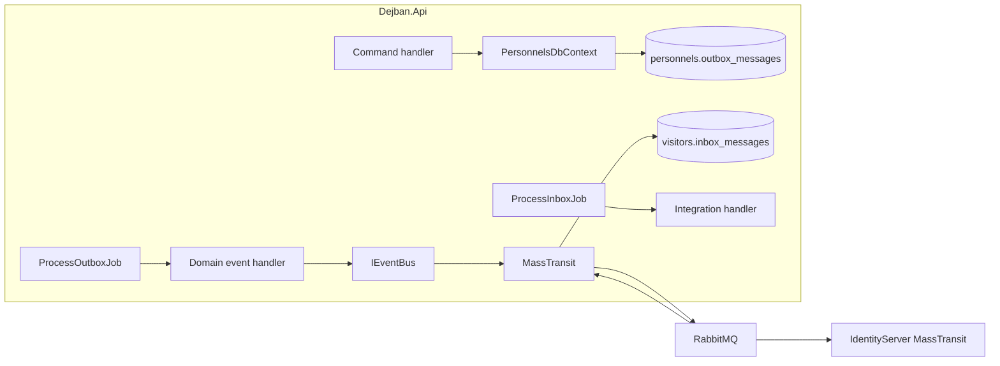

# Messaging، RabbitMQ، MassTransit، Outbox و Inbox در دژبان

شناسهٔ کاتالوگ: `11-messaging`.

ارجاع: [07-modular-monolith](07-modular-monolith.md)، [08-cqrs-mediatr](08-cqrs-mediatr.md)، [09-ef-core-postgresql](09-ef-core-postgresql.md)، [10-dapper](10-dapper.md)، [06-tenancy-authorization](06-tenancy-authorization.md)، [00-execution-path-index](00-execution-path-index.md).

اپ، تست، اتصال به RabbitMQ و دیتابیس در این فاز اجرا نشد. مقدار رمز و credential نقل نمی‌شود؛ فقط نام کلید پیکربندی.

## مشکل و نقش لایه‌ها

وقتی یک ماژول تغییری می‌دهد که ماژول یا سرویس دیگر باید بداند، دو راه دارید: فراخوانی همزمان شبکه، یا پیام ناهمزمان. پیام decoupling می‌دهد ولی ترتیب، تکرار، و شکست broker را وارد می‌کند.

در این مخزن:

| لایه | نقش |
|---|---|
| Domain event | اتفاق داخل aggregate؛ داخل همان ماژول؛ ابتدا در outbox جدولی |
| Integration event | قرارداد مشترک در `Common.EventBus.Contracts` برای بین ماژول/سرویس |
| `IEventBus` | abstraction دژبان روی `IBus.Publish` |
| MassTransit | کتابخانهٔ messaging روی .NET؛ endpoint، retry، consumer |
| RabbitMQ | broker |
| Outbox (دژبان) | جدول + Quartz + Dapper؛ نه MassTransit EF Outbox |
| Inbox (دژبان) | جدول + consumer که فقط insert می‌کند + Quartz برای اجرای handler |
| Outbox (هویت) | `AddEntityFrameworkOutbox` + `UseBusOutbox` روی MassTransit |

MediatR `IPublisher` مسیر اصلی domain event دژبان نیست (درس 08).

## نسخه‌ها و ثبت

از `Directory.Packages.props`:

| بسته | نسخه |
|---|---|
| `MassTransit` / `MassTransit.RabbitMQ` / `MassTransit.EntityFrameworkCore` / `MassTransit.Redis` | 8.5.7 |
| `Quartz.Extensions.Hosting` | 3.15.1 |

وضعیت: `verified`.

### دژبان — `InfrastructureConfiguration.AddInfrastructure`

1. `IEventBus` → `EventBus` (روی `IBus`)  
2. `AddOptions<RabbitMqTransportOptions>().BindConfiguration("RabbitMqTransport")` — کلیدهای سطح بخش معمولاً `Host`، `User`، `Pass` (بدون نقل مقدار)  
3. `AddMassTransit`: برای هر ماژول `moduleConfigureConsumers` صریح؛ `SetKebabCaseEndpointNameFormatter`؛ `UsingRabbitMq` با `UseTenantContextFilters`، `UseMessageRetry` نمایی (حد 5)، `UseCircuitBreaker`، سپس `ConfigureEndpoints`  
4. Quartz برای hosted jobs جدا ثبت می‌شود (درس 10/12)

Consumerهای ماژول با `configure.AddConsumer<IntegrationEventConsumer<T>>()` **صریح** ثبت می‌شوند، نه اسکن خودکار Presentation (آن خط comment است).

### هویت — `ServiceCollectionExtensions.AddMassTransit`

- همان bind `RabbitMqTransport`  
- `AddEntityFrameworkOutbox<ApplicationDbContext>` با `UsePostgres()` و `UseBusOutbox()`  
- Consumerهای صریح مثل `PersonnelCreatedConsumer` با `Endpoint(... InstanceId = "IdentityServer")`  
- همان retry، circuit breaker، tenant filters  
- برای بیشتر endpointها `UseEntityFrameworkOutbox` روی configure callback

وضعیت ثبت: `verified`.

## دو سبک outbox

```text
دژبان:
  EF SaveChanges → InsertOutboxMessagesInterceptor → *.outbox_messages
  → Quartz ProcessOutboxJob (Dapper) → IDomainEventHandler
  → (گاهی) IEventBus → MassTransit → RabbitMQ
  → IntegrationEventConsumer → *.inbox_messages
  → Quartz ProcessInboxJob → IIntegrationEventHandler (+ idempotent decorate)

هویت:
  IPublishEndpoint.Publish → (با Bus Outbox) ذخیرهٔ transactional outbox EF
  → SaveChanges → MassTransit outbox delivery به RabbitMQ
  → IConsumer مستقیم (مثلاً ساخت کاربر)
```

این دو را یکی ندانید.

## معماری مفهومی



## جریان A — `PersonnelCreated`

زنجیرهٔ تأییدشده از سورس:

1. `CreatePersonnelCommandHandler` → `Personnel.CreateAsync` → `Raise(PersonnelCreatedDomainEvent)` (درس 08/09).  
2. `Insert` + `SaveChangesAsync` → `InsertOutboxMessagesInterceptor.SavingChangesAsync` رویدادهای Domain را از tracker به `OutboxMessage` با JSON (`TypeNameHandling.All`) و `SiteIds`/`IsSuperAdmin` از `TenantContextAccessor` می‌نویسد.  
3. Quartz `ProcessOutboxJob` (Personnels): Dapper `SELECT … FOR UPDATE` از `personnels.outbox_messages` جایی که `processed_on_utc IS NULL`، `LIMIT` از Options، داخل تراکنش.  
4. Deserialize به `IDomainEvent`؛ `TenantContextAccessor.SetContext` از ستون‌های پیام؛ اجرای `IDomainEventHandler`ها.  
5. `PersonnelCreatedDomainEventHandler`: `ISender.Send(GetPersonnelQuery)` سپس `eventBus.PublishAsync(new PersonnelCreated(...))` با همان `domainEvent.Id` و `OccurredOnUtc`.  
6. `EventBus` → `IBus.Publish` → فیلتر publish هدرهای `X-Tenant-SiteIds` و `X-IsSuperAdmin`.  
7. بعد از handlerها، job همان ردیف outbox را با `processed_on_utc` و در صورت خطا `error` به‌روز می‌کند و commit می‌کند.  
8. روی RabbitMQ: endpointها با kebab-case از `ConfigureEndpoints`؛ نام دقیق exchange/queue در سورس اپ hardcode نشده؛ `definitions.json` در این درس استخراج نشد → جزئیات broker `unresolved` / بخشی `runtime verification pending`.  
9. **داخل دژبان (مثلاً Visitors):** `IntegrationEventConsumer<PersonnelCreated>` فقط `INSERT INTO visitors.inbox_messages … ON CONFLICT DO NOTHING`؛ منطق کسب‌وکار در `ProcessInboxJob` → `PersonnelCreatedIntegrationEventHandler` → `IReplicaHealer.EnsurePersonnelAsync`. Idempotency با `IdempotentIntegrationEventHandler` روی `visitors.inbox_message_consumers` (الگوی مشابه Personnels).  
10. **هویت:** `PersonnelCreatedConsumer : IConsumer<PersonnelCreated>` مستقیماً کاربر Identity می‌سازد اگر سایت باشد و کاربر تکراری نباشد؛ بدون inbox جدولی دژبان. ACL/RequestTracker هم consumer مشابه دارند (وجود فایل؛ بدنهٔ همه در این درس خط‌به‌خط باز نشد).

وضعیت گام‌های 1–7 و 9–10 کد: `verified`. تحویل واقعی broker و زمان job: `runtime verification pending`.

## جریان B — `SiteCreated`

1. منشأ: `CreateSiteCommandHandler` در هویت؛ `Sites.Add` سپس `_publishEndpoint.Publish(new SiteCreated(...))` سپس کمک super-admin سپس `SaveChangesAsync`.  
2. چون `UseBusOutbox` ثبت شده، الگوی MassTransit این است که Publish تا قبل از تکمیل تراکنش EF به broker نرود و با outbox EF همگام شود. وضعیت ثبت outbox: `verified`. وضعیت اینکه در runtime دقیقاً بعد از SaveChanges ارسال می‌شود: `inferred` از قرارداد MassTransit Bus Outbox؛ dump اجرا نشد.  
3. `SiteCreated` از سازندهٔ بدون id صریح به `IntegrationEvent()` پیش‌فرض می‌رود → `Id = Guid.NewGuid()` و `OccurredOnUtc = UtcNow` در base.  
4. دریافت در Personnels: `AddConsumer<IntegrationEventConsumer<SiteCreated>>()` → insert به `personnels.inbox_messages`.  
5. `ProcessInboxJob` → `SiteCreatedIntegrationEventHandler`: اگر سایت نباشد `Site.Create` + `SaveChangesAsync`.  
6. Retry مصرف روی bus: همان `UseMessageRetry` نمایی هویت/دژبان. Idempotency handler integration با جدول consumers. اگر insert inbox با `ON CONFLICT DO NOTHING` باشد، تکرار پیام MassTransit ردیف تکراری نمی‌سازد.

اگر Bus Outbox در runtime غیرفعال بود، Publish قبل از SaveChanges خطر از دست رفتن همگامی داشت؛ با ثبت فعلی آن فرض ضعیف است ولی مشاهده نشد.

## Outbox و Inbox — جزئیات

### جداول (schema ماژول)

مثال پرسنل: `personnels.outbox_messages`، `personnels.outbox_message_consumers`، `personnels.inbox_messages`، `personnels.inbox_message_consumers`. Visitors همان نام جداول را زیر schema `visitors` دارد. `OutboxMessage` فیلدهای `Id`, `Type`, `Content` (jsonb، در configuration `HasMaxLength(2000)`), `SiteIds`, `IsSuperAdmin`, `OccurredOnUtc`, `ProcessedOnUtc`, `Error`.

### انتخاب و همزمانی

Job با `FOR UPDATE` داخل تراکنش ردیفهای پردازش‌نشده را می‌گیرد. `[DisallowConcurrentExecution]` روی job همان scheduler از اجرای هم‌پوشان همان job جلوگیری می‌کند. چند instance دژبان با scheduler جدا ممکن است هر کدام job داشته باشند؛ قفل ردیف DB کمک می‌کند ولی رفتار cluster کامل `runtime verification pending`. `SKIP LOCKED` در outbox job پرسنل دیده نشد (برخلاف claim import؛ درس 10).

### علامت‌گذاری

بعد از هر پیام (موفق یا با exception گرفته‌شده)، `processed_on_utc` ست می‌شود و متن exception در `error`. Job پیام شکست‌خورده را دوباره از `processed_on_utc IS NULL` برنمی‌دارد مگر کسی آن را دستی null کند — پس «retry داخل جدول outbox» بعد از علامت‌خوردن در این SQL نیست. Retry روی **مصرف MassTransit** جداست.

### Inbox واقعی است

Consumer MassTransit فقط persist می‌کند؛ پردازش کسب‌وکار deferred به Quartz است. `ON CONFLICT (id) DO NOTHING` جلوی duplicate insert را می‌گیرد. جدول `*_message_consumers` idempotency per-handler است، نه جایگزین inbox.

### تراکنش و اتصال جدا

`IdempotentDomainEventHandler` / `IdempotentIntegrationEventHandler` connection جدا از تراکنش job باز می‌کنند (درس 10). پس «handler + insert consumer + update processed» یک تراکنش واحد نیست → at-least-once با امکان ناسازگاری جزئی؛ exactly-once ادعا نمی‌شود.

### اشتراک تراکنش دامنه و publish integration

در دژبان: دامنه و outbox جدولی در یک `SaveChanges`؛ publish به RabbitMQ **بعداً** در job و خارج از آن تراکنش است. بنابراین بین commit دامنه و رسیدن پیام به broker فاصله و امکان تکرار/تأخیر هست.

## زمان‌بندی و شکست

| موضوع | شاهد |
|---|---|
| Trigger | `ConfigureProcessOutboxJob` / `ConfigureProcessInboxJob` با `WithIntervalInSeconds` از Options |
| نمونهٔ Personnels | `modules.personnels.json`: Outbox `IntervalInSeconds` 2؛ Inbox 5 (و BatchSize در همان فایل/محیط) |
| ماژول‌های دیگر | اغلب Outbox/Inbox interval 5 و BatchSize 50؛ Development گاهی BatchSize 20 |
| Concurrent job | `[DisallowConcurrentExecution]` |
| Retry MassTransit | Exponential، `retryLimit: 5`، min 1s، max 5m |
| Circuit breaker | TrackingPeriod 1m، TripThreshold 15، … |
| Dead-letter صریح در کد دژبان | جستجوی `DeadLetter` / `UseDelayedRedelivery` در Dejban خالی بود |
| Shutdown | `AddQuartzHostedService(... WaitForJobsToComplete = true)` |

اگر RabbitMQ نباشد: publish از domain handler fail می‌کند؛ exception در outbox `error` می‌نشیند و پیام processed می‌شود — **بازنشر خودکار از همان ردیف در SQL فعلی نیست**. وضعیت: `verified` از منطق job. رفتار دقیق وقتی publish وسط راه timeout شود: به جزئیات exception handling وابسته است.

## Tenant روی پیام

- Publish/Send filter: هدر `X-Tenant-SiteIds` و `X-IsSuperAdmin` از `TenantContextAccessor`.  
- Consume filter: خواندن هدر و `SetContext` قبل از consumer؛ `Clear` در finally.  
- Outbox job: context را از ستون‌های ذخیره‌شدهٔ outbox set می‌کند قبل از domain handler (مهم چون publish integration در همان scope است).  
- Inbox consumer: موقع insert، `SiteIds` را از accessor (که consume filter پر کرده) کپی می‌کند؛ ProcessInboxJob دوباره از ردیف inbox set می‌کند.

Authorization روی consumer غیرد همزمان مثل endpoint HTTP نیست؛ اعتماد به صحت پیام و replica/وجود سایت است. `PersonnelCreatedConsumer` هویت فقط وجود سایت را چک می‌کند.

## امنیت و درستی

| موضوع | مسیر | رفتار | اهمیت | شدت | بهبود |
|---|---|---|---|---|---|
| Payload پرسنل روی bus | `PersonnelCreated` | کد ملی، موبایل، … | دادهٔ حساس روی broker و لاگ احتمالی | ریسک بالقوه | حداقل فیلد؛ رمزنگاری transport؛ سیاست لاگ |
| `Content` MaxLength 2000 | `OutboxMessageConfiguration` | jsonb با سقف طول | رویداد بزرگ ممکن است در Save بشکند | ریسک بالقوه | افزایش سقف یا ذخیرهٔ شناسهٔ کم‌حجم |
| Outbox processed حتی با خطا | `ProcessOutboxJob` | set `processed_on_utc` + `error` | بدون retry جدولی | ریسک بالقوه | سیاست reprocess یا جدا کردن failed |
| Idempotency connection جدا | `Idempotent*Handler` | جدا از تراکنش job | duplicate یا از دست رفتن علامت | ریسک بالقوه | تراکنش مشترک |
| Tenant SQL در replica | `ReplicaHealer` | کپی با SQL؛ فیلتر EF نیست | درس 10 | همان | |
| Publish قبل از Save در هویت | `CreateSiteCommandHandler` | با Bus Outbox | بدون outbox خطرناک است | ثبت outbox `verified`؛ ترتیب runtime `inferred` | تست integration |
| نبود DLQ صریح در کد | Infra MassTransit | فقط retry/circuit | poison message بعد از retry | unresolved در سطح broker | پیکربندی DLQ در MassTransit/Rabbit |
| TypeNameHandling.All | `SerializerSettings` | JSON با نام نوع | deserialize polymorphic؛ سطح حمله اگر محتوا دستکاری شود | ریسک بالقوه برای ورودی غیرقابل‌اعتماد | محدود کردن انواع مجاز |

## جدول ضمانت‌ها

| رفتار / ضمانت | شاهد سورس | وضعیت | ناشناخته |
|---|---|---|---|
| Persist دامنه + ردیف outbox با هم | interceptor در همان SaveChanges | source verified | isolation level دقیق DB |
| Publish به Rabbit بعد از commit دامنه | job بعد از persist | inferred برای ترتیب زمانی | تأخیر Quartz واقعی |
| At-least-once به مصرف‌کننده | retry MT + inbox ON CONFLICT + consumers table | inferred | تعداد واقعی redelivery |
| Exactly-once end-to-end | — | **ادعا نمی‌شود** | — |
| Idempotency per handler | `*_message_consumers` | source verified | race دو worker روی insert consumer |
| Retry مصرف | `UseMessageRetry` 5 | source verified | رفتار بعد از اتمام retry |
| Scheduling outbox | Options + SimpleSchedule | source verified برای interval پیکربندی | اجرای زنده scheduler چندنودی |
| Tenant روی پیام | publish/consume filters + ستون‌ها | source verified | کامل بودن همهٔ مسیرهای publish |
| تراکنش واحد DB+broker | دژبان: خیر؛ هویت: Bus Outbox | source verified / inferred | |
| Ordering سراسری | ORDER BY occurred_on_utc در batch | فقط داخل یک batch/job | ترتیب بین instanceها و partitionها |
| Dead-letter | در کد اپ دیده نشد | unresolved | تنظیمات سرور Rabbit |

کد به‌تنهایی delivery broker (ack، mirror queue، شبکه) را ثابت نمی‌کند.

## واژه‌نامه

| اصطلاح | معنی |
|---|---|
| Broker | واسطهٔ صف/exchange مثل RabbitMQ |
| Outbox | ذخیرهٔ پیام کنار داده برای ارسال بعدی |
| Inbox | ذخیرهٔ پیام دریافتی قبل یا برای پردازش کنترل‌شده |
| At-least-once | حداقل یک بار رسیدن؛ ممکن است تکرار |
| Idempotent | تکرار اثر یکسان یا بی‌اثر |
| Bus Outbox | outbox یکپارچهٔ MassTransit با EF |
| Poison message | پیامی که مدام fail می‌شود |

## سؤال‌های مصاحبه

### 1. RabbitMQ در برابر MassTransit؟

RabbitMQ broker است. MassTransit کتابخانهٔ .NET روی broker است (اینجا RabbitMQ): endpoint، serialize، retry، consumer DI. می‌توان بدون MassTransit به Rabbit وصل شد؛ این مخزن از MassTransit استفاده می‌کند.

### 2. Domain event در برابر integration event؟

Domain برای واکنش داخل مدل/ماژول است (`PersonnelCreatedDomainEvent`). Integration قرارداد بین مرزهاست (`PersonnelCreated` در Contracts). دژبان اولی را در outbox جدولی می‌گذارد و دومی را با `IEventBus` پخش می‌کند.

### 3. چرا outbox؟

تا اگر بعد از SaveChanges پردازه بمیرد، «قصد انتشار» در DB بماند. بدون outbox، publish وسط راه یعنی داده commit شده و پیام نرفته، یا برعکس.

### 4. چرا outbox ممکن است duplicate بسازد؟

اگر handler دامنه publish کند ولی update `processed_on_utc` fail شود و سیاست reprocess باشد، یا مصرف‌کننده پیام را دو بار ببیند. اینجا بعد از خطا هم processed می‌شود؛ تکرار بیشتر از سمت retry MassTransit/inbox است تا از بازخوانی همان outbox.

### 5. Inbox در برابر فقط idempotency؟

Inbox در دژبان صف داخلی واقعی است (insert سپس job). جدول consumers فقط «این handler این پیام را انجام داده» است. هر دو با هم‌اند.

### 6. At-least-once در برابر exactly-once؟

At-least-once یعنی ممکن است بیش از یک بار پردازش شود؛ باید idempotent باشید. Exactly-once سراسری بین DB و broker عملاً سخت است و این مخزن آن را ادعا نمی‌کند.

### 7. Retry و dead-letter؟

اینجا retry نمایی MassTransit و circuit breaker هست. DLQ صریح در کد Dejban دیده نشد؛ بعد از اتمام retry رفتار پیش‌فرض MassTransit/Rabbit بدون مشاهدهٔ runtime قطعی نیست.

### 8. مرز تراکنش DB و broker؟

دژبان: SaveChanges دامنه+outbox؛ publish جدا. هویت: Bus Outbox با EF. قاطی کردن این دو در مصاحبه اشتباه رایج است.

### 9. Tenant در consumer ناهمزمان؟

هدرهای MassTransit و ستون‌های outbox/inbox؛ `TenantContextConsumeFilter` و set دستی در job. بدون آن، فیلتر EF سایت خالی/غلط می‌بیند.

### 10. جریان `PersonnelCreated` در دژبان؟

ایجاد پرسنل → domain event در outbox → Quartz → handler دامنه → `IEventBus`/`PersonnelCreated` → Rabbit → در Visitors insert inbox → Quartz → replica healer؛ در هویت consumer مستقیم کاربر می‌سازد.

## پرسش‌های باز

- فهرست دقیق exchange/queue در `definitions.json` و نام endpointهای kebab در runtime.  
- رفتار واقعی بعد از اتمام 5 retry و وضعیت DLQ سرور.  
- چندنودی بودن Quartz و رقابت روی `FOR UPDATE` بدون `SKIP LOCKED`.  
- اینکه آیا `HasMaxLength(2000)` عملاً رویداد پرسنل را رد می‌کند.  
- ترتیب قطعی Bus Outbox برای `SiteCreated` با تست.  
- درس 12 جزئیات بیشتر Quartz؛ match حروف `/api` همچنان باز است.

## مرور

دژبان MassTransit 8.5.7 روی RabbitMQ با retry و circuit breaker دارد، ولی outbox دامنهٔ خودش Quartz+Dapper است و inbox ماژول‌ها پیام را اول ذخیره می‌کنند. هویت outbox را داخل MassTransit/EF دارد. `PersonnelCreated` و `SiteCreated` دو مسیر متفاوت publisher دارند. Tenant روی هدر و جداول جابه‌جا می‌شود. Exactly-once و DLQ از روی کد فعلی اثبات نمی‌شوند.
