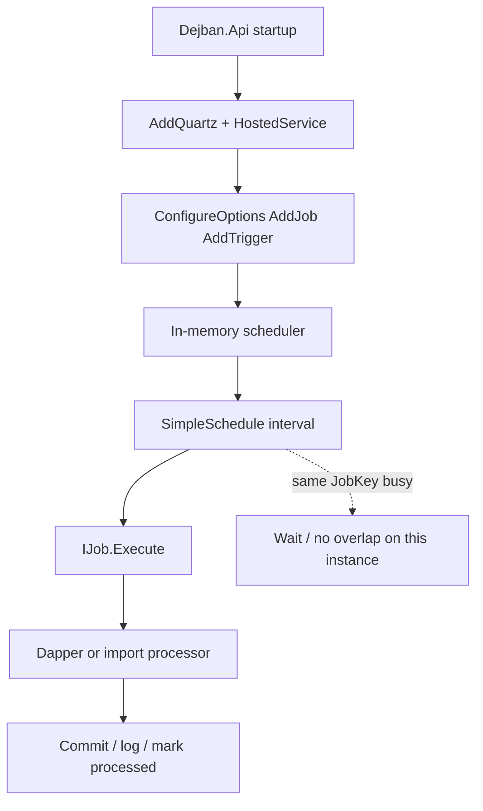

# Quartz.NET در دژبان

شناسهٔ کاتالوگ: `12-quartz`.

ارجاع: [10-dapper](10-dapper.md)، [11-messaging](11-messaging.md)، [09-ef-core-postgresql](09-ef-core-postgresql.md)، [07-modular-monolith](07-modular-monolith.md)، [00-execution-path-index](00-execution-path-index.md).

اپ و scheduler در این فاز اجرا نشد. Quartz فقط در host دژبان ثبت شده است؛ مسیر Bus Outbox هویت Quartz نیست (درس 11).

## مشکل زمان‌بندی

بعضی کارها باید دوره‌ای تکرار شوند: خواندن outbox، پردازش inbox، claim کردن ردیفهای import. Message broker برای «وقتی پیامی رسید» است؛ برای «هر N ثانیه یک‌بار این منطق را اجرا کن» به scheduler نیاز دارید.

Quartz.NET یک scheduler داخل پردازهٔ .NET است: job تعریف می‌کنید، trigger زمان را می‌گوید، scheduler آن‌ها را نگه می‌دارد و در زمان مناسب `IJob.Execute` را صدا می‌زند. این همان background thread اختصاصی دائمی برای یک کار نیست؛ thread از pool scheduler برای هر اجرا قرض گرفته می‌شود.

## نسخه و کجا ثبت می‌شود

| مورد | شاهد |
|---|---|
| بسته | `Quartz.Extensions.Hosting` **3.15.1** در `Directory.Packages.props` |
| `PackageReference` | `Dejban.Common.Infrastructure.csproj` |
| ثبت scheduler | `InfrastructureConfiguration.AddInfrastructure` → `AddQuartz` + `AddQuartzHostedService` |
| هویت / Reporting / … | جستجوی `AddQuartz` / `IJob` در IdentityServer خالی بود |

وضعیت: `verified`.

### ثبت مرکزی

در `InfrastructureConfiguration.cs`:

1. `AddQuartz`: `SchedulerId` و `SchedulerName` با `Guid.NewGuid()` برای هر start پردازه یکتا می‌شوند.  
2. `AddQuartzHostedService(options => options.WaitForJobsToComplete = true)` — هنگام shutdown منتظر اتمام jobهای در حال اجرا می‌ماند.  
3. **هیچ** `UsePersistentStore` / `JobStoreTX` / clustering در کد دیده نشد → store پیش‌فرض in-memory (RAM) است. وضعیت نبود پیکربندی persistent: `verified`. معنای دقیق store داخلی نسخه: semantics مستند Quartz / `inferred` برای RAMJobStore پیش‌فرض.

با SchedulerId تصادفی و حافظهٔ محلی، دو instance دژبان دو scheduler جدا دارند؛ `[DisallowConcurrentExecution]` بین آن‌ها مشترک نیست.

## مفاهیم با مثال دژبان

| اصطلاح | معنی | مثال دژبان |
|---|---|---|
| Scheduler | موتور زمان‌بندی | یکی per process از `AddQuartz` |
| `IJob` | واحد کار قابل اجرا | `ProcessOutboxJob`، `ProcessInboxJob`، `ProcessPersonnelImportJob` |
| JobDetail / identity | شناسه و metadata ثبت job | `WithIdentity(typeof(ProcessOutboxJob).FullName!)` — چون هر ماژول namespace جدا دارد، کلیدها متمایزند |
| Trigger | کی اجرا شود | `WithSimpleSchedule(... WithIntervalInSeconds(...).RepeatForever())` |
| `IJobExecutionContext` | زمینهٔ اجرا؛ شامل `CancellationToken` | import آن را به processor می‌دهد |

### DI به job

کلاس‌های job سازنده با dependency دارند (`IDbConnectionFactory`، `IOptions<>`، …). با `Quartz.Extensions.Hosting`، factory مبتنی بر DI نمونه می‌سازد. `ProcessPersonnelImportJob` فقط `IServiceScopeFactory` می‌گیرد و داخل `Execute` یک scope برای `PersonnelImportBatchProcessor` باز می‌کند — الگوی درست برای سرویس‌های Scoped داخل job Singleton-مانند scheduler.

### `DisallowConcurrentExecution`

Attribute روی کلاس job: تا وقتی یک اجرای همان JobKey روی **همین** scheduler تمام نشده، اجرای هم‌پوشان بعدی برای همان کلید شروع نمی‌شود. ضمانت نمی‌کند:

- جلوگیری بین دو پردازه / دو pod  
- قفل ردیف دیتابیس (آن را `FOR UPDATE` یا `SKIP LOCKED` می‌دهد)  
- اینکه trigger از دست‌رفته دوباره با چه سیاست misfire بیاید (اینجا misfire صریح تنظیم نشده)

### Scheduler در برابر broker

Quartz: زمان‌بندی داخل پردازه. RabbitMQ/MassTransit: انتقال پیام بین مصرف‌کننده‌ها. Outbox دژبان هر دو را ترکیب می‌کند: Quartz ردیف را می‌خواند؛ گاهی handler به bus publish می‌کند (درس 11).

## فهرست jobها

همه زیر `Microservices/Dejban/Modules/*/...Infrastructure` و فقط روی host `Dejban.Api` فعال می‌شوند (`ConfigureOptions<ConfigureProcess…>` در `*Module`).

| Job | ماژول‌ها | کار اصلی |
|---|---|---|
| `ProcessOutboxJob` | هر ۸ ماژول (کلاس هم‌نام، namespace جدا) | Dapper خواندن `*.outbox_messages`، domain handlers، علامت processed |
| `ProcessInboxJob` | هر ۸ ماژول | خواندن `*.inbox_messages`، integration handlers |
| `ProcessPersonnelImportJob` | فقط Personnels | `PersonnelImportBatchProcessor.ProcessNextBatchAsync` |

ثبت trigger: کلاس‌های `ConfigureProcessOutboxJob` / `ConfigureProcessInboxJob` / `ConfigureProcessPersonnelImportJob` که `IConfigureOptions<QuartzOptions>` هستند و `AddJob` + `AddTrigger` می‌زنند.

## بازه‌ها و BatchSize — از فایل ماژول، نه حدس یکسان

پیکربندی از `modules.<name>.json` و در محیط Development از `modules.<name>.Development.json` (ادغام پیکربندی؛ درس 02). بخش‌ها مثل `Personnels:Outbox`.

| ماژول | Outbox interval / batch (پایه) | Inbox interval / batch (پایه) | Development (جایی که فرق دارد) |
|---|---|---|---|
| Personnels | **2 s** / **200** | 5 s / 50 | Inbox batch **20**؛ Outbox/Import همان 2/200 |
| Visitors, Vehicles, SecurityPatrols, Armory, CashLogistics, Inventory, WeighBridge | 5 s / 50 | 5 s / 50 | Outbox و Inbox batch **20** |
| Personnels Import | interval **2 s**، batch **200**، `MaxAttempts` 3 | — | همان در Development |

وضعیت اعداد فایل: `verified`. اینکه در کانتینر کدام فایل محیطی برنده است: به `ASPNETCORE_ENVIRONMENT` و `AddModuleConfiguration` وابسته است (درس 02)؛ dump زنده نشد.

Personnels عمداً outbox سریع‌تر و batch بزرگ‌تر دارد؛ بقیه را 2 ثانیه فرض نکنید.

## مسیر اجرا — Outbox (مثال Personnels)

1. Startup: `AddQuartz` + بعداً `ConfigureOptions<ConfigureProcessOutboxJob>` از `PersonnelsModule`.  
2. Options از `Personnels:Outbox` → interval 2، batch 200.  
3. Trigger هر 2 ثانیه (اگر اجرا قبلی با `DisallowConcurrentExecution` تمام شده باشد).  
4. Quartz `ProcessOutboxJob.Execute` را با DI صدا می‌زند.  
5. `OpenConnectionAsync`، `BeginTransactionAsync`، `SELECT … FOR UPDATE … LIMIT {BatchSize}` روی `personnels.outbox_messages` (درس 10/11).  
6. برای هر پیام: handlers دامنه (ممکن است `IEventBus` بزنند).  
7. `UPDATE` با `processed_on_utc` و اختیاری `error`؛ حتی وقتی exception گرفته شده باشد.  
8. `CommitAsync`.

اگر اجرا بیشتر از interval طول بکشد: روی همین instance به‌خاطر attribute هم‌پوشانی نیست؛ triggerهای معوق به misfire پیش‌فرض SimpleSchedule وابسته‌اند که **صریحاً** در کد ست نشده → رفتار دقیق misfire `runtime verification pending` / semantics مستند Quartz.

چند instance: هر کدام scheduler جدا + `FOR UPDATE` روی ردیف؛ بدون `SKIP LOCKED` در outbox (برخلاف import claim). رقابت بین instanceها ممکن است یکی منتظر قفل بماند. وضعیت کد: `verified`. نتیجهٔ عملی cluster: `runtime verification pending`.

## مسیر Inbox

همان الگو با جدول inbox و `IIntegrationEventHandler`. Consumer MassTransit فقط insert می‌کند؛ Quartz کار دامنه را انجام می‌دهد (درس 11). `[DisallowConcurrentExecution]` روی inbox jobs هم هست.

## مسیر Import پرسنل

`ProcessPersonnelImportJob`:

- Attribute جلوگیری از هم‌پوشانی روی همین scheduler  
- Scope جدید → `PersonnelImportBatchProcessor`  
- `ClaimAsync` با Dapper و `SKIP LOCKED` (درس 10)  
- `context.CancellationToken` به processor؛ `OperationCanceledException` در صورت cancel دوباره پرتاب می‌شود  
- سایر exceptionها فقط لاگ می‌شوند و job «موفق» از دید Quartz تمام می‌شود (بلعیدن خطا) — با outbox که error را در ردیف می‌نویسد فرق دارد  

وضعیت: `verified`.

## دو Outbox — بدون قاطی کردن

| | Outbox سفارشی دژبان | Bus Outbox هویت |
|---|---|---|
| Scheduler | Quartz + Dapper | MassTransit EF Outbox |
| Trigger | `WithIntervalInSeconds` | delivery داخلی MassTransit |
| جداول | `*.outbox_messages` ماژول | جداول outbox MassTransit روی `ApplicationDbContext` |
| نقش Quartz | بله | خیر (در IdentityServer `AddQuartz` نیست) |
| جزئیات | درس 11 + همین سند | درس 11 |

## نمودار چرخهٔ تأییدشده

مسیر هویت جداست و وارد این نمودار نمی‌شود.

## مقایسه فشرده

| موضوع | در این مخزن |
|---|---|
| Quartz vs RabbitMQ | زمان‌بندی محلی vs انتقال پیام |
| Job vs Trigger | `ProcessOutboxJob` vs interval Options |
| `DisallowConcurrentExecution` vs `FOR UPDATE` / `SKIP LOCKED` | جلوگیری هم‌پوشانی job در یک scheduler vs قفل/ادعای ردیف DB |
| In-memory vs persistent | فقط in-memory پیکربندی‌شده؛ بدون cluster store |
| Retry Quartz vs MassTransit | Quartz retry misfire صریح ندارد؛ MT `UseMessageRetry` روی مصرف پیام است؛ outbox بعد از error معمولاً دوباره از همان ردیف خوانده نمی‌شود |

## ریسک‌ها و درستی

| موضوع | مسیر | رفتار | اهمیت | شدت | بهبود |
|---|---|---|---|---|---|
| SchedulerId تصادفی | `InfrastructureConfiguration` | هر start شناسهٔ جدید | clustering Quartz عملاً بی‌معنی حتی با store مشترک | ریسک عملیاتی بالقوه | شناسهٔ پایدار فقط اگر cluster عمدی شود |
| بدون persistent store | نبود `UsePersistentStore` | از دست رفتن trigger state با restart پردازه | jobها از Options دوباره ثبت می‌شوند؛ state داخلی Quartz نه | محدودیت تأییدشده در پیکربندی | اگر نیاز به misfire history است، store پایدار |
| چند instance | Attribute فقط محلی | کار تکراری یا قفل DB | ریسک بالقوه | `SKIP LOCKED` روی outbox؛ یا یک worker |
| Outbox processed با error | `ProcessOutboxJob` | دیگر `processed_on_utc IS NULL` نیست | بدون retry جدولی | ریسک بالقوه (درس 11) | صف failed جدا |
| Import بلعیدن exception | `ProcessPersonnelImportJob` | فقط لاگ | شکست خاموش از دید مانیتور Quartz | ریسک بالقوه | متریک/alert؛ یا rethrow کنترل‌شده |
| Interval ناهماهنگ | Personnels 2s در برابر 5s دیگران | بار نابرابر روی DB/bus | مشاهدهٔ پیکربندی؛ نه باگ لزوماً | تنظیم آگاهانه | |
| Misfire ست‌نشده | `WithSimpleSchedule` بدون `WithMisfireHandlingInstruction…` | پیش‌فرض کتابخانه | unresolved بدون تست | صریح کردن سیاست | |
| Cancellation در outbox/inbox | عمدتاً به handlers پاس داده می‌شود | import صریح‌تر است | تفاوت مسیرها | بالقوه | یکدست کردن |

## واژه‌نامه

| اصطلاح | معنی |
|---|---|
| Scheduler | زمان‌بند jobها |
| Trigger | قانون زمان اجرا |
| Misfire | آتش‌نشدن به‌موقع trigger |
| RAMJobStore | نگهداری تعریف job/trigger در حافظه |
| Clustering (Quartz) | چند گره با store مشترک و هماهنگی |
| Hosted service | سرویس پس‌زمینهٔ ASP.NET که scheduler را بالا می‌آورد |

## سؤال‌های مصاحبه

### 1. Quartz.NET چیست؟

کتابخانهٔ زمان‌بندی job داخل برنامهٔ .NET. در دژبان با `AddQuartz` و hosted service برای outbox/inbox/import استفاده می‌شود.

### 2. فرق `IJob`، JobDetail و Trigger؟

`IJob` منطق است. JobDetail/identity ثبت آن در scheduler است. Trigger می‌گوید کی. مثال: کلاس `ProcessOutboxJob` با identity برابر FullName و trigger هر N ثانیه.

### 3. Dependencyها چطور inject می‌شوند؟

از طریق DI integration پکیج Hosting؛ سازندهٔ job یا `IServiceScopeFactory` داخل `Execute` برای Scopedها.

### 4. `DisallowConcurrentExecution` یعنی چه؟

جلوگیری از دو اجرای هم‌زمان همان JobKey روی همان scheduler. بین چند replica دژبان با store جدا کافی نیست.

### 5. اگر job از interval طولانی‌تر شود؟

هم‌پوشانی روی همان instance به‌خاطر attribute نیست؛ fire بعدی معوق/misfire می‌شود. سیاست misfire اینجا صریح نیست.

### 6. Scheduling با messaging چه فرقی دارد؟

Scheduler زمان را هل می‌دهد. Broker پیام را. Outbox دژبان هر دو را دارد؛ Bus Outbox هویت فقط MassTransit/EF است.

### 7. In-memory در برابر persistent و cluster؟

این مخزن پیکربندی persistent/cluster ندارد. Restart پردازه state داخلی Quartz را از بین می‌برد؛ jobها از `ConfigureOptions` دوباره اضافه می‌شوند.

### 8. Retry و misfire؟

Retry مصرف پیام روی MassTransit است. Outbox بعد از نوشتن `processed_on_utc` با error، در SQL فعلی دوباره انتخاب نمی‌شود. Misfire Quartz تنظیم صریح ندارد.

### 9. Quartz چطور outbox/inbox دژبان را می‌چرخاند؟

Trigger → job → Dapper batch → handlers → علامت processed. Inbox بعد از insert توسط consumer MassTransit.

### 10. چرا Bus Outbox هویت چرخهٔ دیگری است؟

`UseBusOutbox` روی EF/MassTransit است؛ `AddQuartz` در IdentityServer نیست. همان مفهوم «ارسال بعد از commit» با پیاده‌سازی متفاوت.

## پرسش‌های باز

- رفتار misfire واقعی SimpleTrigger در نسخهٔ استفاده‌شده.  
- رقابت چند pod روی `FOR UPDATE` outbox بدون `SKIP LOCKED`.  
- آیا همهٔ هشت `ProcessOutboxJob` جز schema و ModuleName یکسان‌اند (الگوی Personnels/Inventory خوانده شد؛ diff بایتی کامل انجام نشد).  
- متریک/مانیتورینگ شکست import پس از catch.  
- جزئیات بیشتر Hangfire در سرویس‌های دیگر موضوع درس 15 است، نه جایگزین Quartz دژبان.

## مرور

دژبان Quartz 3.15.1 را in-memory با hosted service و `WaitForJobsToComplete` ثبت می‌کند. هر ماژول outbox/inbox جدا با interval/batch از `modules.*.json` دارد؛ Personnels outbox و import با 2 ثانیه و batch 200 از بقیه متمایز است. `DisallowConcurrentExecution` فقط داخل یک پردازه است. هویت از Quartz برای outbox استفاده نمی‌کند. Scheduler جایگزین RabbitMQ نیست؛ مکمل مسیر سفارشی outbox/inbox است.
