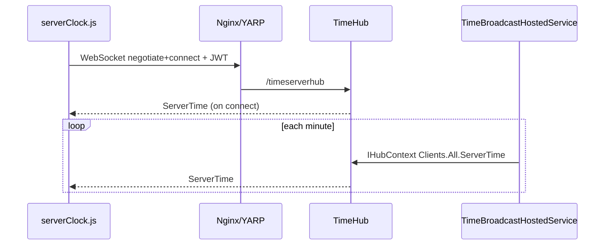

# SignalR در این مخزن

شناسهٔ کاتالوگ: `13-signalr`.

ارجاع: [04-yarp](04-yarp.md)، [05-jwt-identity](05-jwt-identity.md)، [11-messaging](11-messaging.md)، [00-project-discovery](00-project-discovery.md)، [00-execution-path-index](00-execution-path-index.md).

اپ، مرورگر، و تست اتصال زنده در این فاز اجرا نشد. SignalR جایگزین صف پایدار (RabbitMQ) نیست؛ برای اعلان لحظه‌ای به کلاینت‌های **متصل** است.

## 1. اهداف درس

- دیدن hubهای واقعی، مسیر `MapHub`، و پروکسی Nginx/YARP.  
- تفکیک فراخوانی کلاینت→سرور از push سرور→کلاینت با `IHubContext`.  
- درک auth، group، reconnect، و محدودیت چند instance بدون backplane.  
- شناخت شکاف‌های منبع‌محور مثل نبود `gateStatusHub` در Nginx و `AddSignalR` بدون `MapHub` در دژبان.

## 2. نقش SignalR در این مخزن

HTTP درخواست/پاسخ برای «الان چه خبر؟» کافی نیست وقتی سرور باید بدون polling مداوم به UI فشار بدهد: ساعت سرور، وضعیت گیت، به‌روزرسانی تیکت، لاگ پلاک، حضور کاربر.

ASP.NET Core SignalR همین کانال دوطرفه را می‌سازد (معمولاً WebSockets با fallback). در این مخزن چند **سرویس جدا** hub دارند؛ `Dejban.Api` فقط `AddSignalR()` دارد و **هیچ** `MapHub` در جستجوی ماژول دژبان دیده نشد — ثبت بدون endpoint فعال. وضعیت: `verified`.

پیام‌رسانی بین سرویس‌ها همچنان MassTransit/RabbitMQ است (درس 11). SignalR لبهٔ مرورگر/عامل نزدیک UI است.

## 3. بسته‌ها، ثبت، و نگاشت

| محل | نسخه / ثبت |
|---|---|
| بک‌اند central package | `Microsoft.AspNetCore.SignalR.Client` **10.0.0** در `Directory.Packages.props` (مصرف مثلاً در `ACLServer.csproj` به‌عنوان کلاینت) |
| سرور hub | بخشی از ASP.NET Core روی `net10.0`؛ `AddSignalR()` در Identity، ACL، RequestTracker، Gate، Baskool، و نیز `Dejban.Api` |
| فرانت | `@microsoft/signalr` **^8.0.17** در `apps/dejban` و `apps/access-control`؛ `packages/ui` peer اختیاری `^8.0.0` |

جستجوی `AddStackExchangeRedis` روی SignalR / `AddAzureSignalR` / Redis backplane برای SignalR: **یافت نشد**. Redis در مخزن برای cache/blacklist است، نه scale-out SignalR. وضعیت نبود backplane SignalR در کد: `verified`.

### `MapHub` تأییدشده

| سرویس | Hub | مسیر |
|---|---|---|
| IdentityServer | `TimeHub` | `/timeserverhub` |
| IdentityServer | `UserActivityHub` | `/useractivityhub` |
| RequestTracker | `TicketHub` | `/tickethub` |
| ACLServer | `DeviceHub`, `SSMHub`, `PlateReaderHub`, `VehiclePolicyHub`, `ManualAccessHub` | `/devicehub`, `/ssmhub`, `/platereaderhub`, `/vehiclepolicyhub`, `/manualaccesshub` |
| GateServer | `GateConnectionStatusHub` | `/gateStatusHub` |
| BaskoolService | `BaskoolHub` | `/baskoolhub` |

YARP در `ApiGateway/appsettings*.json` برای بسیاری از این‌ها route با `{**catch-all}` دارد (هم مسیر ریشه‌ای و هم گاهی `/Api/v{apiVersion}/...` با rewrite به مسیر hub). Nginx فرانت (`docker/nginx/default.conf.template`) regex این hubها را به gateway می‌فرستد: `tickethub|platereaderhub|devicehub|ssmhub|vehiclepolicyhub|manualaccesshub|baskoolhub|timeserverhub`. **`gateStatusHub` و `useractivityhub` در آن regex نیستند**؛ `useractivityhub` در YARP هست. وضعیت فایل‌ها: `verified`. رسیدن واقعی از مرورگر: `runtime verification pending`.

## 4. مفاهیم با مثال همین مخزن

**Hub** کلاس سروری است که اتصال‌ها را می‌پذیرد. مثال: `TimeHub : Hub<IRealtimeClockClient>`.

**Connection** یک نشست زنده است؛ `Context.ConnectionId` با reconnect عوض می‌شود و شناسهٔ دائمی کاربر نیست.

**User** از `Context.UserIdentifier` (با `IUserIdProvider` سفارشی در تیکت) برای group کاربری استفاده می‌شود.

**Group** مجموعهٔ connectionهاست. مثال: `TicketHub.UserGroup(userId)` برابر `user:{guid}`؛ `UserActivityHub.WatchersGroup`.

**Client → server:** متد روی Hub مثل `GateConnectionStatusHub.JoinGateGroup` یا `PlateReaderHub`ی که کلاینت `invoke('Subscribe', ids)` می‌زند.

**Server → client:** از داخل Hub (`Clients.Caller.ServerTime`) یا بیرون با `IHubContext` (`TimeBroadcastHostedService`، `TicketRealtimeNotifier`).

`AddSignalR` سرویس‌ها را ثبت می‌کند؛ `MapHub` endpoint را روی pipeline می‌نشاند. بدون `MapHub`، `AddSignalR` alone کانال عمومی نمی‌سازد (مورد دژبان).

SignalR تحویل durable به کلاینت قطع‌شده را تضمین نمی‌کند مگر خودتان صف/persist بسازید. این مخزن برای تیکت همزمان notifier می‌زند؛ اگر کاربر وصل نباشد پیام SignalR از دست می‌رود مگر UI بعداً با REST تازه کند. وضعیت از کد push: `verified` که فقط به Clients/Group می‌فرستد؛ بازیابی بعد از قطع: `runtime verification pending`.

## 5. فهرست Hub و رویدادها (خلاصهٔ شاهد)

| Hub | Auth روی کلاس | رویداد / متد مهم | فرستندهٔ معمول |
|---|---|---|---|
| `TimeHub` | `[Authorize]` | کلاینت: `ServerTime`؛ connect هم یک بار می‌فرستد | `TimeBroadcastHostedService` هر دقیقه به `Clients.All` |
| `UserActivityHub` | `[Authorize]` | `UserActivityChanged` به group ناظران | `UserActivityNotifier`؛ join ناظران با permission View |
| `TicketHub` | `[Authorize]` | `TicketUpdated` به `user:{id}` | `TicketRealtimeNotifier` از `TicketSyncService` |
| `GateConnectionStatusHub` | بدون `[Authorize]` روی کلاس در فایل خوانده‌شده | کلاینت متد `JoinGateGroup`؛ سرور `ReceiveGateStatus` | `EventHandelerCommands` و `GateStatusCheckerService` با **`Clients.All`** |
| `DeviceHub` | `[Authorize]` | `OnlineTerminals` هنگام connect به All | همچنین `IHubContext` از handlerهای access log / sync |
| `PlateReaderHub` | `[Authorize]` | کلاینت `Subscribe`؛ رویداد `RealtimePlateReaderAccessLogs` | سرویس‌های ACL + hosted notify |
| `VehiclePolicyHub` | **`[AllowAnonymous]`** | سیاست خودرو / رله | `VehiclePolicyPushService`، `RelayCommandDispatcher` |
| `ManualAccessHub` | `[Authorize]` | پاپ‌آپ دسترسی دستی | `ManualAccessPopupService` |
| `SSMHub` / `BaskoolHub` | SSM: Authorize؛ Baskool جدا | عملیات دستگاه / باسکول | سرویس مربوط |

Typed client interfaces مثل `ITicketHubClient.TicketUpdated` نام متد را به نام رویداد کلاینت نگاشت می‌کنند.

## 6. مسیرهای اجرا end-to-end

### مسیر A — ساعت سرور (کامل‌ترین زنجیرهٔ فرانت+بک)

1. UI دژبان `serverClock.connect()` در `apps/dejban/src/hooks/server-time/server-clock.js`.  
2. `HubConnectionBuilder.withUrl(base + '/timeserverhub', { accessTokenFactory: jwt })` و `withAutomaticReconnect()`.  
3. Nginx → gateway → YARP `timeserver-hub` → Identity `/timeserverhub`.  
4. `TimeHub.OnConnectedAsync` → `Clients.Caller.ServerTime(...)`.  
5. هر دقیقه `TimeBroadcastHostedService` → `hubContext.Clients.All.ServerTime(...)`.  
6. کلاینت `connection.on('ServerTime', ...)`. Fallback HTTP polling اگر Connected نباشد.

وضعیت کد: `verified`. اتصال زنده: `runtime verification pending`.

### مسیر B — به‌روزرسانی تیکت

1. Commandهایی مثل `CreateTicketCommandHandler` / `AddTicketMessageCommandHandler` → `TicketSyncService.NotifyAsync`.  
2. `TicketRealtimeNotifier` → `Clients.Group(user:{guid}).TicketUpdated(payload)`.  
3. کاربر هنگام connect در `TicketHub.OnConnectedAsync` با `UserIdentifier` از `TicketUserIdProvider` به همان group اضافه می‌شود.  
4. فرانت `use-ticket-hub.js`: listen روی `TicketUpdated`، JWT از `tokenStorage`، `withAutomaticReconnect([...])`، cleanup در unmount.

وضعیت: `verified`. اگر کاربر disconnect باشد، این push را از دست می‌دهد مگر refresh لیست.

### مسیر C — وضعیت گیت

1. تغییر وضعیت در `EventHandelerCommands` یا `GateStatusCheckerService`.  
2. `IHubContext<GateConnectionStatusHub>.Clients.All.SendAsync("ReceiveGateStatus", payload)`.  
3. فرانت gate: `getSignalRConnection("gateStatusHub")` و `useSignalREvent(..., "ReceiveGateStatus", ...)`.  
4. `JoinGateGroup` روی hub وجود دارد ولی مسیر push تأییدشده از **All** است نه Group — پس join برای این sendها اثر ندارد. وضعیت: `verified`.

پروکسی: YARP مسیر `/gateStatusHub` دارد؛ Nginx regex فعلی آن را لیست نکرده. کلاینت gate با حذف `/api/vN` به `origin/gateStatusHub` وصل می‌شود. اینکه در Docker فرانت این URL به gateway برسد بدون location جدا: **منبعاً مشکوک / runtime verification pending** (همان مانع کاتالوگ).

### مسیر D — پلاک‌خوان (خلاصه)

کلاینت `invoke('Subscribe', siteIds)`؛ سرور رویداد `RealtimePlateReaderAccessLogs`؛ JWT؛ resubscribe در `onreconnected`. فقط وقتی تب workspace فعال است connect می‌شود.

## 7. چرخهٔ اتصال فرانت

الگوهای مشترک:

- `HubConnectionBuilder` + `accessTokenFactory` (JWT در localStorage یا `tokenStorage`) یا gate با `withCredentials: true`.  
- `withAutomaticReconnect` (ساعت: پیش‌فرض؛ تیکت/پلاک: آرایهٔ تأخیر صریح).  
- `connection.on` / `off` و `stop` در cleanup.  
- ساعت: ref-count برای اشتراک یک اتصال؛ polling Fallback.  
- پلاک: قطع هنگام غیرفعال شدن تب.

Reconnect شناسهٔ connection را عوض می‌کند؛ group عضویت باید دوباره برقرار شود (پلاک `Subscribe` را در `onreconnected` تکرار می‌کند؛ تیکت دوباره `OnConnectedAsync` سرور group را می‌سازد وقتی اتصال جدید authenticate شود).

## 8. احراز هویت، مجوز، جداسازی

| مورد | شاهد |
|---|---|
| JWT به hub | `accessTokenFactory` در کلاینت‌های دژبان |
| `[Authorize]` | Time، UserActivity، Ticket، Device، PlateReader، ManualAccess، SSM |
| `[AllowAnonymous]` | `VehiclePolicyHub` — اتصال بدون کاربر ممکن است؛ بررسی کامل متدها/فیلترها در این درس تمام ACL را پوشش نداد → ریسک بالقوه برای سطح حملهٔ گسترده‌تر |
| Group کاربری تیکت | وابسته به `UserIdentifier` صحیح |
| ناظران فعالیت | فقط claim permission `UserManagementPermissions.View` |
| گیت | hub بدون Authorize در فایل؛ broadcast به All |
| Tenant | پلاک Subscribe با `siteIds` از کلاینت؛ اعتماد به auth + منطق Subscribe سرور — جزئیات اعتبارسنجی site در `PlateReaderHub` باید در خواندن کامل متدها باشد؛ این درس وجود invoke را `verified` و سخت‌گیری کامل فیلتر را `runtime/partial` می‌گذارد |

## 9. Reconnect، قابلیت اطمینان، چند instance

- Automatic reconnect در چند کلاینت هست؛ ضمانت نرسیدن پیام در قطعی برقرار نیست.  
- چند replica از یک سرویس بدون Redis/Azure SignalR backplane: connection روی یک node است؛ `IHubContext` روی node دیگر به آن connection نمی‌رسد. وضعیت نبود backplane: `verified`. رفتار production با یک replica: `runtime verification pending`.  
- `Clients.All` روی گیت همهٔ متصلان همان process را می‌گیرد، نه فیلتر tenant.  
- SignalR ≠ outbox؛ با درس 11 قاطی نشود.

## 10. ریسک‌ها و پرسش‌های runtime

| موضوع | برچسب | توضیح |
|---|---|---|
| `gateStatusHub` خارج از regex Nginx | source-verified gap | YARP دارد؛ لبهٔ Nginx لیست نکرده |
| `useractivityhub` در Nginx نیست، در YARP هست | source-verified | کلاینت اگر از همان origin nginx به root path بزند ممکن است نرسد مگر مسیر دیگر |
| `Dejban.Api` فقط `AddSignalR` | source-verified | بدون MapHub؛ مصرف hub در دژبان دیده نشد |
| `VehiclePolicyHub` AllowAnonymous | potential risk | سطح حمله بالاتر از hubهای Authorize |
| Gate `Clients.All` vs `JoinGateGroup` | source-verified | group برای push استفاده‌نشده |
| بدون backplane | source-verified | scale-out SignalR پیکربندی نشده |
| پیام به کلاینت قطع | strong inference | از دست می‌رود مگر REST بعدی |
| WebSocket زنده از Nginx | runtime verification pending | اجرا نشد |

## 11. سناریو و دیباگ

1. ساعت در فرم‌ها به‌روز نمی‌شود: DevTools → WS به `timeserverhub`؛ JWT؛ YARP identity؛ fallback polling در network.  
2. تیکت real-time نیست: group `user:{id}` با claim شناسه؛ `TicketUserIdProvider`؛ اتصال Authorize.  
3. گیت از اپ gate: URL بعد از strip شدن `/api`؛ وجود location برای `gateStatusHub` روی لبه.  
4. چند pod ACL: اگر device hub unbalanced است، backplane را چک کنید — امروز در کد نیست.

## 12. ده سؤال مصاحبه

### 1. SignalR چه مشکلی را حل می‌کند؟

پوش لحظه‌ای دوطرفه بدون اینکه کلاینت مدام poll کند. در این مخزن مثلاً `ServerTime` و `TicketUpdated`.

### 2. فرق Hub و `IHubContext`؟

Hub برای اتصال و متدهای کلاینت→سرور است. `IHubContext` از سرویس/hosted service بدون داشتن Context اتصال، به کلاینت‌ها پیام می‌فرستد (`TimeBroadcastHostedService`).

### 3. ConnectionId را به‌جای user id نگذارید

با reconnect عوض می‌شود. تیکت از `UserIdentifier` و group پایدار `user:{guid}` استفاده می‌کند.

### 4. `AddSignalR` بدون `MapHub`؟

سرویس ثبت می‌شود ولی endpoint عمومی نیست؛ وضعیت فعلی `Dejban.Api`.

### 5. Authorize روی Hub یعنی چه؟

negotiate/connect بدون principal معتبر رد می‌شود (بسته به پیکربندی JWT). `VehiclePolicyHub` استثنا با AllowAnonymous است.

### 6. Group چه کمکی می‌کند؟

ارسال هدفمند به‌جای All. تیکت و ناظران فعالیت. گیت group دارد ولی push فعلی All است.

### 7. Reconnect خودکار کافی است؟

اتصال را برمی‌گرداند؛ پیام‌های ازدست‌رفته در قطعی را replay نمی‌کند مگر خودتان.

### 8. چرا backplane؟

در چند instance، memory هر node جداست. بدون Redis/Azure SignalR، push فقط به connectionهای همان process می‌رسد. این مخزن backplane SignalR ندارد.

### 9. SignalR در برابر RabbitMQ؟

SignalR لبهٔ UI؛ RabbitMQ بین سرویس‌ها. هر دو می‌توانند در یک ویژگی پشت سر هم باشند ولی جایگزین هم نیستند.

### 10. یک مسیر واقعی از این مخزن را شرح دهید

ایجاد تیکت → `TicketSyncService` → `TicketRealtimeNotifier` → group کاربر → کلاینت `TicketUpdated`؛ یا ساعت با `TimeHub` + broadcast دقیقه‌ای.

## 13. خلاصه و چک‌لیست

- [ ] می‌توانم بگویم کدام سرویس کدام hub را Map می‌کند.  
- [ ] فرق All / Group / Caller را با مثال تیکت و گیت بلدم.  
- [ ] می‌دانم Nginx کدام hubها را پروکسی می‌کند و `gateStatusHub` در لیست نیست.  
- [ ] می‌دانم backplane SignalR در کد نیست.  
- [ ] می‌دانم پیام به کلاینت قطع‌شده durable نیست.

## 14. منابع و مسیرها

- `Microservices/IdentityServer/Program.cs` — MapHub زمان و فعالیت  
- `Microservices/IdentityServer/Infrastructure/Hubs/TimeHub.cs`، `UserActivityHub.cs`  
- `Microservices/IdentityServer/Infrastructure/HostedServices/TimeBroadcastHostedService.cs`  
- `Microservices/RequestTracker/Hubs/TicketHub.cs`، `TicketUserIdProvider.cs`، `Application/Tickets/TicketRealtimeNotifier.cs`  
- `Microservices/GateServer/Application/SignalR/GateConnectionStatusHub.cs`، `GateStatusCheckerService.cs`، `EventHandelerCommands.cs`  
- `Microservices/ACLServer/Program.cs` و `Hubs/*`  
- `Microservices/BaskoolService/Program.cs`  
- `Microservices/Dejban/API/Dejban.Api/Extensions/ServiceCollectionExtension.cs` — فقط `AddSignalR`  
- `ApiGateway/appsettings*.json` — routeهای hub  
- `dejban_frontend_new/docker/nginx/default.conf.template`  
- `apps/dejban/src/hooks/server-time/server-clock.js`، `sections/cartable/tickets/use-ticket-hub.js`، `.../use-plate-reader-hub.js`  
- `apps/gate/src/hooks/signalr/signalRConnection.js`، `services/gate/gate.service.js`  
- `Directory.Packages.props`، `apps/dejban/package.json`
