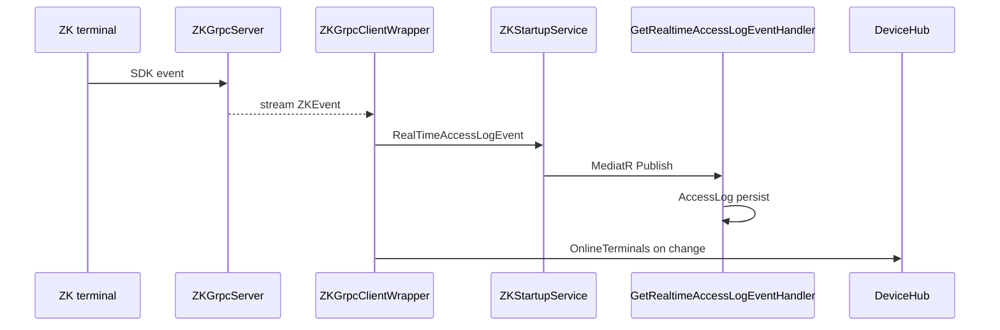

# gRPC و ارتباط با دستگاه‌ها

شناسهٔ کاتالوگ: `14-grpc-devices`.

ارجاع: [13-signalr](13-signalr.md)، [07-modular-monolith](07-modular-monolith.md)، [11-messaging](11-messaging.md)، [03-docker-compose](03-docker-compose.md)، [00-project-discovery](00-project-discovery.md).

اپ، سرور gRPC، دستگاه فیزیکی، و فراخوانی RPC در این فاز اجرا نشد. سرورهای دستگاه در فایل‌های Compose اپ ریشه دیده نشدند.

## 1. اهداف درس

- دیدن قراردادهای `.proto`، سرورهای `*GrpcServer`، و کلاینت‌های ACL.  
- فهم اینکه دستگاه معمولاً به SDK محلی وصل است و ACL از طریق gRPC با آن سرور حرف می‌زند.  
- دانستن اینکه YARP این ترافیک را پروکسی نمی‌کند.  
- تشخیص unary در برابر server-streaming و محدودیت‌های auth/retry از روی سورس.

## 2. جای gRPC در معماری این مخزن

دستگاه‌های کنترل تردد (Virdi، ZK، Tiam) پروتکل اختصاصی/SDK دارند. به‌جای اینکه ACL مستقیماً SDK را در همان پردازه بار کند، پروژه‌های جدا:

- `VirdiGrpcServer`، `ZKGrpcServer`، `TiamGrpcServer` SDK را می‌گیرند و `MapGrpcService` ارائه می‌دهند.  
- `ACLServer` با wrapperهای `*GrpcClientWrapper` (و برای SSM با `AddGrpcClient`) به آدرس‌هایی مثل `http://localhost:5050` وصل می‌شود.  
- رویدادهای realtime از stream gRPC به MediatR/SignalR (`DeviceHub`) می‌رسند (درس 13).

`ServerServiceManagement` سرویس gRPC جدا برای مدیریت سرویس‌های ACL روی ماشین (SSM) است، نه ترمینال بیومتریک.

جستجو در `docker-compose.yml` و `docker/compose.backend.yml` برای نام این سرورها خالی بود. پیکربندی ACL به `host.docker.internal:505x` اشاره می‌کند — یعنی فرض deploy بیرون از Compose اپ. وضعیت: `verified` برای نبود در Compose خوانده‌شده؛ محل واقعی نصب: `runtime verification pending`.

## 3. بسته‌ها، قرارداد، ثبت

| بسته (`Directory.Packages.props`) | نسخه |
|---|---|
| `Google.Protobuf` | 3.33.1 |
| `Grpc.AspNetCore` | 2.71.0 |
| `Grpc.AspNetCore.Server.Reflection` | 2.71.0 |
| `Grpc.Net.Client` / `Grpc.Net.ClientFactory` | 2.71.0 |
| `Grpc.Tools` | 2.76.0 |

| پروژه | نقش proto |
|---|---|
| `ACLServer.csproj` | `Protobuf Include="..\..\Common\Protos\**\*.proto" GrpcServices="Client"` |
| `ZKGrpcServer.csproj` (و مشابه Virdi/Tiam) | `GrpcServices="Server"` روی پوشهٔ برند |

### ثبت ACL

- همیشه: `AddVirdiGrpcClient` / `AddZKGrpcClient` / `AddTiamGrpcClient` / `AddSSMGrpcClient` (Singleton wrapper یا `AddGrpcClient<SSM.SSMClient>`).  
- شرطی با `DeviceGrpcServices:{Brand}:Enabled`: hosted `VirdiStartupService` / `TiamStartupService` / `ZKStartupService` و strategyهای sync.  
- در `appsettings.Development.json` نمونه، هر سه برند **`Enabled: false`** هستند. با این حال comment کد می‌گوید wrapperها همیشه در DI لازم‌اند — پس ساخت Singleton همچنان channel باز می‌کند. وضعیت: `verified`.

### ثبت سرور

هر `*GrpcServer/Program.cs`: `AddGrpc` (DetailedErrors در Development)، اختیاری `AddGrpcReflection`، `MapGrpcService<…>`، پشتیبانی `UseWindowsService` / `UseSystemd`. جستجوی `Authorize` در ZKGrpcServer خالی بود.

## 4. قراردادهای `.proto` و RPC

مسیر مشترک: `Common/Protos/{Virdi,ZK,Tiam,SSM}/`.

| سرویس proto | فایل | نمونه RPC | استریم |
|---|---|---|---|
| `VirdiService` | `virdi_service.proto` | `AddUserToTerminal`، `OpenDoorToTerminal`، `StartServer`، … | `SubscribeToEvents` → `stream VirdiEvent` |
| `ZKService` | `zk_service.proto` | `AddUsers`، `GetUsersList`، `SetDeviceIP`، … | `SubscribeToEvents` → `stream ZKEvent` |
| `TiamService` | `tiam_service.proto` | `SendUserToDevice`، `SetAccess`، `StartWebSocketListener`، … | `SubscribeToEvents` → `stream TiamEvent` |
| `SSM` | `ssm_service.proto` | `StartACLServices`، `ManageService`، … | `StreamServiceLogs` → `stream LogEntry` |

بیشتر RPCها **unary** هستند. رویداد دستگاه با **server-streaming** به ACL می‌رسد. Client-streaming / bidirectional در این protoهای خوانده‌شده دیده نشد.

پیاده‌سازی سرور مثلاً `VirdiGrpcService : VirdiService.VirdiServiceBase` روی `VirdiSdkWrapper` سوار است.

## 5. معماری کلاینت و سرور

```text
[دستگاه فیزیکی] --SDK/پروتکل برند--> [*GrpcServer + SdkWrapper]
                                         ^ gRPC HTTP/2
[ACLServer *GrpcClientWrapper] ----------+
        | events / MediatR
        v
[DeviceHub SignalR] / DB AccessLog / sync strategies
```

کلاینت ZK نمونه (`ZKGrpcClientWrapper`):

1. `GrpcChannel.ForAddress(ServerAddress)` یک‌بار در سازنده.  
2. `ZKService.ZKServiceClient`.  
3. حلقهٔ `SubscribeToEvents` با retry تأخیر 5s هنگام قطع.  
4. متدهای unary مثل `GetDeviceFirmwareVersionAsync` پاسخ را به `ErrorOr` نگاشت می‌کنند.

SSM از `AddGrpcClient` factory استفاده می‌کند؛ بقیه wrapper دستی‌اند.

## 6. مسیرهای end-to-end تأییدشده

### مسیر A — رویداد realtime ZK تا UI/DB

1. ترمینال ZK به SDK داخل `ZKGrpcServer` وصل می‌شود (جزئیات SDK خارج از gRPC).  
2. سرور رویداد را روی stream مشترک `SubscribeToEvents` می‌فرستد.  
3. `ZKGrpcClientWrapper` در ACL می‌خواند و `RealTimeAccessLogEvent` را raise می‌کند.  
4. اگر `DeviceGrpcServices:ZK:Enabled`، `ZKStartupService` به MediatR `GetRealtimeAccessLogEvent` publish می‌کند.  
5. `GetRealtimeAccessLogEventHandler` در DB لاگ می‌سازد و می‌تواند SignalR `DeviceHub` را به‌روز کند.  
6. تغییر لیست آنلاین ترمینال‌ها مستقیم `_deviceHub.Clients.All.OnlineTerminals(...)` می‌زند.



وضعیت زنجیرهٔ کد: `verified`. دستگاه واقعی و پورت زنده: `runtime verification pending`.

### مسیر B — sync کاربر به دستگاه (unary)

`TiamDeviceSyncStrategy` / مشابه ZK/Virdi: قبل از فرمان، `OnlineTerminals` را چک می‌کند؛ اگر آفلاین باشد `Error.Failure("DeviceOffline", ...)`؛ وگرنه RPCهایی مثل `SendUserToDeviceAsync`. موفقیت RPC یعنی پاسخ gRPC موفق از سرور SDK؛ اینکه سخت‌افزار واقعاً کاربر را نوشت وابسته به SDK است → strong inference / runtime pending.

### مسیر C — SSM

ACL `SSM.SSMClient` به `SSMGrpcClientSettings:ServerAddress` (مثلاً `http://localhost:5054`). سرور `ServerServiceManagement` سرویس‌های ویندوز/لینوکس ACL را مدیریت می‌کند. به YARP وصل نیست.

## 7. Transport، HTTP/2، پروکسی، deploy

| موضوع | شاهد |
|---|---|
| HTTP/2 | `VirdiGrpcServer/appsettings.json` → `Kestrel:EndpointDefaults:Protocols = Http2` |
| پورت‌های launch | Virdi `5050`، ZK `5051` (launchSettings)؛ تنظیمات ACL همان پورت‌ها روی localhost / host.docker.internal |
| YARP / Nginx | جستجوی route gRPC دستگاه خالی؛ ترافیک ACL→GrpcServer مستقیم است |
| Compose اپ | سرورهای gRPC در compose خوانده‌شده نیستند |
| Hosted as Windows Service/systemd | در `Program.cs` سرورها پشتیبانی شده |

آدرس‌ها `http://` هستند (بدون TLS در نمونهٔ پیکربندی). برای HTTP/2 بدون TLS معمولاً به تنظیمات خاص کلاینت/سرور نیاز است؛ اینکه در محیط واقعی کار می‌کند اجرا نشد → `runtime verification pending`.

## 8. امنیت

| موضوع | وضعیت |
|---|---|
| `[Authorize]` روی gRPC server پروژه‌های دستگاه | در ZKGrpcServer جستجو خالی → بدون auth سطح gRPC در آن پروژه |
| JWT ACL | برای API/SignalR ACL است، نه برای کانال gRPC به *GrpcServer |
| TLS بین ACL و GrpcServer | در appsettings نمونه `http://` |
| رمز ترمینال در پیام‌ها | فیلدهایی مثل `TerminalPassword` در requestهای ZK در wrapper ساخته می‌شوند — حساسیت داده روی کانال بدون TLS |
| Flag Enable | فقط hosted/strategy را قطع می‌کند؛ wrapper Singleton همچنان ثبت می‌شود |

## 9. Timeout، لغو، retry، شکست

- Stream رویداد: حلقه با catch عمومی و `Delay(5s)`؛ `OperationCanceledException` خروج.  
- کلیدهای `TimeoutSeconds` / `EnableRetry` / `MaxRetryAttempts` در appsettings کلاینت هستند؛ در `ZKGrpcClientWrapper` مصرف این propertyها دیده نشد → احتمال پیکربندی بلااستفاده (`source-verified` نبود مصرف؛ اثر runtime نامعلوم).  
- Deadline صریح `WithDeadline` در مسیرهای خوانده‌شده برجسته نبود.  
- Retry روی فرمان‌های تغییردهندهٔ دستگاه اگر بعداً فعال شود می‌تواند عمل فیزیکی تکراری بسازد — امروز retry خودکار روی unary در wrapper ZK دیده نشد؛ فقط reconnect استریم.  
- آفلاین بودن دستگاه در strategy با چک `OnlineTerminals` قبل از RPC مدیریت می‌شود.

## 10. مقایسه با REST، SignalR، RabbitMQ

| سازوکار | نقش اینجا |
|---|---|
| gRPC | ACL ↔ سرور SDK دستگاه / SSM؛ قرارداد protobuf؛ استریم رویداد |
| REST/JSON | API مدیریت ACL برای UI از طریق gateway |
| SignalR | UI زنده (`DeviceHub`) بعد از رویداد gRPC |
| RabbitMQ | همگام‌سازی بین microserviceها؛ جایگزین کانال دستگاه نیست |

## 11. ریسک‌ها و پرسش‌های runtime

| موضوع | برچسب |
|---|---|
| نبود سرور gRPC در Compose اپ | source-verified |
| نبود auth/TLS روی کانال نمونه | source-verified برای فایل‌های خوانده‌شده |
| Wrapper همیشه ثبت حتی با Enabled=false | source-verified |
| EnableRetry در JSON بدون مصرف در wrapper ZK | source-verified نبود مصرف |
| YARP برای این ترافیک | source-verified نبود route |
| آیا HTTP بدون TLS برای HTTP/2 در محیط شما کار می‌کند | runtime verification pending |
| محل نصب واقعی *GrpcServer و دسترسی دستگاه | runtime verification pending |
| تضمین اثر فیزیکی بعد از RPC موفق | strong inference: وابسته به SDK |

## 12. دیباگ عملی

1. ACL لاگ `event stream disconnected` می‌دهد: آدرس `ServerAddress`، روشن بودن *GrpcServer، پورت، HTTP/2.  
2. `DeviceOffline` در sync: ترمینال در `OnlineTerminals` نیست؛ استریم وصل است؟  
3. UI ترمینال آنلاین نمی‌بیند: `DeviceGrpcServices:ZK:Enabled` و hosted service؛ بعد SignalR `devicehub`.  
4. از Docker ACL به host: `host.docker.internal:505x` و firewall میزبان.

## 13. ده سؤال مصاحبه

### 1. gRPC چیست؟

فراخوانی روی HTTP/2 با قرارداد protobuf. اینجا بین ACL و سرورهای SDK دستگاه استفاده می‌شود.

### 2. `.proto` چه نقشی دارد؟

تعریف سرویس و پیام‌ها؛ با `Grpc.Tools` کلاینت/سرور تولید می‌شود (`GrpcServices=Client` در ACL، `Server` در *GrpcServer).

### 3. Unary در برابر streaming؟

بیشتر فرمان‌ها unaryاند. `SubscribeToEvents` server-stream برای push رویداد دستگاه به ACL است.

### 4. فرق با REST؟

قرارداد باینری و RPC صریح؛ مناسب SDK داخلی. UI همچنان REST/SignalR می‌بیند.

### 5. چرا HTTP/2 مهم است؟

gRPC روی HTTP/2 بنا شده. Kestrel سرور Virdi صریحاً `Protocols=Http2` دارد. پروکسی ناسازگار می‌شکند؛ این مسیر از YARP رد نمی‌شود.

### 6. Deadline و Cancellation؟

استریم با `CancellationToken` لغو می‌شود. Deadline سراسری در wrapper ZK برجسته نبود.

### 7. خطای gRPC؟

`RpcException` و فیلد `Error` داخل پاسخ دامنه؛ wrapper به `ErrorOr` نگاشت می‌کند.

### 8. Auth روی این کانال؟

در سرور ZK نمونه‌ای از Authorize دیده نشد؛ اعتماد شبکه‌ای/میزبان. JWT مال API ACL است.

### 9. Channel lifecycle؟

یک `GrpcChannel` در سازندهٔ Singleton؛ dispose در wrapper. ساخت مکرر per-call در این الگو نیست.

### 10. مسیر واقعی این مخزن؟

رویداد ZK → stream → `ZKGrpcClientWrapper` → `ZKStartupService` → MediatR handler → AccessLog / SignalR؛ یا sync strategy → unary `SendUserToDevice` وقتی آنلاین باشد.

## 14. خلاصه و چک‌لیست

- [ ] می‌دانم چهار خانواده proto کجا هستند.  
- [ ] می‌دانم ACL کلاینت است و *GrpcServer میزبان SDK.  
- [ ] می‌دانم Compose اپ این سرورها را بالا نمی‌آورد.  
- [ ] فرق unary و SubscribeToEvents را بلدم.  
- [ ] می‌دانم SignalR لایهٔ UI بعد از gRPC است نه جایگزین آن.

## 15. منابع

- `Common/Protos/**/*.proto`  
- `Microservices/{Virdi,ZK,Tiam}GrpcServer/Program.cs`، `Services/*GrpcService.cs`  
- `Microservices/ServerServiceManagement/Program.cs`  
- `Microservices/ACLServer/Infrastructure/Services/{Virdi,ZK,Tiam}GrpcClientWrapper.cs`  
- `Microservices/ACLServer/Abstractions/Extensions/ServiceCollectionExtensions.cs`  
- `Microservices/ACLServer/ZKStartupService.cs`، `Application/ZKSDKEventHandlers/GetRealtimeAccessLogEventHandler.cs`  
- `Microservices/ACLServer/appsettings*.json` — `DeviceGrpcServices`، `*GrpcClientSettings`  
- `Directory.Packages.props`  
- `00-project-discovery.md` (نمودار کانتینر و خط نقطه‌چین دستگاه)
