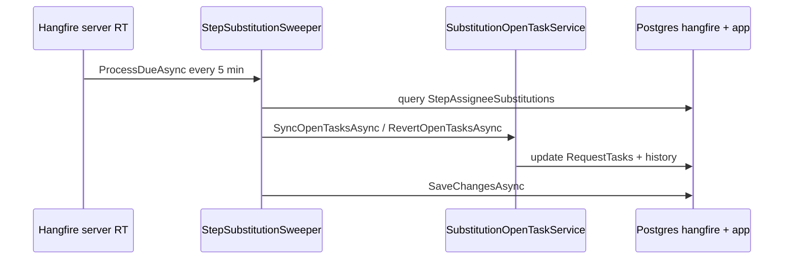
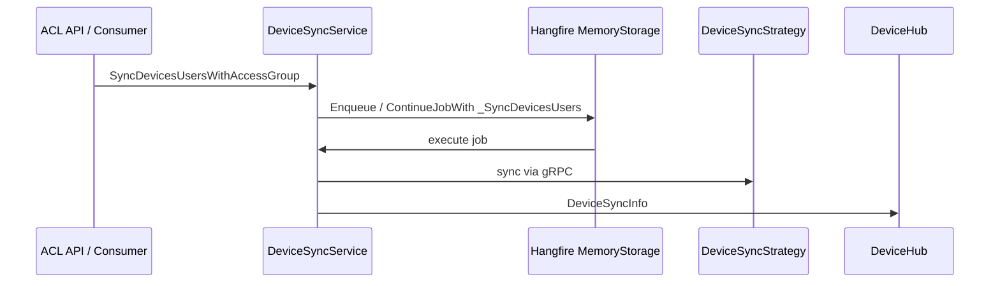

# Hangfire و پردازش job پس‌زمینه

شناسهٔ کاتالوگ: `15-hangfire`.

ارجاع: [12-quartz](12-quartz.md)، [11-messaging](11-messaging.md)، [09-ef-core-postgresql](09-ef-core-postgresql.md)، [14-grpc-devices](14-grpc-devices.md)، [13-signalr](13-signalr.md)، [00-project-discovery](00-project-discovery.md).

اپ، worker Hangfire، و اتصال به Postgres در این فاز اجرا نشد. مقدار رمز و credential نقل نمی‌شود؛ فقط نام کلید پیکربندی.

## 1. اهداف درس

- فهمیدن اینکه Hangfire در این مخزن کجا واقعاً ثبت و صدا زده می‌شود.  
- تفکیک دو الگوی ذخیره‌سازی: PostgreSQL در RequestTracker در برابر MemoryStorage در ACL.  
- دیدن inventory jobها، enqueue/chain، recurring، و dashboard hardened.  
- مقایسهٔ نقش Hangfire با Quartz دژبان و MassTransit، بدون فرض جایگزینی.

## 2. وضعیت و نقش Hangfire در این مخزن

کار طولانی (همگام‌سازی دستگاه، جابه‌جایی assignee در تیکت) نباید thread درخواست HTTP را نگه دارد. Hangfire job را در storage نگه می‌دارد و workerهای داخل همان پردازه آن را بعداً اجرا می‌کنند.

در این مخزن Hangfire **فعال** است، ولی فقط در دو سرویس:

| سرویس | نقش | Storage فعال |
|---|---|---|
| `RequestTracker` | recurring هر ۵ دقیقه برای جانشینی گام تیکت | PostgreSQL، schema `hangfire`، همان connection `Postgres` |
| `ACLServer` | صف همگام‌سازی دستگاه (`devices_queue`) | `UseMemoryStorage` (بلوک PostgreSQL در همان فایل **comment** است) |

جستجوی `AddHangfire` / `Hangfire` در `Dejban` خالی بود. دژبان برای outbox/inbox/import از Quartz استفاده می‌کند (درس 12)، نه Hangfire.

وضعیت: `source-verified` برای ثبت و call siteهای خوانده‌شده. اینکه چند worker زنده در محیط شما روشن است: `runtime verification pending`.

## 3. بسته‌ها و نسخه‌ها

| بسته (`Directory.Packages.props`) | نسخه | مصرف مستقیم |
|---|---|---|
| `Hangfire.Core` | 1.8.22 | RequestTracker، ACLServer |
| `Hangfire.AspNetCore` | 1.8.22 | RequestTracker، ACLServer |
| `Hangfire.PostgreSql` | 1.20.12 | فقط `RequestTracker.csproj` |
| `Hangfire.MemoryStorage` | 1.8.1.2 | فقط `ACLServer.csproj` |

`Hangfire.PostgreSql` برای ACL در پکیج مرکزی وجود دارد و بلوک comment در `ACLServer/.../ServiceCollectionExtensions.cs` به آن اشاره می‌کند، ولی پروژهٔ ACL آن را PackageReference نکرده و کد فعال memory است. وضعیت: `source-verified` (همان تمایز درس کشف).

## 4. ثبت، storage، worker، dashboard

### RequestTracker

در `RequestTracker/Abstractions/Extensions/ServiceCollectionExtensions.AddInfrastructure`:

1. `GetConnectionString("Postgres")` → `UsePostgreSqlStorage(..., SchemaName = "hangfire", PrepareSchemaIfNecessary = true)`.  
2. `UseSerializerSettings` با `ReferenceLoopHandling.Ignore`.  
3. `AddHangfireServer`: `ServerName = "request_tracker"`، `WorkerCount` از `HangfireSettings:WorkerCount` با پیش‌فرض 2.  
4. صف سفارشی ست نشده → صف پیش‌فرض Hangfire (`default`).

در `Program.cs` بعد از auth/tenant:

- `UseHardenedHangfireDashboard`  
- `RecurringJob.AddOrUpdate<StepSubstitutionSweeper>("step-substitution-sweeper", sweeper => sweeper.ProcessDueAsync(), "*/5 * * * *")`

### ACLServer

در `ACLServer/.../ServiceCollectionExtensions`:

1. بلوک `UsePostgreSqlStorage` کامل **comment**.  
2. فعال: `AddHangfire(config => config.UseMemoryStorage().UseSerializerSettings(...))`.  
3. `AddHangfireServer`: `ServerName = "acl_devices"`، `Queues = ["devices_queue"]`، `WorkerCount` از JSON یا `Math.Min(ProcessorCount * 5, 20)`.

در `Program.cs`: فقط `UseHardenedHangfireDashboard` — recurring جداگانه برای ACL دیده نشد.

### Dashboard

هر دو سرویس کپی مشابهی از `UseHardenedHangfireDashboard` و `HangfireDashboardAuthFilter` دارند:

- اگر `HangfireSettings:Dashboard:Enabled` false باشد، middleware اصلاً map نمی‌شود.  
- اگر `AllowRemoteAccess` false باشد، فقط loopback مجاز است.  
- اگر remote true باشد، Basic auth با `Username`/`Password`؛ بدون credential، dashboard اصلاً فعال نمی‌شود.  
- مقایسهٔ credential با `CryptographicOperations.FixedTimeEquals`.  
- `IsReadOnlyFunc`: وقتی remote و بدون `AllowWrite`، داشبورد فقط‌خواندنی است.

مسیر پیش‌فرض `/hangfire`. جستجو در `ApiGateway` برای `hangfire` خالی بود — route اختصاصی gateway برای dashboard دیده نشد. وضعیت: `source-verified` نبود match؛ دسترسی عملی از طریق پروکسی عمومی: `runtime verification pending`.

## 5. پیکربندی: مبدأ و مصرف واقعی

| کلید / تنظیم | مقدار نمونهٔ فایل | محل تعریف | کد مصرف‌کننده | محیط | وضعیت |
|---|---|---|---|---|---|
| `ConnectionStrings:Postgres` | کلید نام؛ مقدار نقل نمی‌شود | `RequestTracker/appsettings*.json`، override Compose | `UseNpgsqlConnection(hangfireConnection)` برای Hangfire + EF | RT همه | storage Hangfire همان DB اپ |
| `HangfireSettings:WorkerCount` | RT: 2؛ ACL: 5 | appsettings پایه و محیط | `AddHangfireServer` options | هر دو | `verified` مصرف |
| `HangfireSettings:Dashboard:Enabled` | پایه/Docker اغلب `false`؛ Development نمونه `true` | appsettings | `UseHardenedHangfireDashboard` early return | هر دو | `verified` |
| `Dashboard:Path` | `/hangfire` | همان | `UseHangfireDashboard(path, …)` | هر دو | `verified` |
| `Dashboard:AllowRemoteAccess` / `AllowWrite` / `Username` / `Password` | نمونه Development remote=false، password خالی | همان | AuthFilter + شرط allowRemote | هر دو | `verified`؛ مقدار secret نقل نشد |
| Schema Hangfire | `hangfire` | فقط کد RT | `PostgreSqlStorageOptions.SchemaName` | RT | `verified`؛ کلید JSON جدا نیست |
| صف ACL | `devices_queue` | کد server + پیش‌فرض آرگومان متدها | `options.Queues` و `[Queue("{0}")]` با پارامتر اول | ACL | `verified` |
| `PrepareSchemaIfNecessary` | `true` | کد RT | Hangfire.PostgreSql | RT | `verified` در کد؛ ایجاد جدول زنده اجرا نشد |

هیچ کلید JSON جدا برای retry Hangfire در نمونهٔ خوانده‌شده دیده نشد؛ retry روی متدهای دستگاه با attribute روی خود متد است (بخش ۸).

## 6. فهرست jobها

### RequestTracker

| شناسه / نوع | کلاس.متد | زمان‌بندی | وابستگی | کار |
|---|---|---|---|---|
| Recurring `step-substitution-sweeper` | `StepSubstitutionSweeper.ProcessDueAsync` | cron `*/5 * * * *` | `ApplicationDbContext`، `ISubstitutionOpenTaskService` | sync/revert تسک‌های باز جانشینی؛ تکمیل AutoApprove منقضی |

`DisableConcurrentExecution` یا attribute مشابه Hangfire روی این کلاس دیده نشد.

### ACL — متدهای enqueue (ورودی عمومی)

این‌ها خودشان job نیستند؛ برای هر `deviceId` از `ChainDeviceJobs` استفاده می‌کنند:

| متد عمومی | jobهای زنجیره‌شده |
|---|---|
| `GetUsersFromDevice` | `_GetUsersFromDevice` |
| `SyncDevicesUsersWithAccessGroup` | `_SyncDevicesUsers` |
| `SyncDevicesUsersWithAccessGroupInAddUser` | `_SyncDevicesUsersInAddUser` |
| `SyncDevicesUsersWithAccessGroupInDeleteUser` | `_SyncDevicesUsersInDeleteUser` |
| `SyncDevicesSettingsWithAccessGroup` | `_SyncDevicesAccessSettings` |
| `GetSelectedUsersFromDevices` | `_GetSelectedUsersFromDevice` |
| `SetBiometricDataToDevices` | `_SetFingerprints` سپس `_SetFaceTemplates` |
| `SetUsersStatus` | `_SetUsersStatusToDevices` |

متدهای `SetInterfaceOptionsAsync` / `SetNetworkOptionsAsync` / `SetSecurityOptionsAsync` **همزمان در درخواست** strategy را صدا می‌زنند؛ Hangfire نیستند. وضعیت: `source-verified`.

### ACL — متدهای اجرایی job (با attribute)

روی متدهای `_…` فعال: `[Queue("{0}")]` و `[AutomaticRetry(Attempts = 0)]`. پارامتر اول `queueName` است (پیش‌فرض `"devices_queue"`) تا با صف server یکی باشد.

کار معمول: بارگذاری دستگاه از repository → strategy برند (gRPC؛ درس 14) → به‌روزرسانی وضعیت sync در DB → اعلان SignalR `DeviceHub` (`DeviceSyncInfo` / `DeviceCurrentStatusInfo`).

زنجیرهٔ قدیمی comment‌شده و متدهای fingerprint/face خواندن از دستگاه comment هستند؛ مسیر فعال بالا است.

## 7. مسیرهای end-to-end

### مسیر A — جانشینی گام تیکت (RequestTracker)

1. Startup: `RecurringJob.AddOrUpdate` با id `step-substitution-sweeper`.  
2. هر حدود ۵ دقیقه Hangfire `ProcessDueAsync` را اجرا می‌کند.  
3. CTS داخلی ۲۰ ثانیه.  
4. جایگزینی‌های Active که شروع شده‌اند و هنوز sync نشده‌اند → `SyncOpenTasksAsync` (مثلاً ReAssign به temporary یا AutoApprove sole assignee).  
5. پایان دوره → `RevertOpenTasksAsync`؛ برای AutoApprove منقضی، Status به Completed.  
6. `SaveChangesAsync`. روی `OperationCanceledException` اگر ChangeTracker تغییر دارد، یک Save بدون همان token.

ایجاد فوری جانشینی از command (`CreateStepAssigneeSubstitutionCommandHandler`) هم می‌تواند همان `SyncOpenTasksAsync` را در request صدا بزند؛ sweeper برای موارد due/منقضی است. وضعیت کد: `verified`. زمان‌بندی زنده: `runtime verification pending`.

### مسیر B — sync کاربران دستگاه (ACL)

1. HTTP مثلاً `DevicesController.SyncDevicesUsersWithAccessGroup` → MediatR handler → `DeviceSyncService.SyncDevicesUsersWithAccessGroup`.  
   یا consumerهایی مثل `PersonnelUpdatedConsumer` / `SendVisitorsToDevicesEventConsumer`.  
2. برای هر device: `ChainDeviceJobs` → `BackgroundJob.Enqueue` یا `ContinueJobWith(..., OnAnyFinishedState)`.  
3. Worker صف `devices_queue` متد `_SyncDevicesUsers` را اجرا می‌کند.  
4. Strategy برند (Virdi/ZK/Tiam) از طریق gRPC با *GrpcServer حرف می‌زند (درس 14).  
5. وضعیت sync و پیام SignalR به کلاینت‌های `DeviceHub`.

موفقیت job یعنی کد تا انتها رفت و strategy نتیجه برگرداند؛ اثر فیزیکی روی ترمینال وابسته به SDK/شبکه است → strong inference / runtime pending (همان درس 14).

## 8. زمان‌بندی، persistence، retry، state

| موضوع | RequestTracker | ACL |
|---|---|---|
| مدل | Recurring cron | Fire-and-forget + continuation per device |
| Persistence | PostgreSQL schema `hangfire` | Memory — با restart پردازه از بین می‌رود |
| Retry خودکار Hangfire روی متد | پیش‌فرض کتابخانه برای sweeper (attribute صریح Attempts=0 دیده نشد) | `[AutomaticRetry(Attempts = 0)]` روی jobهای دستگاه → بدون retry خودکار Hangfire |
| Continuation | ندارد | `OnAnyFinishedState` حتی بعد از شکست parent |
| Serializer | Newtonsoft با Ignore loops | همان الگو |

Restart RequestTracker: jobهای ذخیره‌شده در Postgres می‌مانند؛ recurring دوباره در startup `AddOrUpdate` می‌شود. Restart ACL: صف memory و دیکشنری `DeviceJobChains` خالی می‌شود → jobهای در صف از دست می‌روند. وضعیت: `source-verified` برای نوع storage؛ رفتار دقیق recovery جداول Hangfire: `runtime verification pending`.

## 9. همزمانی و چند instance

| کنترل | شاهد | محدودیت |
|---|---|---|
| صف تک‌نامه‌ای ACL `devices_queue` | `AddHangfireServer.Queues` | فقط workerهایی که این صف را می‌شنوند |
| زنجیره per-`deviceId` | `ConcurrentDictionary` + `lock` در memory پردازه | بین چند instance ACL مشترک نیست |
| بررسی وجود parent | `JobStorage.GetMonitoringApi().JobDetails` | وابسته به storage زنده همان پردازه |
| WorkerCount | از config | چند worker روی یک instance می‌توانند jobهای دستگاه‌های **مختلف** موازی کنند |
| Absence of Hangfire distributed lock attribute روی sweeper | جستجو خالی | دو اجرای overlapping recurring اگر طول بکشد؛ با timeout ۲۰ث بعید ولی theoretically ممکن |
| چند pod RequestTracker با Postgres مشترک | storage مشترک Hangfire | strong inference: Hangfire.PostgreSql می‌تواند بین serverها هماهنگ کند؛ اینکه در deploy چند replica دارید و قفل درست کار می‌کند: runtime pending |
| چند pod ACL با MemoryStorage | storage جدا | هر instance صف خودش؛ زنجیره و job تکراری بین podها ممکن است |

## 10. مقایسه با Quartz و MassTransit

| بُعد | Hangfire (این مخزن) | Quartz (درس 12) | MassTransit (درس 11) |
|---|---|---|---|
| هدف اصلی | job پس‌زمینهٔ اپ (sync دستگاه، sweeper تیکت) | زمان‌بندی دوره‌ای outbox/inbox/import داخل دژبان | انتقال پیام بین سرویس‌ها روی RabbitMQ |
| مدل زمان‌بندی | Recurring cron + enqueue/continue | SimpleSchedule interval از Options | مصرف پیام هنگام رسیدن؛ نه cron کسب‌وکار دستگاه |
| حالت پایدار | RT: Postgres؛ ACL: memory | in-memory scheduler (بدون UsePersistentStore) | broker + جداول outbox/inbox |
| مکانیزم اجرا | `AddHangfireServer` workers | `IJob.Execute` با hosted Quartz | consumer / bus outbox delivery |
| Retry/شکست | ACL صریحاً Attempts=0؛ RT بدون attribute صریح روی sweeper | misfire صریح ست نشده؛ outbox بعد از error معمولاً processed می‌ماند | `UseMessageRetry` نمایی حد 5 + circuit |
| چند instance | RT با DB مشترک بالقوه؛ ACL memory محلی | attribute فقط داخل یک پردازه | صف مشترک broker + inbox idempotency |
| استفادهٔ مخزن | RequestTracker + ACL | فقط host دژبان | دژبان، هویت، ACL، RequestTracker، … |

Hangfire جایگزین Quartz دژبان نیست و جایگزین RabbitMQ هم نیست. ACL گاهی پیام MassTransit می‌گیرد و بعد کار سنگین را به Hangfire می‌سپارد (`PersonnelUpdatedConsumer` → `DeviceSyncService`).

## 11. ریسک‌ها و امنیت

| موضوع | برچسب | توضیح کوتاه |
|---|---|---|
| MemoryStorage ACL | source-verified | از دست رفتن صف با restart؛ بدون اشتراک بین replica |
| `DeviceJobChains` فقط در حافظه | source-verified | بعد از restart زنجیره از صفر؛ چند instance همگام نیست |
| `ContinueJobWith` با `OnAnyFinishedState` | source-verified | ادامه حتی پس از fail parent — ممکن است حالت ناقص روی دستگاه بماند |
| `AutomaticRetry(Attempts = 0)` | source-verified | شکست بدون retry خودکار؛ باید دوباره از API/event enqueue شود |
| اثر فیزیکی تکراری اگر کسی retry دستی/دوباره enqueue کند | strong inference | فرمان‌های دستگاه غیرidempotent ممکن‌اند |
| Dashboard Enabled در Development | source-verified در JSON نمونه | با AllowRemote=false فقط loopback؛ در Docker نمونه Enabled=false |
| نبود route hangfire در gateway | source-verified نبود match | افشای ناخواسته از لبه وابسته به Nginx/شبکه — runtime pending |
| Basic password در config | source-verified کلیدها | اگر remote روشن شود، مدیریت secret مهم است؛ مقدار در درس نقل نشد |
| Sweeper بدون قفل همزمانی صریح | source-verified نبود attribute | با timeout کوتاه ریسک عملی پایین؛ هنوز unverified در cluster |
| Schema auto-prepare | source-verified کد | نیاز به دسترسی DDL روی DB RequestTracker؛ نتیجهٔ migrate زنده اجرا نشد |
| گزینه‌های دستگاه بدون Hangfire | source-verified | timeout شبکه در HTTP request می‌ماند |

## 12. دیباگ عملی

1. Dashboard ACL خالی / job نیست بعد از restart: MemoryStorage است؛ انتظار persistence نداشته باشید.  
2. Sync از UI برمی‌گردد Success ولی دستگاه عوض نشده: HTTP فقط enqueue کرده؛ لاگ `_SyncDevicesUsers`، OnlineTerminals، gRPC (درس 14)، SignalR `DeviceSyncInfo`.  
3. Job در صف می‌ماند: server فقط `devices_queue` را می‌شنود؛ `[Queue("{0}")]` باید با همان نام باشد.  
4. جانشینی تیکت دیر اعمال می‌شود: cron پنج‌دقیقه‌ای؛ یا command همان لحظه `SyncOpenTasksAsync` زده یا نه.  
5. Dashboard 401/بسته: `Enabled`، loopback، یا Basic وقتی remote.  
6. RequestTracker بعد از deploy: schema `hangfire` روی همان Postgres سرویس؛ connection از `ConnectionStrings:Postgres`.

## 13. ده سؤال مصاحبه

### 1. Hangfire چیست؟

کتابخانهٔ .NET برای اجرای کار پس‌زمینه خارج از request HTTP، با storage و worker. در این مخزن در RequestTracker و ACL ثبت شده است.

**Follow-up:** فرق fire-and-forget با recurring؟  
Enqueue یک‌بار اجرا می‌شود؛ recurring با cron مثل `step-substitution-sweeper` تکرار می‌شود.

### 2. چرا کار دستگاه را داخل controller تمام نکنیم؟

sync چند دستگاه و gRPC می‌تواند طولانی باشد. Handler فقط enqueue می‌کند و Success برمی‌گرداند؛ worker بعداً کار می‌کند.

**Follow-up:** آیا Success یعنی دستگاه sync شد؟  
خیر — فقط enqueue موفق از دید handler؛ نتیجهٔ فیزیکی بعداً و وابسته به strategy است.

### 3. MemoryStorage در برابر PostgreSQL؟

ACL memory: سریع برای dev، بدون دوام و بدون اشتراک بین process. RequestTracker Postgres schema `hangfire`: job بعد از restart می‌ماند.

**Follow-up:** چرا بلوک Postgres ACL comment است؟  
کد فعال صریحاً `UseMemoryStorage` است؛ مسیر Postgres آماده‌شده ولی غیرفعال.

### 4. صف `devices_queue` چه نقشی دارد؟

Server ACL فقط همان صف را پردازش می‌کند. متدهای job با `[Queue("{0}")]` نام را از آرگومان می‌گیرند تا با همان صف match شوند.

**Follow-up:** اگر job روی صف `default` برود؟  
با پیکربندی فعلی worker ACL آن را برنمی‌دارد (فقط `devices_queue`).

### 5. `AutomaticRetry(Attempts = 0)` یعنی چه؟

Hangfire بعد از exception آن job را دوباره تلاش نمی‌کند. شکست باید لاگ/SignalR دیده شود و دوباره از دامنه enqueue شود.

**Follow-up:** آیا این همیشه بهتر از retry است؟  
برای فرمان فیزیکی، retry کور ممکن است عمل تکراری بسازد؛ اینجا صریحاً صفر است.

### 6. زنجیرهٔ `ChainDeviceJobs` چگونه کار می‌کند؟

آخرین jobId هر دستگاه در دیکشنری حافظه نگه داشته می‌شود؛ اگر parent در monitoring باشد `ContinueJobWith`، وگرنه `Enqueue`.

**Follow-up:** محدودیت multi-instance؟  
دیکشنری و MemoryStorage محلی‌اند؛ دو pod ACL دو جهان جدا می‌بینند.

### 7. Dashboard را چطور امن کرده‌اند؟

با flag Enabled، محدودیت loopback یا Basic با مقایسهٔ زمان‌ثابت، و حالت read-only وقتی remote بدون AllowWrite.

**Follow-up:** JWT اپ اینجا نقش دارد؟  
فیلتر Hangfire جدا از `UseAuthentication` اپ است؛ Basic/loopback خود dashboard است.

### 8. Hangfire در برابر Quartz در این مخزن؟

Quartz فقط دژبان برای polling outbox/inbox. Hangfire در RT/ACL برای sweeper و sync دستگاه. هر دو «job» هستند ولی مرز سرویس و storage فرق دارد.

**Follow-up:** کدام persistent است؟  
Hangfire RT بله (Postgres). Quartz دژبان در کد بدون persistent store. Hangfire ACL memory.

### 9. Hangfire در برابر MassTransit؟

MassTransit پیام بین سرویس‌هاست. Hangfire کار داخل یک سرویس بعد از تصمیم محلی (یا بعد از مصرف پیام) است. مثال: consumer پرسنل → Hangfire sync دستگاه.

**Follow-up:** آیا outbox دژبان Hangfire است؟  
خیر — Quartz + Dapper (درس 11/12).

### 10. یک مسیر واقعی را شرح دهید

`POST SyncDevicesUsersWithAccessGroup` → handler → `SyncDevicesUsersWithAccessGroup` → `Enqueue(_SyncDevicesUsers)` روی `devices_queue` → strategy gRPC → SignalR وضعیت؛ یا recurring RT هر ۵ دقیقه `ProcessDueAsync` برای جانشینی.

**Follow-up:** اگر ACL وسط sync بمیرد؟  
با MemoryStorage job باقی‌مانده از بین می‌رود؛ باید دوباره از API/event تحریک شود.

## 14. خلاصه و چک‌لیست

- [ ] می‌دانم Hangfire فقط در RequestTracker و ACL فعال است، نه دژبان.  
- [ ] فرق Postgres schema `hangfire` و MemoryStorage ACL را بلدم.  
- [ ] می‌دانم dashboard پیش‌فرض خاموش است و با filter hardened کنترل می‌شود.  
- [ ] inventory متدهای `DeviceSyncService` و sweeper را می‌شناسم.  
- [ ] می‌دانم Attempts=0 و زنجیرهٔ OnAnyFinishedState چه معنایی دارند.  
- [ ] نقش جدا از Quartz و MassTransit را می‌توانم توضیح بدهم.

## 15. منابع

- `Directory.Packages.props` — نسخه‌های Hangfire  
- `Microservices/RequestTracker/RequestTracker.csproj`، `Program.cs`  
- `Microservices/RequestTracker/Abstractions/Extensions/ServiceCollectionExtensions.cs` — `AddHangfire` / `AddHangfireServer`  
- `Microservices/RequestTracker/Infrastructure/Hangfire/StepSubstitutionSweeper.cs`  
- `Microservices/RequestTracker/Infrastructure/Hangfire/HangfireDashboardExtensions.cs`، `HangfireDashboardAuthFilter.cs`  
- `Microservices/RequestTracker/Application/Services/SubstitutionOpenTaskService.cs`  
- `Microservices/RequestTracker/appsettings*.json` — `HangfireSettings`  
- `Microservices/ACLServer/ACLServer.csproj`، `Program.cs`  
- `Microservices/ACLServer/Abstractions/Extensions/ServiceCollectionExtensions.cs`  
- `Microservices/ACLServer/Infrastructure/Services/DeviceSyncService.cs`  
- `Microservices/ACLServer/Infrastructure/Hangfire/*`  
- `Microservices/ACLServer/Application/Devices/Commands/SyncDevicesUsersWithAccessGroup/*`  
- `docker/compose.backend.yml` — سرویس‌های `requesttracker` / `aclserver` و connection Postgres  
- درس‌های `12-quartz.md`، `11-messaging.md`، `14-grpc-devices.md`
