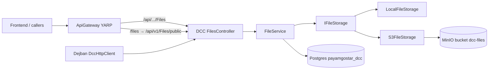
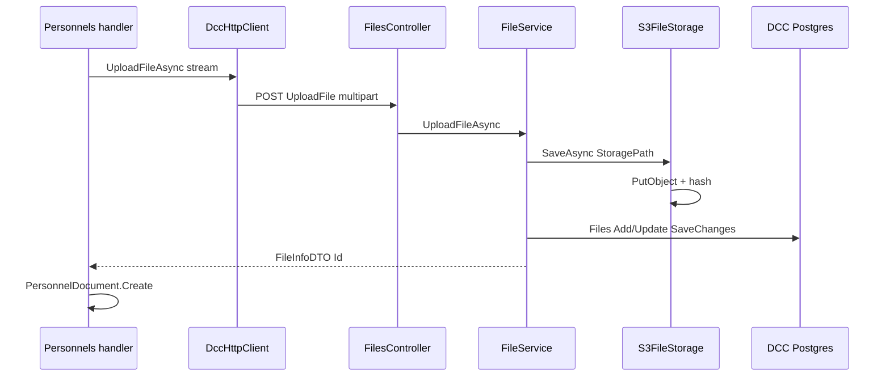

# DCC و ذخیره‌سازی شیء (S3 / MinIO)

شناسهٔ کاتالوگ: `16-dcc-s3`.

ارجاع: [03-docker-compose](03-docker-compose.md)، [04-yarp](04-yarp.md)، [09-ef-core-postgresql](09-ef-core-postgresql.md)، [06-tenancy-authorization](06-tenancy-authorization.md)، [00-project-discovery](00-project-discovery.md).

اپ، MinIO، آپلود/دانلود زنده، و اتصال DB در این فاز اجرا نشد. مقدار AccessKey/SecretKey و رمز Postgres نقل نمی‌شود؛ فقط نام کلید پیکربندی.

## 1. اهداف درس

- فهم نقش سرویس DCC به‌عنوان مرکز فایل‌های سامانه.  
- دیدن abstraction `IFileStorage` و دو پیاده‌سازی Local و S3/MinIO.  
- ردیابی upload، download، soft-delete، purge، و presigned URL از روی سورس.  
- تشخیص جدا بودن متادیتا در PostgreSQL از بایت‌های شیء در object store.  
- دانستن ریسک‌های consistency و امنیت بدون ادعای تست runtime.

## 2. نقش DCC در مخزن

DCC در middleware gateway با برچسب «Document Control Center» آمده است (`ApiGateway/Middleware/ProxyErrorHandlingMiddleware.cs`). یک microservice جداست (`Microservices/DCC`) با Postgres خودش (`payamgostar_dcc`)، Redis/JWT مثل بقیه، و MassTransit برای consumer endpoint سرویس.

کار اصلی: نگه‌داشتن **بایت فایل** در Local disk یا MinIO/S3 و **متادیتا** در جدول `Files`، و ارائهٔ API به سایر سرویس‌ها از طریق `DccHttpClient` در `Common/FileService`.

مصرف‌کنندگان تأییدشده در دژبان (نمونه):

- پرسنل: آپلود/حذف سند، عکس در `CreatePersonnel` / `UpdatePersonnel`، download URL.  
- بازدیدکننده: سند و عکس.  
- انبار: `GoodsTransitDocumentService`، `GoodsReservationDocumentService`.  
- import پرسنل: آپلود از batch processor.

DCC جایگزین فایل‌سیستم داخل هر ماژول است؛ ماژول‌ها فقط `Guid` فایل و گاهی `StoragePath` را در دامنهٔ خود نگه می‌دارند.

## 3. نمای معماری ذخیره‌سازی

| لایه | مسئولیت |
|---|---|
| Presentation | `FilesController` + MediatR |
| Application | commands/queries، `IFileAccessService`، validators |
| Domain | `FileEntity`، `FileRevision` |
| Infrastructure | `FileService`، `LocalFileStorage` / `S3FileStorage`، EF `ApplicationDbContext` |

## 4. بسته‌ها، abstraction، DI

| بسته | نسخه | محل |
|---|---|---|
| `AWSSDK.S3` | 3.7.419 | `Directory.Packages.props`، `DCC.csproj` |

کلاینت MinIO جدا نیست؛ همان SDK آمازون با `ServiceURL` و `ForcePathStyle` به endpoint سازگار با S3 وصل می‌شود.

| قرارداد | پیاده‌سازی |
|---|---|
| `IFileStorage` | `SaveAsync` / `OpenReadAsync` / `DeleteAsync` / `ExistsAsync` |
| `IPresignedUrlProvider` | `IsSupported`، `CreateGetUrlAsync`، `CreatePutUrlAsync` |
| Local | `LocalFileStorage` — `IsSupported = false` (presign null) |
| S3 | `S3FileStorage` — همان کلاس هر دو interface را پیاده می‌کند |

ثبت در `ServiceCollectionExtensions.AddInfrastructure`:

1. `Configure<StorageOptions>(configuration.GetSection("Storage"))`.  
2. اگر `Storage:Provider` برابر `S3` (case-insensitive) → Singleton `S3FileStorage` برای هر دو interface.  
3. در غیر این صورت → `LocalFileStorage`.  
4. `FileService` و `IFileAccessService` Scoped.

`CreatePutUrlAsync` فقط روی interface/پیاده‌سازی تعریف شده؛ **هیچ call site** در مخزن برای آپلود مستقیم کلاینت→MinIO پیدا نشد. وضعیت: `source-verified` نبود مصرف.

## 5. پیکربندی: مبدأ و مصرف

| کلید / گزینه | تعریف | خواننده | اثر | محیط | وضعیت |
|---|---|---|---|---|---|
| `Storage:Provider` | appsettings DCC؛ Compose `Storage__Provider: S3` | `AddInfrastructure` branch | انتخاب Local یا S3 | Dev اغلب Local؛ Docker/Compose S3 | `verified` |
| `Storage:RootPath` | appsettings | `LocalFileStorage` فقط وقتی Environment نه Development/Production خالی | ریشهٔ دیسک | DockerDevelopment نمونه `/app/uploads` | `verified`؛ در Dev/Prod محلی کد به `ContentRoot/uploads` می‌رود |
| `Storage:S3:Endpoint` | JSON / `Storage__S3__Endpoint` | `S3FileStorage` ctor → `AmazonS3Config.ServiceURL` | آدرس داخلی MinIO/S3 | Docker `http://minio:9000` یا host:19000 | `verified` |
| `Storage:S3:PublicEndpoint` | JSON / env | `CreateSigningClient` | host امضای URL برای مرورگر | مثلاً `http://localhost:19000` | `verified` |
| `Storage:S3:AccessKey` / `SecretKey` | JSON / `MINIO_ROOT_*` | `BasicAWSCredentials` | احراز به object store | همهٔ S3 | `verified` مصرف؛ مقدار نقل نشد |
| `Storage:S3:Bucket` | پیش‌فرض کد `dcc-files` | Put/Get/Delete | نام bucket | Compose `mc mb …/dcc-files` | `verified` |
| `Storage:S3:Region` | پیش‌فرض `us-east-1` | `AuthenticationRegion` | سازگاری SDK | MinIO و AWS | `verified` |
| `Storage:S3:ForcePathStyle` | پیش‌فرض `true` | `ForcePathStyle` | path-style برای MinIO | Docker | `verified` |
| `Storage:S3:PresignTtlSeconds` | پیش‌فرض 300 | `GetPresignedDownloadUrlQueryHandler` | TTL لینک GET | وقتی Provider=S3 | `verified` |
| `PublicFiles:Provider` | gateway JSON | `ApiGateway/Program.cs` | Local → StaticFiles؛ غیرLocal → route YARP | Docker `MinIO` | `verified` |
| `PublicFiles:Mode` / `Bucket` | gateway JSON | فقط در JSON دیده شد | Mode/Bucket در `Program.cs` خوانده نشد | Docker | **وجود در JSON بدون مصرف کد gateway** (`source-verified` نبود bind) |
| `DccHttpClient:BaseAddress` / `Address` | config سرویس‌های مصرف‌کننده | `AddDccHttpClient` | پایهٔ HTTP به DCC | دژبان و … | `verified` وجود ثبت |
| `RequestSizeLimit(1_000_000_000)` | attribute کنترلر | ASP.NET | حد ۱GB روی Upload | DCC | `verified` |
| CORS MinIO | `Scripts/minio-cors.json` | `minio-init` با `mc cors set` | مرورگر مستقیم به MinIO (presign) | Compose | `verified` اسکریپت؛ اثر زنده pending |

## 6. مدل فایل و متادیتا

### PostgreSQL (`FileEntity`)

شناسهٔ منطقی برای API: `Id` (Guid). مسیر شیء: `StoragePath` مثل `private/Dejban.Personnels/2026-10/{guid}.pdf` یا `public/...`.

فیلدهای مهم: `ContentType`، `Size`، `OriginalFileName`، `FileName`، `OwnerService`، `FolderName`، `CreatorId`، `IsPublic`، `HashSha256`، `IsProtected` / `IsDeleted`، `SiteId` / `RequireSiteMatch`، و فیلدهای AllowedRoles/Users/Services و `RequiredPermission` (بسیاری در access service comment شده‌اند).

`FileRevision`: snapshot JSON برای SoftDeleted / Restored.

### Object store

کلید شیء = همان `StoragePath` نرمال‌شده (slash جلو، بدون `\`). Bucket نمونه: `dcc-files`. بایت در DB ذخیره نمی‌شود.

دامنهٔ پرسنل/بازدیدکننده علاوه بر `Id` فایل DCC، گاهی `StoragePath` را در entity خودش کپی می‌کند — منبع حقیقت بایت همچنان DCC/MinIO است.

## 7. مسیر Upload

### عملیات مستقیم روی DCC

1. `POST /api/v1/Files/UploadFile` (`[AllowAnonymous]`) یا `UploadFileSecure` (`[Authorize]` از `ApiController`).  
2. `UploadFileCommand` + FluentValidation (فایل، OwnerService، FileName، FolderName، CreatorId، IsPublic، RequireSiteMatch).  
3. `UploadFileCommandHandler`: سایت از `GetUserSiteIds()`؛ stream فرم → `FileService.UploadFileAsync`.  
4. ساخت `StoragePath` = `{public|private}/{ownerService}/{yyyy-MM}/{fileName}`.  
5. `IFileStorage.SaveAsync` → Local write یا `PutObjectAsync` بعد از buffer+SHA256.  
6. اگر ردیفی با همان `StoragePath` باشد Adapt/update؛ وگرنه Add.  
7. `SaveChangesAsync`؛ سپس `IsProtected` از command و Save دوباره.  
8. پاسخ `FileInfoDTO`.

### از دژبان

مثلاً `UploadPersonnelDocumentCommandHandler` → `DccHttpClient.UploadFileAsync` به مسیر `UploadFile` با Bearer اختیاری → سپس `PersonnelDocument.Create` با `uploaded.Id` در DB پرسنل.

وضعیت مسیر کد: `verified`. آپلود زنده: `runtime verification pending`.

## 8. مسیر Download / بازیابی

| عملیات | مسیر | رفتار |
|---|---|---|
| Stream خصوصی | `GET Downloadfile/{Id}` | `FileAccessService` (+ SuperAdmin)؛ بعد `OpenReadAsync` → `File(stream, contentType, fileName)` |
| Presigned | `GET Downloadfile/{Id}/presigned` | همان auth؛ اگر `IPresignedUrlProvider.IsSupported` → GET URL با TTL؛ Local → `PresignNotSupported` |
| Meta | `GET GetFileMeta/{Id}` | فقط `GetFileMeta` — **بدون** `CanAccessAsync` در handler |
| عمومی لبه | Gateway `/files/{**}` → `/api/v1/Files/public/{**}` | فقط کلید با پیشوند `public/`؛ path traversal رد؛ `AllowAnonymous`؛ content-type حدسی از پسوند |

کلاینت دژبان ترجیح presign دارد (`GetPersonnelDocumentDownloadUrlQueryHandler`) و در صورت عدم پشتیبانی، caller باید به stream fallback کند.

## 9. Delete، Restore، Purge، جایگزینی

| عملیات | ورود | رفتار storage | رفتار DB |
|---|---|---|---|
| Soft/hard via Delete | `DELETE DeleteFile/{Id}` | اگر **نه** Protected → `DeleteAsync` شیء + Remove ردیف؛ اگر Protected → فقط flag `IsDeleted` + revision؛ شیء می‌ماند | مطابق بالا |
| Restore | `POST RestoreFile/{Id}` | شیء دست نخورده | پاک کردن flag حذف |
| Purge | `DELETE PurgeFile/{Id}` `[AllowAnonymous]` ولی handler فقط SUPERADMIN | `DeleteAsync` سپس `ExecuteDeleteAsync` ردیف | سخت |
| جایگزینی path | upload با `StoragePath` تکراری | `SaveAsync` روی همان key (PutObject بازنویسی) | Adapt روی ردیف موجود |

جستجوی `Search` در `DccHttpClient` به `/api/v1/Files/Search` می‌رود ولی روی `FilesController` endpoint Search دیده نشد → شکاف کلاینت/سرور (`source-verified`).

Hangfire/Quartz مخصوص cleanup فایل یتیم در DCC دیده نشد.

## 10. Authorization و ایزوله‌سازی سایت

| نقطه | شاهد |
|---|---|
| پیش‌فرض کنترلر | `[Authorize]` روی `ApiController` |
| UploadFile | `[AllowAnonymous]` — آپلود بدون JWT از سطح attribute ممکن است |
| UploadFileSecure | نیاز به auth |
| Download / Presign | authenticated + `CanAccessAsync` مگر SuperAdmin |
| `CanAccessAsync` فعال | auth لازم؛ اگر `IsPublic` اجازه؛ اگر `RequireSiteMatch` و `SiteId`، membership در `siteIds`؛ بقیهٔ role/permission/AllowedUsers **comment** |
| GetFileMeta | بدون CanAccess در handler (فقط Authorize سطح کنترلر) |
| GetPublicFile | anonymous؛ فقط `public/` |
| Purge | نقش SUPERADMIN در claim `role` |
| Gateway `/files` | `AuthorizationPolicy: anonymous` |
| Bucket ناشناس | کامنت کنترلر: credentials پشت `IFileStorage`؛ anonymous bucket لازم نیست — سیاست bucket زنده: runtime pending |

حدس زدن Guid فایل همچنان نیاز به عبور از auth دانلود خصوصی دارد؛ لینک presign بعد از صدور تا TTL بدون JWT ثانویه به MinIO می‌رود (امضای query). فایل عمومی با دانستن path زیر `/files/` قابل خواندن است اگر شیء در `public/` باشد.

## 11. شکست و consistency

| سناریو | رفتار از روی کد | برچسب |
|---|---|---|
| Save شیء موفق، SaveChanges شکست | شیء در store می‌ماند؛ متادیتا نیست (orphan) | strong inference از ترتیب Save سپس DB |
| DB اول — نه | ترتیب فعلی اول storage است | source-verified ترتیب |
| Soft-delete protected | شیء می‌ماند؛ دانلود با Find ممکن است هنوز stream بدهد اگر چک IsDeleted نباشد | DownloadFileAsync فیلتر IsDeleted ندارد → `source-verified` نبود چک |
| Purge: DeleteObject موفق، ExecuteDelete fail | شیء رفته، متادیتا مانده | strong inference |
| Purge: DeleteObject fail قبل از DB | exception؛ ردیف می‌ماند | inferred |
| Local Presign | خطا `PresignNotSupported` | verified |
| قطع کلاینت وسط upload بزرگ | buffer در S3 کامل در حافظه قبل از Put (`BufferAndHashAsync`) | verified الگوی کد؛ فشار حافظه inferred |
| CreatePutUrl بدون consumer | مسیر آپلود مستقیم مرورگر→MinIO فعال نیست | verified |
| همزمان دو upload همان path | Put بازنویسی؛ آخرین DB Adapt | inferred |
| TTL presign منقضی | SDK Expires؛ رفتار 403 MinIO runtime pending | |

تراکنش DB شیء store را atomic نمی‌کند — هیچ compensating transaction در سورس دیده نشد.

## 12. Deploy و عملیات

- Compose داده: سرویس `minio` + `minio-init` ساخت bucket `dcc-files` و CORS.  
- Compose بک‌اند: سرویس `dcc` با `Storage__Provider: S3` و endpoint/کلید از env.  
- پورت میزبان نمونه MinIO: 19000 (API) / 19001 (console) در overlay توسعه (درس 03 / discovery).  
- Gateway Docker: `PublicFiles:Provider=MinIO` ولی route واقعاً به **DCC** پروکسی می‌شود (`Mode: DccProxy` در JSON؛ Mode در کد خوانده نمی‌شود). کامنت قدیمی «مستقیم به MinIO» با transform فعلی هم‌خوان نیست — رفتار کد YARP: `verified` به DCC.  
- اسکریپت یک‌باره: `dotnet run -- --migrate-storage` در `Program.cs` → `MigrateLocalFilesToS3`.  
- DR README: MinIO replicate نمی‌شود؛ بعد از failover فقط Postgres کافی نیست.

## 13. ریسک‌ها و پرسش‌های runtime

| موضوع | نوع |
|---|---|
| `UploadFile` AllowAnonymous | source-verified |
| چک‌های role/permission در FileAccessService غیرفعال (comment) | source-verified |
| GetFileMeta بدون CanAccess | source-verified |
| Orphan object اگر DB بعد از Put شکست بخورد | strong inference |
| Soft-deleted هنوز قابل Download از نظر نبود فیلتر | source-verified نبود فیلتر |
| `PublicFiles:Mode`/`Bucket` در gateway بدون bind کد | source-verified |
| Search در کلاینت بدون endpoint سرور | source-verified |
| CreatePutUrl بدون call site | source-verified |
| آیا bucket در محیط واقعی public است؟ | runtime verification pending |
| صحت CORS و دسترسی مرورگر به PublicEndpoint | runtime verification pending |
| فشار حافظه روی فایل‌های نزدیک ۱GB | runtime verification pending / inferred |

## 14. دیباگ عملی

1. آپلود از دژبان 401/500: BaseAddress `DccHttpClient`، JWT، و اینکه endpoint `UploadFile` anonymous است ولی Secure نیست.  
2. Presign 403 در مرورگر: `PublicEndpoint` باید همان hostی باشد که مرورگر صدا می‌زند؛ rewrite بعد از sign امضا را خراب می‌کند (کامنت `S3FileStorage`).  
3. `/files/...` 404: مسیر باید زیر `public/` در store باشد؛ gateway به `Files/public` می‌رود نه مستقیم به MinIO در Mode فعلی.  
4. Provider Local ولی Docker انتظار MinIO: `Storage:Provider` را در env کانتینر چک کنید.  
5. فایل در DB هست ولی دانلود خالی: وجود object با همان `StoragePath`؛ بعد از migrate یا soft-delete.  
6. AccessDenied با RequireSiteMatch: هدر `X-Site-Id` در download از `DccHttpClient`.

## 15. ده سؤال مصاحبه

### 1. Object storage چیست و چرا به‌جای BLOB در Postgres؟

نگه‌داشتن بایت به‌صورت شیء آدرس‌پذیر با key، جدا از ردیف رابطه‌ای. اینجا متادیتا در Postgres و بایت در MinIO/دیسک است تا DB سبک بماند و scale فایل جدا شود.

**Follow-up:** `StoragePath` چیست؟  
کلید نسبی شیء و ستون متناظر در `FileEntity`.

### 2. فرق Local و S3 در این سرویس؟

همان `IFileStorage`؛ با `Storage:Provider` یکی از دو Singleton ثبت می‌شود. Presign فقط روی S3 پشتیبانی می‌شود.

**Follow-up:** MinIO همان AWS است؟  
پروتکل سازگار با S3؛ endpoint و path-style برای self-host فرق دارد.

### 3. Presigned URL چه می‌کند؟

لینک زمان‌دار امضاشده برای GET مستقیم از object store بعد از اینکه DCC دسترسی را چک کرد. بار بایت از پردازهٔ DCC کم می‌شود.

**Follow-up:** اگر Provider=Local؟  
`PresignNotSupported`؛ کلاینت باید stream API را بزند.

### 4. چرا تراکنش EF شیء S3 را rollback نمی‌کند؟

S3 خارج از تراکنش SQL است. اگر Put موفق و SaveChanges شکست بخورد، orphan ممکن است.

**Follow-up:** ترتیب این مخزن؟  
اول `SaveAsync` بعد DB.

### 5. فایل عمومی چگونه سرو می‌شود؟

آپلود با `IsPublic` زیر پیشوند `public/`؛ لبه `/files` از gateway به `Files/public` روی DCC که فقط همان پیشوند را می‌خواند.

**Follow-up:** آیا anonymous روی bucket لازم است؟  
طبق کامنت کد خیر؛ DCC با credential می‌خواند.

### 6. Soft-delete در برابر Purge؟

Protected: فقط flag و revision. غیرProtected Delete: شیء+ردیف. Purge: حذف سخت شیء و ردیف برای SUPERADMIN.

**Follow-up:** آیا soft-delete دانلود را می‌بندد؟  
در `DownloadFileAsync` چک `IsDeleted` دیده نشد.

### 7. ایزولهٔ سایت چطور است؟

با `RequireSiteMatch` و `SiteId` در برابر مجموعه سایت کاربر؛ نقش/permission پیشرفته در کد فعلی comment است.

**Follow-up:** GetFileMeta؟  
بدون همان CanAccess در handler.

### 8. ForcePathStyle چرا true است؟

برای MinIO معمولاً `endpoint/bucket/key` لازم است؛ virtual-host روی AWS مدرن فرق دارد.

### 9. نقش `DccHttpClient`؟

کلاینت HTTP مشترک سرویس‌ها به API DCC (upload، meta، download، presign، delete) بدون وابسته شدن به SDK S3.

### 10. یک مسیر واقعی end-to-end؟

آپلود سند پرسنل → `DccHttpClient.UploadFileAsync` → `FileService` → Put در `dcc-files` → ردیف Files → `PersonnelDocument` با Guid؛ دانلود با presign پس از auth روی DCC.

**Follow-up:** Hangfire برای فایل؟  
در DCC برای cleanup فایل دیده نشد (درس 15 مربوط RT/ACL است).

## 16. خلاصه و چک‌لیست

- [ ] می‌دانم DCC متادیتا+API است و MinIO/دیسک بایت را نگه می‌دارد.  
- [ ] `IFileStorage` / Provider را بلدم.  
- [ ] فرق download stream و presign را می‌فهمم.  
- [ ] می‌دانم `/files` در Docker از طریق DCC می‌آید نه لزوماً مستقیم MinIO.  
- [ ] ریسک orphan و AllowAnonymous روی Upload را می‌شناسم.  
- [ ] می‌دانم CreatePutUrl هنوز مصرف ندارد.

## 17. منابع

- `Microservices/DCC/Program.cs`، `Controllers/FilesController.cs`  
- `Microservices/DCC/Abstractions/Extensions/ServiceCollectionExtensions.cs`  
- `Microservices/DCC/Infrastructure/Options/StorageOptions.cs`  
- `Microservices/DCC/Infrastructure/Services/{S3FileStorage,LocalFileStorage,FileService,StorageHashing}.cs`  
- `Microservices/DCC/Application/Services/{IFileStorage,IPresignedUrlProvider,FileAccessService}.cs`  
- `Microservices/DCC/Application/Files/**`  
- `Microservices/DCC/Domain/Entities/{FileEntity,FileRevision}.cs`  
- `Microservices/DCC/appsettings*.json`، `Scripts/minio-cors.json`، `Scripts/MigrateLocalFilesToS3.cs`  
- `Common/FileService/DccHttpClient.cs`، `Common/Abstractions/Extensions/ServiceCollectionExtensions.AddDccHttpClient`  
- `ApiGateway/Program.cs` (شاخه PublicFiles)، `appsettings.Docker.json` بخش `ReverseProxy:PublicFiles`  
- `docker/compose.data.yml` / `docker-compose.yml` سرویس `minio` و `minio-init`  
- `docker/compose.backend.yml` کلیدهای `Storage__*` برای `dcc`  
- نمونه مصرف: `UploadPersonnelDocumentCommandHandler.cs`، `GetPersonnelDocumentDownloadUrlQueryHandler.cs`
