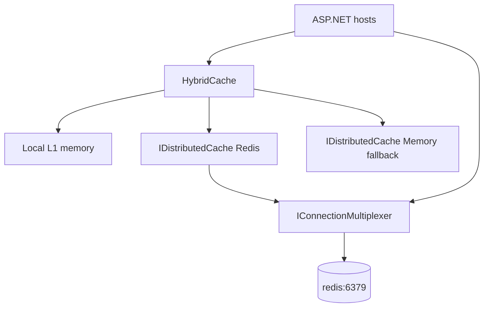
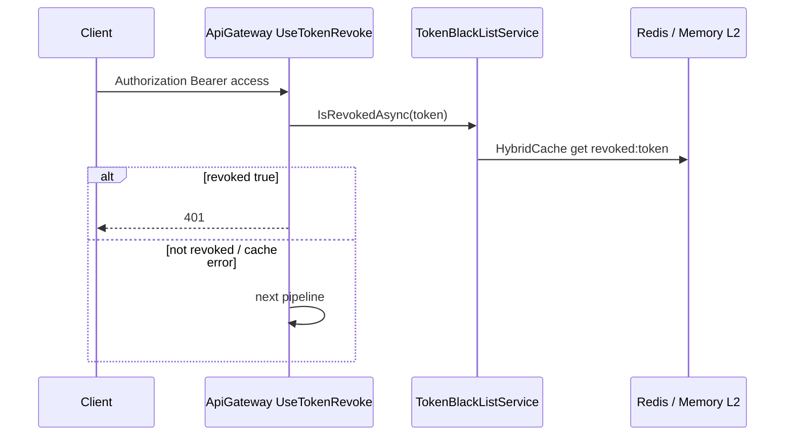

# Redis، HybridCache و فهرست ابطال توکن

شناسهٔ کاتالوگ: `19-redis`.

ارجاع: [05-jwt-identity](05-jwt-identity.md)، [03-docker-compose](03-docker-compose.md)، [06-tenancy-authorization](06-tenancy-authorization.md)، [13-signalr](13-signalr.md)، [00-project-discovery](00-project-discovery.md).

اپ و Redis زنده در این فاز اجرا نشد. مقدار connection string و رمز نقل نمی‌شود؛ فقط نام کلید.

درس‌های `17-reporting` و `18-mediamtx-baskool` از محدودهٔ یادگیری خارج‌اند؛ اگر در این سند به `ReportAccessTicketStore` اشاره شود فقط به‌خاطر ثبت مشترک در `AddCacheServices` است، نه گسترش Reporting.

## 1. اهداف درس

- فهم نقش Redis در این مخزن: L2 برای HybridCache، نه SignalR backplane و نه Hangfire.  
- دیدن fallback به `AddDistributedMemoryCache` وقتی Connect شکست می‌خورد.  
- ردیابی blacklist توکن از Logout تا `TokenRevokeMiddleware`.  
- دیدن کش claim سایت (`ICacheService` / `UserSiteClaimsCache`).  
- دانستن health check و نبود persistence در Compose.

## 2. نقش Redis در این مخزن

چند سرویس هم‌زمان به یک دادهٔ کوتاه‌عمر نیاز دارند: «این access token باطل شده؟» و «claimهای سایت این کاربر چیست؟». نگه‌داشتن فقط در حافظهٔ یک پردازه بین gateway، هویت، ACL، و دژبان مشترک نیست.

Redis اینجا یک **store توزیع‌شدهٔ کش** است که پشت `IDistributedCache` / HybridCache قرار می‌گیرد. از روی سورس:

| استفاده | شاهد |
|---|---|
| HybridCache L2 + `ICacheService` | `AddCacheServices`، `CacheService` |
| Blacklist JWT | `TokenBlackListService` روی HybridCache؛ کلید `revoked:{token}` |
| Invalidation claim | tag `UserSiteClaims`؛ `RemoveByTagAsync` با Redis SETهای `tag:…` |
| Health | `AddRedis` فقط در `Dejban.Api/Program.cs` (جستجوی مشابه در بقیهٔ hostها در این فاز گسترده نشد) |
| OTEL | `AddRedisInstrumentation` در `InfrastructureConfiguration` دژبان |

**صریحاً نیست:** SignalR Redis backplane (درس 13)، Hangfire Redis storage (درس 15 memory/Postgres)، persistence volume برای Redis در Compose داده (درس 03).

## 3. بسته‌ها و ثبت

| بسته (`Directory.Packages.props`) | نسخه |
|---|---|
| `Microsoft.Extensions.Caching.Hybrid` | 10.0.0 |
| `Microsoft.Extensions.Caching.StackExchangeRedis` | 10.0.0 |
| `AspNetCore.HealthChecks.Redis` | 9.0.0 |
| `OpenTelemetry.Instrumentation.StackExchangeRedis` | 1.15.1-beta.1 (دژبان) |

StackExchange.Redis به‌صورت transitive از پکیج Caching می‌آید؛ `IConnectionMultiplexer` در `CacheService` و Connect مستقیم استفاده می‌شود.

### `AddCacheServices` (`Common/.../ServiceCollectionExtensions.cs`)

1. `AddHybridCache()`  
2. `try { ConnectionMultiplexer.Connect(redisConnectionString); AddSingleton(mux); AddStackExchangeRedisCache(... ConnectionMultiplexerFactory) }`  
3. `catch { AddSingleton<IConnectionMultiplexer>(_ => null!); AddDistributedMemoryCache(); }`  
4. `TryAddSingleton<ICacheService, CacheService>`  
5. `TryAddSingleton<IReportAccessTicketStore, ReportAccessTicketStore>` (مصرف Reporting؛ خارج از محدودهٔ درس ۱۷)

### `AddTokenBlackList` / `AddTokenRevokeMiddleware`

- TTL پیش‌فرض از `JwtSettings:ExpirationInMinutes` (مثلاً همان عمر access).  
- Middleware به‌صورت `IMiddleware` Singleton با selector برای Bearer / cookie / query `access_token`.

ثبت زنجیره در سرویس‌هایی مثل Identity، Gateway، ACL، DCC، RequestTracker، Gate، Dejban Infrastructure، و Reporting دیده شد. **`UseTokenRevoke` در pipeline** در Identity، Gateway، ACL، DCC، RequestTracker، Gate، Reporting صدا زده می‌شود؛ در `Dejban.Api/Program.cs` بعد از ثبت، **`UseTokenRevoke` نیست** (همان یافتهٔ درس 05).

## 4. معماری کش

`CacheService` روی HybridCache می‌نشیند و برای tag invalidation مستقیماً با Redis SET (`tag:{name}` → members = cache keys) کار می‌کند؛ اگر `redis == null` (fallback) آن شاخه no-op است و فقط `RemoveByTagAsync` خود HybridCache اجرا می‌شود.

پیش‌فرض TTL در `CacheOptions`: Local 5 دقیقه، Distributed 20 دقیقه؛ قابل override در هر فراخوانی.

## 5. پیکربندی

| کلید | مبدأ | مصرف | وضعیت |
|---|---|---|---|
| `ConnectionStrings:Redis` | appsettings سرویس‌ها؛ Compose `ConnectionStrings__Redis` / JSON داکر `redis:6379` یا `localhost:6379` | آرگومان `AddCacheServices` | `verified` |
| `JwtSettings:ExpirationInMinutes` | Global / appsettings | TTL پیش‌فرض `AddTokenBlackList` | `verified` |
| سرویس Compose `redis` | `docker-compose.yml` / `compose.data.yml` | image `redis`؛ بدون volume فعال؛ health `redis-cli ping` | `verified` (درس 03) |
| `protected-mode no` | `compose.data.yml` command | پذیرش از غیرloopback در split topology | `verified` در درس 03 |

رمز جدا برای Redis در نمونه‌های خوانده‌شده دیده نشد (اتصال بدون password در رشتهٔ نمونه). وضعیت امنیت شبکه: وابسته به deploy — runtime pending.

## 6. مسیر ابطال توکن (blacklist)

### نوشتن

`LogoutCommandHandler`: بعد از حذف refresh از user store و پاک کردن cookie، `await _jwtBlackList.RevokeAsync(accessToken)` — کلید = **کل رشتهٔ access token** با پیشوند `revoked:`.

جاهای دیگر هویت هم accessهای ذخیره‌شده در `UserTokens` را revoke می‌کنند (تغییر نقش/claim، terminate session، غیرفعال‌سازی، …).

`TokenBlackListService.RevokeAsync`: `HybridCache.SetAsync(true, Expiration = ttl, DisableLocalCache)` تا L1 محلی گمراه‌کننده نباشد و L2 مشترک بماند.

### خواندن

`TokenRevokeMiddleware`: اگر endpoint AllowAnonymous نباشد و توکن استخراج شود، `IsRevokedAsync`؛ در صورت true → 401 بدون `next`.

`IsRevokedAsync`: `GetOrCreateAsync` با factory که `false` برمی‌گرداند و پرچم‌های `DisableLocalCache | DisableDistributedCacheWrite` — یعنی فقط خواندن؛ miss را در cache نمی‌نویسد. Timeout 2 ثانیه یا exception → **false** (توکن را revoked فرض نمی‌کند؛ fail-open).

## 7. مسیر کش claim سایت

1. سرویس‌های غیرهویت: `RemoteClaimService` → `ICacheService.GetOrCreateAsync(userId, …, tags: UserSiteClaims, localCacheExpiration: 2s)` → MassTransit request `GetUserSiteClaims`.  
2. هویت: `ClaimService` همان الگو روی DB محلی.  
3. بعد از تغییر نقش/سایت/…: `IUserSiteClaimsCache.InvalidateUsersAsync` → `RemoveAsync(userId)`؛ یا `InvalidateAllAsync` → `RemoveByTagAsync([UserSiteClaims])`.

کلید کش claim در این مسیر **خود `userId`** است (بدون پیشوند جدا در `GetOrCreateAsync`).

## 8. Health و observability

- دژبان: `AddHealthChecks().AddNpgSql(...).AddRedis(redisConnectionString)` و `MapHealthChecks("health", …)`.  
- OpenTelemetry دژبان: `AddRedisInstrumentation()` روی multiplexer (جزئیات exporter در درس 20).

اجرای health زنده: `runtime verification pending`.

## 9. همزمانی، چند instance، پایداری

| موضوع | یافته | برچسب |
|---|---|---|
| چند host با یک Redis | blacklist و claim L2 مشترک می‌مانند | strong inference از طراحی؛ runtime pending |
| Connect fail در startup | memory cache per process؛ mux null | source-verified |
| Fail-open در IsRevoked | قطعی Redis کوتاه ممکن است توکن باطل را بپذیرد | source-verified |
| نبود volume Redis | بعد از recreate کانتینر، blacklist و کش خالی | source-verified Compose |
| Dejban بدون UseTokenRevoke | درخواست مستقیم به دژبان blacklist را چک نمی‌کند | source-verified |
| کلید = کل JWT | کلیدهای بلند؛ دو رشتهٔ متفاوت برای همان session match نمی‌شوند مگر همان string revoke شود | source-verified |
| SignalR scale-out | از Redis این مخزن استفاده نمی‌کند | source-verified درس 13 |

## 10. امنیت

- Token کامل در Redis به‌عنوان کلید/مقدار boolean — نشت Redis یعنی فهرست توکن‌های باطل‌شده (و شکل JWT) در دسترس مهاجم شبکه؛ محافظت شبکه Redis مهم است.  
- Fail-open: ترجیح در دسترس بودن بر رد سخت هنگام خطای cache.  
- Anonymous endpoints از چک revoke رد می‌شوند (`IAllowAnonymous`).  
- Query string `access_token` هم خوانده می‌شود (مناسب SignalR/negotiate؛ ریسک لاگ URL).  

## 11. مقایسه با سایر storeها در مخزن

| نیاز | سازوکار این مخزن |
|---|---|
| ابطال JWT زودهنگام | Redis/HybridCache blacklist |
| Outbox دامنه | Postgres + Quartz (نه Redis) |
| Job ACL | Hangfire Memory |
| Job RT | Hangfire Postgres |
| فایل | MinIO/S3 یا دیسک |
| UI realtime | SignalR بدون Redis backplane |

## 12. دیباگ عملی

1. بعد از Logout هنوز 200 از gateway: آیا همان رشتهٔ access revoke شده؟ آیا gateway `UseTokenRevoke` دارد؟ آیا Redis مشترک است یا یکی memory fallback شده؟  
2. Claim کهنه بعد از تغییر نقش: invalidate صدا شده؟ tag/`RemoveAsync(userId)`؟ TTL local 2s روی RemoteClaimService.  
3. همهٔ سرویس‌ها بعد از restart Redis رفتار عجیب: volume نیست — انتظار خالی بودن.  
4. دژبان مستقیم (بدون gateway) توکن باطل را می‌پذیرد: نبود `UseTokenRevoke` در `Program.cs`.  
5. Startup کند/خطا: `ConnectionMultiplexer.Connect` sync؛ exception → memory بدون Redis.

## 13. ده سؤال مصاحبه

### 1. Redis در این سامانه چه کاری می‌کند؟

عمدتاً backend برای HybridCache و blacklist توکن و کمک به tag invalidation؛ نه صف پیام و نه store اصلی دامنه.

**Follow-up:** جایگزین اگر Redis نباشد؟  
در `catch` مربوط به Connect، `AddDistributedMemoryCache` — فقط همان پردازه.

### 2. HybridCache چیست؟

لایهٔ کش با L1 داخل process و L2 روی `IDistributedCache`. اینجا با `AddHybridCache` + Redis یا Memory ثبت می‌شود.

**Follow-up:** چرا blacklist `DisableLocalCache` دارد؟  
تا revoke روی یک host، host دیگر از L1 کهنه نخواند.

### 3. Blacklist چگونه با JWT کار می‌کند؟

JWT تا `exp` خودش معتبر است مگر در cache به‌عنوان revoked علامت بخورد؛ middleware قبل از ادامهٔ pipeline چک می‌کند.

**Follow-up:** TTL blacklist؟  
از `JwtSettings:ExpirationInMinutes` به‌عنوان پیش‌فرض Revoke.

### 4. Fail-open یعنی چه؟

اگر خواندن blacklist خطا/timeout دهد، middleware توکن را قبول می‌کند (`return false`). امنیت سخت‌تر fail-closed است.

### 5. چرا Dejban ممکن است توکن باطل را بپذیرد؟

`AddTokenRevokeMiddleware` ثبت شده ولی `UseTokenRevoke` در pipeline دژبان نیست؛ مسیر معمول از gateway چک می‌شود.

### 6. کش claim چگونه invalidate می‌شود؟

`UserSiteClaimsCache` کلید per-user را Remove می‌کند یا با tag `UserSiteClaims` همه را پاک می‌کند؛ RemoteClaimService دوباره از bus می‌خواند.

### 7. Redis persistent است؟

در Compose خوانده‌شده volume/save فعال نیست؛ دادهٔ کش با عمر کانتینر است.

### 8. فرق با SignalR backplane؟

Backplane پیام hub را بین nodeها پخش می‌کند. این مخزن آن را با Redis نساخته؛ Redis اینجا برای cache/auth است.

### 9. Health check Redis کجاست؟

در `Dejban.Api` با `AspNetCore.HealthChecks.Redis` روی همان connection string.

### 10. یک مسیر واقعی؟

Logout → `RevokeAsync(accessToken)` → کلید در L2 → درخواست بعدی به gateway با همان Bearer → `TokenRevokeMiddleware` → 401.

**Follow-up:** terminate سایر sessionها؟  
حلقه روی `UserTokens` و Revoke هر access ذخیره‌شده.

## 14. خلاصه و چک‌لیست

- [ ] می‌دانم Redis پشت HybridCache و blacklist است.  
- [ ] fallback memory و پیامد چندinstance را بلدم.  
- [ ] فرق ثبت middleware با `UseTokenRevoke` در دژبان را می‌فهمم.  
- [ ] می‌دانم Redis volume ندارد و SignalR backplane نیست.  
- [ ] مسیر claim cache + invalidate را می‌توانم شرح بدهم.

## 15. منابع

- `Common/Abstractions/Extensions/ServiceCollectionExtensions.cs` — `AddCacheServices`، `AddTokenBlackList`، `AddTokenRevokeMiddleware`، `UseTokenRevoke`  
- `Common/Caching/{CacheService,TokenBlackListService,TokenRevokeMiddleware,CacheOptions,CacheTags,ICacheService,ITokenBlackList}.cs`  
- `Common/Claims/RemoteClaimService.cs`  
- `Common/Reporting/ReportAccessTicketStore.cs` (فقط ثبت مشترک)  
- `Microservices/IdentityServer/.../LogoutCommandHandler.cs`، `ClaimService.cs`، `UserSiteClaimsCache.cs`  
- `ApiGateway/Program.cs`، `Microservices/Dejban/API/Dejban.Api/Program.cs`  
- `Microservices/Dejban/Common/Dejban.Common.Infrastructure/InfrastructureConfiguration.cs`  
- `Directory.Packages.props`  
- `docker-compose.yml` / `docker/compose.data.yml` سرویس `redis`؛ `docker/compose.backend.yml` کلید `ConnectionStrings__Redis`  
- درس‌های `05-jwt-identity.md`، `03-docker-compose.md`، `13-signalr.md`
