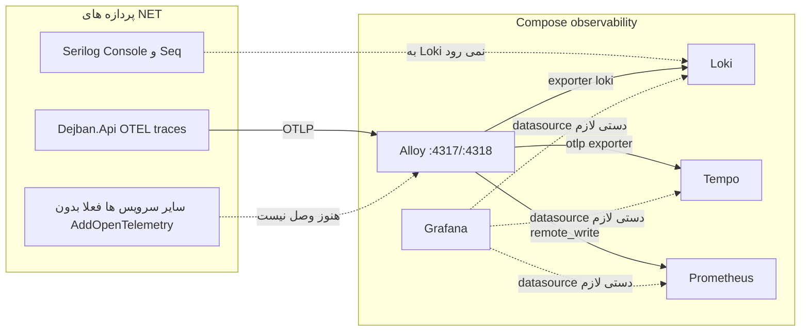
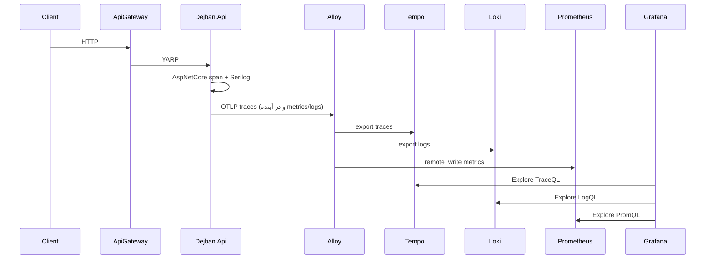

# Observability: Serilog، OpenTelemetry و استک Grafana (Loki / Tempo / Prometheus / Alloy)

شناسهٔ کاتالوگ: `20-observability`.

ارجاع: [01-dotnet-aspnetcore](01-dotnet-aspnetcore.md)، [02-configuration](02-configuration.md)، [03-docker-compose](03-docker-compose.md)، [04-yarp](04-yarp.md)، [11-messaging](11-messaging.md)، [19-redis](19-redis.md)، [00-project-discovery](00-project-discovery.md).

این سند در **2026-11-01** با کد و Compose فعلی و با probe زندهٔ کانتینرهای observability دوباره نوشته شد. Aspire از محدودهٔ این درس خارج است و جایگزین مشاهده‌پذیری محلی نیست. مقدار رمز Grafana یا connection string نقل نمی‌شود.

وضعیت کلی پس از wiring در **2026-11-01**: زیرساخت Compose + helper مشترک OTEL/Serilog OTLP + datasource Grafana provision شده است. مسیر کد برای trace/metric/log به Alloy وصل است؛ دیدن داده در UI هنوز به اجرای سرویس‌ها و ترافیک واقعی وابسته است.

## 1. مسئله

در سامانه‌ای با چند پردازه (Gateway، Identity، Dejban، ACL، …) وقتی یک درخواست fail می‌شود، باید بتوانی بگویی:

1. کدام سرویس‌ها در مسیر بودند؟
2. کدام لاگ‌ها به همان درخواست مربوط‌اند؟
3. زمان و نرخ خطا چقدر بوده؟

بدون استاندارد مشترک، هر سرویس فایل لاگ جدا می‌نویسد و تریس بین سرویس‌ها گم می‌شود. OpenTelemetry همان استاندارد جمع‌آوری است. Grafana و پشت‌صحنه‌اش (Loki، Tempo، Prometheus، Alloy) محل ذخیره و دیدن آن داده هستند. Serilog همچنان مسیر لاگ ساختاریافتهٔ خود اپ است؛ این دو لایه باید به هم وصل شوند، وگرنه داشبورد خالی می‌ماند.

## 2. نقشهٔ کلی ابزارها

| ابزار | نقش عمومی | نقش در این مخزن (شاهد) |
|---|---|---|
| OpenTelemetry | API/SDK برای traces، metrics، logs | tracing فقط در `Dejban.Common.Infrastructure` با `AddOtlpExporter` |
| Grafana Alloy | دریافت OTLP و forward به بک‌اندها | سرویس `alloy` در Compose؛ `Observability/alloy/config.alloy` |
| Loki | ذخیره و جست‌وجوی لاگ | سرویس `loki` + `Observability/loki/loki-config.yaml` |
| Tempo | ذخیره trace | سرویس `tempo` + `Observability/tempo/tempo.yaml` |
| Prometheus | ذخیره متریک | سرویس `prometheus` + remote-write فعال + `Observability/prometheus/prometheus.yml` |
| Grafana | UI داشبورد و Explore | سرویس `grafana`؛ **datasource provision نشده** |
| Serilog | لاگ داخل پردازهٔ .NET | تقریباً همهٔ microserviceها؛ sink اصلی Console + Seq در GlobalAppsettings |
| Seq / Jaeger | مقصد قدیمی لاگ/تریس | بلوک Compose همچنان comment؛ جایگزین عملی Alloy+Grafana است ولی config اپ هنوز به Seq/Jaeger اشاره دارد |



خط‌چین یعنی مسیر در کد یا provisioning کامل نیست.

## 3. آنچه در اپ ثبت شده (کد)

### 3.1 Serilog

الگوی رایج hostها (Identity، RequestTracker، ACL، DCC، Gate، Dejban، …):

```csharp
builder.Host.UseSerilog((context, loggerConfig) =>
    loggerConfig.ReadFrom.Configuration(context.Configuration)
    .Filter.ByExcluding(/* commandText شامل OutboxState/InboxState/OutboxMessage */));
```

و در pipeline معمولاً `app.UseSerilogRequestLogging()`.

پیکربندی از `GlobalAppsettings/globalAppsettings*.json`:

- `Using`: Console، File، Seq
- `WriteTo`: Console و Seq (`serverUrl` مثل `http://localhost:5341`)
- Override سطح Warning برای namespaceهای Outbox/Inbox ماژول‌های دژبان
- Enrich: FromLogContext، WithMachineName، WithThreadId

**شاهد مهم:** هیچ sink یا exporter لاگ به سمت Alloy/Loki در کد خوانده‌شده نیست. پس حتی اگر Loki و Grafana بالا باشند، لاگ اپ به‌صورت پیش‌فرض وارد Loki نمی‌شود مگر اینکه بعداً `OpenTelemetry` logging exporter یا sink OTLP/Loki برای Serilog اضافه شود.

Gateway در جستجوی این فاز `UseSerilog` ندارد؛ از logging پیش‌فرض ASP.NET و `ILogger` در middleware استفاده می‌کند.

### 3.2 OpenTelemetry tracing (فقط دژبان)

در `Microservices/Dejban/Common/Dejban.Common.Infrastructure/InfrastructureConfiguration.cs`:

1. `AddOpenTelemetry().ConfigureResource(... AddService(serviceName))` با `DiagnosticsConfig.ServiceName = "Dejban.Api"`
2. `WithTracing`: AspNetCore، HttpClient، EntityFrameworkCore، Redis، Npgsql، و source MassTransit
3. `tracing.AddOtlpExporter()`
4. **`WithMetrics` نیست** → مسیر metrics در Alloy برای متریک اپ خالی می‌ماند مگر منبع دیگری بفرستد

جستجوی `AddOpenTelemetry` خارج از این Infra به همان مسیر دژبان محدود بود. Identity، ACL، Gateway، DCC، Reporting و بقیه در این فاز exporter OTEL ندارند.

کلید مقصد:

| فایل | مقدار کلید `OTEL_EXPORTER_OTLP_ENDPOINT` |
|---|---|
| `globalAppsettings.Development.json` | `http://localhost:4317` (= پورت host مربوط به Alloy در Compose development) |
| `globalAppsettings.DockerDevelopment.json` / `Docker.json` | `http://jaeger:4317` (**سرویس Jaeger در Compose comment است؛ باید به hostname سرویس Alloy اشاره کند اگر داخل شبکه Docker باشی**) |
| `globalAppsettings.Production.json` | `http://localhost:4317` |

SDK معمولاً این env/config را برای OTLP می‌خواند. اثر واقعی وقتی Dejban با Development روی host اجرا شود و Alloy روی `4317` publish شده باشد، محتمل است؛ وقتی کانتینر اپ به `jaeger` اشاره کند، مقصد مرده است. وضعیت: کلیدها `source-verified`؛ رسیدن span به Tempo وابسته به اجرای Dejban + endpoint درست است.

### 3.3 TraceId در لاگ دژبان

`LogContextTraceLoggingMiddleware` اگر `Activity.Current` باشد `TraceId` را به `LogContext` می‌فرستد. این correlation داخل لاگ Serilog است، نه جایگزین ارسال لاگ به Loki.

### 3.4 Health و متریک gateway

- دژبان: `AddHealthChecks().AddNpgSql(...).AddRedis(...)` و `MapHealthChecks("health", ...)`
- Gateway: `RequestMetricsMiddleware` + `RequestMetricsStore` in-memory و endpoint snapshot با Authorize — **Prometheus نیست** و با restart صفر می‌شود
- Gateway: `ProxyErrorHandlingMiddleware` برای 502/500 پروکسی

## 4. آنچه در Compose و Observability/ اضافه شده

### 4.1 سرویس‌ها (`docker-compose.yml`)

| سرویس | Image (در فایل) | نقش |
|---|---|---|
| `loki` | `grafana/loki:3.7.0` | لاگ |
| `tempo` | `grafana/tempo:2.7.2` | تریس |
| `prometheus` | `prom/prometheus:v3.5.0` با `--web.enable-remote-write-receiver` | متریک |
| `alloy` | `grafana/alloy:v1.8.3` | گیرنده OTLP و forward |
| `grafana` | `grafana/grafana:11.5.2` | UI |

Volumeها: `grafana-data`، `loki-data`، `tempo-data`، `prometheus-data`.

### 4.2 پورت‌های development (`docker-compose.development.yml`)

| سرویس | پورت host |
|---|---|
| Loki | `3100` |
| Tempo | `3200` |
| Prometheus | `9090` |
| Alloy | `4317` (gRPC)، `4318` (HTTP)، `12345` (UI Alloy) |
| Grafana | `3000` |

Seq و Jaeger هنوز در همان فایل **comment** مانده‌اند.

### 4.3 Alloy (`Observability/alloy/config.alloy`)

جریان تأییدشده از فایل:

1. `otelcol.receiver.otlp` روی `0.0.0.0:4317` و `:4318`
2. `otelcol.processor.batch`
3. logs → `otelcol.exporter.loki` → `loki.write` به `http://loki:3100/loki/api/v1/push`
4. traces → `otelcol.exporter.otlp` به `tempo:4317` با `tls.insecure = true`
5. metrics → `otelcol.exporter.prometheus` → `prometheus.remote_write` به `http://prometheus:9090/api/v1/write`

این پیکربندی برای **جمع‌آوری OTLP** درست است. خودش داده تولید نمی‌کند؛ اگر اپ trace/metric/log نفرستد، بک‌اندها خالی می‌مانند.

### 4.4 Loki

`auth_enabled: false`، filesystem storage، schema v13/tsdb، `allow_structured_metadata: true`، `path_prefix: /loki`. URL push Alloy با این prefix جور است.

### 4.5 Tempo

دریافت OTLP روی 4317/4318 داخل کانتینر، storage محلی، retention compaction ۲۴ ساعت. برای Explore در Grafana معمولاً datasource Tempo به `http://tempo:3200` لازم است (هنوز provision نشده).

### 4.6 Prometheus

فقط job `prometheus` خودش را scrape می‌کند. متریک اپ باید از طریق remote_write Alloy بیاید. چون اپ‌ها `WithMetrics` ندارند، انتظار متریک business از .NET فعلاً واقع‌بینانه نیست.

### 4.7 Grafana

کاربر ادمین از env؛ پسورد از `GRAFANA_ADMIN_PASSWORD` با پیش‌فرض در Compose. **هیچ فایل `provisioning/datasources` در `Observability/` دیده نشد.** بدون datasource دستی، Explore برای Loki/Tempo/Prometheus دادهٔ اپ را نشان نمی‌دهد حتی اگر داده در بک‌اند باشد.

## 5. Runtime verification (2026-11-01)

کانتینرها در زمان بررسی بالا بودند: `alloy`، `prometheus`، `grafana`، `loki`، `tempo`.

| بررسی | نتیجه |
|---|---|
| Alloy log startup | receiver OTLP روی 4317/4318 listen؛ بدون error گراف |
| `http://localhost:3100/ready` | `ready` |
| `http://localhost:3200/ready` | `ready` |
| Prometheus targets | فقط scrape خود Prometheus healthy |
| Tempo `api/search?limit=5` | `"traces":[]` — تریس اپ ذخیره نشده |
| Loki labels | چند label عمومی (`exporter`, `job`, `service_name`)؛ نشانهٔ پر بودن لاگ اپ نیست |
| متریک‌های Prometheus | عمدتاً `go_*` خود Prometheus |
| Grafana API datasources با admin پیش‌فرض | 401 در این محیط (رمز یا auth متفاوت؛ به‌هرحال provision در repo نیست) |

جمع‌بندی runtime: **استک زنده است، pipeline Alloy load شده، ولی دادهٔ اپ (trace دژبان / لاگ / متریک) در Tempo/Loki/Prom به‌عنوان مسیر کامل تأیید نشد.**

## 6. شکاف‌ها — چرا Grafana / Tempo خالی به نظر می‌رسد

| شکاف | اثر | شاهد |
|---|---|---|
| فقط Dejban `AddOpenTelemetry` دارد | Identity/ACL/Gateway در Tempo span نمی‌سازند | جستجوی `AddOpenTelemetry` |
| نبود `WithMetrics` | Alloy چیزی برای Prometheus از اپ نمی‌گیرد | بلوک tracing-only در Infra |
| Serilog → Seq، نه OTLP logs | Loki از لاگ اپ تغذیه نمی‌شود | GlobalAppsettings WriteTo Seq |
| Docker OTEL هنوز `jaeger` | کانتینر اپ به collector مرده می‌زند | `globalAppsettings.Docker*.json` |
| Grafana بدون datasource provision | UI به Loki/Tempo/Prom وصل نیست مگر دستی | نبود فایل provisioning |
| Seq در Compose خاموش | sink Seq هم مقصد زنده‌ای ندارد مگر Seq جدا بالا باشد | comment در development compose |

پس «OpenTelemetry فعال شده؟» پاسخ دقیق:

- **SDK tracing در Dejban: بله، در کد ثبت شده.**
- **Collector محلی Alloy: بله، کانتینر و پورت 4317 بالا است.**
- **مسیر end-to-end تا Tempo در Grafana: هنوز کامل نیست** تا Dejban واقعاً به Alloy بفرستد، span ساخته شود، و Grafana datasource Tempo داشته باشد.
- **Metrics و Logs مسیر LGTM: هنوز فعال به معنی محصولی نیستند.**

## 7. مزیت این مدل برای local (نسبت به Seq/Jaeger جدا یا Aspire)

وقتی مسیر کامل شود، برای توسعهٔ محلی این‌ها را می‌دهد که Compose قدیمی comment‌شده نمی‌داد:

1. **یک UI (Grafana)** برای لاگ + تریس + متریک به‌جای چند ابزار جدا.
2. **Correlation:** از یک span در Tempo به لاگ هم‌`trace_id` در Loki (بعد از اینکه لاگ هم OTLP/structured بفرستد).
3. **همان قرارداد OTLP** که بعداً در staging/production هم قابل تکرار است؛ AppHost Aspire فقط برای orchestration لوکال بود و جایگزین این استک ذخیره نیست.
4. **جست‌وجوی لاگ چندسرویسی** در Loki وقتی همه سرویس‌ها لاگ را به Alloy برسانند.
5. **متریک درخواست/خطا** در Prometheus وقتی `WithMetrics` و instrumentation اضافه شود؛ امروز متریک gateway هنوز in-process است.

آنچه **نمی‌دهد** تا wiring تمام شود: دیدن خودکار همهٔ سرویس‌ها، جایگزین Serilog Console برای debug روزمره، یا متریک CPU کانتینر بدون exporter جدا.

## 8. مسیر هدف end-to-end (وقتی کامل شود)



وضعیت امروز: فقط فلش‌های Compose و tracing-only دژبان از کد تأیید شده‌اند؛ بقیه هدف طراحی است.

## 9. سناریوهای شکست مرتبط با استک جدید

1. **Alloy پایین، Dejban Development با OTLP به localhost:4317:** exporter ممکن است fail/retry کند؛ UI Tempo خالی می‌ماند.
2. **اپ Docker با `http://jaeger:4317`:** DNS/اتصال به سرویس ناموجود.
3. **فقط Grafana باز شده بدون datasource:** داشبورد خالی حتی اگر Tempo پر باشد.
4. **Seq خاموش و Serilog WriteTo Seq:** لاگ Console هست؛ مقصد Seq نیست؛ Loki هم پر نمی‌شود.
5. **Tempo خالی چون هیچ درخواستی به Dejban نخورده یا instrumentation قبل از اولین request span ندارد.**
6. **انتظار متریک HTTP در Prometheus بدون `WithMetrics`:** فقط متریک‌های خود Prometheus دیده می‌شود.

## 10. ده سؤال مصاحبه

### 1. فرق OpenTelemetry با Grafana چیست؟

OpenTelemetry استاندارد و SDK جمع‌آوری است. Grafana UI مشاهده است. داده باید از SDK به collector (اینجا Alloy) و بعد به Loki/Tempo/Prometheus برسد تا Grafana چیزی نشان دهد.

**Follow-up:** Alloy کجای این مخزن است؟  
سرویس Compose و فایل `Observability/alloy/config.alloy`.

### 2. الان کدام سرویس واقعاً OTEL می‌فرستد؟

از روی کد، فقط مسیر دژبان در `InfrastructureConfiguration`. بقیه microserviceها در این فاز `AddOpenTelemetry` ندارند.

### 3. چرا Loki ممکن است خالی باشد در حالی که Serilog کار می‌کند؟

چون Serilog به Console/Seq می‌نویسد، نه به OTLP logs یا push مستقیم Loki. Alloy فقط چیزی را که OTLP log بگیرد به Loki می‌دهد.

### 4. `OTEL_EXPORTER_OTLP_ENDPOINT` در Development به کجا می‌خورد؟

`http://localhost:4317` که با publish پورت Alloy در `docker-compose.development.yml` هم‌خوان است.

**Follow-up:** در DockerDevelopment؟  
هنوز `http://jaeger:4317` در JSON است؛ با استک جدید ناسازگار است مگر عوض شود.

### 5. Prometheus در این Compose چطور متریک اپ را می‌گیرد؟

Remote write receiver روشن است و Alloy به `/api/v1/write` می‌نویسد. Scrape فعلی فقط خود Prometheus است. بدون metrics از اپ، remote write عملاً خالی از متریک business می‌ماند.

### 6. Tempo چه چیزی ذخیره می‌کند؟

Traceهای OTLP که Alloy به `tempo:4317` forward کند. در probe این جلسه search خالی بود.

### 7. متریک gateway با Prometheus چه فرقی دارد؟

`RequestMetricsStore` شمارنده در حافظهٔ همان پردازه است و از API JSON خوانده می‌شود؛ exporter/`WithMetrics` نیست.

### 8. برای دیدن تریس در Grafana حداقل چه چیزهایی لازم است؟

Dejban در حال اجرا با OTLP به Alloy، Alloy و Tempo healthy، حداقل یک درخواست HTTP که span بسازد، و datasource Tempo در Grafana.

### 9. فیلتر outbox در Serilog چه مشکلی را حل می‌کند؟

نویز Information از SQL/commandText جداول Outbox/Inbox را کم می‌کند تا لاگ مفید دفن نشود.

### 10. چرا داشتن Compose برای LGTM به‌تنهایی یعنی «observability کامل» نیست؟

چون بدون instrumentation همگانی، بدون ارسال لاگ/متریک، و بدون datasource Grafana، فقط جعبه‌های خالی بالا آمده‌اند. این مخزن الان در همان مرحلهٔ میانی است.

## 11. چک‌لیست تکمیل

- [x] `OTEL_EXPORTER_OTLP_ENDPOINT` در Docker* → `http://alloy:4317`
- [x] `WithMetrics` + `UseOtlpExporter` در Infra دژبان و helper مشترک
- [x] Serilog → OTLP با `Serilog.Sinks.OpenTelemetry` (`WriteToObservabilityOtlp`)
- [x] `AddObservabilityTelemetry` روی Gateway، Identity، ACL، DCC، RequestTracker، GateServer، Reporting، Baskool (+ tracing غنی دژبان)
- [x] Provision datasource در `Observability/grafana/provisioning` و mount در Compose
- [ ] smoke test دستی بعد از F5: درخواست واقعی → Tempo Explore / Loki `{service_name="Dejban.Api"}`

## 12. خلاصه مرور

- [ ] می‌دانم استک Compose (Alloy/Loki/Tempo/Prometheus/Grafana) اضافه و در development پورت دارد.
- [ ] می‌دانم tracing OTEL فقط در Infra دژبان ثبت شده و metrics OTEL نیست.
- [ ] می‌دانم Serilog هنوز به Seq می‌رود نه Loki.
- [ ] می‌دانم Docker OTEL هنوز به `jaeger` اشاره می‌کند.
- [ ] می‌دانم Grafana بدون datasource provision در repo است.
- [ ] می‌توانم بگویم چرا Tempo/Explore خالی دیده می‌شود حتی وقتی کانتینرها Up هستند.

## 13. منابع

- `Observability/alloy/config.alloy`
- `Observability/loki/loki-config.yaml`
- `Observability/tempo/tempo.yaml`
- `Observability/prometheus/prometheus.yml`
- `docker-compose.yml` — سرویس‌ها و volumeهای observability
- `docker-compose.development.yml` — پورت‌ها؛ Seq/Jaeger comment
- `GlobalAppsettings/globalAppsettings*.json` — Serilog و `OTEL_EXPORTER_OTLP_ENDPOINT`
- `Microservices/Dejban/Common/Dejban.Common.Infrastructure/InfrastructureConfiguration.cs`
- `Microservices/Dejban/API/Dejban.Api/OpenTelemetry/DiagnosticsConfig.cs`
- `Microservices/Dejban/API/Dejban.Api/Program.cs` — health، Serilog
- `ApiGateway/Middleware/RequestMetricsMiddleware.cs`، `RequestMetricsStore.cs`، `ProxyErrorHandlingMiddleware.cs`
- `Directory.Packages.props` — نسخه‌های OpenTelemetry و Serilog
- درس‌های `03-docker-compose.md`، `04-yarp.md`، `19-redis.md`
