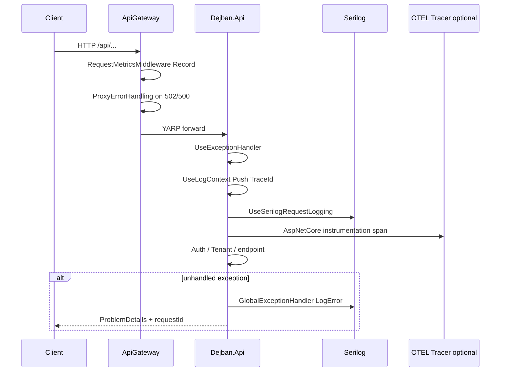

# Observability: لاگ، تریس، health و متریک gateway

شناسهٔ کاتالوگ: `20-observability`.

ارجاع: [01-dotnet-aspnetcore](01-dotnet-aspnetcore.md)، [03-docker-compose](03-docker-compose.md)، [04-yarp](04-yarp.md)، [11-messaging](11-messaging.md)، [19-redis](19-redis.md)، [00-project-discovery](00-project-discovery.md).

اپ، Seq، Jaeger، و OTLP collector در این فاز اجرا نشدند. سرویس‌های Seq/Jaeger در Compose توسعه **comment** هستند. مقدار secret نقل نمی‌شود.

درس‌های `17-reporting` و `18-mediamtx-baskool` خارج از محدوده می‌مانند؛ اگر نام Reporting در health/gateway دیده شود فقط به‌خاطر مسیر موجود کد است.

## 1. اهداف درس

- دیدن اینکه «مشاهده‌پذیری» در این مخزن عملاً یعنی چه: Serilog، health دژبان، OTEL فقط روی دژبان، متریک in-process در gateway.  
- تفکیک آنچه ثبت شده از آنچه در Compose واقعاً بالا نیست.  
- ردیابی یک درخواست از middleware لاگ تا exception handler.  
- شناخت فیلتر نویز outbox و محدودیت‌های cross-service tracing.

## 2. Observability در این مخزن یعنی چه؟

بدون داشبورد ابری واحد، تیم باید بداند: درخواست کجا شکست خورد، SQL/پیام تکراری لاگ را خفه نکند، وابستگی Postgres/Redis سالم است یا نه، و کدام مسیر API روی gateway فشار می‌آورد.

پیاده‌سازی تأییدشده چند لایهٔ جداست، نه یک پلتفرم کامل:

| لایه | کجا | وضعیت |
|---|---|---|
| Structured logging (Serilog) | اکثر microserviceها + دژبان؛ خواندن از Configuration | فعال در کد |
| Request logging | `UseSerilogRequestLogging` در hostهایی مثل Identity/DCC/… و دژبان | فعال در کد |
| TraceId در LogContext | فقط دژبان `LogContextTraceLoggingMiddleware` | فعال در کد |
| OpenTelemetry tracing + OTLP | فقط مسیر `InfrastructureConfiguration` دژبان | ثبت شده؛ مقصد در Compose comment |
| Health checks | `Dejban.Api` → Npgsql + Redis | فعال در کد |
| API pressure metrics | gateway `RequestMetricsStore` in-memory | فعال در کد؛ نه Prometheus |
| Seq / Jaeger containers | `docker-compose.development.yml` | comment → سرویس فعال نیست |

جستجوی `AddOpenTelemetry` خارج از `Dejban.Common.Infrastructure` در این فاز به همان مسیر دژبان محدود بود. Gateway اصلاً `UseSerilog` ندارد.

## 3. بسته‌ها

| بسته | نسخه (`Directory.Packages.props`) |
|---|---|
| `Serilog` | 4.3.0 |
| `Serilog.AspNetCore` | 10.0.0 |
| `Serilog.Sinks.Console` / `File` / `Seq` | 6.1.1 / 7.0.0 / 9.0.0 |
| `OpenTelemetry.Extensions.Hosting` / `Exporter.OpenTelemetryProtocol` | 1.15.3 |
| Instrumentation AspNetCore / Http / EF / Redis / Npgsql | 1.15.x مطابق props |
| `AspNetCore.HealthChecks.NpgSql` / `Redis` / `UI.Client` | 9.0.0 |
| `AspNetCore.HealthChecks.Uris` | 9.0.0 در csproj Infra — **فراخوانی `AddUrlGroup`/`AddUri` در کد دژبان دیده نشد** |

## 4. Logging با Serilog

### ثبت

الگوی رایج hostها (Identity، RequestTracker، ACL، DCC، Gate، Dejban، …):

```csharp
builder.Host.UseSerilog((context, loggerConfig) =>
    loggerConfig.ReadFrom.Configuration(context.Configuration)
    .Filter.ByExcluding(/* commandText شامل OutboxState/InboxState/OutboxMessage */));
```

و در pipeline: `app.UseSerilogRequestLogging()`.

Gateway: بدون Serilog package/usage در جستجوی cs/csproj — از logging پیش‌فرض ASP.NET + `ILogger` در middlewareها استفاده می‌کند. وضعیت: `source-verified`.

### پیکربندی

بخش اصلی در `GlobalAppsettings/globalAppsettings*.json`:

- `Using`: Console، File، Seq  
- `MinimumLevel` Information؛ Override برای namespaceهای Outbox/Inbox هر ماژول دژبان → Warning  
- `WriteTo`: Console و Seq (`serverUrl` مثلاً `http://localhost:5341`) — **Sink File در Using هست ولی در بلوک WriteTo خوانده‌شده نیست**  
- `Enrich`: FromLogContext، WithMachineName، WithThreadId  
- هر سرویس در appsettings خودش معمولاً فقط `Serilog:Properties:Application` را ست می‌کند  

فیلتر کد روی property `commandText` نویز SQL مربوط به جداول outbox/inbox MassTransit/EF را کم می‌کند (مکمل Override سطح Warning برای jobهای Quartz outbox دژبان).

### TraceId در لاگ دژبان

`LogContextTraceLoggingMiddleware`: اگر `Activity.Current` باشد، `LogContext.PushProperty("TraceId", traceId)`. بعد `UseSerilogRequestLogging` می‌آید. بدون Activity (مثلاً قبل از ساخت span یا خارج از instrumentation) مقدار null ممکن است. وضعیت: `source-verified` کد؛ پر شدن واقعی Activity با OTLP زنده: `runtime verification pending`.

## 5. OpenTelemetry (فقط دژبان)

در `InfrastructureConfiguration.AddInfrastructure`:

1. `AddOpenTelemetry().ConfigureResource(r => r.AddService(serviceName))` با `DiagnosticsConfig.ServiceName = "Dejban.Api"`.  
2. `WithTracing`: AspNetCore، HttpClient، EF Core، Redis، Npgsql، و `AddSource(MassTransit.Logging.DiagnosticHeaders.DefaultListenerName)`.  
3. `AddOtlpExporter()` — بدون `WithMetrics` در همین بلوک.

کلید پیکربندی `OTEL_EXPORTER_OTLP_ENDPOINT` در GlobalAppsettings (مثلاً `http://localhost:4317` یا `http://jaeger:4317`). SDK معمولاً این متغیر محیطی را می‌خواند؛ اینکه در همهٔ محیط‌های deploy به‌صورت env تزریق می‌شود یا فقط از JSON لود می‌شود: بخشی از bind JSON `source-verified` وجود کلید؛ اثر runtime exporter: `runtime verification pending`.

**نبود:** collector فعال در Compose فعلی (Jaeger comment)، tracing روی Identity/ACL/Gateway، metrics OTEL، داشبورد در مخزن.

## 6. Health checks

فقط مسیر خوانده‌شدهٔ `Dejban.Api/Program.cs`:

- `AddHealthChecks().AddNpgSql(databaseConnectionString).AddRedis(redisConnectionString)`  
- `MapHealthChecks("health", ResponseWriter = UIResponseWriter.WriteHealthCheckUIResponse)`  

Gateway: `GET /health/reporting-routes` وضعیت کلیدهای پیکربندی Reporting در configuration را چک می‌کند (نه Postgres)؛ اشارهٔ مختصر، بدون ورود به درس Reporting. همچنین `GET /api/v1/gateway/request-metrics` با Authorize برای snapshot فشار API.

Identity و چند سرویس دیگر در جستجوی این فاز `AddHealthChecks` نداشتند.

## 7. Exception handling و مشاهدهٔ خطا

### دژبان

- `AddExceptionHandler<GlobalExceptionHandler>` + `AddProblemDetails` با extension `requestId` = `TraceIdentifier`.  
- Handler: `InvalidParameterException` / `BadHttpRequestException` با LogWarning؛ بقیه LogError و ProblemDetails 500؛ Detail پیام exception فقط در Development / DockerDevelopment.  
- `UseExceptionHandler()` در pipeline قبل از LogContext.

### سرویس‌های سه‌لایه (نمونه DCC)

`GlobalExceptionHandler` با `IProblemDetailsService`؛ Status 500؛ Detail = `exception.Message` — الگوی ساده‌تر؛ لاگ صریح در همان handler دیده نشد (ممکن است جای دیگر لاگ شود).

### Gateway

`ProxyErrorHandlingMiddleware`: بعد از next، اگر پاسخ 502/500 باشد، cluster را از YARP feature می‌خواند، LogWarning می‌زند، برای browser به `/error/503?system=…` redirect و برای API پاسخ دوستانه می‌نویسد. Exception داخل middleware دوباره throw می‌شود بعد از LogError.

## 8. متریک فشار API روی gateway

`RequestMetricsMiddleware` فقط متدهای رایج روی مسیرهای `/api/` را زمان می‌گیرد (بدون scalar/health/static). `RequestMetricsStore` in-process: نرمال‌سازی GUID/عدد به `{id}`، سقف حدود 2000 bucket، snapshot با sort روی avg/count/max/errors.

این Prometheus/OTLP metrics نیست؛ با restart gateway صفر می‌شود. وضعیت: `source-verified`.

## 9. مسیر end-to-end تأییدشده (درخواست به دژبان)



وضعیت ترتیب middleware از `Program.cs`: `verified`. اینکه span به Jaeger برسد وقتی سرویس comment است: عملاً exporter ممکن است به endpoint مرده بزند — `runtime verification pending` / strong inference از Compose comment.

## 10. پیکربندی و محیط

| کلید / موضوع | محل | مصرف | وضعیت |
|---|---|---|---|
| `Serilog` section | GlobalAppsettings + Properties در appsettings سرویس | `ReadFrom.Configuration` | verified |
| Override Outbox/Inbox Warning | GlobalAppsettings | کاهش نویز job | verified |
| Filter `commandText` | Program.cs چند سرویس | حذف لاگ SQL outbox جداول | verified |
| Seq `serverUrl` | WriteTo Seq | نیاز به Seq در حال اجرا | config verified؛ سرویس Compose comment |
| `OTEL_EXPORTER_OTLP_ENDPOINT` | GlobalAppsettings | مقصد OTLP دژبان | کلید verified؛ collector فعال نیست در Compose خوانده‌شده |
| File sink | Using بدون WriteTo File | اثر نوشتن فایل از این JSON قطعی نیست | inferred: ممکن است غیرفعال باشد مگر جای دیگر |

## 11. آنچه نیست / محدودیت

| مورد | شاهد |
|---|---|
| Seq/Jaeger در Compose فعال | بلوک comment در `docker-compose.development.yml` |
| OTEL روی gateway/هویت | نبود `AddOpenTelemetry` در جستجوی آن hostها |
| Metrics OTEL | نبود `WithMetrics` در بلوک دژبان |
| Correlation ID سفارشی بین سرویس‌ها فراتر از W3C/Activity | فقط PushProperty TraceId در دژبان تأیید شد |
| Health همگانی همهٔ microserviceها | فقط دژبان (+ endpoint پیکربندی reporting در gateway) |
| `HealthChecks.Uris` | پکیج بدون call site در دژبان |
| متریک gateway پایدار بین replicaها | حافظهٔ پردازه |

## 12. سناریوهای شکست (بر اساس کد)

1. **Postgres دژبان پایین:** health `/health` Unhealthy؛ درخواست‌های داده fail؛ exception handler لاگ می‌کند.  
2. **Redis پایین:** health Redis fail؛ اثر blacklist/cache در درس 19 (fail-open revoke).  
3. **Downstream 502 از YARP:** ProxyErrorHandling پیام سیستم را لاگ و به کلاینت برمی‌گرداند.  
4. **Seq خاموش، Serilog WriteTo Seq:** رفتار sink (buffer/error) بدون اجرا قطعی نیست → runtime pending؛ Console همچنان در WriteTo هست.  
5. **Jaeger خاموش، OTLP روشن:** exporter ممکن است خطا/retry کند؛ تأثیر روی request path معمولاً جدا از business است ولی تأیید نشد.  
6. **Unhandled در دژبان Production-like:** 500 بدون Detail پیام؛ با LogError.  
7. **فشار یک endpoint:** `/api/v1/gateway/request-metrics` (با auth) میانگین/خطا را نشان می‌دهد تا restart.

## 13. ده سؤال مصاحبه

### 1. Observability در این مخزن از چه اجزایی تشکیل شده؟

عمدتاً Serilog، health دژبان، tracing OTEL فقط دژبان، و متریک in-process gateway — نه یک APM یکپارچه برای همهٔ سرویس‌ها.

**Follow-up:** Seq کجاست؟  
در config WriteTo؛ کانتینر در Compose توسعه comment است.

### 2. چرا لاگ outbox را فیلتر می‌کنند؟

Jobهای پرتکرار SQL/commandText تولید می‌کنند؛ Override Warning + ByExcluding روی OutboxMessage/InboxState نویز Information را کم می‌کند.

### 3. `UseSerilogRequestLogging` چه می‌کند؟

یک خلاصهٔ درخواست HTTP (مسیر، وضعیت، زمان) را با Serilog می‌نویسد؛ مکمل لاگ‌های دستی handlerهاست.

### 4. TraceId چطور به لاگ دژبان می‌رسد؟

Middleware از `Activity.Current?.TraceId` می‌خواند و به `LogContext` می‌فرستد تا Enrich FromLogContext آن را در رویدادها ببیند.

**Follow-up:** آیا همهٔ سرویس‌ها همین middleware را دارند؟  
در مسیر خوانده‌شده فقط دژبان.

### 5. OpenTelemetry اینجا چه instrument می‌کند؟

ASP.NET Core، HttpClient، EF، Redis، Npgsql، و source MassTransit؛ خروجی OTLP.

**Follow-up:** Metrics؟  
در همان بلوک `WithMetrics` نیست.

### 6. چرا ممکن است تریس در UI نبینید؟

Jaeger/collector در Compose فعلی comment است؛ فقط ثبت exporter در کد کافی برای مشاهدهٔ UI نیست.

### 7. Health check دژبان چه چیزهایی را می‌سنجد؟

اتصال پیکربندی‌شدهٔ Postgres و Redis؛ پاسخ با UI writer روی مسیر `health`.

### 8. متریک gateway با Prometheus چه فرقی دارد؟

شمارنده/میانگین در حافظهٔ همان پردازه است و از endpoint JSON خوانده می‌شود؛ scrape/exporter استاندارد Prometheus در این کد نیست.

### 9. Gateway چطور خطای پروکسی را قابل‌مشاهده می‌کند؟

`ProxyErrorHandlingMiddleware` وضعیت 502/500 را می‌بیند، cluster را نام‌گذاری می‌کند، لاگ Warning می‌زند و پاسخ/redirect مناسب می‌دهد.

### 10. یک مسیر واقعی را شرح دهید

درخواست پرسنل از UI → gateway (metrics + در صورت 502 پیام سیستم) → دژبان (exception handler، TraceId در context، Serilog request log، span OTEL) → در خطا ProblemDetails با requestId.

**Follow-up:** requestId همان TraceId است؟  
در ProblemDetails از `TraceIdentifier` ASP.NET است؛ TraceId اکتیویتی جدا در LogContext است — لزوماً یک رشته نیستند.

## 14. خلاصه و چک‌لیست

- [ ] می‌دانم Serilog از GlobalAppsettings خوانده می‌شود و outbox نویزگیری دارد.  
- [ ] می‌دانم OTEL tracing فقط در Infra دژبان ثبت شده و Compose Jaeger comment است.  
- [ ] فرق health دژبان و متریک in-process gateway را بلدم.  
- [ ] می‌دانم gateway Serilog ندارد.  
- [ ] محدودیت نبود collector و نبود metrics OTEL را می‌توانم بگویم.

## 15. منابع

- `Microservices/Dejban/API/Dejban.Api/Program.cs`  
- `Microservices/Dejban/API/Dejban.Api/Middleware/{LogContextTraceLoggingMiddleware,GlobalExceptionHandler,MiddlewareExtensions}.cs`  
- `Microservices/Dejban/API/Dejban.Api/OpenTelemetry/DiagnosticsConfig.cs`  
- `Microservices/Dejban/Common/Dejban.Common.Infrastructure/InfrastructureConfiguration.cs` — `AddOpenTelemetry`  
- `Microservices/Dejban/Common/Dejban.Common.Infrastructure/Dejban.Common.Infrastructure.csproj`  
- `GlobalAppsettings/globalAppsettings*.json` — Serilog، `OTEL_EXPORTER_OTLP_ENDPOINT`  
- `ApiGateway/Program.cs`، `Middleware/{RequestMetricsMiddleware,RequestMetricsStore,ProxyErrorHandlingMiddleware}.cs`  
- `Microservices/IdentityServer/Program.cs` (نمونه Serilog + filter + RequestLogging)  
- `Microservices/DCC/Abstractions/Exceptions/GlobalExceptionHandler.cs` (نمونه ساده‌تر)  
- `docker-compose.development.yml` — بلوک‌های comment Seq/Jaeger  
- `Directory.Packages.props`  
- درس‌های `03-docker-compose.md`، `04-yarp.md`، `19-redis.md`
