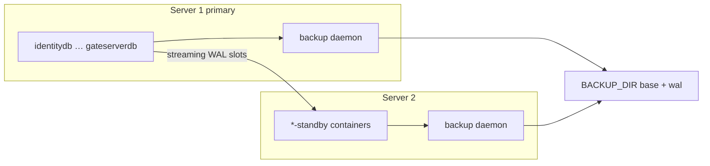

# PostgreSQL: ماندگاری داده در برابر Disaster Recovery

شناسهٔ کاتالوگ: `21-postgres-dr`.

ارجاع: [03-docker-compose](03-docker-compose.md)، [09-ef-core-postgresql](09-ef-core-postgresql.md)، [16-dcc-s3](16-dcc-s3.md)، [19-redis](19-redis.md)، [00-project-discovery](00-project-discovery.md).

اپ، کانتینر Postgres، standby، و اسکریپت‌های DR در این فاز اجرا نشدند. رمز و محتوای `secrets/` نقل نمی‌شود.

درس‌های `17-reporting` و `18-mediamtx-baskool` خارج از محدوده می‌مانند؛ نام `reportingdb` فقط چون یکی از هفت کلاستر است ذکر می‌شود.

## 1. اهداف درس

- فهم توپولوژی هفت کلاستر Postgres جدا در Compose اپ.  
- تفکیک volume ماندگار از backup و از replica.  
- دیدن کیت جداگانهٔ `infrastructure/postgres-dr` و آنچه واقعاً در درخت فایل هست.  
- دانستن اینکه failover اپ خودکار نیست و connection string دستی عوض می‌شود.  
- فهم نقش `Migrate()` در برابر بازیابی داده.

## 2. Persistence در برابر Recovery

| مفهوم | معنی در این مخزن | اشتباه رایج |
|---|---|---|
| Persistence | داده روی volume نام‌دار Docker (مثلاً `dejbandb-data`) می‌ماند اگر کانتینر عوض شود ولی volume پاک نشود | «volume = backup» |
| Backup | کپی base + آرشیو WAL بیرون از volume زنده، در `BACKUP_DIR` | «همان دیسک کانتینر کافی است» |
| Replica / standby | کپی زنده با تأخیر چندثانیه‌ای برای failover | «replica حذف اشتباه را برمی‌گرداند» — README صریح می‌گوید نه |
| Migration | تغییر schema با EF `Migrate()` | «migration داده را بکاپ می‌گیرد» |
| Health check | `pg_isready` / health اپ | «سرویس را restore می‌کند» |

حذف اشتباهی روی primary با standby هم به standby می‌رسد. برگرداندن نقطهٔ زمانی به backup+WAL نیاز دارد (PITR). وضعیت این تمایز در README کیت: `source-verified`.

## 3. توپولوژی Postgres اپ (بدون DR)

هفت سرویس دادهٔ جدا، هر کدام یک دیتابیس و یک volume:

| Container (Server 1) | پورت host | Database | Volume نمونه |
|---|---|---|---|
| `identitydb` | 18001 | `payamgostar_identity` | `identityserverdb-data` |
| `requesttrackerdb` | 18002 | `payamgostar_requesttracker` | `requesttrackerdb-data` |
| `aclserverdb` | 18003 | `payamgostar_aclserver` | `aclserverdb-data` |
| `dejbandb` | 18004 | `payamgostar_dejban` | `dejbandb-data` |
| `dccdb` | 18005 | `payamgostar_dcc` | `dccdb-data` |
| `reportingdb` | 18006 | `payamgostar_reporting` | … |
| `gateserverdb` | 18007 | `payamgostar_gateserver` | … |

شاهد Compose: `docker/compose.data.yml` و `docker-compose.yml` (درس 03). Imageها بین فایل‌ها یکسان نیستند: `postgres` بدون tag، `postgres:latest`، و پیش‌فرض کیت DR `postgres:18.1`.

هر microservice معمولاً به **یک** Postgres خودش وصل است (`ConnectionStrings:Postgres`). دژبان یک DB با چند schema ماژول دارد (درس 09). تراکنش توزیع‌شده بین این هفت DB نیست.

آنچه **replicate نمی‌شود** (صریح README کیت): Redis، MinIO، RabbitMQ. فایل‌های DCC در MinIO با replica شدن `payamgostar_dcc` برنمی‌گردند (درس 16).

## 4. اتصال و محیط

| محیط | منبع Host | مثال مفهومی |
|---|---|---|
| Development | `appsettings.Development.json` | `localhost` + پورت 1800x |
| Docker | `appsettings.Docker.json` / DockerDevelopment | نام سرویس مثل `dejbandb`، پورت داخلی 5432 |
| Compose split backend | `ConnectionStrings__Postgres` در `compose.backend.yml` | `Host=${DATA_HOST};Port=1800x;…` |

مقدار رمز نقل نمی‌شود. بعد از promote standby، README می‌گوید Host را **دستی** به Server 2 عوض کنید؛ کیت connection string را جابه‌جا نمی‌کند. وضعیت: `source-verified` متن README و نبود کد اپ برای auto-failover.

## 5. نقش EF، migration، Dapper

- دژبان: هشت `DbContext`، `UseNpgsql`، `ApplyMigrations` → `Database.Migrate()` بعد از تأخیر startup (درس 09).  
- سرویس‌های جدا: هر کدام context و migration خود (هویت، ACL، DCC، …).  
- Dapper برای outbox/inbox/گزارش‌های خاص روی همان Postgres دژبان (درس 10) — جایگزین backup نیست.  
- README DR: migration روی standby فقط‌خواندنی خطا می‌دهد؛ اپ را قبل از promote به Server 2 وصل نکنید.

`Migrate()` schema را هم‌تراز می‌کند؛ ردیف‌های حذف‌شده یا دیسک ازدست‌رفته را برنمی‌گرداند.

## 6. کیت `infrastructure/postgres-dr`

جدا از Compose اپ است؛ README می‌گوید compose اپ را عوض نکند.

### اجزای موجود در درخت (source-verified)

| فایل | نقش |
|---|---|
| `clusters.env` | نگاشت هفت کلاستر + slotها |
| `docker-compose.standby.yml` | فقط Server 2؛ entrypoint `standby-entrypoint.sh`؛ volume `*-standby-data` |
| `docker-compose.backup.yml` | هر دو سرور؛ `network_mode: host`؛ entrypoint `backup-daemon.sh` |
| `scripts/prepare-primary.sh` | نقش `replicator`، pg_hba، دو physical slot؛ **بدون restart** |
| `scripts/standby-entrypoint.sh` | اولین بار `pg_basebackup`؛ بعد postgres با `standby.signal` |
| `scripts/promote.sh` | `pg_promote` روی standby در recovery |
| `scripts/failback.sh` | بازپیوستن Server 1 به‌عنوان follower |
| `scripts/restore-pitr.sh` | restore موقت روی `127.0.0.1:RESTORE_PORT` بدون لمس production |
| `scripts/status.sh` / `verify-backup.sh` / `lib.sh` | وضعیت و تأیید |

`.env` و `secrets/` در Git نیستند (`.gitignore`).

### شکاف فایل در مخزن (source-verified نبود فایل)

- `docker-compose.backup.yml` به `scripts/backup-daemon.sh` اشاره می‌کند.  
- README به `scripts/backup.sh` اشاره می‌کند.  

در فهرست فعلی `infrastructure/postgres-dr/scripts/` این دو فایل **وجود ندارند** (جستجوی مسیر). بدون آن‌ها، طبق compose فعلی، بالا آوردن سرویس backup به entrypoint غایب وابسته است. وضعیت: **پیاده‌سازی backup daemon در درخت بازرسی‌شده ناقص/غایب است**؛ مستند README وجود دارد. اجرای زنده انجام نشد → اثر عملی `runtime verification pending`، نبود فایل در tree: `source-verified`.

`verify-backup.sh` و `restore-pitr.sh` فرض می‌کنند ساختار `BACKUP_DIR/<cluster>/base` و `wal` پر شده باشد — بدون daemon/اسکریپت تولیدکنندهٔ آن ساختار در tree، مسیر end-to-end backup از روی سورس کامل بسته نمی‌شود.

## 7. مسیر راه‌اندازی مستند (کد/README)

1. هفت primary از Compose داده/اپ از قبل بالا باشند.  
2. Server 1: `.env` با `ROLE=primary`، `PEER_HOST`، `POSTGRES_IMAGE` هم‌تراز نسخهٔ واقعی؛ `prepare-primary.sh` با تأیید `PREPARE PRIMARY`.  
3. شرط‌ها: `wal_level` برابر `replica` یا `logical`؛ `max_wal_senders` / `max_replication_slots` ≥ 4؛ در غیر این صورت اسکریپت می‌ایستد و restart نمی‌کند.  
4. Server 2: `docker compose -f docker-compose.standby.yml up -d` → basebackup به volume جدید.  
5. هر دو سرور: `docker compose -f docker-compose.backup.yml up -d` (وابسته به وجود `backup-daemon.sh`).  
6. مانیتور: `status.sh`؛ روی primary `pg_stat_replication`.  
7. فاجعه Server 1: `promote.sh` روی Server 2؛ سپس تغییر دستی Host در appsettings/Compose.  
8. PITR آزمایشی: `restore-pitr.sh <cluster> "<timestamp>"` → کانتینر موقت، production دست‌نخورده.

وضعیت مراحل ۱–۴ و ۷–۸ از اسکریپت‌های موجود: شواهد سورس قوی. مرحلهٔ ۵: فایل entrypoint غایب.

## 8. سناریوهای شکست

| سناریو | رفتار مورد انتظار از شواهد | برچسب |
|---|---|---|
| حذف کانتینر Postgres بدون حذف volume | داده در volume نام‌دار می‌ماند | strong inference از Compose volumes؛ runtime pending |
| `docker volume rm` | داده از بین می‌رود مگر backup بیرونی | inferred |
| حذف ردیف روی primary با standby فعال | به standby هم replicate می‌شود | README verified مفهوم |
| Server 1 خاموش، بدون promote | اپ به Host قدیمی وصل نمی‌شود | inferred |
| Promote بدون عوض کردن connection string | اپ هنوز به Server 1 می‌نویسد/خطا می‌دهد | README verified |
| وصل اپ به standby قبل از promote | نوشتن و `Migrate()` شکست | README verified |
| فقط یک کلاستر promote شود | ناهماهنگی بین سرویس‌ها؛ Reporting چند DB می‌خواند | README؛ Reporting خارج از محدودهٔ عمیق |
| Redis/MinIO از دست برود | کیت DR پوشش نمی‌دهد | README verified |
| `wal_level` نامناسب | `prepare-primary` متوقف؛ خود اپ عوضش نمی‌کند | script verified |
| Migration شکست در startup | اپ ممکن است بالا نیاید؛ backup نمی‌سازد | inferred از درس 09 |

## 9. موجودی قابلیت‌ها

| قابلیت | وضعیت در مخزن بازرسی‌شده |
|---|---|
| هفت Postgres + volume ماندگار اپ | Implemented (Compose) |
| Health `pg_isready` روی سرویس داده | Implemented (Compose) |
| Health Npgsql/Redis در دژبان | Implemented (درس 20) — تشخیص، نه restore |
| نقش replicator + slot + pg_hba آماده‌سازی | Implemented (`prepare-primary.sh`) |
| Standby streaming + basebackup اولیه | Implemented (`standby-entrypoint.sh` + compose standby) |
| Promote / failback / status / PITR restore موقت | Implemented (اسکریپت‌های هم‌نام) |
| مستند backup روزانه، retention، verify | Documented in README |
| `backup-daemon.sh` / `backup.sh` | **Missing from scripts tree** (referenced) |
| Auto failover connection string | Missing (صریح README) |
| Replication Redis/MinIO/RabbitMQ | Missing (صریح README) |
| Delayed replica چنددقیقه‌ای | Missing (صریح README «کارهایی که انجام نمی‌دهد») |
| اجرای زنده standby/backup/PITR | Runtime verification pending |
| نسخهٔ دقیق Postgres در محیط شما | Runtime verification pending |

## 10. ریسک‌ها و محدودیت‌ها (بدون پیشنهاد به‌عنوان ویژگی موجود)

- سه رشتهٔ image متفاوت بین Composeها و کیت DR.  
- Slot غیرفعال WAL را روی primary نگه می‌دارد و می‌تواند دیسک را پر کند.  
- دو primary هم‌زمان اگر failback را اشتباه انجام دهید.  
- نبود فایل daemon بکاپ در tree یعنی مسیر backup مستند ممکن است در checkout فعلی قابل اجرا نباشد.  
- DCC/MinIO و صف‌ها خارج از این کیت‌اند؛ «بازیابی کامل سامانه» فقط با Postgres ممکن نیست.

## 11. دیباگ عملی (از روی README/اسکریپت)

1. `prepare-primary` گیر کرد: `SHOW wal_level` / `pending_restart` / نسخه در برابر `POSTGRES_IMAGE`.  
2. standby وصل نمی‌شود: فایروال 18001–18007، `PEER_HOST`، یکسان بودن sha256 رمز replicator.  
3. بعد از failover هنوز خطا: Host در `appsettings.Docker.json` هنوز نام Server 1 است.  
4. PITR به زمان هدف نمی‌رسد: WAL آن بازه در `BACKUP_DIR` نیست یا base بعد از زمان هدف است.  
5. `backup compose` فوری fail: وجود فایل `scripts/backup-daemon.sh` را در checkout چک کنید.

## 12. ده سؤال مصاحبه

### 1. Volume داکر با backup چه فرقی دارد؟

Volume دادهٔ زنده را روی همان میزبان نگه می‌دارد. Backup کپی جدا (اینجا ideally بیرون volume، در `BACKUP_DIR`) برای بازیابی بعد از پاک شدن یا فساد است.

**Follow-up:** آیا volume حذف اشتباه را خنثی می‌کند؟  
خیر، اگر volume پاک شود داده می‌رود مگر backup بیرونی باشد.

### 2. چرا هفت Postgres جدا؟

هر microservice مرز داده و استقرار خودش را دارد؛ یک failure/migrate یک سرویس، schema بقیه را قفل نمی‌کند. هزینه: نبود تراکنش توزیع‌شده و failover چندگانه.

### 3. Replica جای backup نیست یعنی چه؟

دستور مخرب روی primary به standby هم می‌رسد. برگشت به دیروز نیاز به base+WAL دارد نه فقط promote.

### 4. کیت DR چه کاری با Compose اپ می‌کند؟

طبق README هیچ؛ جدا اجرا می‌شود و volume/connection اپ را خودش عوض نمی‌کند.

### 5. `prepare-primary.sh` چرا restart نمی‌کند؟

تغییراتی مثل `wal_level` ممکن است `pending_restart` بخواهند؛ اسکریپت عمداً متوقف می‌شود تا اپ بدون تصمیم انسان restart نشود.

### 6. بعد از `pg_promote` اپ از کجا می‌فهمد؟

نمی‌فهمد خودکار؛ باید Host/Port در تنظیمات بک‌اند عوض شود.

### 7. PITR در این کیت production را لمس می‌کند؟

`restore-pitr.sh` کانتینر موقت می‌سازد و primary را stop/modify نمی‌کند.

### 8. `Migrate()` در failover چه نقشی دارد؟

فقط schema. روی standby خواندنی خطا می‌دهد؛ دادهٔ ازدست‌رفته را برنمی‌گرداند.

### 9. چه چیزهایی با این کیت برنمی‌گردند؟

Redis (کش/blacklist)، MinIO (فایل)، RabbitMQ (صف). فقط هفت کلاستر Postgres هدف‌اند.

### 10. یک مسیر واقعی مستند را شرح دهید

Primaryهای Compose → `prepare-primary` (replicator+slots) → standby با `pg_basebackup` و streaming → (در صورت وجود daemon) آرشیو WAL/base در `BACKUP_DIR` → خرابی Server 1 → `promote.sh` → تغییر دستی connection string.

**Follow-up:** اگر `backup-daemon.sh` در checkout نباشد؟  
Compose backup به فایل غایب اشاره می‌کند؛ مسیر backup از روی tree فعلی کامل نیست.

## 13. خلاصه و چک‌لیست

- [ ] هفت DB و volume اپ را می‌شناسم.  
- [ ] volume ≠ backup ≠ replica را بلدم توضیح بدهم.  
- [ ] می‌دانم کیت DR جداست و connection را عوض نمی‌کند.  
- [ ] اسکریپت‌های موجود (prepare/standby/promote/PITR) را از غایب‌های مستند (`backup-daemon`) تفکیک می‌کنم.  
- [ ] می‌دانم MinIO/Redis/Rabbit خارج از این DR هستند.

## 14. منابع

- `infrastructure/postgres-dr/README.md`  
- `infrastructure/postgres-dr/clusters.env`، `.env.example`، `.gitignore`  
- `infrastructure/postgres-dr/docker-compose.standby.yml`، `docker-compose.backup.yml`  
- `infrastructure/postgres-dr/scripts/{prepare-primary,standby-entrypoint,promote,failback,restore-pitr,status,verify-backup,lib}.sh`  
- `docker/compose.data.yml`، `docker-compose.yml` (هفت Postgres + volumes)  
- `docker/compose.backend.yml` — `ConnectionStrings__Postgres`  
- `Microservices/*/appsettings.Docker.json` — Hostهای دیتابیس (جدول README)  
- `Microservices/Dejban/API/Dejban.Api/Extensions/MigrationExtensions.cs`  
- درس‌های `03-docker-compose.md`، `09-ef-core-postgresql.md`، `16-dcc-s3.md`، `19-redis.md`
