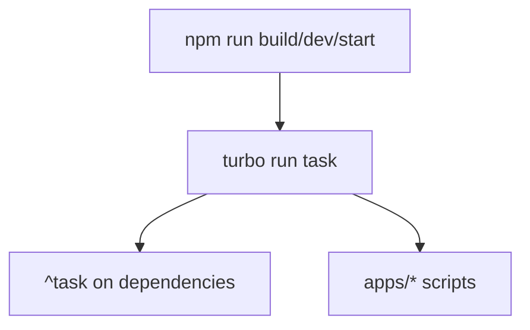

# Turborepo و monorepo فرانت‌اند

شناسهٔ کاتالوگ: `22-turborepo`.

ارجاع: [00-project-discovery](00-project-discovery.md)، [03-docker-compose](03-docker-compose.md)، [28-nginx-edge](28-nginx-edge.md) (آینده)، درس‌های Next/Vite بعدی (`23`، `24`).

مخزن فرانت: ریشهٔ `dejban_frontend_new` (جدا از بک‌اند). مسیرهای این درس نسبت به همان ریشه هستند مگر خلافش گفته شود.

`npm install` / `turbo run` / Docker build در این فاز اجرا نشد. Remote cache و زمان واقعی build: `runtime verification pending`.

درس‌های `17-reporting` و `18-mediamtx-baskool` خارج از محدوده می‌مانند.

## 1. اهداف درس

- دیدن اینکه Turborepo **واقعاً** نصب، پیکربندی، و در CI/Docker صدا می‌شود.  
- فهم رابطهٔ npm workspaces با task runner توربو.  
- تفکیک Turborepo از پرچم `--turbo` / `--turbopack` خود Next.js.  
- شناخت اپ‌ها و پکیج‌های `@repo/*` و مسیرهای `dev` / `build` / `start`.

## 2. آیا Turborepo استفاده می‌شود؟

| سؤال | پاسخ از سورس |
|---|---|
| نصب؟ | بله — `devDependencies.turbo` برابر `^2.10.12`؛ optional `@turbo/linux-64` / `@turbo/windows-64` 2.10.12 |
| پیکربندی؟ | بله — `turbo.json` با schema `v2-10-12` |
| workspaces؟ | بله — npm: `"workspaces": ["apps/*", "packages/*"]`؛ `packageManager`: `npm@10.9.2`؛ قفل `package-lock.json` |
| فراخوانی واقعی؟ | بله — اسکریپت‌های ریشه؛ CI گیت‌لب `npx turbo run build`؛ Docker `npx turbo run build --filter=${APP_NAME}` |

وضعیت: **فعال و source-verified**. pnpm-workspace وجود ندارد.

## 3. ساختار workspace

```text
dejban_frontend_new/
  package.json          # root scripts → turbo run …
  turbo.json
  package-lock.json
  apps/
    main/               # Next
    dejban/             # Next, basePath /dejban
    gate/               # Next
    dcc/                # Next
    access-control/     # Vite
  packages/
    api-client/         # @repo/api-client
    auth/               # @repo/auth
    config/             # @repo/config
    ui/                 # @repo/ui
    eslint-config/      # @repo/eslint-config
    typescript-config/  # @repo/typescript-config
  docker/               # Dockerfile.next، nginx template، compose
  tools/scanner-agent/  # از script dev اپ dejban
```

نام ریشهٔ پکیج: `pg_frontend`. موتور: `node >= 20`.

اپ‌ها به `@repo/ui`، `@repo/api-client`، `@repo/auth`، `@repo/config` وابسته می‌شوند (`"*"` در workspace). جزئیات Next/Vite در درس‌های 23–24.

## 4. اسکریپت ریشه → Turborepo → پکیج

ریشه (`package.json`):

| Script ریشه | فرمان |
|---|---|
| `dev` | `turbo run dev` |
| `build` | `turbo run build` |
| `start` | `turbo run start` |
| `lint` / `check-types` | `turbo run …` |
| `test:e2e` / `test:unit` | `turbo run …` |
| `format` | Prettier مستقیم (بدون turbo) |

توربو برای هر workspace که script هم‌نام دارد task را اجرا می‌کند. نمونهٔ سطح اپ:

- Next: `next build --turbopack`، `next dev … --turbo`، `next start -p …`  
- Vite access-control: `vite` / `vite build` / `vite preview`

**هشدار واژه‌ها:** `--turbo` / `--turbopack` در Next = bundler داخلی Next، نه جایگزین Turborepo. هر دو در این مخزن هم‌زمان دیده می‌شوند.

پکیج‌های `@repo/*` عمدتاً library بدون script `build` هستند؛ `@repo/ui` دارای `lint` و `check-types` است. بنابراین `dependsOn: ["^build"]` برای dependencyهایی بدون `build` عملاً کار اضافی تولید نمی‌کند (رفتار دقیق skip: semantics توربو؛ در این فاز اجرا نشد).

## 5. `turbo.json` — pipeline



| Task | dependsOn | cache | persistent | outputs / env |
|---|---|---|---|---|
| `build` | `^build` | پیش‌فرض on | خیر | `.next/**` (بدون `.next/cache`)، `dist/**`؛ `env`: NODE_ENV، BUILD_STATIC_EXPORT؛ `passThroughEnv`: PLAYWRIGHT_*، NEXT_PUBLIC_*؛ `inputs`: `$TURBO_DEFAULT$`، `.env*` |
| `dev` | — | false | true | — |
| `start` | `build` | false | true | اول build سپس process ماندگار |
| `lint` / `check-types` | `^lint` / `^check-types` | پیش‌فرض | خیر | — |
| `test:e2e` / `test:unit` | — | false | خیر | passThrough CI / Playwright |

`ui: "tui"` برای UI ترمینال توربو.

Remote Caching: در `turbo.json` تنظیم تیم/توکن دیده نشد؛ README قالب create-turbo هنوز متن remote cache عمومی دارد — **فعال‌سازی remote در این مخزن از روی config اثبات نشد** (`source-verified` نبود تنظیم؛ ادعای استفاده در CI: فقط local turbo در script).

## 6. مسیرهای اجرا: محلی، CI، Docker

### محلی (اعلام‌شده)

`npm run dev` → همهٔ workspaceهایی که `dev` دارند به‌صورت persistent موازی (تا وقتی فیلتر نزنید). پورت‌ها per-app در package.json متفاوت‌اند (مثلاً dejban 3034، gate 3036). اجرای زنده: pending.

### GitLab CI (`.gitlab-ci.yml`)

1. SSH به سرور؛ `nvm use 22`  
2. Clone/pull در `~/dejban_frontend_new_turborepo`  
3. `npm ci --prefer-offline`  
4. `npx turbo run build --concurrency=1 --no-daemon` با `NODE_OPTIONS=--max-old-space-size=3072` (صریح: جلوگیری از OOM)  
5. `pm2 restart|start npm -- start` → همان `turbo run start` ریشه (که به `build` وابسته است)

وضعیت وجود workflow: `verified`. موفقیت deploy زنده: pending.

### Docker (`docker/Dockerfile.next` + `docker-compose.yml`)

- Context کل monorepo؛ `npm ci`؛ سپس `npx turbo run build --filter=${APP_NAME}`  
- Runner فقط خروجی standalone/static همان اپ Next را کپی می‌کند  
- Compose جدا (`dejban-frontend`) چند سرویس اپ + nginx لبه؛ به شبکهٔ بک‌اند وصل نیست (درس کشف/۳)

برای Vite access-control Dockerfile جدا در ادامهٔ compose وجود دارد (خوانده‌شده در discovery؛ جزئیات Vite درس 24).

## 7. پیامدها و محدودیت‌ها

| موضوع | یافته | برچسب |
|---|---|---|
| یک monorepo چند اپ محصول | پنج app + پکیج مشترک | verified |
| CI سریال build | `--concurrency=1` | verified — محدودیت حافظه، نه الزام توربو |
| Cache محلی توربو | outputs برای `.next` و `dist` | config verified؛ hit نرخ pending |
| Remote cache | پیکربندی اختصاصی نیست | absent/unverified |
| `start` وابسته به `build` | هر `npm start` ریشه ابتدا build را در گراف می‌خواهد | verified config |
| Next turbopack ≠ Turborepo | هر دو در scripts | verified — سوءبرداشت رایج |
| README ریشه | هنوز متن boilerplate create-turbo | verified؛ با اپ‌های واقعی یکی نیست |
| پکیج‌ها بدون build | اشتراک کد با source/`exports` نه artifact جدا | strong inference از package.json |

## 8. ده سؤال مصاحبه

### 1. Turborepo چیست و اینجا چه می‌کند؟

Task runner برای monorepo: از ریشه یک فرمان می‌زند و scriptهای هم‌نام را در apps/packages با ترتیب و cache اجرا می‌کند. اینجا `build`/`dev`/`start`/`lint`/`test` از طریق turbo می‌روند.

**Follow-up:** با npm workspaces چه فرقی دارد؟  
Workspaces وابستگی و نصب مشترک می‌سازد؛ turbo اجرای موازی/ترتیبی و cache taskها را اضافه می‌کند.

### 2. شواهد فعال بودن turbo در این مخزن؟

`turbo` در package.json، `turbo.json`، `npx turbo` در GitLab CI و Dockerfile.

### 3. `dependsOn: ["^build"]` یعنی چه؟

قبل از build یک پکیج، turbo سعی می‌کند task `build` وابستگی‌های workspace (`^`) را تمام کند.

**Follow-up:** اگر dependency اسکریپت build نداشته باشد؟  
معمولاً کاری برای آن پکیج تعریف نمی‌شود؛ اپ همچنان از سورس `@repo/*` مصرف می‌کند.

### 4. چرا `dev` و `start` با `cache: false` و `persistent: true`؟

Processهای بلندمدت‌اند؛ خروجی cacheشدنی مثل artifact build نیستند.

### 5. `--concurrency=1` در CI چرا؟

کامنت workflow: جلوگیری از OOM کرنل هنگام چند build هم‌زمان Node/Next.

### 6. Turbopack همان Turborepo است؟

خیر. Turbopack bundler/dev Next است (`next build --turbopack`). Turborepo ارکستراسیون monorepo است.

### 7. خروجی‌های cache build چیست؟

`.next/**` بدون `.next/cache/**` و `dist/**` — مناسب Next و Vite.

### 8. فیلتر Docker چیست؟

`--filter=${APP_NAME}` فقط همان اپ (مثلاً `dejban`) را از گراف می‌سازد تا image تک‌اپ باشد.

### 9. `passThroughEnv` برای `NEXT_PUBLIC_*` چه می‌کند؟

اجازه می‌دهد متغیرهای عمومی Next روی task دیده شوند بدون اینکه همه در آرایهٔ `env` سخت کد شوند؛ برای صحت cache مهم است که تغییر env ورودی محسوب شود (جزئیات دقیق hashing: docs توربو؛ اجرا نشد).

### 10. مسیر deploy فرانت را شرح دهید

Push به `master` → job SSH → `npm ci` → `turbo run build` سریال → pm2 روی `npm start` (= `turbo run start` با وابستگی build).

**Follow-up:** Compose فرانت کجا وارد می‌شود؟  
مسیر جدا با build per-app از Dockerfile و nginx؛ هم‌زمان با CI pm2 روی همان سرور ممکن است محیط‌های متفاوت باشند — هم‌زیستی runtime pending.

## 9. خلاصه و چک‌لیست

- [ ] می‌دانم فرانت npm workspaces + Turborepo 2.10 است.  
- [ ] فرق turbo task با Next `--turbo` را بلدم.  
- [ ] `turbo.json` tasks و outputs را می‌شناسم.  
- [ ] CI و Docker را به‌عنوان call site واقعی turbo بلدم.  
- [ ] می‌دانم remote cache اینجا اثبات نشده است.

## 10. منابع

- `dejban_frontend_new/package.json`  
- `dejban_frontend_new/turbo.json`  
- `dejban_frontend_new/package-lock.json`  
- `dejban_frontend_new/.gitlab-ci.yml`  
- `dejban_frontend_new/docker/Dockerfile.next`  
- `dejban_frontend_new/docker-compose.yml`  
- `dejban_frontend_new/apps/*/package.json`  
- `dejban_frontend_new/packages/*/package.json`  
- `docs/technical-learning/00-project-discovery.md` (جدول اپ‌ها و پورت‌ها)
