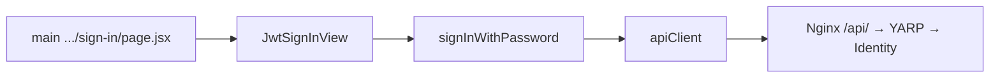

# Next.js در اپ‌های فرانت دژبان

شناسهٔ کاتالوگ: `23-nextjs`.

ارجاع: [22-turborepo](22-turborepo.md)، [00-login-execution-path](00-login-execution-path.md)، [00-personnel-list-execution-path](00-personnel-list-execution-path.md)، درس‌های آیندهٔ `24-vite-access-control`، `25-api-client-auth`، `28-nginx-edge`.

مسیرهای این درس نسبت به ریشهٔ `dejban_frontend_new` هستند مگر خلافش گفته شود. اپ، build، و درخواست HTTP زنده اجرا نشدند. Context7 در این فاز در دسترس نبود.

درس‌های `17-reporting` و `18-mediamtx-baskool` خارج از محدوده می‌مانند. جزئیات کامل Turborepo اینجا تکرار نمی‌شود.

## 1. Next.js اینجا چه مسئله‌ای را حل می‌کند؟

Next.js فریم‌ورک React است که routing مبتنی بر فایل، layout تو در تو، metadata، و خروجی production (مثل `standalone`) را روی یک سرور Node می‌گذارد. در این مخزن چهار اپ محصولی جدا با Next ساخته شده‌اند تا هر کدام `basePath`، پورت، و دامنهٔ UI خود را داشته باشند، ولی پکیج‌های مشترک `@repo/*` را از monorepo بگیرند.

`access-control` Next نیست (Vite) و موضوع درس 24 است.

## 2. کدام اپ‌ها Next هستند؟

| اپ (`package.json` name) | نسخهٔ اعلام‌شده | پورت `dev` | پورت `start` | `basePath` در `next.config.mjs` |
|---|---|---|---|---|
| `main` | `next` `^16.2.6` | `3031` + `--experimental-https` | `3035` | ندارد (ریشه) |
| `dejban` | `^16.2.6` | `3034` + `--turbo` | `3034` | `/dejban` |
| `gate` | `^16.2.6` | `3036` + `--turbo` | `3036` | `/gate` |
| `dcc` | `^16.2.6` | `3037` + `--turbo` | `3037` | `/dcc` |

نسخهٔ runtime نصب‌شده روی هر ماشین از lockfile/نصب محلی می‌آید؛ این جدول فقط dependency اعلام‌شده است (`verified` از `package.json`).

Build همه: `next build --turbopack`. این پرچم bundler خود Next است، نه Turborepo (درس 22).

## 3. App Router در برابر Pages Router

هر چهار اپ پوشهٔ `src/app` با `layout.jsx` و `page.jsx` دارند. زیر درخت این اپ‌ها پوشهٔ Next به‌نام `pages/` برای routing دیده نشد. مسیرهای `apps/*/tests/pages` مربوط به Playwright هستند، نه Pages Router. پوشهٔ `apps/access-control/src/pages` مربوط به Vite است.

| قرارداد App Router | شاهد |
|---|---|
| Root layout | `apps/*/src/app/layout.jsx` — `async function RootLayout` |
| Segment dashboard | `apps/dejban|gate|dcc/src/app/dashboard/layout.jsx` |
| Loading UI | مثلاً `apps/dejban/src/app/loading.jsx`، `.../dashboard/loading.jsx` |
| not-found | مثلاً `apps/dejban/src/app/not-found.jsx`، `apps/main/src/app/not-found.jsx` |
| صفحات خطا به‌صورت route | `apps/*/src/app/error/403|404|500|503/page.jsx` (بسته به اپ) |
| `middleware.js` / `middleware.ts` | در `apps/` یافت نشد |
| `route.js` / Route Handlers | در `apps/*/src/app` یافت نشد |
| `generateStaticParams` / `getServerSideProps` | در `apps/dejban/src/app` یافت نشد |

نتیجه: routing محصولی = **App Router**. API بک‌اند از مرورگر با Axios می‌رود، نه از Route Handlerهای Next.

## 4. ساختار نقش‌ها

```text
main          → ورود JWT، home، redirect ریشه به /dejban؛ rewrites اختیاری به اپ‌های دیگر
dejban        → داشبورد بزرگ دامنه (پرسنل، خودرو، گشت، …) زیر /dejban
gate          → مدیریت گیت تحت /gate
dcc           → فایل/اسناد تحت /dcc
```

نمونهٔ `main` (`next.config.mjs`):

- `output: 'standalone'`
- `redirects`: `/` → `/dejban`
- `rewrites` فقط اگر `NEXT_PUBLIC_*_DOMAIN` برای access-control/dejban/gate/dcc ست شده باشد؛ وگرنه آرایه خالی از آن جفت‌ها
- بدون `basePath`

نمونهٔ `dejban` / `gate` / `dcc`:

- `output: 'standalone'` (تا وقتی `isStaticExport === false`)
- `basePath` سخت‌کد شده (`/dejban`، `/gate`، `/dcc`)
- `redirects`: `/` → `/dashboard` (نسبت به basePath)
- `transpilePackages`: `@repo/ui`، `@repo/auth`، `@repo/api-client`، `@repo/config`
- `typescript.ignoreBuildErrors: true` در dejban/gate/dcc

در Compose، argهای `NEXT_PUBLIC_BASE_PATH` به Dockerfile پاس می‌شوند، ولی `basePath` در `next.config.mjs` از آن env خوانده نمی‌شود — از مقدار ثابت فایل می‌آید (`verified` در config؛ اثر build زنده: pending).

Nginx لبه مسیرهای `/dejban/`، `/gate/`، `/dcc/` و `/` را به سرویس‌های مربوط می‌فرستد (`docker/nginx/default.conf.template`). جزئیات لبه در درس 28.

## 5. Server Component در برابر Client Component

### الگوی مشترک root layout

`RootLayout` در هر چهار اپ **بدون** `"use client"` و `async` است: روی سرور `detectLanguage` را صدا می‌زند، `metadata` / `viewport` export می‌کند، و درخت providerها را می‌چیند.

مرز client زود باز می‌شود:

1. `ClientInit` (`'use client'`) → `ConfigRegistry.set(CONFIG)` و `ConfigProvider`
2. `AuthProvider` از `@repo/ui/auth-context-jwt` (کلاینت)
3. `ClientProvider` → React Query
4. Theme / Settings / Motion و بقیه UI اشتراکی

### Dashboard layout

`apps/dejban/src/app/dashboard/layout.jsx` و معادل gate/dcc با `'use client'` شروع می‌شوند و `AuthGuard` می‌گذارند. بدون session، `AuthGuard` با `window.location.href` به مسیر ورود می‌فرستد (نه لزوماً `next/navigation` redirect).

### صفحهٔ نازک + view کلاینت

خیلی از `page.jsx`ها خود `"use client"` ندارند ولی کامپوننت کلاینت import می‌کنند. مثال پرسنل:

- `apps/dejban/src/app/dashboard/personnel/staff/page.jsx` — Server Component نازک + `PageGuard` + `StaffListView`
- `StaffListView` — `'use client'` و React Query

پیامد عملی: بخش عمدهٔ داده و تعامل UI روی کلاینت است. RSC برای shell، زبان، و metadata استفاده می‌شود؛ لیست‌ها با `fetch` سمت سرور Next پر نمی‌شوند (در `src/app` دژبان `fetch(` برای data route دیده نشد).

## 6. جریان داده و API (شاهد مسیر)

### ورود



- صفحه: `apps/main/src/app/auth/jwt/sign-in/page.jsx`
- View کلاینت: `apps/main/src/auth/view/jwt/jwt-sign-in-view.jsx`
- Action اشتراکی: `packages/ui/src/auth/context/jwt/action.js` → `apiClient.post(endpoints.auth.login, …)`
- Base URL کلاینت: `resolveBaseUrl()` در `packages/api-client/src/axiosInstance.ts` از `process.env.NEXT_PUBLIC_SERVER_URL` (مثلاً Compose: `/api/v1`)

جزئیات hop تا handler بک‌اند: `00-login-execution-path.md`. درس 25 عمیق‌تر به Axios/token می‌پردازد.

### فهرست پرسنل

- صفحه: `staff/page.jsx` → `PageGuard` → `StaffListView`
- `useGetStaffWithPagination` → `staff.http` → `endpoints.staff.list` در `apps/dejban/src/lib/api.js` برابر `/Personnels/GetPersonnels`
- `apiClient` همان پکیج مشترک با هدرهای `Authorization` و `X-Site-Id`

جزئیات: `00-personnel-list-execution-path.md`.

### پیکربندی اپ

هر اپ `src/global-config.js` دارد که `createAppConfig` از `@repo/config` را با `serverUrl: process.env.NEXT_PUBLIC_SERVER_URL || ''` صدا می‌زند. `ClientInit` همان CONFIG را در `ConfigRegistry` می‌گذارد تا پکیج‌های UI/auth بخوانند.

تفاوت gate: `signalRUrl` می‌تواند از `NEXT_PUBLIC_SERVER_URL_Gate` یا با حذف پسوند `/api/v…` از `serverUrl` ساخته شود (`apps/gate/src/global-config.js`).

## 7. احراز هویت و خطا (فقط verified)

| موضوع | یافته |
|---|---|
| روش | `CONFIG.auth.method === 'jwt'` → `JwtAuthProvider` |
| محافظ داشبورد | `AuthGuard` کلاینت؛ redirect با `window.location.href` و `returnTo` |
| مسیر ورود اعلام‌شده | `paths.auth.jwt.signIn` = `/auth/jwt/sign-in` در هر اپ |
| محل واقعی UI ورود | عمدتاً اپ `main`؛ اپ‌های basePath معمولاً صفحهٔ sign-in داخل خودشان ندارند (جستجوی route در dejban/gate/dcc برای auth/jwt در این فاز روی صفحهٔ اصلی ورود main تکیه دارد — شاهد صفحه: `apps/main/.../sign-in`) |
| مجوز صفحه | `PageGuard` / `Guard` / `RouteAccessGuard` با claim |
| Loading | `loading.jsx` → `SplashScreen` |
| 404 App Router | `not-found.jsx` → `NotFoundView` |
| صفحات خطا دستی | routeهای `/error/403` و مشابه |
| `error.jsx` سگمنت | در `src/app` اپ‌های Next یافت نشد |

رفتار دقیق redirect بین basePath و مسیر `/auth/...` روی هاست واحد به routing Nginx وابسته است؛ match زنده: `Runtime verification pending`.

## 8. پکیج‌های مشترک و تفاوت اپ‌ها

همهٔ چهار اپ: `transpilePackages` برای `@repo/ui`، `@repo/auth`، `@repo/api-client`، `@repo/config`.

| تفاوت | main | dejban | gate | dcc |
|---|---|---|---|---|
| نقش | launcher / login / home | دامنه اصلی | گیت | فایل |
| `basePath` | خیر | بله | بله | بله |
| حجم route داشبورد | کم | خیلی زیاد | چند صفحه manageGate | files + dashboard |
| AuthGuard داشبورد | — | بله + Component/Route guard | بله | بله + Component/Route |
| Script خاص | HTTPS تجربی در dev | `ensure-agent.mjs` قبل از `next dev` | — | — |
| Rewrite به زیراپ‌ها | بله (اگر domain env) | خیر | خیر | خیر |

نکتهٔ ریسک سورس: `JwtSignInView` در main با مسیر نسبی به `apps/dejban/src/utils/extract-error-message` import می‌کند — وابستگی متقابل اپ، نه فقط `@repo/*` (`verified` import).

## 9. Build و deploy (اشاره کوتاه)

- محلی / CI: از ریشه monorepo `turbo run build` سپس در CI `pm2` روی `npm start` (درس 22).
- Docker: `docker/Dockerfile.next` با `APP_NAME` و `npx turbo run build --filter=${APP_NAME}`؛ runner خروجی `.next/standalone` همان اپ را اجرا می‌کند.
- Compose فرانت: سرویس‌های `main`/`dejban`/`gate`/`dcc` + nginx؛ `NEXT_PUBLIC_SERVER_URL=/api/v1`.

اجرای زنده build/start: pending.

## 10. محدودیت‌ها و سوءبرداشت‌ها

| موضوع | برچسب |
|---|---|
| «همه چیز Server Component است» | رد؛ داشبورد و لیست‌ها کلاینت‌محورند |
| «Next API routes بک‌اند را عوض کرده» | رد؛ Route Handler نیست |
| Turbopack = Turborepo | رد (درس 22) |
| `NEXT_PUBLIC_BASE_PATH` لزوماً `basePath` را ست می‌کند | در `next.config` فعلی خوانده نمی‌شود |
| `ignoreBuildErrors: true` | خطاهای TS ممکن است build را رد نکنند |
| نسخهٔ دقیق Next روی سرور | فقط از lock/install؛ runtime pending |

## 11. ده سؤال مصاحبه

### 1. در این مخزن چند اپ Next دارید و نسخه‌شان چیست؟

چهار اپ: `main`، `dejban`، `gate`، `dcc`؛ dependency `next` برابر `^16.2.6`.

**Follow-up:** access-control؟  
Vite است، نه Next.

### 2. App Router است یا Pages Router؟ شاهد؟

App Router: `src/app/**/page.jsx` و `layout.jsx`. پوشهٔ Pages Router برای این چهار اپ نیست.

### 3. `basePath` چه می‌کند و کجا ست شده؟

پیشوند URL اپ در Next. در `next.config.mjs` اپ‌های dejban/gate/dcc به‌ترتیب `/dejban`، `/gate`، `/dcc`. `main` ندارد.

### 4. Root layout سرور است یا کلاینت؟

`async` بدون `"use client"` → Server Component؛ ولی بلافاصله providerهای کلاینت را mount می‌کند.

### 5. دادهٔ جدول پرسنل کجا fetch می‌شود؟

روی کلاینت: `StaffListView` → React Query → Axios `apiClient`، نه `fetch` داخل RSC صفحه.

### 6. اگر کاربر لاگین نباشد به داشبورد dejban برود چه می‌شود؟

`AuthGuard` در `dashboard/layout.jsx` پس از اتمام loading، با `window.location.href` به مسیر ورود (از config) می‌فرستد و `returnTo` می‌گذارد.

### 7. `NEXT_PUBLIC_SERVER_URL` کجا مصرف می‌شود؟

در `resolveBaseUrl`ی `@repo/api-client` و در `global-config` به‌عنوان `serverUrl`. مقدار Compose نمونه: `/api/v1`.

### 8. خروجی production چیست؟

`output: 'standalone'` (با `isStaticExport === false`). Dockerfile همان artifact را کپی می‌کند.

### 9. نقش اپ `main` نسبت به بقیه؟

ورود و خانه؛ redirect `/` به `/dejban`؛ در صورت env، rewrite به دامنهٔ زیراپ‌ها. زیراپ‌ها `basePath` دارند و پشت Nginx جدا سرو می‌شوند.

### 10. چرا `transpilePackages` برای `@repo/*` لازم است؟

پکیج‌های workspace سورس JS/TS خام export می‌کنند؛ Next باید آن‌ها را مثل کد اپ transpile کند.

**Follow-up:** آیا middleware احراز هویت Next دارید؟  
فایل `middleware` در apps یافت نشد؛ گاردها کلاینت‌اند.

## 12. خلاصه و چک‌لیست

- [ ] چهار اپ Next 16 با App Router را می‌شناسم.  
- [ ] فرق shell سرور با دادهٔ کلاینت را بلدم.  
- [ ] مسیر login و staff را تا `apiClient` می‌توانم شرح بدهم.  
- [ ] `basePath` و نقش `main` را از config می‌گویم.  
- [ ] می‌دانم Route Handler و middleware Next اینجا شاهد ندارند.

## 13. منابع

- `apps/main|dejban|gate|dcc/package.json`
- `apps/*/next.config.mjs`
- `apps/*/src/app/layout.jsx` و `dashboard/layout.jsx`
- `apps/main/src/app/auth/jwt/sign-in/page.jsx`
- `apps/dejban/src/app/dashboard/personnel/staff/page.jsx`
- `apps/dejban/src/global-config.js` و `app/client-init.jsx`
- `packages/config/src/index.ts` — `createAppConfig`
- `packages/api-client/src/axiosInstance.ts` — `resolveBaseUrl`، `apiClient`
- `packages/ui/src/auth/guard/auth-guard.jsx`، `component-guard.jsx`
- `packages/ui/src/auth/context/jwt/action.js`
- `docker-compose.yml`، `docker/Dockerfile.next`، `docker/nginx/default.conf.template`
- `docs/technical-learning/00-login-execution-path.md`، `00-personnel-list-execution-path.md`
