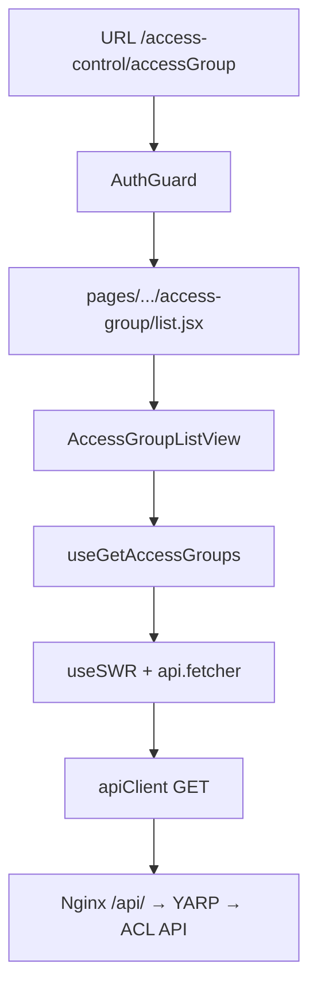

# Vite و اپ access-control

شناسهٔ کاتالوگ: `24-vite-access-control`.

ارجاع: [22-turborepo](22-turborepo.md)، [23-nextjs](23-nextjs.md)، [25-api-client-auth](25-api-client-auth.md) (آینده)، [28-nginx-edge](28-nginx-edge.md) (آینده).

مسیرها نسبت به ریشهٔ `dejban_frontend_new` هستند مگر خلافش گفته شود. `vite`/`npm` زنده، Docker build، و درخواست HTTP اجرا نشدند.

**محدوده:** معماری فرانت SPA، routing، auth عمومی، و یک مسیر غیردستگاهی. کارکرد اختصاصی دستگاه/gRPC و درس‌های `17`/`18` اینجا باز نمی‌شوند؛ وجود routeهای device فقط به‌عنوان ساختار UI ذکر می‌شود.

## 1. Vite اینجا چه می‌کند؟

Vite ابزار build و dev server برای اپ‌های فرانت مدرن است: در توسعه ماژول‌های ESM را سریع سرو می‌کند و در production با Rollup (از طریق `vite build`) bundle استاتیک می‌سازد. برخلاف Next.js، سرور Node برای SSR/RSC ندارد؛ خروجی یک پوشهٔ استاتیک (`dist`) است که Nginx آن را سرو می‌کند.

در این مخزن فقط اپ `apps/access-control` با Vite ساخته شده؛ چهار اپ دیگر Next هستند (درس 23).

| موضوع | access-control (Vite) | اپ‌های Next |
|---|---|---|
| Bundler / framework | `vite` `^6.3.5` + `@vitejs/plugin-react-swc` | `next` `^16.2.6` |
| Routing | `react-router` `^8.3.0` — `createBrowserRouter` | App Router (`src/app`) |
| Entry | `index.html` → `src/main.jsx` | `src/app/layout.jsx` |
| خروجی | static `dist` | `output: 'standalone'` |
| پیشوند مسیر | `base` / `basename` ≈ `/access-control` | `basePath` در next.config |
| Env مرورگر | `import.meta.env.VITE_*` | `process.env.NEXT_PUBLIC_*` |
| Data fetch غالب | **SWR** (`swr` `^2.3.6`) | TanStack Query در shell مشترک Next |

نسخه‌ها از `apps/access-control/package.json` اعلام شده‌اند. `react` / `react-dom` `^19.1.1`.

## 2. Entry و bootstrap

1. `index.html`: `<div id="root">`، `<base href="/access-control/">`، اسکریپت `config.js`، سپس `src/main.jsx`.
2. `src/main.jsx`:
   - در `import.meta.env.DEV` اگر hash شامل `accessToken` باشد، در `localStorage` کلید `jwt_access_token` می‌نویسد (کمک ورود cross-origin در dev؛ کامنت سورس).
   - `ConfigRegistry.set(CONFIG)` از `@repo/config`.
   - `createBrowserRouter(..., { basename: '/access-control' })`.
   - درخت: `ConfigProvider` → `App` → `Outlet`؛ `errorElement: <ErrorBoundary />`.
   - `createRoot(...).render(<RouterProvider />)`.

3. `src/app.jsx`: `I18nProvider`، `JwtAuthProvider` (اگر `CONFIG.auth.method === 'jwt'`)، Settings/Theme از `@repo/ui`، Snackbar/ProgressBar. **بدون** `ClientProvider` / React Query.

`public/config.js` از HTML لود می‌شود و طبق کامنت خودش stub است: `window.globalConfig` با فیلدهای خالی؛ URL API نباید آنجا باشد — پیکربندی واقعی از `VITE_*` در build می‌آید (`verified`).

## 3. Routing

تعریف: `src/routes/sections/index.jsx` → `dashboardRoutes` + `mainRoutes` + `*` → `/404`.

`dashboard.jsx`:

- مسیر ریشه `/` (نسبت به basename) با `AuthGuard` مگر `CONFIG.auth.skip` (در `createAppConfig` فعلی از global-config ست نشده → عملاً AuthGuard فعال، `verified` از شرط و نبود `skip` در `global-config.js`).
- فرزندان lazy: overview، region، calendar، accessGroup، trafficReport، ApiKeyManagement، و همچنین device/deviceType/aclUserManagement (جزئیات device خارج از محدودهٔ این درس).
- Layout: `DashboardLayout` از `@repo/ui` + `Suspense` + `LoadingScreen`.

`main.jsx` (routes): صفحات خطای `403` / `404` / `500` بدون AuthGuard.

`paths.js`: `auth.jwt.signIn` = `/auth/jwt/sign-in` (مسیر مطلق هاست؛ UI ورود داخل این SPA تعریف نشده — مشابه الگوی اپ‌های Next با basePath).

## 4. احراز هویت و گارد

| لایه | شاهد |
|---|---|
| Provider | `JwtAuthProvider` از `@repo/ui/auth-context-jwt` در `app.jsx` |
| Redirect path | `authRedirectPath: paths.auth.jwt.signIn` در `global-config.js` |
| محافظ داشبورد | `AuthGuard` دور `DashboardLayoutWrapper` |
| Token storage | پکیج `@repo/api-client` / `tokenStorage`؛ در dev، تزریق از hash به `jwt_access_token` |
| Login UI در این اپ | route sign-in داخل `routesSection` دیده نشد |

`AuthGuard` (پکیج مشترک، درس 23): اگر authenticated نباشد با `window.location.href` به مسیر ورود می‌رود. اجرای زندهٔ redirect و اشتراک cookie/localStorage با `main`: `Runtime verification pending`.

`PageGuard` / `ComponentGuard` روی routeهای dashboard این اپ مثل dejban پیچیده نیست؛ سطح اول فقط `AuthGuard` است (`verified` از `dashboard.jsx`).

## 5. API و رسیدن به بک‌اند

- `src/lib/api.js` re-export می‌کند: `fetcher`، `apiClient`، `createItem`، `updateItem`، `deleteItem` از `@repo/api-client` و `endpoints` اختصاصی ACL را تعریف می‌کند.
- Base URL: `resolveBaseUrl()` در `axiosInstance.ts` اول `NEXT_PUBLIC_SERVER_URL` را می‌بیند؛ در Vite به `import.meta.env.VITE_SERVER_URL` می‌رسد.
- `global-config.js`: `serverUrl: import.meta.env.VITE_SERVER_URL || ''`، `signalRUrl: import.meta.env.VITE_SIGNALR_HUB_URL || ''`.
- Docker/Compose: `VITE_SERVER_URL=/api/v1` (همان الگوی relative path پشت Nginx لبه).

Interceptorهای توکن، `X-Site-Id`، refresh: در پکیج مشترک‌اند (درس 25 عمیق‌تر). اینجا فقط مصرف از طریق `apiClient`/`fetcher` تأیید شد.

## 6. State و data-fetching

| الگو | استفادهٔ تأییدشده |
|---|---|
| SWR | `src/actions/*.js` — مثلاً `useGetAccessGroups`، `useGetCalendars` با `api.fetcher` |
| Zustand | فروشگاه‌های `src/stores/*` — مثلاً `useAccessGroupActions`؛ call site اصلی دیده‌شده در بخش device است، نه لیست access-group |
| react-hook-form + zod | در فرم‌های متعدد (از جمله device)؛ برای معماری کلی موجود است |
| TanStack Query | در این اپ به‌عنوان provider دیده نشد؛ dependency مستقیم در package.json اپ نیست |

گزینه‌های SWR در actions معمولاً `revalidateIfStale/OnFocus/OnReconnect: false` هستند.

i18n: `i18next` + `react-i18next` + بارگذاری JSON از `src/locales/langs/...`؛ RTL از طریق Theme/stylis در UI مشترک (جزئیات درس 27).

## 7. Build، base، deploy

`vite.config.js`:

- `base: process.env.VITE_BASE || '/access-control'`
- alias `src` → پوشهٔ `src`
- `server`/`preview` پورت `3033`، `host: true`
- پلاگین React SWC + `vite-plugin-checker` (eslint)

توجه: `basename` در `main.jsx` **سخت‌کد** `'/access-control'` است؛ اگر `VITE_BASE` مقدار دیگری بگیرد ممکن است با router نخواند (`risk`؛ runtime pending).

Docker: `docker/Dockerfile.access-control` → `npm ci` → `npx turbo run build --filter=access-control` → کپی `apps/access-control/dist` به `/usr/share/nginx/html/access-control`؛ conf داخلی:

```nginx
location /access-control/ {
  try_files $uri $uri/ /access-control/index.html;
}
```

Compose لبه: upstream `access-control:80`؛ `location /access-control/` در `docker/nginx/default.conf.template`.

`public/web.config`: قانون rewrite برای IIS به `index.html` (میزبانی جایگزین؛ در مسیر Docker اصلی از conf بالا استفاده می‌شود).

## 8. مسیر اجرا (غیر دستگاه): فهرست Access Group



Hopها (`verified` از import/call؛ HTTP زنده pending):

1. Route `accessGroup` / `accessGroup/list` در `dashboard.jsx` → lazy `AccessGroupsPage`.
2. `pages/dashboard/access-group/list.jsx` → `AccessGroupListView`.
3. View: `useGetAccessGroups(debouncedQuery, page+1, pageSize, …)` از `src/actions/access-group.js`.
4. SWR key: `[api.endpoints.accessGroups.list, { params }]` با  
   `list: '/accessgroups/getaccessgroups'`.
5. `fetcher` → `apiClient.get` با base `VITE_SERVER_URL` (مثلاً `/api/v1`) → لبه Nginx و gateway (الگوی کلی درس‌های login/personnel؛ مقصد دقیق cluster ACL در این فاز از روی YARP دوباره dump نشد — ارجاع به gateway/ACL در بک‌اند).

پاسخ مورد انتظار در UI: `data?.items` و `data?.totalCount`. جور بودن JSON زنده: pending.

مسیر جایگزین غیر دستگاه (ساختار مشابه): calendar → `useGetCalendars` → `/aclcalendars/getaclcalendars`؛ api-key → `/apikeymanagement/...`.

## 9. ریسک‌ها و محدودیت‌ها

| موضوع | برچسب |
|---|---|
| SPA بدون SSR | SEO/اولین paint متفاوت از Next؛ برای داشبورد داخلی معمولاً پذیرفته |
| `basename` ثابت در برابر `VITE_BASE` | mismatch محتمل |
| فروشگاه Zustand `access-group-actions` برای create/delete به `endpoints.regions.*` می‌زند | باگ یا کپی ناقص در سورس؛ لیست اصلی از SWR می‌آید |
| وابستگی `axios` مستقیم در package.json اپ + `@repo/api-client` | کلاینت واقعی از پکیج مشترک است |
| اسکریپت `config.js` در HTML | رفتار runtime بدون اجرای مرورگر کامل مشخص نشد |
| Device routes زیاد | عمداً در این درس عمیق نشده‌اند |

## 10. ده سؤال مصاحبه

### 1. چرا access-control Next نیست؟

با Vite به‌صورت SPA استاتیک build می‌شود؛ entry از `index.html` و routing با React Router است، نه App Router.

**Follow-up:** خروجی deploy چیست؟  
`dist` زیر `/access-control` پشت Nginx با `try_files` برای SPA.

### 2. `basename` و `base` چه فرقی دارند؟

`vite` `base` پیشوند asset/build است؛ `createBrowserRouter` `basename` پیشوند routeهای کلاینت. هر دو اینجا روی `/access-control` هم‌تراز شده‌اند (با ریسک env).

### 3. ورود کاربر در این اپ کجا انجام می‌شود؟

UI login داخل routes این اپ نیست؛ `AuthGuard` به `/auth/jwt/sign-in` می‌فرستد (معمولاً اپ `main`). در DEV، توکن از hash قابل تزریق است.

### 4. دادهٔ لیست Access Group چطور لود می‌شود؟

`AccessGroupListView` → `useGetAccessGroups` → SWR → `fetcher` → GET `/accessgroups/getaccessgroups`.

### 5. فرق data-fetching با اپ dejban؟

اینجا SWR در `src/actions`؛ dejban عمدتاً TanStack Query داخل `ClientProvider` و سرویس‌های اپ. هر دو در نهایت `@repo/api-client` را مصرف می‌کنند.

### 6. Env مرورگر در Vite چه پیشوندی دارد؟

`VITE_` — مثلاً `VITE_SERVER_URL`، `VITE_BASE`، `VITE_APP_VERSION`، `VITE_SIGNALR_HUB_URL`.

### 7. اگر کاربر مستقیم `/access-control/calendar` را refresh کند چه باید رخ دهد؟

Nginx داخلی image با `try_files` باید `index.html` را برگرداند تا React Router مسیر را بگیرد. بدون آن 404 استاتیک می‌آید. اجرای زنده: pending.

### 8. آیا همهٔ dependencyهای package.json استفادهٔ فعال دارند؟

نه لزوماً. شاهد فعال: Vite، React Router، SWR، MUI، i18next، `@repo/*`، Zustand در stores. ادعای «همه استفاده می‌شوند» بدون call site مجاز نیست.

### 9. Turborepo اینجا چه نقشی دارد؟

Build از ریشه با `--filter=access-control` (Dockerfile و workspace). خود Vite task را اجرا می‌کند؛ ارکستراسیون در درس 22.

### 10. چرا `AuthGuard` کافی است ولی claim صفحه مثل dejban دیده نمی‌شود؟

در `dashboard.jsx` فقط همان گارد دور layout است؛ `PageGuard` روی children این فایل نیست. کنترل claim در سطح صفحه/کامپوننت جدا باید جدا جستجو شود و در این درس برای access-group list ادعا نشد.

## 11. خلاصه و چک‌لیست

- [ ] می‌دانم access-control یک Vite SPA است نه Next.  
- [ ] مسیر `main.jsx` → Router → AuthGuard → lazy pages را بلدم.  
- [ ] SWR + `@repo/api-client` را از access-group مثال می‌زنم.  
- [ ] `VITE_*` و deploy Nginx/`try_files` را شرح می‌دهم.  
- [ ] می‌دانم جزئیات device خارج از این درس است.

## 12. منابع

- `apps/access-control/package.json`
- `apps/access-control/vite.config.js`
- `apps/access-control/index.html`
- `apps/access-control/src/main.jsx`، `app.jsx`، `global-config.js`
- `apps/access-control/src/routes/sections/{index,dashboard,main}.jsx`، `paths.js`
- `apps/access-control/src/lib/api.js`
- `apps/access-control/src/actions/access-group.js`، `calendar.js`
- `apps/access-control/src/sections/access-group/view/access-group-list-view.jsx`
- `apps/access-control/src/pages/dashboard/access-group/list.jsx`
- `packages/api-client/src/axiosInstance.ts` — `resolveBaseUrl`
- `packages/ui/src/auth/guard/auth-guard.jsx`
- `docker/Dockerfile.access-control`، `docker/nginx/access-control.conf`
- `docker-compose.yml`، `docker/nginx/default.conf.template`
