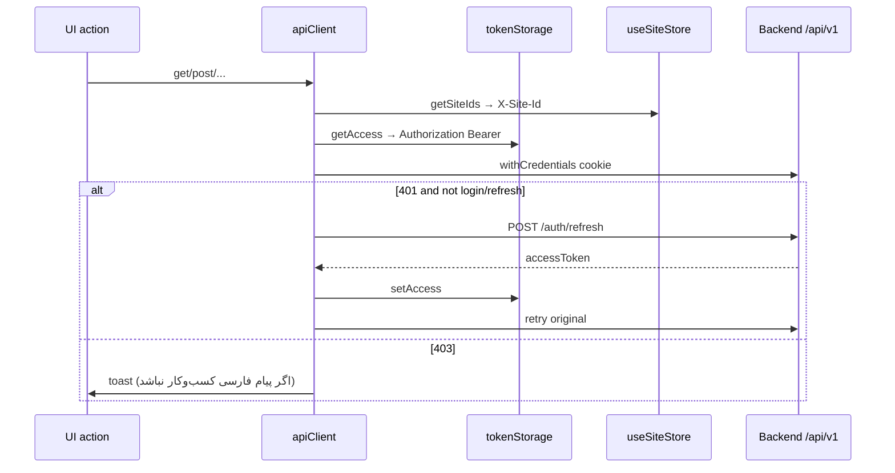

# کلاینت API مشترک و احراز هویت فرانت

شناسهٔ کاتالوگ: `25-api-client-auth`.

ارجاع: [05-jwt-identity](05-jwt-identity.md)، [06-tenancy-authorization](06-tenancy-authorization.md)، [23-nextjs](23-nextjs.md)، [24-vite-access-control](24-vite-access-control.md)، [00-login-execution-path](00-login-execution-path.md)، [26-client-state](26-client-state.md) (آینده).

مسیرهای فرانت نسبت به `dejban_frontend_new` هستند. اپ و درخواست HTTP زنده اجرا نشدند. درس‌های `17`/`18` و flowهای اختصاصی دستگاه خارج از محدوده می‌مانند.

## 1. نقش پکیج‌های مشترک

سه لایه در workspace دیده می‌شود:

| پکیج / مسیر | نقش verified |
|---|---|
| `@repo/api-client` | Axios مشترک، `tokenStorage`، refresh روی 401، retry امن، helpers (`fetcher`/`createItem`/…) |
| `@repo/auth` | `AuthProvider` / `useAuth`: state کاربر، claims، `checkUserSession` → `GET /auth/getme` |
| `@repo/ui` (auth) | re-export provider؛ `AuthGuard` / `GuestGuard` / `PageGuard`؛ `signInWithPassword` در `auth/context/jwt/action.js`؛ `useSiteStore` برای `X-Site-Id` |
| `@repo/config` | `createAppConfig` + `ConfigRegistry` برای `serverUrl` و مسیر ورود |

`@repo/ui/auth-context-jwt` فقط `export { AuthProvider } from '@repo/auth'` است. هوک UI: `useAuthContext` = `useAuth` از `@repo/auth`.

اپ‌ها `apiClient` را معمولاً از `@repo/api-client` (گاهی از `src/lib/api.js` که re-export می‌کند) مصرف می‌کنند؛ instance واحد: `export const apiClient = createApiClient(resolveBaseUrl())`.

## 2. چرخهٔ درخواست

Request interceptor (`createApiClient`):

1. `Accept-Language` از `localStorage.i18nextLng` یا `fa-IR`
2. `X-Site-Id` از `useSiteStore.getState().getSiteIds()` (یا override روی config)
3. مگر URL برابر `endpoints.auth.refresh` باشد: `Authorization: Bearer ${tokenStorage.getAccess()}`
4. نرمال‌سازی ارقام فارسی/عربی در params و body

Response interceptor (خلاصهٔ ترتیب):

1. Retry برای متدهای امن (`GET`/`HEAD`/`OPTIONS`) روی statusهای مشخص یا بدون پاسخ — `apiRetry.ts` (پیش‌فرض max 3، interval 1000ms؛ env `NEXT_PUBLIC_API_RETRY_*` یا `VITE_API_RETRY_*`)
2. `503` → redirect مرورگر به `/error/503?system=…`
3. `401` (غیر login/refresh/public ticket) → یک‌بار refresh با cookie → در موفقیت `setAccess` و retry؛ در شکست 401/403/404 → تلاش `logout` + `tokenStorage.clear()` + `redirectToSignIn`
4. `403` → toast فارسی دسترسی مگر بدنه پیام کسب‌وکار فارسی داشته باشد

**Verified:** refresh خودکار روی 401 پیاده شده است (نه فقط نام نماد).  
**Inference از کامنت سورس:** refresh با cookie httpOnly می‌آید (`withCredentials: true`)؛ refresh token در `localStorage` ذخیره نمی‌شود. مقدار/نام cookie سمت سرور: درس 05 / runtime pending.

## 3. Base URL و JWT

### Base URL

`resolveBaseUrl()`:

1. اگر `process.env.NEXT_PUBLIC_SERVER_URL` باشد (اپ‌های Next)
2. وگرنه `import.meta.env.VITE_SERVER_URL` (Vite)
3. وگرنه `''`

Compose نمونه: `/api/v1` نسبی پشت Nginx. `CONFIG.serverUrl` در `global-config` همان env را نگه می‌دارد؛ خود Axios از `resolveBaseUrl` در زمان import ماژول ساخته می‌شود، نه لزوماً از `ConfigRegistry` (`verified` ساخت instance؛ تغییر دیرهنگام config روی baseURL موجود: inference که اثر ندارد مگر instance تازه).

### Access token

| عمل | نماد |
|---|---|
| کلید | `STORAGE_KEY = 'jwt_access_token'` |
| get/set/clear | `tokenStorage` روی **localStorage** |
| Login | `signInWithPassword` → `POST /auth/login` → در صورت وجود `data.accessToken`، `setAccess` |
| Attach | interceptor request مگر refresh |
| Clear | `signOut` / `AuthProvider.logout` / شکست refresh بحرانی |

ذخیره در localStorage یعنی هر اسکریپت هم‌origin می‌تواند بخواند — **ریسک امنیتی شناخته‌شدهٔ مرورگر**؛ آسیب‌پذیری exploit خاص در این فاز ادعا نمی‌شود.

## 4. State احراز هویت

`AuthProvider` (`packages/auth/src/AuthContext.tsx`):

- Mount → `checkUserSession`
- بدون token → `user=null`، `loading=false`
- با token → `GET endpoints.auth.getMe`؛ از `data` فیلدهای `user`، `siteClaims|SiteClaims|sites|Sites`، `claims`
- `authenticated: !!user` — یعنی **فقط داشتن token کافی نیست**؛ باید user از getMe ست شود
- اگر getMe خطا بدهد: `console.error`؛ token پاک نمی‌شود در این catch؛ `user` می‌تواند null بماند → گاردها کاربر را unauthenticated می‌بینند (`verified` از کد)
- `login(accessToken, user)` → setAccess + setUser + دوباره checkUserSession
- `logout` → POST logout (ignore error) → clear → redirect `/auth/jwt/sign-in`
- همگام‌سازی تب: `storage` event وقتی کلید token پاک شود

Call site ورود در UI: اپ `main` — `JwtSignInView` از **کپی محلی** `apps/main/src/auth/context/jwt/action.js` استفاده می‌کند (متن هم‌ارز `@repo/ui/.../action.js`). بعد از login: `checkUserSession` سپس `router.replace(returnTo || '/')`. Layout ورود با `GuestGuard`.

## 5. گارد مسیر (کلاینت)

| گارد | رفتار |
|---|---|
| `AuthGuard` | تا `loading` تمام شود Splash؛ اگر `!authenticated` → `window.location` به `signInUrl` یا `redirectPath` با `returnTo` |
| `GuestGuard` | اگر authenticated → `router.replace(safeReturnUrl(returnTo, '/'))`؛ جلوگیری از حلقه روی صفحهٔ ورود |
| `PageGuard` / `ComponentGuard` / `RouteAccessGuard` | **authorization** با `claims` و `componentId`؛ نه جایگزینی JWT بک‌اند |

مصرف: داشبورد Next (dejban/gate/dcc) و Vite access-control دور layout با `AuthGuard`؛ صفحهٔ staff دژبان با `PageGuard` (درس 23).

این گاردها **endpoint بک‌اند را محافظت نمی‌کنند**؛ فقط UI. مجوز واقعی روی Identity/Dejban/ACL و YARP است (درس‌های 05–06).

## 6. Authentication در برابر Authorization

- **Authentication:** کیستی کاربر — token + getMe + `authenticated`.
- **Authorization (فرانت):** آیا claim لازم را دارد — `hasComponentAccess(claims, componentId)`.
- **Authorization (بک‌اند):** policy/JWT/tenant — مستقل؛ فرانت ممکن است UI را مخفی کند ولی API را باید سرور رد کند.

`RoleBasedGuard` در UI با کامنت «for reference only» است؛ الگوی اصلی claim-based همان `PageGuard` است.

## 7. خطاها

| وضعیت | رفتار کلاینت |
|---|---|
| Login fail | `signInWithPassword` → `Error` از `title`/`message` |
| UI login | `extractErrorMessage` / `getErrorMessage` |
| 401 → refresh fail | logout attempt + clear + hard redirect sign-in |
| 403 | toast «شما دسترسی لازم را ندارید.» مگر پیام فارسی در body |
| 503 | redirect `/error/503` |
| Network / 5xx روی GET | ممکن است api-retry چند بار تکرار کند؛ 401 در مجموعهٔ permanent است و وارد retry عمومی نمی‌شود |

Public ticket URLها از مسیر 401 refresh و toast 403 مستثنی‌اند (`isPublicTicketRequest`).

## 8. تفاوت مصرف‌کننده‌ها

| موضوع | Next (`main`/dejban/…) | Vite access-control |
|---|---|---|
| Env base | `NEXT_PUBLIC_SERVER_URL` | `VITE_SERVER_URL` |
| Data layer غالب | React Query (+ helpers) | SWR در `src/actions` |
| Login UI | `main` + GuestGuard | ندارد؛ AuthGuard به `/auth/jwt/sign-in` |
| تزریق token dev | — | hash `accessToken` → localStorage در `main.jsx` |
| Provider | همان `@repo/auth` از طریق UI | همان |
| Endpointهای دامنه | `apps/*/src/lib/api.js` گسترش می‌دهد | `access-control/src/lib/api.js` |

هر دو به **یک** `apiClient` و یک کلید localStorage متکی‌اند؛ روی origin مشترک، token بین اپ‌های هم‌origin قابل اشتراک است (inference برای prod پشت یک host؛ runtime pending).

## 9. دو مسیر اجرا (غیر دستگاه)

### A) Login

`main` `sign-in/page` → `JwtSignInView` → `signInWithPassword` → `POST /auth/login` → `tokenStorage.setAccess` → `checkUserSession` → `GET /auth/getme` → state user/claims → navigate.

جزئیات gateway/handler: `00-login-execution-path.md` و درس 05.

### B) درخواست authenticated (نمونهٔ staff یا access-group)

UI → service/SWR → `apiClient`/`fetcher` با Bearer + اختیاری `X-Site-Id` → Nginx `/api/` → YARP → API.  
اگر access منقضی و cookie refresh معتبر باشد، interceptor بدون دخالت UI retry می‌کند (`verified` کد؛ موفقیت زنده pending).

## 10. محدودیت‌ها و ریسک‌ها

| مورد | نوع |
|---|---|
| Access JWT در localStorage | ریسک XSS هم‌origin |
| `authenticated` وابسته به getMe موفق | token یتیم ممکن است تا redirect گارد بماند |
| Hard redirect ثابت `/auth/jwt/sign-in` در interceptor | با basePath اپ‌ها؛ وابسته به routing لبه |
| کپی duplicate `action.js` در `apps/main` | drift احتمالی نسبت به `@repo/ui` |
| apiClient در import-time | SSR بدون `window` در interceptor فقط وقتی request زده شود؛ `localStorage` در request/tokenStorage مرورگر فرض می‌شود |
| Refresh cookie | رفتار دقیق سرور runtime pending |

## 11. ده سؤال مصاحبه

### 1. `@repo/api-client` چه چیزی export می‌کند که همه اپ‌ها مشترک‌اند؟

`apiClient`، `createApiClient`، `tokenStorage`، `endpoints` پایهٔ auth، `fetcher` و CRUD helpers، منطق retry.

### 2. Access token کجا نگه داشته می‌شود و refresh چطور؟

Access در `localStorage` با کلید `jwt_access_token`. Refresh از طریق `POST /auth/refresh` با `withCredentials` (بدون گذاشتن Bearer روی خود refresh)؛ موفقیت → `setAccess` و retry.

**Follow-up:** آیا refresh token در localStorage است؟  
در این پکیج نه؛ فقط access.

### 3. چرا روی درخواست refresh، Authorization ست نمی‌شود؟

شرط صریح: اگر `config.url === endpoints.auth.refresh` باشد، getAccess اعمال نمی‌شود — اتکا به cookie.

### 4. `AuthGuard` چه چیزی را چک می‌کند؟

`authenticated` از context (= وجود `user` بعد از getMe)، نه صرفاً وجود رشتهٔ token.

### 5. فرق AuthGuard با PageGuard؟

Auth = وارد شده یا نه. PageGuard = claim مؤلفه برای مجوز UI.

### 6. آیا گارد فرانت جایگزین authorize بک‌اند است؟

خیر. فقط UX؛ API باید جداگانه authorize شود.

### 7. وقتی 401 می‌آید دقیقاً چه ترتیبی است؟

علامت `_retry`؛ صف مشترک `refreshPromise`؛ post refresh؛ در 200 با `accessToken` ذخیره و تکرار درخواست؛ در شکست قطعی clear و redirect ورود.

### 8. Retry عمومی با refresh چه فرقی دارد؟

Retry در `apiRetry` برای متدهای امن و statusهایی مثل 408/429/5xx است و 401 را permanent می‌داند. مسیر 401 جدا برای refresh است.

### 9. اپ Vite چطور base URL را می‌گیرد؟

`import.meta.env.VITE_SERVER_URL` داخل همان `resolveBaseUrl` بعد از چک Next.

### 10. بعد از login موفق چه stateهایی پر می‌شوند؟

Token در storage؛ سپس getMe → `user`، `siteClaims`، `claims`؛ UI با `authenticated === true` از AuthGuard عبور می‌کند.

**Follow-up:** اگر getMe بعد از login شکست بخورد؟  
در catch فقط log؛ user null می‌ماند؛ گارد احتمالاً دوباره به ورود می‌فرستد — token ممکن است هنوز در localStorage باشد تا clear دیگر.

## 12. خلاصه و چک‌لیست

- [ ] مرز `@repo/api-client` / `@repo/auth` / گاردهای UI را بلدم.  
- [ ] چرخهٔ Bearer + refresh cookie + retry را شرح می‌دهم.  
- [ ] Auth در برابر claim authorization را جدا می‌کنم.  
- [ ] تفاوت Next/Vite در env و data layer را می‌دانم بدون تکرار کل درس 23/24.  
- [ ] ریسک localStorage را بدون ادعای CVE جعلی می‌گویم.

## 13. منابع

- `packages/api-client/src/axiosInstance.ts` — `createApiClient`، `apiClient`، `resolveBaseUrl`، interceptors
- `packages/api-client/src/tokenStorage.ts`، `apiRetry.ts`
- `packages/auth/src/AuthContext.tsx` — `AuthProvider`، `checkUserSession`، `logout`
- `packages/ui/src/auth/context/jwt/{action,auth-provider}.js`
- `packages/ui/src/auth/guard/{auth-guard,guest-guard,component-guard}.jsx`
- `packages/ui/src/auth/utils/site-storage.js` — `useSiteStore`
- `packages/ui/src/auth/hooks/index.js`
- `apps/main/src/auth/view/jwt/jwt-sign-in-view.jsx`، `apps/main/src/auth/context/jwt/action.js`
- `apps/main/src/app/auth/jwt/sign-in/layout.jsx` — `GuestGuard`
- `apps/dejban/src/app/dashboard/layout.jsx`، `apps/access-control/src/routes/sections/dashboard.jsx`
- `docs/technical-learning/00-login-execution-path.md`، `05-jwt-identity.md`
