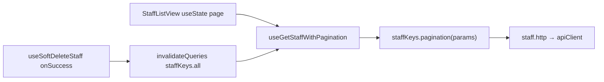

# state سمت کلاینت و server-state

شناسهٔ کاتالوگ: `26-client-state`.

ارجاع: [23-nextjs](23-nextjs.md)، [24-vite-access-control](24-vite-access-control.md)، [25-api-client-auth](25-api-client-auth.md)، [27-mui-i18n](27-mui-i18n.md) (آینده).

مسیرها نسبت به `dejban_frontend_new`. اپ و شبکه زنده اجرا نشدند. `17`/`18` و flowهای اختصاصی دستگاه خارج از محدوده؛ فقط الگوهای عمومی state و مسیرهای غیردستگاهی.

## 1. سه لایهٔ state (با مثال همین مخزن)

| لایه | معنی | مثال verified |
|---|---|---|
| Local UI state | فقط همان کامپوننت/درخت نزدیک | `useState` برای page/search در `AccessGroupListView` یا `StaffListView` |
| Shared client state | بین چند کامپوننت بدون «منبع حقیقت سرور» | `useSiteStore` (سایت انتخابی)، `SettingsProvider` (تم/ناو)، `useWorkspaceTabsStore` (تب‌ها)، `AuthProvider` (user/claims در حافظه) |
| Server state | دادهٔ API که cache/refetch می‌شود | TanStack Query در dejban/gate/dcc/main؛ SWR در access-control actions |

این سه تا یک cache مشترک نیستند. عوض کردن سایت، Query Client را reset می‌کند؛ SWR جدا است و از آن subscribe خبر ندارد (`verified` برای RQ؛ برای SWR+سایت: inference که header عوض می‌شود ولی cache SWR خودکار clear نمی‌شود مگر mutate دستی).

## 2. موجودی مکانیسم‌ها

| مکانیسم | کجا فعال است | شاهد |
|---|---|---|
| TanStack Query v5 | Next: main, dejban, gate, dcc از طریق `ClientProvider` | `@repo/ui/.../client-provider.jsx`؛ `*.service.js` با `useQuery`/`useMutation` |
| SWR | تقریباً فقط access-control `src/actions/*` | `useSWR` + `api.fetcher`؛ **در سورس dejban import از `swr` یافت نشد** با اینکه در `package.json` هست |
| Zustand | dejban stores + workspace-tabs؛ ACL `src/stores/*`؛ مشترک `useSiteStore` | مثلاً `positions-store.js`، `api-key-actions-store.js`، `site-storage.js` |
| React Context | Auth، Settings، Theme، ConfigProvider | درس 25 برای auth؛ Settings با localStorage |
| RHF + Zod | فرم‌های create/edit (مثلاً staff) | state فرم محلی، نه server cache |
| `useState` / hooks مینیمال | همه‌جا | pagination UI، dialog open، debounce |

`ClientProvider` در layoutهای main/dejban/gate/dcc هست. access-control **بدون** `QueryClientProvider` است (`verified` از `app.jsx` درس 24).

## 3. TanStack Query — پیکربندی و رفتار

`ClientProvider`:

- یک `QueryClient` با `defaultOptions.queries.gcTime = 5 * 60 * 1000` (۵ دقیقه)
- پیش‌فرض‌های staleTime/retry سطح provider ست نشده (رفتار پیش‌فرض کتابخانه؛ جزئیات نسخه runtime pending)
- روی تغییر `selectedSiteIds[0]` در `useSiteStore`: `cancelQueries()` سپس `resetQueries()` تا cache سایت قبلی نماند

الگوی سرویس (dejban staff):

- کلیدها در `staff.keys.js`: `staffKeys.all = ['staff']`، `pagination(params)`، `detail(id)`، …
- `useGetStaffWithPagination` → `useQuery({ queryKey: staffKeys.pagination(params), queryFn, placeholderData: previous })`
- Mutations مثل `useCreateStaff` / `useUpdateStaff` / `useSoftDeleteStaff` روی موفقیت: `invalidateQueries({ queryKey: staffKeys.all })` (و گاهی detail/roles)

DCC مشابه: `dccKeys` + invalidate روی upload/delete.

## 4. SWR — پیکربندی و رفتار

در actions ACL، options تکراری:

```js
revalidateIfStale: false,
revalidateOnFocus: false,
revalidateOnReconnect: false,
```

یعنی refetch خودکار با focus/reconnect خاموش است؛ تازه‌سازی عمدتاً با `mutate()` دستی (مثلاً بعد از delete در `AccessGroupListView`: `await localMutate()`).

کلید SWR اغلب آرایهٔ `[endpoint, { params }]` یا رشتهٔ URL است — **همان queryKeyهای RQ نیستند** و cache با RQ اشتراک ندارد.

`SWRConfig` سراسری در access-control یافت نشد.

## 5. Zustand و persistence

| Store | نقش | Persist؟ |
|---|---|---|
| `useSiteStore` | سایت انتخابی → هدر API | بله، `localStorage` کلید `selectedSiteId` |
| `SettingsProvider` / `useLocalStorage` | تم، RTL، `workspaceTabs`، … | بله، `app-settings` |
| `tokenStorage` (درس 25) | access JWT | بله، `jwt_access_token` |
| `useWorkspaceTabsStore` | تب‌های داشبورد dejban | تب‌ها در حافظه؛ `tabStateMap` با TTL ۵ دقیقه — نه localStorage تب‌ها |
| `usePositionStore` و مشابه | fetch داخل action store | نه؛ server data در store (الگوی موازی با RQ) |
| `useAPIKeyActions` | لیست API key در ACL | نه؛ `getAPIKeys` دستی از UI |
| `useCalendarStore` | weekDays/holidays فرم تقویم | state فرم/ویرایش محلی در Zustand |
| `useAccessGroupActions` | fetch گروه‌ها | call site اصلی در UI device؛ create/delete به `endpoints.regions.*` می‌زند — **ناسازگاری سورس** نسبت به نام access-group (فرضیهٔ باگ؛ لیست اصلی از SWR می‌آید) |

## 6. رابطه با auth (کوتاه)

- Session کاربر: Context `@repo/auth` (نه RQ/SWR).
- سایت: Zustand جدا؛ تغییرش RQ را خالی می‌کند.
- Form preferences / client preferences جدا در UI auth services وجود دارد؛ جزئیات deep خارج از تمرکز این درس مگر اینکه state مشترک محسوب شوند.

گاردها از `authenticated`/`claims` می‌خوانند؛ لیست‌ها از cache سرور. اشتباه رایج: فکر کردن که invalidate کردن query معادل logout است — نیست.

## 7. Next در برابر Vite access-control

| | Next apps | access-control |
|---|---|---|
| Server-state غالب | TanStack Query + `*.service.js` + `*.keys.js` | SWR در `actions/` |
| Provider RQ | بله `ClientProvider` | خیر |
| Zustand برای API list | کمتر؛ برخی domain stores موازی | رایج (api-key، …) کنار SWR |
| Site→cache | reset همه queryها | فقط هدر عوض می‌شود تا mutate |
| `swr` در package.json | dejban اعلام کرده ولی import فعال یافت نشد | استفادهٔ فعال |

## 8. دو مسیر اجرا (غیردستگاه)

### A) Staff list + mutation invalidate (dejban / RQ)



1. UI pagination محلی → params به hook  
2. Query cache با کلید شامل params  
3. حذف نرم → invalidate پیشوند `['staff']` → refetch لیست‌های staff  

### B) Access Group list (ACL / SWR) و API Key (ACL / Zustand)

- Access Group: `useGetAccessGroups` → SWR → `mutate` بعد از delete/page change.  
- API Key: `APIKeyListView` → `useAPIKeyActions().getAPIKeys(...)` در `useEffect`/handlers؛ داده در `allAPIKeys` store — **بدون SWR برای این صفحه** (`verified`).

دو سبک server-state در یک اپ Vite هم‌زیست‌اند.

## 9. ناسازگاری‌ها و ریسک‌ها

| یافته | برچسب |
|---|---|
| `swr` در dejban بدون import | dependency بلااستفادهٔ محتمل |
| RQ و SWR cache جدا | confirmed architectural split |
| Zustand ACL گاهی به‌جای SWR برای همان دامنه | الگوی دوگانه؛ access-group store مشکوک به endpoint غلط |
| Site change فقط RQ را reset می‌کند | ریسک stale SWR اگر کاربر سایت را عوض کند داخل ACL بدون remount/mutate |
| `placeholderData` / keep previous | UX نرم؛ ممکن است دادهٔ صفحهٔ قبل لحظه‌ای دیده شود |
| Workspace tab state فقط memory | با refresh مرورگر از بین می‌رود (`verified` ساختار Map) |

## 10. ده سؤال مصاحبه

### 1. فرق server state و client state در این پروژه؟

Server state از API می‌آید و با RQ/SWR cache می‌شود (staff، access groups). Client state مثل سایت انتخابی، تنظیمات UI، و تب‌ها بدون اینکه «لیست سرور» باشند.

### 2. چرا با عوض کردن سایت، Queryها reset می‌شوند؟

چون `X-Site-Id` داده را scope می‌کند؛ `ClientProvider` با subscribe به `useSiteStore` از نشت cache بین سایت‌ها جلوگیری می‌کند.

### 3. آیا SWR و React Query یک cache دارند؟

خیر. دو کتابخانه و دو provider/مدل کلید جدا.

### 4. بعد از create staff چه می‌شود؟

`onSuccess` → `invalidateQueries({ queryKey: staffKeys.all })` تا queryهای زیر `['staff']` دوباره معتبر شوند.

### 5. در access-control چرا focus باعث refetch نمی‌شود؟

`revalidateOnFocus: false` (و stale/reconnect هم false) در options اکشن‌ها.

### 6. API Key list از SWR استفاده می‌کند؟

صفحهٔ list از Zustand `useAPIKeyActions` می‌خواند، نه `useSWR` در آن view.

### 7. Settings کجا persist می‌شود؟

`SettingsProvider` با `useLocalStorage` و کلید `app-settings`؛ شامل مثلاً `workspaceTabs`.

### 8. Auth state داخل React Query است؟

خیر؛ `AuthProvider` / Context. Token جدا در localStorage.

### 9. `placeholderData: (previous) => previous` چه کمکی می‌کند؟

هنگام عوض شدن کلید query (مثلاً صفحهٔ بعد) دادهٔ قبلی را نگه می‌دارد تا پرش خالی کمتر شود.

### 10. یک ریسک معماری dual-fetch در ACL چیست؟

هم SWR و هم Zustand برای دامنه‌های مشابه؛ یا store با endpoint اشتباه — نگهداری سخت و باگ‌های ناهمخوان ممکن است.

**Follow-up:** چطور بفهمیم یک dependency واقعاً استفاده می‌شود؟  
جستجوی import/call site، نه فقط `package.json` (مثال: `swr` در dejban).

## 11. خلاصه و چک‌لیست

- [ ] سه لایه state را با مثال مخزن بلدم.  
- [ ] RQ provider + staff keys/invalidate را شرح می‌دهم.  
- [ ] SWR options و mutate دستی ACL را می‌دانم.  
- [ ] Zustand سایت/تنظیمات/تب/api-key را از هم جدا می‌کنم.  
- [ ] می‌دانم RQ≠SWR cache و site-reset فقط RQ را می‌گیرد.

## 12. منابع

- `packages/ui/src/custom-components/react-query-provider/client-provider.jsx`
- `packages/ui/src/auth/utils/site-storage.js`
- `packages/ui/src/components/settings/context/settings-provider.jsx`، `settings-config.js`
- `apps/dejban/src/services/staff/{staff.service.js,staff.keys.js}`
- `apps/dejban/src/sections/staff/view/staff-list-view.jsx`
- `apps/dejban/src/workspace-tabs/workspace-tabs-store.js`
- `apps/dejban/src/stores/positions-store.js`
- `apps/dcc/src/services/dcc/dcc.service.js`
- `apps/access-control/src/actions/access-group.js`
- `apps/access-control/src/sections/access-group/view/access-group-list-view.jsx`
- `apps/access-control/src/stores/api-key-actions-store.js`، `access-group-actions.js`
- `apps/access-control/src/sections/api-key/view/api-key-list-view.jsx`
- `apps/*/src/app/layout.jsx` — حضور `ClientProvider`
